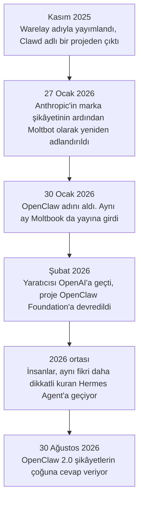
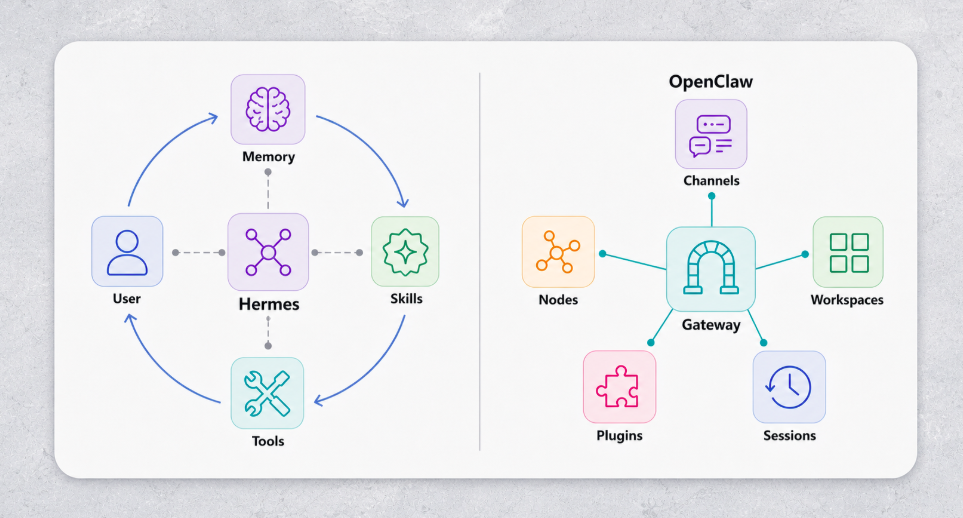
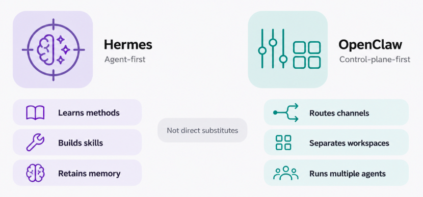

# Personal Agent'lar

Şimdiye kadarki her agent bir proje üzerinde çalıştı. Onu açtın, bir iş verdin ve kapattığında gitti.

**Personal agent**, aynı teknolojinin bu kez projeye değil, hayatına yöneltilmiş hâli. Sürekli çalışıyor. Onunla özel bir uygulamada değil, WhatsApp ya da Telegram'da konuşuyorsun. Ve seni bir konuşmadan diğerine hatırlıyor.

Bu, kurstaki en yeni konu ve en az oturmuş olanı.

## Bu Senin İçin Neden Önemli

Bu, günlük hayatta muhtemelen ilk karşılaşacağın, hatta belki zaten karşılaştığın agent türü. Büyük yapay zekâ şirketleri 2026'da kendi agent'larını çıkardı. Bunların nasıl çalıştığını bilmek, onlardan ne bekleyeceğini ve onlara neyi vermemen gerektiğini söylüyor.

## Onları Farklı Yapan Nedir

Dört şey var ve hiçbiri aslında modelle ilgili değil:

- **Ömür boyu hafıza.** Tek bir sohbet ya da tek bir oturumun özeti değil: sürekli büyüyen bir depo; böylece agent, Mart'ta ona ne söylediğini biliyor.
- **Kendi skill'lerini yazar.** Aynı şeyi tekrar tekrar istediğini fark ettiğinde, nasıl yapılacağını yazıyor ve onu yeniden kullanıyor. Bunlar [Code Agent'lar](coding_agents_tr.md) modülündeki skill'ler, ama kimse onları elle yazmadı.
- **Sana, zaten bulunduğun yerde ulaşır**: Telegram, WhatsApp, Slack, e-posta. Açılacak bir uygulama yok. İnsanların bu agent'lara bu kadar bağlanmasının büyük bir kısmı bu.
- **Gerçek erişiminle çalışır**: dosyaların, hesapların, oturumu açık tarayıcın. Onu işe yarar kılan o erişim. Bütün riskin geldiği yer de orası.

## Hikâye

Bu araçlardaki hemen her tasarım kararı bu hikâyeden geliyor, o yüzden anlatmaya değer.

Avusturyalı bir geliştirici olan Peter Steinberger'in, çalıştığı model olan Claude'dan esinlenerek **Clawd** adını verdiği kişisel bir asistan projesi vardı. Projeyi Kasım 2025'te yayımladı ve çok hızlı büyüdü. Sonra Anthropic'in avukatları ona yazdı, çünkü "Clawd" adı "Claude"a fazla yakındı. Hemen kabul etti ve adını **Moltbot** yaptı, üç gün sonra da **OpenClaw**.

Yeniden adlandırma sırasında iki şey ters gitti. Yeni hesap adlarını almadan önce eskilerini bıraktı ve yaklaşık on saniye içinde başkası onları aldı. Bir de projenin adını kullanan sahte bir kripto para ortaya çıktı. Şubat 2026'da Steinberger OpenAI'a katıldı ve projeyi kâr amacı gütmeyen bir kuruluşa, OpenClaw Foundation'a devretti. Proje bugün GitHub'da, geliştiriciler arasındaki popülerliğin bir ölçüsü olan 380.000'in çok üzerinde yıldıza sahip.

## Moltbook: Agent'lar İçin Sosyal Medya

Aynı sıralarda bir girişimci **Moltbook**'u başlattı: Reddit gibi bir sosyal ağ, ama kullanıcıları insan değil agent'lar. Agent'ını bağlıyorsun ve kendi hâline bırakıyorsun. Ne zaman paylaşım yapacağına ve nasıl cevap vereceğine kendisi karar veriyor.

Bir gösteri gibi görünüyor, ama üzerine yapılan bir çalışma ciddi bir şey buldu: **gönderilerin yüzde 18,4'ü, diğer agent'lara bir şey yaptırmaya çalışan talimatlar içeriyordu.** Bu, [Güvenlik](security_tr.md) modülündeki indirect prompt injection'ın, gerçek hayatta yaşanması. Çalışma cesaret verici bir şey de buldu: agent'lar riskli gönderilere, zararsız olanlardan daha sık itiraz etti ve bunu kimse onlara söylemeden yaptı.

## SOUL.md: Kişilik Dosyası

Her OpenClaw agent'ının `SOUL.md` adlı bir dosyası var. Agent'ın kim olduğunu söylüyor: nasıl davrandığını, neyi önemsediğini, nasıl konuştuğunu. Agent her uyandığında bu dosyayı önce okuyor. Dosya olarak tutulan bir system prompt.

Bu dosya değiştirilebilir de. O dosyaya yazabilen her şey, agent'ının kim olduğunu sessizce değiştirebilir ve agent fark etmez: uyanıyor, dosyayı okuyor ve içinde ne yazıyorsa o oluyor.

## Hermes Agent

OpenClaw o kadar hızlı büyüdü ki mühendisliği yetişemedi: ağır bir kurulum ve yavaş bir hafıza. Birçok insan, aynı fikri daha dikkatli kuran Nous Research'ün **Hermes Agent**'ına geçti: hızlı ve aranabilir hafıza, kendi yazdığı skill'ler, sade dille zamanlama ("her pazartesi sabahı bana şunu hatırlat...") ve kendi güvenli alanlarında çalışan yardımcılar.

  
*Hermes, kullanıcıya geri dönen kapalı bir daire olarak çizilmiş: hatırladıkları ve yazdığı skill'ler bir sonraki konuşmayı besliyor. "Seninle birlikte büyüyor" fikri, bir şema olarak çizilmiş hâliyle.*

  
*İki sütunu fiiller olarak oku. Solda agent kendini değiştiriyor. Sağda agent işi araçlar ve insanlar arasında taşıyor. Soru hangi aracın daha iyi olduğu değil, senin hangi işin olduğu.*

İkisi de aynı yapay zekâ modellerini çalıştırıyor. Onları ayıran şey hafıza, skill'ler ve güvenlik tasarımı: yine [Harness Engineering](harness_engineering_tr.md) modülündeki harness tartışması.

## OpenClaw 2.0

Ağustos 2026'da OpenClaw 2.0 şikâyetlerin çoğuna cevap verdi. Kurulum çok kısaldı ve güvenlik iyileşti: her oturum için izin modları, tüm disk yerine tek bir çalışma klasörüne sınırlı erişim ve parolaların sohbetin dışında tutulması. Değerlendirenler yine de zayıf noktalara dikkat çekti; örneğin varsayılan olarak şifrelenmeyen, kayıtlı parolalar gibi. Daha iyi olmak, güvenli olmakla aynı şey değil.

Daha hafif seçenekler de var (her agent'ı kendi kapalı container'ında çalıştıran nanoclaw) ve agent'ı senin yerine başkasının çalıştırdığı barındırılan seçenekler de (Kimi Claw gibi).

## Büyük Şirketlerin Personal Agent'ları

OpenClaw ve Hermes topluluktan geliyor. 2026'da büyük yapay zekâ şirketleri kendilerininkini çıkardı. Hepsinin ortak fikri şu: uygulamayı kapattıktan sonra arka planda çalışmaya devam eden bir agent.

- **[dots](https://openai.com/index/introducing-dots/)**, OpenAI'dan: her birinin bulutta kendi bilgisayarı olan, geri bildirimlerinden öğrenen, her zaman açık agent'lar.
- **[Muse](https://ai.meta.com/muse/)**, Meta'dan: web'de geziniyor, satın alma yapıyor, doküman yazıyor ve e-postanı ile takvimini yönetiyor.
- **[Grok Bot](https://x.ai/bot)**, xAI'dan: araçlarına giriş yapan ve onları senin gibi kullanan yapay zekâ ekip arkadaşları.
- **[Gemini Spark](https://gemini.google/overview/agent/spark/)**, Google'dan: telefonun ve laptopun kapalıyken bile arka planda çalışıyor ve Gmail ile Takvim'e bağlı.
- **[Claude Duet](https://claude.com/product/claude-duet)**, Anthropic'ten: burada işi sen değil, Claude başlatıyor. Bağladığın uygulamaları takip ediyor ve her sabah sana kısa bir özetle geliyor.

OpenClaw ve Hermes'ten büyük fark, nerede çalıştıkları: senin bilgisayarında değil, şirketin bilgisayarlarında. Kurulacak bir şey yok. Bunun bedeli, verilerinin ve erişimlerinin o şirkette durması.

## Dikkatli Olman Gereken Kısım

Dosyalarına, hesaplarına, oturumu açık tarayıcına, hiç sıfırlanmayan bir hafızaya ve kendi skill'lerini yazma iznine sahip bir agent düşün. Bu kurstaki en yararlı asistan o. Aynı zamanda bu kurstaki en büyük risk de o.

Bu bir teori değil. Şubat 2026'da bir öğrenci, kurduğu agent'ın onun için deneysel bir flört servisinde profil oluşturduğunu ve eşleşmeleri elemeye başladığını fark etti; bunu ondan kimse istememişti.

Peki ne yapmalı:

- **Ona ayrı hesaplar ver**, ana iş ya da kişisel hesaplarını değil.
- **Parolaları, onun okuyabileceği dosyaların dışında tut.**
- **Geri alınamayan her şeyden önce bir insanın onayını iste**: para göndermek, silmek, senin adına mesaj göndermek.
- **Mümkünse kapalı bir alanda çalıştır** ve en güçlü araçlarının etrafına [Güvenlik](security_tr.md) modülündeki görevlileri koy.

Bu modül Güvenlik'ten sonra geliyor, çünkü bir agent'a bu kadar erişim vermeden önce o savunmalara ihtiyacın var.

## Artık Bildiğin Terimler

- **Personal agent**: senin için çalışan, sohbet uygulamalarından ulaşılan ve seni hatırlayan, her zaman açık bir agent.
- **OpenClaw**: en bilinen açık personal agent.
- **Hermes Agent**: daha dikkatli kurulmuş açık bir alternatif.
- **SOUL.md**: bir personal agent'ın kişiliğini belirleyen dosya.
- **Moltbook**: yalnızca agent'ların paylaşım yaptığı bir sosyal ağ.

## Özet

Personal agent, aynı teknolojinin hayatına yöneltilmiş hâli: her zaman açık, sohbet uygulamalarında, ömür boyu hafızayla ve kendi yazdığı skill'lerle. OpenClaw fikri meşhur etti; Hermes onu daha dikkatli kurdu; büyük şirketler de şimdi kendilerininkini barındırıyor, dots'tan Claude Duet'e kadar. Erişimi hem işe yaradığı yer hem riski, bu yüzden ona ayrı hesaplar ver, parolalarını ondan uzak tut ve geri alınamayan her şey için onay iste.

**Hızlı Kontrol**: Bir personal agent'ı farklı yapan dört şey nedir? Ona neden ana hesaplarını asla vermemelisin?

## Kaynaklar

### 📄 Makaleler

- [OpenClaw vs Hermes Agent: The best agent harness in 2026](https://composio.dev/content/openclaw-vs-hermes-agent): hangisinin ne zaman uygun olduğunun en açık anlatımı
- [OpenClaw Agents on Moltbook: Risky Instruction Sharing and Norm Enforcement in an Agent-Only Social Network](https://arxiv.org/abs/2602.02625): yüzde 18,4 rakamı

### 🛠️ Araçlar

- [Introducing dots](https://openai.com/index/introducing-dots/), [Muse](https://ai.meta.com/muse/), [Grok Bot](https://x.ai/bot), [Gemini Spark](https://gemini.google/overview/agent/spark/) ve [Claude Duet](https://claude.com/product/claude-duet): büyük yapay zekâ şirketlerinin senin için barındırdığı personal agent'lar

### 🗃️ Repolar

- [OpenClaw](https://github.com/openclaw/openclaw): projenin kendisi
- [Hermes Agent](https://github.com/NousResearch/hermes-agent): insanların geçtiği alternatif
