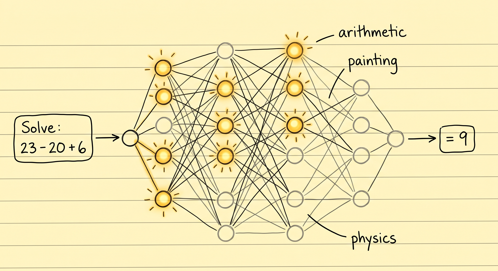
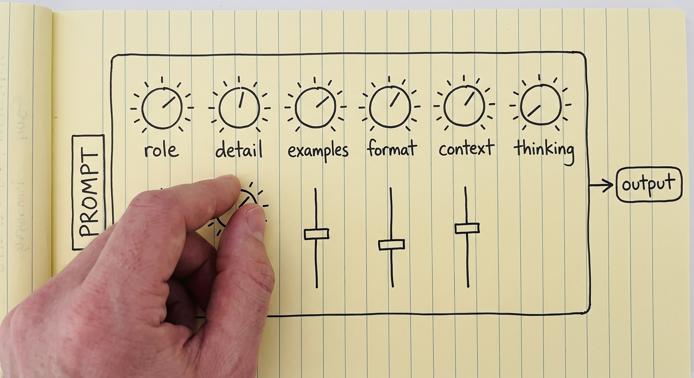
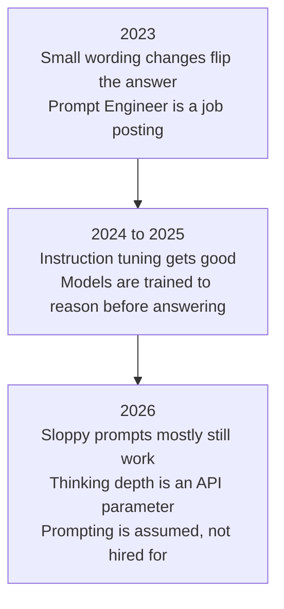
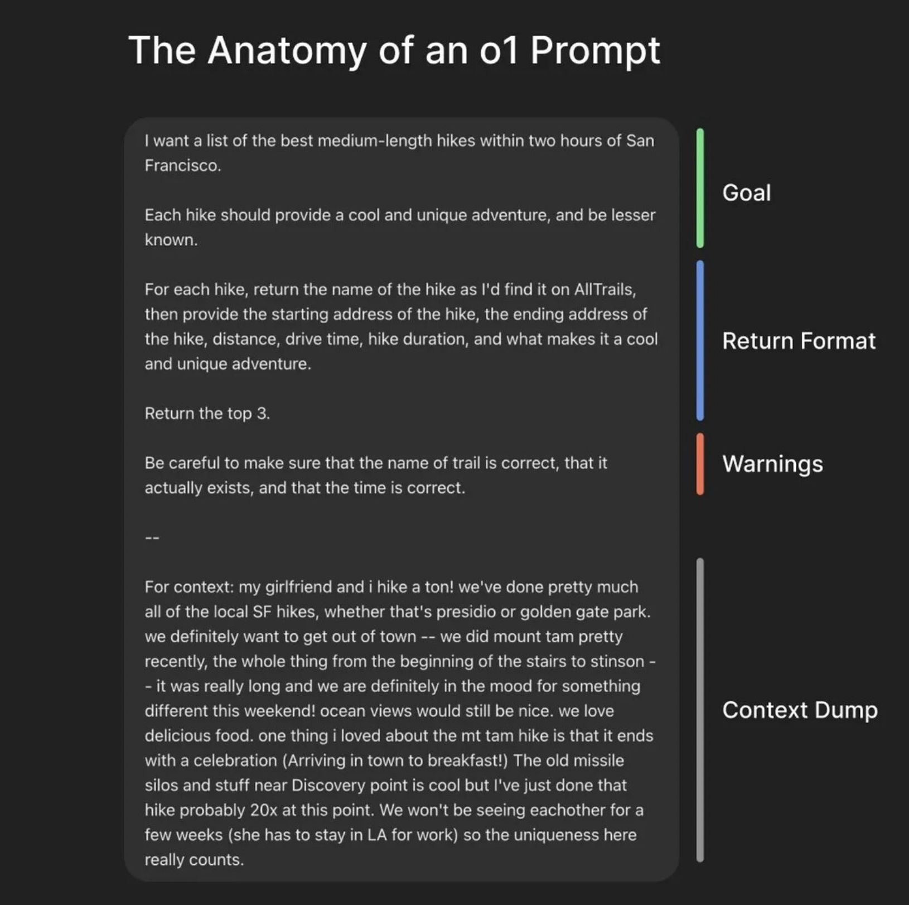
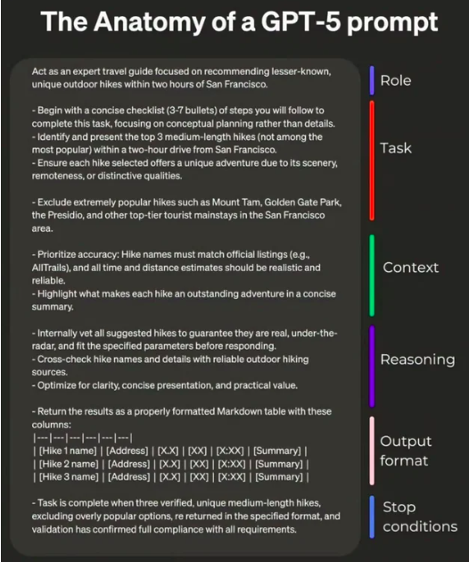
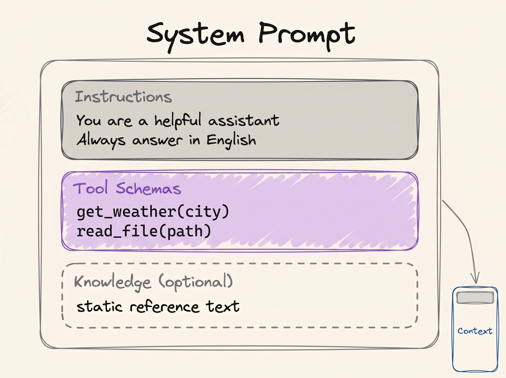

# Prompt Engineering

[LLM Fundamentals](../1_fundamentals/llms.md) ended with one paragraph about prompts. This module
opens that paragraph up.

> **Prompt engineering is writing an input that leads the model to the output you expect.**

The model is fixed. Its numbers do not change while you use it, and it remembers nothing between
messages. So the words you write are the only thing you control. That makes your words the only
thing that decides the quality of the answer.

[LLM Fundamentals](../1_fundamentals/llms.md) wrote down what the model calculates:

```
P(next token | context)
```

Your prompt *is* that context. So the whole job is finding the input that makes the answer you
want the most likely one:

```
best prompt = the prompt that maximises P(the output you want | prompt)
```

If the formulas mean nothing to you, that is fine: the sentence above them says the same thing.

## Why This Matters to You

Most AI requests at work are prompts, so this module applies to them. Every email draft, report,
summary or analysis you ask an AI for gets better when you ask well. And it is now a basic skill
that everyone who works with AI is expected to have, in HR and finance as much as in engineering.

## Why Wording Matters

If the model is fixed and remembers nothing, why do two ways of asking the same question give two
different answers?

Because two wordings are two different inputs. Inside the model is a network, and your words
decide which parts of it become active. Change the words, and you change which parts work on your
question.

  
*The model's numbers are the same in both cases. The prompt only decides which of them get used. That is why the same model answers a maths question with one part of itself and a painting question with another.*

Think of a DJ mixer. It has knobs for volume, bass and echo. The DJ never changes the machine.
They turn the knobs, listen, and turn them again until the room sounds right. Your prompt is one
setting of those knobs.

  
*Every knob here is something this module covers. None of them is on a panel you can touch: the prompt text is the only thing that moves them.*

But the knobs have no labels, and you can only move them with words. That is why prompting is
trial and error, and why nobody can hand you the one correct prompt for your task.

## What a Weak Prompt Costs You

Two drivers drive the same car on the same track and get different lap times. Same engine, same
corners. The better driver gets more out of the same machine.

AI works the same way. Someone with little prompting skill does not get what they wanted, and
decides the AI is weak. Someone else uses the same AI, writes a better prompt, and finishes the
task. So when an AI disappoints you, check your prompt before you switch to another product.

## Prompt Engineering is No Longer a Job Title

Around 2023, AI models were fragile. A small change in wording could turn a good answer into a
wrong one. Companies hired people called **Prompt Engineers** to spend the whole day finding
wordings that worked.

Those days are gone. Models now understand what you meant even from a messy prompt, partly
because they think before they answer (see below). In 2026, prompt engineering is not a career.
It is a basic skill everyone is expected to have.



## Two Prompt Templates

The rule is simple: a clearer and more detailed prompt gets a better answer. Two templates show
what "clear and detailed" means in practice.

The simple one:

```text
{Goal}
{Output Format}
{Warnings}
{Context}
```

- **Goal**: what you want, in a sentence or two.
- **Output format**: the shape of the answer (a table, three bullet points, an email).
- **Warnings**: the mistakes you already expect the AI to make.
- **Context**: everything about your situation that a stranger would need to know to help you.

  
*The context part is the longest and the least polished, and that is fine. It is the part no template can write for you.*

The detailed one:

```text
{Role}
{Task}
{Context}
{Reasoning}
{Output Format}
{Stop Conditions}
```

- **Role**: who the AI should be while it works (more on this below).
- **Task**: the work itself, as numbered steps when the order matters.
- **Context**: background, limits, and what to avoid.
- **Reasoning**: how you want the AI to think before it answers.
- **Output format**: the exact shape, including table columns if you need them.
- **Stop conditions**: how the AI knows it is finished.

  
*Stop conditions are the part people forget. Without one, "done" is the AI's guess, not your definition.*

You do not have to follow either template strictly. They are here so that "write a clear prompt"
is no longer vague advice.

## Learning from Examples

An AI can learn something new from what is in the chat right now, without any training. This is
called **in-context learning** (ICL). It is also why [RAG](../1_fundamentals/rag.md) works: the
documents go into the chat, and the AI uses them at once.

It gives you a technique: **few-shot prompting**. Show the AI a few examples of the task done
right, then give it the real one:

```text
Classify the sentiment of each message as positive, negative or neutral.

Message: "the package arrived two days early"
Sentiment: positive

Message: "the box was crushed and the mug inside was broken"
Sentiment: negative

Message: "delivery is scheduled for Thursday"
Sentiment: neutral

Message: "it works, but the app crashed twice"
Sentiment:
```

The three examples do two jobs. They fix the possible answers to three words, and they fix the
format, so the answer comes back as `Sentiment: <label>`. Using a few examples is **few-shot**.
Using none is **zero-shot**, which is what you do every time you type a plain question.

## Three Tips

### Be Clear and Direct

Less effective:

```text
Create an analytics dashboard
```

More effective:

```text
Create an analytics dashboard. Include as many relevant features and interactions as possible. Go beyond the basics to create a fully-featured implementation.
```

The difference is not politeness. The second one says much more about what "finished" looks like.

### Give Your Reasons

Tell the AI *why* a rule exists, not only the rule.

Less effective:

```text
NEVER use ellipses
```

More effective:

```text
Your response will be read aloud by a text-to-speech engine, so never use ellipses since the text-to-speech engine will not know how to pronounce them.
```

With the reason, the AI can also avoid other things that would cause the same problem, even ones
you did not list.

### Give the Prompt a Structure

Split a long prompt into labelled parts, so the AI can tell which part is an instruction, which
part is data, and which part describes the answer. Headings work well:

```markdown
## Identity
You are a support engineer for a company that hosts Postgres databases.

## Goal
Decide whether the ticket below is a billing question, a technical question, or both.

### How to do it
Read the whole ticket first. Ignore the customer's own guess about the cause.

## Output format
One line: BILLING, TECHNICAL or BOTH, followed by a one-sentence reason.
```

Structure matters most when you paste other people's text into a prompt:

```text
Please read the emails below from my boss and my friend:

=== Boss Email ===
Write down the report of what you have done.

=== Friend Email ===
Write a poem for me.

=== Your Task ===
Please write a polite reply to both emails.
```

Without the labels, "Write a poem for me" looks exactly like an instruction from you, and the AI
may write the poem. Pasted text can even be written on purpose to trick the AI. That attack is
called **prompt injection**, and the [Security](security.md) module covers it.

## Thinking Out Loud (Chain of Thought)

A model gives better answers when it writes the steps down *before* the final answer, the same way
you do arithmetic better on paper than in your head. This is called **chain of thought**.

Ask a model:

```text
The cafeteria had 23 apples. They used 20 for lunch and bought 6 more. How many now?
```

Asked to answer at once, it can get it wrong:

```text
Final Answer: 32 apples
```

Asked to think first:

```text
<thinking>
The user wants the final number of apples in the cafeteria. Steps:
start with the initial number, subtract the apples used for lunch, add the apples bought later.

Initial apples: 23. Apples used for lunch: 20. Apples bought: 6.

Step 1: apples remaining after lunch. 23 - 20 = 3 apples.
Step 2: final number after buying more. 3 + 6 = 9 apples.
</thinking>

Final Answer: 9 apples
```

Why does this work? The model writes one word at a time, and every word it writes becomes part of
what it reads next. Once it has written "23 - 20 = 3", that result is on the page, and it does not
have to hold it in its head. So writing the steps down helps the model get them right. The author of this course built a
[Chain of Thought Visualizer](https://cot-visualizer.online/) where you can watch the two side by
side.

### Thinking is Now a Dial

Today you almost never write "think step by step" yourself. When ChatGPT or Claude shows that it
is "thinking", that is chain of thought, built into the model. How much it thinks is now a
setting, often called **effort**, from low to max. More thinking gives better answers on hard
problems, but it costs more and takes longer.

> **NOTE: more thinking is not always better.** Like people, models can overthink, and their
> answers get worse. Research on this is collected in
> [Stop Overthinking](https://arxiv.org/abs/2503.16419). The skill is matching the thinking to how
> hard the task is.

## Giving the AI a Role

**Role prompting** means giving the AI a job or a character before the task.

> **NOTE: what is a system prompt?** The system prompt sits once at the very top of the chat and
> sets how the AI behaves for the whole conversation. The company or developer that built the
> product writes it, not the user, and it is usually long. It also lists the tools the AI may use
> ([Tool Calling](../1_fundamentals/tools.md)).

  
*The same figure as in LLM Fundamentals. A role goes into the identity and instructions part. Everything in this box is written before the user says anything.*

A role usually works best in the system prompt. The technique itself is simple:

```text
Act as a senior software engineer. Review this code and find security bugs.
```

```text
You are William Shakespeare. Write a short poem about summer.
```

A role does two things well. It sets the point of view (an HR manager, a chef, an interviewer),
and it shapes the tone and the vocabulary. But **a role does not make the AI smarter.** Research
found that a persona does not improve answers in general. Use a role to shape *how* the answer
reads, not to raise what the AI can do.

Roles matter most when you build agents. Designing an agent mostly means choosing a system prompt
and a set of tools for one job. For example, an HR team of three agents:

1. **CV Screening Agent.** Instructions: read each CV against the job description and list how
   well the candidate matches each requirement. Do not judge age, gender or photos. Tools:
   `read_cv`, `read_job_description`.
2. **Interview Question Agent.** Instructions: write interview questions that test the
   requirements the CV did not prove. Do not repeat what the CV already shows. Tools:
   `read_screening_notes`.
3. **Offer Letter Agent.** Instructions: write the offer letter in the company's standard format,
   with the agreed salary and start date. Do not change any number you were given. Tools:
   `read_offer_details`, `fill_letter_template`.

These are three different agents, but all three run on the same model. Only the role, the
instructions and the tools differ. The team shapes in
[Multi-Agent Systems](../1_fundamentals/multi_agent.md) assume exactly this.

One warning. A role changes all of the AI's behaviour, not only the part you wanted. Give it a
security-expert role and then ask about art history, and the answer can be worse than with no role
at all. Back to the mixer: the role turned some knobs up and others down, and the knobs you turned
down stay down when the question changes.

## Words You Now Know

- **Prompt engineering**: writing your input so you get the output you want.
- **In-context learning** (ICL): the AI learning from what is in the chat right now.
- **Few-shot** and **zero-shot**: a prompt with a few examples, or with none.
- **Prompt injection**: hidden instructions in pasted text that try to take over the AI.
- **Chain of thought**: the AI writing its steps before the answer.
- **Effort**: the setting for how much the AI thinks.
- **Role prompting**: giving the AI a job or character.
- **System prompt**: the instructions at the top of the chat, written by the product's maker.

## Summary

The model is fixed, so your words are the only thing you control. Say the goal, the format, the
warnings and the context. Show examples when the format matters. Label the parts of a long prompt.
Let the AI think on hard problems, but not on easy ones. Use a role for tone and point of view,
and remember it does not make the AI smarter.

Next: context engineering, which is about everything else in the chat, not only your prompt.

**Quick check**: Why do two wordings of the same question give two different answers? What does a
few-shot prompt add? And what can a role not do?

## References

### 📄 Articles

- [Prompt Engineering Guide](https://www.promptingguide.ai/): the full catalogue of techniques, much more than we covered
- [Prompting best practices](https://platform.claude.com/docs/en/build-with-claude/prompt-engineering/claude-prompting-best-practices): Anthropic's guidance, and the source of the before-and-after examples
- [Stop Overthinking: A Survey on Efficient Reasoning for Large Language Models](https://arxiv.org/abs/2503.16419): the research on overthinking, in one place
- [When "A Helpful Assistant" Is Not Really Helpful](https://arxiv.org/abs/2311.10054): the study that showed persona prompts help less than people hoped

### 🛠️ Tools

- [Chain of Thought Visualizer](https://cot-visualizer.online/): reasoning next to answering at once, side by side

### 🗃️ Repositories

- [System prompt leaks](https://github.com/asgeirtj/system_prompts_leaks): real system prompts from AI products
