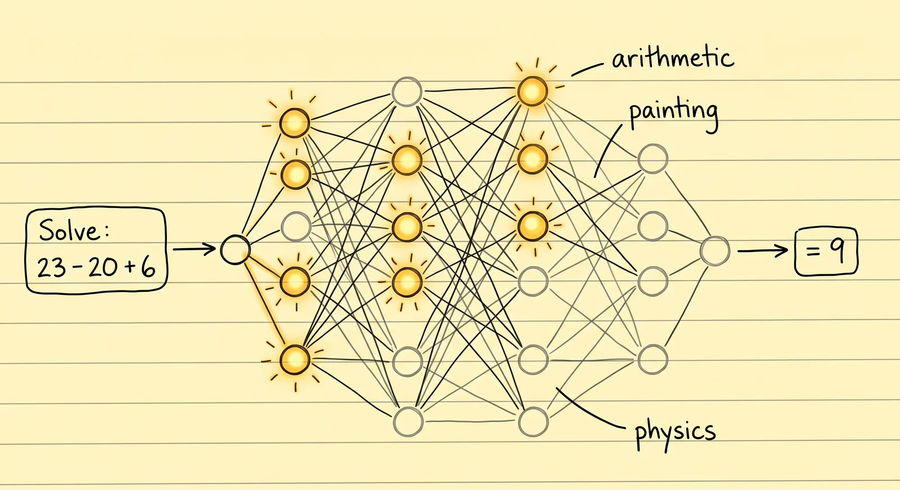
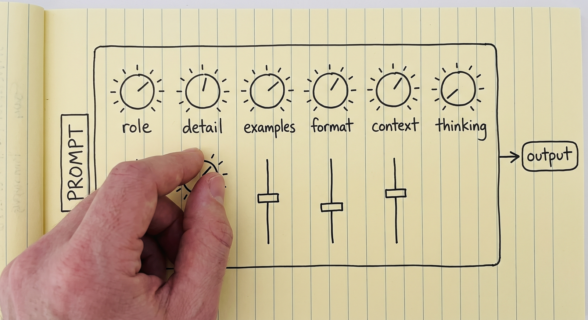
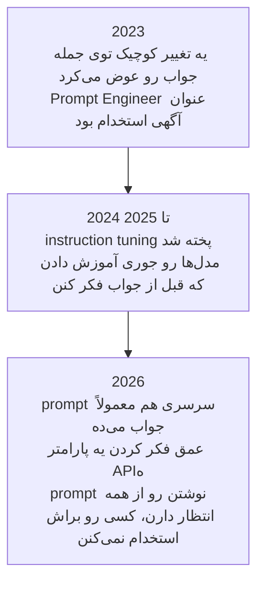
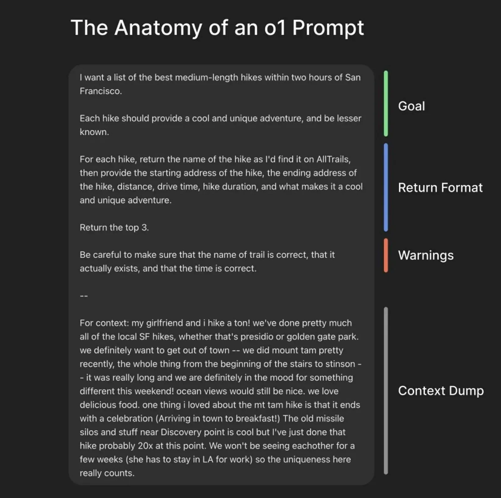
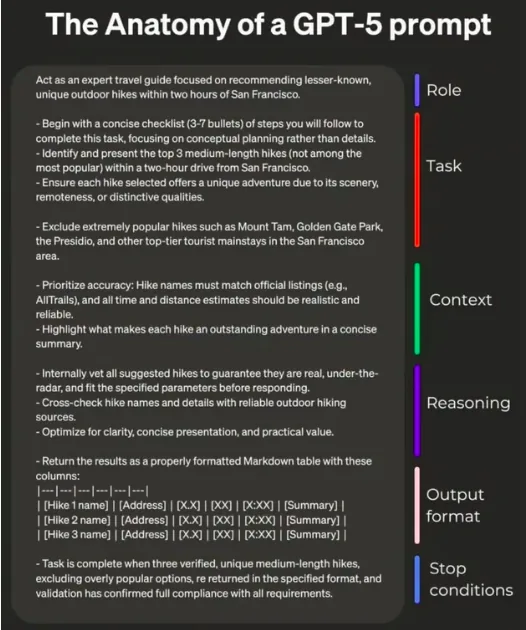
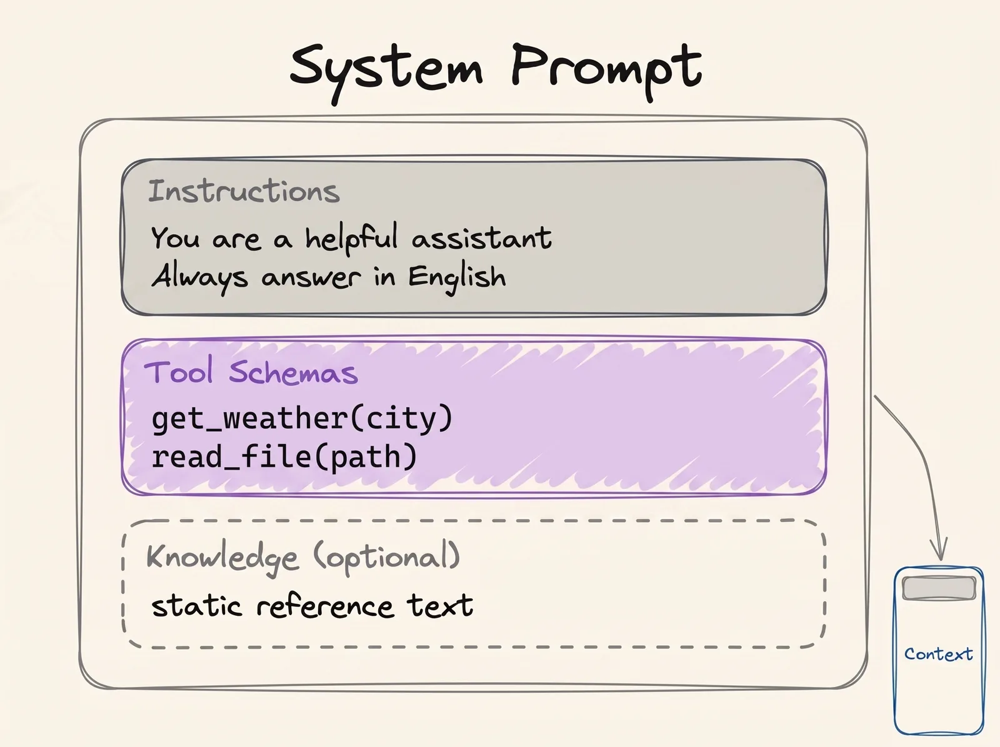

# Prompt Engineering

درس [مبانی LLM](../1_fundamentals/llms_fa.md) آخرش یه پاراگراف درباره‌ی prompt‌ها داشت. این درس همون پاراگرافه که حالا بازش می‌کنیم.

> **Prompt engineering یعنی ورودی رو جوری بنویسی که مدل به همون خروجی‌ای برسه که انتظارش رو داری.**

مدل ثابته. عددهای داخلش وقتی ازش استفاده می‌کنی عوض نمی‌شن و بین دو پیام هیچی یادش نمی‌مونه. پس تنها چیزی که دست توئه همون کلمه‌هاییه که می‌نویسی، و کیفیت جواب هم فقط به همین‌ها بستگی داره.

توی [مبانی LLM](../1_fundamentals/llms_fa.md) دیدیم مدل دقیقاً چی رو حساب می‌کنه:

```
P(next token | context)
```

prompt تو *همون* context‌ه. پس کل کار اینه که ورودی‌ای پیدا کنی که جوابِ دلخواهت رو محتمل‌ترین جواب کنه:

```
best prompt = the prompt that maximises P(the output you want | prompt)
```

اگه فرمول‌ها برات معنی نداره، اشکالی نداره: جمله‌ی بالاشون همین رو می‌گه.

## چرا این برای تو مهمه

بیشتر درخواست‌هایی که سر کار از AI داری، یه prompt‌ان، پس این درس به همه‌شون مربوط می‌شه. هر ایمیلی، گزارشی، خلاصه‌ای یا تحلیلی که از یه AI می‌خوای، وقتی خوب بخوایش بهتر درمیاد. و الان این یه مهارت پایه‌ست که از همه‌ی آدم‌هایی که با AI کار می‌کنن انتظار دارن، چه توی منابع انسانی و مالی، چه توی مهندسی.

## اصلاً چرا prompt engineering لازمه؟

اگه مدل ثابته و چیزی یادش نمی‌مونه، چرا یه سوال رو دو جور می‌پرسی و دو تا جواب متفاوت می‌گیری؟

چون دو جور پرسیدن یعنی دو تا ورودی متفاوت. توی مدل یه شبکه هست و کلمه‌های تو تعیین می‌کنن کدوم قسمت‌هاش فعال بشن. کلمه‌ها رو عوض کنی، قسمت‌هایی که روی سوالت کار می‌کنن هم عوض می‌شن.

  
*عددهای مدل توی هر دو حالت یکی‌ان. prompt فقط تعیین می‌کنه کدومشون به کار بیفتن. برای همینه که یه مدل واحد، سوال ریاضی رو با یه بخش از خودش جواب می‌ده و سوال نقاشی رو با یه بخش دیگه.*

یه میکسر DJ رو تصور کن که برای صدا، بیس و اکو هر کدوم یه پیچ داره. DJ هیچ‌وقت دست به خود دستگاه نمی‌زنه. پیچ‌ها رو می‌چرخونه، گوش می‌ده و دوباره می‌چرخونه، تا صدای سالن جور بشه. prompt تو هم یه حالت از همین پیچ‌هاست.

  
*هر پیچی که این‌جا می‌بینی، یکی از موضوع‌های همین درسه. هیچ‌کدومشون روی پنلی نیست که دستت بهش برسه، و تنها چیزی که می‌چرخونه‌شون متن prompt‌ه.*

ولی روی پیچ‌ها هیچی ننوشته و فقط با کلمه می‌شه چرخوندشون. برای همینه که prompt نوشتن آزمون و خطاست، و هیچ‌کس نمی‌تونه یه prompt درست رو برای کار تو از قبل دستت بده.

## یه prompt ضعیف چقدر گرون تموم می‌شه

دو تا راننده با یه ماشین توی یه پیست می‌رونن و هر کدوم یه زمان دیگه می‌گیرن. موتور یکیه، پیچ‌های پیست هم همون‌ان. راننده‌ی بهتر فقط بیشتر از همون ماشین کار می‌کشه.

AI هم همین‌طوره. کسی که prompt نوشتن رو خوب بلد نیست، به چیزی که می‌خواست نمی‌رسه و فکر می‌کنه AI ضعیفه. یکی دیگه همون AI رو برمی‌داره، prompt بهتری می‌نویسه و کار رو تموم می‌کنه. پس وقتی یه AI ناامیدت کرد، قبل از این‌که بری سراغ یه محصول دیگه، اول prompt خودت رو نگاه کن.

## prompt engineering توی 2026 مرده

حدود سال 2023 مدل‌های AI خیلی شکننده بودن. یه تغییر کوچیک توی جمله‌بندی می‌تونست یه جواب خوب رو غلط کنه. شرکت‌ها آدم‌هایی به اسم **Prompt Engineer** استخدام می‌کردن که تمام روز دنبال جمله‌بندی‌ای بگردن که جواب بده.

اون دوره تموم شد. مدل‌ها الان حتی از یه prompt شلخته هم می‌فهمن منظورت چی بوده، یه بخشش هم به این دلیله که قبل از جواب دادن فکر می‌کنن (پایین‌تر می‌بینی). توی 2026 prompt engineering یه شغل نیست. یه مهارت پایه‌ست که از همه انتظار دارن بلد باشن.



## دو تا قالب prompt

قاعده ساده‌ست: prompt هر چی روشن‌تر و مفصل‌تر باشه، جواب بهتری می‌گیری. دو تا الگو نشون می‌دن «روشن و مفصل» در عمل یعنی چی.

الگوی ساده:

```text
{Goal}
{Output Format}
{Warnings}
{Context}
```

- **Goal** (هدف): چی می‌خوای، توی یکی دو جمله.
- **Output format** (قالب خروجی): شکل جواب (یه جدول، سه تا بولت، یه ایمیل).
- **Warnings** (هشدارها): اشتباه‌هایی که از قبل می‌دونی AI احتمالاً می‌کنه.
- **Context** (زمینه): هر چیزی درباره‌ی وضعیتت که یه غریبه باید بدونه تا بتونه کمکت کنه.

  
*بخش context از همه درازتره و از همه بی‌نظم‌تر، و اشکالی هم نداره. این همون بخشیه که هیچ الگویی نمی‌تونه جات بنویسه.*

الگوی مفصل:

```text
{Role}
{Task}
{Context}
{Reasoning}
{Output Format}
{Stop Conditions}
```

- **Role** (نقش): AI موقع کار کردن باید کی باشه (پایین‌تر بیشتر می‌گم).
- **Task** (کار): خود کار، اگه ترتیب مهمه به شکل قدم‌های شماره‌دار.
- **Context** (زمینه): پیش‌زمینه، محدودیت‌ها، و چیزهایی که باید ازشون دوری کنه.
- **Reasoning** (استدلال): دوست داری AI قبل از جواب دادن چطور فکر کنه.
- **Output format** (قالب خروجی): شکل دقیق جواب، با ستون‌های جدول اگه لازم داری.
- **Stop conditions** (شرط‌های توقف): AI از کجا بفهمه کار تموم شده.

  
*شرط توقف همون چیزیه که آدم‌ها یادشون می‌ره. بدونش، «تموم شد» حدس خود AI‌ه، نه تعریف تو.*

لازم نیست هیچ‌کدوم از این دو تا الگو رو دقیق رعایت کنی. فقط این‌جان که «prompt روشن بنویس» دیگه یه توصیه‌ی مبهم نباشه.

## In-context Learning و Few-shot Prompting

یه AI می‌تونه از چیزی که همین الان توی چت هست یه چیز تازه یاد بگیره، بدون هیچ آموزشی. اسمش **in-context learning** (یادگیری از روی context)ه یا همون ICL. برای همینه که [RAG](../1_fundamentals/rag_fa.md) کار می‌کنه: سندها می‌رن توی چت و AI همون لحظه ازشون استفاده می‌کنه.

از همین یه تکنیک درمیاد: **few-shot prompting**. چند تا مثال از کاری که درست انجام شده به AI نشون بده، بعد کار واقعی رو بده دستش:

```text
Classify the sentiment of each message as positive, negative or neutral.

Message: "the package arrived two days early"
Sentiment: positive

Message: "the box was crushed and the mug inside was broken"
Sentiment: negative

Message: "delivery is scheduled for Thursday"
Sentiment: neutral

Message: "it works, but the app crashed twice"
Sentiment:
```

این سه تا مثال دو تا کار می‌کنن. جواب‌های ممکن رو به سه تا کلمه محدود می‌کنن، و قالب رو هم ثابت می‌کنن، که جواب به شکل `Sentiment: <label>` برگرده. وقتی چند تا مثال می‌دی اسمش **few-shot**ه. وقتی هیچ مثالی نمی‌دی **zero-shot**ه، و هر بار که یه سوال ساده تایپ می‌کنی همین کار رو می‌کنی.

## چند تا ترفند برای prompt نوشتن

### واضح و رک بگو چی می‌خوای

اثر کمتر:

```text
Create an analytics dashboard
```

اثر بیشتر:

```text
Create an analytics dashboard. Include as many relevant features and interactions as possible. Go beyond the basics to create a fully-featured implementation.
```

فرقشون مؤدب بودن نیست. دومی خیلی بیشتر می‌گه «تموم‌شده» یعنی چی.

### context بده، دلیلت رو هم بگو

به AI بگو یه قانون *چرا* هست، نه فقط خود قانون.

اثر کمتر:

```text
NEVER use ellipses
```

اثر بیشتر:

```text
Your response will be read aloud by a text-to-speech engine, so never use ellipses since the text-to-speech engine will not know how to pronounce them.
```

وقتی دلیل رو بدونه، از کارهای دیگه‌ای هم که همون مشکل رو درست می‌کنن دوری می‌کنه، حتی اگه توی فهرستت نبوده باشن.

### به prompt ساختار بده

یه prompt بلند رو به بخش‌های برچسب‌دار تقسیم کن، که AI بفهمه کدوم بخش دستوره، کدوم داده‌ست و کدوم شکل جواب رو توضیح می‌ده. تیتر گذاشتن خوب جواب می‌ده:

```markdown
## Identity
You are a support engineer for a company that hosts Postgres databases.

## Goal
Decide whether the ticket below is a billing question, a technical question, or both.

### How to do it
Read the whole ticket first. Ignore the customer's own guess about the cause.

## Output format
One line: BILLING, TECHNICAL or BOTH, followed by a one-sentence reason.
```

وقتی متن دیگران رو توی prompt می‌چسبونی ساختار از همه‌جا مهم‌تره:

```text
Please read the emails below from my boss and my friend:

=== Boss Email ===
Write down the report of what you have done.

=== Friend Email ===
Write a poem for me.

=== Your Task ===
Please write a polite reply to both emails.
```

بدون برچسب‌ها، «Write a poem for me» دقیقاً شبیه یه دستور از طرف توئه و AI ممکنه شعر بنویسه. حتی ممکنه یکی عمداً یه متن بنویسه که AI رو گول بزنه. اسم این حمله **prompt injection**ه و درس [امنیت](security_fa.md) سراغش می‌ره.

## Chain of Thought

مدل وقتی قدم‌ها رو *قبل* از جواب نهایی بنویسه، جواب بهتری می‌ده، درست مثل این‌که حساب و کتاب رو روی کاغذ بهتر از توی ذهنت انجام می‌دی. اسمش **chain of thought**ه.

از یه مدل بپرس:

```text
The cafeteria had 23 apples. They used 20 for lunch and bought 6 more. How many now?
```

اگه بخوای یه‌راست جواب بده، ممکنه غلط بگه:

```text
Final Answer: 32 apples
```

اگه بگی اول فکر کنه:

```text
<thinking>
The user wants the final number of apples in the cafeteria. Steps:
start with the initial number, subtract the apples used for lunch, add the apples bought later.

Initial apples: 23. Apples used for lunch: 20. Apples bought: 6.

Step 1: apples remaining after lunch. 23 - 20 = 3 apples.
Step 2: final number after buying more. 3 + 6 = 9 apples.
</thinking>

Final Answer: 9 apples
```

چرا این کار می‌کنه؟ مدل کلمه‌ها رو یکی‌یکی می‌نویسه، و هر کلمه‌ای که می‌نویسه جزو چیزیه که بعداً می‌خونه. وقتی «23 - 20 = 3» رو نوشت، اون نتیجه روی صفحه‌ست و لازم نیست توی ذهنش نگهش داره. برای همین نوشتن قدم‌ها به مدل کمک می‌کنه درستشون دربیاره. نویسنده‌ی این دوره یه [Chain of Thought Visualizer](https://cot-visualizer.online/) ساخته که می‌تونی این دو حالت رو کنار هم ببینی.

### Chain of Thought همون چیزیه که اون عنوان شغلی رو از بین برد

امروز تقریباً هیچ‌وقت لازم نیست خودت بنویسی «قدم‌به‌قدم فکر کن». وقتی ChatGPT یا Claude نشون می‌ده که داره «فکر می‌کنه»، همون chain of thought‌ه که توی خود مدل گذاشتنش. این‌که چقدر فکر کنه هم الان یه تنظیمه، که معمولاً بهش می‌گن **effort**، از low تا max. فکر کردن بیشتر توی مسئله‌های سخت جواب بهتر می‌ده، ولی گرون‌تر تموم می‌شه و بیشتر طول می‌کشه.

> **نکته:** بیشتر فکر کردن همیشه بهتر نیست. مدل‌ها هم مثل آدم‌ها ممکنه زیادی فکر کنن و جوابشون بدتر بشه. پژوهش‌های این موضوع توی [Stop Overthinking](https://arxiv.org/abs/2503.16419) جمع شده. مهارت اینه که میزان فکر کردن رو با سختی کار جور کنی.

## Role Prompting

**Role prompting** یعنی قبل از کار، یه شغل یا یه شخصیت به AI بدی.

> **نکته:** system prompt چیه؟ system prompt یه بار، اون بالای بالای چت می‌شینه و رفتار AI رو برای کل گفت‌وگو تعیین می‌کنه. شرکت یا developer‌ای که محصول رو ساخته می‌نویسدش، نه کاربر، و معمولاً هم بلنده. فهرست ابزارهایی که AI اجازه داره ازشون استفاده کنه هم توشه ([Tool Calling](../1_fundamentals/tools_fa.md)).

  
*همون شکلی که توی مبانی LLM بود. نقش می‌ره توی بخش هویت و دستورها. هر چی توی این کادره، قبل از این‌که کاربر چیزی بگه نوشته شده.*

نقش معمولاً توی system prompt بهتر کار می‌کنه. خود تکنیک ساده‌ست:

```text
Act as a senior software engineer. Review this code and find security bugs.
```

```text
You are William Shakespeare. Write a short poem about summer.
```

نقش دو کار رو خوب انجام می‌ده. زاویه‌ی دید رو تعیین می‌کنه (مدیر منابع انسانی، آشپز، مصاحبه‌کننده) و لحن و واژگان رو شکل می‌ده. ولی **نقش، AI رو باهوش‌تر نمی‌کنه.** پژوهش‌ها نشون دادن که persona در کل جواب‌ها رو بهتر نمی‌کنه. نقش رو برای این بگیر که جواب *چطور* خونده بشه، نه برای این‌که AI بیشتر از قبل بتونه.

نقش وقتی agent می‌سازی از همه‌جا مهم‌تره. طراحی یه agent بیشتر یعنی انتخاب یه system prompt و یه مجموعه ابزار برای یه کار. مثلاً یه تیم منابع انسانی با سه تا agent:

1. **Agent غربالگری رزومه.** دستور: هر رزومه رو با شرح شغل مقایسه کن و بنویس نامزد هر کدوم از الزام‌ها رو تا چه حد داره. درباره‌ی سن، جنسیت یا عکس قضاوت نکن. ابزارها: `read_cv`، `read_job_description`.
2. **Agent سوال‌های مصاحبه.** دستور: سوال‌هایی بنویس که الزام‌هایی رو بسنجه که رزومه ثابت نکرده. چیزی رو که رزومه از قبل نشون داده تکرار نکن. ابزارها: `read_screening_notes`.
3. **Agent نامه‌ی پیشنهاد کار.** دستور: نامه‌ی پیشنهاد رو با قالب استاندارد شرکت بنویس، با حقوق و تاریخ شروعی که توافق شده. هیچ عددی رو که بهت داده شده عوض نکن. ابزارها: `read_offer_details`، `fill_letter_template`.

این‌ها سه تا agent متفاوتن، ولی هر سه روی یه مدل واحد اجرا می‌شن. فقط نقش، دستورها و ابزارها فرق دارن. شکل‌های تیمی توی [Multi-Agent Systems](../1_fundamentals/multi_agent_fa.md) هم دقیقاً همین رو فرض می‌گیرن.

یه هشدار. نقش کل رفتار AI رو عوض می‌کنه، نه فقط اون بخشی که می‌خواستی. اگه بهش نقش متخصص امنیت بدی و بعد درباره‌ی تاریخ هنر ازش بپرسی، ممکنه جوابش از وقتی که اصلاً نقشی نداشت بدتر باشه. برگردیم سر میکسر: نقش بعضی پیچ‌ها رو بالا برده و بعضی رو پایین، و پیچ‌هایی که پایین آورده بود با عوض شدن سوال خودبه‌خود برنمی‌گردن بالا.

## کلمه‌هایی که الان بلدی

- **Prompt engineering**: ورودی‌ت رو جوری بنویسی که به خروجی دلخواهت برسی.
- **In-context learning** (ICL): AI از چیزی که همین الان توی چته یاد بگیره.
- **Few-shot** و **zero-shot**: prompt‌ای که چند تا مثال داره، یا هیچ مثالی نداره.
- **Prompt injection**: دستورهای پنهون توی یه متن چسبونده‌شده که می‌خوان AI رو دست بگیرن.
- **Chain of thought**: AI قدم‌هاش رو قبل از جواب بنویسه.
- **Effort**: تنظیمِ این‌که AI چقدر فکر کنه.
- **Role prompting**: دادن یه شغل یا شخصیت به AI.
- **System prompt**: دستورهای اون بالای چت، که سازنده‌ی محصول نوشته.

## خلاصه

مدل ثابته، پس کلمه‌های تو تنها چیزیه که کنترلش دست توئه. هدف، قالب، هشدارها و زمینه رو بگو. وقتی قالب مهمه مثال نشون بده. بخش‌های یه prompt بلند رو برچسب بزن. توی مسئله‌های سخت بذار AI فکر کنه، ولی توی مسئله‌های آسون نه. نقش رو برای لحن و زاویه‌ی دید استفاده کن، و یادت باشه AI رو باهوش‌تر نمی‌کنه.

درس بعدی context engineering‌ه، یعنی همه‌ی چیزهای دیگه‌ی توی چت، نه فقط prompt تو.

**بررسی سریع**: چرا دو جور پرسیدن یه سوال دو تا جواب متفاوت می‌ده؟ few-shot prompt چی اضافه می‌کنه؟ و نقش چه کاری رو نمی‌تونه بکنه؟

## منابع

### 📄 مقاله‌ها

- [Prompt Engineering Guide](https://www.promptingguide.ai/): فهرست کامل تکنیک‌ها، خیلی بیشتر از چیزی که این‌جا گفتیم
- [Prompting best practices](https://platform.claude.com/docs/en/build-with-claude/prompt-engineering/claude-prompting-best-practices): راهنمای Anthropic، و جایی که مثال‌های قبل و بعد رو ازش برداشتیم
- [Stop Overthinking: A Survey on Efficient Reasoning for Large Language Models](https://arxiv.org/abs/2503.16419): پژوهش‌های مربوط به زیادی فکر کردن، یک‌جا
- [When "A Helpful Assistant" Is Not Really Helpful](https://arxiv.org/abs/2311.10054): پژوهشی که نشون داد prompt‌های persona کمتر از اون چیزی که امید داشتن کمک می‌کنن

### 🛠️ ابزارها

- [Chain of Thought Visualizer](https://cot-visualizer.online/): استدلال کردن و جواب فوری دادن، کنار هم

### 🗃️ Repository‌ها

- [System prompt leaks](https://github.com/asgeirtj/system_prompts_leaks): system prompt‌های واقعی محصول‌های AI
