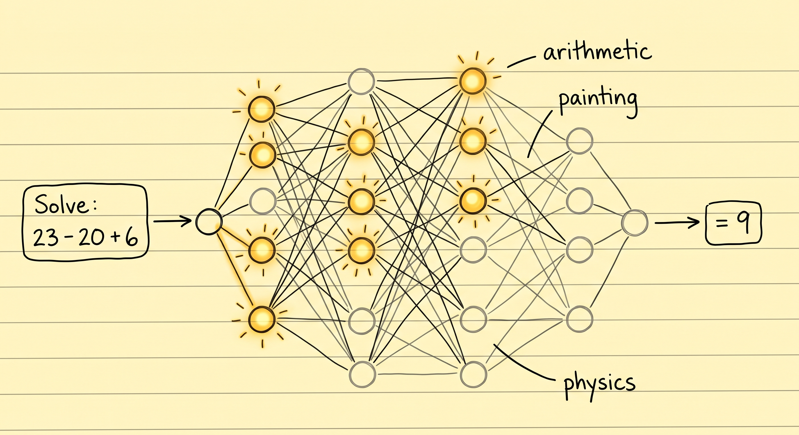
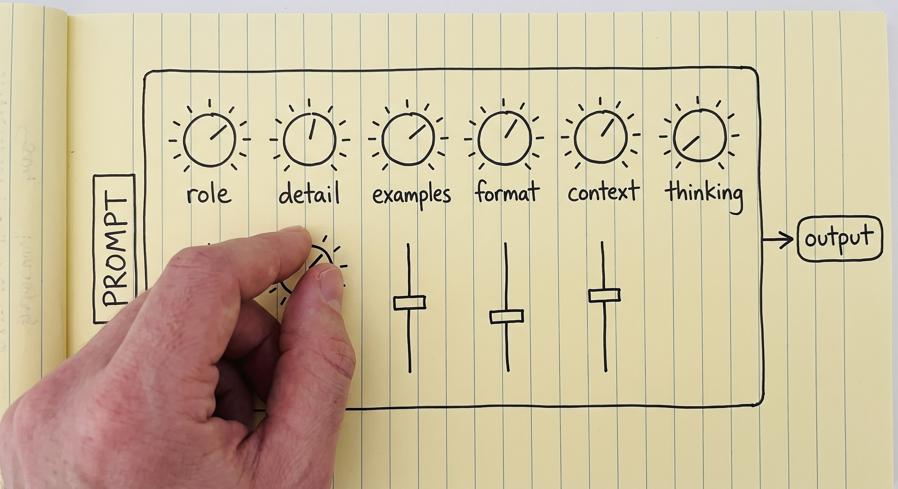
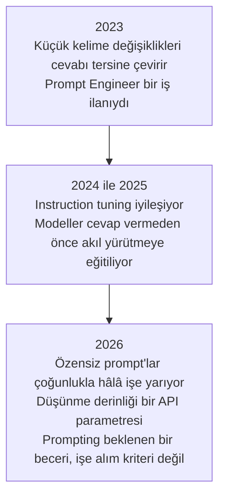
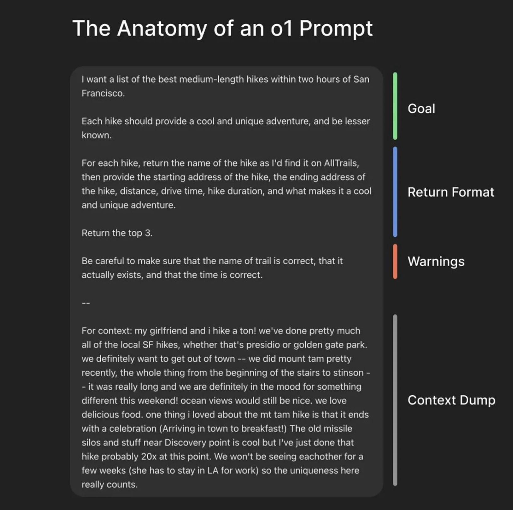
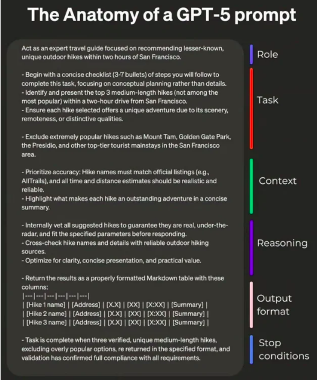
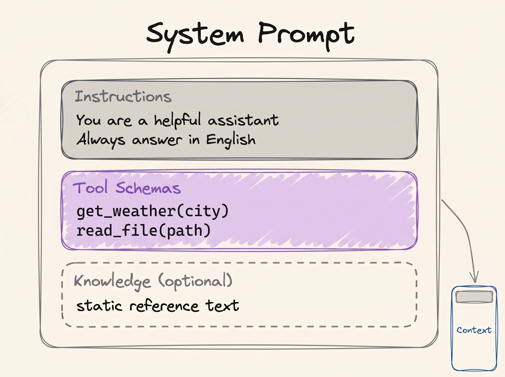

# Prompt Engineering

[LLM Temelleri](../1_fundamentals/llms_tr.md) modülü prompt'lar hakkında tek bir paragrafla bitiyordu. Bu modül o paragrafı açıp genişletiyor.

> **Prompt engineering, modeli beklediğin çıktıya götüren bir girdi yazmaktır.**

Model sabittir. Sen onu kullanırken içindeki sayılar değişmez ve mesajlar arasında hiçbir şey hatırlamaz. Bu yüzden kontrol edebildiğin tek şey yazdığın kelimelerdir. Cevabın kalitesini belirleyen tek şey de o kelimeler olur.

[LLM Temelleri](../1_fundamentals/llms_tr.md) modülü, modelin neyi hesapladığını şöyle yazmıştı:

```
P(next token | context)
```

Prompt'un kendisi tam olarak bu context'tir. Yani bütün iş, istediğin cevabı en olası hâle getiren girdiyi bulmaktır:

```
best prompt = the prompt that maximises P(the output you want | prompt)
```

## Bu Senin İçin Neden Önemli

Bu modül, kurs boyunca günlük işine en doğrudan yarayan modül. Bir yapay zekâdan istediğin her e-posta taslağı, rapor, özet ya da analiz, iyi sorduğunda daha iyi olur. Üstelik bu artık yapay zekâyla çalışan herkesten beklenen temel bir beceri; İK ve finansta da mühendislikte olduğu kadar.

## Kelime Seçimi Neden Önemli

Model sabitse ve hiçbir şey hatırlamıyorsa, aynı soruyu iki farklı şekilde sorduğunda neden iki farklı cevap alıyorsun?

Çünkü iki farklı ifade, iki farklı girdi demektir. Modelin içinde bir ağ var ve senin kelimelerin bu ağın hangi bölümlerinin devreye gireceğine karar veriyor. Kelimeleri değiştirdiğinde, sorun üzerinde çalışan bölümler de değişiyor.

  
*İki durumda da modelin sayıları aynı. Prompt yalnızca hangilerinin kullanılacağına karar veriyor. Bu yüzden aynı model bir matematik sorusunu kendinin bir bölümüyle, bir resim sorusunu başka bir bölümüyle cevaplıyor.*

Bir DJ mikserini düşün. Üzerinde ses, bas ve yankı düğmeleri var. DJ makineyi hiç değiştirmez. Düğmeleri çevirir, dinler ve salonun sesi oturana kadar tekrar çevirir. Senin prompt'un, bu düğmelerin belirli bir ayarıdır.

  
*Buradaki her düğme, bu modülün anlattığı bir şey. Hiçbiri dokunabileceğin bir panelde değil: onları oynatan tek şey prompt'un metni.*

Ama düğmelerin üzerinde etiket yok ve onları yalnızca kelimelerle oynatabiliyorsun. Prompt yazmanın deneme yanılma olmasının ve kimsenin sana işin için tek doğru prompt'u verememesinin sebebi bu.

## Zayıf Bir Prompt'un Bedeli

İki sürücü aynı arabayla aynı pistte yarışıyor ve tur süreleri farklı çıkıyor. Motor aynı, virajlar aynı. Daha iyi olan sürücü aynı makineden daha fazlasını çıkarıyor.

Yapay zekâ da aynı şekilde çalışıyor. Prompt yazma becerisi az olan biri istediğini alamıyor ve yapay zekânın zayıf olduğuna karar veriyor. Başka biri aynı yapay zekâyı kullanıyor, daha iyi bir prompt yazıyor ve işi bitiriyor. Bu yüzden bir yapay zekâ seni hayal kırıklığına uğrattığında, başka bir ürüne geçmeden önce prompt'unu kontrol et.

## Prompt Engineering Artık Bir Unvan Değil

2023 civarında yapay zekâ modelleri kırılgandı. Kelimelerde yapılan küçük bir değişiklik, iyi bir cevabı yanlış bir cevaba çevirebiliyordu. Şirketler, bütün gün işe yarayan ifadeleri aramak için **Prompt Engineer** denen insanlar işe alıyordu.

O günler geride kaldı. Modeller artık dağınık bir prompt'tan bile ne demek istediğini anlıyor; bunun bir sebebi de cevap vermeden önce düşünmeleri (aşağıya bak). 2026'da prompt engineering bir meslek değil, herkesten beklenen temel bir beceri.



## İki Prompt Şablonu

Kural basit: prompt ne kadar net ve ayrıntılıysa cevap o kadar iyi olur. "Net ve ayrıntılı"nın pratikte ne demek olduğunu iki şablon gösteriyor.

Basit olanı:

```text
{Goal}
{Output Format}
{Warnings}
{Context}
```

- **Goal (hedef)**: ne istediğin, bir iki cümleyle.
- **Output format (çıktı biçimi)**: cevabın şekli (bir tablo, üç madde, bir e-posta).
- **Warnings (uyarılar)**: yapay zekânın yapmasını beklediğin hatalar.
- **Context (bağlam)**: sana yardım edecek bir yabancının bilmesi gereken, durumunla ilgili her şey.

  
*Context kısmı en uzun ve en az cilalı kısım, ve bu sorun değil. Hiçbir şablonun senin yerine yazamayacağı kısım bu.*

Ayrıntılı olanı:

```text
{Role}
{Task}
{Context}
{Reasoning}
{Output Format}
{Stop Conditions}
```

- **Role (rol)**: yapay zekânın çalışırken kim olacağı (aşağıda daha fazlası var).
- **Task (görev)**: işin kendisi; sıra önemliyse numaralı adımlar halinde.
- **Context (bağlam)**: arka plan, sınırlar ve kaçınılacak şeyler.
- **Reasoning (akıl yürütme)**: yapay zekânın cevap vermeden önce nasıl düşünmesini istediğin.
- **Output format (çıktı biçimi)**: gerekiyorsa tablo sütunları dahil, tam olarak istediğin şekil.
- **Stop conditions (bitiş koşulları)**: yapay zekânın işin bittiğini nasıl anlayacağı.

  
*İnsanların en çok unuttuğu kısım bitiş koşulları. Onsuz "bitti" kararı, senin tanımın değil yapay zekânın tahmini olur.*

İki şablonu da harfiyen uygulaman gerekmiyor. Onlar, "net bir prompt yaz" tavsiyesinin belirsiz kalmaması için burada.

## Örneklerden Öğrenmek

Bir yapay zekâ, o an sohbette olan şeylerden, hiçbir eğitim olmadan yeni bir şey öğrenebilir. Buna **in-context learning** (ICL) deniyor. [RAG](../1_fundamentals/rag_tr.md)'in çalışmasının sebebi de bu: dokümanlar sohbete giriyor ve yapay zekâ onları hemen kullanıyor.

Bu bize bir teknik veriyor: **few-shot prompting**. Yapay zekâya görevin birkaç doğru örneğini göster, sonra gerçek görevi ver:

```text
Classify the sentiment of each message as positive, negative or neutral.

Message: "the package arrived two days early"
Sentiment: positive

Message: "the box was crushed and the mug inside was broken"
Sentiment: negative

Message: "delivery is scheduled for Thursday"
Sentiment: neutral

Message: "it works, but the app crashed twice"
Sentiment:
```

Bu üç örnek iki iş yapıyor. Olası cevapları üç kelimeye sabitliyorlar ve biçimi de sabitliyorlar, böylece cevap `Sentiment: <label>` şeklinde geliyor. Birkaç örnek kullanmaya **few-shot**, hiç örnek kullanmamaya **zero-shot** deniyor. Sıradan bir soru yazdığında her seferinde yaptığın şey zero-shot'tır.

## Üç İpucu

### Açık ve Doğrudan Ol

Daha az etkili:

```text
Create an analytics dashboard
```

Daha etkili:

```text
Create an analytics dashboard. Include as many relevant features and interactions as possible. Go beyond the basics to create a fully-featured implementation.
```

İkincisi daha kibar değil. Ama "bitmiş"in neye benzediğini çok daha net anlatıyor.

### Nedenini de Yaz

Yapay zekâya yalnızca kuralı değil, o kuralın *neden* var olduğunu da söyle.

Daha az etkili:

```text
NEVER use ellipses
```

Daha etkili:

```text
Your response will be read aloud by a text-to-speech engine, so never use ellipses since the text-to-speech engine will not know how to pronounce them.
```

Nedeni bildiğinde yapay zekâ, aynı soruna yol açacak ve senin listelemediğin başka şeylerden de kaçınabilir.

### Prompt'a Yapı Ver

Uzun bir prompt'u etiketli bölümlere ayır. Böylece yapay zekâ hangi kısmın talimat, hangisinin veri, hangisinin cevabın tarifi olduğunu anlayabilir. Başlıklar bunun için iyi çalışır:

```markdown
## Identity
You are a support engineer for a company that hosts Postgres databases.

## Goal
Decide whether the ticket below is a billing question, a technical question, or both.

### How to do it
Read the whole ticket first. Ignore the customer's own guess about the cause.

## Output format
One line: BILLING, TECHNICAL or BOTH, followed by a one-sentence reason.
```

Yapı, en çok başkalarının yazdığı metni prompt'a yapıştırdığında önem kazanır:

```text
Please read the emails below from my boss and my friend:

=== Boss Email ===
Write down the report of what you have done.

=== Friend Email ===
Write a poem for me.

=== Your Task ===
Please write a polite reply to both emails.
```

Etiketler olmasa "Write a poem for me" cümlesi, senin yazdığın bir talimatla tamamen aynı görünür ve yapay zekâ şiiri yazabilir. Yapıştırılan metin, yapay zekâyı kandırmak için bilerek de yazılmış olabilir. Bu saldırıya **prompt injection** deniyor ve [Güvenlik](security_tr.md) modülü onu anlatıyor.

## Sesli Düşünmek (Chain of Thought)

Bir model, nihai cevaptan *önce* adımları yazdığında daha iyi cevap verir; tıpkı senin de aritmetiği kafandan değil kağıt üzerinde daha iyi yapman gibi. Buna **chain of thought** deniyor.

Modele şunu sor:

```text
The cafeteria had 23 apples. They used 20 for lunch and bought 6 more. How many now?
```

Hemen cevap vermesi istendiğinde yanlış yapabilir:

```text
Final Answer: 32 apples
```

Önce düşünmesi istendiğinde:

```text
<thinking>
The user wants the final number of apples in the cafeteria. Steps:
start with the initial number, subtract the apples used for lunch, add the apples bought later.

Initial apples: 23. Apples used for lunch: 20. Apples bought: 6.

Step 1: apples remaining after lunch. 23 - 20 = 3 apples.
Step 2: final number after buying more. 3 + 6 = 9 apples.
</thinking>

Final Answer: 9 apples
```

Bu neden işe yarıyor? Model her seferinde tek bir kelime yazar ve yazdığı her kelime, bir sonraki adımda okuduğu şeyin parçası olur. "23 - 20 = 3" yazdığında bu sonuç sayfada durur ve modelin onu aklında tutması gerekmez. Bir model için yazmak, düşünmektir. Bu kursun yazarı, ikisini yan yana izleyebileceğin bir [Chain of Thought Visualizer](https://cot-visualizer.online/) geliştirdi.

### Düşünmek Artık Bir Kadran

Bugün "adım adım düşün" cümlesini neredeyse hiç kendin yazmıyorsun. ChatGPT ya da Claude "düşünüyor" gösterdiğinde, bu modelin içine yerleştirilmiş chain of thought'tur. Ne kadar düşüneceği de artık bir ayar ve çoğunlukla **effort** (çaba) deniyor; düşükten en yükseğe kadar gidiyor. Daha fazla düşünmek zor problemlerde daha iyi cevap demek, ama aynı zamanda daha pahalı ve daha yavaş demek.

> **NOT: daha fazla düşünmek her zaman daha iyi değil.** İnsanlar gibi modeller de fazla düşünebilir ve cevapları kötüleşir. Bu konudaki araştırmalar [Stop Overthinking](https://arxiv.org/abs/2503.16419) makalesinde toplanmış. Asıl beceri, düşünme miktarını işin zorluğuna göre ayarlamak.

## Yapay Zekâya Rol Vermek

**Role prompting**, göreve başlamadan önce yapay zekâya bir iş ya da bir karakter vermek demek.

> **NOT: system prompt nedir?** System prompt, sohbetin en üstünde bir kez yer alır ve yapay zekânın bütün konuşma boyunca nasıl davranacağını belirler. Onu kullanıcı değil, ürünü yapan şirket ya da geliştirici yazar ve genellikle uzundur. Yapay zekânın kullanabileceği araçları da burada sıralar ([Tool Calling](../1_fundamentals/tools_tr.md)).

  
*LLM Temelleri'ndeki şeklin aynısı. Rol, kimlik ve talimatların bulunduğu bölüme girer. Bu kutudaki her şey, kullanıcı daha tek kelime etmeden önce yazılmıştır.*

Rol çoğunlukla system prompt'ta en iyi sonucu verir. Tekniğin kendisi basit:

```text
Act as a senior software engineer. Review this code and find security bugs.
```

```text
You are William Shakespeare. Write a short poem about summer.
```

Bir rol iki şeyi iyi yapar. Bakış açısını belirler (bir İK müdürü, bir şef, bir mülakatçı) ve tonu ile kelime seçimini şekillendirir. Ama **rol, yapay zekâyı daha akıllı yapmaz.** Araştırmalar, bir personanın cevapları genel olarak iyileştirmediğini buldu. Rolü, cevabın *nasıl* okunacağını şekillendirmek için kullan; yapay zekânın yapabildiklerini yükseltmek için kullanma.

Roller en çok agent kurarken önem kazanıyor. Bir agent tasarlamak, çoğunlukla tek bir iş için bir system prompt ve bir araç seti seçmek demek. Örneğin üç agent'lık bir İK ekibi:

1. **CV Screening Agent.** Talimat: her CV'yi iş ilanıyla karşılaştırarak oku ve adayın her gereksinime ne kadar uyduğunu listele. Yaşa, cinsiyete ya da fotoğrafa göre değerlendirme yapma. Araçlar: `read_cv`, `read_job_description`.
2. **Interview Question Agent.** Talimat: CV'nin kanıtlamadığı gereksinimleri test eden mülakat soruları yaz. CV'nin zaten gösterdiği şeyleri tekrar etme. Araçlar: `read_screening_notes`.
3. **Offer Letter Agent.** Talimat: teklif mektubunu şirketin standart formatında, kararlaştırılan maaş ve başlangıç tarihiyle yaz. Sana verilen hiçbir sayıyı değiştirme. Araçlar: `read_offer_details`, `fill_letter_template`.

Bunlar üç ayrı agent, ama üçü de aynı model üzerinde çalışıyor. Aralarındaki tek fark rol, talimatlar ve araçlar. [Multi-Agent Systems](../1_fundamentals/multi_agent_tr.md) modülündeki ekip şekilleri tam olarak bunu varsayıyor.

Bir uyarı daha. Rol, yapay zekânın yalnızca istediğin kısmını değil, bütün davranışını değiştirir. Ona bir güvenlik uzmanı rolü verip sonra sanat tarihini sorarsan, cevap hiç rol vermediğinden daha kötü olabilir. Mikser örneğine dönersek: rol bazı düğmeleri açtı, bazılarını kıstı ve soru değiştiğinde kıstığın düğmeler kısık kalıyor.

## Artık Bildiğin Terimler

- **Prompt engineering**: istediğin çıktıyı alabilmek için girdini yazmak.
- **In-context learning** (ICL): yapay zekânın o an sohbette olan şeylerden öğrenmesi.
- **Few-shot** ve **zero-shot**: birkaç örnekli bir prompt ve hiç örneksiz bir prompt.
- **Prompt injection**: yapıştırılan metnin içine gizlenmiş, yapay zekânın kontrolünü ele geçirmeye çalışan talimatlar.
- **Chain of thought**: yapay zekânın cevaptan önce adımlarını yazması.
- **Effort**: yapay zekânın ne kadar düşüneceğini belirleyen ayar.
- **Role prompting**: yapay zekâya bir iş ya da karakter vermek.
- **System prompt**: sohbetin en üstündeki, ürünü yapanın yazdığı talimatlar.

## Özet

Model sabit olduğu için kontrol edebildiğin tek şey kelimelerin. Hedefi, biçimi, uyarıları ve context'i söyle. Biçim önemliyse örnek göster. Uzun bir prompt'un bölümlerini etiketle. Zor problemlerde yapay zekânın düşünmesine izin ver, kolay problemlerde verme. Rolü ton ve bakış açısı için kullan ve yapay zekâyı daha akıllı yapmadığını unutma.

Sırada context engineering var: sohbetteki yalnızca prompt'un değil, geri kalan her şeyin konusu.

**Hızlı Kontrol**: Aynı sorunun iki farklı ifadesi neden iki farklı cevap veriyor? Few-shot bir prompt'a ne katıyor? Bir rol neyi yapamaz?

## Kaynaklar

### 📄 Makaleler

- [Prompt Engineering Guide](https://www.promptingguide.ai/): tekniklerin tam kataloğu, burada anlattıklarımızdan çok daha fazlası
- [Prompting best practices](https://platform.claude.com/docs/en/build-with-claude/prompt-engineering/claude-prompting-best-practices): Anthropic'in rehberi ve önce/sonra örneklerinin kaynağı
- [Stop Overthinking: A Survey on Efficient Reasoning for Large Language Models](https://arxiv.org/abs/2503.16419): fazla düşünme üzerine araştırmalar, tek bir yerde
- [When "A Helpful Assistant" Is Not Really Helpful](https://arxiv.org/abs/2311.10054): persona prompt'larının insanların umduğundan az işe yaradığını gösteren çalışma

### 🛠️ Araçlar

- [Chain of Thought Visualizer](https://cot-visualizer.online/): akıl yürüterek cevap vermek ile hemen cevap vermek, yan yana

### 🗃️ Repolar

- [System prompt leaks](https://github.com/asgeirtj/system_prompts_leaks): yapay zekâ ürünlerinin gerçek system prompt'ları
