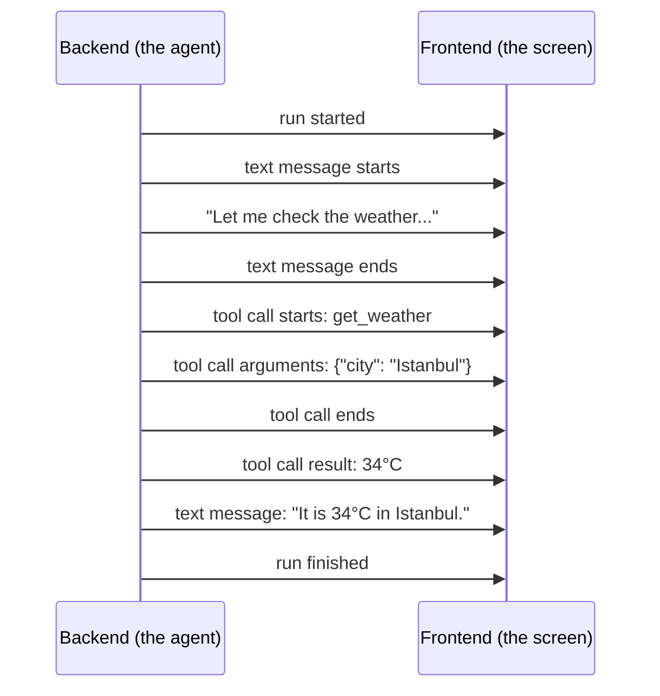
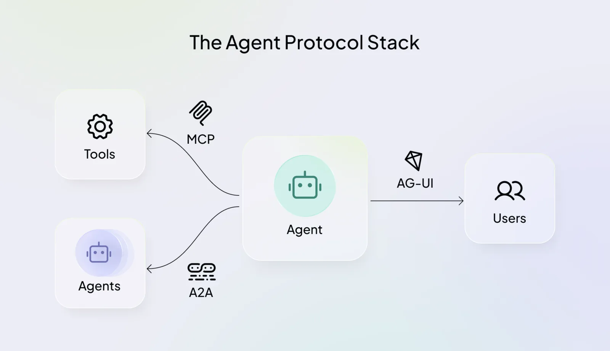

# Agentic UI

[Loop Engineering](loop_engineering.md) ended with agents that work for minutes, hours, and
sometimes days. Someone still has to look at that work: see what the agent is doing, stop it when it
goes wrong, and approve the steps that matter. This module is about the screen where that happens.

## Why This Matters to You

Many AI assistants at work show their progress on a screen: "searching", "reading the
file", "writing the report". When that screen is built well, you can follow the agent, catch a
mistake early, and step in. This module explains how that screen gets the agent's work, and why many of
the companies building these products now use one shared way to do it.

## What Agentic UI is

CopilotKit, a company that builds these interfaces, defines it like this:

> **Agentic UI is user interface built for humans and AI agents to work in the same application.**
> It streams agent work as it happens, accepts human steering and approvals mid-run, renders
> agent-generated interface alongside developer-built components, and keeps application state
> synchronized between the user and the agent.

In plain words, the difference is who is doing the work:

- **A normal app** waits for you. You press a button, and the same thing happens every time.
- **A chat box** answers once. You type a question, you wait, and one reply appears.
- **An agentic UI** shows an agent that is already working. It makes many decisions and uses many
  tools, and you watch it, guide it, and correct it while it works.

This module covers the base of all of this: **showing the agent's work as it happens**. The parts
where you approve steps, or where the agent designs the screen itself, come in the Expert level.

## Why Stream the Run

Think of ordering food with a delivery app. You can wait at the door with no idea what is
happening. Or the app shows you each step: order received, being prepared, on the way, at your
door. The food arrives at the same time either way. But in the second case you know what is going
on, and if something goes wrong, you find out early.

An agent works the same way. A model writes its answer one word at a time, as
[LLM Fundamentals](../1_fundamentals/llms.md) showed. An agent also thinks, uses a tool, waits for
the result, and uses another tool. The whole job can take a minute or an hour. So there are two ways
to build the screen:

1. **Wait, then show everything.** You look at a spinning wheel the whole time and cannot tell
   whether the agent is working, stuck, or going the wrong way.
2. **Stream the run.** The screen shows each piece of work as soon as it exists: a few words of the
   answer, "now checking the weather", the result. This is called **streaming**.

Agent products such as chat assistants and coding agents stream. The work happens step by step anyway, so there is no reason to
hide it. And seeing the steps lets you stop a job that is going wrong while it is still cheap.

  
*The screen starts with an empty prompt. Once the agent starts, a checklist of its steps fills in, and each step is ticked off as the agent finishes it, so you see progress instead of a spinner.*

## What Gets Streamed

The agent's side (the **backend**) does not send one long piece of text. It sends many small
messages called **events**, each saying what just happened. The screen (the **frontend**) reads each
event and updates itself. For the weather question from [Tool Calling](../1_fundamentals/tools.md):



The kinds of event are the same in almost every agent:

- the job started or finished
- a piece of the answer
- the agent's thinking
- a tool being used, and its result
- a helper agent (a **subagent**) starting or finishing
- the current state of the work

## Every Agent Speaks Its Own Format

Here is the problem. The kinds of event are similar everywhere, but each agent product writes them
in its own format, with its own names. So the screen has to be built for one specific agent. If the
company later switches to a different agent, the screen has to be rebuilt too, even if it should look
exactly the same.

Engineers try hard to avoid this kind of tie between two parts. Remember the universal charger plug
from [Code Agents](coding_agents.md): MCP lets one tool work with every agent. The same idea, used
between the agent and the screen, is AG-UI.

## AG-UI

**AG-UI** stands for the **Agent–User Interaction Protocol**. A **protocol** is an agreed set of
rules for how two systems talk. AG-UI is an open, shared list of events. An agent that speaks AG-UI
can send them, and a screen built for AG-UI can show them. So the company can change the agent behind
the screen at any time.

Some of its events, by name:

- `RunStarted` and `RunFinished`: the job starts and ends.
- `TextMessageContent`: a piece of the answer.
- `ToolCallStart` and `ToolCallResult`: a tool is used, and what it returned.
- `SubagentStarted`: a helper agent begins.

If you are curious, this is what the weather job looks like as AG-UI events, one line per event. On
the wire each name is written in capitals, so `RunStarted` becomes `RUN_STARTED`. It is fine to skip
it:

```json
{"type": "RUN_STARTED", "threadId": "t1", "runId": "r1"}
{"type": "TEXT_MESSAGE_START", "messageId": "m1", "role": "assistant"}
{"type": "TEXT_MESSAGE_CONTENT", "messageId": "m1", "delta": "Let me check the weather..."}
{"type": "TEXT_MESSAGE_END", "messageId": "m1"}
{"type": "TOOL_CALL_START", "toolCallId": "c1", "toolCallName": "get_weather"}
{"type": "TOOL_CALL_ARGS", "toolCallId": "c1", "delta": "{\"city\": \"Istanbul\"}"}
{"type": "TOOL_CALL_END", "toolCallId": "c1"}
{"type": "TOOL_CALL_RESULT", "messageId": "m2", "toolCallId": "c1", "content": "34°C"}
{"type": "TEXT_MESSAGE_START", "messageId": "m3", "role": "assistant"}
{"type": "TEXT_MESSAGE_CONTENT", "messageId": "m3", "delta": "It is 34°C in Istanbul."}
{"type": "TEXT_MESSAGE_END", "messageId": "m3"}
{"type": "RUN_FINISHED", "threadId": "t1", "runId": "r1"}
```

### Who Supports It

Because the list is shared, many agent products speak it. LangChain and CrewAI are partners.
Microsoft's and Google's agent kits support it directly. The Claude Agent SDK and the OpenAI Agents
SDK support it through community projects. The CopilotKit team develops it together with its
partners.

## The Agent Protocol Stack

AG-UI is one of three shared protocols, and each one connects the agent to a different side.

  
*The agent sits in the middle. MCP and A2A reach left, to its tools and to other agents. AG-UI reaches right, to the people using the app.*

| Protocol | Connects the agent to |
| --- | --- |
| **MCP** | tools and data |
| **A2A** | other agents |
| **AG-UI** | the people using the app |

They work together. A real product often uses all three at once. Do not mix them up: you met MCP in
[Code Agents](coding_agents.md) and A2A in [Multi-Agent Systems](../1_fundamentals/multi_agent.md),
and AG-UI is the third, the one that faces the people.

## Beyond Streaming

Streaming is the base. The Expert level will cover three more things:

- The agent can stop and ask you to approve an important step (**human in the loop**).
- The screen and the agent can share the same information.
- The agent can design parts of the screen itself (**generative UI**).

## Words You Now Know

- **Agentic UI**: a screen where a person and a working agent use the same app together.
- **Streaming**: showing the agent's work piece by piece, as it happens.
- **Event**: one small message saying what just happened, such as "tool call started".
- **Backend** and **frontend**: the agent's side, and the screen's side.
- **Protocol**: an agreed set of rules for how two systems talk.
- **AG-UI**: the shared protocol between an agent and the screen.
- **MCP** and **A2A**: the shared protocols between an agent and its tools, and between agents.
- **Human in the loop**: the agent stops and waits for a person's approval.

## Summary

Agentic UI is the screen where you and a working agent share an app. Its base is streaming: the agent
works step by step, so the screen shows it step by step, like a delivery app showing each stage of
your order. Each agent product used its own format, which tied the screen to one agent. AG-UI is a
shared format, like a universal plug, so any screen can work with any agent. Next to MCP (tools) and
A2A (other agents), it connects the agent to the people using it.

**Quick check**: Why does an agentic UI show the agent's work step by step? And what problem does
AG-UI solve?

## References

### 📄 Articles

- [What Is Agentic UI?](https://www.copilotkit.ai/learning/what-is-agentic-ui): the definition this module uses
- [AG-UI Overview](https://docs.ag-ui.com/introduction): what the protocol is, and who supports it

### 🛠️ Tools

- [CopilotKit Interactive Dojo](https://dojo.ag-ui.com/): live demos of agentic UI to try in the browser
