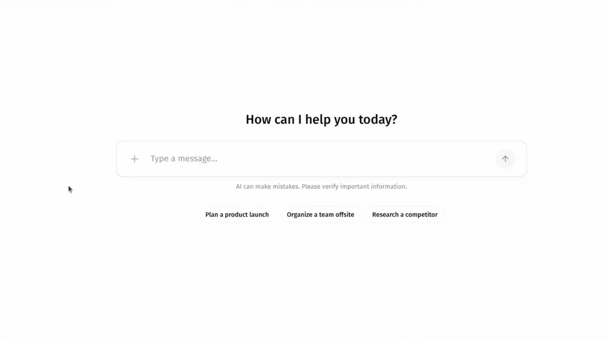
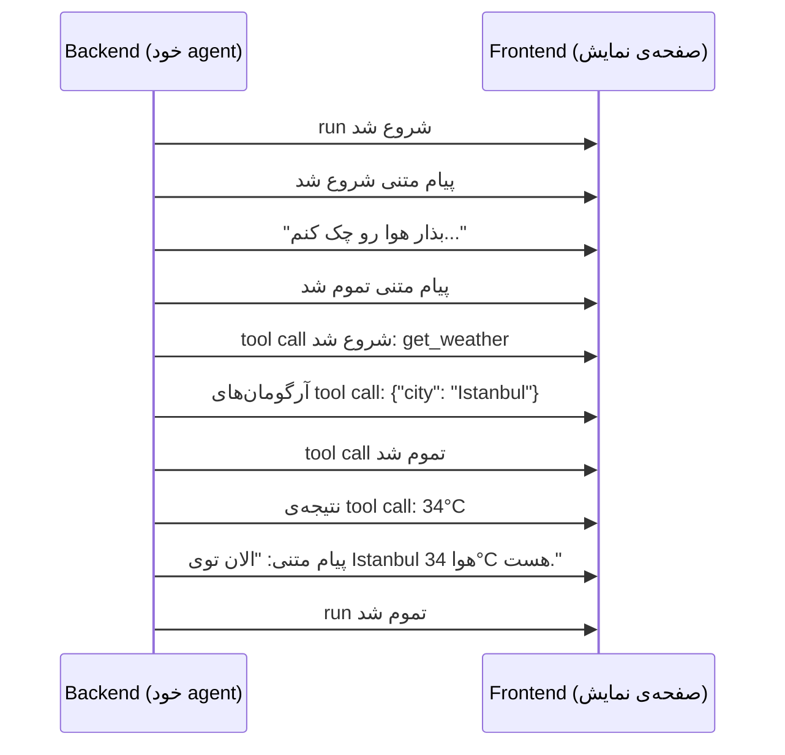
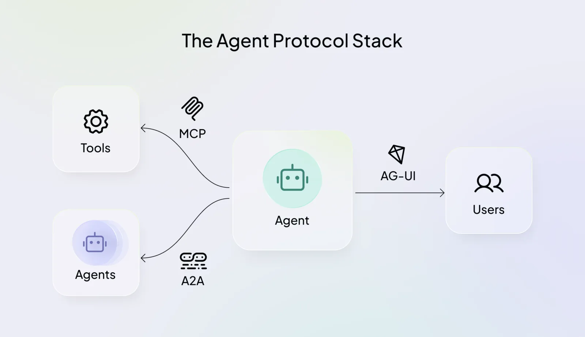
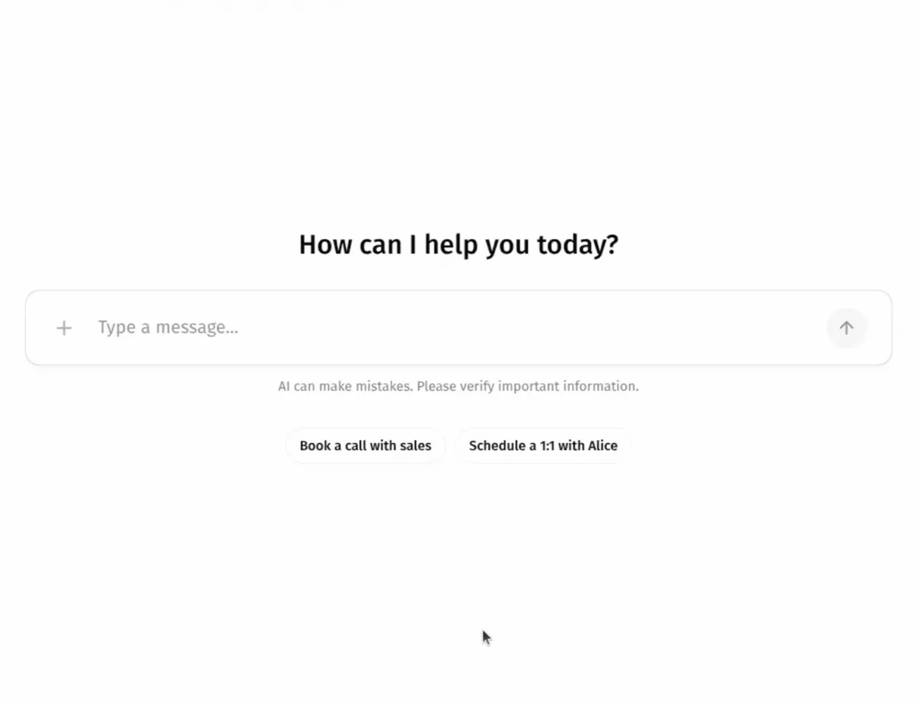

---
objectives:
  - "بگو Agentic UI چیه و چه فرقی با یه برنامه‌ی معمولی و یه chat داره"
  - "توضیح بده چرا کار agent قدم‌به‌قدم نشون داده می‌شه، نه اینکه همه‌ش آخر کار یه‌جا نشون داده بشه"
  - "با کمک شارژر همه‌کاره‌ای که توی Code Agent‌ها دیدی، توضیح بده AG-UI به چه درد می‌خوره"
  - "بگو human in the loop یعنی چی و چرا یه agent قبل از یه قدم مهم وایمیسه و از تو می‌پرسه"
---

# Agentic UI

[Loop Engineering](loop_engineering_fa.md) با agent‌هایی تموم شد که چند دقیقه، چند ساعت و گاهی چند روز کار می‌کنن. ولی هنوز یه نفر باید به این کار نگاه کنه: ببینه agent داره چی‌کار می‌کنه، وقتی داره اشتباه می‌ره متوقفش کنه، و قدم‌های مهم رو تأیید کنه. این درس درباره‌ی همون صفحه‌ایه که این اتفاق‌ها توش می‌افته.

## چرا این برای تو مهمه

خیلی از دستیارهای AI سر کار پیشرفتشون رو روی صفحه نشون می‌دن: «در حال جستجو»، «در حال خوندن فایل»، «در حال نوشتن گزارش». وقتی این صفحه خوب ساخته شده باشه، می‌تونی agent رو دنبال کنی، یه اشتباه رو زود بگیری و وسط کار دخالت کنی. این درس توضیح می‌ده این صفحه کار agent رو از کجا می‌گیره، و چرا خیلی از شرکت‌هایی که این محصول‌ها رو می‌سازن الان از یه روش مشترک برای این کار استفاده می‌کنن.

## Agentic UI چیه؟

CopilotKit، شرکتی که این جور رابط‌ها می‌سازه، این‌طوری تعریفش می‌کنه:

> **Agentic UI یعنی رابط کاربری‌ای که برای این ساخته شده که آدم‌ها و agent‌های AI توی یه برنامه‌ی مشترک با هم کار کنن.** کار agent رو همون لحظه که داره انجام می‌شه stream می‌کنه، وسط اجرا از آدم هدایت و تأیید می‌گیره، رابطی که خود agent می‌سازه رو کنار component‌هایی که برنامه‌نویس ساخته نشون می‌ده، و state برنامه رو بین کاربر و agent هماهنگ نگه می‌داره.

به زبان ساده، فرقشون اینه که کار رو کی انجام می‌ده.

- **یه برنامه‌ی معمولی** منتظر تو می‌مونه. دکمه رو می‌زنی و هر بار همون اتفاق می‌افته.
- **یه chat** فقط یه بار جواب می‌ده. سؤالت رو می‌نویسی، صبر می‌کنی و یه پاسخ می‌رسه.
- **Agentic UI** یه agent رو نشون می‌ده که همین الان داره کار می‌کنه. کلی تصمیم می‌گیره و کلی tool استفاده می‌کنه، و تو وسط کار نگاهش می‌کنی، هدایتش می‌کنی و اصلاحش می‌کنی.

این درس سراغ پایه‌ی همه‌ی این‌ها می‌ره: **نشون دادن کار agent همون لحظه که اتفاق می‌افته**، و اینکه agent قبل از یه قدم مهم **وایمیسه و از تو می‌پرسه**. بخش‌هایی که توش agent رو وسط کارش هدایت می‌کنی، یا خود agent صفحه رو طراحی می‌کنه، می‌رسه به سطح Expert.

## چرا run رو stream می‌کنیم؟

فرض کن از یه اپ تحویل غذا سفارش می‌دی. یه راهش اینه که پشت در وایسی و هیچ نمی‌دونی چه خبره. راه دیگه اینه که اپ هر مرحله رو نشونت بده: سفارش ثبت شد، دارن آماده‌ش می‌کنن، پیکِ تو راهه، پشت دری. غذا تو هر دو حالت همون ساعت می‌رسه. ولی تو حالت دوم می‌دونی چه خبره، و اگه یه جای کار بلنگه، زود می‌فهمی.

agent هم همین‌طوره. یه مدل جوابش رو کلمه‌به‌کلمه می‌نویسه، همون‌طور که توی [مبانی LLM](../1_fundamentals/llms_fa.md) دیدیم. agent یه کار دیگه هم می‌کنه: فکر می‌کنه، یه tool رو استفاده می‌کنه، منتظر نتیجه می‌مونه و بعد سراغ tool بعدی می‌ره. کل کار می‌تونه یه دقیقه طول بکشه یا یه ساعت. برای همین دو جور می‌شه صفحه رو ساخت.

1. **صبر کن، بعد همه‌چی رو یه‌جا نشون بده.** تمام این مدت به یه چرخ در حال چرخیدن زل می‌زنی و نمی‌دونی agent داره کار می‌کنه، گیر کرده یا به سمت اشتباه می‌ره.
2. **run رو stream کن.** صفحه هر تیکه از کار رو به محض اینکه ساخته شد نشون می‌ده: چند کلمه از جواب، «الان دارم هوا رو چک می‌کنم»، نتیجه. اسم این کار **streaming**ه.

محصول‌های agent‌ای مثل chat assistant‌ها و coding agent‌ها از راه دوم می‌رن. کار به‌هرحال قدم‌به‌قدم انجام می‌شه، پس دلیلی نداره قایمش کنیم. وقتی قدم‌ها رو می‌بینی، می‌تونی کاری که داره اشتباه می‌ره رو متوقف کنی، تا وقتی که هنوز ارزونه.

  
*صفحه با یه prompt خالی شروع می‌شه. وقتی agent شروع می‌کنه، یه checklist از قدم‌هاش پر می‌شه و هر قدم که agent تمومش می‌کنه تیک می‌خوره، برای همین به‌جای یه spinner پیشرفت رو می‌بینی.*

## چی stream می‌شه؟

سمت agent (همون **backend**) یه متن طولانی نمی‌فرسته. کلی پیام کوچیک می‌فرسته به اسم **event**، که هر کدوم می‌گه همین الان چی اتفاق افتاد. صفحه (همون **frontend**) هر event رو می‌خونه و خودش رو به‌روز می‌کنه. برای سؤال هوا که توی [Tool Calling](../1_fundamentals/tools_fa.md) دیدیم، این‌جوریه:



نوع event‌ها تقریباً توی همه‌ی agent‌ها یکیه:

- کار شروع شد یا تموم شد
- یه تیکه از جواب
- فکر کردن agent
- استفاده از یه tool و نتیجه‌ش
- شروع یا تموم شدن کار یه agent کمکی (یه **subagent**)
- وضعیت فعلی کار

## هر Agent با فرمت خودش حرف می‌زنه

مشکل اینجاست. نوع event‌ها همه‌جا شبیه همه، ولی هر محصول agent اون‌ها رو با فرمت خودش و اسم‌های خودش می‌نویسه. برای همین صفحه رو باید برای یه agent مشخص ساخت. اگه شرکت بعداً بره سراغ یه agent دیگه، صفحه رو هم باید از نو ساخت، با اینکه قراره دقیقاً همون شکلی بمونه.

مهندس‌ها خیلی تلاش می‌کنن که دو بخش این‌طوری به هم گره نخورن. شارژر همه‌کاره‌ای رو یادته که توی [Code Agent‌ها](coding_agents_fa.md) گفتیم: MCP باعث می‌شه یه tool با همه‌ی agent‌ها کار کنه. همین ایده، این بار بین agent و صفحه، می‌شه AG-UI.

## AG-UI

**AG-UI** مخفف **Agent–User Interaction Protocol** هست. **Protocol** یعنی یه مجموعه قانون که همه سرش توافق کردن و مشخص می‌کنه دو سیستم چطور با هم حرف بزنن. AG-UI یه فهرست باز و مشترک از event‌هاست. agent‌ای که AG-UI بلده می‌تونه اون‌ها رو بفرسته، و صفحه‌ای که برای AG-UI ساخته شده می‌تونه نشونشون بده. پس شرکت هر وقت خواست می‌تونه agent پشت صفحه رو عوض کنه.

چند تا از event‌هاش، با اسم:

- `RunStarted` و `RunFinished`: کار شروع و تموم می‌شه.
- `TextMessageContent`: یه تیکه از جواب.
- `ToolCallStart` و `ToolCallResult`: یه tool استفاده می‌شه، و چی برگردونده.
- `SubagentStarted`: یه agent کمکی شروع می‌کنه.

اگه کنجکاوی، همون کار هوا به‌شکل event‌های AG-UI این‌جوریه، یه خط برای هر event. روی wire اسم هر event با حروف بزرگ نوشته می‌شه، پس `RunStarted` می‌شه `RUN_STARTED`. نخوندنش هم اشکالی نداره:

```json
{"type": "RUN_STARTED", "threadId": "t1", "runId": "r1"}
{"type": "TEXT_MESSAGE_START", "messageId": "m1", "role": "assistant"}
{"type": "TEXT_MESSAGE_CONTENT", "messageId": "m1", "delta": "Let me check the weather..."}
{"type": "TEXT_MESSAGE_END", "messageId": "m1"}
{"type": "TOOL_CALL_START", "toolCallId": "c1", "toolCallName": "get_weather"}
{"type": "TOOL_CALL_ARGS", "toolCallId": "c1", "delta": "{\"city\": \"Istanbul\"}"}
{"type": "TOOL_CALL_END", "toolCallId": "c1"}
{"type": "TOOL_CALL_RESULT", "messageId": "m2", "toolCallId": "c1", "content": "34°C"}
{"type": "TEXT_MESSAGE_START", "messageId": "m3", "role": "assistant"}
{"type": "TEXT_MESSAGE_CONTENT", "messageId": "m3", "delta": "It is 34°C in Istanbul."}
{"type": "TEXT_MESSAGE_END", "messageId": "m3"}
{"type": "RUN_FINISHED", "threadId": "t1", "runId": "r1"}
```

### کی ازش پشتیبانی می‌کنه؟

چون این فهرست مشترکه، خیلی از محصول‌های agent بلدنش. LangChain و CrewAI شریک (partner) هستن. ابزارهای agent شرکت‌های Microsoft و Google مستقیم ازش پشتیبانی می‌کنن. Claude Agent SDK و OpenAI Agents SDK از راه پروژه‌های community ازش پشتیبانی می‌کنن. تیم CopilotKit این protocol رو با شریک‌هاش با هم توسعه می‌ده.

## Protocol Stack برای Agent

AG-UI یکی از سه protocol مشترکه، و هر کدوم agent رو به یه طرف دیگه وصل می‌کنه.

  
*agent وسطه. MCP و A2A به سمت چپ می‌رن، به tool‌ها و agent‌های دیگه. AG-UI به سمت راست می‌ره، به آدم‌هایی که از برنامه استفاده می‌کنن.*

| Protocol | agent رو وصل می‌کنه به |
| --- | --- |
| **MCP** | tool‌ها و داده |
| **A2A** | agent‌های دیگه |
| **AG-UI** | آدم‌هایی که از برنامه استفاده می‌کنن |

این‌ها با هم کار می‌کنن. یه محصول واقعی اغلب هر سه رو هم‌زمان استفاده می‌کنه. قاطی‌شون نکن: MCP رو توی [Code Agent‌ها](coding_agents_fa.md) دیدی و A2A رو توی [Multi-Agent Systems](../1_fundamentals/multi_agent_fa.md)، و AG-UI سومیه، همونی که رو به آدم‌هاست.

## Human in the Loop

نگاه کردن به کار یه agent به درد می‌خوره. ولی اینکه قبل از اقدام اون بتونی بگی «آره» یا «نه»، از اون هم مفیدتره. اسمش **human in the loop** هست، یعنی تو توی حلقه‌ی کار می‌مونی.

یه دستیار تازه رو در نظر بگیر که برات یه ایمیل می‌نویسه. یه دستیار خوب ایمیل رو یه‌دفعه نمی‌فرسته. نشونت می‌ده، و تو تأییدش می‌کنی، عوضش می‌کنی یا می‌گی نه. بعد کار رو ادامه می‌ده. یه agent هم می‌تونه همین‌جوری کار کنه. قدم‌های روتین رو خودش انجام می‌ده. ولی سر یه قدم مهم، مثلاً فرستادن یه ایمیل، عوض کردن یه رکورد یا پرداخت پول برای یه چیزی، وایمیسه و منتظر تو می‌مونه.

این بیشتر وقتی مهمه که یه قدم نتیجه‌ی واقعی داره. اگه قدم رو قبل از اجرا ببینی، می‌تونی جلوش رو بگیری یا درستش کنی. اشتباهی که زود گرفته بشه ارزون‌تر تموم می‌شه، و دلیل اینکه صفحه قدم‌ها رو نشون می‌ده هم همینه.

روی صفحه این‌جوری کار می‌کنه. agent می‌ایسته. صفحه نشون می‌ده agent می‌خواد چی کار کنه، با دکمه‌هایی برای تأیید کردن، رد کردن یا انتخاب یکی از گزینه‌ها. جواب تو برمی‌گرده سمت agent و agent از همون‌جا ادامه می‌ده. AG-UI یه راه استاندارد برای این کار داره، پس هر صفحه‌ای دست‌کم می‌تونه متن پیام رو نشون بده.

  
*هوش مصنوعی چند تا ساعت برای یه جلسه پیشنهاد می‌ده و می‌ایسته. فقط بعد از اینکه تو یکی رو انتخاب کنی رزرو می‌کنه. توی تلاش دوم، آدم «None of these work» رو می‌زنه و هوش مصنوعی می‌گه نتونسته رزرو کنه.*

## فراتر از Streaming

streaming و human in the loop پایه‌ست. سطح Expert چند تا چیز دیگه رو پوشش می‌ده:

- می‌تونی agent رو وسط کارش هدایت کنی.
- صفحه و agent می‌تونن اطلاعات مشترک داشته باشن.
- خود agent می‌تونه بخش‌هایی از صفحه رو طراحی کنه (**generative UI**).

## کلمه‌هایی که الان بلدی

- **Agentic UI**: صفحه‌ای که توش یه آدم و یه agent در حال کار با هم از یه برنامه استفاده می‌کنن.
- **Streaming**: نشون دادن کار agent تیکه‌تیکه، همون لحظه که اتفاق می‌افته.
- **Event**: یه پیام کوچیک که می‌گه همین الان چی اتفاق افتاد، مثلاً «tool call شروع شد».
- **Backend** و **frontend**: سمت agent، و سمت صفحه.
- **Protocol**: یه مجموعه قانون مشترک برای اینکه دو سیستم چطور با هم حرف بزنن.
- **AG-UI**: protocol مشترک بین یه agent و صفحه.
- **MCP** و **A2A**: protocol‌های مشترک بین agent و tool‌هاش، و بین agent‌ها.
- **Human in the loop**: agent سر یه قدم مهم وایمیسه و منتظر می‌مونه یه آدم تأیید کنه، تغییر بده یا انتخاب کنه.

## خلاصه

Agentic UI صفحه‌ایه که توش تو با یه agent در حال کار، از یه برنامه‌ی مشترک استفاده می‌کنی. پایه‌ش streaming‌ه: agent قدم‌به‌قدم کار می‌کنه، پس صفحه هم قدم‌به‌قدم نشونش می‌ده، مثل اپ تحویل غذا که هر مرحله‌ی سفارشت رو نشون می‌ده. هر محصول agent فرمت خودش رو داشت و همین صفحه رو به یه agent گره می‌زد. AG-UI یه فرمت مشترکه، مثل یه شارژر همه‌کاره، که باعث می‌شه هر صفحه‌ای با هر agent‌ی کار کنه. کنار MCP (برای tool‌ها) و A2A (برای agent‌های دیگه)، AG-UI اون رو به آدم‌هایی وصل می‌کنه که ازش استفاده می‌کنن. و وقتی یه قدم مهمه، agent اول وایمیسه و از تو می‌پرسه: این همون human in the loop هست.

**بررسی سریع**: چرا یه agentic UI کار agent رو قدم‌به‌قدم نشون می‌ده؟ و AG-UI چه مشکلی رو حل می‌کنه؟ و چرا یه agent گاهی وایمیسه و منتظر تو می‌مونه؟

## منابع

### 📄 مقاله‌ها

- [What Is Agentic UI?](https://www.copilotkit.ai/learning/what-is-agentic-ui): تعریفی که این درس ازش استفاده می‌کنه
- [AG-UI Overview](https://docs.ag-ui.com/introduction): protocol چیه، و کی ازش پشتیبانی می‌کنه
- [Interrupts](https://docs.ag-ui.com/concepts/interrupts): AG-UI چطور یه agent رو برای جواب یه آدم متوقف می‌کنه

### 🛠️ ابزارها

- [CopilotKit Interactive Dojo](https://dojo.ag-ui.com/): دموهای زنده‌ی agentic UI که می‌تونی توی مرورگر امتحانشون کنی
