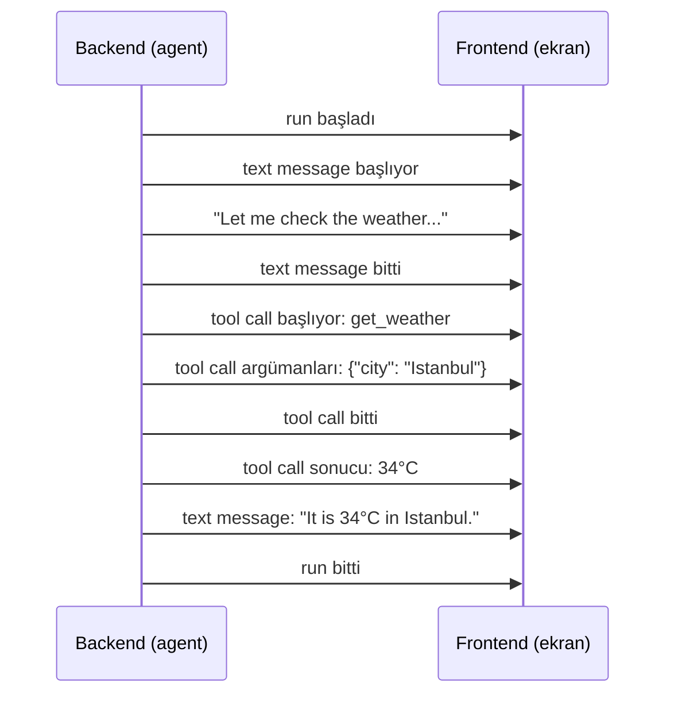
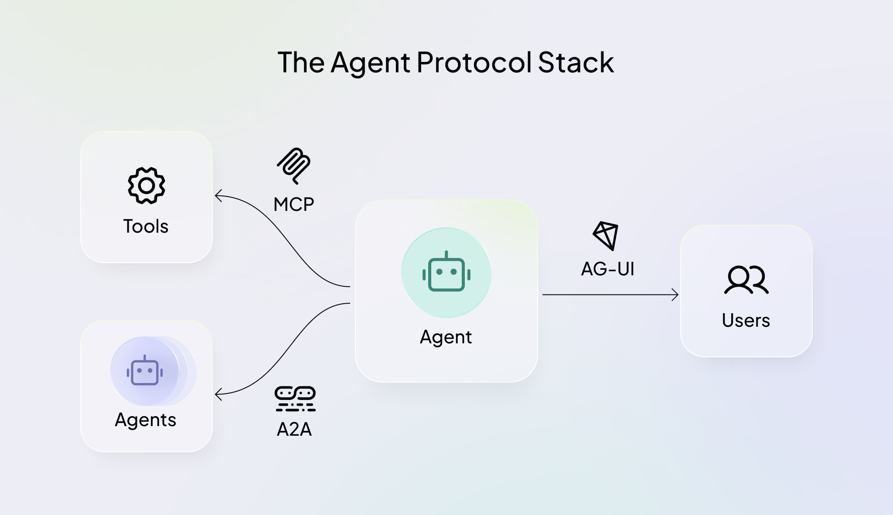

# Agentic UI

[Loop Engineering](loop_engineering_tr.md) modülü, dakikalarca, saatlerce, bazen günlerce çalışan agent'larla bitti. Yine de biri bu işe bakmak zorunda: agent'ın ne yaptığını görmek, işler ters gittiğinde onu durdurmak ve önemli adımlara onay vermek. Bu modül, tüm bunların olduğu ekranı anlatıyor.

## Bu Senin İçin Neden Önemli

İş yerinde kullanacağın her AI asistanı ilerleyişini ekranda gösterir: "arıyor", "dosyayı okuyor", "raporu yazıyor". Bu ekran iyi yapıldıysa agent'ı takip edebilir, bir hatayı erkenden yakalayabilir ve araya girebilirsin. Bu modül, o ekranın agent'ın işini nasıl aldığını ve bu ürünleri yapan şirketlerin neden bunu tek bir ortak yolla yapmakta anlaştığını açıklıyor.

## Agentic UI Nedir

Bu arayüzleri geliştiren CopilotKit şirketi, agentic UI'ı şöyle tanımlıyor:

> **Agentic UI, insanların ve AI agent'larının aynı uygulamada birlikte çalışması için geliştirilmiş kullanıcı arayüzüdür.**
> Agent'ın işini olurken stream eder, çalışma sürerken insanın yönlendirmesini ve onaylarını kabul eder, agent'ın ürettiği arayüzü geliştiricinin yazdığı bileşenlerin yanında gösterir ve uygulamanın durumunu kullanıcı ile agent arasında senkron tutar.

Sade bir dille söylersek, fark işi kimin yaptığında:

- **Normal bir uygulama** seni bekler. Bir düğmeye basarsın ve her seferinde aynı şey olur.
- **Bir chat kutusu** bir kez cevap verir. Bir soru yazarsın, beklersin ve tek bir cevap görünür.
- **Bir agentic UI** zaten çalışmakta olan bir agent'ı gösterir. Agent birçok karar verir ve birçok tool kullanır; sen de o çalışırken onu izler, yönlendirir ve düzeltirsin.

Bu modül, bunların hepsinin temelini anlatıyor: **agent'ın işini olurken göstermek**. Adımları onayladığın ya da agent'ın ekranı kendisinin tasarladığı kısımlar Expert seviyesinde geliyor.

## Run'ı Neden Stream Ederiz

Bir yemek uygulamasından sipariş verdiğini düşün. Kapıda, ne olduğunu bilmeden bekleyebilirsin. Ya da uygulama sana her adımı gösterir: sipariş alındı, hazırlanıyor, yolda, kapında. Yemek her iki durumda da aynı anda gelir. Ama ikinci durumda neler olduğunu bilirsin ve bir şey ters giderse erkenden öğrenirsin.

Bir agent de aynı şekilde çalışır. Bir model cevabını, [LLM Temelleri](../1_fundamentals/llms_tr.md) modülünde gördüğün gibi, kelime kelime yazar. Agent bunun üstüne daha fazlasını yapar: düşünür, bir tool kullanır, sonucu bekler ve başka bir tool kullanır. Bütün iş bir dakika da sürebilir, bir saat de. Dolayısıyla ekranı kurmanın iki yolu var:

1. **Bekle, sonra hepsini göster.** Bütün bu süre boyunca dönen bir tekerleğe bakarsın ve agent'ın çalışıyor mu, takılmış mı, yoksa yanlış yöne mi gidiyor olduğunu anlayamazsın.
2. **Run'ı stream et.** Ekran her iş parçasını oluştuğu anda gösterir: cevabın birkaç kelimesi, "şimdi hava durumuna bakıyorum", sonuç. Buna **streaming** denir.

Ciddi her agent ürünü stream eder. İş zaten adım adım yapılıyor, o yüzden onu saklamanın bir sebebi yok. Adımları görmek, yanlış giden bir işi daha masrafı küçükken durdurmanı da sağlar.

  
*Bir agent'ın işi, olurken ekranda gösteriliyor. Her adım oluşur oluşmaz görünür; böylece boş bir ekranın karşısında beklemezsin.*

## Neler Stream Edilir

Agent'ın tarafı (**backend**) tek bir uzun metin göndermez. **Event** denen, her biri az önce ne olduğunu söyleyen birçok küçük mesaj gönderir. Ekran (**frontend**) her event'i okur ve kendini günceller. [Tool Calling](../1_fundamentals/tools_tr.md) modülündeki hava durumu sorusu için:



Event türleri hemen her agent'ta aynıdır: işin başlaması ya da bitmesi, cevabın bir parçası, agent'ın düşünmesi, kullanılan bir tool ve sonucu, yardımcı bir agent'ın (bir **subagent**) başlaması ya da bitmesi ve işin o anki durumu.

## Her Agent Kendi Formatını Konuşur

Sorun şu. Event türleri her yerde birbirine benzer, ama her agent ürünü onları kendi formatında, kendi adlarıyla yazar. Bu yüzden ekran, belirli bir agent için yazılmak zorunda. Şirket sonradan başka bir agent'a geçerse, ekranın tıpatıp aynı görünmesi gerekse bile, ekran baştan yazılmalı.

Mühendisler iki parça arasındaki bu tür bir bağdan kaçınmak için çok uğraşır. [Code Agents](coding_agents_tr.md) modülündeki evrensel şarj fişini hatırla: MCP, tek bir tool'un her agent'la çalışmasını sağlıyor. Aynı fikir agent ile ekran arasında kullanılınca ortaya AG-UI çıkıyor.

## AG-UI

**AG-UI**, **Agent–User Interaction Protocol**'ün kısaltmasıdır. **Protocol**, iki sistemin nasıl konuşacağını belirleyen, üzerinde anlaşılmış kurallar bütünüdür. AG-UI, her agent'ın gönderebileceği ve her ekranın okuyabileceği, açık ve ortak bir event listesidir. Yani AG-UI için yazılmış bir ekran, AG-UI konuşan her agent'la çalışır ve şirket, arkasındaki agent'ı istediği zaman değiştirebilir.

Event'lerden bazıları, adlarıyla: `RunStarted` ve `RunFinished` (iş başlıyor ve bitiyor), `TextMessageContent` (cevabın bir parçası), `ToolCallStart` ve `ToolCallResult` (bir tool kullanılıyor ve ne döndürdü) ve `SubagentStarted` (yardımcı bir agent başlıyor).

Merak edersen, hava durumu işi AG-UI event'leri olarak şöyle görünür, her satır bir event. Atlaman sorun değil:

```json
{"type": "RUN_STARTED", "threadId": "t1", "runId": "r1"}
{"type": "TEXT_MESSAGE_START", "messageId": "m1", "role": "assistant"}
{"type": "TEXT_MESSAGE_CONTENT", "messageId": "m1", "delta": "Let me check the weather..."}
{"type": "TEXT_MESSAGE_END", "messageId": "m1"}
{"type": "TOOL_CALL_START", "toolCallId": "c1", "toolCallName": "get_weather"}
{"type": "TOOL_CALL_ARGS", "toolCallId": "c1", "delta": "{\"city\": \"Istanbul\"}"}
{"type": "TOOL_CALL_END", "toolCallId": "c1"}
{"type": "TOOL_CALL_RESULT", "messageId": "m2", "toolCallId": "c1", "content": "34°C"}
{"type": "TEXT_MESSAGE_START", "messageId": "m3", "role": "assistant"}
{"type": "TEXT_MESSAGE_CONTENT", "messageId": "m3", "delta": "It is 34°C in Istanbul."}
{"type": "TEXT_MESSAGE_END", "messageId": "m3"}
{"type": "RUN_FINISHED", "threadId": "t1", "runId": "r1"}
```

### Kim Destekliyor

Liste ortak olduğu için çoğu agent ürünü artık onu konuşuyor: LangChain, CrewAI, Microsoft'un ve Google'ın agent kitleri, Claude Agent SDK ve OpenAI Agents SDK bunların arasında. CopilotKit ekibi onu bu partnerlerle birlikte geliştiriyor.

## Agent Protocol Stack

AG-UI, ortak üç protocol'den biridir ve her biri agent'ı farklı bir tarafa bağlar.

  
*Ortada bir agent ve her yanında bir protocol. MCP onu tool'larına, A2A diğer agent'lara, AG-UI ise uygulamayı kullanan insanlara bağlar.*

| Protocol | Agent'ı neye bağlar |
| --- | --- |
| **MCP** | tool'lara ve veriye |
| **A2A** | diğer agent'lara |
| **AG-UI** | uygulamayı kullanan insanlara |

Birlikte çalışırlar. Gerçek bir ürün çoğu zaman üçünü birden kullanır.

## Streaming'in Ötesi

Streaming temeldir. Expert seviyesi gerisini anlatıyor: agent'ın önemli bir adımdan önce durup onayını istemesi (**human in the loop**), ekranın ve agent'ın aynı bilgiyi paylaşması ve agent'ın ekranın bazı kısımlarını kendisinin tasarlaması (**generative UI**).

## Artık Bildiğin Terimler

- **Agentic UI**: bir insanın ve çalışan bir agent'ın aynı uygulamayı birlikte kullandığı ekran.
- **Streaming**: agent'ın işini olurken, parça parça göstermek.
- **Event**: az önce ne olduğunu söyleyen küçük bir mesaj, örneğin "tool call başladı".
- **Backend** ve **frontend**: agent'ın tarafı ve ekranın tarafı.
- **Protocol**: iki sistemin nasıl konuşacağını belirleyen, üzerinde anlaşılmış kurallar.
- **AG-UI**: agent ile ekran arasındaki ortak protocol.
- **MCP** ve **A2A**: agent ile tool'ları arasındaki ve agent'lar arasındaki ortak protocol'ler.
- **Human in the loop**: agent durur ve bir insanın onayını bekler.

## Özet

Agentic UI, sen ile çalışan bir agent'ın bir uygulamayı paylaştığı ekrandır. Temeli streaming: agent işi adım adım yaptığı için ekran da onu adım adım gösterir, tıpkı bir yemek uygulamasının siparişinin her aşamasını göstermesi gibi. Her agent ürünü kendi formatını kullandı ve bu, ekranı tek bir agent'a bağladı. AG-UI, evrensel bir fiş gibi ortak bir format; böylece her ekran her agent'la çalışabiliyor. MCP (tool'lar) ve A2A'in (diğer agent'lar) yanında, agent'ı onu kullanan insanlara bağlıyor.

**Hızlı Kontrol**: Bir agentic UI agent'ın işini neden adım adım gösterir? AG-UI hangi sorunu çözer?

## Kaynaklar

### 📄 Makaleler

- [What Is Agentic UI?](https://www.copilotkit.ai/learning/what-is-agentic-ui): bu modülün kullandığı tanım
- [AG-UI Overview](https://docs.ag-ui.com/introduction): protocol'ün ne olduğu ve onu kimin desteklediği

### 🛠️ Araçlar

- [CopilotKit Interactive Dojo](https://dojo.ag-ui.com/): tarayıcıda deneyebileceğin, agentic UI'ın canlı demoları
