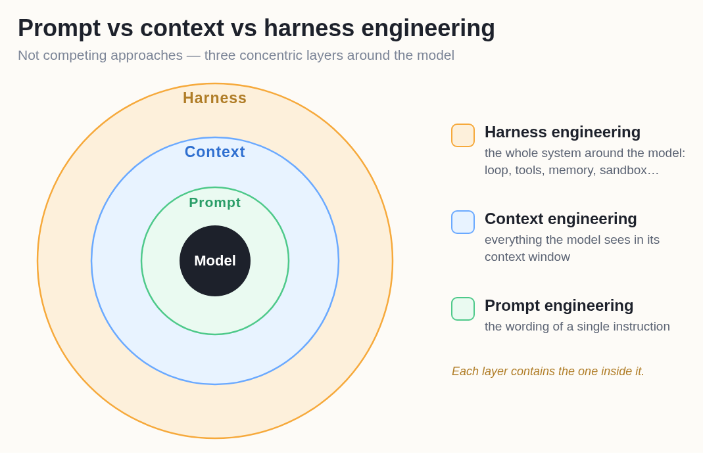
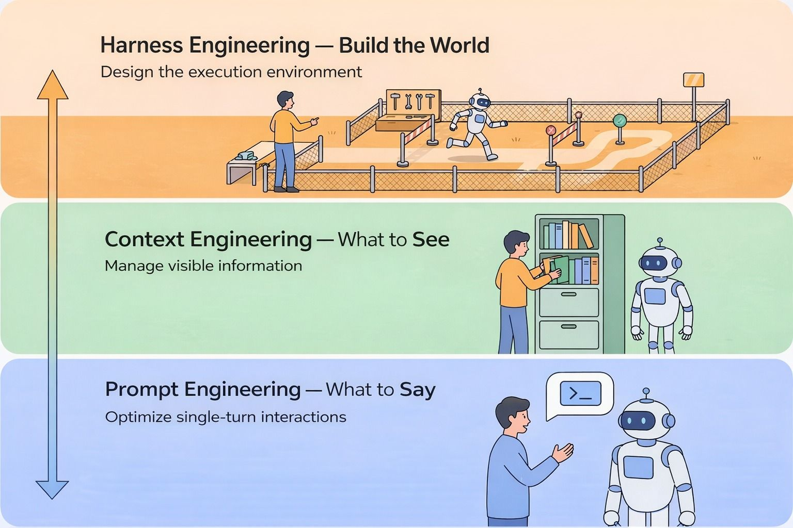
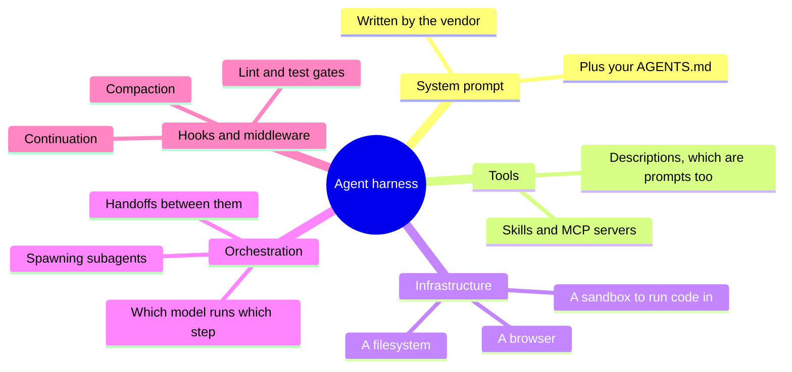
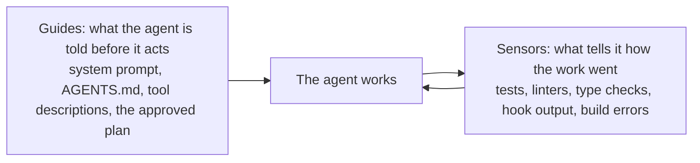
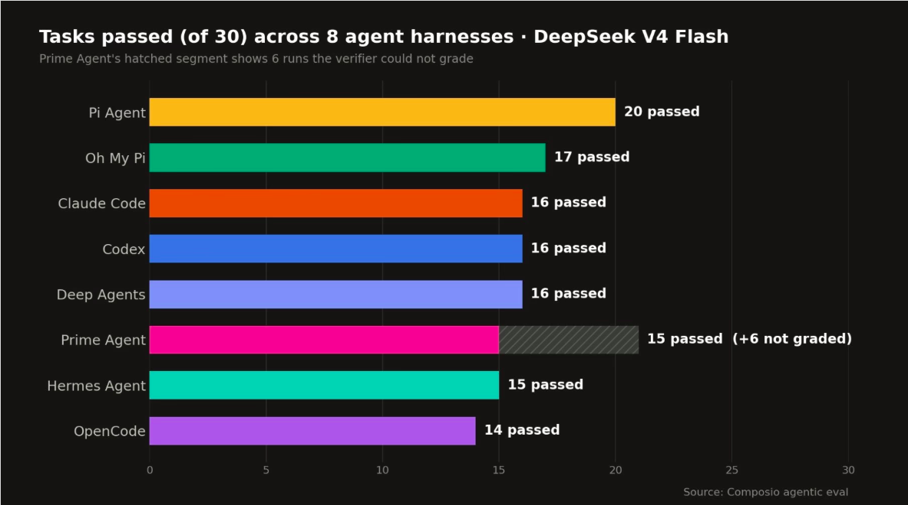
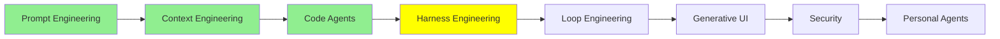

# Harness Engineering

[Code Agents](coding_agents.md) ended with hooks, and hooks were different from everything else in that module. All the other extension points are advice that you give the model. It is good advice, and the model usually follows it. But the model is still the one that decides. A hook is not like that. It is a shell command connected to a fixed point in the agent's life. It runs whether the model wants it to or not.

That difference is what this whole module is about.

## The Problem Prompts Do Not Solve

LLMs are non-deterministic. It does not matter what you do with the prompt or what you put in the context: the same input can give a different answer the next time. And an agent that runs for two hours has a lot of next times.

So asking nicely does not get you a guarantee, no matter how often you ask. Say that the agent must never push to main. You can write "please do not push to main" in your instructions. That works most of the time. But for this particular rule, most of the time is not good enough. What you need instead is something mechanical: wiring around the model that behaves the same way on every run. That wiring must hold while the model does whatever it is going to do.

Designing that wiring is **harness engineering**.

  
*The engine is the prompt: the thing that makes power. The car is the context: the body that is built around the engine, and that decides what the power can do. The track and the barriers are the harness. Notice that the barriers do not steer, and that is the point. They do not make the car go the right way. They make it impossible to go the wrong way.*

The analogy is from [Harness Engineering: What It Is and How It Complements Context Engineering](https://medium.com/@amirkiarafiei/harness-engineering-what-it-is-and-how-it-complements-context-engineering-6545b40bfc84). The next two modules use it again, so it is worth remembering.

## What an Agent Harness is

When you do harness engineering, the result is called an **agent harness**. It is the agent, plus all the mechanical wiring around it, plus the environment that it runs in.

LangChain's [The Anatomy of an Agent Harness](https://www.langchain.com/blog/the-anatomy-of-an-agent-harness) says it in one line: **Agent = Model + Harness.** The model gives the intelligence. The harness makes that intelligence do useful work in a real place, with real files.

This means that the products you already use are harnesses. Claude Code is a harness. Codex is a harness. Pi is a harness. None of them is a model. And if you replace the model inside one of them, less changes than you expect.

Philipp Schmid's [The importance of Agent Harness in 2026](https://www.philschmid.de/agent-harness-2026) says the same thing in computer terms. The model is the CPU. The context window is the RAM: it is small, and it is cleared between runs. The harness is the operating system. It decides what goes into that memory, and it gives the CPU its drivers. Here, the drivers are the tools. The agent is the application that runs on top. His practical advice comes from this picture. Keep the harness simple and easy to delete, because the next model update will make some of today's careful wiring unnecessary.

One thing needs to be clear, because people use the word "harness" loosely. The harness is the **outer** layer. It does not compete with the other two layers. It contains your prompt and context work, and it does not replace that work.

  
*Each ring contains the one inside it. That is why these are never alternatives. When you choose a harness, you have already decided some things about your context. The reason is that the harness compacts the context window, spawns the subagents and writes the system prompt. You cannot do context engineering "instead of" harness engineering. You do it inside the harness that you picked.*

## Four Disciplines, Four Questions

By 2026 this work has divided into four jobs, and each job asks a different question.

  
*Read it from the bottom to the top. Each layer takes in the one below it. Saying is one turn. Seeing is the whole context window. Building the world is everything that the agent can reach, and everything that stops it. The human's job also changes on the way up. At the bottom, the human talks to the robot. At the top, the human builds the place where the robot works.*

- **Prompt engineering**: what should I ask, and how should I ask it?
- **Context engineering**: what should the model see in its context, and in what form?
- **Harness engineering**: how should I design the environment around the agent?
- **Loop engineering**: who decides when it runs again, and when it stops? That is the next module.

## What a Harness is Made Of

[The Anatomy of an Agent Harness](https://www.langchain.com/blog/the-anatomy-of-an-agent-harness) lists the parts. You will recognise most of them from the last module:

Notice that the tool *descriptions* are in the list. A description is a prompt. It is the text that the model reads when it decides whether to call that tool. So if you rename a tool, or rewrite one sentence of its description, the agent behaves differently. That counts as harness work, not prompt work, because you edited the environment and not the request.

The clearest way to organise all of this comes from Birgitta Böckeler's [Harness engineering for coding agent users](https://martinfowler.com/articles/harness-engineering.html). It splits a harness into two kinds of thing:

Guides come before the work. Sensors come after it. What the sensors report goes back to the agent, so that the agent can fix whatever it broke. Almost all harness engineering is adding one or the other. So if you are ever unsure whether something counts as harness work, ask yourself which of the two it is.

The same article makes a second split, and this split applies to both guides and sensors. Every guide and every sensor is one of two types:

- **Computational**: ordinary code runs it, on the CPU. Tests, linters, type checkers and structural analysis are all computational. They are deterministic and fast. They finish in milliseconds to seconds, and the article calls their results reliable. If you run the same check twice, you get the same answer.
- **Inferential**: a model runs it. AI code review, semantic analysis and an "LLM as judge" are all inferential. They can judge meaning, and ordinary code cannot. But they are slower, they cost more, and their results can change from one run to the next.

This is the point of the whole module, again. A computational check is fixed, so it behaves the same way on every run. That is exactly the guarantee that a prompt cannot give you. So use a computational check wherever one can do the job, because it is cheap enough to run on every change. Keep the inferential checks for the questions that only a model can answer.

One example in the article surprises people. A popular addition to coding agents right now is the **language server** (LSP) and code intelligence. These are the same tools that give your editor go-to-definition and live type errors. The article notes that more and more developers talk about them, and it classes them as computational guides. They give the agent exact facts about the code before it acts, so the agent does not have to guess.

## Some Actual Examples

Here are a few concrete things that people really do. None of them is big:

- **A sandbox.** The agent runs commands in a container. The container has no network and a mounted copy of the repository. Now "delete everything" costs you a container.
- **A permission gate.** A `PreToolUse` hook refuses writes outside `src/`, and it refuses `git push` completely. The model can try, but it cannot do it.
- **A test gate on finishing.** A `Stop` hook runs the test suite. If anything is red, the hook tells the agent that it is not done. The agent is not the one that decides it has finished.
- **A format-on-write hook.** A `PostToolUse` hook runs the formatter on every edited file. So the style no longer depends on the agent remembering the style.
- **A loop detector.** Count the edits to each file. After the fifth edit to the same file, tell the agent to stop and think again. Five edits to one file usually means that the agent is stuck in a loop.

That last one is real, and it came with numbers. LangChain's [Improving Deep Agents with harness engineering](https://www.langchain.com/blog/improving-deep-agents-with-harness-engineering) describes five changes that they made to the harness of their coding agent:

- **A rewritten system prompt**, organised around four stages: plan, build, verify, fix.
- **A checklist step** that stops the agent just before it exits. It makes the agent check its own work against the spec.
- **A startup step** that maps the directory tree and the available tools. With this step, the agent knows where it is before it starts.
- **The per-file edit counter** from the list above.
- **A "reasoning sandwich"**: maximum reasoning for the planning and the verification, and less reasoning for the mechanical work in the middle.

**The model did not change.** The Terminal Bench 2.0 score went from 52.8% to 66.5%.

Remember that number, because it is the reason this module exists. Nearly fourteen points came from editing the environment. The weights that did the thinking were the same in both runs.

If you want to build a harness and not only read about one, [How to Build a Custom Agent Harness](https://www.langchain.com/blog/how-to-build-a-custom-agent-harness) shows you how, step by step, with middleware. OpenAI's [Harness engineering: leveraging Codex in an agent-first world](https://openai.com/index/harness-engineering/) shows the same discipline from the other side. Its main lesson is about knowledge. They keep a structured `docs/` directory as the single source of truth. They keep `AGENTS.md` short, as a map that points into that directory. Then they run linters and CI jobs over that documentation. They also have a gardening agent that runs regularly, and its only job is to find the parts that are out of date. That is a sensor pointed at the guides.

## No Harness is Best for Every Model

Here is the finding that surprises people.

Take one model, run it on one benchmark, and change nothing except the harness. The scores move a lot.

  
*One model, one task set, eight harnesses, and the scores go from 14 to 20 out of 30. In the bottom bar and in the top bar, the same weights do the thinking. Also read past the winner. The source measured cost and speed too. The fastest harness here was also the most expensive per success, because it almost never reused its prompt cache.*

That chart is from Composio's [Finding the Best Harness for DeepSeek V4 Flash](https://composio.dev/content/best-agent-harness-deepseek-v4-flash). It ran the model through eight harnesses:

- Pi Agent
- Prime Agent
- OMP
- Claude Code
- Codex
- DeepAgents
- Hermes Agent
- OpenCode

Pi Agent came first at 66.7%, which is twenty of thirty workflows. Claude Code was the fastest, at 122.7 seconds per task, but it cost the most per success.

The lesson is not "use Pi Agent". The lesson is that **the pairing matters**. It is a bit like a t-shirt: there is no single size that fits everybody. Claude Code's harness is tuned for Claude models. Codex's harness is tuned for GPT models. A harness makes assumptions about the model that it was built for: how that model plans, how it handles long tool outputs, and how eager it is to call a tool. If you give the harness a model with different habits, those assumptions stop fitting. Then the model does worse than it would do in a harness built around its own habits.

So when you read that a model is state of the art, ask the honest question: which harness did that number come from?

## The Harnesses are Open Now

The other change by 2026 is that many of these harnesses are open source, and that includes the commercial ones.

Claude Code's harness is open. So is [DeepSeek's](https://github.com/deepseek-ai/deepseek-harness). DeepSeek published it right next to the model that it was tuned for. That tells you the two were designed together. OpenCode, Pi and LangChain's [deepagents](https://github.com/langchain-ai/deepagents) are open. So are the personal agent harnesses, Hermes and OpenClaw. They get their own module, [Personal Agents](personal_agents.md).

This is really useful, and not only because you can read the code. You can take a harness that works and change the parts that do not suit your job. You can:

- replace the system prompt;
- add a middleware;
- change a tool description;
- point it at a different model.

If you want to compare harnesses, there are two maintained lists. [best-of-Agent-Harnesses](https://github.com/RyanAlberts/best-of-Agent-Harnesses) ranks more than a hundred of them and scores them again every week. [awesome-harness-engineering](https://github.com/walkinglabs/awesome-harness-engineering) collects the tools and guides.

> **NOTE:** this module stays at the level of what a harness is and why it matters. [Advanced Harness Engineering](../3_expert/advanced_harness_engineering.md) covers harness profiles, self-evolving harnesses, and the question of how much of the harness is moving inside the model. Böckeler's [Harness engineering for coding agent users](https://martinfowler.com/articles/harness-engineering.html) goes much deeper than the two splits above. It is the place to continue.

## Where this fits in the series

## Summary

A model is non-deterministic. So instructions get you a good success rate, but never a guarantee. The harness is the mechanical part that holds anyway. It includes:

- the system prompt;
- the tools, and the way they are described;
- the filesystem and the sandbox;
- the way subagents get spawned and handed work;
- the hooks that fire whether the model wants them to or not.

Agent = Model + Harness. Claude Code, Codex and Pi are all harnesses. The harness is the outer ring, so it contains your prompt and context work and does not compete with it. There is a simple way to think about what is inside it. Guides are what the agent reads before it acts, and sensors are what tell it how the work went.

All of this is worth real effort, because you can see the effect in the numbers. Five harness changes moved one agent from 52.8% to 66.5% on Terminal Bench 2.0, and the model never changed. The fit is also specific to the model. One model, run through eight different harnesses, scored anywhere from 14 to 20 out of 30. So there is no best harness. There is only a best match.

Next: so far, you are still in the driver's seat. You write the prompt, you read the output, and you decide what happens next. The next module replaces that person.

**Quick Check**: an instruction in AGENTS.md and a `PreToolUse` hook can both stop an agent from touching a file. Why is only one of them harness engineering? And when does the difference really matter?

## References

- [Harness Engineering: What It Is and How It Complements Context Engineering](https://medium.com/@amirkiarafiei/harness-engineering-what-it-is-and-how-it-complements-context-engineering-6545b40bfc84): the car, the track and the barriers, in full detail
- [The Anatomy of an Agent Harness](https://www.langchain.com/blog/the-anatomy-of-an-agent-harness): Agent = Model + Harness, and the list of parts that this module works from
- [How to Build a Custom Agent Harness](https://www.langchain.com/blog/how-to-build-a-custom-agent-harness): how to build one yourself, with middleware
- [Improving Deep Agents with harness engineering](https://www.langchain.com/blog/improving-deep-agents-with-harness-engineering): five concrete changes, and the jump from 52.8% to 66.5% that they produced
- [Harness engineering: leveraging Codex in an agent-first world](https://openai.com/index/harness-engineering/): a team that built a product with agents, and what they had to do to their repository first
- [Harness engineering for coding agent users](https://martinfowler.com/articles/harness-engineering.html): the idea of guides and sensors, the split into computational and inferential, and the most complete text on the subject
- [The importance of Agent Harness in 2026](https://www.philschmid.de/agent-harness-2026): the harness as the operating system around the model, and why it should be easy to delete
- [Finding the Best Harness for DeepSeek V4 Flash](https://composio.dev/content/best-agent-harness-deepseek-v4-flash): eight harnesses and one model, with cost and speed next to the pass rate
- [DeepSeek Harness](https://github.com/deepseek-ai/deepseek-harness): a harness published next to the model it was tuned for
- [deepagents](https://github.com/langchain-ai/deepagents): the open harness from the anatomy article
- [best-of-Agent-Harnesses](https://github.com/RyanAlberts/best-of-Agent-Harnesses): a ranked list of more than a hundred, scored again every week
- [awesome-harness-engineering](https://github.com/walkinglabs/awesome-harness-engineering): tools and guides for the practice
- [Agent Harness Explained in 2 minutes](https://youtube.com/shorts/IVdJj_aNwhE): the short version, if you prefer to watch
- [Agent Harness explained in 8min..](https://www.youtube.com/watch?v=1a1VXDdIyrk): the longer version, which puts the three practices side by side, like the rings above
- [Advanced Harness Engineering](../3_expert/advanced_harness_engineering.md): profiles, self-evolving harnesses, and what is moving into the model
