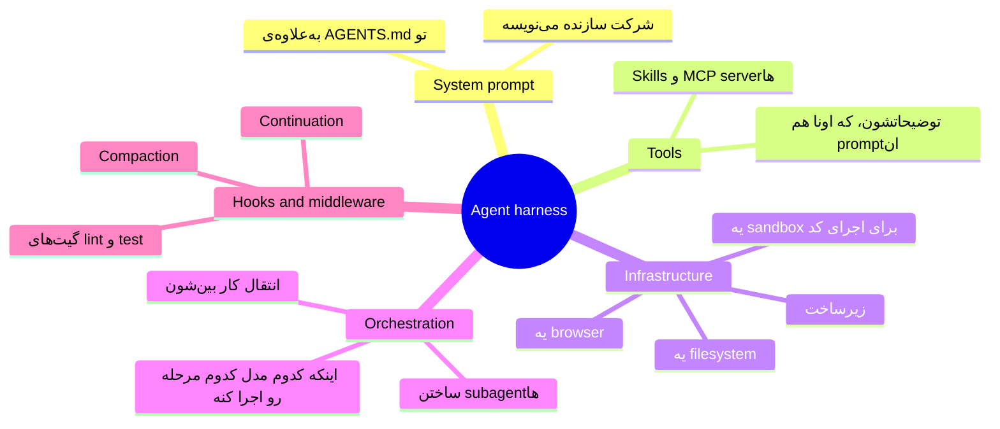
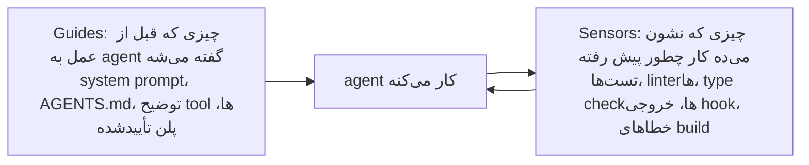
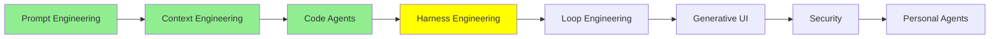

# Harness Engineering

ماژول [Code Agent‌ها](coding_agents_fa.md) آخرش به hook رسید، و hook‌ها توی اون ماژول با بقیه‌ی چیزها فرق داشتن. بقیه‌ی نقطه‌های توسعه همه توصیه‌هایی هستن که به مدل می‌دی. توصیه‌ی خوبیه و مدل معمولاً هم بهش عمل می‌کنه، ولی تصمیم آخر با خود مدله. اما hook یه چیز دیگه‌ست: یه دستور shell که به یه نقطه‌ی ثابت توی زندگی agent وصل شده، و چه مدل بخواد چه نخواد، اجرا می‌شه.

این تفاوت، چیزیه که کل این ماژول دربارشه.

## مشکلی که prompt حلش نمی‌کنه

LLM‌ها non-deterministic هستن. فرقی نمی‌کنه prompt رو چطور بنویسی یا توی context چی بذاری، همون ورودی ممکنه دفعه‌ی بعد یه جواب دیگه بده. حالا یه agent رو در نظر بگیر که دو ساعت داره کار می‌کنه. یه agent این‌جوری یه عالمه «دفعه‌ی بعد» داره، و توی هرکدوم ممکنه یه تصمیم دیگه بگیره.

پس اینکه خوب و مؤدبانه ازش بخوای، هرچقدر هم تکرار کنی، تضمینی نمی‌ده. فرض کن قانونت اینه که agent هیچ‌وقت نباید به main push کنه. می‌تونی توی دستورهات بنویسی «به main push نکن». بیشتر وقت‌ها جواب می‌ده، ولی برای یه قانون مثل این، «بیشتر وقت‌ها» کافی نیست. چیزی که لازم داری یه چیز مکانیکیه. یعنی یه سیم‌کشی دور مدل که توی هر اجرا یه جور رفتار کنه. اون سیم‌کشی باید حتی وقتی مدل هر کاری که می‌خواد می‌کنه، سر جاش بمونه، و طراحی همین سیم‌کشیه که اسمش می‌شه **harness engineering**.

  
*موتور همون prompt هست، یعنی چیزی که قدرت تولید می‌کنه. ماشین همون context هست، یعنی بدنه‌ای که دور موتور ساخته شده و تعیین می‌کنه اون قدرت چی کار می‌تونه بکنه. پیست و موانعش همون harness هستن. به موانع دقت کن: اونا فرمون رو نمی‌چرخونن و ماشین رو به سمت درست نمی‌برن. کارشون اینه که رفتن توی جهت اشتباه رو غیرممکن کنن.*

این تشبیه از مقاله‌ی [Harness Engineering: What It Is and How It Complements Context Engineering](https://medium.com/@amirkiarafiei/harness-engineering-what-it-is-and-how-it-complements-context-engineering-6545b40bfc84) گرفته شده. دو ماژول بعدی هم دوباره ازش استفاده می‌کنن، پس ارزش داره یادت بمونه.

## agent harness یعنی چی

وقتی روی harness engineering کار می‌کنی، نتیجه‌ش می‌شه یه **agent harness**. یعنی خود agent، به‌علاوه‌ی همه‌ی سیم‌کشی‌های مکانیکی‌ای که دورش هست، به‌علاوه‌ی محیطی که توش اجرا می‌شه.

[The Anatomy of an Agent Harness](https://www.langchain.com/blog/the-anatomy-of-an-agent-harness) از LangChain این رو توی یه خط گفته: **Agent = Model + Harness**. مدل هوش رو فراهم می‌کنه، و harness کاری می‌کنه که اون هوش توی یه جای واقعی و با فایل‌های واقعی کار مفید انجام بده.

پس محصول‌هایی که الان استفاده می‌کنی، خودشون harness هستن. Claude Code یه harness هست، Codex هم همین‌طور، و Pi هم. هیچ‌کدومشون مدل نیست. و اگه مدل داخل یکی از اون‌ها رو عوض کنی، کمتر از چیزی که فکر می‌کنی عوض می‌شه.

Philipp Schmid توی [The importance of Agent Harness in 2026](https://www.philschmid.de/agent-harness-2026) همین حرف رو با زبون کامپیوتر می‌زنه. مدل همون CPU هست، و context window همون RAM که کوچیکه و بین هر اجرا پاک می‌شه. harness هم همون سیستم‌عامله، که تصمیم می‌گیره چی وارد اون حافظه بشه و درایورهای CPU رو هم فراهم کنه. اینجا درایورها همون tool‌ها هستن، و agent هم برنامه‌ای هست که روی این سیستم‌عامل اجرا می‌شه.

نصیحت عملی Schmid هم از همین تصویر میاد: harness رو ساده نگه دار و طوری بساز که راحت بشه حذفش کرد. دلیلش اینه که آپدیت بعدی مدل، بعضی از سیم‌کشی‌های دقیق امروز رو بی‌فایده می‌کنه.

یه نکته باید روشن باشه، چون آدم‌ها کلمه‌ی «harness» رو شل به کار می‌برن. harness لایه‌ی **بیرونی** هست و با دو لایه‌ی دیگه رقابت نمی‌کنه. کار prompt و context رو توی خودش داره، و جای اون کار رو نمی‌گیره.

  
*هر حلقه، حلقه‌ی داخلی‌اش رو در خودش داره، و برای همین این سه تا هیچ‌وقت جایگزین هم نیستن. وقتی یه harness رو انتخاب می‌کنی، از قبل بعضی چیزها رو درباره‌ی context تصمیم گرفتی. دلیلش اینه که harness پنجره‌ی context رو فشرده می‌کنه، subagent‌ها رو راه می‌ندازه و system prompt رو می‌نویسه. پس نمی‌شه context engineering رو «به‌جای» harness engineering انجام داد. اون رو داخل همون harness انجام می‌دی که انتخاب کردی.*

## چهار کار، چهار سؤال

تا 2026 این کار به چهار بخش تقسیم شده، و هر بخش یه سؤال متفاوت می‌پرسه.

  
*از پایین به بالا بخونش. هر لایه، لایه‌ی زیرش رو در خودش می‌گیره. گفتن یه نوبته. دیدن یعنی کل پنجره‌ی context. ساختن دنیا یعنی هر چیزی که agent بهش دسترسی داره، و هر چیزی که جلوشو می‌گیره. نقش آدم هم وقتی بالاتر می‌ری عوض می‌شه: پایین، آدم با ربات حرف می‌زنه، و بالا، آدم جایی رو می‌سازه که ربات توش کار می‌کنه.*

- **Prompt engineering**: چی باید بپرسی و چطوری بپرسی؟
- **Context engineering**: مدل توی context چی ببینه، و اون باید به چه شکلی باشه؟
- **Harness engineering**: محیط اطراف agent رو چطوری طراحی کنی؟
- **Loop engineering**: چه کسی تصمیم می‌گیره کی دوباره اجرا بشه، و کی باید متوقف بشه؟ این موضوع ماژول بعدیه.

## harness از چی ساخته شده

[The Anatomy of an Agent Harness](https://www.langchain.com/blog/the-anatomy-of-an-agent-harness) اجزای یه harness رو فهرست می‌کنه. بیشترشون رو از ماژول قبلی می‌شناسی:

دقت کن که توضیح tool‌ها هم توی این فهرست هست. هر توضیح یه prompte: متنیه که مدل، وقتی می‌خواد تصمیم بگیره اون tool رو صدا بزنه یا نه، می‌خونه. پس اگه اسم یه tool رو عوض کنی، یا فقط یه جمله از توضیحش رو بازنویسی کنی، رفتار agent عوض می‌شه. این کار رو باید کار harness حساب کنی، نه کار prompt، چون محیط رو عوض کردی، نه درخواست رو.

Birgitta Böckeler توی [Harness engineering for coding agent users](https://martinfowler.com/articles/harness-engineering.html) واضح‌ترین راه برای مرتب کردن همه‌ی این‌ها رو پیشنهاد می‌کنه. اون harness رو به دو نوع چیز تقسیم می‌کنه:

guide‌ها قبل از کار میان و sensor‌ها بعد از کار. چیزی که sensor‌ها گزارش می‌دن برمی‌گرده پیش agent، تا agent بتونه هر چیزی رو که خراب کرده درست کنه. تقریباً تمام کار harness engineering اضافه کردن یکی از این دو تاست. پس اگه یه وقت نمی‌دونی یه کاری جزو کار harness هست یا نه، از خودت بپرس کدوم‌شونه.

مقاله یه تقسیم دوم هم داره، و این یکی هم برای guide‌ها و هم برای sensor‌ها صدق می‌کنه. هر guide و هر sensor یکی از دو نوعه:

- **Computational**: کد معمولی روی CPU اجراشون می‌کنه. تست‌ها، linter‌ها، type checker‌ها و تحلیل ساختاری همه computational هستن. این‌ها قطعی و سریعن. توی چند میلی‌ثانیه تا چند ثانیه تموم می‌شن، و مقاله می‌گه نتیجه‌شون قابل اعتماده. اگه یه چک رو دوبار اجرا کنی، همون جواب رو می‌گیری.
- **Inferential**: یه مدل اجراشون می‌کنه. بازبینی کد با AI، تحلیل معنایی و «LLM به‌عنوان قاضی» همه inferential هستن. این‌ها معنا رو می‌سنجن، و کد معمولی از پسش برنمیاد. ولی کندترن، هزینه‌ی بیشتری دارن، و نتیجه‌شون ممکنه از یه اجرا به اجرای بعد عوض بشه.

این همون نکته‌ی اصلی کل ماژوله، این بار دوباره. یه چک computational ثابته، پس توی هر اجرا همون رفتار رو داره؛ دقیقاً همون تضمینی که prompt نمی‌تونه بده. پس هر جا یه چک computational بتونه کار رو انجام بده، ازش استفاده کن، چون اونقدر ارزونه که بشه توی هر تغییر اجراش کرد. چک‌های inferential رو برای سؤال‌هایی نگه دار که فقط یه مدل می‌تونه جوابشون رو بده.

یه مثال توی مقاله هست که خیلی‌ها رو شگفت‌زده می‌کنه. الان یه اضافه‌ی محبوب به coding agent‌ها، **language server** (LSP) و code intelligence هست. این‌ها همون ابزارهایی‌ان که به ادیتورت امکان go-to-definition و نمایش زنده‌ی خطاهای نوع (type error) رو می‌دن. مقاله می‌گه توسعه‌دهنده‌ها بیشتر و بیشتر درباره‌شون حرف می‌زنن، و اون‌ها رو guide‌های computational دسته‌بندی می‌کنه. قبل از اینکه agent دست به کاری بزنه، اطلاعات دقیقی درباره‌ی کد بهش می‌دن، پس لازم نیست حدس بزنه.

## چند مثال واقعی

چند کار مشخص هست که آدم‌ها واقعاً انجامشون می‌دن. هیچ‌کدومشون هم بزرگ نیست:

- **یه sandbox.** agent دستورها رو توی یه container اجرا می‌کنه. این container شبکه نداره و یه کپی mount شده از repository داره. حالا «همه‌چیز رو پاک کن» فقط یه container رو از بین می‌بره.
- **یه permission gate.** یه hook از نوع `PreToolUse` نوشتن بیرون از `src/` رو رد می‌کنه، و `git push` رو کلاً می‌بنده. مدل می‌تونه امتحانش کنه، ولی نمی‌تونه انجامش بده.
- **یه گیت تست برای تموم کردن کار.** یه hook از نوع `Stop` مجموعه‌ی تست رو اجرا می‌کنه. اگه یه چیزی قرمز باشه، hook به agent می‌گه که هنوز کارش تموم نشده. خود agent تصمیم نمی‌گیره که کارش تموم شده.
- **یه hook فرمت‌دهی هنگام نوشتن.** یه hook از نوع `PostToolUse` بعد از هر فایلی که ویرایش شده، formatter رو اجرا می‌کنه. پس دیگه سبک کد به این بستگی نداره که agent سبک درست رو یادش باشه.
- **یه تشخیص‌دهنده‌ی حلقه.** تعداد ویرایش‌های هر فایل رو بشمار. بعد از پنجمین ویرایش روی یه فایل، به agent بگو وایسه و دوباره فکر کنه. پنج بار ویرایش یه فایل معمولاً یعنی agent توی یه حلقه گیر کرده.

اون آخری واقعیه، و عدد هم پشتشه. توی [Improving Deep Agents with harness engineering](https://www.langchain.com/blog/improving-deep-agents-with-harness-engineering) تیم LangChain پنج تغییری رو شرح می‌ده که توی harness مربوط به coding agent خودشون دادن:

- **یه system prompt بازنویسی‌شده**، که حول چهار مرحله چیده شده: plan، build، verify و fix.
- **یه مرحله‌ی checklist** که درست قبل از خروج، agent رو نگه می‌داره و وادارش می‌کنه کارش رو با spec مقایسه کنه.
- **یه مرحله‌ی شروع** که ساختار پوشه‌ها و tool‌های موجود رو نقشه‌برداری می‌کنه. با این مرحله، agent قبل از شروع کار می‌دونه کجاست.
- **شمارنده‌ی ویرایش برای هر فایل**، همون که بالاتر گفتیم.
- **یه «reasoning sandwich»**: بیشترین استدلال (reasoning) برای برنامه‌ریزی و تأیید، و کمترین استدلال برای کارهای مکانیکی وسط.

**مدل عوض نشد.** امتیاز Terminal Bench 2.0 از 52.8% به 66.5% رسید.

این عدد رو یادت باشه، چون دلیل وجود این ماژول همینه. نزدیک چهارده امتیاز از ویرایش محیط اومد. وزن‌های مدل، که کار فکر کردن رو انجام می‌دادن، توی هر دو اجرا یکی بودن.

اگه بخوای harness بسازی و نه فقط درباره‌اش بخونی، [How to Build a Custom Agent Harness](https://www.langchain.com/blog/how-to-build-a-custom-agent-harness) قدم‌به‌قدم و با middleware نشون می‌ده چطوری. انضباط مشابهی رو از سمت دیگه، توی [Harness engineering: leveraging Codex in an agent-first world](https://openai.com/index/harness-engineering/) از OpenAI می‌شه دید. درس اصلی‌شون درباره‌ی دانشه: اون‌ها یه پوشه‌ی `docs/` ساخت‌یافته رو به‌عنوان تنها منبع حقیقت نگه می‌دارن، و `AGENTS.md` رو کوتاه نگه می‌دارن تا فقط یه نقشه باشه که به اون پوشه اشاره کنه. بعد روی همین مستندات linter و CI job اجرا می‌کنن.

یه gardening agent هم دارن که مرتب اجرا می‌شه، و کارش فقط پیدا کردن بخش‌هایی هست که دیگه به‌روز نیستن. این یه sensor هست که روی guide‌ها تنظیم شده.

## هیچ harness برای همه‌ی مدل‌ها بهترین نیست

یافته‌ای که خیلی‌ها رو شگفت‌زده می‌کنه اینه: یه مدل رو بردار، روی یه benchmark اجراش کن، و هیچی رو عوض نکن جز harness. امتیازها خیلی جابه‌جا می‌شن.

  
*یه مدل، یه مجموعه کار، هشت harness، و امتیازها از 14 تا 20 از 30 فرق می‌کنن. توی نوار پایین و نوار بالا، همون وزن‌ها دارن فکر می‌کنن. ولی فقط به برنده نگاه نکن. منبع هزینه و سرعت رو هم اندازه گرفته بود، و سریع‌ترین harness این جدول به ازای هر موفقیت گران‌ترین هم بود، چون تقریباً هیچ‌وقت prompt cache خودش رو دوباره استفاده نمی‌کرد.*

این نمودار مال Composio هست و از [Finding the Best Harness for DeepSeek V4 Flash](https://composio.dev/content/best-agent-harness-deepseek-v4-flash) گرفته شده. اون‌ها مدل رو از این هشت harness گذروندن:

- Pi Agent
- Prime Agent
- OMP
- Claude Code
- Codex
- DeepAgents
- Hermes Agent
- OpenCode

Pi Agent با 66.7% اول شد، یعنی بیست تا از سی workflow. Claude Code سریع‌ترین بود، با 122.7 ثانیه برای هر کار، ولی به ازای هر موفقیت گران‌ترین هم بود.

درس این نیست که «Pi Agent رو استفاده کن». درس اینه که **تطابق (pairing) مهمه**. یه‌جورایی مثل تی‌شرته: هیچ سایز واحدی برای همه نیست. harness مربوط به Claude Code برای مدل‌های Claude تنظیم شده، و Codex هم برای مدل‌های GPT. یه harness درباره‌ی مدلی که برایش ساخته شده فرض‌هایی داره: اینکه اون مدل چطور برنامه‌ریزی می‌کنه، با خروجی‌های طولانی tool چطور برخورد می‌کنه، و اینکه چقدر زود یه tool رو صدا می‌زنه. وقتی یه مدل با عادت‌های دیگه رو توی اون بذاری، این فرض‌ها دیگه جور در نمی‌یان. اون وقت مدل بدتر از چیزی عمل می‌کنه که توی harnessی که برای عادت‌های خودش ساخته شده بود عمل می‌کرد.

پس وقتی می‌خونی یه مدل state of the art هست، این سؤال درست رو از خودت بپرس: اون عدد از کدوم harness درومده؟

## harness‌ها الان open هستن

تغییر دیگه‌ای که تا 2026 اتفاق افتاد اینه که خیلی از این harness‌ها متن‌بازن، و حتی تجاری‌ها هم توشون هستن. harness مربوط به Claude Code بازه، و harness [DeepSeek](https://github.com/deepseek-ai/deepseek-harness) هم همین‌طور. DeepSeek اون رو درست کنار مدلی منتشر کرده که برایش تنظیمش کرده، و این یعنی این دو تا با هم طراحی شدن. OpenCode و Pi و [deepagents](https://github.com/langchain-ai/deepagents) از LangChain هم بازن. personal agent harness‌های Hermes و OpenClaw هم همین‌طورن، و اون‌ها ماژول خودشون رو دارن: [Personal Agent‌ها](personal_agents_fa.md).

این واقعاً مفیده، و نه فقط چون می‌تونی کدش رو بخونی. یه harness که کار می‌کنه رو برمی‌داری و بخش‌هایی رو که به کارت نمی‌خورن عوض می‌کنی. مثلاً می‌تونی:

- system prompt رو عوض کنی؛
- یه middleware اضافه کنی؛
- توضیح یه tool رو عوض کنی؛
- harness رو به یه مدل دیگه وصل کنی.

اگه بخوای harness‌ها رو با هم مقایسه کنی، دوتا فهرست نگهداری‌شده هست. [best-of-Agent-Harnesses](https://github.com/RyanAlberts/best-of-Agent-Harnesses) بیشتر از صد تا رو رتبه‌بندی می‌کنه و هر هفته امتیازشون رو دوباره حساب می‌کنه. [awesome-harness-engineering](https://github.com/walkinglabs/awesome-harness-engineering) ابزارها و راهنماهای این حوزه رو جمع کرده.

> **نکته:** این ماژول فقط در حد همین می‌مونه که harness چیه و چرا مهمه. [Advanced Harness Engineering](../3_expert/advanced_harness_engineering.md) درباره‌ی profile‌های harness، harness‌های خودتکامل، و این سؤال حرف می‌زنه که چقدر از harness داره وارد خود مدل می‌شه. نوشته‌ی Böckeler، یعنی [Harness engineering for coding agent users](https://martinfowler.com/articles/harness-engineering.html)، خیلی عمیق‌تر از دو تقسیم بالا میره، و اگه بخوای ادامه بدی، اون‌جا رو بخون.

## کجای این مجموعه هستیم

## خلاصه

مدل non-deterministic هست، پس دستورها یه نرخ موفقیت خوب بهت می‌دن، ولی هیچ‌وقت تضمین نمی‌دن. harness بخش مکانیکیه که با این وجود سر جاش می‌مونه. این‌ها رو شامل می‌شه:

- system prompt؛
- tool‌ها و روشی که توضیح داده می‌شن؛
- filesystem و sandbox؛
- نحوه‌ی ساخته شدن subagent‌ها و تحویل کار بهشون؛
- hook‌هایی که خودشون اجرا می‌شن، چه مدل بخواد چه نخواد.

Agent = Model + Harness. Claude Code و Codex و Pi همه harness هستن. harness لایه‌ی بیرونیه، پس کار prompt و context رو در خودش داره و با اون‌ها رقابت نمی‌کنه. یه راه ساده برای فکر کردن به چیزهایی که داخلشه هم هست: guide‌ها همون چیزهایی هستن که agent قبل از عمل می‌خونه، و sensor‌ها همون چیزهایی هستن که بهش می‌گن کارش چطور پیش رفته.

همه‌ی این کار ارزش تلاش داره، چون اثرش توی عدد دیده می‌شه. پنج تغییر توی harness یه agent رو از 52.8% به 66.5% توی Terminal Bench 2.0 رسوند، و مدل هیچ‌وقت عوض نشد. این تناسب مخصوص مدله هم هست. یه مدل که از هشت harness مختلف گذشت، بین 14 تا 20 از 30 امتیاز گرفت. پس هیچ harness بهترینی وجود نداره، فقط یه بهترین تطابق هست.

ادامه‌ش این‌طوره: تا اینجا هنوز پشت فرمونی. prompt رو خودت می‌نویسی، خروجی رو خودت می‌خونی، و خودت تصمیم می‌گیری بعدش چی بشه. ماژول بعدی جای همین آدم رو می‌گیره.

**بررسی سریع**: یه دستور توی AGENTS.md و یه hook از نوع `PreToolUse` هر دو می‌تونن جلوی یه agent رو بگیرن که به یه فایل دست بزنه. چرا فقط یکی‌شون جزو harness engineering هست؟ و این تفاوت کی واقعاً مهم می‌شه؟

## منابع

- [Harness Engineering: What It Is and How It Complements Context Engineering](https://medium.com/@amirkiarafiei/harness-engineering-what-it-is-and-how-it-complements-context-engineering-6545b40bfc84): تشبیه ماشین، پیست و موانع، با همه‌ی جزئیات
- [The Anatomy of an Agent Harness](https://www.langchain.com/blog/the-anatomy-of-an-agent-harness): Agent = Model + Harness، و فهرست اجزایی که این ماژول ازشون استفاده می‌کنه
- [How to Build a Custom Agent Harness](https://www.langchain.com/blog/how-to-build-a-custom-agent-harness): راهنمای ساختن harness خودت، با middleware
- [Improving Deep Agents with harness engineering](https://www.langchain.com/blog/improving-deep-agents-with-harness-engineering): پنج تغییر مشخص، و جهشی که از 52.8% به 66.5% رسید
- [Harness engineering: leveraging Codex in an agent-first world](https://openai.com/index/harness-engineering/): تیمی که با agent یه محصول ساخت، و اینکه قبلش مجبور شد repository خودش رو چطور آماده کنه
- [Harness engineering for coding agent users](https://martinfowler.com/articles/harness-engineering.html): ایده‌ی guide و sensor، تقسیم به computational و inferential، و کامل‌ترین متن درباره‌ی این موضوع
- [The importance of Agent Harness in 2026](https://www.philschmid.de/agent-harness-2026): harness به‌عنوان سیستم‌عامل دور مدل، و اینکه چرا باید راحت حذف بشه
- [Finding the Best Harness for DeepSeek V4 Flash](https://composio.dev/content/best-agent-harness-deepseek-v4-flash): هشت harness و یه مدل، با هزینه و سرعت کنار نرخ موفقیت
- [DeepSeek Harness](https://github.com/deepseek-ai/deepseek-harness): harnessی که کنار مدلی که براش تنظیم شده منتشر شده
- [deepagents](https://github.com/langchain-ai/deepagents): harness بازی که توی مقاله‌ی anatomy ازش اسم برده شد
- [best-of-Agent-Harnesses](https://github.com/RyanAlberts/best-of-Agent-Harnesses): فهرست رتبه‌بندی‌شده‌ی بیش از صد تا، که هر هفته دوباره امتیاز می‌گیره
- [awesome-harness-engineering](https://github.com/walkinglabs/awesome-harness-engineering): ابزارها و راهنماهایی برای این حوزه
- [Agent Harness Explained in 2 minutes](https://youtube.com/shorts/IVdJj_aNwhE): نسخه‌ی کوتاه، اگه ترجیح می‌دی ویدیو ببینی
- [Agent Harness explained in 8min..](https://www.youtube.com/watch?v=1a1VXDdIyrk): نسخه‌ی بلندتر، که سه روش رو کنار هم می‌ذاره، مثل همون حلقه‌هایی که بالاتر دیدیم
- [Advanced Harness Engineering](../3_expert/advanced_harness_engineering.md): profile‌ها، harness‌های خودتکامل، و اینکه چی داره وارد خود مدل می‌شه
