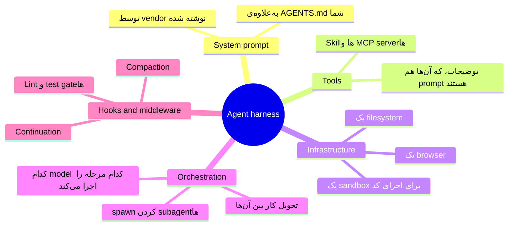
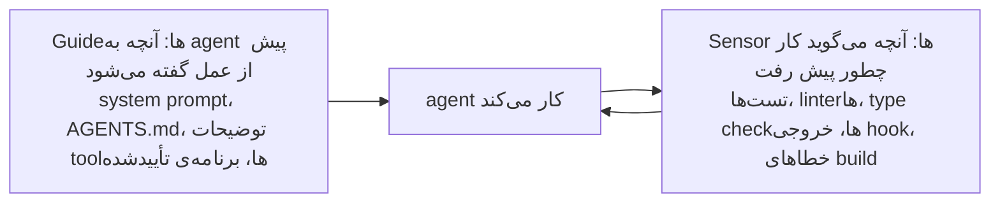
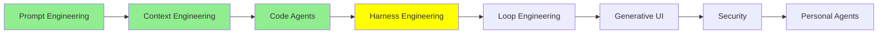

# Harness Engineering

[Code Agent‌ها](coding_agents_fa.md) با hook‌ها تمام شد، و hook‌ها با بقیه‌ی چیزهای آن ماژول فرق داشتند. همه‌ی extension point‌های دیگر، توصیه‌هایی هستند که به مدل می‌دهید. توصیه‌های خوبی هستند و مدل معمولاً از آن‌ها پیروی می‌کند. اما مدل هنوز همان کسی است که تصمیم می‌گیرد. hook این‌طور نیست. hook یک دستور shell است که به یک نقطه‌ی ثابت در زندگی agent وصل شده است. اجرا می‌شود، چه مدل بخواهد چه نخواهد.

این تفاوت، کل موضوع این ماژول است.

## مشکلی که Prompt‌ها حل نمی‌کنند

LLM‌ها non-deterministic هستند. فرقی نمی‌کند با prompt چه کنید یا چه چیزی را در context بگذارید: همان input ممکن است دفعه‌ی بعد جواب دیگری بدهد. و یک agent که دو ساعت اجرا می‌شود، دفعه‌های بعد زیادی دارد.

پس با مؤدبانه خواستن، هر قدر هم که بخواهید، تضمینی به شما نمی‌دهد. فرض کنید باید agent هرگز به main push نکند. می‌توانید در دستورالعمل‌هایتان بنویسید: «لطفاً به main push نکن.» این کار بیشتر وقت‌ها جواب می‌دهد. اما برای این قانون خاص، «بیشتر وقت‌ها» کافی نیست. چیزی که لازم دارید مکانیکی است: یک سیم‌کشی اطراف مدل که در هر اجرا به یک شکل رفتار کند. آن سیم‌کشی باید برقرار بماند، هر کاری که مدل قرار است انجام دهد.

طراحی آن سیم‌کشی همان **harness engineering** است.

  
*موتور، prompt است: چیزی که قدرت تولید می‌کند. ماشین، context است: بدنه‌ای که دور موتور ساخته شده و تعیین می‌کند آن قدرت چه کاری می‌تواند انجام دهد. پیست و موانع، harness هستند. به موانع توجه کنید که فرمان را نمی‌چرخانند، و نکته‌ی اصلی همین است. آن‌ها ماشین را به مسیر درست نمی‌برند. آن‌ها رفتن به مسیر اشتباه را ناممکن می‌کنند.*

این تشبیه از [Harness Engineering: What It Is and How It Complements Context Engineering](https://medium.com/@amirkiarafiei/harness-engineering-what-it-is-and-how-it-complements-context-engineering-6545b40bfc84) گرفته شده است. دو ماژول بعدی دوباره از آن استفاده می‌کنند، پس ارزش دارد آن را به خاطر بسپارید.

## Agent Harness چیست

وقتی harness engineering انجام می‌دهید، نتیجه **agent harness** نام دارد. این همان agent است، به‌علاوه‌ی تمام سیم‌کشی مکانیکی اطرافش، به‌علاوه‌ی محیطی که در آن اجرا می‌شود.

نوشته‌ی [The Anatomy of an Agent Harness](https://www.langchain.com/blog/the-anatomy-of-an-agent-harness) از LangChain این را در یک خط می‌گوید: **Agent = Model + Harness.** مدل هوش را فراهم می‌کند. harness کاری می‌کند که آن هوش، در یک محل واقعی و با فایل‌های واقعی، کار مفید انجام دهد.

یعنی محصول‌هایی که از قبل استفاده می‌کنید، harness هستند. Claude Code یک harness است. Codex یک harness است. Pi یک harness است. هیچ‌کدام از آن‌ها یک model نیستند. و اگر model داخل یکی از آن‌ها را عوض کنید، تغییرات کمتر از آن است که انتظار دارید.

نوشته‌ی [The importance of Agent Harness in 2026](https://www.philschmid.de/agent-harness-2026) از Philipp Schmid همین را با زبان کامپیوتر می‌گوید. model همان CPU است. context window همان RAM است: کوچک است و بین اجراها پاک می‌شود. harness همان operating system است. تصمیم می‌گیرد چه چیزی وارد آن حافظه شود، و driver‌های لازم برای CPU را فراهم می‌کند. در این تشبیه، driver‌ها همان tool‌ها هستند. agent برنامه‌ای است که روی آن اجرا می‌شود. توصیه‌ی عملی او از همین تصویر می‌آید. harness را ساده و آسان برای حذف نگه دارید، چون به‌روزرسانی بعدی model، بعضی از سیم‌کشی‌های دقیق امروز را بی‌نیاز می‌کند.

یک نکته باید روشن باشد، چون مردم کلمه‌ی «harness» را بی‌دقت به کار می‌برند. harness لایه‌ی **بیرونی** است. با دو لایه‌ی دیگر رقابت نمی‌کند. کار prompt و context شما را در خود دارد و جای آن کار را نمی‌گیرد.

  
*هر حلقه، حلقه‌ی داخلی‌اش را در بر دارد. به همین دلیل این‌ها هرگز جایگزین هم نیستند. وقتی یک harness را انتخاب می‌کنید، از قبل درباره‌ی بعضی چیزهای context خود تصمیم گرفته‌اید. دلیلش این است که harness، context window را compact می‌کند، subagent‌ها را spawn می‌کند و system prompt را می‌نویسد. شما نمی‌توانید context engineering را «به‌جای» harness engineering انجام دهید. آن را داخل همان harness انجام می‌دهید که انتخاب کرده‌اید.*

## چهار حوزه، چهار سؤال

تا سال 2026، این کار به چهار کار جدا تقسیم شده است، و هر کار سؤال متفاوتی می‌پرسد.

  
*آن را از پایین به بالا بخوانید. هر لایه، لایه‌ی زیر خود را در بر می‌گیرد. گفتن، یک نوبت است. دیدن، کل context window است. ساختن دنیا یعنی همه‌ی چیزهایی که agent می‌تواند به آن برسد، و همه‌ی چیزهایی که جلویش را می‌گیرند. کار انسان هم با بالا رفتن تغییر می‌کند. در پایین، انسان با ربات حرف می‌زند. در بالا، انسان جایی را می‌سازد که ربات در آن کار می‌کند.*

- **Prompt engineering**: چه چیزی باید بپرسم، و چطور باید بپرسم؟
- **Context engineering**: model باید در context خود چه چیزی ببیند، و در چه شکلی؟
- **Harness engineering**: چطور محیط اطراف agent را طراحی کنم؟
- **Loop engineering**: چه کسی تصمیم می‌گیرد که agent کی دوباره اجرا شود، و کی متوقف شود؟ این موضوع ماژول بعدی است.

## یک Harness از چه ساخته شده است

نوشته‌ی [The Anatomy of an Agent Harness](https://www.langchain.com/blog/the-anatomy-of-an-agent-harness) بخش‌های آن را فهرست می‌کند. بیشتر آن‌ها را از ماژول قبلی می‌شناسید:

توجه کنید که *توضیحات* tool‌ها هم در این فهرست آمده‌اند. توضیحات یک prompt است. متنی است که model هنگام تصمیم‌گیری درباره‌ی فراخوانی آن tool می‌خواند. پس اگر نام یک tool را عوض کنید، یا یک جمله از توضیحش را دوباره بنویسید، agent رفتار متفاوتی نشان می‌دهد. این کار، کار harness حساب می‌شود، نه کار prompt، چون محیط را ویرایش کرده‌اید، نه درخواست را.

واضح‌ترین راه برای سازمان‌دهی همه‌ی این‌ها از نوشته‌ی Birgitta Böckeler با عنوان [Harness engineering for coding agent users](https://martinfowler.com/articles/harness-engineering.html) می‌آید. این نوشته، یک harness را به دو نوع چیز تقسیم می‌کند:

Guide‌ها پیش از کار می‌آیند. Sensor‌ها بعد از آن می‌آیند. گزارش sensor‌ها به agent برمی‌گردد تا agent هر چیزی را که خراب کرده درست کند. تقریباً همه‌ی harness engineering، افزودن یکی از این دو است. پس اگر مطمئن نیستید که چیزی کار harness حساب می‌شود یا نه، از خودتان بپرسید که کدام‌یک از این دو است.

همان نوشته، یک تقسیم دوم هم دارد، و این تقسیم هم برای guide‌ها و هم برای sensor‌ها صدق می‌کند. هر guide و هر sensor یکی از دو نوع است:

- **Computational**: کد معمولی آن را روی CPU اجرا می‌کند. تست‌ها، linter‌ها، type checker‌ها و تحلیل ساختاری همه computational هستند. آن‌ها deterministic و سریع هستند. در بازه‌ی چند میلی‌ثانیه تا چند ثانیه تمام می‌شوند، و نوشته نتایجشان را قابل‌اعتماد می‌داند. اگر همان بررسی را دو بار اجرا کنید، همان جواب را می‌گیرید.
- **Inferential**: یک model آن را اجرا می‌کند. AI code review، تحلیل معنایی (semantic) و «LLM as judge» همه inferential هستند. آن‌ها می‌توانند معنا را ارزیابی کنند، و کد معمولی نمی‌تواند. اما کندترند، هزینه‌ی بیشتری دارند، و نتایجشان ممکن است از یک اجرا تا اجرای بعدی تغییر کند.

این باز هم نکته‌ی کل ماژول است. یک بررسی computational ثابت است، پس در هر اجرا به همان شکل رفتار می‌کند. این دقیقاً همان تضمینی است که یک prompt نمی‌تواند به شما بدهد. پس هر جا که یک بررسی computational بتواند کار را انجام دهد، از آن استفاده کنید، چون آن‌قدر ارزان است که بشود روی هر تغییر اجرایش کرد. بررسی‌های inferential را برای سؤال‌هایی نگه دارید که فقط یک model می‌تواند به آن‌ها جواب دهد.

یک مثال در این نوشته مردم را شگفت‌زده می‌کند. الان یک افزودنی محبوب به coding agent‌ها، **language server** (LSP) و code intelligence است. این‌ها همان ابزارهایی هستند که به ویرایشگرتان go-to-definition و خطاهای type زنده می‌دهند. نوشته یادآوری می‌کند که تعداد بیشتری از توسعه‌دهندگان درباره‌ی آن‌ها حرف می‌زنند، و آن‌ها را به‌عنوان computational guide دسته‌بندی می‌کند. این‌ها پیش از عمل، حقایق دقیقی درباره‌ی کد به agent می‌دهند، پس agent مجبور نیست حدس بزند.

## چند مثال واقعی

این‌ها چند کار مشخص است که مردم واقعاً انجام می‌دهند. هیچ‌کدام از آن‌ها بزرگ نیست:

- **یک sandbox.** agent دستورها را داخل یک container اجرا می‌کند. این container هیچ network ندارد و یک کپی mount‌شده از repository داخلش است. حالا «همه‌چیز را پاک کن» فقط یک container برای شما هزینه دارد.
- **یک permission gate.** یک hook از نوع `PreToolUse` نوشتن خارج از `src/` را رد می‌کند و `git push` را کامل رد می‌کند. مدل می‌تواند تلاش کند، اما نمی‌تواند آن را انجام دهد.
- **یک test gate در پایان کار.** یک hook از نوع `Stop` کل test suite را اجرا می‌کند. اگر هر چیزی قرمز (شکست‌خورده) باشد، hook به agent می‌گوید که کارش تمام نشده است. agent تصمیم نمی‌گیرد که کارش تمام شده است.
- **یک format-on-write hook.** یک hook از نوع `PostToolUse` شکل‌دهنده‌ی کد (formatter) را روی هر فایلی که ویرایش شده اجرا می‌کند. پس سبک کد دیگر به یادآوری agent از سبک بستگی ندارد.
- **یک loop detector.** تعداد edit‌های هر فایل را بشمارید. بعد از پنجمین edit روی یک فایل، به agent بگویید بایستد و دوباره فکر کند. پنج edit روی یک فایل معمولاً یعنی agent در یک loop گیر کرده است.

آخرین مورد واقعی است، و عدد هم برایش داریم. نوشته‌ی [Improving Deep Agents with harness engineering](https://www.langchain.com/blog/improving-deep-agents-with-harness-engineering) از LangChain پنج تغییری را شرح می‌دهد که آن‌ها در harness مربوط به coding agent خود ایجاد کردند:

- **یک system prompt بازنویسی‌شده**، با چهار مرحله سازمان‌دهی شده: plan، build، verify، fix.
- **یک مرحله‌ی checklist** که agent را درست پیش از خروج متوقف می‌کند. agent را وادار می‌کند کار خودش را با spec مقایسه کند.
- **یک مرحله‌ی startup** که ساختار پوشه‌ها و tool‌های موجود را نقشه‌برداری می‌کند. با این مرحله، agent پیش از شروع می‌داند کجاست.
- **شمارنده‌ی edit برای هر فایل** از فهرست بالا.
- **یک «reasoning sandwich»**: بیشترین reasoning برای برنامه‌ریزی و تأیید، و کمترین reasoning برای کار مکانیکی وسط.

**model تغییری نکرد.** امتیاز Terminal Bench 2.0 از 52.8% به 66.5% رسید.

این عدد را به خاطر بسپارید، چون دلیل وجود این ماژول همین است. نزدیک به چهارده امتیاز از ویرایش محیط آمد. weight‌هایی که کار فکر کردن را انجام می‌دادند، در هر دو اجرا یکسان بودند.

اگر می‌خواهید یک harness بسازید و فقط درباره‌ی آن نخوانید، [How to Build a Custom Agent Harness](https://www.langchain.com/blog/how-to-build-a-custom-agent-harness) گام‌به‌گام و با middleware نشان می‌دهد که چطور این کار را بکنید. نوشته‌ی [Harness engineering: leveraging Codex in an agent-first world](https://openai.com/index/harness-engineering/) از OpenAI همان نظم را از سمت دیگری نشان می‌دهد. درس اصلی‌اش درباره‌ی دانش است. آن‌ها یک پوشه‌ی ساختاریافته‌ی `docs/` را به‌عنوان single source of truth نگه می‌دارند. `AGENTS.md` را کوتاه نگه می‌دارند، به‌عنوان نقشه‌ای که به داخل آن پوشه اشاره می‌کند. سپس روی آن مستندات، linter‌ها و CI job‌ها اجرا می‌کنند. آن‌ها همچنین یک agent باغبان (gardening agent) دارند که به‌طور منظم اجرا می‌شود، و تنها کارش پیدا کردن بخش‌های قدیمی است. این یک sensor است که به سمت guide‌ها نشانه رفته است.

## هیچ Harness برای هر model بهترین نیست

یافته‌ای که مردم را شگفت‌زده می‌کند این است.

یک model را بردارید، آن را روی یک benchmark اجرا کنید، و هیچ چیزی را جز harness عوض نکنید. امتیازها خیلی جابه‌جا می‌شوند.

  
*یک model، یک مجموعه‌ی کار، هشت harness، و امتیازها از 14 تا 20 از 30 می‌رسند. در میله‌ی پایین و میله‌ی بالا، همان weight‌ها فکر می‌کنند. همچنین فراتر از برنده را هم بخوانید. منبع، هزینه و سرعت را هم سنجیده بود. سریع‌ترین harness این‌جا، به ازای هر موفقیت، گران‌ترین هم بود، چون تقریباً هیچ‌وقت prompt cache خود را دوباره استفاده نمی‌کرد.*

این نمودار از نوشته‌ی Composio با عنوان [Finding the Best Harness for DeepSeek V4 Flash](https://composio.dev/content/best-agent-harness-deepseek-v4-flash) گرفته شده است. آن‌ها model را از هشت harness گذراندند:

- Pi Agent
- Prime Agent
- OMP
- Claude Code
- Codex
- DeepAgents
- Hermes Agent
- OpenCode

Pi Agent با 66.7% اول شد، یعنی بیست workflow از سی. Claude Code با 122.7 ثانیه برای هر کار، سریع‌ترین بود، اما به ازای هر موفقیت بیشترین هزینه را داشت.

درس این نیست که «از Pi Agent استفاده کنید». درس این است که **تطابق (pairing) مهم است**. کمی شبیه تی‌شرت است: هیچ سایز واحدی نیست که برای همه جور باشد. harness مربوط به Claude Code برای مدل‌های Claude تنظیم شده است. harness مربوط به Codex برای مدل‌های GPT تنظیم شده است. یک harness درباره‌ی مدلی که برایش ساخته شده فرض‌هایی می‌کند: آن مدل چطور برنامه‌ریزی می‌کند، با خروجی‌های طولانی tool چطور کنار می‌آید، و چقدر راحت یک tool را صدا می‌زند. اگر به harness یک model با عادت‌های متفاوت بدهید، آن فرض‌ها دیگر جور درنمی‌آیند. آن‌وقت model بدتر از حالتی کار می‌کند که داخل harness ساخته‌شده روی عادت‌های خودش باشد.

پس وقتی می‌خوانید که یک model «state of the art» است، سؤال صادقانه را بپرسید: آن عدد از کدام harness آمده است؟

## Harness‌ها اکنون متن‌باز هستند

تغییر دیگری که تا سال 2026 رخ داده این است که بسیاری از این harness‌ها متن‌باز (open source) هستند، و این شامل harness‌های تجاری هم می‌شود.

harness مربوط به Claude Code متن‌باز است. [harness مربوط به DeepSeek](https://github.com/deepseek-ai/deepseek-harness) هم همین‌طور است. DeepSeek آن را درست کنار model‌ای منتشر کرد که برایش تنظیم شده بود. این به شما نشان می‌دهد که این دو با هم طراحی شده‌اند. OpenCode، Pi و [deepagents](https://github.com/langchain-ai/deepagents) از LangChain متن‌باز هستند. harness‌های personal agent، یعنی Hermes و OpenClaw، هم همین‌طورند. آن‌ها ماژول مخصوص خودشان را دارند: [Personal Agent‌ها](personal_agents_fa.md).

این واقعاً مفید است، و نه فقط چون می‌توانید کد را بخوانید. می‌توانید یک harness را که کار می‌کند بردارید و بخش‌هایی را که به کارتان نمی‌خورند عوض کنید. می‌توانید:

- system prompt را جایگزین کنید؛
- یک middleware اضافه کنید؛
- توضیح یک tool را عوض کنید؛
- آن را به یک model دیگر وصل کنید.

اگر می‌خواهید harness‌ها را با هم مقایسه کنید، دو فهرست نگه‌داری‌شده وجود دارد. [best-of-Agent-Harnesses](https://github.com/RyanAlberts/best-of-Agent-Harnesses) بیش از صد harness را رتبه‌بندی می‌کند و هر هفته دوباره به آن‌ها امتیاز می‌دهد. [awesome-harness-engineering](https://github.com/walkinglabs/awesome-harness-engineering) ابزارها و راهنماها را گرد آورده است.

> **نکته:** این ماژول در سطح «harness چیست و چرا مهم است» می‌ماند. [Advanced Harness Engineering](../3_expert/advanced_harness_engineering.md) به harness profile‌ها، harness‌های self-evolving، و این پرسش می‌پردازد که چه مقدار از harness داخل خود model منتقل می‌شود. نوشته‌ی [Harness engineering for coding agent users](https://martinfowler.com/articles/harness-engineering.html) از Böckeler خیلی عمیق‌تر از دو تقسیم بالا می‌رود. ادامه‌ی مطلب آن‌جاست.

## کجای این مجموعه هستیم

## خلاصه

یک model، non-deterministic است. پس دستورالعمل‌ها نرخ موفقیت (success rate) خوبی به شما می‌دهند، اما هرگز تضمین نمی‌دهند. harness بخش مکانیکی‌ای است که با این حال برقرار می‌ماند. آن شامل این موارد است:

- system prompt؛
- tool‌ها و روشی که توصیف می‌شوند؛
- filesystem و sandbox؛
- روشی که subagent‌ها spawn می‌شوند و کار به آن‌ها تحویل داده می‌شود؛
- hook‌هایی که چه model بخواهد چه نخواهد اجرا می‌شوند.

Agent = Model + Harness. Claude Code، Codex و Pi همگی harness هستند. harness حلقه‌ی بیرونی است، پس کار prompt و context شما را در خود دارد و با آن رقابت نمی‌کند. یک راه ساده برای فکر کردن درباره‌ی آنچه داخلش است وجود دارد. guide‌ها چیزهایی هستند که agent پیش از عمل می‌خواند، و sensor‌ها چیزهایی هستند که به آن می‌گویند کار چطور پیش رفته است.

همه‌ی این‌ها ارزش تلاش واقعی را دارد، چون اثرش را در عددها می‌توانید ببینید. پنج تغییر در harness، یک agent را در Terminal Bench 2.0 از 52.8% به 66.5% رساند، و model هرگز تغییر نکرد. این تطابق به model هم وابسته است. یک model که از هشت harness مختلف عبور داده شد، امتیازی بین 14 تا 20 از 30 گرفت. پس هیچ harness بهترینی وجود ندارد. فقط بهترین تطابق وجود دارد.

در ادامه: تا اینجا، شما هنوز پشت فرمان نشسته‌اید. شما prompt را می‌نویسید، خروجی را می‌خوانید، و تصمیم می‌گیرید بعد چه می‌شود. ماژول بعدی جای آن شخص را می‌گیرد.

**بررسی سریع**: یک دستورالعمل در AGENTS.md و یک hook از نوع `PreToolUse` هر دو می‌توانند جلوی دست زدن agent به یک فایل را بگیرند. چرا فقط یکی از این دو، harness engineering است؟ و این تفاوت واقعاً کی اهمیت پیدا می‌کند؟

## منابع

- [Harness Engineering: What It Is and How It Complements Context Engineering](https://medium.com/@amirkiarafiei/harness-engineering-what-it-is-and-how-it-complements-context-engineering-6545b40bfc84): ماشین، پیست و موانع، با جزئیات کامل
- [The Anatomy of an Agent Harness](https://www.langchain.com/blog/the-anatomy-of-an-agent-harness): Agent = Model + Harness، و فهرست بخش‌هایی که این ماژول از آن کار می‌کند
- [How to Build a Custom Agent Harness](https://www.langchain.com/blog/how-to-build-a-custom-agent-harness): چطور خودتان یکی بسازید، با middleware
- [Improving Deep Agents with harness engineering](https://www.langchain.com/blog/improving-deep-agents-with-harness-engineering): پنج تغییر مشخص، و جهش از 52.8% به 66.5% که ایجاد کردند
- [Harness engineering: leveraging Codex in an agent-first world](https://openai.com/index/harness-engineering/): تیمی که با agent محصولی ساخت، و اینکه قبل از آن، repository خود را چه کار کردند
- [Harness engineering for coding agent users](https://martinfowler.com/articles/harness-engineering.html): ایده‌ی guide و sensor، تقسیم به computational و inferential، و کامل‌ترین متن درباره‌ی این موضوع
- [The importance of Agent Harness in 2026](https://www.philschmid.de/agent-harness-2026): harness به‌عنوان operating system اطراف model، و اینکه چرا باید آسان قابل حذف باشد
- [Finding the Best Harness for DeepSeek V4 Flash](https://composio.dev/content/best-agent-harness-deepseek-v4-flash): هشت harness و یک model، با هزینه و سرعت در کنار pass rate
- [DeepSeek Harness](https://github.com/deepseek-ai/deepseek-harness): یک harness که کنار model‌ای منتشر شده که برایش تنظیم شده بود
- [deepagents](https://github.com/langchain-ai/deepagents): harness متن‌باز از مقاله‌ی anatomy
- [best-of-Agent-Harnesses](https://github.com/RyanAlberts/best-of-Agent-Harnesses): فهرست رتبه‌بندی‌شده‌ی بیش از صد مورد، که هر هفته دوباره امتیاز داده می‌شود
- [awesome-harness-engineering](https://github.com/walkinglabs/awesome-harness-engineering): ابزارها و راهنماها برای این کار
- [Agent Harness Explained in 2 minutes](https://youtube.com/shorts/IVdJj_aNwhE): نسخه‌ی کوتاه، اگر تماشا را ترجیح می‌دهید
- [Agent Harness explained in 8min..](https://www.youtube.com/watch?v=1a1VXDdIyrk): نسخه‌ی بلندتر، که سه روش را کنار هم می‌گذارد، مثل حلقه‌های بالا
- [Advanced Harness Engineering](../3_expert/advanced_harness_engineering.md): profile‌ها، harness‌های self-evolving، و آنچه به داخل model منتقل می‌شود
