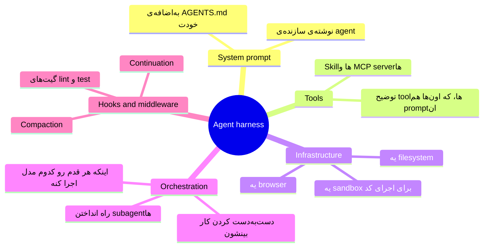
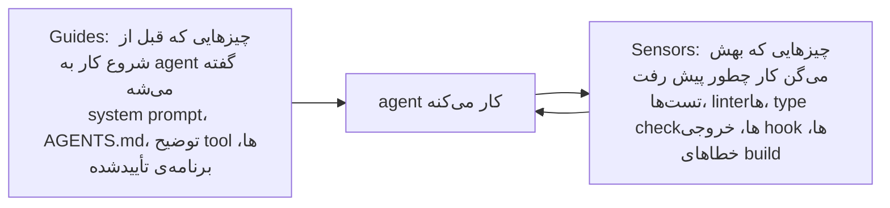
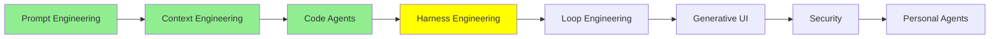

# Harness Engineering

درس [Code Agent‌ها](coding_agents_fa.md) با hook‌ها تموم شد، و hook‌ها با هر چیز دیگه‌ای توی اون درس فرق داشتن. بقیه‌ی راه‌های گسترش، همه توصیه‌هایی‌ان که به مدل می‌کنی؛ توصیه‌ی خوبیه و مدل معمولاً هم بهش گوش می‌ده، ولی آخرش تصمیم با خود مدله. hook این‌طوری نیست. یه shell command‌ه که به یه نقطه‌ی مشخص از چرخه‌ی کار agent وصل شده و اجرا می‌شه، چه مدل بخواد چه نخواد.

کل این درس درباره‌ی همین فرقه.

## مشکلی که با prompt حل نمی‌شه

LLM‌ها non-deterministic‌ان. هر کاری با prompt بکنی و هر چی توی context بذاری، باز هم همون ورودی ممکنه دفعه‌ی بعد یه جواب دیگه بده. یه agent هم که دو ساعت یه‌کله کار می‌کنه، یه عالمه «دفعه‌ی بعد» داره.

پس با خواهش و تمنا، هر چقدر هم تکرارش کنی، تضمینی گیرت نمیاد. فرض کن agent هیچ‌وقت نباید روی main push کنه. می‌تونی توی دستورهات بنویسی «لطفاً روی main push نکن» و بیشتر وقت‌ها هم جواب می‌ده، ولی برای همچین قانونی «بیشتر وقت‌ها» کافی نیست. چیزی که لازم داری یه چیز مکانیکیه، یعنی یه لایه دور مدل که توی هر اجرا دقیقاً یه جور رفتار کنه و مدل هر کاری هم که بکنه، این لایه سر جاش محکم بمونه.

به طراحی همین لایه می‌گن **harness engineering**.

  
*موتور همون prompt‌ه، یعنی چیزی که قدرت تولید می‌کنه. ماشین همون context‌ه، یعنی بدنه‌ای که دور موتور ساخته شده و تعیین می‌کنه اون قدرت به چه کاری بیاد. پیست و گاردریل‌ها هم harness‌ان. دقت کن که گاردریل‌ها فرمون نمی‌گیرن، و نکته دقیقاً همین‌جاست: کاری نمی‌کنن که ماشین درست بره، کاری می‌کنن که نتونه از مسیر بیرون بزنه.*

این تشبیه از مقاله‌ی [Harness Engineering: What It Is and How It Complements Context Engineering](https://medium.com/@amirkiarafiei/harness-engineering-what-it-is-and-how-it-complements-context-engineering-6545b40bfc84) اومده و دو درس بعدی هم دوباره سراغش می‌رن، پس خوبه یادت بمونه.

## agent harness یعنی چی

حاصل harness engineering رو بهش می‌گن **agent harness**: خود agent، به‌اضافه‌ی همه‌ی لایه‌های مکانیکی دورش، به‌اضافه‌ی محیطی که توش اجرا می‌شه.

LangChain توی [The Anatomy of an Agent Harness](https://www.langchain.com/blog/the-anatomy-of-an-agent-harness) کل حرف رو توی یه خط زده: **Agent = Model + Harness.** هوش رو مدل میاره، و harness کاری می‌کنه که این هوش توی یه محیط واقعی و با فایل‌های واقعی یه کار به‌دردبخور انجام بده.

یعنی محصول‌هایی که همین الان باهاشون کار می‌کنی، harness‌ان. Claude Code یه harness‌ه، Codex یه harness‌ه، Pi هم یه harness‌ه، و هیچ‌کدومشون مدل نیستن. اگه مدلِ توی یکی‌شون رو عوض کنی، کمتر از اونی که فکر می‌کنی چیزی عوض می‌شه.

Philipp Schmid توی [The importance of Agent Harness in 2026](https://www.philschmid.de/agent-harness-2026) همین رو با زبون کامپیوتر گفته: مدل CPU‌ه، context window هم RAM‌ه که کوچیکه و بین هر اجرا پاک می‌شه، و harness سیستم‌عامله که تصمیم می‌گیره چی بره توی اون حافظه و درایورهای CPU رو هم فراهم می‌کنه. این‌جا درایورها همون tool‌ها هستن، و agent هم برنامه‌ایه که روی این سیستم‌عامل اجرا می‌شه. توصیه‌ی عملی‌ش هم از همین تصویر درمیاد: harness رو ساده نگه دار، طوری که راحت بشه دورش انداخت، چون آپدیت بعدی مدل بعضی از لایه‌هایی رو که امروز با کلی دقت ساختی، بی‌مصرف می‌کنه.

یه چیز رو باید روشن کنیم، چون کلمه‌ی «harness» رو خیلی سرسری به کار می‌برن: harness لایه‌ی **بیرونی** ماجراست و با اون دو لایه‌ی دیگه رقابتی نداره. کار prompt و context تو رو در بر می‌گیره، نه اینکه جاش رو بگیره.

  
*هر حلقه، حلقه‌ی داخلی‌ش رو در بر گرفته، و برای همین این‌ها هیچ‌وقت جایگزین هم نیستن. وقتی یه harness انتخاب می‌کنی، در واقع یه سری تصمیم درباره‌ی context‌ت رو هم از قبل گرفتی، چون همین harness‌ه که context window رو compact می‌کنه، subagent‌ها رو راه می‌ندازه و system prompt رو می‌نویسه. نمی‌شه context engineering رو «به‌جای» harness engineering انجام داد؛ انجامش می‌دی، ولی توی همون harness‌ی که انتخاب کردی.*

## چهار کار، چهار سوال

تا 2026 این کار به چهار شاخه تقسیم شده که هر کدوم یه سوال جدا می‌پرسه.

  
*از پایین به بالا بخونش؛ هر لایه، لایه‌ی زیری رو در بر می‌گیره. لایه‌ی پایین، یعنی گفتن، فقط حرف‌های یه نوبت رو در بر می‌گیره، لایه‌ی وسط، یعنی دیدن، کل context window رو، و ساختن دنیا یعنی هر چیزی که agent بهش دسترسی داره و هر چیزی که جلوش رو می‌گیره. هر چی بالاتر می‌ری، کار آدم هم عوض می‌شه: پایین، آدم با ربات حرف می‌زنه، و بالا، آدم جایی رو می‌سازه که ربات توش کار می‌کنه.*

- **Prompt engineering**: چی بپرسم و چطوری بپرسم؟
- **Context engineering**: مدل توی context‌ش چی ببینه و به چه شکلی؟
- **Harness engineering**: محیط دور agent رو چطور طراحی کنم؟
- **Loop engineering**: کی تصمیم می‌گیره که دوباره اجرا بشه و کی وایسه؟ این موضوع درس بعدیه.

## harness از چی ساخته شده

[The Anatomy of an Agent Harness](https://www.langchain.com/blog/the-anatomy-of-an-agent-harness) اجزای harness رو فهرست کرده که بیشترشون رو از درس قبل می‌شناسی:

اینم توضیح ساده‌ی هر کدوم از این اجزا:

- **System prompt‌ها.** دستورهایی‌ان که agent قبل از شروع هر کاری می‌خونه. بیشترشون رو سازنده‌ی agent نوشته و `AGENTS.md` خودت هم بهشون اضافه می‌شه.
- **Tool‌ها، Skill‌ها، MCP server‌ها و توضیحشون.** این‌ها کارهایی‌ان که agent می‌تونه انجام بده، و هر کدوم یه توضیح کوتاه دارن که به مدل می‌گه اون کار به چه دردی می‌خوره.
- **زیرساختی که همراهش میاد (Bundled infrastructure).** جاییه که agent توش کار می‌کنه: یه filesystem که فایل‌هاش رو اونجا نگه می‌داره، یه sandbox که توش بی‌خطر کد اجرا می‌کنه، و یه browser که باهاش از وب استفاده می‌کنه و نتیجه‌ی کار خودش رو چک می‌کنه.
- **منطق Orchestration.** این کد تصمیم می‌گیره هر بخش از کار رو کی انجام بده. برای کارهای جدا subagent راه می‌ندازه، کار رو از یه agent به agent دیگه می‌سپره (handoff)، و انتخاب می‌کنه هر قدم رو کدوم مدل اجرا کنه (model routing).
- **Hook‌ها و middleware برای اجرای قطعی (deterministic).** کدهایی‌ان که سر نقطه‌های مشخصی اجرا می‌شن، مدل هر تصمیمی هم که بگیره، واسه همین هر بار دقیقاً همون‌جوری رفتار می‌کنن. Compaction یکی از نمونه‌هاشه: وقتی context window داره پر می‌شه، محتوای قدیمی‌تر رو خلاصه می‌کنه تا agent بتونه کارش رو ادامه بده. این رو قبلاً توی [Context Engineering](context_engineering_fa.md) دیدی. Continuation یه نمونه‌ی دیگه‌ست: اگه مدل بخواد قبل از رسیدن به هدف کار رو ول کنه، یه hook جلوش رو می‌گیره و همون کار اول رو توی یه context window تمیز دوباره بهش می‌ده. اسم این کار Ralph loop‌ه، که درس بعدی، یعنی [Loop Engineering](loop_engineering_fa.md)، درباره‌شه. Lint check هم نمونه‌ی سومه: کدی که agent نوشته رو چک می‌کنه و هر خطایی پیدا کنه برمی‌گردونه به مدل.

LangChain این اجزا رو توی یه ویدیو هم توضیح داده: [What is an Agent Harness?](https://www.youtube.com/watch?v=R0ckdFjUF5U).

دقت کن که *توضیح* tool‌ها هم توی این لیسته. توضیح هر tool خودش یه prompt‌ه، یعنی متنیه که مدل موقع تصمیم گرفتن برای صدا زدن یا نزدن اون tool می‌خونه. پس اگه اسم یه tool رو عوض کنی، یا حتی یه جمله از توضیحش رو بازنویسی کنی، رفتار agent فرق می‌کنه. این کار جزو harness حساب می‌شه، نه prompt، چون محیط رو عوض کردی نه درخواست رو.

روشن‌ترین دسته‌بندی برای همه‌ی این‌ها رو Birgitta Böckeler توی [Harness engineering for coding agent users](https://martinfowler.com/articles/harness-engineering.html) داده، که harness رو به دو جور چیز تقسیم می‌کنه:

guide‌ها قبل از کار میان و sensor‌ها بعدش. هر چی sensor‌ها گزارش می‌کنن برمی‌گرده به agent، تا هر چی رو خراب کرده درست کنه. تقریباً کل harness engineering اضافه کردن یکی از این دو تاست، پس هر وقت شک داشتی یه کار جزو harness حساب می‌شه یا نه، از خودت بپرس guide‌ه یا sensor.

همین مقاله یه دسته‌بندی دوم هم داره که هم به guide‌ها می‌خوره هم به sensor‌ها، و هر guide و هر sensor یکی از این دو نوعه:

- **Computational**: کد معمولی روی CPU اجراشون می‌کنه. تست‌ها، linter‌ها، type checker‌ها و تحلیل ساختاری همه computational‌ان. قطعی و سریعن، توی چند میلی‌ثانیه تا چند ثانیه تموم می‌شن و مقاله نتیجه‌شون رو قابل اعتماد می‌دونه؛ یه چک رو دو بار اجرا کنی، دو بار همون جواب رو می‌گیری.
- **Inferential**: یه مدل اجراشون می‌کنه. code review با AI، تحلیل معنایی و «LLM as judge» همه inferential‌ان. می‌تونن درباره‌ی معنا قضاوت کنن، کاری که از کد معمولی برنمیاد، ولی کندترن، گرون‌ترن و نتیجه‌شون ممکنه از یه اجرا به اجرای بعد فرق کنه.

این‌جا دوباره می‌رسیم به حرف اصلی کل درس. یه چک computational ثابته و توی هر اجرا همون‌جور رفتار می‌کنه، و این دقیقاً همون تضمینیه که prompt هیچ‌وقت نمی‌تونه بهت بده. پس هر جا یه چک computational از پس کار برمیاد، از همون استفاده کن، چون اون‌قدر ارزونه که بشه روی تک‌تک تغییرها اجراش کرد. چک‌های inferential رو هم بذار برای سوال‌هایی که فقط یه مدل می‌تونه جوابشون رو بده.

یه مثال توی مقاله هست که خیلی‌ها انتظارش رو ندارن. یکی از چیزهایی که این روزها زیاد به coding agent‌ها اضافه می‌کنن، **language server** (LSP) و code intelligence‌ه، یعنی همون ابزارهایی که توی ادیتورت go-to-definition و نمایش لحظه‌ای type error‌ها رو ممکن می‌کنن. مقاله می‌گه developer‌ها روزبه‌روز بیشتر ازشون حرف می‌زنن، و اون‌ها رو جزو guide‌های computational می‌ذاره، چون قبل از اینکه agent دست به کار بشه، اطلاعات دقیق درباره‌ی کد بهش می‌دن و دیگه لازم نیست حدس بزنه.

## چند تا مثال واقعی

چند تا کار مشخص که آدم‌ها واقعاً انجام می‌دن، و هیچ‌کدومشون هم کار بزرگی نیست:

- **یه sandbox.** agent دستورها رو توی یه container اجرا می‌کنه که شبکه نداره و یه کپی از repository توش mount شده. این‌جوری اگه agent دستوری اجرا کنه که همه‌چی رو پاک کنه، فقط همون container و کپی توش رو از دست می‌دی و فایل‌های خودت سالم می‌مونن.
- **یه permission gate.** یه hook از نوع `PreToolUse` جلوی نوشتن بیرون از `src/` رو می‌گیره و `git push` رو هم کلاً قدغن می‌کنه. مدل می‌تونه تلاشش رو بکنه، ولی از پسش برنمیاد.
- **گیت تست موقع تموم کردن کار.** یه hook از نوع `Stop` تست‌ها رو اجرا می‌کنه و اگه چیزی قرمز باشه، به agent می‌گه کارت هنوز تموم نشده. این‌جوری تموم شدن کار رو خود agent اعلام نمی‌کنه.
- **فرمت کردن بعد از هر نوشتن.** یه hook از نوع `PostToolUse` روی هر فایلی که ویرایش شده formatter رو اجرا می‌کنه، پس استایل کد دیگه بسته به این نیست که agent یادش باشه یا نه.
- **تشخیص گیر کردن توی حلقه.** تعداد ویرایش‌های هر فایل رو بشمار و بعد از پنجمین ویرایش روی یه فایل، به agent بگو دست نگه داره و از نو فکر کنه. پنج بار ویرایش یه فایل معمولاً یعنی agent توی یه حلقه گیر افتاده.

این آخری خیالی نیست و عدد هم پشتشه. LangChain توی [Improving Deep Agents with harness engineering](https://www.langchain.com/blog/improving-deep-agents-with-harness-engineering) پنج تا تغییری رو تعریف کرده که توی harness coding agent خودشون دادن:

- **system prompt از نو نوشته‌شده**، که دور چهار مرحله چیده شده: plan، build، verify و fix.
- **یه مرحله‌ی checklist** که درست قبل از اینکه agent کار رو ببنده، نگهش می‌داره و وادارش می‌کنه کارش رو با spec مقایسه کنه.
- **یه مرحله‌ی شروع** که درخت پوشه‌ها و tool‌های در دسترس رو درمیاره، تا agent قبل از شروع بدونه کجاست.
- **همون شمارنده‌ی ویرایش هر فایل** که بالاتر گفتیم.
- **یه «reasoning sandwich»**: بیشترین reasoning برای برنامه‌ریزی و بررسی نهایی، و reasoning کمتر برای کارهای یکنواخت وسط.

**مدل هیچ تغییری نکرد**، و امتیاز Terminal Bench 2.0 از 52.8% رسید به 66.5%.

این عدد رو یادت بمونه، چون دلیل وجود این درس همینه: نزدیک چهارده امتیاز فقط از دست بردن توی محیط اومد، در حالی که وزن‌هایی که فکر می‌کردن توی هر دو اجرا عین هم بودن.

اگه می‌خوای خودت یه harness بسازی و فقط درباره‌ش نخونی، [How to Build a Custom Agent Harness](https://www.langchain.com/blog/how-to-build-a-custom-agent-harness) قدم به قدم و با middleware نشونت می‌ده. مقاله‌ی [Harness engineering: leveraging Codex in an agent-first world](https://openai.com/index/harness-engineering/) از OpenAI هم همین کار رو از اون طرف ماجرا نشون می‌ده، و درس اصلی‌ش درباره‌ی دانشه. اون‌ها یه پوشه‌ی `docs/` مرتب و ساختاریافته رو تنها مرجع معتبر نگه می‌دارن و `AGENTS.md` رو کوتاه نگه می‌دارن، فقط در حد یه نقشه که به اون پوشه اشاره می‌کنه، و بعد روی همین مستندات linter و CI job اجرا می‌کنن. یه gardening agent (agent باغبون) هم دارن که مرتب اجرا می‌شه و تنها کارش پیدا کردن قسمت‌هاییه که کهنه شدن؛ اگه با همون دسته‌بندی بالا بگیم، این agent یه sensor‌ه و چیزی که بررسی می‌کنه، خود guide‌هاست.

## هیچ harness‌ای برای همه‌ی مدل‌ها بهترین نیست

حالا می‌رسیم به نتیجه‌ای که خیلی‌ها رو غافلگیر می‌کنه.

یه مدل رو بردار، روی یه benchmark اجراش کن و هیچی رو جز harness عوض نکن؛ امتیازها حسابی بالا پایین می‌شن.

  
*یه مدل، یه مجموعه کار، هشت harness، و امتیازها از 14 تا 20 از 30. توی پایین‌ترین میله و بالاترین میله، همون وزن‌ها دارن فکر می‌کنن. فقط هم به برنده نگاه نکن؛ منبع هزینه و سرعت رو هم اندازه گرفته، و سریع‌ترین harness این‌جا به ازای هر موفقیت از همه گرون‌تر هم درومد، چون تقریباً هیچ‌وقت از prompt cache‌ش دوباره استفاده نمی‌کرد.*

این نمودار مال مقاله‌ی [Finding the Best Harness for DeepSeek V4 Flash](https://composio.dev/content/best-agent-harness-deepseek-v4-flash) از Composio‌ه که مدل رو توی این هشت harness اجرا کرده:

- Pi Agent
- Prime Agent
- OMP
- Claude Code
- Codex
- DeepAgents
- Hermes Agent
- OpenCode

Pi Agent با 66.7%، یعنی بیست workflow از سی تا، اول شد. Claude Code با 122.7 ثانیه برای هر کار از همه سریع‌تر بود، ولی به ازای هر موفقیت از همه گرون‌تر هم تموم شد.

نتیجه این نیست که «برو Pi Agent استفاده کن»؛ نتیجه اینه که **جفت شدن مدل و harness مهمه**. یه کم مثل تی‌شرت می‌مونه: تی‌شرت فری‌سایزی که واقعاً اندازه‌ی همه باشه وجود نداره. harness Claude Code برای مدل‌های Claude تنظیم شده و harness Codex برای مدل‌های GPT. هر harness درباره‌ی مدلی که براش ساخته شده یه سری فرض داره، مثلاً اینکه اون مدل چطور برنامه می‌ریزه، با خروجی‌های طولانی tool‌ها چطور کنار میاد و چقدر زود دست به tool می‌بره. اگه یه مدل با عادت‌های دیگه رو بذاری توش، این فرض‌ها دیگه جور درنمیان، و مدل ضعیف‌تر از وقتی کار می‌کنه که توی یه harness ساخته‌شده برای عادت‌های خودش باشه.

پس هر وقت خوندی فلان مدل state of the art‌ه، این سوال رو بپرس: این عدد با کدوم harness به دست اومده؟

## حالا harness‌ها متن‌بازن

تغییر دیگه‌ای که تا 2026 پیش اومد اینه که خیلی از این harness‌ها متن‌بازن، حتی تجاری‌هاشون.

harness Claude Code بازه، harness [DeepSeek](https://github.com/deepseek-ai/deepseek-harness) هم همین‌طور، که DeepSeek درست کنار همون مدلی منتشرش کرد که براش تنظیم شده بود، و این خودش نشون می‌ده این دو تا با هم طراحی شدن. OpenCode، Pi و [deepagents](https://github.com/langchain-ai/deepagents) از LangChain هم بازن، و همین‌طور harness‌های personal agent یعنی Hermes و OpenClaw، که یه درس جدا دارن: [Personal Agent‌ها](personal_agents_fa.md).

این خیلی به کار میاد، و فقط هم به خاطر این نیست که می‌تونی کدش رو بخونی. می‌تونی یه harness که خوب کار می‌کنه رو برداری و قسمت‌هایی رو که به کارت نمی‌خوره عوض کنی؛ مثلاً می‌تونی:

- system prompt‌ش رو عوض کنی؛
- یه middleware بهش اضافه کنی؛
- توضیح یه tool رو تغییر بدی؛
- یه مدل دیگه رو بهش وصل کنی.

اگه می‌خوای harness‌ها رو با هم مقایسه کنی، دو تا لیست هست که مرتب به‌روز می‌شن. [best-of-Agent-Harnesses](https://github.com/RyanAlberts/best-of-Agent-Harnesses) بیشتر از صد تا harness رو رتبه‌بندی می‌کنه و هر هفته از نو امتیاز می‌ده، و [awesome-harness-engineering](https://github.com/walkinglabs/awesome-harness-engineering) هم ابزارها و راهنماها رو جمع کرده.

> **نکته:** این درس در حد اینکه harness چیه و چرا مهمه می‌مونه. [Advanced Harness Engineering](../3_expert/advanced_harness_engineering.md) سراغ profile‌های harness، harness‌هایی که خودشون رو تکامل می‌دن و این سوال می‌ره که چه مقدار از harness داره کم‌کم می‌ره توی خود مدل. مقاله‌ی Böckeler، یعنی [Harness engineering for coding agent users](https://martinfowler.com/articles/harness-engineering.html)، خیلی عمیق‌تر از اون دو تا دسته‌بندی بالا می‌ره و جای خوبیه برای ادامه دادن.

## کجای این مجموعه هستیم

## خلاصه

مدل non-deterministic‌ه، پس دستورها بهت نرخ موفقیت خوبی می‌دن، ولی هیچ‌وقت تضمین نمی‌دن. harness اون بخش مکانیکیه که حتی وقتی مدل به دستورها گوش نمی‌ده هم کار خودش رو می‌کنه، و این‌ها رو شامل می‌شه:

- system prompt؛
- tool‌ها و طرز توضیح دادنشون؛
- filesystem و sandbox؛
- اینکه subagent‌ها چطور راه می‌افتن و کار بهشون سپرده می‌شه؛
- hook‌هایی که اجرا می‌شن، چه مدل بخواد چه نخواد.

Agent = Model + Harness. Claude Code، Codex و Pi همه harness‌ان. harness حلقه‌ی بیرونیه، پس کار prompt و context رو در بر می‌گیره و باهاش رقابتی نداره. برای اینکه بفهمی توش چی هست هم یه راه ساده هست: guide‌ها چیزهایی‌ان که agent قبل از کار می‌خونه، و sensor‌ها چیزهایی‌ان که بهش می‌گن کار چطور پیش رفت.

همه‌ی این‌ها ارزش وقت گذاشتن داره، چون اثرش توی عددها پیداست. پنج تا تغییر توی harness یه agent رو توی Terminal Bench 2.0 از 52.8% به 66.5% رسوند، بدون اینکه مدل عوض بشه. اینکه چه harness‌ای جور باشه هم به خود مدل بستگی داره: یه مدل توی هشت harness مختلف، از 14 تا 20 از 30 امتیاز گرفت. پس بهترین harness وجود نداره؛ فقط بهترین جفت وجود داره.

درس بعدی: تا این‌جا هنوز خودت پشت فرمونی؛ prompt رو تو می‌نویسی، خروجی رو تو می‌خونی و تو تصمیم می‌گیری بعدش چی بشه. درس بعدی یه چیز دیگه رو جای همین آدم پشت فرمون می‌نشونه.

**بررسی سریع**: هم یه دستور توی AGENTS.md و هم یه hook از نوع `PreToolUse` می‌تونن نذارن agent به یه فایل دست بزنه. چرا فقط یکی‌شون harness engineering حساب می‌شه؟ و این فرق کی واقعاً مهم می‌شه؟

## منابع

- [Harness Engineering: What It Is and How It Complements Context Engineering](https://medium.com/@amirkiarafiei/harness-engineering-what-it-is-and-how-it-complements-context-engineering-6545b40bfc84): ماشین، پیست و گاردریل‌ها، با همه‌ی جزئیات
- [The Anatomy of an Agent Harness](https://www.langchain.com/blog/the-anatomy-of-an-agent-harness): Agent = Model + Harness، و لیست اجزایی که این درس از روش جلو رفته
- [How to Build a Custom Agent Harness](https://www.langchain.com/blog/how-to-build-a-custom-agent-harness): ساختن یه harness برای خودت، با middleware
- [Improving Deep Agents with harness engineering](https://www.langchain.com/blog/improving-deep-agents-with-harness-engineering): پنج تغییر مشخص، و پرشی که از 52.8% به 66.5% درآوردن
- [Harness engineering: leveraging Codex in an agent-first world](https://openai.com/index/harness-engineering/): تیمی که با agent‌ها یه محصول ساخت، و کارهایی که اول مجبور شد روی repository‌ش بکنه
- [Harness engineering for coding agent users](https://martinfowler.com/articles/harness-engineering.html): ایده‌ی guide و sensor، تقسیم به computational و inferential، و کامل‌ترین نوشته درباره‌ی این موضوع
- [The importance of Agent Harness in 2026](https://www.philschmid.de/agent-harness-2026): harness به‌عنوان سیستم‌عامل دور مدل، و اینکه چرا باید راحت بشه دورش انداخت
- [Finding the Best Harness for DeepSeek V4 Flash](https://composio.dev/content/best-agent-harness-deepseek-v4-flash): هشت harness و یه مدل، با هزینه و سرعت کنار نرخ موفقیت
- [DeepSeek Harness](https://github.com/deepseek-ai/deepseek-harness): harness‌ی که کنار همون مدلی منتشر شده که براش تنظیم شده
- [deepagents](https://github.com/langchain-ai/deepagents): harness متن‌بازی که توی مقاله‌ی anatomy اومده
- [best-of-Agent-Harnesses](https://github.com/RyanAlberts/best-of-Agent-Harnesses): رتبه‌بندی بیشتر از صد تا harness، که هر هفته از نو امتیاز می‌گیرن
- [awesome-harness-engineering](https://github.com/walkinglabs/awesome-harness-engineering): ابزارها و راهنماها برای این کار
- [Agent Harness Explained in 2 minutes](https://youtube.com/shorts/IVdJj_aNwhE): نسخه‌ی کوتاه، اگه دیدن ویدیو رو ترجیح می‌دی
- [Agent Harness explained in 8min..](https://www.youtube.com/watch?v=1a1VXDdIyrk): نسخه‌ی بلندتر، که سه تا روش رو کنار هم می‌ذاره، مثل همون حلقه‌های بالا
- [What is an Agent Harness?](https://www.youtube.com/watch?v=R0ckdFjUF5U): ویدیوی خود LangChain، از همون تیمی که مقاله‌ی anatomy رو نوشته، درباره‌ی اجزای harness
- [Advanced Harness Engineering](../3_expert/advanced_harness_engineering.md): profile‌ها، harness‌هایی که خودشون رو تکامل می‌دن، و چیزهایی که دارن می‌رن توی خود مدل
