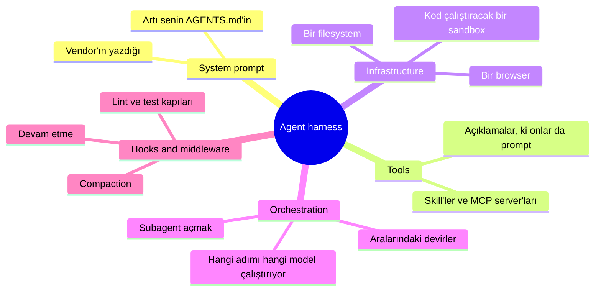
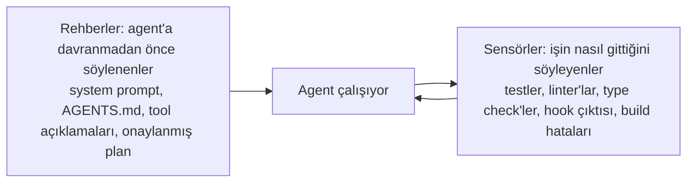
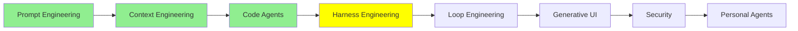

# Harness Engineering

[Code Agent'lar](coding_agents_tr.md) hook'larla bitiyordu. Hook'lar o modüldeki her şeyden farklıydı. Diğer bütün genişletme noktaları (extension point) modele verdiğin tavsiyeler. İyi tavsiyeler ve model genelde onlara uyuyor, ama kararı yine model veriyor. Hook öyle değil. Hook, agent'ın yaşam döngüsündeki sabit bir noktaya bağlanmış bir shell komutu. Model istesin istemesin çalışıyor.

O fark, bu modülün bütün konusu.

## Prompt'ların Çözmediği Problem

LLM'ler non-deterministic. Prompt'la ne yaparsan yap, context'e ne koyarsan koy, aynı input bir sonraki seferde farklı bir çıktı verebilir. İki saat çalışan bir agent'ın da çok "sonraki sefer"i var.

Yani kibarca istemek sana garanti getirmiyor. Diyelim agent main'e asla push etmemeli. Talimatlarına "lütfen main'e push etme" yazmak çoğu zaman işe yarıyor. Ama bu kural için "çoğu zaman" yeterli değil. Bunun yerine mekanik bir şeye ihtiyacın var: modelin etrafına kurulmuş, her çalışmada aynı davranan bir kablolama. Model ne yaparsa yapsın, bu kablolama ayakta kalmalı.

O kablolamayı tasarlamak **harness engineering**.

  
*Motor prompt: gücü üreten şey. Araba context: motorun etrafına kurulan ve o gücün ne yapabileceğine karar veren gövde. Pist ve bariyerler ise harness. Bariyerlerin direksiyon çevirmediğine dikkat et: asıl nokta bu. Arabayı doğru yöne götürmüyorlar. Yanlış yöne gitmeyi imkânsız kılıyorlar.*

Analoji [Harness Engineering: What It Is and How It Complements Context Engineering](https://medium.com/@amirkiarafiei/harness-engineering-what-it-is-and-how-it-complements-context-engineering-6545b40bfc84) yazısından. Sonraki iki modül de onu kullanıyor, o yüzden aklında tutmaya değer.

## Agent Harness Ne Demek

Harness engineering yaptığında elde ettiğin şeye **agent harness** deniyor. Bu, agent'ın kendisi, artı etrafındaki bütün mekanik kablolama, artı içinde çalıştığı ortam.

LangChain'in [The Anatomy of an Agent Harness](https://www.langchain.com/blog/the-anatomy-of-an-agent-harness) yazısı bunu tek satıra indiriyor: **Agent = Model + Harness.** Zekâyı model sağlıyor. Harness ise o zekâyı gerçek dosyaların olduğu gerçek bir yerde işe yarar hâle getiren şey.

Yani zaten kullandığın ürünler harness. Claude Code bir harness. Codex bir harness. Pi bir harness. Hiçbiri model değil. Birinin içindeki modeli değiştirirsen, beklediğinden daha az şey değişiyor.

Philipp Schmid'in [The importance of Agent Harness in 2026](https://www.philschmid.de/agent-harness-2026) yazısı aynı fikri bilgisayar terimleriyle anlatıyor. Model CPU. Context window RAM: küçük ve çalışmalar arasında siliniyor. Harness işletim sistemi. O belleğe neyin yükleneceğine karar veriyor ve CPU'ya driver'larını veriyor. Burada driver'lar, tool'lar. Agent ise üstte çalışan uygulama. Pratik tavsiyesi de buradan çıkıyor. Harness'ı basit ve kolayca silinebilir tut, çünkü bir sonraki model güncellemesi bugünkü özenli kablolamanın bir kısmını gereksiz yapacak.

Bir şeyi netleştirmek gerekiyor, çünkü insanlar "harness" kelimesini gelişigüzel kullanıyor. Harness **dış** katman. Diğer iki katmanla yarışmıyor. Prompt ve context işinin yerini almıyor, onu içine alıyor.

  
*Her halka içindekini kapsıyor. Bu yüzden bunlar asla birbirinin alternatifi değil. Bir harness seçtiğinde, context'inle ilgili bazı şeylere zaten karar vermiş oluyorsun. Çünkü context window'u sıkıştıran, subagent'ları açan ve system prompt'u yazan şey harness. Context engineering'i harness engineering'in "yerine" yapamıyorsun. Onu seçtiğin harness'ın içinde yapıyorsun.*

## Dört Disiplin, Dört Soru

2026'ya gelindiğinde bu alan dört ayrı işe bölündü. Her iş farklı bir soru soruyor.

  
*Aşağıdan yukarı oku. Her katman altındakini içine alıyor. Söylemek tek bir tur. Görmek bütün context window. Dünyayı inşa etmek ise agent'ın erişebildiği her şey ve onu durduran her şey. Yukarı çıktıkça insanın işi de değişiyor. En altta insan robotla konuşuyor. En üstte robotun çalıştığı yeri kuruyor.*

- **Prompt engineering**: ne sormalıyım ve nasıl sormalıyım?
- **Context engineering**: model context'inde ne görmeli ve hangi biçimde?
- **Harness engineering**: agent'ın etrafındaki ortamı nasıl tasarlamalıyım?
- **Loop engineering**: tekrar ne zaman çalışacağına ve ne zaman duracağına kim karar veriyor? Bu, sonraki modülün konusu.

## Bir Harness Neden Oluşuyor

[The Anatomy of an Agent Harness](https://www.langchain.com/blog/the-anatomy-of-an-agent-harness) parçaları listeliyor. Çoğunu geçen modülden tanıyacaksın:

Tool *açıklamalarının* da listede olduğuna dikkat et. Açıklama bir prompt. Model o tool'u çağırıp çağırmayacağına karar verirken bu metni okuyor. Yani bir tool'un adını değiştirirsen ya da açıklamasının bir cümlesini yeniden yazarsan, agent farklı davranıyor. Bu, prompt işi değil harness işi sayılıyor, çünkü düzenlediğin şey istek değil, ortam.

Bütün bunları düzenlemenin en net yolu Birgitta Böckeler'in [Harness engineering for coding agent users](https://martinfowler.com/articles/harness-engineering.html) yazısından geliyor. Yazı, harness'ı iki tür şeye ayırıyor:

Rehberler (guides) işten önce geliyor. Sensörler (sensors) işten sonra geliyor. Sensörlerin raporladığı şey agent'a geri gidiyor, böylece agent neyi bozduysa onu düzeltebiliyor. Harness engineering'in neredeyse tamamı bu ikisinden birini eklemek. Yani bir şeyin harness işi olup olmadığından emin değilsen, kendine hangisi olduğunu sor.

Aynı yazı ikinci bir ayrım daha yapıyor. Bu ayrım hem rehberler hem sensörler için geçerli. Her rehber ve her sensör iki türden biri:

- **Computational**: CPU üzerinde sıradan kodla çalışıyor. Testler, linter'lar, type checker'lar ve yapısal analiz computational. Deterministic ve hızlılar. Milisaniyelerle saniyeler arasında bitiyorlar ve yazı sonuçlarını güvenilir buluyor. Aynı kontrolü iki kez çalıştırırsan aynı cevabı alırsın.
- **Inferential**: onu bir model çalıştırıyor. AI code review, anlamsal (semantic) analiz ve bir "LLM as judge" inferential. Sıradan kodun yapamadığı şekilde anlamı yargılayabiliyorlar. Ama daha yavaşlar, daha pahalılar ve sonuçları bir çalıştırmadan diğerine değişebiliyor.

Bu, bütün modülün ana fikri, bir kez daha. Computational bir kontrol sabit, yani her çalışmada aynı şekilde davranıyor. Bir prompt'un sana veremeyeceği garanti tam olarak bu. O yüzden bir computational kontrol işi görebiliyorsa onu kullan, çünkü her değişiklikte çalıştıracak kadar ucuz. Inferential kontrolleri sadece bir modelin cevaplayabileceği sorulara sakla.

Yazıdaki bir örnek insanları şaşırtıyor. Şu sıralar coding agent'lara yapılan popüler bir ekleme **language server** (LSP) ve code intelligence. Bunlar, editörüne go-to-definition'ı ve canlı type hatalarını veren araçların aynısı. Yazı, gittikçe daha fazla geliştiricinin bunlardan bahsettiğini belirtiyor ve onları computational rehberler olarak sınıflıyor. Agent'a davranmadan önce kod hakkında kesin bilgiler veriyorlar, böylece agent tahmin etmek zorunda kalmıyor.

## Birkaç Gerçek Örnek

İşte insanların gerçekten yaptığı birkaç somut şey. Hiçbiri büyük değil:

- **Bir sandbox.** Agent komutlarını bir container'da çalıştırıyor. Container'ın network'ü yok ve içine repo'nun bir kopyası bağlanmış. Artık "her şeyi sil" sana bir container'a mal oluyor.
- **Bir izin kapısı.** Bir `PreToolUse` hook'u `src/` dışındaki yazmaları reddediyor ve `git push`'u tamamen reddediyor. Model deneyebiliyor, ama yapamıyor.
- **Bitirmede bir test kapısı.** Bir `Stop` hook'u test suite'ini çalıştırıyor. Kırmızı bir şey varsa agent'a işin bitmediğini söylüyor. İşin bittiğine agent karar vermiyor.
- **Yazmada format hook'u.** Bir `PostToolUse` hook'u düzenlenen her dosyada formatter'ı çalıştırıyor. Böylece stil, agent'ın stili hatırlamasına bağlı olmaktan çıkıyor.
- **Bir loop dedektörü.** Her dosyadaki edit'leri say. Aynı dosyadaki beşinci edit'ten sonra agent'a durup yeniden düşünmesini söyle. Tek dosyaya beş edit genelde agent'ın bir döngüye takıldığı anlamına geliyor.

Son madde gerçek ve yanında sayılarla geldi. LangChain'in [Improving Deep Agents with harness engineering](https://www.langchain.com/blog/improving-deep-agents-with-harness-engineering) yazısı coding agent'larının harness'ında yaptıkları beş değişikliği anlatıyor:

- **Yeniden yazılmış bir system prompt**, dört aşama etrafında düzenlenmiş: plan, build, verify, fix.
- **Bir checklist adımı**, agent'ı tam çıkmadan önce yakalıyor. Agent'ı kendi işini spec'e karşı kontrol etmeye zorluyor.
- **Bir açılış adımı**, dizin ağacını ve mevcut tool'ları haritalıyor. Böylece agent başlamadan önce nerede olduğunu biliyor.
- **Yukarıdaki listedeki dosya başına edit sayacı.**
- **Bir "reasoning sandwich"**: planlama ve doğrulama için maksimum reasoning, ortadaki mekanik iş için daha azı.

**Model değişmedi.** Terminal Bench 2.0 skoru %52,8'den %66,5'e çıktı.

Bu sayıyı aklında tut, çünkü bu modülün var olma sebebi bu. Neredeyse on dört puan ortamı düzenlemekten geldi. İki çalışmada da düşünmeyi yapan weight'ler aynıydı.

Okumak yerine bir tane inşa etmek istersen [How to Build a Custom Agent Harness](https://www.langchain.com/blog/how-to-build-a-custom-agent-harness) middleware ile bunu adım adım gösteriyor. OpenAI'ın [Harness engineering: leveraging Codex in an agent-first world](https://openai.com/index/harness-engineering/) yazısı aynı disiplini öbür taraftan anlatıyor. Asıl dersi bilgiyle ilgili. Yapılandırılmış bir `docs/` dizinini tek doğru kaynak olarak tutuyorlar. `AGENTS.md`'yi ise oraya işaret eden kısa bir harita olarak bırakıyorlar. Sonra o dokümantasyonun üzerinde linter'lar ve CI job'ları çalıştırıyorlar. Ayrıca düzenli çalışan bir bahçıvan agent'ları var. Onun tek işi, eskimiş kısımları bulmak. Bu da rehberlere yöneltilmiş bir sensör.

## Hiçbir Harness Her Model için En İyisi Değil

İnsanları şaşırtan bulgu şu.

Bir model al, bir benchmark'ta çalıştır ve harness dışında hiçbir şeyi değiştirme. Skorlar ciddi biçimde oynuyor.

  
*Bir model, bir iş kümesi, sekiz harness ve skorlar 30 üzerinden 14 ile 20 arasında. En alttaki çubukta da en üstteki çubukta da düşünmeyi yapan weight'ler aynı. Kazananın ötesini de oku. Kaynak maliyeti ve hızı da ölçmüş. Buradaki en hızlı harness aynı zamanda başarı başına en pahalı olanıydı, çünkü prompt cache'ini neredeyse hiç yeniden kullanmıyordu.*

Bu grafik Composio'nun [Finding the Best Harness for DeepSeek V4 Flash](https://composio.dev/content/best-agent-harness-deepseek-v4-flash) çalışmasından. Çalışma modeli sekiz harness üzerinden geçirmiş:

- Pi Agent
- Prime Agent
- OMP
- Claude Code
- Codex
- DeepAgents
- Hermes Agent
- OpenCode

Pi Agent %66,7 ile birinci oldu, yani otuz workflow'un yirmisi. Claude Code iş başına 122,7 saniyeyle en hızlısıydı, ama başarı başına en pahalısı da oydu.

Ders "Pi Agent kullan" değil. Asıl ders şu: **eşleşme önemli**. Bu biraz tişört gibi: herkese uyan tek bir beden yok. Claude Code'un harness'ı Claude modellerine göre ayarlı. Codex'in harness'ı GPT modellerine göre ayarlı. Bir harness, kendisi için kurulduğu model hakkında varsayımlar yapıyor: o model nasıl plan yapıyor, uzun tool çıktılarıyla nasıl baş ediyor, bir tool'u çağırmaya ne kadar istekli. Harness'a farklı alışkanlıkları olan bir model verirsen, o varsayımlar artık uymuyor. O zaman model, kendi alışkanlıklarına göre kurulmuş bir harness'ta olacağından daha kötü çalışıyor.

Yani bir modelin state of the art olduğunu okuduğunda dürüst soruyu sor: bu sayı hangi harness'tan geldi?

## Harness'lar Artık Açık

2026'ya gelirken değişen öbür şey şu: bu harness'ların çoğu artık açık kaynak, ticari olanlar da dahil.

Claude Code'un harness'ı açık. [DeepSeek'in](https://github.com/deepseek-ai/deepseek-harness) de öyle. DeepSeek onu, ayarlandığı modelin hemen yanında yayınladı. Bu da sana ikisinin birlikte tasarlandığını gösteriyor. OpenCode, Pi ve LangChain'in [deepagents](https://github.com/langchain-ai/deepagents)'ı açık. Kişisel agent harness'ları Hermes ve OpenClaw da öyle. Onların kendi modülü var: [Personal Agent'lar](personal_agents_tr.md).

Bu gerçekten faydalı, ve sadece kodu okuyabildiğin için değil. İşe yarayan bir harness'ı alıp işine uymayan parçalarını değiştirebiliyorsun:

- system prompt'u değiştir;
- bir middleware ekle;
- bir tool açıklamasını değiştir;
- başka bir modele yönlendir.

Harness'ları karşılaştırmak istersen, güncel tutulan iki liste var. [best-of-Agent-Harnesses](https://github.com/RyanAlberts/best-of-Agent-Harnesses) yüzden fazlasını sıralıyor ve her hafta yeniden puanlıyor. [awesome-harness-engineering](https://github.com/walkinglabs/awesome-harness-engineering) ise araçları ve rehberleri topluyor.

> **NOT:** bu modül bir harness'ın ne olduğu ve neden önemli olduğu seviyesinde kalıyor. [Advanced Harness Engineering](../3_expert/advanced_harness_engineering_tr.md) harness profillerini, kendi kendini geliştiren harness'ları ve harness'ın ne kadarının modelin içine taşındığı sorusunu ele alıyor. Böckeler'in [Harness engineering for coding agent users](https://martinfowler.com/articles/harness-engineering.html) yazısı yukarıdaki iki ayrımdan çok daha derine iniyor. Devam etmek için doğru yer orası.

## Bu serinin neresindeyiz

## Özet

Bir model non-deterministic. Yani talimatlar sana yüksek bir başarı oranı veriyor, ama asla garanti vermiyor. Harness, buna rağmen ayakta kalan mekanik kısım. İçinde şunlar var:

- system prompt;
- tool'lar ve nasıl tarif edildikleri;
- filesystem ve sandbox;
- subagent'ların nasıl açılıp iş aldığı;
- model istesin istemesin tetiklenen hook'lar.

Agent = Model + Harness. Claude Code, Codex ve Pi'nin hepsi birer harness. Harness dış halka. Yani prompt ve context işinle yarışmıyor, onu içine alıyor. İçinde ne olduğunu düşünmenin basit bir yolu var. Rehberler, agent'ın davranmadan önce okuduğu şeyler. Sensörler de ona işin nasıl gittiğini söyleyen şeyler.

Bütün bunlar gerçek emek harcamaya değer, çünkü etkisi sayılarda görünüyor. Beş harness değişikliği bir agent'ı Terminal Bench 2.0'da %52,8'den %66,5'e taşıdı ve model hiç değişmedi. Uyum da modele özgü. Sekiz farklı harness'tan geçirilen tek bir model, 30 üzerinden 14 ile 20 arasında değişen skorlar aldı. Yani en iyi harness yok. Sadece en iyi eşleşme var.

Sırada: buraya kadar her şeyde sürücü koltuğunda sen varsın. Sen prompt'u yazıyorsun, çıktıyı okuyorsun ve sırada ne olacağına karar veriyorsun. Sonraki modül o insanın yerine geçiyor.

**Hızlı Kontrol**: AGENTS.md'deki bir talimat da bir `PreToolUse` hook'u da agent'ın bir dosyaya dokunmasını engelleyebilir. Neden sadece biri harness engineering? Ve bu fark gerçekte ne zaman önemli oluyor?

## Kaynaklar

- [Harness Engineering: What It Is and How It Complements Context Engineering](https://medium.com/@amirkiarafiei/harness-engineering-what-it-is-and-how-it-complements-context-engineering-6545b40bfc84): araba, pist ve bariyerler, ayrıntılı hâliyle
- [The Anatomy of an Agent Harness](https://www.langchain.com/blog/the-anatomy-of-an-agent-harness): Agent = Model + Harness, ve bu modülün dayandığı parça listesi
- [How to Build a Custom Agent Harness](https://www.langchain.com/blog/how-to-build-a-custom-agent-harness): middleware ile kendi harness'ını nasıl kurarsın
- [Improving Deep Agents with harness engineering](https://www.langchain.com/blog/improving-deep-agents-with-harness-engineering): beş somut değişiklik ve ürettikleri %52,8'den %66,5'e sıçrama
- [Harness engineering: leveraging Codex in an agent-first world](https://openai.com/index/harness-engineering/): agent'larla ürün kuran bir ekip, ve önce repo'larına ne yapmak zorunda kaldıkları
- [Harness engineering for coding agent users](https://martinfowler.com/articles/harness-engineering.html): rehberler ve sensörler fikri, computational ve inferential ayrımı, ve konunun en kapsamlı işlenişi
- [The importance of Agent Harness in 2026](https://www.philschmid.de/agent-harness-2026): modelin etrafındaki işletim sistemi olarak harness, ve neden kolayca silinebilir olması gerektiği
- [Finding the Best Harness for DeepSeek V4 Flash](https://composio.dev/content/best-agent-harness-deepseek-v4-flash): sekiz harness, bir model, pass oranının yanında maliyet ve hız
- [DeepSeek Harness](https://github.com/deepseek-ai/deepseek-harness): ayarlandığı modelin yanında yayınlanmış bir harness
- [deepagents](https://github.com/langchain-ai/deepagents): anatomi yazısındaki açık harness
- [best-of-Agent-Harnesses](https://github.com/RyanAlberts/best-of-Agent-Harnesses): yüzden fazlasının sıralı listesi, her hafta yeniden puanlanıyor
- [awesome-harness-engineering](https://github.com/walkinglabs/awesome-harness-engineering): pratiğe dair araçlar ve rehberler
- [Agent Harness Explained in 2 minutes](https://youtube.com/shorts/IVdJj_aNwhE): izlemeyi tercih edersen kısa versiyon
- [Agent Harness explained in 8min..](https://www.youtube.com/watch?v=1a1VXDdIyrk): uzun versiyon, üç pratiği yukarıdaki halkalar gibi yan yana koyuyor
- [Advanced Harness Engineering](../3_expert/advanced_harness_engineering_tr.md): profiller, kendi kendini geliştiren harness'lar, ve modelin içine ne taşınıyor
