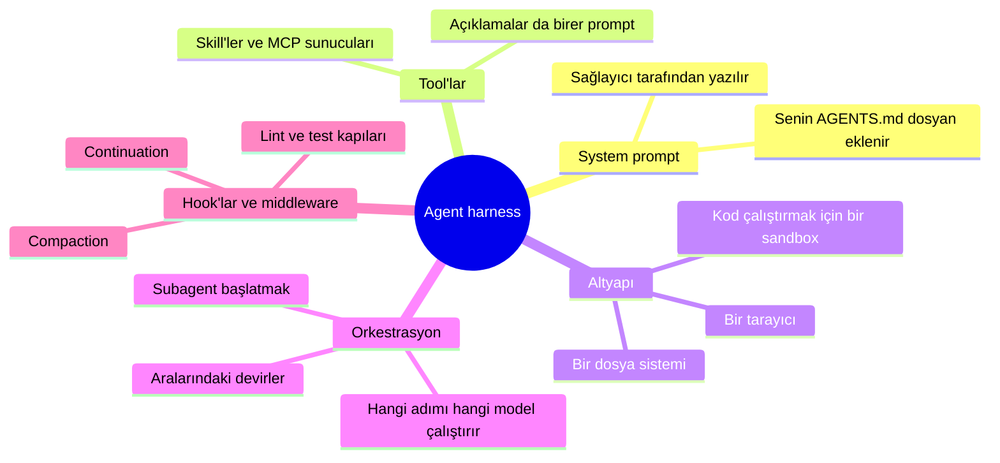
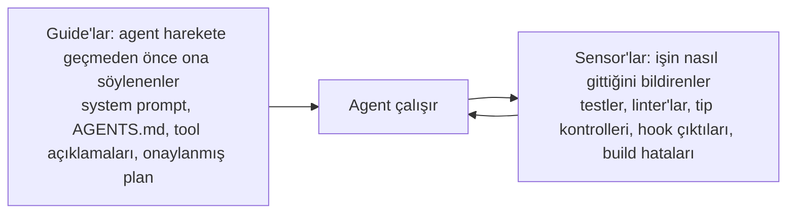
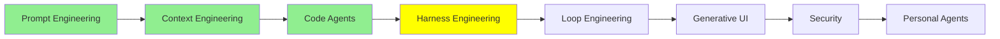

# Harness Engineering

[Code Agent'lar](coding_agents_tr.md) modülü hook'larla bitiyordu. Hook'lar ise o modüldeki diğer genişletme noktalarının hiçbirine benzemiyordu, çünkü diğerleri modele verdiğin tavsiyelerdi. Bu tavsiyeler iyiydi ve model çoğunlukla onlara uyuyordu, ama son kararı yine model veriyordu. Hook ise agent'ın yaşamındaki sabit bir noktaya bağlı bir shell komutudur ve model isteyip istemediğine bakmadan çalışır.

Bu modülün konusu tam olarak bu farktır. Modelin kararına bırakılmadan, her çalışmada aynı şekilde davranan mekanik bir düzen kurma işine **harness engineering** deniyor. Bu modül, bu işin ne olduğunu, bir harness'in neyden oluştuğunu ve neden her model için tek bir en iyi harness bulunmadığını anlatıyor.

## Promptların Çözemediği Sorun

LLM'ler deterministik değildir. Prompt'la ne yaparsan yap, context'e ne koyarsan koy, aynı girdi bir dahaki sefere farklı bir cevap verebilir. İki saat boyunca çalışan bir agent ise bu riski çok kez yaşar.

Yani nazikçe istemek, ne kadar sık tekrarlarsan tekrarla, hiçbir garanti vermez. Diyelim ki agent'ın asla main'e push atmaması gerekiyor. Talimatlarına "lütfen main'e push atma" yazabilirsin. Bu çoğu zaman işe yarar. Ama bu kural için "çoğu zaman" yeterli değildir. İhtiyacın olan şey mekanik bir şeydir: modelin ne yaptığından bağımsız olarak her çalışmada aynı davranan bir düzen. Bu düzen, model ne yapmaya karar verirse versin yerinde durmalıdır.

  
*Motor prompt'tur: güç üreten parça. Araba context'tir: motorun etrafına kurulmuş, gücün neye yarayacağını belirleyen gövde. Pist ve bariyerler ise harness'tir. Dikkat et, bariyerler direksiyon çevirmez ve asıl nokta da budur. Arabayı doğru yöne sokmazlar. Yanlış yöne gitmeyi imkânsız hale getirirler.*

Bu analoji, [Harness Engineering: What It Is and How It Complements Context Engineering](https://medium.com/@amirkiarafiei/harness-engineering-what-it-is-and-how-it-complements-context-engineering-6545b40bfc84) yazısından alındı. Sonraki iki modül de bu analojiyi tekrar kullanıyor, bu yüzden akılda tutmaya değer.

## Agent Harness Nedir

Harness engineering yaptığında ortaya çıkan şeye **agent harness** denir. Agent'ın kendisi, etrafındaki bütün mekanik düzenek ve agent'ın içinde çalıştığı ortam, hepsi birlikte bir agent harness'i oluşturur.

LangChain'in [The Anatomy of an Agent Harness](https://www.langchain.com/blog/the-anatomy-of-an-agent-harness) yazısı bunu tek satırda özetliyor: **Agent = Model + Harness**. Model zekâyı sağlar. Harness ise bu zekânın gerçek bir ortamda, gerçek dosyalarla yararlı iş yapmasını sağlar.

Bu da demek oluyor ki zaten kullandığın ürünler birer harness'tir. Claude Code, Codex ve Pi, hepsi bir harness'tir. Bunların hiçbiri bir model değildir. Birinin içindeki modeli değiştirirsen, sandığından çok daha az şey değişir.

Philipp Schmid'in [The importance of Agent Harness in 2026](https://www.philschmid.de/agent-harness-2026) yazısı aynı şeyi bilgisayar diliyle anlatıyor. Burada model CPU'dur, context window ise RAM: küçüktür ve her çalışmadan sonra temizlenir. Harness, işletim sistemi gibidir. Bu belleğe neyin gireceğine karar verir ve CPU'ya sürücülerini sağlar. Buradaki sürücüler tool'lardır, agent ise bunların üzerinde çalışan uygulamadır. Schmid'in pratik tavsiyesi bu resimden çıkıyor: harness'i basit tut ve kolayca silinebilir olsun. Çünkü bir sonraki model güncellemesi, bugün özenle kurduğun düzeneklerin bir kısmını gereksiz hale getirecek.

Bir noktayı netleştirmek gerekiyor, çünkü insanlar "harness" kelimesini gelişigüzel kullanıyor. Harness **dış** katmandır: prompt ve context çalışmanı içinde barındırır, ama o çalışmanın yerini almaz ve diğer iki katmanla yarışmaz.

  
*Her halka, içindeki halkayı barındırır. Bu yüzden bunlar asla birbirinin alternatifi değildir. Bir harness seçtiğinde, context hakkındaki bazı kararları çoktan vermiş olursun. Çünkü harness, context window'u sıkıştırır (compaction), subagent'ları başlatır ve system prompt'u yazar. Context engineering'i harness engineering'in yerine yapamazsın. Onu, seçtiğin harness'in içinde yaparsın.*

## Dört Disiplin, Dört Soru

2026'ya gelindiğinde bu çalışma dört ayrı alana bölünmüştü ve her alan farklı bir soru soruyor.

  
*Şekli alttan yukarıya doğru oku. Her katman, altındakini içine alır. En alttaki katman olan söylemek, tek bir turun sözlerini kapsar; ortadaki katman olan görmek ise bütün context window'u kapsar. Dünyayı inşa etmek ise agent'ın ulaşabildiği her şeyi ve onu durduran her şeyi kapsar. İnsanın rolü de yukarı çıktıkça değişir. En altta insan robotla konuşur. En üstte ise robotun çalışacağı yeri insan kurar.*

- **Prompt engineering**: Ne sormalıyım ve bunu nasıl sormalıyım?
- **Context engineering**: Modelin context'inde neyi görmesi gerekir ve bu bilgi hangi biçimde sunulmalı?
- **Harness engineering**: Agent'ın etrafındaki ortamı nasıl tasarlamalıyım?
- **Loop engineering**: Agent'ın ne zaman yeniden çalışacağına ve ne zaman duracağına kim karar verir? Bu, bir sonraki modülün konusu.

## Bir Harness Neyden Oluşur

[The Anatomy of an Agent Harness](https://www.langchain.com/blog/the-anatomy-of-an-agent-harness) yazısı parçaları sayıyor. Bunların çoğunu önceki modülden tanıyacaksın:

Listede tool *açıklamalarının* da yer aldığına dikkat et. Açıklama bir prompt'tur: model, o tool'u çağırıp çağırmayacağına karar verirken okuduğu metin budur. Bu yüzden bir tool'un adını değiştirirsen ya da açıklamasındaki tek bir cümleyi yeniden yazarsan, agent farklı davranır. Bu bir prompt işi değil, harness işidir. Çünkü isteği değil, ortamı değiştirmiş olursun.

Bütün bunları düzenlemenin en net yolunu Birgitta Böckeler'in [Harness engineering for coding agent users](https://martinfowler.com/articles/harness-engineering.html) yazısı sunuyor. Yazıya göre bir harness iki tür şeyden oluşur:

Guide'lar işten önce gelir, sensor'lar ise işten sonra. Sensor'ların bildirdiği şey agent'a geri döner ve agent böylece kırdığı her şeyi düzeltebilir. Harness engineering'in neredeyse tamamı bu iki şeyden birini eklemekten ibarettir. Bu yüzden bir şeyin harness işi sayılıp sayılmadığından emin değilsen kendine şunu sor: bu iki türden hangisi?

Aynı yazı ikinci bir ayrım daha yapıyor ve bu ayrım hem guide'lar hem sensor'lar için geçerli. Her guide ve her sensor iki tipten birine girer:

- **Computational**: Bunları sıradan kod çalıştırır, CPU üzerinde. Testler, linter'lar, tip denetleyicileri ve yapısal analiz hepsi computational türdendir. Bu kontroller deterministiktir ve sonuçlarını milisaniyeler ya da birkaç saniye içinde verir. Yazı bu sonuçları güvenilir sayıyor. Aynı kontrolü iki kez çalıştırırsan, iki kez aynı cevabı alırsın.
- **Inferential**: Bunu bir model çalıştırır. AI kod incelemesi, anlamsal analiz ve "LLM as judge" hepsi inferential türdendir. Anlamı değerlendirebilirler, sıradan kod ise bunu yapamaz. Ama daha yavaştırlar, daha pahalıdırlar ve sonuçları bir çalıştırmadan diğerine değişebilir.

Bu, modülün bütün konusunu bir kez daha özetliyor. Computational bir kontrol sabittir, dolayısıyla her çalıştırmada aynı davranır. Prompt'un sana veremediği garanti tam olarak budur. Bu yüzden iş görebiliyorsa computational kontrolü tercih et, çünkü her değişiklikte çalıştırılacak kadar ucuzdur. Inferential kontrolleri ise yalnızca bir modelin cevaplayabildiği sorulara ayır.

Yazıdaki bir örnek insanları şaşırtıyor. Bugünlerde coding agent'lara eklenen en popüler şeylerden biri **dil sunucusu** (language server, LSP) ve kod zekâsı. Bunlar, editörünün sana verdiği tanıma git (go-to-definition) ve anlık tip hataları gibi özelliklerin arkasındaki araçlardır. Yazı, bu araçlardan söz eden geliştirici sayısının arttığını belirtiyor ve bunları computational guide'lar olarak sınıflandırıyor. Agent harekete geçmeden önce koda dair kesin bilgiler alır, böylece tahmin yürütmek zorunda kalmaz.

## Gerçek Örnekler

İnsanların gerçekten yaptığı birkaç somut şey var. Hiçbiri büyük değil:

- **Bir sandbox.** Agent komutlarını bir container içinde çalıştırır. Bu container'ın ağ bağlantısı yoktur ve repository'nin bağlanmış bir kopyasını içerir. Böylece agent her şeyi silen bir komut çalıştırsa bile yalnızca container'ı ve içindeki kopyayı kaybedersin, kendi dosyaların yerinde kalır.
- **Bir izin kapısı.** Bir `PreToolUse` hook'u `src/` dışındaki yazmaları reddeder ve `git push` komutunu tamamen engeller. Model deneyebilir, ama yapamaz.
- **Bitirme için test kapısı.** Bir `Stop` hook'u test paketini çalıştırır. Başarısız bir test varsa hook, agent'a işinin bitmediğini söyler. Bitti olup olmadığına karar veren agent değildir.
- **Yazınca biçimlendiren bir hook.** Bir `PostToolUse` hook'u, düzenlenen her dosyada formatter'ı çalıştırır. Böylece kod stili, agent'ın stili hatırlamasına bağlı olmaktan çıkar.
- **Bir döngü dedektörü.** Her dosyaya yapılan düzenlemeleri say. Aynı dosyaya beşinci düzenlemeden sonra agent'a durup yeniden düşünmesini söyle. Bir dosyaya beş kez dokunmak, genellikle agent'ın bir döngüye takıldığı anlamına gelir.

Son örnek gerçek ve arkasında sayılar da var. LangChain'in [Improving Deep Agents with harness engineering](https://www.langchain.com/blog/improving-deep-agents-with-harness-engineering) yazısı, kendi coding agent'larının harness'inde yaptıkları beş değişikliği anlatıyor:

- **Yeniden yazılmış bir system prompt**, dört aşamaya göre düzenlenmiş: planlama, build, doğrulama ve düzeltme.
- **Bir kontrol listesi adımı.** Agent çıkmadan hemen önce devreye girer ve agent, işini spec'e karşılaştırarak kendisi kontrol eder.
- **Bir başlangıç adımı.** Dizin ağacını ve kullanılabilir tool'ları haritalandırır. Bu sayede agent başlamadan önce nerede olduğunu bilir.
- **Yukarıda geçen dosya başına düzenleme sayacı.**
- **Bir "reasoning sandwich"**: planlama ve doğrulama için en fazla akıl yürütme (reasoning), ortadaki mekanik iş için ise daha az.

**Model değişmedi.** Terminal Bench 2.0 skoru 52.8%'ten 66.5%'e çıktı. Bu sayıyı akılda tut, çünkü bu modülün var olma sebebi tam olarak bu. Neredeyse on dört puanlık artış ortamı düzenlemekten geldi. Düşünme işini yapan model ağırlıkları ise iki çalıştırmada da aynıydı.

Sadece okumakla kalmayıp kendi harness'ini kurmak istiyorsan, [How to Build a Custom Agent Harness](https://www.langchain.com/blog/how-to-build-a-custom-agent-harness) yazısı bunu middleware ile adım adım gösteriyor. OpenAI'ın [Harness engineering: leveraging Codex in an agent-first world](https://openai.com/index/harness-engineering/) yazısı aynı disiplini başka bir açıdan anlatıyor. Ana dersi bilgi yönetimiyle ilgili. Yapılandırılmış bir `docs/` dizinini tek doğruluk kaynağı olarak tutuyorlar. `AGENTS.md` dosyasını kısa tutuyorlar, o dizine işaret eden bir harita gibi. Sonra bu dokümantasyon üzerinde linter'ları ve CI işlerini çalıştırıyorlar. Ayrıca düzenli çalışan bir bahçıvan agent'ı (gardening agent) var. Tek işi, güncelliğini yitirmiş parçaları bulmak. Yukarıdaki ayrımın diliyle bu agent bir sensor'dur ve kontrol ettiği şey de guide'lardır.

## Her Model İçin En İyi Harness Yok

İnsanları şaşırtan bulgu şu: Bir model al, onu tek bir benchmark üzerinde çalıştır ve harness dışında hiçbir şeyi değiştirme. Bu durumda skorlar ciddi ölçüde değişiyor.

  
*Tek bir model, tek bir görev kümesi, sekiz harness. Skorlar 30 üzerinden 14 ile 20 arasında değişiyor. En alttaki ve en üstteki çubukta aynı model ağırlıkları düşünme işini yapıyor. Ayrıca kazananın ötesine de bak. Kaynak maliyeti ve hızı da ölçmüş. Buradaki en hızlı harness, aynı zamanda başarı başına en pahalı olandı, çünkü prompt cache'ini neredeyse hiç yeniden kullanmıyordu.*

Bu grafik, Composio'nun [Finding the Best Harness for DeepSeek V4 Flash](https://composio.dev/content/best-agent-harness-deepseek-v4-flash) yazısından alındı. Yazarda model şu sekiz harness'te denenmiş:

- Pi Agent
- Prime Agent
- OMP
- Claude Code
- Codex
- DeepAgents
- Hermes Agent
- OpenCode

Pi Agent, 66.7%'yle birinci oldu. Bu da otuz iş akışından yirmisinin başarılı olması demek. Claude Code ise görev başına 122.7 saniyeyle en hızlısıydı, ama başarı başına en pahalı olan da oydu.

Buradaki ders "Pi Agent'ı kullan" değil. Asıl ders şu: **eşleşme önemli**. Bu, biraz tişörte benziyor: herkese uyan tek bir beden yok. Claude Code'un harness'i Claude modelleri için, Codex'in harness'i ise GPT modelleri için ayarlanmış. Bir harness, tasarlandığı modele dair varsayımlar içerir. Bu varsayımlar, modelin nasıl plan yaptığını, uzun tool çıktılarını nasıl işlediğini ve bir tool'u çağırmaya ne kadar istekli olduğunu kapsar. Harness'e farklı alışkanlıkları olan bir model verirsen bu varsayımlar tutmaz hale gelir. O zaman model, kendi alışkanlıklarına göre kurulmuş bir harness'te yapabileceğinden daha kötü sonuç verir.

Bu yüzden bir modelin "state of the art" olduğunu okuduğunda dürüst bir soru sor: Bu sayı hangi harness'ten çıktı?

## Harness'ler Artık Açık Kaynak

2026'da bir diğer değişiklik de bu harness'lerin çoğunun açık kaynak olması. Bu listeye ticari olanlar da giriyor.

Claude Code'un harness'i açık, [DeepSeek'in](https://github.com/deepseek-ai/deepseek-harness) harness'i de öyle. DeepSeek bunu, ayarlandığı modelin hemen yanında yayımladı. Bu da ikisinin birlikte tasarlandığını gösteriyor. OpenCode, Pi ve LangChain'in [deepagents](https://github.com/langchain-ai/deepagents) projesi de açık. Kişisel agent harness'leri olan Hermes ve OpenClaw da öyle. Bunların kendi modülü var: [Personal Agent'lar](personal_agents_tr.md).

Bu gerçekten işe yarıyor, yalnızca kodu okuyabildiğin için değil. Çalışan bir harness alıp işine uymayan kısımları değiştirebilirsin. Şunları yapabilirsin:

- system prompt'u değiştirmek;
- bir middleware eklemek;
- bir tool açıklamasını değiştirmek;
- harness'i farklı bir modele yönlendirmek.

Harness'leri karşılaştırmak istersen düzenli olarak güncellenen iki liste var. [best-of-Agent-Harnesses](https://github.com/RyanAlberts/best-of-Agent-Harnesses) yüzden fazla harness'i sıralıyor ve her hafta yeniden puanlıyor. [awesome-harness-engineering](https://github.com/walkinglabs/awesome-harness-engineering) ise araçları ve rehberleri bir araya getiriyor.

> **NOT:** Bu modül, bir harness'in ne olduğu ve neden önemli olduğu düzeyinde kalıyor. [İleri Seviye Harness Engineering](../3_expert/advanced_harness_engineering_tr.md) harness profillerini, kendini evrimleştiren harness'leri ve harness'in ne kadarının modelin içine taşındığı sorusunu işliyor. Böckeler'in [Harness engineering for coding agent users](https://martinfowler.com/articles/harness-engineering.html) yazısı ise yukarıdaki iki ayrımdan çok daha derine iniyor. Devam etmek için doğru yer orası.

## Bu serinin neresindeyiz

## Özet

Model deterministik olmadığı için talimatlar sana iyi bir başarı oranı kazandırır, ama hiçbir zaman garanti vermez. Harness ise mekanik kısımdır ve model talimatlara uymasa bile çalışmaya devam eder. Şunları içerir:

- system prompt'u;
- tool'ları ve onların nasıl tanımlandığını;
- dosya sistemini ve sandbox'ı;
- subagent'ların nasıl başlatılıp kendilerine nasıl iş devredildiğini;
- model isteyip istemese de tetiklenen hook'ları.

Agent = Model + Harness. Claude Code, Codex ve Pi, hepsi birer harness'tir. Harness dış halkadır, bu yüzden prompt ve context çalışmanı içinde barındırır ve onunla yarışmaz. İçinde ne olduğunu düşünmenin basit bir yolu var: guide'lar agent'ın harekete geçmeden önce okuduğu şeylerdir, sensor'lar ise işin nasıl gittiğini ona söyleyen şeylerdir.

Bütün bunlar gerçek bir emeğe değer, çünkü etkisini sayılarda görebilirsin. Beş harness değişikliği, bir agent'ı Terminal Bench 2.0'da 52.8%'ten 66.5%'e taşıdı ve model hiç değişmedi. Uyum da modele özgüdür: tek bir model sekiz farklı harness'ten geçirildiğinde, 30 üzerinden 14 ile 20 arasında skor aldı. Yani en iyi harness diye bir şey yok. Yalnızca en iyi eşleşme var.

Şimdiye kadar hâlâ direksiyonun başındasın. Prompt'u sen yazıyorsun, çıktıyı sen okuyorsun ve sonrasında ne olacağına sen karar veriyorsun. Bir sonraki modül bu kişinin yerini alıyor.

**Hızlı Kontrol**: AGENTS.md içindeki bir talimat ile bir `PreToolUse` hook'u, ikisi de agent'ın bir dosyaya dokunmasını engelleyebilir. Peki neden yalnızca biri harness engineering sayılır? Ve bu fark gerçekten ne zaman önem kazanır?

## Kaynaklar

- [Harness Engineering: What It Is and How It Complements Context Engineering](https://medium.com/@amirkiarafiei/harness-engineering-what-it-is-and-how-it-complements-context-engineering-6545b40bfc84): Arabayı, pisti ve bariyerleri tüm ayrıntılarıyla anlatıyor.
- [The Anatomy of an Agent Harness](https://www.langchain.com/blog/the-anatomy-of-an-agent-harness): Agent = Model + Harness ve bu modülün dayandığı parça listesi.
- [How to Build a Custom Agent Harness](https://www.langchain.com/blog/how-to-build-a-custom-agent-harness): Kendi harness'ini middleware ile nasıl kuracağını gösteriyor.
- [Improving Deep Agents with harness engineering](https://www.langchain.com/blog/improving-deep-agents-with-harness-engineering): Beş somut değişiklik ve bunların getirdiği 52.8%'ten 66.5%'e sıçrama.
- [Harness engineering: leveraging Codex in an agent-first world](https://openai.com/index/harness-engineering/): Ürünü agent'larla geliştiren bir ekip ve önce repository'lerinde neleri değiştirmek zorunda kaldıkları.
- [Harness engineering for coding agent users](https://martinfowler.com/articles/harness-engineering.html): Guide ve sensor fikri, computational ile inferential ayrımı ve konunun en eksiksiz metni.
- [The importance of Agent Harness in 2026](https://www.philschmid.de/agent-harness-2026): Harness'i model etrafındaki işletim sistemi olarak ele alıyor ve neden kolayca silinebilir olması gerektiğini açıklıyor.
- [Finding the Best Harness for DeepSeek V4 Flash](https://composio.dev/content/best-agent-harness-deepseek-v4-flash): Sekiz harness ve tek bir model; geçme oranının yanında maliyet ve hız da var.
- [DeepSeek Harness](https://github.com/deepseek-ai/deepseek-harness): Ayarlandığı modelin yanında yayımlanmış bir harness.
- [deepagents](https://github.com/langchain-ai/deepagents): Anatomi yazısındaki açık harness.
- [best-of-Agent-Harnesses](https://github.com/RyanAlberts/best-of-Agent-Harnesses): Yüzden fazla harness'in sıralandığı, her hafta yeniden puanlanan bir liste.
- [awesome-harness-engineering](https://github.com/walkinglabs/awesome-harness-engineering): Bu pratik için araçlar ve rehberler.
- [Agent Harness Explained in 2 minutes](https://youtube.com/shorts/IVdJj_aNwhE): Kısa versiyon, izlemeyi tercih edersen.
- [Agent Harness explained in 8min..](https://www.youtube.com/watch?v=1a1VXDdIyrk): Daha uzun versiyon. Yukarıdaki halkalar gibi üç pratiği yan yana koyuyor.
- [İleri Seviye Harness Engineering](../3_expert/advanced_harness_engineering_tr.md): Profiller, kendini evrimleştiren harness'ler ve modelin içine taşınanlar.
