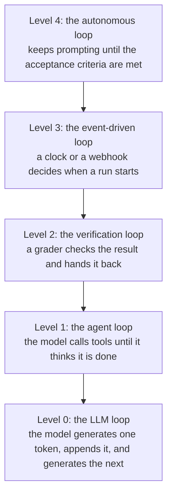
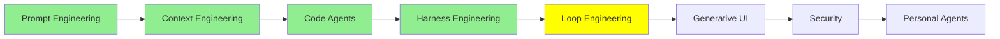

# Loop Engineering

By the end of [Harness Engineering](harness_engineering.md), the agent had an engine, a body and a track with barriers. Look at the drawing again, and notice who is still in the driver's seat.

You are. You type the prompt. You read what came back. You decide whether it was good enough, and you decide what happens next. Modern agents took over a great deal of the work:

- they manage their own context
- they compact it when it gets long
- they spawn their own subagents
- they keep their own to-do list

And still, at the centre of it, a person sits there and presses enter.

This module is about removing that person.

## What Loop Engineering is

Loop engineering is the practice of designing loops that repeat automatically. Each loop carries an agent through cycles of acting, observing and adjusting, until the agent meets a defined goal. You do not prompt the agent turn by turn. Instead, you build the control system: what starts a run, what the agent gets, and above all **when it stops**.

The last of those three, when the agent stops, is the most important part of the design. Loop engineering asks one single question: **what is the stop condition?** Everything else follows from it. If you get it wrong in one direction, the loop stops before the work is done. If you get it wrong in the other direction, the loop runs until your bill arrives.

Back to the car. The engine is the prompt, the body is the context, and the track and barriers are the harness. Until now, the driver was a human. Loop engineering is the AI driving. It is the difference between a car and a car that drives itself. Everything that follows is about how much of the steering you are willing to give to the AI.

  
*The joke works because each panel is a real job that existed. The arrows are the whole argument. In 2026, the human points at agents. By 2026.5, the human points at one agent, and that agent points at the others. The panel after that asks the honest question: where does this go? In the last two panels, the thing that gets automated is not the coding. It is the supervising.*

## Loops Happen at Five Levels

When people say "loop engineering", they usually mean the outermost loop. But it helps to see all five, because they stack on top of each other. LangChain's [The Art of Loop Engineering](https://www.langchain.com/blog/the-art-of-loop-engineering) calls the practice "the art of stacking loops". That is exactly right.



*Each level wraps the one below it, and each one takes a decision away from you. Level 0 decides the next token. Level 1 decides which tool to call next. Level 2 decides whether the answer was good enough. Level 3 decides when to start. Only level 4 decides whether to try again. That is the real decision you were making.*

### Level 0: The LLM Loop

The loop starts inside the model itself. Modern LLMs are mostly **autoregressive**. That means the model takes the input and generates only one token. Then it appends that one token to the end of the input. It generates the next token from this longer input. It repeats this until it produces a stop token or reaches a length limit. Every answer you have ever read from an LLM was written this way, one token at a time.

This is level 0 of the loops, and it happens at the LLM level. Nobody engineers this one. It is how the model produces text. It is also the loop that every other loop in this module sits on.

### Level 1: The Agent Loop

The agent itself is a loop. A model calls a tool, reads the result and calls another tool. It keeps going until it decides that the task is done. That is the loop from [AI Agents](../1_fundamentals/agents.md). It sits directly on level 0, at the model's own turn.

Nobody engineers this one either. LangChain, the other frameworks and every coding agent already implement it. When people talk about loop engineering, they do not mean this loop. It is here so that the other three have something to sit on.

### Level 2: The Verification Loop

The agent finishes. Then something checks the work against criteria, before anyone accepts it. If the work is not good enough, the feedback goes back to the agent, and the agent does another round.

This is the sensor idea from [Harness Engineering](harness_engineering.md), turned into a loop. The sensor no longer only reports. It decides whether there is another iteration. The stop condition here is a **goal**, so this is the goal-based loop.

The criteria can be anything that you are able to check. For example, a test suite passes, a type check comes back clean, or a Lighthouse score is above 90. The criteria can also be a rubric. A rubric is a written list of what a good result looks like. Another model call grades the work against that list. This covers the things that no test can check.

In LangChain, you build it with rubric middleware. In Claude Code, it is `/goal`. According to [Loop engineering: Getting started with loops](https://claude.com/blog/getting-started-with-loops), `/goal` stops when the agent achieves the goal or reaches a maximum number of turns:

```text
/goal get the homepage Lighthouse score to 90 or above, stop after 5 tries
```

Look at the shape of that: a target, and a cap. The cap is not decoration. If success is the only stop condition of a loop, the loop will not stop when success is impossible.

### Level 3: The Event-driven Loop

Here, something outside the conversation decides when a run happens: a schedule, or a webhook. The agent stops being a thing that you open. It becomes a thing that runs.

The stop condition is time-based, not goal-based. The loop does not iterate towards a target. It wakes up, does a job, and goes back to sleep until the next trigger.

In Claude Code, `/loop` runs a recurring job on your own machine. `/schedule` does the same thing in the cloud, so the job keeps running while your laptop is closed:

```text
/loop 5m check my PR, address review comments, and fix failing CI
```

Both stop when you cancel them, or when the work is finished. This level is worth having because the agent is now connected to the systems around it. A pull request opens, a build fails, or an alert fires. The agent has already started to deal with it before anybody reads the notification.

### Level 4: The Autonomous Loop

This is the one that made loop engineering a topic.

Its history starts with the **Ralph loop**, from Geoffrey Huntley's [everything is a ralph loop](https://ghuntley.com/loop/). You write a script in shell or JavaScript. The script prompts the agent mechanically, again and again, until the work meets the acceptance criteria. Here it is in its purest and most oversimplified form:

```bash
while true; do
  claude -p "$PROMPT"
done
```

That really is most of the idea. The loop keeps prompting until the job is done. Each fresh session starts with a fresh context window. Because of this, context rot never gets a chance to build up. Context rot is the problem from [Context Engineering](context_engineering.md) where a model gets worse at its task as its context grows. The state lives on disk, in the plan and the code, not in a context window.

  
*The name comes from the Simpsons character. The joke is friendly, and it does not look down on the technique. The technique works exactly because it is too simple to be clever. It keeps going after setbacks that would stop something more sophisticated.*

The one rule that matters most is this: **Ralph does one task per loop.** It does not take the whole backlog on every iteration, only one item from it. Each pass does this:

- it reads the plan
- it picks the next unfinished item
- it does that item
- it records that the item is done
- it exits

Then the next pass starts clean and picks up the item after that.

This is what pushed coding agents beyond the several hours of work that [Context Engineering](context_engineering.md) described. A loop like this runs for days, because no single session has to last that long.

The real versions are much more careful than four lines of bash. What people add is failure handling. You watch which iterations fail, and you find the failure mode. Then you engineer that failure mode out, so it cannot happen again. Huntley describes it this way: software becomes clay on a pottery wheel, not bricks that you lay one at a time. A failed iteration is a reason to refine, not a reason to stop.

You can get a real one in a few places. The [ralph-loop plugin](https://claude.com/plugins/ralph-loop) is the packaged version for Claude Code. [snarktank/ralph](https://github.com/snarktank/ralph) runs until every item in a product requirements document is complete. And [loop-engineering](https://github.com/cobusgreyling/loop-engineering) collects patterns and CLI tools. One of those tools audits what a long run costs you.

[Ralph Wiggum Loop for Claude Code](https://awesomeclaude.ai/ralph-wiggum) is a good written walkthrough. It makes a point that is worth repeating: how well this works depends more on the prompt you wrote than on the model you ran it with.

> **NOTE:** LangChain names a different top level: the **hill climbing loop**. It reads production traces to find problems, and it improves the agent's own configuration. It is worth knowing as the level above this one. It is a loop whose output is a better harness, not finished work.

## Agent Teams & Dynamic Workflows

Everything up to this point is a loop that a human designed. The script is mechanical, and you write the criteria. The structure is either yours or a known pattern like Ralph's.

The next step is to let the agent design and run the loop itself. Back to the car one last time: here the AI is not only driving. It also decides the route. It is an AI that orchestrates other AIs.

Be clear about what these two are. Agent teams and dynamic workflows are **advanced multi-agent architectures**. They build on the patterns in [Multi-Agent Systems](../1_fundamentals/multi_agent.md). Do not mistake them for loop engineering itself. Loop engineering is the practice: you decide what starts a run, what the agent gets, and when it stops. Agent teams and dynamic workflows are architectures that suit that practice. They make it possible at a much larger scale.

Claude Code has two features for this, and they do not have the same shape.

### Agent Teams

An agent team is several full Claude Code sessions that work together. One session is the lead. The lead breaks the work into a shared task list, spawns the others, and brings the results together. Each teammate has its own context window. The teammates claim tasks from the shared list. They message each other directly, instead of reporting only up to the lead.

That creates a loop, almost as a side effect. The lead watches what the others are doing and decides what happens next. That is the job you used to do.

  
*The thing to notice is the dashed circles on the left. When a subagent ends, only its result survives. The main agent is the only place that any of that work comes back to. On the right, nothing gets summarised on the way up, because no single window sees everything. That is where the higher token cost in the table below comes from. It is also why a lead can lose track of what its own team is doing.*

Here is how the two compare, from [Orchestrate teams of Claude Code sessions](https://code.claude.com/docs/en/agent-teams):

| | Subagents | Agent teams |
| --- | --- | --- |
| Context | Own context window; results return to the caller | Own context window; fully independent |
| Communication | Return a result to the caller. Subagents that Claude named when it spawned them can also message each other | Teammates message each other directly |
| Coordination | Main agent manages all work | Self-coordination through messages, plus a shared task list |
| Best for | Focused tasks where only the result matters | Complex work requiring discussion and collaboration |
| Token cost | Lower: results summarized back to main context | Higher: each teammate is a separate Claude instance |

The row to notice is the last one. Each teammate is a whole separate instance, so the cost grows with the number of teammates. Three focused teammates usually do better than five scattered ones. The docs suggest that you start with three to five.

> **NOTE:** agent teams are experimental, and they are off by default. You turn them on with `CLAUDE_CODE_EXPERIMENTAL_AGENT_TEAMS=1`.

### Dynamic Workflows

A dynamic workflow is a JavaScript script that orchestrates many subagents at once. Claude writes the script for the task that you described. A runtime then executes the script in the background, and your session stays free.

The difference from everything above is **who holds the plan**. With subagents, skills and agent teams, Claude is the orchestrator. It decides, turn by turn, what to run next. A workflow moves that decision into code instead. The script holds the loop, the branching and all the intermediate results. So the only thing that reaches your context is the final answer.

The next table is from [Orchestrate subagents at scale with dynamic workflows](https://code.claude.com/docs/en/workflows):

| | Subagents | Skills | Agent teams | Workflows |
| --- | --- | --- | --- | --- |
| What it is | A worker Claude spawns | Instructions Claude follows | A lead agent supervising peer sessions | A script the runtime executes |
| Who decides what runs next | Claude, turn by turn | Claude, following the prompt | The lead agent, turn by turn | The script |
| Where intermediate results live | Claude's context window | Claude's context window | A shared task list | Script variables |
| What is repeatable | The worker definition | The instructions | The team definition | The orchestration itself |
| Scale | A few delegated tasks per turn | Same as subagents | A handful of long-running peers | Dozens to hundreds of agents per run |
| Interruption | Restarts the turn | Restarts the turn | Teammates keep running | Resumable in the same session |

Two rows deserve attention. The first is **scale**. A workflow gives you dozens to hundreds of agents in a single run, where a team gives you a handful. A script can do that because it does not need a context window to remember what it is doing. The second row is **what is repeatable**. With a team, you can reuse the team definition. With a workflow, the orchestration itself becomes a file. You can read, edit, rerun and commit that file.

That also gives you a quality pattern that is hard to get in any other way. The script is in charge. So it can send independent agents to argue against each other's findings, before any of those findings get reported. Or it can draft a plan from several angles and weigh those angles against each other. You do not only get more agents. You get agents that check each other.

You turn it on with `/effort ultracode`. This combines the highest reasoning setting with automatic workflow orchestration. Or you can include the word `ultracode` in a single prompt, and then only that task runs as a workflow.

## Recursive Language Models

Dynamic workflows do not exist only because of loop engineering. They are also the practical form of an idea called the **recursive language model** (RLM). The idea comes from the paper [Recursive Language Models](https://arxiv.org/abs/2512.24601) by Alex Zhang, Tim Kraska and Omar Khattab at MIT.

A normal model receives the whole prompt inside its context window. An RLM does not. The long prompt sits in a Python environment, as a variable. At the start, the model sees only a little about it: how long it is, how it begins, and how to read parts of it. The model then writes code to work with that variable. It can look at a slice, search it with grep, or split it into chunks. And it can call a model again on any one of those pieces, including another copy of itself. Those calls are the "recursive" part. Only their results come back into the main context window. So the window never has to hold the whole input. That is how one model starts to behave as if its window had no limit. A dynamic workflow uses the same idea at a larger scale: the script holds the input and the intermediate results in variables, and many agents work on the pieces. That is how a script full of agents starts to look like one model with an unbounded window.

Two things are easy to confuse here, so it is worth saying them plainly.

- **An RLM is not loop engineering.** It does not decide what starts a run or when the run stops. But it makes loop engineering possible, and it makes it better. A loop that runs for days needs a way to work with more text than one window can hold.
- **An RLM is a single-agent architecture.** It describes how one agent works on the inside: one model that calls itself through code. It makes many model calls, but do not mistake it for the multi-agent architectures above.

**CodeAct**, from [Executable Code Actions Elicit Better LLM Agents](https://arxiv.org/abs/2402.01030), is a close relative. It makes executable code the agent's action space, instead of JSON tool calls. [Advanced Agent Architectures](../3_expert/advanced_agent_architectures.md) covers both of them properly. Alex Zhang's [write-up](https://alexzhang13.github.io/blog/2025/rlm/) is the readable version of the paper, and [rlm](https://github.com/alexzhang13/rlm) is the library.

## The Trend

Put the last four modules next to each other, and the direction is easy to see:

- better models
- then better use of the context window
- then better environments around the models
- then better loops around those environments

Each new layer let the agent work for longer before a person had to step in. One good answer became a session that stays coherent. That became hours of unattended work, and then runs measured in days.

None of the layers replaced the one before it. They stacked. That is why the whole series has been one drawing, with more parts added to it.

## Where this fits in the series



## Summary

Loop engineering means designing the repeating cycle that carries an agent to a goal, with no person in that cycle. The design is the stop condition.

The loops stack, one inside the next:

- At the bottom is the LLM loop. The model generates one token, appends it to the input and generates the next.
- The agent loop is the model calling tools until it is done. Every framework already gives you that one.
- The verification loop adds a grader that hands the work back when it is not good enough. It stops on a goal, plus a cap on how many tries it gets.
- The event-driven loop hands the starting decision to a clock or a webhook.
- The autonomous loop, the Ralph loop, is a script that prompts the agent again and again until the work meets the acceptance criteria. It does one task per iteration, and every pass starts from a clean window. The state lives on disk, not in a context. That last point is what took agents from hours to days.

Above all of that, the agent designs the loop itself. Agent teams give you peer sessions with a shared task list, and a lead that coordinates them. Dynamic workflows move the plan into a script. That gives you three things: it scales to hundreds of agents, it makes the orchestration itself the reusable part, and it lets agents check each other's work. Both are advanced multi-agent architectures. They make loop engineering possible, but they are not loop engineering. A recursive language model is different again. It is a single-agent architecture: one model calls itself through code, so it can work through more text than its window holds.

Next: everything in this module made an agent harder to supervise. The Security module is about the cost of that: the risks that appear when nobody is watching what the agent does.

**Quick Check**: a verification loop and an autonomous loop both keep going until something is satisfied. What is the difference, and which one needs a maximum number of tries?

## References

- [The Art of Loop Engineering](https://www.langchain.com/blog/the-art-of-loop-engineering): loop engineering as stacking loops, and the four levels
- [Loop engineering: Getting started with loops](https://claude.com/blog/getting-started-with-loops): `/goal`, `/loop` and `/schedule`, with the stop condition each one uses
- [everything is a ralph loop](https://ghuntley.com/loop/): the original technique, and the one-task-per-loop rule
- [ralph-loop plugin](https://claude.com/plugins/ralph-loop): the packaged version for Claude Code
- [snarktank/ralph](https://github.com/snarktank/ralph): an autonomous loop that runs until every item in a requirements document is complete
- [loop-engineering](https://github.com/cobusgreyling/loop-engineering): patterns, starters and CLI tools, including cost auditing for a long run
- [Ralph Wiggum Loop for Claude Code](https://awesomeclaude.ai/ralph-wiggum): a written walkthrough, and why the operator's prompt matters more than the model
- [Orchestrate teams of Claude Code sessions](https://code.claude.com/docs/en/agent-teams): agent teams, the shared task list, and the architecture behind it
- [Orchestrate subagents at scale with dynamic workflows](https://code.claude.com/docs/en/workflows): what a workflow script looks like, its limits, and the four-way comparison
- [Executable Code Actions Elicit Better LLM Agents](https://arxiv.org/abs/2402.01030): CodeAct, where code becomes the action space
- [Recursive Language Models](https://arxiv.org/abs/2512.24601): the paper, with [Alex Zhang's write-up](https://alexzhang13.github.io/blog/2025/rlm/) and the [rlm](https://github.com/alexzhang13/rlm) library
- [Loop Engineering explained in 8min..](https://www.youtube.com/watch?v=4biXYSNkn9Y): this module's own subject in eight minutes, if you would rather watch it
- [Advanced Agent Architectures](../3_expert/advanced_agent_architectures.md): CodeAct, recursive language models and the rest, covered properly
