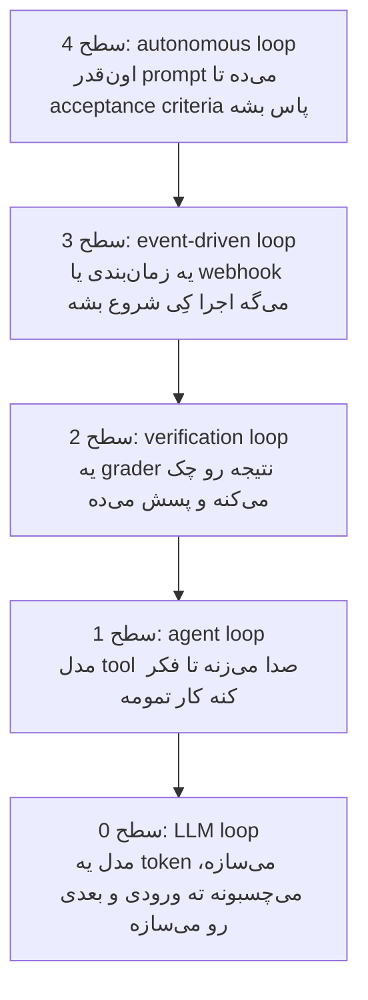
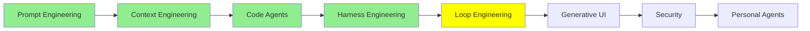

# Loop Engineering

آخر [Harness Engineering](harness_engineering_fa.md)، agent‌مون همه‌چی داشت: موتور، بدنه، و یه پیست که دورش حفاظ کشیده بودیم. حالا یه بار دیگه به اون تصویر نگاه کن؛ می‌بینی که هنوز خودت پشت فرمونی.

prompt رو تو می‌نویسی، جوابی که برمی‌گرده رو تو می‌خونی، تو تصمیم می‌گیری به درد می‌خوره یا نه، و قدم بعدی رو هم باز خودت تعیین می‌کنی. البته agent‌های امروزی خیلی از کارها رو از دوشمون برداشتن:

- context‌شون رو خودشون مدیریت می‌کنن
- وقتی context زیادی بلند شد، خودشون compact‌ش می‌کنن
- subagent‌هاشون رو خودشون راه می‌ندازن
- to-do list‌شون رو هم خودشون نگه می‌دارن

ولی با همه‌ی این‌ها، هنوز وسط کار یه نفر نشسته که باید enter رو بزنه.

توی این درس می‌خوایم همین یه نفر رو هم از وسط برداریم.

## Loop Engineering چیه؟

Loop engineering یعنی loop‌هایی طراحی کنی که خودبه‌خود تکرار بشن. توی هر loop، agent یه کاری می‌کنه، نتیجه‌ش رو می‌بینه و خودش رو اصلاح می‌کنه، و این چرخه رو اون‌قدر تکرار می‌کنه تا به هدفی که از قبل مشخص کردی برسه. دیگه لازم نیست خودت دونه‌دونه به agent prompt بدی. کار تو اینه که سیستم کنترلش رو بسازی: چی یه اجرا رو راه می‌ندازه، چی به agent می‌دی، و از همه مهم‌تر، **کِی وایمیسه**.

مهم‌ترین بخش طراحی همین آخریه، یعنی اینکه loop کِی وایسه. کل loop engineering برمی‌گرده به یه سؤال: **stop condition چیه؟** بقیه‌ی تصمیم‌ها همه از جواب همین سؤال درمیان. اگه این شرط رو یه جوری اشتباه بذاری، loop قبل از اینکه کار تموم بشه وایمیسه؛ اگه جور دیگه‌ش رو اشتباه کنی، loop اون‌قدر می‌چرخه تا صورت‌حساب بیاد دستت.

برگردیم سراغ همون ماشین. موتورش prompt بود، بدنه‌ش context، و پیست و حفاظ‌هاش harness. تا اینجا راننده یه آدم بود، ولی loop engineering یعنی رانندگی رو بدیم دست AI؛ فرقش درست مثل فرق یه ماشین معمولی با یه ماشین خودرانه. هرچی از اینجا به بعد می‌گیم، سر همین سؤاله که حاضری چقدر از فرمون رو بدی دست AI.

  
*این شوخی می‌گیره چون هر کادرش یه شغل واقعیه که یه زمانی وجود داشته. اصل حرف رو فلش‌ها می‌زنن: توی 2026 آدم به agent‌ها اشاره می‌کنه، و توی 2026.5 آدم فقط به یه agent اشاره می‌کنه و همون agent به بقیه. کادر بعدی هم بی‌تعارف می‌پرسه ته این مسیر کجاست. توی دو کادر آخر، چیزی که خودکار می‌شه دیگه کدنویسی نیست، خودِ نظارته.*

## پنج سطح Loop

وقتی کسی می‌گه «loop engineering»، معمولاً منظورش بیرونی‌ترین loop‌ه. ولی بهتره هر پنج تا رو ببینی، چون این‌ها لایه‌لایه روی هم سوار می‌شن. LangChain توی [The Art of Loop Engineering](https://www.langchain.com/blog/the-art-of-loop-engineering) به این کار می‌گه «هنر روی هم چیدن loop‌ها»، و حق هم داره.



*هر سطح، سطح زیرش رو در بر می‌گیره و هر کدوم یه تصمیم رو از دست تو می‌گیره. سطح 0 token بعدی رو انتخاب می‌کنه، سطح 1 tool بعدی رو، سطح 2 می‌گه جواب به اندازه‌ی کافی خوب بوده یا نه، و سطح 3 می‌گه کِی شروع کنیم. فقط سطح 4 تصمیم می‌گیره که دوباره امتحان کنه یا نه، و این دقیقاً همون تصمیم اصلیه که تا حالا خودت می‌گرفتی.*

### سطح 0: LLM Loop

اولین loop داخل خود مدله. بیشتر LLM‌های امروزی **autoregressive** هستن؛ یعنی مدل ورودی رو می‌گیره و فقط یه token تولید می‌کنه، اون token رو می‌چسبونه ته ورودی، و از روی این ورودیِ یه کم بلندتر token بعدی رو می‌سازه. این کار رو اون‌قدر تکرار می‌کنه تا یا یه stop token تولید کنه یا به سقف طول برسه. هر جوابی که تا حالا از یه LLM خوندی همین‌طوری نوشته شده، token به token.

این سطح 0 ماجراست و جاش داخل خود LLM‌ه. کسی این loop رو مهندسی نمی‌کنه، چون اصلاً مدل همین‌طوری متن تولید می‌کنه. ولی همه‌ی loop‌های دیگه‌ی این درس روی همین یکی بنا شدن.

### سطح 1: Agent Loop

خود agent هم یه loop‌ه: مدل یه tool رو صدا می‌زنه، نتیجه‌ش رو می‌خونه، یه tool دیگه صدا می‌زنه، و همین‌طور ادامه می‌ده تا به این نتیجه برسه که کار تمومه. این همون loop‌یه که توی [AI Agents](../1_fundamentals/agents_fa.md) دیدیم، و مستقیم روی سطح 0 سواره: هر بار که نوبت به خود مدل می‌رسه، همون LLM loop جوابش رو می‌نویسه.

این یکی رو هم کسی مهندسی نمی‌کنه، چون LangChain و بقیه‌ی framework‌ها و همه‌ی coding agent‌ها از قبل پیاده‌ش کردن. وقتی حرف از loop engineering می‌شه منظور این loop نیست؛ اینجا آوردیمش چون سه سطح بعدی روی همین بنا می‌شن.

### سطح 2: Verification Loop

agent کارش که تموم شد، قبل از اینکه کسی کار رو تحویل بگیره، یه چیزی اون رو با یه سری معیار می‌سنجه. اگه کار به حد کافی خوب نبود، بازخوردش برمی‌گرده دست agent و agent یه دور دیگه روش کار می‌کنه.

این همون ایده‌ی sensor‌ه که توی [Harness Engineering](harness_engineering_fa.md) دیدیم، فقط حالا تبدیل شده به یه loop. sensor دیگه فقط گزارش نمی‌ده، تصمیم هم می‌گیره که یه دور دیگه لازمه یا نه. چون stop condition اینجا رسیدن به یه هدف (**goal**) هست، به این loop می‌گن goal-based.

معیار می‌تونه هر چیزی باشه که بشه چکش کرد: مثلاً اینکه test suite پاس بشه، type check بدون خطا رد بشه، یا امتیاز Lighthouse بالای 90 باشه. معیار می‌تونه یه rubric هم باشه، یعنی یه فهرست مکتوب از اینکه یه نتیجه‌ی خوب باید چه شکلی باشه؛ بعد یه call دیگه به مدل، کار رو با همون فهرست نمره می‌ده. این‌طوری چیزهایی هم چک می‌شن که هیچ test‌ی از پسشون برنمیاد.

توی LangChain این loop رو با rubric middleware می‌سازی و توی Claude Code با `/goal`. طبق [Loop engineering: Getting started with loops](https://claude.com/blog/getting-started-with-loops)، `/goal` وقتی وایمیسه که یا agent به هدف برسه، یا تعداد نوبت‌ها به سقفش برسه:

```text
/goal get the homepage Lighthouse score to 90 or above, stop after 5 tries
```

دقت کن این دستور از دو تیکه ساخته شده: یه هدف و یه سقف. سقف رو الکی اونجا نذاشتن؛ loop‌ی که تنها شرط توقفش موفقیت باشه، اگه موفقیت اصلاً ممکن نباشه، هیچ‌وقت وانمیسه.

### سطح 3: Event-driven Loop

اینجا یه چیزی بیرون از گفت‌وگو تعیین می‌کنه اجرا کِی شروع بشه: یه زمان‌بندی، یا یه webhook. agent دیگه ابزاری نیست که خودت بازش کنی و باهاش کار کنی؛ خودش سر وقتش راه می‌افته.

stop condition اینجا به زمان بنده، نه به هدف. loop قرار نیست قدم‌به‌قدم به یه هدف نزدیک بشه؛ بیدار می‌شه، کارش رو انجام می‌ده و تا trigger بعدی دوباره می‌خوابه.

توی Claude Code، `/loop` یه کار تکراری رو روی سیستم خودت اجرا می‌کنه و `/schedule` همین کار رو توی cloud انجام می‌ده، پس حتی وقتی در لپ‌تاپت بسته‌ست کار ادامه پیدا می‌کنه:

```text
/loop 5m check my PR, address review comments, and fix failing CI
```

هر دوشون یا وقتی لغوشون کنی وایمیسن، یا وقتی کار تموم بشه. ارزش این سطح اینه که agent حالا به سیستم‌های دور و برش وصله: یه pull request باز می‌شه، یه build fail می‌شه یا یه alert میاد، و تا کسی بیاد notification رو بخونه، agent دست به کار شده.

### سطح 4: Autonomous Loop

loop engineering به خاطر همین سطح سر زبون‌ها افتاد.

داستانش از **Ralph loop** شروع می‌شه که Geoffrey Huntley توی [everything is a ralph loop](https://ghuntley.com/loop/) معرفیش کرد. یه script با shell یا JavaScript می‌نویسی که خودکار و پشت سر هم به agent prompt بده، تا وقتی کار acceptance criteria رو پاس کنه. خالص‌ترین و البته زیادی ساده‌شده‌ترین شکلش اینه:

```bash
while true; do
  claude -p "$PROMPT"
done
```

باور کن بیشتر ایده همینه: loop اون‌قدر prompt می‌ده تا کار تموم بشه. هر session جدید با یه context window تمیز شروع می‌شه، برای همین مشکل context rot اصلاً فرصت نمی‌کنه جمع بشه. context rot همون مشکلیه که توی [Context Engineering](context_engineering_fa.md) دیدیم: هر چی context بزرگ‌تر بشه، مدل کارش رو بدتر انجام می‌ده. state روی دیسک می‌مونه، توی plan و کد، نه توی context window.

  
*اسمش رو از شخصیت Ralph توی سیمپسون‌ها برداشتن. شوخیش دوستانه‌ست و قصد مسخره کردن تکنیک رو نداره. اتفاقاً این تکنیک دقیقاً به این خاطر جواب می‌ده که ساده‌تر از اونیه که بخواد زرنگی کنه؛ بعد از شکست‌هایی که یه سیستم پیچیده‌تر رو از پا درمیارن، باز به راهش ادامه می‌ده.*

قانون اصلیش اینه که **Ralph توی هر loop فقط یه task انجام می‌ده**: هر iteration به‌جای کل backlog فقط یه آیتمش رو برمی‌داره. هر دور این کارها رو می‌کنه:

- plan رو می‌خونه
- آیتم بعدیِ انجام‌نشده رو انتخاب می‌کنه
- همون یه آیتم رو انجام می‌ده
- ثبت می‌کنه که اون آیتم انجام شد
- و خارج می‌شه

بعدش دور بعدی با یه context تمیز از نو شروع می‌شه و می‌ره سراغ آیتم بعدی.

همین ترفند بود که coding agent‌ها رو از اون چند ساعت کاری که توی [Context Engineering](context_engineering_fa.md) گفتیم جلوتر برد. یه loop این‌شکلی چند روز کار می‌کنه، چون هیچ session‌ی لازم نیست اون‌قدر دووم بیاره.

البته نسخه‌های واقعی خیلی حساب‌شده‌تر از این چهار خط bash هستن، و چیزی که بهشون اضافه می‌کنن مدیریت خطاست. نگاه می‌کنی کدوم iteration‌ها fail می‌شن، می‌فهمی خطا از چه جنسیه، و بعد طوری درستش می‌کنی که دیگه تکرار نشه. به قول Huntley، نرم‌افزار می‌شه مثل گِل روی چرخ کوزه‌گری، نه آجری که یکی‌یکی روی هم بچینی. iteration‌ی که fail می‌شه یعنی یه جای کار رو باید بهتر کنی، نه اینکه کار رو ول کنی.

اگه نسخه‌ی واقعیش رو می‌خوای، چند جا هست. [ralph-loop plugin](https://claude.com/plugins/ralph-loop) نسخه‌ی آماده‌ش برای Claude Code‌ه. [snarktank/ralph](https://github.com/snarktank/ralph) اون‌قدر اجرا می‌شه تا همه‌ی آیتم‌های یه سند product requirements تیک بخورن. [loop-engineering](https://github.com/cobusgreyling/loop-engineering) هم یه مجموعه از الگوها و ابزارهای CLI‌ه که یکی‌شون حساب می‌کنه یه اجرای طولانی چقدر برات آب خورده.

[Ralph Wiggum Loop for Claude Code](https://awesomeclaude.ai/ralph-wiggum) هم یه راهنمای نوشتاری خوبه، و یه حرفی می‌زنه که ارزش داره دوباره بگیم: اینکه این روش چقدر خوب جواب بده، بیشتر به prompt‌ی بستگی داره که نوشتی تا مدلی که باهاش اجراش کردی.

> **نکته:** LangChain بالاترین سطح رو یه چیز دیگه می‌دونه: **hill climbing loop**. این loop، trace‌های production رو می‌خونه تا مشکل‌ها رو پیدا کنه و تنظیمات خود agent رو بهتر می‌کنه. خوبه به‌عنوان یه سطح بالاتر از این یکی بشناسیش، چون خروجیش یه harness بهتره، نه یه کار تموم‌شده.

## Agent Teams و Dynamic Workflows

همه‌ی loop‌هایی که تا اینجا دیدیم رو یه آدم طراحی کرده: script فقط کورکورانه تکرار می‌کنه، معیارها رو تو می‌نویسی، و ساختار کار یا مال خودته یا یه الگوی شناخته‌شده مثل Ralph.

قدم بعدی اینه که طراحی و اجرای loop رو هم بسپری به خود agent. برای آخرین بار برگردیم سراغ ماشین: اینجا AI فقط رانندگی نمی‌کنه، مسیر رو هم خودش انتخاب می‌کنه. یعنی یه AI داریم که بقیه‌ی AI‌ها رو هماهنگ می‌کنه.

ولی حواست باشه این دو تا دقیقاً چی هستن. agent teams و dynamic workflows **معماری‌های پیشرفته‌ی multi-agent** هستن و روی الگوهای [Multi-Agent Systems](../1_fundamentals/multi_agent_fa.md) ساخته شدن، پس با خود loop engineering قاطیشون نکن. loop engineering یه روش کاره: تو تعیین می‌کنی چی اجرا رو راه بندازه، چی به agent بدی و کِی وایسه. agent teams و dynamic workflows معماری‌هایی هستن که به کار این روش میان و کمک می‌کنن همین کار رو توی مقیاس خیلی بزرگ‌تری انجام بدی.

Claude Code برای این کار دو تا قابلیت داره که ساختارشون با هم فرق داره.

### Agent Teams

agent team یعنی چند تا session کامل Claude Code که با هم کار می‌کنن. یکی‌شون سرگروهه (lead): کار رو به یه task list مشترک می‌شکنه، بقیه رو راه می‌ندازه و آخر سر نتیجه‌ها رو جمع‌وجور می‌کنه. هر هم‌تیمی (teammate) context window خودش رو داره، task‌ها رو خودش از لیست مشترک برمی‌داره، و به‌جای اینکه فقط به سرگروه گزارش بده، مستقیم با بقیه‌ی هم‌تیمی‌ها پیام رد و بدل می‌کنه.

این‌طوری تقریباً ناخواسته یه loop شکل می‌گیره: سرگروه حواسش به کار بقیه هست و تصمیم می‌گیره قدم بعدی چی باشه، یعنی همون کاری که قبلاً خودت می‌کردی.

  
*به دایره‌های خط‌چین سمت چپ دقت کن: وقتی کار یه subagent تموم می‌شه، فقط نتیجه‌ش می‌مونه، و همه‌ی اون کار فقط به agent اصلی برمی‌گرده. سمت راست، چیزی سر راهش به بالا خلاصه نمی‌شه، چون هیچ window‌ی نیست که همه‌چیز رو ببینه. هزینه‌ی token بیشتری که توی جدول پایین می‌بینی از همین‌جا میاد، و برای همینه که ممکنه رشته‌ی کار تیم از دست خود سرگروه هم در بره.*

[Orchestrate teams of Claude Code sessions](https://code.claude.com/docs/en/agent-teams) این دو تا رو این‌طوری با هم مقایسه می‌کنه:

| | Subagents | Agent teams |
| --- | --- | --- |
| Context | context window خودش رو داره؛ نتیجه برمی‌گرده به agent‌ی که صداش زده | context window خودش رو داره؛ کاملاً مستقله |
| ارتباط | نتیجه رو به agent‌ی که صداش زده برمی‌گردونه. subagent‌هایی که Claude موقع راه انداختنشون براشون اسم گذاشته، می‌تونن به هم پیام هم بدن | هم‌تیمی‌ها مستقیم به هم پیام می‌دن |
| هماهنگی | agent اصلی همه‌ی کارها رو مدیریت می‌کنه | خودشون با پیام دادن به هم و یه task list مشترک هماهنگ می‌شن |
| مناسب برای | کارهای مشخصی که فقط نتیجه‌شون مهمه | کارهای پیچیده‌ای که بحث و همفکری لازم دارن |
| هزینه‌ی token | کمتر: نتیجه‌ها خلاصه می‌شن و برمی‌گردن به context اصلی | بیشتر: هر هم‌تیمی یه instance جدای Claude‌ه |

ردیف آخر از همه مهم‌تره. هر هم‌تیمی یه instance کامل و جداست، پس هزینه با تعداد هم‌تیمی‌ها بالا می‌ره. معمولاً سه تا هم‌تیمی که هر کدوم روی یه کار مشخص متمرکزن، از پنج تایی که هر کدوم یه طرف می‌رن بهتر جواب می‌دن، و خود مستندات هم پیشنهاد می‌کنه با سه تا پنج تا شروع کنی.

> **نکته:** agent teams هنوز آزمایشی‌ان و به‌طور پیش‌فرض خاموشن. برای روشن کردنشون `CLAUDE_CODE_EXPERIMENTAL_AGENT_TEAMS=1` رو ست کن.

### Dynamic Workflows

dynamic workflow یه script به زبان JavaScript‌ه که کلی subagent رو هم‌زمان هماهنگ می‌کنه. Claude این script رو برای کاری که شرح دادی می‌نویسه، بعد یه runtime توی پس‌زمینه اجراش می‌کنه و session خودت آزاد می‌مونه.

فرق اصلیش با همه‌ی چیزهای قبلی اینه که **plan دست کیه**. با subagent‌ها، skill‌ها و agent teams، Claude نقش orchestrator رو داره و هر نوبت خودش تصمیم می‌گیره بعدش چی اجرا بشه. ولی workflow این تصمیم رو می‌بره توی کد: loop، شاخه‌ها و همه‌ی نتیجه‌های میانی دست script‌ه، و تنها چیزی که به context تو می‌رسه جواب نهاییه.

جدول زیر از [Orchestrate subagents at scale with dynamic workflows](https://code.claude.com/docs/en/workflows) اومده:

| | Subagents | Skills | Agent teams | Workflows |
| --- | --- | --- | --- | --- |
| چیه | یه worker که Claude راه می‌ندازه | دستورالعمل‌هایی که Claude ازشون پیروی می‌کنه | یه agent سرگروه که حواسش به چند تا session هم‌سطحه | یه script که runtime اجراش می‌کنه |
| کی تصمیم می‌گیره بعدش چی اجرا بشه | Claude، هر نوبت | Claude، طبق prompt | agent سرگروه، هر نوبت | خود script |
| نتیجه‌های میانی کجا می‌مونن | context window خود Claude | context window خود Claude | یه task list مشترک | متغیرهای script |
| چی رو می‌شه دوباره به کار برد | تعریف worker | دستورالعمل‌ها | تعریف تیم | خود orchestration |
| مقیاس | چند تا task واگذارشده توی هر نوبت | مثل subagent‌ها | چند تا session هم‌سطح که مدت طولانی کار می‌کنن | ده‌ها تا صدها agent توی هر اجرا |
| اگه وسطش قطع بشه | نوبت از اول شروع می‌شه | نوبت از اول شروع می‌شه | هم‌تیمی‌ها به کارشون ادامه می‌دن | می‌شه توی همون session از همون‌جا ادامه‌ش داد |

دو تا از این ردیف‌ها ارزش دارن بیشتر روشون مکث کنی. اولیش ردیف **مقیاس** هست: یه workflow توی یه اجرا ده‌ها تا صدها agent راه می‌ندازه، در حالی که یه تیم فقط چند تا. script از پس این کار برمیاد چون برای اینکه یادش بمونه داره چی کار می‌کنه، به context window احتیاج نداره. دومی ردیف **چی رو می‌شه دوباره به کار برد** هست: توی تیم، تعریف تیم رو دوباره استفاده می‌کنی، ولی توی workflow خود orchestration تبدیل می‌شه به یه فایل که می‌تونی بخونیش، ویرایشش کنی، دوباره اجراش کنی و commit‌ش کنی.

یه الگوی کیفیت هم دستت میاد که از راه دیگه به‌سختی می‌شه بهش رسید. چون اختیار دست script‌ه، می‌تونه چند تا agent مستقل رو بفرسته که قبل از گزارش شدن یافته‌ها، به یافته‌های همدیگه ایراد بگیرن؛ یا یه plan رو از چند زاویه بنویسه و این زاویه‌ها رو با هم سبک‌سنگین کنه. پس فقط تعداد agent‌ها بیشتر نمی‌شه، agent‌هایی داری که کار همدیگه رو چک می‌کنن.

برای روشن کردنش `/effort ultracode` رو بزن؛ این دستور بالاترین سطح reasoning رو با orchestration خودکار workflow ترکیب می‌کنه. اگه هم فقط برای یه کار می‌خوایش، کلمه‌ی `ultracode` رو توی همون یه prompt بنویس تا فقط همون task به شکل workflow اجرا بشه.

## Recursive Language Models

dynamic workflow‌ها فقط به خاطر loop engineering به وجود نیومدن؛ در واقع شکل عملیِ ایده‌ای به اسم **recursive language model** (RLM) هم هستن. این ایده از مقاله‌ی [Recursive Language Models](https://arxiv.org/abs/2512.24601) اومده که Alex Zhang، Tim Kraska و Omar Khattab توی MIT نوشتن.

یه مدل معمولی کل prompt رو یه‌جا توی context window‌ش می‌گیره، ولی RLM نه. توی RLM، prompt بلند به شکل یه متغیر توی یه محیط Python می‌مونه و مدل اولش فقط یه چیزهای مختصری درباره‌ش می‌بینه: چقدر طوله، اولش چی نوشته، و چطوری می‌شه تیکه‌هاش رو خوند. بعد خود مدل کد می‌نویسه تا با اون متغیر کار کنه: یه برش ازش رو نگاه کنه، با grep توش بگرده، یا به چند تا chunk تقسیمش کنه.

روی هر کدوم از این تیکه‌ها هم می‌تونه دوباره یه مدل رو صدا بزنه، حتی یه نسخه‌ی دیگه از خودش؛ اسم «recursive» دقیقاً از همین صدا زدن‌ها میاد. فقط نتیجه‌ی این call‌ها برمی‌گرده توی context window اصلی، پس window هیچ‌وقت مجبور نمی‌شه کل ورودی رو توی خودش نگه داره. این‌طوری یه مدل جوری رفتار می‌کنه که انگار window‌ش ته نداره. dynamic workflow همین ایده رو در مقیاس بزرگ‌تر پیاده می‌کنه: script ورودی و نتیجه‌های میانی رو توی متغیرها نگه می‌داره و کلی agent روی تیکه‌ها کار می‌کنن. این‌طوری یه script پر از agent کم‌کم شبیه یه مدل واحد با window بی‌انتها می‌شه.

اینجا دو تا نکته راحت با هم قاطی می‌شن، پس بذار رک و راست بگیمشون.

- **RLM همون loop engineering نیست.** نه تعیین می‌کنه چی اجرا رو راه بندازه، نه اینکه کِی تموم بشه. ولی هم loop engineering رو ممکن می‌کنه و هم بهترش می‌کنه، چون loop‌ی که چند روز کار می‌کنه بالاخره باید راهی داشته باشه که با متنی بیشتر از ظرفیت یه window کار کنه.
- **RLM یه معماری single-agent‌ه.** یعنی توضیح می‌ده یه agent از داخل چطور کار می‌کنه: یه مدل که از طریق کد خودش رو صدا می‌زنه. درسته که کلی call به مدل می‌زنه، ولی با معماری‌های multi-agent بالا اشتباهش نگیر.

**CodeAct** که از مقاله‌ی [Executable Code Actions Elicit Better LLM Agents](https://arxiv.org/abs/2402.01030) اومده، فامیل نزدیک همین ایده‌ست: به‌جای tool call‌های JSON، کد اجرایی رو action space agent می‌کنه، یعنی agent کارهاش رو با نوشتن کد انجام می‌ده. [Advanced Agent Architectures](../3_expert/advanced_agent_architectures.md) هر دو رو مفصل توضیح می‌ده. [یادداشت Alex Zhang](https://alexzhang13.github.io/blog/2025/rlm/) نسخه‌ی خوش‌خوان‌تر مقاله‌ست و [rlm](https://github.com/alexzhang13/rlm) هم کتابخونه‌شه.

## روند کلی

چهار درس آخر رو که کنار هم بذاری، راحت می‌بینی کار داره به کدوم سمت می‌ره:

- مدل‌های بهتر
- بعد استفاده‌ی بهتر از context window
- بعد محیط‌های بهتر دور مدل‌ها
- و بعد loop‌های بهتر دور همون محیط‌ها

هر لایه مدت کار رو بیشتر کرد: اول فقط یه جواب خوب می‌گرفتیم، بعد شد یه session که تا آخر انسجامش رو حفظ می‌کنه، بعد چند ساعت کار بدون اینکه کسی بالای سرش باشه، و الان اجراهایی که با روز اندازه گرفته می‌شن.

هیچ لایه‌ای جای لایه‌ی قبلی رو نگرفت؛ همه روی هم سوار شدن. برای همینه که کل این مجموعه در واقع یه تصویر بوده که هر بار یه تیکه بهش اضافه کردیم.

## کجای این مجموعه هستیم



## خلاصه

Loop engineering یعنی طراحی یه چرخه‌ی تکرارشونده که agent رو بدون دخالت آدم به هدف برسونه. مهم‌ترین تصمیم توی این طراحی هم stop condition‌ه، یعنی اینکه loop کِی وایسه.

این loop‌ها لایه‌لایه توی هم قرار می‌گیرن:

- پایین‌ترین لایه LLM loop‌ه: مدل یه token تولید می‌کنه، می‌چسبونه ته ورودی و token بعدی رو می‌سازه.
- agent loop یعنی مدل اون‌قدر tool صدا بزنه تا کار تموم بشه، و هر framework‌ی این یکی رو آماده بهت می‌ده.
- verification loop یه grader اضافه می‌کنه که اگه کار به حد کافی خوب نبود، پسش بده. شرط توقفش رسیدن به هدفه، به‌اضافه‌ی یه سقف برای تعداد تلاش‌ها.
- event-driven loop تصمیم شروع رو می‌سپره به یه زمان‌بندی یا یه webhook.
- autonomous loop، یعنی همون Ralph loop، یه script‌ه که اون‌قدر پشت سر هم به agent prompt می‌ده تا کار acceptance criteria رو پاس کنه. هر iteration فقط یه task انجام می‌ده و هر دور با یه window تمیز شروع می‌شه، چون state روی دیسکه، نه توی context. همین نکته‌ی آخر بود که agent‌ها رو از چند ساعت کار به چند روز رسوند.

یه پله بالاتر از همه‌ی این‌ها، خود agent loop رو طراحی می‌کنه. agent teams چند تا session هم‌سطح بهت می‌ده، با یه task list مشترک و یه سرگروه که هماهنگشون می‌کنه. dynamic workflow‌ها plan رو می‌برن توی یه script و سه تا چیز بهت می‌دن: تا صدها agent بزرگ می‌شن، خود orchestration می‌شه همون بخشی که دوباره به کار می‌ره، و agent‌ها می‌تونن کار همدیگه رو چک کنن. هر دو معماری‌های پیشرفته‌ی multi-agent هستن که loop engineering رو ممکن می‌کنن، ولی خودشون loop engineering نیستن. recursive language model هم یه داستان دیگه‌ست: یه معماری single-agent که توش یه مدل از طریق کد خودش رو صدا می‌زنه و این‌طوری می‌تونه با متنی بیشتر از ظرفیت window‌ش کار کنه.

قدم بعدی امنیته: هر چیزی که توی این درس دیدیم نظارت روی agent رو سخت‌تر کرد، و درس بعدی درباره‌ی تاوان همینه، یعنی خطرهایی که وقتی کسی حواسش به agent نیست پیش میان.

**بررسی سریع**: verification loop و autonomous loop هر دو اون‌قدر ادامه می‌دن تا یه شرطی برقرار بشه. فرقشون چیه، و کدومشون به سقف تعداد تلاش احتیاج داره؟

## منابع

- [The Art of Loop Engineering](https://www.langchain.com/blog/the-art-of-loop-engineering): loop engineering به‌عنوان روی هم چیدن loop‌ها، و چهار سطحش
- [Loop engineering: Getting started with loops](https://claude.com/blog/getting-started-with-loops): `/goal`، `/loop` و `/schedule`، و اینکه هر کدوم کِی وایمیسه
- [everything is a ralph loop](https://ghuntley.com/loop/): خود تکنیک از زبون کسی که ساختش، و قانون یه task در هر loop
- [ralph-loop plugin](https://claude.com/plugins/ralph-loop): نسخه‌ی آماده برای Claude Code
- [snarktank/ralph](https://github.com/snarktank/ralph): یه autonomous loop که تا تیک خوردن همه‌ی آیتم‌های یه سند requirements ادامه می‌ده
- [loop-engineering](https://github.com/cobusgreyling/loop-engineering): الگوها، starter‌ها و ابزارهای CLI، از جمله یکی برای حساب‌وکتاب هزینه‌ی یه اجرای طولانی
- [Ralph Wiggum Loop for Claude Code](https://awesomeclaude.ai/ralph-wiggum): یه راهنمای نوشتاری، و اینکه چرا prompt‌ی که اپراتور می‌نویسه از خود مدل مهم‌تره
- [Orchestrate teams of Claude Code sessions](https://code.claude.com/docs/en/agent-teams): agent teams، task list مشترک، و معماری پشتش
- [Orchestrate subagents at scale with dynamic workflows](https://code.claude.com/docs/en/workflows): یه workflow script چه شکلیه، محدودیت‌هاش، و مقایسه‌ی چهارتایی
- [Executable Code Actions Elicit Better LLM Agents](https://arxiv.org/abs/2402.01030): CodeAct، که توش کد می‌شه action space
- [Recursive Language Models](https://arxiv.org/abs/2512.24601): خود مقاله، همراه با [یادداشت Alex Zhang](https://alexzhang13.github.io/blog/2025/rlm/) و کتابخونه‌ی [rlm](https://github.com/alexzhang13/rlm)
- [Loop Engineering explained in 8min..](https://www.youtube.com/watch?v=4biXYSNkn9Y): کل موضوع این درس توی هشت دقیقه، اگه دیدن رو به خوندن ترجیح می‌دی
- [Advanced Agent Architectures](../3_expert/advanced_agent_architectures.md): CodeAct، recursive language model‌ها و بقیه، با توضیح کامل
