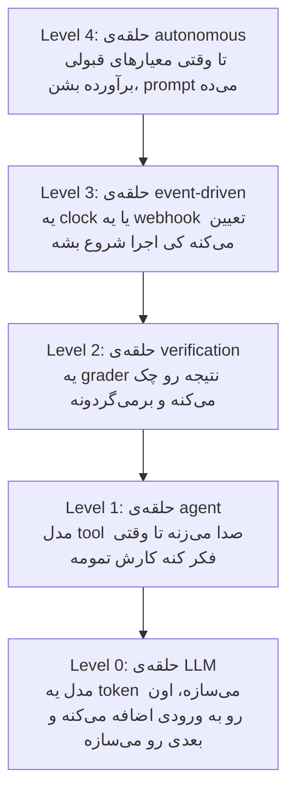
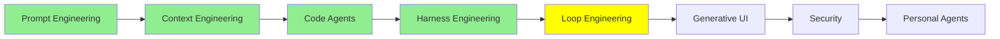

# Loop Engineering

تا اینجای [Harness Engineering](harness_engineering_fa.md)، agent یه موتور داشت، یه بدنه، و یه مسیر با مانع جلوش. یه بار دیگه به همون نقاشی نگاه کن و ببین هنوز پشت فرمون کی نشسته.

پشت فرمون تویی. تو prompt رو می‌نویسی، جوابی که برمی‌گرده رو می‌خونی، و خودت تصمیم می‌گیری که خوب بوده یا نه. بعدش هم تو تعیین می‌کنی قدم بعدی چی باشه. agent‌های امروزی خیلی از کارها رو خودشون به عهده گرفتن:

- context خودشون رو مدیریت می‌کنن
- وقتی خیلی طولانی بشه، خودشون compact‌اش می‌کنن
- subagent‌های خودشون رو راه می‌ندازن
- to-do list خودشون رو نگه می‌دارن

با این همه، هنوز توی مرکز ماجرا یه آدم نشسته و enter رو می‌زنه.

این ماژول درباره‌ی اینه که اون آدم رو از این وسط برداریم.

## Loop Engineering چیه؟

Loop engineering یعنی طراحی حلقه‌هایی که خودشون به‌طور خودکار تکرار می‌شن. هر حلقه agent رو از چرخه‌های عمل کردن، مشاهده کردن و تنظیم کردن می‌گذرونه، تا وقتی که به یه هدف تعریف‌شده برسه. تو دیگه agent رو نوبت به نوبت prompt نمی‌دی. به‌جاش یه سیستم کنترل می‌سازی: اینکه چی یه اجرا رو شروع کنه، agent چی دریافت کنه، و از همه مهم‌تر، **کی متوقف بشه**.

همین آخری، یعنی «کی متوقف بشه»، خودِ طراحیه. Loop engineering فقط یه سؤال رو می‌پرسه: **stop condition چیه؟** بقیه‌ی چیزها از همین جواب نتیجه می‌شن. اگه این شرط رو یه‌جوری غلط تنظیم کنی، loop قبل از تموم شدن کار می‌ایسته. اگه یه‌جور دیگه غلطش کنی، اونقدر می‌چرخه که آخرش صورت‌حساب‌ت برسه.

برگردیم سر همون ماشین. موتور همون prompt‌ه، بدنه همون context‌ه، و مسیر با موانعش همون harness. تا الان راننده یه آدم بود. Loop engineering یعنی AI داره رانندگی می‌کنه. این همون فرق بین یه ماشین معمولیه و ماشینی که خودش رانندگی می‌کنه. بقیه‌ی این ماژول درباره‌ی اینه که چقدر از فرمون رو حاضری به AI بدی.

  
*این شوخی جواب می‌ده، چون هر کادرش یه شغل واقعیه که وجود داشته. فلش‌ها کل استدلال رو می‌سازن. توی 2026 آدم به agent‌ها اشاره می‌کنه. توی 2026.5 آدم به یه agent اشاره می‌کنه، و اون agent هم به بقیه اشاره می‌کنه. کادر بعدی این سؤال صادقانه رو می‌پرسه: این مسیر کجا تموم می‌شه؟ توی دو کادر آخر، چیزی که داره خودکار می‌شه کدنویسی نیست؛ خود نظارته.*

## حلقه‌ها در پنج سطح

وقتی آدم‌ها می‌گن «loop engineering»، معمولاً بیرونی‌ترین حلقه رو منظور دارن. ولی دیدن هر پنج تاش کمک می‌کنه، چون این حلقه‌ها روی هم سوار می‌شن. [The Art of Loop Engineering](https://www.langchain.com/blog/the-art-of-loop-engineering) از LangChain به این کار می‌گه «هنر روی هم چیدن حلقه‌ها»، و واقعاً هم همین‌طوره.



*هر سطح، سطح پایینی‌اش رو توی خودش جا داده، و هر کدوم یه تصمیم رو از دست تو درمیاره. Level 0 توکن بعدی رو انتخاب می‌کنه. Level 1 تعیین می‌کنه که بعدش کدوم tool رو صدا بزنه. Level 2 تصمیم می‌گیره که جواب به‌اندازه‌ی کافی خوب بوده یا نه. Level 3 تصمیم می‌گیره کی شروع کنه. فقط Level 4 تصمیم می‌گیره دوباره تلاش کنه یا نه. و این همون تصمیم واقعی‌ایه که تا حالا خودت می‌گرفتی.*

### Level 0: حلقه‌ی LLM

حلقه از داخل خود مدل شروع می‌شه. بیشتر LLM‌های امروزی **autoregressive** هستن. یعنی مدل ورودی رو می‌گیره و فقط یه token می‌سازه. بعد اون token رو به آخر ورودی اضافه می‌کنه، و با این ورودی بلندتر، token بعدی رو می‌سازه. این کار رو تکرار می‌کنه تا وقتی که یه stop token بسازه یا به سقف طول برسه. هر جوابی که تا حالا از یه LLM خوندی، همین‌طوری و یه token در هر بار نوشته شده.

این پایین‌ترین سطح حلقه‌هاست، و داخل خود LLM اتفاق می‌افته. هیچ‌کس این یکی رو مهندسی نمی‌کنه، چون این فقط راهیه که مدل باهاش متن تولید می‌کنه. حالا ببین: همه‌ی حلقه‌های دیگه‌ی این ماژول، روی همین یکی سوار شدن.

### Level 1: حلقه‌ی Agent

خود agent هم یه حلقه‌ست. مدل یه tool رو صدا می‌زنه، نتیجه رو می‌خونه، و یه tool دیگه رو صدا می‌زنه. این کار رو ادامه می‌ده تا وقتی که خودش تشخیص بده کار تمومه. همین حلقه‌ایه که توی [AI Agents](../1_fundamentals/agents_fa.md) دیدیم. مستقیم روی Level 0 نشسته، یعنی روی نوبت خود مدل.

این یکی رو هم کسی مهندسی نمی‌کنه. LangChain، فریم‌ورک‌های دیگه و همه‌ی coding agent‌ها، همین حلقه رو از قبل پیاده کردن. وقتی آدم‌ها از loop engineering حرف می‌زنن، این حلقه رو منظورشون نیست. این سطح اینجاست تا سه سطح بعدی یه چیزی برای تکیه کردن داشته باشن.

### Level 2: حلقه‌ی Verification

agent کارش رو تموم می‌کنه. بعدش یه چیزی، قبل از اینکه کسی نتیجه رو قبول کنه، کار رو با یه سری معیار چک می‌کنه. اگه کار به‌اندازه‌ی کافی خوب نباشه، بازخورد برمی‌گرده پیش agent، و agent یه دور دیگه کار می‌کنه.

این همون ایده‌ی sensor از [Harness Engineering](harness_engineering_fa.md) هست، ولی حالا تبدیل شده به یه حلقه. sensor دیگه فقط گزارش نمی‌ده، بلکه تصمیم می‌گیره یه دور دیگه لازم هست یا نه. شرط توقف اینجا یه **goal** هست، پس اسمش حلقه‌ی goal-based هست.

معیارها هر چیزی می‌تونن باشن که تو بتونی چکش کنی. مثلاً اینکه یه test suite پاس بشه، یه type check بدون خطا تموم بشه، یا امتیاز Lighthouse از 90 بالاتر بره. معیارها می‌تونن یه rubric هم باشن. rubric یه فهرست نوشته‌شده‌ست از اینکه یه نتیجه‌ی خوب چه شکلیه. یه call دیگه‌ی مدل، کار رو طبق همون فهرست نمره می‌ده. این‌جوری چیزهایی رو هم پوشش می‌ده که هیچ test‌ای نمی‌تونه چک کنه.

توی LangChain این رو با rubric middleware می‌سازی. توی Claude Code، این کار با `/goal` انجام می‌شه. طبق [Loop engineering: Getting started with loops](https://claude.com/blog/getting-started-with-loops)، `/goal` وقتی متوقف می‌شه که agent به هدف برسه یا به سقف تعداد نوبت‌ها برسه:

```text
/goal get the homepage Lighthouse score to 90 or above, stop after 5 tries
```

به شکلش دقت کن: یه هدف، و یه سقف. یادت باشه این سقف فقط تزئین نیست. اگه تنها شرط توقف یه loop موفقیت باشه، وقتی موفقیت غیرممکن باشه، اون loop هیچ‌وقت نمی‌ایسته.

### Level 3: حلقه‌ی Event-driven

اینجا یه چیزی بیرون از مکالمه تعیین می‌کنه کی یه اجرا انجام بشه: یه زمان‌بندی، یا یه webhook. دیگه agent چیزی نیست که تو بازش کنی؛ تبدیل می‌شه به چیزی که خودش اجرا می‌شه.

شرط توقف اینجا بر اساس زمانه، نه بر اساس هدف. حلقه قرار نیست به سمت یه هدف جلو بره. بیدار می‌شه، یه کار رو انجام می‌ده، و تا تریگر بعدی دوباره می‌خوابه.

توی Claude Code، `/loop` یه job تکراری رو روی ماشین خودت اجرا می‌کنه. `/schedule` همین کار رو توی cloud انجام می‌ده، پس job حتی وقتی لپ‌تاپت بسته‌ست هم ادامه داره:

```text
/loop 5m check my PR, address review comments, and fix failing CI
```

هر دوشون وقتی متوقف می‌شن که خودت لغوشون کنی، یا کار تموم بشه. این سطح ارزشش رو داره، چون agent الان به سیستم‌های اطرافش وصل شده. یه pull request باز می‌شه، یه build خراب می‌شه، یا یه alert روشن می‌شه. و agent قبل از اینکه کسی اعلان رو بخونه، شروع کرده به رسیدگی به اون.

### Level 4: حلقه‌ی Autonomous

این همون سطحیه که loop engineering رو تبدیل به یه موضوع کرد.

تاریخچه‌ش از **Ralph loop** شروع می‌شه، که از Geoffrey Huntley و نوشته‌ی [everything is a ralph loop](https://ghuntley.com/loop/) اومده. یه script توی shell یا JavaScript می‌نویسی. این script agent رو مکانیکی و یکی پس از دیگری prompt می‌ده، تا وقتی که کار به معیارهای قبولی برسه. خالص‌ترین و خیلی ساده‌شده‌ترین شکلش این‌جوریه:

```bash
while true; do
  claude -p "$PROMPT"
done
```

این تقریباً کل ایده‌ست: حلقه تا وقتی کار تموم نشده، prompt می‌ده. هر session تازه‌ای هم با یه context window تازه شروع می‌شه. به همین خاطر، مشکل context rot که توی [Context Engineering](context_engineering_fa.md) ازش حرف زدیم، هیچ‌وقت فرصت جمع شدن پیدا نمی‌کنه. state روی دیسک نگه داشته می‌شه، توی plan و کد، نه توی یه context window.

  
*اسمش از یکی از شخصیت‌های Simpsons گرفته شده. شوخی دوستانه‌ست و به تکنیک از بالا نگاه نمی‌کنه. تکنیک دقیقاً به همین خاطر کار می‌کنه که اون‌قدر ساده‌ست که نمی‌خواد باهوش به نظر برسه. بعد از شکست‌هایی که یه سیستم پیچیده‌تر رو متوقف می‌کرد، همچنان ادامه می‌ده.*

قاعده‌ای که از همه مهم‌تره اینه: **Ralph توی هر loop فقط یه task انجام می‌ده.** توی هر iteration کل backlog رو برنمی‌داره، فقط یه آیتم ازش رو برمی‌داره. هر دور این کارها رو انجام می‌ده:

- plan رو می‌خونه
- آیتم بعدی تموم‌نشده رو انتخاب می‌کنه
- همون یه آیتم رو انجام می‌ده
- ثبت می‌کنه که اون آیتم تموم شده
- خارج می‌شه

بعدش دور بعدی از صفر و با یه شروع تمیز شروع می‌شه، و آیتم بعدی رو برمی‌داره.

همین بود که coding agent‌ها رو از اون چند ساعت کاری که توی [Context Engineering](context_engineering_fa.md) توصیف شد، فراتر برد. یه حلقه‌ی این‌جوری می‌تونه چند روز اجرا بشه، چون لازم نیست هیچ session واحدی اون‌قدر طول بکشه.

نسخه‌های واقعی خیلی دقیق‌تر از چهار خط bash هستن. چیزی که آدم‌ها بهش اضافه می‌کنن، مدیریت شکست‌هاست. اجراهایی که شکست می‌خورن رو زیر نظر می‌گیری و حالت شکست رو پیدا می‌کنی. بعدش اون حالت شکست رو مهندسی می‌کنی و کنار می‌ذاری، تا دیگه پیش نیاد. Huntley این‌طوری توصیفش می‌کنه: نرم‌افزار مثل گِل روی چرخ کوزه‌گریه، نه آجرهایی که یکی‌یکی روی هم بچینی. یه iteration شکست‌خورده دلیلیه برای بهتر کردن، نه دلیلی برای متوقف شدن.

چند جا می‌شه یه نسخه‌ی واقعی پیدا کرد. [ralph-loop plugin](https://claude.com/plugins/ralph-loop) نسخه‌ی بسته‌بندی‌شده‌ی این تکنیک برای Claude Code هست. [snarktank/ralph](https://github.com/snarktank/ralph) اجرا می‌شه تا وقتی که همه‌ی آیتم‌های یه سند product requirements کامل بشه. و [loop-engineering](https://github.com/cobusgreyling/loop-engineering) الگوها و ابزارهای CLI رو جمع کرده. یکی از این ابزارها، هزینه‌ی یه اجرای طولانی رو برات حسابرسی می‌کنه.

[Ralph Wiggum Loop for Claude Code](https://awesomeclaude.ai/ralph-wiggum) یه راهنمای مکتوب و خوبه. یه نکته‌ش ارزش تکرار داره: اینکه این روش چقدر خوب کار می‌کنه، بیشتر به prompt‌ای که نوشتی بستگی داره تا مدلی که باهاش اجراش کردی.

> **نکته:** LangChain برای یه سطح بالاتر، اسم دیگه‌ای گذاشته: **hill climbing loop**. این حلقه trace‌های production رو می‌خونه تا مشکل‌ها رو پیدا کنه، و تنظیمات خود agent رو بهتر می‌کنه. ارزش داره این سطح بالاتر از این یکی رو هم بشناسی. خروجی این حلقه یه harness بهتره، نه کار تموم‌شده.

## Agent Teams و Dynamic Workflows

تا اینجا همه‌ی حلقه‌ها رو یه آدم طراحی کرده بود. script مکانیکیه، و معیارها رو تو می‌نویسی. ساختار یا مال خودته، یا یه الگوی شناخته‌شده مثل الگوی Ralph.

قدم بعدی اینه که بذاری agent خودش حلقه رو طراحی کنه و اجراش کنه. یه بار دیگه برگردیم سر ماشین: اینجا AI فقط رانندگی نمی‌کنه، مسیر رو هم خودش انتخاب می‌کنه. این یه AI هست که داره AI‌های دیگه رو هماهنگ می‌کنه.

باید دقیق بدونیم این دو تا چی هستن. agent teams و dynamic workflows **معماری‌های پیشرفته‌ی multi-agent** هستن، و روی الگوهای [Multi-Agent Systems](../1_fundamentals/multi_agent_fa.md) ساخته شدن. اشتباهشون نگیریم و خود loop engineering حسابشون نکنیم. loop engineering همون روشه: تو تعیین می‌کنی چی یه اجرا رو شروع کنه، agent چی بگیره، و کی متوقف بشه. agent teams و dynamic workflows معماری‌هایی هستن که به این روش می‌خورن. اونا این روش رو توی مقیاس خیلی بزرگ‌تری ممکن می‌کنن.

Claude Code دو تا قابلیت برای این کار داره، و شکلشون یکی نیست.

### Agent Teams

یه agent team چندتا session کامل Claude Code هست که با هم کار می‌کنن. یکی از sessionها رهبره. رهبر کار رو به یه فهرست مشترک task تقسیم می‌کنه، بقیه رو راه می‌ندازه، و نتیجه‌ها رو کنار هم می‌ذاره. هر teammate یه context window مخصوص خودش داره. teammate‌ها task‌ها رو از همون فهرست مشترک برمی‌دارن. مستقیم هم به هم پیام می‌دن، به‌جای اینکه فقط گزارششون رو به رهبر بدن.

همین کار، تقریباً بی‌اینکه قصدش باشه، یه حلقه می‌سازه. رهبر نگاه می‌کنه بقیه چی کار می‌کنن، و تصمیم می‌گیره قدم بعدی چی باشه. همون کاری که قبلاً خودت می‌کردی.

  
*چیزی که باید بهش توجه کنی، دایره‌های خط‌چین سمت چپه. وقتی یه subagent تموم می‌شه، فقط نتیجه‌ش باقی می‌مونه. agent اصلی تنها جاییه که همه‌ی اون کار بهش برمی‌گرده. سمت راست، چیزی توی مسیر به بالا خلاصه نمی‌شه، چون هیچ پنجره‌ی واحدی همه‌چیز رو نمی‌بینه. هزینه‌ی توکن بالاتری که توی جدول زیر می‌بینی هم از همین‌جا میاد. برای همین هم ممکنه یه رهبر گم کنه که خود تیمش داره چی کار می‌کنه.*

مقایسه‌ی این دو تا، از روی [Orchestrate teams of Claude Code sessions](https://code.claude.com/docs/en/agent-teams)، این‌جوریه:

| | Subagents | Agent teams |
| --- | --- | --- |
| Context | context window مخصوص خودشون دارن؛ نتیجه‌ها برمی‌گردن به caller | context window مخصوص خودشون دارن؛ کاملاً مستقل هستن |
| ارتباط | نتیجه رو به caller برمی‌گردونن. subagent‌هایی که Claude موقع ساختنشون اسمشون رو برده، می‌تونن به هم هم پیام بدن | teammate‌ها مستقیم با هم پیام رد و بدل می‌کنن |
| هماهنگی | agent اصلی همه‌ی کارها رو مدیریت می‌کنه | خودشون با پیام‌ها هماهنگ می‌شن، به‌علاوه‌ی یه فهرست مشترک task |
| بهترین کاربرد | کارهای متمرکزی که فقط نتیجه‌شون مهمه | کارهای پیچیده‌ای که بحث و همکاری می‌خوان |
| هزینه‌ی توکن | کمتر: نتیجه‌ها خلاصه می‌شن و برمی‌گردن به context اصلی | بیشتر: هر teammate یه instance جدا از Claude هست |

ردیفی که باید بهش دقت کنی، ردیف آخره. هر teammate یه instance کامل و جداست، پس هزینه با تعداد teammate‌ها بالا می‌ره. سه teammate متمرکز معمولاً از پنج تا پراکنده بهتر کار می‌کنن. داک‌ها پیشنهاد می‌کنن از سه تا پنج تا شروع کنی.

> **نکته:** agent teams آزمایشی‌ان و به‌صورت پیش‌فرض خاموش‌ان. با متغیر `CLAUDE_CODE_EXPERIMENTAL_AGENT_TEAMS=1` روشنشون می‌کنی.

### Dynamic Workflows

یه dynamic workflow یه script با JavaScript هست که چندتا subagent رو همزمان هماهنگ می‌کنه. Claude همون script رو برای کاری که توصیف کردی می‌نویسه. بعد یه runtime اون script رو توی پس‌زمینه اجرا می‌کنه، و session تو آزاد می‌مونه.

فرقش با همه‌ی چیزهای بالا توی اینه که **plan دست کیه**. با subagent‌ها، skill‌ها و agent teams، Claude هماهنگ‌کننده‌ست و نوبت به نوبت تصمیم می‌گیره بعدش چی اجرا بشه. workflow این تصمیم رو می‌ذاره توی کد. پس script حلقه، شاخه‌بندی و همه‌ی نتیجه‌های میانی رو نگه می‌داره. در نتیجه تنها چیزی که به context تو می‌رسه، جواب نهاییه.

جدول بعدی از [Orchestrate subagents at scale with dynamic workflows](https://code.claude.com/docs/en/workflows) گرفته شده:

| | Subagents | Skills | Agent teams | Workflows |
| --- | --- | --- | --- | --- |
| چی هست | یه worker که Claude می‌سازه | دستورالعمل‌هایی که Claude دنبال می‌کنه | یه agent رهبر که sessionهای همتا رو هدایت می‌کنه | یه script که runtime اجراش می‌کنه |
| کی تعیین می‌کنه بعدش چی اجرا بشه | Claude، نوبت به نوبت | Claude، طبق prompt | agent رهبر، نوبت به نوبت | خود script |
| نتیجه‌های میانی کجا نگه داشته می‌شن | توی context window خود Claude | توی context window خود Claude | یه فهرست مشترک task | متغیرهای script |
| چی قابل تکراره | تعریف worker | دستورالعمل‌ها | تعریف تیم | خود orchestration |
| مقیاس | چندتا task واگذارشده توی هر نوبت | مثل subagent‌ها | چند peer که اجراشون طولانیه | ده‌ها تا صدها agent توی یه اجرا |
| قطع شدن | نوبت دوباره از اول شروع می‌شه | نوبت دوباره از اول شروع می‌شه | teammate‌ها همچنان اجرا می‌شن | توی همون session ادامه پیدا می‌کنه |

دو تا ردیف ارزش توجه دارن. ردیف اول **scale** هست. یه workflow توی یه اجرا ده‌ها تا صدها agent در اختیارت می‌ذاره، در حالی‌که یه تیم فقط چندتا می‌ده. script این کار رو می‌تونه بکنه، چون لازم نیست یه context window برای یادآوری کاری که داره انجام می‌ده نگه داره. ردیف دومی **چی قابل تکراره** هست. با یه تیم، تعریف تیم رو دوباره می‌شه استفاده کرد. با یه workflow، خود orchestration تبدیل می‌شه به یه فایل. می‌تونی اون فایل رو بخونی، ویرایشش کنی، دوباره اجراش کنی و commit کنی.

یه الگوی کیفیت هم بهت می‌ده که به هیچ روش دیگه‌ای به این راحتی به دست نمی‌آد. script مسئوله، پس می‌تونه agent‌های مستقل رو بفرسته که قبل از گزارش شدن یافته‌ها، یافته‌های همدیگه رو به چالش بکشن. یا می‌تونه یه plan رو از چند زاویه بنویسه و زاویه‌ها رو با هم بسنجه. اینجا فقط agent بیشتر نمی‌گیری؛ agent‌هایی می‌گیری که همدیگه رو کنترل می‌کنن.

برای روشن کردنش از `/effort ultracode` استفاده کن. این کار بالاترین تنظیم reasoning رو با هماهنگ‌سازی خودکار workflow یکی می‌کنه. یا می‌تونی کلمه‌ی `ultracode` رو توی یه prompt تنها بیاری. اون وقت فقط همون task به شکل workflow اجرا می‌شه.

## Recursive Language Models

Dynamic workflow‌ها فقط به خاطر loop engineering وجود ندارن. اونا فرم عملی یه ایده‌ان هم هستن، به اسم **recursive language model** (RLM). این ایده از مقاله‌ی [Recursive Language Models](https://arxiv.org/abs/2512.24601) نوشته‌ی Alex Zhang، Tim Kraska و Omar Khattab از MIT اومده.

یه مدل معمولی کل prompt رو توی context window خودش دریافت می‌کنه. RLM این‌طوری نیست. prompt بلند توی یه محیط Python قرار می‌گیره، به شکل یه متغیر. مدل اول کار فقط یه کم ازش می‌بینه: اینکه چقدر طوله، از کجا شروع می‌شه، و چطوری می‌شه تیکه‌هایی ازش رو خوند. بعد کد می‌نویسه تا با اون متغیر کار کنه. می‌تونه یه تیکه‌ش رو نگاه کنه، با grep توش جستجو کنه، یا کلاً تکه‌تکه‌ش کنه.

و روی هر تیکه می‌تونه دوباره یه مدل رو صدا بزنه، حتی یه نسخه‌ی دیگه از خودش. همین صداهای تکرارشونده‌ن که بخش «recursive» اسمشن. فقط نتیجه‌ی این صداها برمی‌گرده توی context window اصلی. پس این window هیچ‌وقت مجبور نیست کل ورودی رو نگه داره. به همین خاطره که یه مدل کم‌کم طوری رفتار می‌کنه که انگار window‌ش سقفی نداره. dynamic workflow همین ایده رو توی مقیاس بزرگ‌تری به کار می‌گیره: script ورودی و نتیجه‌های میانی رو توی متغیرها نگه می‌داره، و agent‌های زیادی روی تیکه‌ها کار می‌کنن. این‌جوری یه script پر از agent کم‌کم شبیه یه مدل با window بی‌کران می‌شه.

دو تا چیز اینجا راحت قاطی می‌شن، پس خوبه صاف و ساده بگیمشون.

- **RLM همون loop engineering نیست.** تعیین نمی‌کنه چی یه اجرا رو شروع کنه، یا کی متوقف بشه. ولی loop engineering رو ممکن و بهتر می‌کنه. حلقه‌ای که چند روز اجرا می‌شه، به راهی نیاز داره که با متنی بیشتر از ظرفیت یه window کار کنه.
- **RLM یه معماری single-agent هست.** یه agent رو از داخل توصیف می‌کنه: یه مدل که از طریق کد خودش رو صدا می‌زنه. این مدل تعداد زیادی call انجام می‌ده، ولی اشتباهش نگیر که با معماری‌های multi-agent بالاتر یکی باشه.

**CodeAct** که از [Executable Code Actions Elicit Better LLM Agents](https://arxiv.org/abs/2402.01030) میاد، یه خویشاوند نزدیکه. این روش کد قابل اجرا رو جای tool call‌های JSON می‌ذاره و فضای action agent رو می‌سازه. [Advanced Agent Architectures](../3_expert/advanced_agent_architectures.md) هر دو تا رو کامل و درست توضیح می‌ده. اگه نسخه‌ی قابل‌خوندن‌تر مقاله رو می‌خوای، [یادداشت Alex Zhang](https://alexzhang13.github.io/blog/2025/rlm/) روی همین موضوع خوبه، و [rlm](https://github.com/alexzhang13/rlm) هم کتابخونه‌ش هست.

## روند کلی

اگه چهار ماژول آخر رو کنار هم بذاری، جهت کار راحت معلوم می‌شه:

- مدل‌های بهتر
- بعدش استفاده‌ی بهتر از context window
- بعدش محیط‌های بهتر اطراف مدل‌ها
- و در آخر حلقه‌های بهتر اطراف اون محیط‌ها

هر لایه به طول کار اضافه کرد. اول یه جواب خوب بود، بعد شد یه session که منسجم می‌مونه. بعدش شد ساعت‌ها کار بدون نظارت، و الان به اجراهایی رسیده که با روز سنجیده می‌شن.

هیچ‌کدوم از لایه‌ها جای لایه‌ی قبلی رو نگرفتن. روی هم سوار شدن. برای همین کل این مجموعه یه نقاشی واحد بوده، که هر ماژول یه بخش تازه بهش اضافه کرده.

## کجای این مجموعه هستیم



## خلاصه

Loop engineering یعنی طراحی چرخه‌ای که تکرار می‌شه و agent رو به یه هدف می‌رسونه، بدون اینکه آدمی توش باشه. و طراحی همون stop condition هست.

حلقه‌ها روی هم سوار می‌شن، یکی توی دیگری:

- پایین‌ترین لایه، حلقه‌ی LLM هست. مدل یه token می‌سازه، اون رو به ورودی اضافه می‌کنه، و token بعدی رو می‌سازه.
- حلقه‌ی agent یعنی مدل تا وقتی کارش تموم نشده tool صدا می‌زنه. هر فریم‌ورکی این یکی رو از قبل در اختیارت می‌ذاره.
- حلقه‌ی verification یه grader اضافه می‌کنه که وقتی نتیجه خوب نیست، کار رو برمی‌گردونه. این حلقه روی یه هدف متوقف می‌شه، به‌علاوه‌ی یه سقف برای تعداد تلاش‌هایی که داره.
- حلقه‌ی event-driven تصمیم شروع کردن رو به یه clock یا یه webhook می‌سپره.
- حلقه‌ی autonomous، یعنی همون Ralph loop، یه script هست که agent رو یکی پس از دیگری prompt می‌ده تا کار به معیارهای قبولی برسه. هر دور یه task انجام می‌ده، و هر بار از یه window تمیز شروع می‌شه. state روی دیسک می‌مونه، نه توی context. همین آخری بود که agent‌ها رو از چند ساعت به چند روز رسوند.

بالای همه‌ی این‌ها، agent خودش حلقه رو طراحی می‌کنه. agent teams چندتا session همتا رو با یه فهرست مشترک task و یه رهبر که هماهنگشون می‌کنه، در اختیارت می‌ذارن. dynamic workflow‌ها plan رو توی یه script می‌ذارن. این کار سه تا مزیت داره: تا صدها agent مقیاس‌پذیره، خود هماهنگ‌سازی قطعه‌ی قابل استفاده‌ی دوباره می‌شه، و agent‌ها می‌تونن کار همدیگه رو چک کنن. هر دو تا معماری‌های پیشرفته‌ی multi-agent هستن. امکان loop engineering رو فراهم می‌کنن، ولی خودشون loop engineering نیستن. یه recursive language model فرق دیگه‌ای داره. یه معماری single-agent هست: یه مدل از طریق کد خودش رو صدا می‌زنه، پس می‌تونه با متنی بیشتر از ظرفیت window خودش کار کنه.

ماژول بعدی درباره‌ی این هزینه‌ست: همه‌ی چیزهایی که توی این ماژول دیدیم، نظارت روی agent رو سخت‌تر کرد. امنیت همون هزینه‌ایه که باید بابتش بپردازیم.

**بررسی سریع**: یه verification loop و یه autonomous loop، هر دو تا تا وقتی که یه چیزی برآورده بشه ادامه می‌دن. فرقشون چیه؟ و کدومشون به یه سقف برای تعداد تلاش‌ها نیاز داره؟

## منابع

- [The Art of Loop Engineering](https://www.langchain.com/blog/the-art-of-loop-engineering): Loop engineering به‌عنوان روی هم چیدن حلقه‌ها، و چهار سطحش
- [Loop engineering: Getting started with loops](https://claude.com/blog/getting-started-with-loops): `/goal`، `/loop` و `/schedule`، همراه با شرط توقفی که هرکدوم استفاده می‌کنه
- [everything is a ralph loop](https://ghuntley.com/loop/): تکنیک اصلی، و قاعده‌ی یه task در هر loop
- [ralph-loop plugin](https://claude.com/plugins/ralph-loop): نسخه‌ی بسته‌بندی‌شده برای Claude Code
- [snarktank/ralph](https://github.com/snarktank/ralph): یه autonomous loop که تا وقتی همه‌ی آیتم‌های یه سند requirements کامل بشه ادامه می‌ده
- [loop-engineering](https://github.com/cobusgreyling/loop-engineering): الگوها، starterها و ابزارهای CLI، از جمله حسابرسی هزینه‌ی یه اجرای طولانی
- [Ralph Wiggum Loop for Claude Code](https://awesomeclaude.ai/ralph-wiggum): یه راهنمای مکتوب، و اینکه چرا prompt اپراتور از مدل مهم‌تره
- [Orchestrate teams of Claude Code sessions](https://code.claude.com/docs/en/agent-teams): agent teams، فهرست مشترک task، و معماری پشت اون
- [Orchestrate subagents at scale with dynamic workflows](https://code.claude.com/docs/en/workflows): اینکه یه script workflow چه شکلیه، محدودیت‌هاش، و مقایسه‌ی چهارطرفه
- [Executable Code Actions Elicit Better LLM Agents](https://arxiv.org/abs/2402.01030): CodeAct، جایی که کد می‌شه فضای action
- [Recursive Language Models](https://arxiv.org/abs/2512.24601): مقاله، همراه با [یادداشت Alex Zhang](https://alexzhang13.github.io/blog/2025/rlm/) و کتابخونه‌ی [rlm](https://github.com/alexzhang13/rlm)
- [Loop Engineering explained in 8min..](https://www.youtube.com/watch?v=4biXYSNkn9Y): خود موضوع این ماژول توی هشت دقیقه، اگه ترجیح می‌دی ببینیش
- [Advanced Agent Architectures](../3_expert/advanced_agent_architectures.md): CodeAct، recursive language models و بقیه، کامل توضیح داده شده
