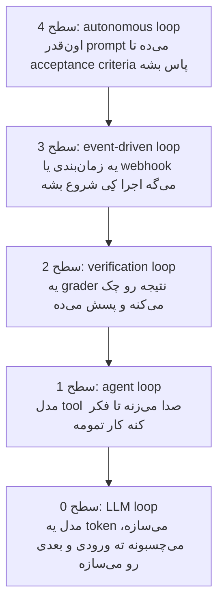

# Loop Engineering

آخر [Harness Engineering](harness_engineering_fa.md)، agent‌مون همه‌چی داشت: موتور، بدنه، و یه پیست که دورش حفاظ کشیده بودیم. حالا یه بار دیگه به اون تصویر نگاه کن؛ می‌بینی که هنوز خودت پشت فرمونی.

prompt رو تو می‌نویسی، جوابی که برمی‌گرده رو تو می‌خونی، تو تصمیم می‌گیری به درد می‌خوره یا نه، و قدم بعدی رو هم باز خودت تعیین می‌کنی. البته agent‌های امروزی خیلی از کارها رو از دوشمون برداشتن:

- context‌شون رو خودشون مدیریت می‌کنن
- وقتی context زیادی بلند شد، خودشون compact‌ش می‌کنن
- subagent‌هاشون رو خودشون راه می‌ندازن
- to-do list‌شون رو هم خودشون نگه می‌دارن

ولی با همه‌ی این‌ها، هنوز وسط کار یه نفر نشسته که باید enter رو بزنه.

توی این درس می‌خوایم همین یه نفر رو هم از وسط برداریم.

## Loop Engineering چیه؟

Loop engineering یعنی loop‌هایی طراحی کنی که خودبه‌خود تکرار بشن. توی هر loop، agent یه کاری می‌کنه، نتیجه‌ش رو می‌بینه و خودش رو اصلاح می‌کنه، و این چرخه رو اون‌قدر تکرار می‌کنه تا به هدفی که از قبل مشخص کردی برسه. دیگه لازم نیست خودت دونه‌دونه به agent prompt بدی. کار تو اینه که سیستم کنترلش رو بسازی: چی یه اجرا رو راه می‌ندازه، چی به agent می‌دی، و از همه مهم‌تر، **کِی وایمیسه**.

مهم‌ترین بخش طراحی همین آخریه، یعنی اینکه loop کِی وایسه. کل loop engineering برمی‌گرده به یه سؤال: **stop condition چیه؟** بقیه‌ی تصمیم‌ها همه از جواب همین سؤال درمیان. اگه این شرط رو یه جوری اشتباه بذاری، loop قبل از اینکه کار تموم بشه وایمیسه؛ اگه جور دیگه‌ش رو اشتباه کنی، loop اون‌قدر می‌چرخه تا صورت‌حساب بیاد دستت.

برگردیم سراغ همون ماشین. موتورش prompt بود، بدنه‌ش context، و پیست و حفاظ‌هاش harness. تا اینجا راننده یه آدم بود، ولی loop engineering یعنی رانندگی رو بدیم دست AI؛ فرقش درست مثل فرق یه ماشین معمولی با یه ماشین خودرانه. هرچی از اینجا به بعد می‌گیم، سر همین سؤاله که حاضری چقدر از فرمون رو بدی دست AI.

  
*این شوخی می‌گیره چون هر کادرش یه شغل واقعیه که یه زمانی وجود داشته. اصل حرف رو فلش‌ها می‌زنن: توی 2026 آدم به agent‌ها اشاره می‌کنه، و توی 2026.5 آدم فقط به یه agent اشاره می‌کنه و همون agent به بقیه. کادر بعدی هم بی‌تعارف می‌پرسه ته این مسیر کجاست. توی دو کادر آخر، چیزی که خودکار می‌شه دیگه کدنویسی نیست، خودِ نظارته.*

## پنج سطح Loop

وقتی کسی می‌گه «loop engineering»، معمولاً منظورش بیرونی‌ترین loop‌ه. ولی بهتره هر پنج تا رو ببینی، چون این‌ها لایه‌لایه روی هم سوار می‌شن. LangChain توی [The Art of Loop Engineering](https://www.langchain.com/blog/the-art-of-loop-engineering) به این کار می‌گه «هنر روی هم چیدن loop‌ها»، و حق هم داره.



*هر سطح، سطح زیرش رو در بر می‌گیره و هر کدوم یه تصمیم رو از دست تو می‌گیره. سطح 0 token بعدی رو انتخاب می‌کنه، سطح 1 tool بعدی رو، سطح 2 می‌گه جواب به اندازه‌ی کافی خوب بوده یا نه، و سطح 3 می‌گه کِی شروع کنیم. فقط سطح 4 تصمیم می‌گیره که دوباره امتحان کنه یا نه، و این دقیقاً همون تصمیم اصلیه که تا حالا خودت می‌گرفتی.*

### سطح 0: LLM Loop

اولین loop داخل خود مدله. بیشتر LLM‌های امروزی **autoregressive** هستن؛ یعنی مدل ورودی رو می‌گیره و فقط یه token تولید می‌کنه، اون token رو می‌چسبونه ته ورودی، و از روی این ورودیِ یه کم بلندتر token بعدی رو می‌سازه. این کار رو اون‌قدر تکرار می‌کنه تا یا یه stop token تولید کنه یا به سقف طول برسه. هر جوابی که تا حالا از یه LLM خوندی همین‌طوری نوشته شده، token به token.

این سطح 0 ماجراست و جاش داخل خود LLM‌ه. کسی این loop رو مهندسی نمی‌کنه، چون اصلاً مدل همین‌طوری متن تولید می‌کنه. ولی همه‌ی loop‌های دیگه‌ی این درس روی همین یکی بنا شدن.

### سطح 1: Agent Loop

خود agent هم یه loop‌ه: مدل یه tool رو صدا می‌زنه، نتیجه‌ش رو می‌خونه، یه tool دیگه صدا می‌زنه، و همین‌طور ادامه می‌ده تا به این نتیجه برسه که کار تمومه. این همون loop‌یه که توی [AI Agents](../1_fundamentals/agents_fa.md) دیدیم، و مستقیم روی سطح 0 سواره: هر بار که نوبت به خود مدل می‌رسه، همون LLM loop جوابش رو می‌نویسه.

این یکی رو هم کسی مهندسی نمی‌کنه، چون LangChain و بقیه‌ی framework‌ها و همه‌ی coding agent‌ها از قبل پیاده‌ش کردن. وقتی حرف از loop engineering می‌شه منظور این loop نیست؛ اینجا آوردیمش چون سه سطح بعدی روی همین بنا می‌شن.

### سطح 2: Verification Loop

agent کارش که تموم شد، قبل از اینکه کسی کار رو تحویل بگیره، یه چیزی اون رو با یه سری معیار می‌سنجه. اگه کار به حد کافی خوب نبود، بازخوردش برمی‌گرده دست agent و agent یه دور دیگه روش کار می‌کنه.

این همون ایده‌ی sensor‌ه که توی [Harness Engineering](harness_engineering_fa.md) دیدیم، فقط حالا تبدیل شده به یه loop. sensor دیگه فقط گزارش نمی‌ده، تصمیم هم می‌گیره که یه دور دیگه لازمه یا نه. چون stop condition اینجا رسیدن به یه هدف (**goal**) هست، به این loop می‌گن goal-based.

معیار می‌تونه هر چیزی باشه که بشه چکش کرد: مثلاً اینکه test suite پاس بشه، type check بدون خطا رد بشه، یا امتیاز Lighthouse بالای 90 باشه. معیار می‌تونه یه rubric هم باشه، یعنی یه فهرست مکتوب از اینکه یه نتیجه‌ی خوب باید چه شکلی باشه؛ بعد یه call دیگه به مدل، کار رو با همون فهرست نمره می‌ده. این‌طوری چیزهایی هم چک می‌شن که هیچ test‌ی از پسشون برنمیاد.

توی LangChain این loop رو با rubric middleware می‌سازی و توی Claude Code با `/goal`. طبق [Loop engineering: Getting started with loops](https://claude.com/blog/getting-started-with-loops)، `/goal` وقتی وایمیسه که یا agent به هدف برسه، یا تعداد نوبت‌ها به سقفش برسه:

```text
/goal get the homepage Lighthouse score to 90 or above, stop after 5 tries
```

دقت کن این دستور از دو تیکه ساخته شده: یه هدف و یه سقف. سقف رو الکی اونجا نذاشتن؛ loop‌ی که تنها شرط توقفش موفقیت باشه، اگه موفقیت اصلاً ممکن نباشه، هیچ‌وقت وانمیسه.

### سطح 3: Event-driven Loop

اینجا یه چیزی بیرون از گفت‌وگو تعیین می‌کنه اجرا کِی شروع بشه: یه زمان‌بندی، یا یه webhook. agent دیگه ابزاری نیست که خودت بازش کنی و باهاش کار کنی؛ خودش سر وقتش راه می‌افته.

stop condition اینجا به زمان بنده، نه به هدف. loop قرار نیست قدم‌به‌قدم به یه هدف نزدیک بشه؛ بیدار می‌شه، کارش رو انجام می‌ده و تا trigger بعدی دوباره می‌خوابه.

توی Claude Code، `/loop` یه کار تکراری رو روی سیستم خودت اجرا می‌کنه و `/schedule` همین کار رو توی cloud انجام می‌ده، پس حتی وقتی در لپ‌تاپت بسته‌ست کار ادامه پیدا می‌کنه:

```text
/loop 5m check my PR, address review comments, and fix failing CI
```

هر دوشون یا وقتی لغوشون کنی وایمیسن، یا وقتی کار تموم بشه. ارزش این سطح اینه که agent حالا به سیستم‌های دور و برش وصله: یه pull request باز می‌شه، یه build fail می‌شه یا یه alert میاد، و تا کسی بیاد notification رو بخونه، agent دست به کار شده.

### سطح 4: Autonomous Loop

loop engineering به خاطر همین سطح سر زبون‌ها افتاد.

داستانش از **Ralph loop** شروع می‌شه که Geoffrey Huntley توی [everything is a ralph loop](https://ghuntley.com/loop/) معرفیش کرد. یه script با shell یا JavaScript می‌نویسی که خودکار و پشت سر هم به agent prompt بده، تا وقتی کار acceptance criteria رو پاس کنه. خالص‌ترین و البته زیادی ساده‌شده‌ترین شکلش اینه:

```bash
while true; do
  claude -p "$PROMPT"
done
```

باور کن بیشتر ایده همینه: loop اون‌قدر prompt می‌ده تا کار تموم بشه. هر session جدید با یه context window تمیز شروع می‌شه، برای همین مشکل context rot اصلاً فرصت نمی‌کنه جمع بشه. context rot همون مشکلیه که توی [Context Engineering](context_engineering_fa.md) دیدیم: هر چی context بزرگ‌تر بشه، مدل کارش رو بدتر انجام می‌ده. state روی دیسک می‌مونه، توی plan و کد، نه توی context window.

  
*اسمش رو از شخصیت Ralph توی سیمپسون‌ها برداشتن. شوخیش دوستانه‌ست و قصد مسخره کردن تکنیک رو نداره. اتفاقاً این تکنیک دقیقاً به این خاطر جواب می‌ده که ساده‌تر از اونیه که بخواد زرنگی کنه؛ بعد از شکست‌هایی که یه سیستم پیچیده‌تر رو از پا درمیارن، باز به راهش ادامه می‌ده.*

قانون اصلیش اینه که **Ralph توی هر loop فقط یه task انجام می‌ده**: هر iteration به‌جای کل backlog فقط یه آیتمش رو برمی‌داره. هر دور این کارها رو می‌کنه:

- plan رو می‌خونه
- آیتم بعدیِ انجام‌نشده رو انتخاب می‌کنه
- همون یه آیتم رو انجام می‌ده
- ثبت می‌کنه که اون آیتم انجام شد
- و خارج می‌شه

بعدش دور بعدی با یه context تمیز از نو شروع می‌شه و می‌ره سراغ آیتم بعدی.

همین ترفند بود که coding agent‌ها رو از اون چند ساعت کاری که توی [Context Engineering](context_engineering_fa.md) گفتیم جلوتر برد. یه loop این‌شکلی چند روز کار می‌کنه، چون هیچ session‌ی لازم نیست اون‌قدر دووم بیاره.

البته نسخه‌های واقعی خیلی حساب‌شده‌تر از این چهار خط bash هستن، و چیزی که بهشون اضافه می‌کنن مدیریت خطاست. نگاه می‌کنی کدوم iteration‌ها fail می‌شن، می‌فهمی خطا از چه جنسیه، و بعد طوری درستش می‌کنی که دیگه تکرار نشه. به قول Huntley، نرم‌افزار می‌شه مثل گِل روی چرخ کوزه‌گری، نه آجری که یکی‌یکی روی هم بچینی. iteration‌ی که fail می‌شه یعنی یه جای کار رو باید بهتر کنی، نه اینکه کار رو ول کنی.

اگه نسخه‌ی واقعیش رو می‌خوای، چند جا هست. [ralph-loop plugin](https://claude.com/plugins/ralph-loop) نسخه‌ی آماده‌ش برای Claude Code‌ه. [snarktank/ralph](https://github.com/snarktank/ralph) اون‌قدر اجرا می‌شه تا همه‌ی آیتم‌های یه سند product requirements تیک بخورن. [loop-engineering](https://github.com/cobusgreyling/loop-engineering) هم یه مجموعه از الگوها و ابزارهای CLI‌ه که یکی‌شون حساب می‌کنه یه اجرای طولانی چقدر برات آب خورده.

[Ralph Wiggum Loop for Claude Code](https://awesomeclaude.ai/ralph-wiggum) هم یه راهنمای نوشتاری خوبه، و یه حرفی می‌زنه که ارزش داره دوباره بگیم: اینکه این روش چقدر خوب جواب بده، بیشتر به prompt‌ی بستگی داره که نوشتی تا مدلی که باهاش اجراش کردی.

> **نکته:** LangChain بالاترین سطح رو یه چیز دیگه می‌دونه: **hill climbing loop**. این loop، trace‌های production رو می‌خونه تا مشکل‌ها رو پیدا کنه و تنظیمات خود agent رو بهتر می‌کنه. خوبه به‌عنوان یه سطح بالاتر از این یکی بشناسیش، چون خروجیش یه harness بهتره، نه یه کار تموم‌شده.

## Agent‌هایی که خودشون loop رو طراحی می‌کنن

همه‌ی loop‌های این درس رو یه آدم طراحی کرده: script رو تو می‌نویسی، معیارها رو تو می‌ذاری، و تویی که تصمیم می‌گیری چی یه اجرا رو شروع کنه و کی تمومش کنه. ساختار کار هم یا مال خودته یا یه الگوی شناخته‌شده مثل Ralph.

قدم بعدی اینه که طراحی و اجرای loop رو هم بسپری به خود agent. برای آخرین بار برگردیم سراغ ماشین: این‌جا AI فقط رانندگی نمی‌کنه، مسیر رو هم خودش انتخاب می‌کنه. سه تا تکنیک هست که این کار رو توی مقیاس خیلی بزرگ‌تر ممکن می‌کنن:

- **Agent teams**: چند تا session کامل agent که یه task list مشترک دارن و یه lead هماهنگشون می‌کنه.
- **Dynamic workflows**: یه script که خود agent می‌نویسه، ده‌ها یا حتی صدها subagent رو اجرا می‌کنه و نقشه‌ی کار رو توی کد نگه می‌داره.
- **Recursive language models**: یه مدل که از طریق کد خودش رو صدا می‌زنه، تا بتونه با متنی بیشتر از ظرفیت window‌ش کار کنه.

این‌ها روی همین loop‌های این درس ساخته می‌شن، ولی خودشون یه موضوع جدان. هر سه‌تاشون رو توی [Advanced Loop Engineering](../3_expert/advanced_loop_engineering.md) توضیح می‌دیم.

## روند کلی

چهار درس آخر رو که کنار هم بذاری، راحت می‌بینی کار داره به کدوم سمت می‌ره:

- مدل‌های بهتر
- بعد استفاده‌ی بهتر از context window
- بعد محیط‌های بهتر دور مدل‌ها
- و بعد loop‌های بهتر دور همون محیط‌ها

هر لایه مدت کار رو بیشتر کرد: اول فقط یه جواب خوب می‌گرفتیم، بعد شد یه session که تا آخر انسجامش رو حفظ می‌کنه، بعد چند ساعت کار بدون اینکه کسی بالای سرش باشه، و الان اجراهایی که با روز اندازه گرفته می‌شن.

هیچ لایه‌ای جای لایه‌ی قبلی رو نگرفت؛ همه روی هم سوار شدن. برای همینه که کل این مجموعه در واقع یه تصویر بوده که هر بار یه تیکه بهش اضافه کردیم.

## اصطلاح‌های کلیدی

- **Loop engineering**: طراحی loop‌هایی که خودبه‌خود تکرار بشن، تا agent به یه هدف تعریف‌شده برسه.
- **Stop condition**: قانونی که مشخص می‌کنه loop کِی وایسه. مهم‌ترین بخش طراحیه.
- **LLM loop**: loop داخل خود مدل، که متن رو token به token تولید می‌کنه.
- **Autoregressive**: مدلی که هر token رو که می‌سازه به ورودی‌ش اضافه می‌کنه و بعد token بعدی رو می‌سازه.
- **Agent loop**: مدل tool صدا می‌زنه، نتیجه رو می‌خونه و ادامه می‌ده تا خودش تشخیص بده کار تموم شده.
- **Verification loop**: یه grader کار رو با معیارها می‌سنجه و اگه کار به‌اندازه‌ی کافی خوب نباشه، بازخوردش رو می‌ده به agent.
- **Rubric**: فهرست مکتوبی از اینکه یه نتیجه‌ی خوب باید چه شکلی باشه. یه call به مدل کار رو با همین فهرست نمره می‌ده.
- **Event-driven loop**: یه زمان‌بندی یا یه webhook تعیین می‌کنه هر اجرا کِی شروع بشه، و stop condition اش بر پایه‌ی زمانه.
- **Autonomous loop**: loop‌ای که اون‌قدر به agent prompt می‌ده تا کار به acceptance criteria برسه.
- **Acceptance criteria**: شرط‌هایی که کار باید پاسشون کنه، مثل پاس شدن test suite یا امتیاز Lighthouse بالای 90.
- **Ralph loop**: یه script که پشت سر هم به agent prompt می‌ده؛ توی هر loop فقط یه task انجام می‌ده و context‌ش تازه‌ست.
- **Context rot**: وقتی context بزرگ‌تر می‌شه، مدل کارش رو بدتر انجام می‌ده.

## کجای این مجموعه هستیم

```mermaid
graph LR
    A[Prompt Engineering] --> B[Context Engineering]
    B --> C[Code Agents]
    C --> D[Agents in Practice]
    D --> E[Harness Engineering]
    E --> F[Loop Engineering]
    F --> G[Agentic UI]
    G --> H[Security]
    H --> I[Personal Agents]
    style A fill:#90EE90
    style B fill:#90EE90
    style C fill:#90EE90
    style D fill:#90EE90
    style E fill:#90EE90
    style F fill:#FFFF00
```



## خلاصه

Loop engineering یعنی طراحی یه چرخه‌ی تکرارشونده که agent رو بدون دخالت آدم به هدف برسونه. مهم‌ترین تصمیم توی این طراحی هم stop condition‌ه، یعنی اینکه loop کِی وایسه.

این loop‌ها لایه‌لایه توی هم قرار می‌گیرن:

- پایین‌ترین لایه LLM loop‌ه: مدل یه token تولید می‌کنه، می‌چسبونه ته ورودی و token بعدی رو می‌سازه.
- agent loop یعنی مدل اون‌قدر tool صدا بزنه تا کار تموم بشه، و هر framework‌ی این یکی رو آماده بهت می‌ده.
- verification loop یه grader اضافه می‌کنه که اگه کار به حد کافی خوب نبود، پسش بده. شرط توقفش رسیدن به هدفه، به‌اضافه‌ی یه سقف برای تعداد تلاش‌ها.
- event-driven loop تصمیم شروع رو می‌سپره به یه زمان‌بندی یا یه webhook.
- autonomous loop، یعنی همون Ralph loop، یه script‌ه که اون‌قدر پشت سر هم به agent prompt می‌ده تا کار acceptance criteria رو پاس کنه. هر iteration فقط یه task انجام می‌ده و هر دور با یه window تمیز شروع می‌شه، چون state روی دیسکه، نه توی context. همین نکته‌ی آخر بود که agent‌ها رو از چند ساعت کار به چند روز رسوند.

یه پله بالاتر از همه‌ی این‌ها، خود agent loop رو طراحی می‌کنه. agent teams، dynamic workflows و recursive language models تکنیک‌هایی‌ان که این کار رو توی مقیاس بزرگ ممکن می‌کنن، و Advanced Loop Engineering سراغشون می‌ره.

قدم بعدی امنیته: هر چیزی که توی این درس دیدیم نظارت روی agent رو سخت‌تر کرد، و درس بعدی درباره‌ی تاوان همینه، یعنی خطرهایی که وقتی کسی حواسش به agent نیست پیش میان.

**بررسی سریع**: verification loop و autonomous loop هر دو اون‌قدر ادامه می‌دن تا یه شرطی برقرار بشه. فرقشون چیه، و کدومشون به سقف تعداد تلاش احتیاج داره؟

## منابع

### 📄 مقاله‌ها

- [The Art of Loop Engineering](https://www.langchain.com/blog/the-art-of-loop-engineering): loop engineering به‌عنوان روی هم چیدن loop‌ها، و چهار سطحش
- [Loop engineering: Getting started with loops](https://claude.com/blog/getting-started-with-loops): `/goal`، `/loop` و `/schedule`، و اینکه هر کدوم کِی وایمیسه
- [everything is a ralph loop](https://ghuntley.com/loop/): خود تکنیک از زبون کسی که ساختش، و قانون یه task در هر loop
- [Ralph Wiggum Loop for Claude Code](https://awesomeclaude.ai/ralph-wiggum): یه راهنمای نوشتاری، و اینکه چرا prompt‌ی که اپراتور می‌نویسه از خود مدل مهم‌تره

### 🎬 ویدیوها

- [Loop Engineering explained in 8min..](https://www.youtube.com/watch?v=4biXYSNkn9Y): کل موضوع این درس توی هشت دقیقه، اگه دیدن رو به خوندن ترجیح می‌دی

### 🛠️ ابزارها

- [ralph-loop plugin](https://claude.com/plugins/ralph-loop): نسخه‌ی آماده برای Claude Code

### 🗃️ Repository‌ها

- [snarktank/ralph](https://github.com/snarktank/ralph): یه autonomous loop که تا تیک خوردن همه‌ی آیتم‌های یه سند requirements ادامه می‌ده
- [loop-engineering](https://github.com/cobusgreyling/loop-engineering): الگوها، starter‌ها و ابزارهای CLI، از جمله یکی برای حساب‌وکتاب هزینه‌ی یه اجرای طولانی

### 🧭 ماژول‌ها

- [Advanced Loop Engineering](../3_expert/advanced_loop_engineering.md): agent teams، dynamic workflows و recursive language models
