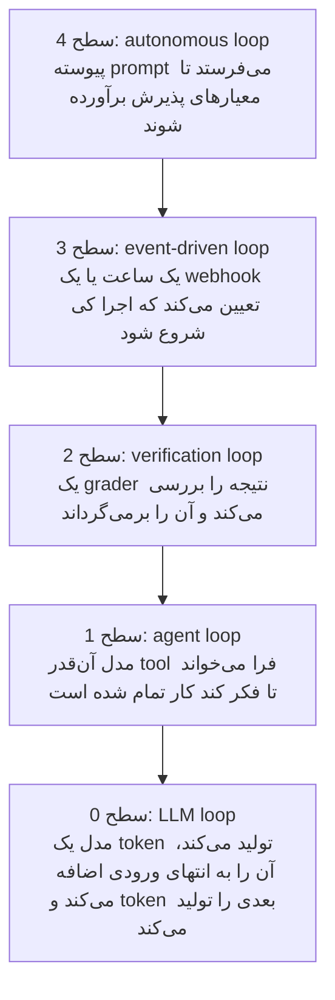
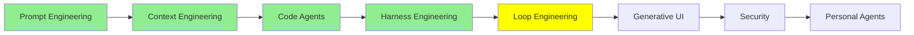

# Loop Engineering

تا پایان [Harness Engineering](harness_engineering_fa.md)، agent یک موتور، یک بدنه و یک مسیر با مانع داشت. دوباره به نقاشی نگاه کنید و ببینید هنوز چه کسی پشت فرمان نشسته است.

شما هنوز پشت فرمان هستید. شما prompt را تایپ می‌کنید. شما پاسخ برگشتی را می‌خوانید. شما تصمیم می‌گیرید که آیا پاسخ به اندازه کافی خوب بود یا نه، و شما تصمیم می‌گیرید که بعد چه اتفاقی بیفتد. agent‌های مدرن بخش زیادی از این کار را خودشان به عهده گرفته‌اند:

- خودشان context خود را مدیریت می‌کنند
- وقتی طولانی می‌شود، آن را compact می‌کنند
- subagent‌های خودشان را می‌سازند
- فهرست کارهای خودشان را نگه می‌دارند

با این حال، در مرکز همه این‌ها، یک آدم همچنان نشسته و کلید Enter را فشار می‌دهد.

این ماژول درباره حذف کردن آن آدم است.

## Loop Engineering چیست

Loop engineering یعنی طراحی loop‌هایی که خودکار تکرار می‌شوند. هر loop یک agent را از چرخه‌های عمل‌کردن، مشاهده و تنظیم عبور می‌دهد، تا این که agent به یک هدف تعریف‌شده برسد. شما agent را نوبت‌به‌نوبت prompt نمی‌کنید. به جایش، سیستم کنترل را می‌سازید: این که چه چیزی اجرا را شروع می‌کند، agent چه چیزی می‌گیرد، و از همه مهم‌تر **کی متوقف می‌شود**.

آن آخری همان طراحی است. Loop engineering فقط یک سؤال می‌پرسد: **stop condition چیست؟** بقیه چیزها از همین سؤال نتیجه می‌شوند. اگر این شرط را در یک جهت اشتباه تعیین کنید، loop قبل از تمام شدن کار متوقف می‌شود. اگر در جهت دیگر اشتباه کنید، loop آن‌قدر ادامه می‌یابد تا وقتی که صورت‌حساب‌تان برسد.

برگردیم سر ماشین. موتور همان prompt است، بدنه همان context است، و مسیر و مانع‌ها همان harness هستند. تا اینجا راننده یک انسان بود. Loop engineering یعنی AI راننده است. این فرق بین یک ماشین معمولی و ماشینی است که خودش می‌راند. هر چیزی که بعد می‌آید درباره این است که حاضرید چقدر از فرمان را به AI بدهید.

  
*این شوخی کار می‌کند چون هر پنل یک شغل واقعی است که وجود داشته. فلش‌ها تمام استدلال هستند. در سال 2026، انسان به agent‌ها اشاره می‌کند. تا 2026.5، انسان به یک agent اشاره می‌کند، و آن agent به بقیه اشاره می‌کند. پنل بعدی سؤال صادقانه را می‌پرسد: این مسیر به کجا می‌رود؟ در دو پنل آخر، چیزی که خودکار می‌شود کدنویسی نیست. نظارت است.*

## Loop‌ها در پنج سطح اتفاق می‌افتند

وقتی آدم‌ها می‌گویند «loop engineering»، معمولاً منظورشان بیرونی‌ترین loop است. اما دیدن هر پنج سطح کمک می‌کند، چون این سطح‌ها روی هم سوار می‌شوند. LangChain در مقاله [The Art of Loop Engineering](https://www.langchain.com/blog/the-art-of-loop-engineering) این کار را «هنر روی هم چیدن loop‌ها» می‌نامد. این توصیف کاملاً درست است.



*هر سطح، سطح زیر خودش را در بر می‌گیرد، و هر سطح یک تصمیم را از شما می‌گیرد. سطح 0 توکن بعدی را تعیین می‌کند. سطح 1 تعیین می‌کند کدام tool بعد فراخوانی شود. سطح 2 تعیین می‌کند آیا پاسخ به اندازه کافی خوب بود. سطح 3 تعیین می‌کند کی شروع شود. فقط سطح 4 تعیین می‌کند آیا دوباره تلاش شود. این همان تصمیم واقعی‌ای است که شما می‌گرفتید.*

### سطح 0: LLM Loop

loop از خود مدل شروع می‌شود. LLM‌های مدرن بیشتر **autoregressive** هستند. یعنی مدل ورودی را می‌گیرد و فقط یک token تولید می‌کند. بعد آن یک token را به انتهای ورودی اضافه می‌کند. با این ورودی طولانی‌تر، token بعدی را تولید می‌کند. این کار را تکرار می‌کند تا این که یک stop token تولید کند یا به حد طول برسد. هر پاسخی که تا به حال از یک LLM خوانده‌اید به همین شکل نوشته شده است، یک token در هر بار.

این سطح 0 از loop‌ها است، و در سطح LLM رخ می‌دهد. هیچ‌کس این یکی را مهندسی نمی‌کند. این روشی است که مدل با آن متن تولید می‌کند. این loop همان پایه‌ای است که هر loop دیگر این ماژول روی آن قرار دارد.

### سطح 1: Agent Loop

خود agent یک loop است. یک مدل یک tool را فراخوانی می‌کند، نتیجه را می‌خواند و tool دیگری را فراخوانی می‌کند. این کار ادامه پیدا می‌کند تا این که مدل تصمیم بگیرد کار تمام شده است. این همان loopی است که در [AI Agents](../1_fundamentals/agents_fa.md) آمده است. این loop مستقیماً روی سطح 0 قرار دارد، در نوبت خود مدل.

این را هم هیچ‌کس مهندسی نمی‌کند. LangChain، framework‌های دیگر و هر coding agent از قبل این loop را پیاده‌سازی کرده‌اند. وقتی آدم‌ها درباره loop engineering حرف می‌زنند، منظورشان این loop نیست. این بخش این‌جاست تا سه loop دیگر روی چیزی تکیه داشته باشند.

### سطح 2: Verification Loop

agent کارش را تمام می‌کند. بعد چیزی کار را با معیارها بررسی می‌کند، پیش از این که کسی آن را بپذیرد. اگر کار به اندازه کافی خوب نباشد، بازخورد به agent برمی‌گردد و agent یک دور دیگر انجام می‌دهد.

این همان ایده sensor از [Harness Engineering](harness_engineering_fa.md) است که به یک loop تبدیل شده است. sensor دیگر فقط گزارش نمی‌دهد. تصمیم می‌گیرد که آیا یک iteration دیگر لازم است یا نه. شرط توقف در اینجا یک **goal** است، پس این loop بر پایه goal است.

معیارها می‌توانند هر چیزی باشند که شما بتوانید بررسی‌اش کنید. برای مثال، یک test suite پاس شود، یک type check بدون خطا تمام شود، یا امتیاز Lighthouse بالاتر از 90 باشد. معیارها می‌توانند یک rubric هم باشند. rubric فهرست نوشته‌شده‌ای است از این که یک نتیجه خوب چه شکلی است. یک فراخوانی دیگر مدل، کار را بر اساس آن فهرست نمره می‌دهد. این روش چیزهایی را پوشش می‌دهد که هیچ test نمی‌تواند بررسی کند.

در LangChain، این را با rubric middleware می‌سازید. در Claude Code، این کار با `/goal` انجام می‌شود. طبق [Loop engineering: Getting started with loops](https://claude.com/blog/getting-started-with-loops)، `/goal` وقتی متوقف می‌شود که agent به هدف برسد یا به حداکثر تعداد نوبت برسد:

```text
/goal get the homepage Lighthouse score to 90 or above, stop after 5 tries
```

به ساختار آن نگاه کنید: یک هدف، و یک سقف (cap). سقف تزئینی نیست. اگر موفقیت تنها شرط توقف یک loop باشد، وقتی موفقیت غیرممکن شود، loop متوقف نمی‌شود.

### سطح 3: Event-driven Loop

در این سطح، چیزی بیرون از گفتگو تعیین می‌کند که کی یک اجرا رخ دهد: یک زمان‌بندی، یا یک webhook. agent دیگر چیزی نیست که شما بازش کنید. به چیزی تبدیل می‌شود که خودش اجرا می‌شود.

شرط توقف بر پایه زمان است، نه بر پایه هدف. این loop برای رسیدن به یک هدف بارها تکرار نمی‌شود. بیدار می‌شود، یک کار را انجام می‌دهد، و تا trigger بعدی دوباره می‌خوابد.

در Claude Code، `/loop` یک کار تکرارشونده را روی دستگاه خودتان اجرا می‌کند. `/schedule` همان کار را در cloud انجام می‌دهد، پس کار ادامه پیدا می‌کند حتی وقتی لپ‌تاپ‌تان بسته است:

```text
/loop 5m check my PR, address review comments, and fix failing CI
```

هر دو با لغو شما، یا وقتی کار تمام شده باشد، متوقف می‌شوند. این سطح ارزش دارد که داشته باشیم، چون agent حالا به سیستم‌های اطرافش وصل است. یک pull request باز می‌شود، یک build شکست می‌خورد، یا یک alert فعال می‌شود. agent پیش از آن‌که کسی اعلان را بخواند، شروع به رسیدگی کرده است.

### سطح 4: Autonomous Loop

این همان سطحی است که loop engineering را به یک موضوع مطرح تبدیل کرد.

تاریخچه‌اش از **Ralph loop** شروع می‌شود، که از [everything is a ralph loop](https://ghuntley.com/loop/) نوشته Geoffrey Huntley آمده است. شما یک script در shell یا JavaScript می‌نویسید. این script به شکل مکانیکی و بارها و بارها به agent prompt می‌دهد، تا این که کار به معیارهای پذیرش برسد. این شکل خالص و بسیار ساده‌شده آن است:

```bash
while true; do
  claude -p "$PROMPT"
done
```

واقعاً بیشتر ایده همین است. loop آن‌قدر prompt می‌دهد تا کار تمام شود. هر session تازه با یک context window تازه شروع می‌شود. به همین دلیل، مشکل rot از [Context Engineering](context_engineering_fa.md) فرصتی برای انباشته شدن پیدا نمی‌کند. state روی دیسک نگه داشته می‌شود، در plan و در کد، نه در یک context window.

  
*نام این تکنیک از شخصیت Simpsons گرفته شده است. شوخی دوستانه است و به تکنیک نگاه تحقیرآمیز ندارد. تکنیک به این دلیل کار می‌کند که آن‌قدر ساده است که نمی‌تواند پیچیده‌بازی کند. بعد از شکست‌هایی که چیز پیچیده‌تری را متوقف می‌کرد، همچنان ادامه می‌دهد.*

مهم‌ترین قاعده این است: **Ralph در هر loop یک task انجام می‌دهد.** در هر iteration کل backlog را برنمی‌دارد، بلکه فقط یک آیتم از آن را. هر دور این کارها را انجام می‌دهد:

- plan را می‌خواند
- آیتم بعدی انجام‌نشده را انتخاب می‌کند
- همان آیتم را انجام می‌دهد
- ثبت می‌کند که آیتم انجام شده است
- خارج می‌شود

بعد دور بعدی از صفر شروع می‌شود و آیتم بعدی را برمی‌دارد.

همین بود که coding agent‌ها را فراتر از چند ساعت کاری که [Context Engineering](context_engineering_fa.md) توصیف کرده بود برد. یک loop مثل این روزها اجرا می‌شود، چون هیچ session منفردی لازم نیست آن‌قدر طول بکشد.

نسخه‌های واقعی بسیار دقیق‌تر از چهار خط bash هستند. چیزی که آدم‌ها اضافه می‌کنند مدیریت خطا (failure handling) است. شما می‌بینید کدام iteration‌ها شکست می‌خورند، و حالت شکست را پیدا می‌کنید. بعد آن حالت شکست را طوری مهندسی می‌کنید که دیگر رخ ندهد. Huntley این‌طور توصیف می‌کند: نرم‌افزار مثل گِلی روی چرخ سفالگری شکل می‌گیرد، نه مثل آجرهایی که یکی‌یکی چیده شوند. یک iteration شکست‌خورده دلیلی است برای بهتر کردن، نه دلیلی برای توقف.

می‌توانید یک نسخه واقعی را در چند جا پیدا کنید. [ralph-loop plugin](https://claude.com/plugins/ralph-loop) نسخه بسته‌بندی‌شده برای Claude Code است. [snarktank/ralph](https://github.com/snarktank/ralph) اجرا می‌شود تا وقتی که همه آیتم‌های یک product requirements document کامل شوند. و [loop-engineering](https://github.com/cobusgreyling/loop-engineering) الگوها و ابزارهای CLI را گردآوری کرده است. یکی از آن ابزارها هزینه یک اجرای طولانی را audit می‌کند.

[Ralph Wiggum Loop for Claude Code](https://awesomeclaude.ai/ralph-wiggum) یک راهنمای گام‌به‌گام مکتوب خوب است. نکته‌ای را می‌گوید که ارزش تکرار دارد: این روش چقدر خوب کار می‌کند بیشتر به prompt‌ای بستگی دارد که نوشته‌اید، تا به مدلی که با آن اجرا کرده‌اید.

> **نکته:** LangChain یک سطح بالاتر متفاوت را نام می‌برد: **hill climbing loop**. این loop trace‌های production را می‌خواند تا مشکلات را پیدا کند، و پیکربندی خود agent را بهبود می‌دهد. ارزش دارد آن را به‌عنوان سطحی بالاتر از این یکی بشناسید. این loopی است که خروجی‌اش یک harness بهتر است، نه کار تمام‌شده.

## Agent Teams و Dynamic Workflows

همه چیز تا اینجا loopی بود که یک انسان طراحی کرده بود. script مکانیکی است، و معیارها را شما می‌نویسید. ساختار یا مال خودتان است یا یک الگوی شناخته‌شده، مثل الگوی Ralph.

مرحله بعد این است که اجازه دهیم agent خودش loop را طراحی و اجرا کند. یک بار دیگر به ماشین برگردیم: این‌جا AI فقط رانندگی نمی‌کند. مسیر را هم انتخاب می‌کند. این یک AI است که AI‌های دیگر را orchestrate می‌کند.

روشن کنید این دو چه هستند. Agent teams و dynamic workflows **معماری‌های پیشرفته multi-agent** هستند. آن‌ها بر پایه الگوهای [Multi-Agent Systems](../1_fundamentals/multi_agent_fa.md) ساخته شده‌اند. آن‌ها را با خود loop engineering اشتباه نگیرید. loop engineering همان روش کار است: شما تصمیم می‌گیرید چه چیزی اجرا را شروع کند، agent چه چیزی بگیرد، و کی متوقف شود. Agent teams و dynamic workflows معماری‌هایی هستند که با این روش کار سازگار هستند. آن‌ها این روش را در مقیاس بسیار بزرگ‌تری ممکن می‌کنند.

Claude Code برای این کار دو قابلیت دارد، و این دو شکل یکسانی ندارند.

### Agent Teams

یک agent team چند session کامل از Claude Code است که با هم کار می‌کنند. یک session رهبر است. رهبر کار را به یک فهرست مشترک task تقسیم می‌کند، بقیه را راه‌اندازی می‌کند، و نتیجه‌ها را کنار هم می‌آورد. هر teammate یک context window مخصوص خودش دارد. teammate‌ها task‌ها را از فهرست مشترک برمی‌دارند. آن‌ها مستقیماً به هم پیام می‌دهند، به جای این که فقط به رهبر گزارش دهند.

این کار تقریباً به‌عنوان یک اثر جانبی یک loop می‌سازد. رهبر می‌بیند بقیه چه می‌کنند و تصمیم می‌گیرد بعد چه اتفاقی بیفتد. این همان کاری است که قبلاً شما انجام می‌دادید.

  
*چیزی که باید دید دایره‌های خط‌چین سمت چپ است. وقتی یک subagent تمام می‌شود، فقط نتیجه‌اش باقی می‌ماند. agent اصلی تنها جایی است که کار به آن برمی‌گردد. سمت راست، چیزی در مسیر بالا خلاصه نمی‌شود، چون هیچ context window واحدی همه چیز را نمی‌بیند. هزینه بالاتر token در جدول زیر از همین‌جا می‌آید. این هم دلیلی است که رهبر ممکن است دیگر ندانَد تیم خودش دقیقاً چه می‌کند.*

این مقایسه دو روش است، از [Orchestrate teams of Claude Code sessions](https://code.claude.com/docs/en/agent-teams):

| | Subagents | Agent teams |
| --- | --- | --- |
| Context | context window مخصوص خودش؛ نتیجه‌ها به فراخواننده برمی‌گردند | context window مخصوص خودش؛ کاملاً مستقل |
| ارتباط | یک نتیجه به فراخواننده برمی‌گرداند. subagent‌هایی که Claude هنگام ساختنشان نام برده است هم می‌توانند به هم پیام دهند | teammate‌ها مستقیماً به هم پیام می‌دهند |
| هماهنگی | agent اصلی همه کارها را مدیریت می‌کند | هماهنگی خودکار از طریق پیام‌ها، به‌علاوه یک فهرست مشترک task |
| بهترین کاربرد | کارهای متمرکز که فقط نتیجه‌شان مهم است | کار پیچیده‌ای که به بحث و همکاری نیاز دارد |
| هزینه token | کمتر: نتیجه‌ها به context اصلی خلاصه برمی‌گردند | بیشتر: هر teammate یک نمونه جدا از Claude است |

ردیفی که باید به آن توجه کنید ردیف آخر است. هر teammate یک نمونه کامل و جدا است، پس هزینه با تعداد teammate‌ها بالا می‌رود. سه teammate متمرکز معمولاً بهتر از پنج teammate پراکنده عمل می‌کنند. مستندات پیشنهاد می‌کنند که از سه تا پنج تا شروع کنید.

> **نکته:** agent teams آزمایشی هستند، و به‌طور پیش‌فرض خاموش‌اند. با `CLAUDE_CODE_EXPERIMENTAL_AGENT_TEAMS=1` روشنشان می‌کنید.

### Dynamic Workflows

یک dynamic workflow یک script به زبان JavaScript است که چند subagent را هم‌زمان orchestrate می‌کند. Claude برای کاری که شما توصیف کرده‌اید، script را می‌نویسد. بعد یک runtime، script را در پس‌زمینه اجرا می‌کند، و session شما آزاد می‌ماند.

تفاوت این با همه چیزهای بالا **چه کسی plan را نگه می‌دارد** است. با subagent‌ها، skill‌ها و agent teams، Claude orchestrator است. نوبت‌به‌نوبت تصمیم می‌گیرد چه چیزی بعد اجرا شود. یک workflow این تصمیم را به جای آن در کد قرار می‌دهد. script، loop، branching و همه نتیجه‌های میانی را نگه می‌دارد. پس تنها چیزی که به context شما می‌رسد پاسخ نهایی است.

جدول بعدی از [Orchestrate subagents at scale with dynamic workflows](https://code.claude.com/docs/en/workflows) است:

| | Subagents | Skills | Agent teams | Workflows |
| --- | --- | --- | --- | --- |
| ماهیت | یک worker که Claude می‌سازد | دستورالعمل‌هایی که Claude دنبال می‌کند | یک agent رهبر که session‌های peer را نظارت می‌کند | یک script که runtime اجرا می‌کند |
| چه کسی تعیین می‌کند بعد چه اجرا شود | Claude، نوبت‌به‌نوبت | Claude، با دنبال کردن prompt | agent رهبر، نوبت‌به‌نوبت | script |
| نتیجه‌های میانی کجا نگه داشته می‌شوند | context window مربوط به Claude | context window مربوط به Claude | یک فهرست مشترک task | متغیرهای script |
| چه چیزی قابل تکرار است | تعریف worker | خود دستورالعمل‌ها | تعریف team | خود orchestration |
| مقیاس | چند task واگذارشده در هر نوبت | مثل subagent‌ها | چند peer با اجرای طولانی | ده‌ها تا صدها agent در هر اجرا |
| وقفه | نوبت را از اول شروع می‌کند | نوبت را از اول شروع می‌کند | teammate‌ها به اجرا ادامه می‌دهند | در همان session قابل ازسرگیری است |

دو ردیف توجه می‌خواهند. اولی **مقیاس** است. یک workflow در یک اجرا ده‌ها تا صدها agent به شما می‌دهد، در حالی که یک team چند تا می‌دهد. یک script می‌تواند این کار را بکند، چون برای به یاد داشتن کاری که انجام می‌دهد به context window نیاز ندارد. ردیف دوم **چه چیزی قابل تکرار است** است. با یک team می‌توانید تعریف team را دوباره استفاده کنید. با یک workflow، خود orchestration به یک فایل تبدیل می‌شود. می‌توانید آن فایل را بخوانید، ویرایش کنید، دوباره اجرا کنید و commit کنید.

این همچنین یک الگوی کیفیت به شما می‌دهد که از هیچ راه دیگری به‌آسانی به دست نمی‌آید. script مسئول است. پس می‌تواند agent‌های مستقل را بفرستد تا یافته‌های یکدیگر را به چالش بکشند، پیش از آن‌که هیچ‌کدام از آن یافته‌ها گزارش شود. یا می‌تواند از چند زاویه یک plan پیش‌نویس کند و این زاویه‌ها را در برابر هم بسنجد. فقط agent بیشتر به دست نمی‌آورید. agent‌هایی به دست می‌آورید که یکدیگر را بررسی می‌کنند.

با `/effort ultracode` آن را روشن می‌کنید. این کار بالاترین تنظیم reasoning را با orchestration خودکار workflow ترکیب می‌کند. یا می‌توانید کلمه `ultracode` را در یک prompt بیاورید، و آنگاه فقط همان task به‌صورت workflow اجرا می‌شود.

## Recursive Language Models

Dynamic workflow‌ها فقط به دلیل loop engineering وجود ندارند. آن‌ها شکل عملی یک ایده‌ی به نام **recursive language model** (RLM) نیز هستند. این ایده از مقاله [Recursive Language Models](https://arxiv.org/abs/2512.24601) نوشته Alex Zhang، Tim Kraska و Omar Khattab در MIT می‌آید.

یک مدل معمولی کل prompt را داخل context window خودش می‌گیرد. یک RLM این کار را نمی‌کند. prompt طولانی در یک محیط Python قرار می‌گیرد، به‌صورت یک متغیر. در ابتدا، مدل فقط کمی درباره آن می‌بیند: چقدر طولانی است، چطور شروع می‌شود، و چطور بخش‌هایی از آن را بخواند. بعد مدل کد می‌نویسد تا با آن متغیر کار کند. می‌تواند یک تکه از آن را نگاه کند، با grep در آن جست‌وجو کند، یا آن را به chunk تقسیم کند. و می‌تواند دوباره یک مدل را روی هر یک از آن تکه‌ها فراخوانی کند، از جمله یک نسخه دیگر از خودش. این فراخوانی‌ها بخش «بازگشتی» (recursive) هستند. فقط نتیجه‌های آن‌ها به context window اصلی برمی‌گردد. پس window هرگز مجبور نیست کل ورودی را نگه دارد. به این شکل است که یک مدل شروع می‌کند طوری رفتار کند که انگار window آن محدودیتی ندارد. یک dynamic workflow همان ایده را در مقیاس بزرگ‌تری به کار می‌گیرد: script ورودی و نتیجه‌های میانی را در متغیرها نگه می‌دارد، و agent‌های زیادی روی تکه‌ها کار می‌کنند. به همین شکل است که یک script پر از agent شروع می‌کند شبیه یک مدل با window بی‌کران به نظر برسد.

دو چیز این‌جا به‌آسانی با هم اشتباه گرفته می‌شوند، پس ارزش دارد صریح بگوییم.

- **RLM، loop engineering نیست.** این که چه چیزی اجرا را شروع می‌کند یا کی اجرا متوقف می‌شود را تعیین نمی‌کند. اما loop engineering را ممکن می‌کند و بهترش می‌کند. یک loop که چند روز اجرا می‌شود به راهی نیاز دارد تا با متنی بیشتر از آنچه یک window می‌تواند نگه دارد کار کند.
- **RLM یک معماری single-agent است.** توضیح می‌دهد که یک agent از درون چطور کار می‌کند: یک مدل که از طریق کد خودش را فراخوانی می‌کند. این معماری تعداد زیادی فراخوانی مدل انجام می‌دهد، اما آن را با معماری‌های multi-agent بالا اشتباه نگیرید.

**CodeAct**، که از مقاله [Executable Code Actions Elicit Better LLM Agents](https://arxiv.org/abs/2402.01030) آمده است، خویشاوند نزدیکی است. این روش کد قابل اجرا را به فضای action یک agent تبدیل می‌کند، به‌جای tool call‌های JSON. [Advanced Agent Architectures](../3_expert/advanced_agent_architectures.md) هر دو را به‌طور کامل توضیح می‌دهد. [توضیح Alex Zhang](https://alexzhang13.github.io/blog/2025/rlm/) نسخه خواناتر مقاله است، و [rlm](https://github.com/alexzhang13/rlm) کتابخانه آن است.

## روند

چهار ماژول آخر را کنار هم بگذارید، و جهت حرکت به‌آسانی دیده می‌شود:

- مدل‌های بهتر
- بعد استفاده بهتر از context window
- بعد محیط‌های بهتر دور مدل‌ها
- بعد loop‌های بهتر دور آن محیط‌ها

هر لایه بر طول کار افزود. یک پاسخ خوب تبدیل شد به یک session که منسجم می‌ماند. آن تبدیل شد به ساعت‌ها کار بدون نظارت انسانی، و بعد اجراهایی که طولشان بر حسب روز سنجیده می‌شود.

هیچ‌کدام از لایه‌ها جای لایه قبلی را نگرفت. آن‌ها روی هم سوار شدند. به همین دلیل کل این مجموعه یک نقاشی بوده است که بخش‌های بیشتری به آن اضافه شده است.

## کجای این مجموعه هستیم



## خلاصه

Loop engineering یعنی طراحی چرخه تکراری که یک agent را به یک هدف می‌رساند، بدون هیچ آدمی در آن چرخه. طراحی همان stop condition است.

loop‌ها روی هم قرار می‌گیرند، هر کدام داخل بعدی:

- در پایین، LLM loop قرار دارد. مدل یک token تولید می‌کند، آن را به ورودی اضافه می‌کند و token بعدی را تولید می‌کند.
- agent loop همان مدل است که tool فرا می‌خواند تا کار تمام شود. هر framework از قبل این یکی را به شما می‌دهد.
- verification loop یک grader اضافه می‌کند که کار را وقتی به اندازه کافی خوب نیست برمی‌گرداند. این loop با رسیدن به یک هدف متوقف می‌شود، به‌علاوه یک سقف برای تعداد تلاش‌هایش.
- event-driven loop تصمیم شروع را به یک ساعت یا یک webhook می‌سپارد.
- autonomous loop، یعنی Ralph loop، یک script است که بارها و بارها به agent prompt می‌دهد تا کار به معیارهای پذیرش برسد. در هر iteration یک task انجام می‌دهد، و هر دور از یک window تمیز شروع می‌شود. state روی دیسک نگه داشته می‌شود، نه در یک context. همین نکته آخر بود که agent‌ها را از ساعت‌ها به روزها رساند.

بالاتر از همه این‌ها، agent خود loop را طراحی می‌کند. Agent teams به شما session‌های peer با یک فهرست مشترک task می‌دهند، و یک رهبر که آن‌ها را هماهنگ می‌کند. Dynamic workflow‌ها plan را به یک script منتقل می‌کنند. این سه چیز به شما می‌دهد: تا صدها agent مقیاس می‌پذیرد، خود orchestration را بخش قابل تکرار می‌کند، و به agent‌ها اجازه می‌دهد کار یکدیگر را بررسی کنند. هر دو معماری‌های پیشرفته multi-agent هستند. آن‌ها loop engineering را ممکن می‌کنند، اما خود loop engineering نیستند. یک recursive language model باز هم متفاوت است. این یک معماری single-agent است: یک مدل از طریق کد خودش را فراخوانی می‌کند، پس می‌تواند متنی بیشتر از window خودش را پردازش کند.

بعدی: همه چیزهایی که در این ماژول آمد، نظارت بر agent را سخت‌تر کرد. Security همان هزینه‌ای است که این کار دارد.

**بررسی سریع**: یک verification loop و یک autonomous loop هر دو تا وقتی که چیزی برآورده شود ادامه می‌دهند. تفاوتشان چیست، و کدام یک به حداکثر تعداد تلاش نیاز دارد؟

## منابع

- [The Art of Loop Engineering](https://www.langchain.com/blog/the-art-of-loop-engineering): loop engineering به‌عنوان روی هم چیدن loop‌ها، و چهار سطح آن
- [Loop engineering: Getting started with loops](https://claude.com/blog/getting-started-with-loops): `/goal`، `/loop` و `/schedule`، به‌همراه شرط توقفی که هر یک استفاده می‌کند
- [everything is a ralph loop](https://ghuntley.com/loop/): تکنیک اصلی، و قاعده «یک task در هر loop»
- [ralph-loop plugin](https://claude.com/plugins/ralph-loop): نسخه بسته‌بندی‌شده برای Claude Code
- [snarktank/ralph](https://github.com/snarktank/ralph): یک autonomous loop که تا کامل شدن همه آیتم‌های یک requirements document اجرا می‌شود
- [loop-engineering](https://github.com/cobusgreyling/loop-engineering): الگوها، starter‌ها و ابزارهای CLI، از جمله audit هزینه برای یک اجرای طولانی
- [Ralph Wiggum Loop for Claude Code](https://awesomeclaude.ai/ralph-wiggum): یک راهنمای گام‌به‌گام مکتوب، و این که چرا prompt‌ای که اپراتور می‌نویسد از مدل مهم‌تر است
- [Orchestrate teams of Claude Code sessions](https://code.claude.com/docs/en/agent-teams): agent teams، فهرست مشترک task، و معماری پشت آن
- [Orchestrate subagents at scale with dynamic workflows](https://code.claude.com/docs/en/workflows): شکل یک workflow script، محدودیت‌های آن، و مقایسه چهارطرفه
- [Executable Code Actions Elicit Better LLM Agents](https://arxiv.org/abs/2402.01030): CodeAct، جایی که کد فضای action می‌شود
- [Recursive Language Models](https://arxiv.org/abs/2512.24601): خود مقاله، همراه با [توضیح Alex Zhang](https://alexzhang13.github.io/blog/2025/rlm/) و کتابخانه [rlm](https://github.com/alexzhang13/rlm)
- [Loop Engineering explained in 8min..](https://www.youtube.com/watch?v=4biXYSNkn9Y): همان موضوع این ماژول در هشت دقیقه، اگر ترجیح می‌دهید آن را تماشا کنید
- [Advanced Agent Architectures](../3_expert/advanced_agent_architectures.md): CodeAct، recursive language models و بقیه، به‌طور کامل پوشش داده شده‌اند
