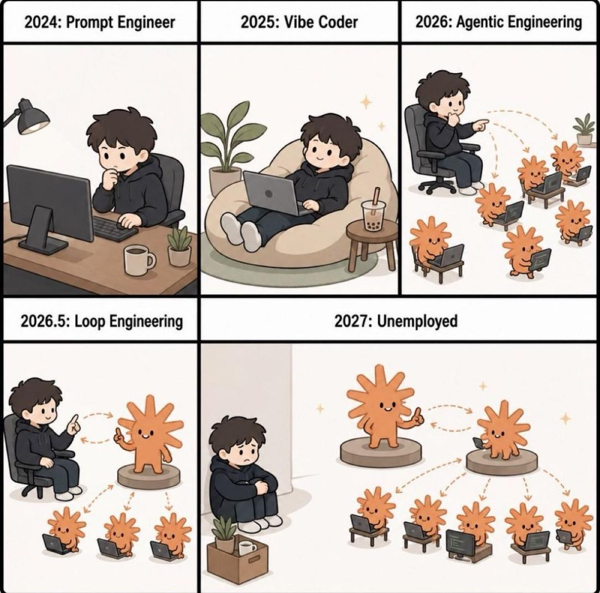
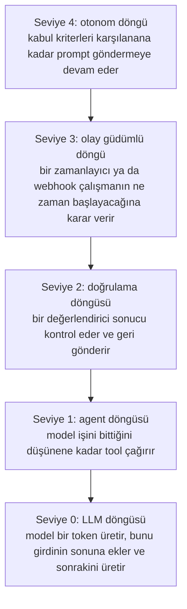
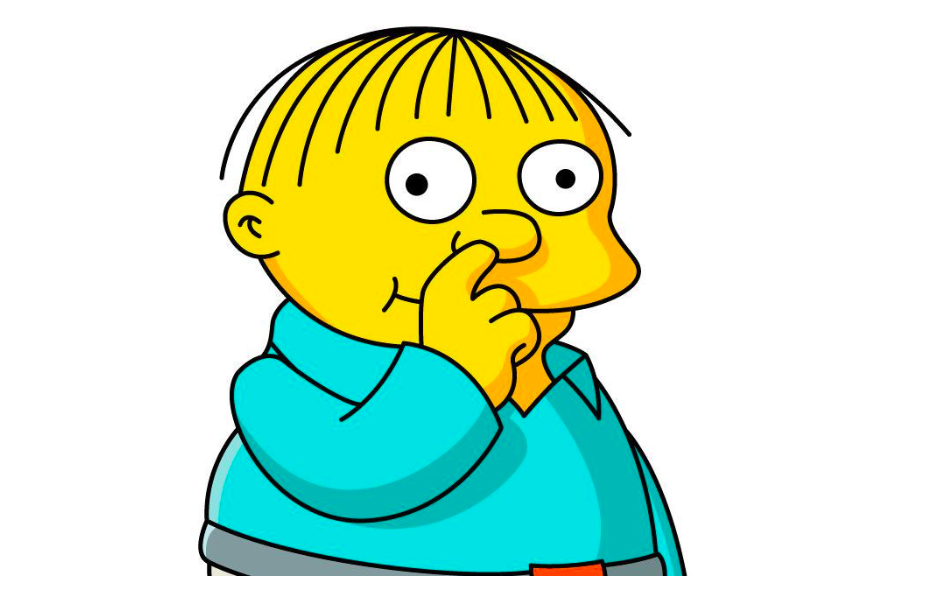
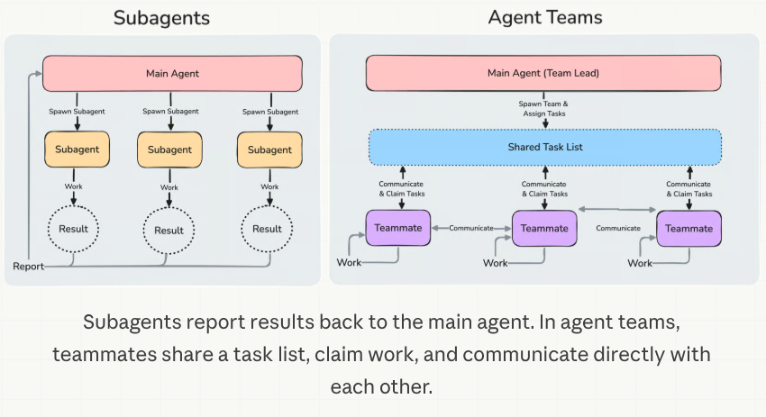
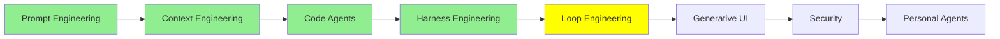

# Loop Engineering

[Harness Engineering](harness_engineering_tr.md) modülünün sonunda agent'ın bir motoru, bir gövdesi ve engellerin olduğu bir pisti vardı. Çizime bir daha bak ve hâlâ sürücü koltuğunda kimin oturduğuna dikkat et.

Hâlâ sensin. Modern agent'lar ise bu işin büyük bölümünü kendi üzerlerine aldı:

- kendi context'lerini kendileri yönetiyorlar
- context uzadığında onu sıkıştırıyorlar
- kendi subagent'larını kendileri başlatıyorlar
- kendi yapılacaklar listelerini kendileri tutuyorlar

Yine de bütün bunların merkezinde hâlâ bir insan oturmuş enter tuşuna basıyor; bu modül de tam olarak o insanı döngüden çıkarmakla ilgili.

## Loop Engineering nedir

Loop engineering, kendi kendine tekrar eden döngüler (loop) tasarlama pratiğidir. Her döngü agent'ı eylem, gözlem ve ayarlama çevrimlerinden geçirir ve agent tanımlı bir hedefe ulaşana kadar bu çevrim sürer. Agent'a her seferinde tek tek prompt yazmak yerine kontrol sistemini kurarsın: bir çalışmayı neyin başlattığını, agent'a neyin verildiğini ve en önemlisi **ne zaman durduğunu**.

Asıl tasarım kararı işte bu son unsurdur. Loop engineering de tek bir soru sorar: **durma koşulu (stop condition) nedir?** Diğer her şey bu sorunun cevabından çıkar. Koşulu bir yönde yanlış kurarsan döngü iş bitmeden durur. Öbür yönde yanlış kurarsan ise faturanı görene kadar çalışmaya devam eder.

Arabaya geri dönelim: motor prompt'tur, gövde context'tir, pist ve engeller de harness'tir. Şimdiye kadar sürücü bir insandı, loop engineering'de ise sürücü AI'dır. Bu, sürücüsü insan olan bir araba ile kendi kendine giden bir araba arasındaki farktır. Bundan sonra anlatılan her şey, direksiyonun ne kadarını AI'a bırakmaya razı olduğunla ilgili.

  
*Şaka işe yarıyor, çünkü her panelde gerçekten var olmuş bir iş anlatılıyor. Şakanın asıl söylediği şey, okların kimden kime gittiğinde saklı. Ok 2026'da insandan agent'lara gidiyor; 2026.5'te insan tek bir agent'a işaret ediyor ve o agent diğerlerine işaret ediyor. Sonraki panel ise dürüst bir soru soruyor: bu nereye gidiyor? Son iki panelde otomatikleşen şey kodlama değil, denetleme.*

## Döngüler beş seviyede oluşur

İnsanlar "loop engineering" dediklerinde genellikle en dıştaki döngüyü kastederler. Ama beşinin hepsini görmek faydalı, çünkü bunlar birbirinin üstüne yığılır. LangChain'in [The Art of Loop Engineering](https://www.langchain.com/blog/the-art-of-loop-engineering) yazısı bu pratiğe "döngü yığmanın sanatı" diyor ve bu tanım tam olarak yerinde.



*Her seviye bir altındakini sarar ve her biri senden bir kararı alır: seviye 0 bir sonraki token'a, seviye 1 sonraki tool çağrısına karar verir. Seviye 2 cevabın yeterince iyi olup olmadığına, seviye 3 ne zaman başlanacağına karar verir. Yalnızca seviye 4 yeniden denenip denenmeyeceğine karar verir. Asıl karar buydu ve şimdiye kadar onu sen veriyordun.*

### Seviye 0: LLM döngüsü

Döngü, modelin kendi içinde başlar. Modern LLM'lerin çoğu **autoregressive** çalışır, yani girdiyi alıp yalnızca bir token üretir. Bu token'ı girdinin sonuna ekler ve bu daha uzun girdiden bir sonrakini üretir. Bunu bir stop token'ı üretene ya da bir uzunluk sınırına ulaşana kadar tekrarlar. Bugüne kadar bir LLM'den okuduğun her cevap, tek tek token'larla böyle yazıldı.

Bu, döngülerin seviye 0'ıdır ve LLM düzeyinde gerçekleşir. Kimse bunu tasarlamaz, çünkü modelin metin üretme biçimi budur. Üstelik bu modüldeki diğer bütün döngülerin dayandığı temel döngü de budur.

### Seviye 1: Agent döngüsü

Agent'ın kendisi de bir döngüdür: model bir tool çağırır, sonucu okur ve işin bittiğine karar verene kadar başka tool'lar çağırmaya devam eder. Bu, [AI Agents](../1_fundamentals/agents_tr.md) modülündeki döngüdür ve doğrudan seviye 0'ın üstüne, modelin kendi turunda oturur.

Bunu da kimse tasarlamaz, çünkü LangChain, diğer framework'ler ve her coding agent bunu zaten uygular. İnsanlar loop engineering'den söz ettiğinde bu döngüyü kastetmezler. Burada durmasının sebebi, diğer üç seviyenin üstüne oturabileceği bir zemin olmasıdır.

### Seviye 2: Doğrulama döngüsü

Agent işini bitirir ve kimse işi kabul etmeden önce bir şey, işi kriterlere göre kontrol eder. İş yeterince iyi değilse geri bildirim agent'a döner ve agent bir tur daha yapar.

Bu, [Harness Engineering](harness_engineering_tr.md) modülündeki sensör fikrinin bir döngüye dönüştürülmüş hâlidir. Sensör artık yalnızca rapor vermez, bir tur daha olup olmayacağına da o karar verir. Buradaki durma koşulu bir **hedef** olduğu için bu, hedef tabanlı bir döngüdür.

Kriter, kontrol edebildiğin herhangi bir şey olabilir: bir test paketinin geçmesi, bir tip kontrolünün (type check) hatasız geçmesi ya da bir Lighthouse skorunun 90'ın üzerinde olması gibi. Kriter bir rubric de olabilir. Rubric, iyi bir sonucun neye benzediğini yazılı olarak anlatan bir listedir ve başka bir model çağrısı işi bu listeye göre puanlar. Bu sayede hiçbir testin kontrol edemediği şeyler de kapsanır.

LangChain'de bunu rubric middleware ile kurarsın, Claude Code'da ise bu iş `/goal` komutuna düşer. [Loop engineering: Getting started with loops](https://claude.com/blog/getting-started-with-loops) yazısına göre `/goal`, agent hedefe ulaştığında ya da en fazla tur sayısına eriştiğinde durur:

```text
/goal get the homepage Lighthouse score to 90 or above, stop after 5 tries
```

Bu yapıya bak: bir hedef ve bir üst sınır var. Bu sınır bir süs değildir. Bir döngünün tek durma koşulu başarı olursa, başarı imkânsız hâle geldiğinde döngü hiç durmaz.

### Seviye 3: Olay güdümlü döngü

Bu seviyede konuşmanın dışındaki bir şey çalışmanın ne zaman yapılacağına karar verir: bir zamanlama ya da bir webhook. Agent artık senin açtığın bir şey olmaktan çıkar ve kendi kendine çalışan bir şeye dönüşür.

Bu seviyedeki durma koşulu hedefe değil zamana dayalıdır. Döngü bir hedefe doğru yinelenmez; uyanır, bir işi yapar ve bir sonraki tetikleyiciye kadar yeniden uykuya geçer.

Claude Code'da `/loop` tekrarlayan bir işi kendi makinende çalıştırır. `/schedule` aynı işi bulutta yapar; böylece dizüstü bilgisayarın kapalıyken bile iş çalışmaya devam eder:

```text
/loop 5m check my PR, address review comments, and fix failing CI
```

İkisi de sen iptal ettiğinde ya da iş bittiğinde durur. Bu seviye değerlidir, çünkü agent artık çevresindeki sistemlere bağlıdır. Bir pull request açılır, bir build başarısız olur ya da bir uyarı tetiklenir; agent da bildirimi kimse okumadan önce işe koyulmuş olur.

### Seviye 4: Otonom döngü

Loop engineering'i bir konu hâline getiren asıl bu seviyedir.

Bu seviyenin tarihi, Geoffrey Huntley'nin [everything is a ralph loop](https://ghuntley.com/loop/) yazısında anlattığı **Ralph loop** ile başlar. Bir shell ya da JavaScript betiği yazarsın ve bu betik, iş kabul kriterlerini karşılayana kadar agent'a mekanik olarak, tekrar tekrar prompt gönderir. Bunun en saf ve en basitleştirilmiş hâli şöyle:

```bash
while true; do
  claude -p "$PROMPT"
done
```

Fikrin büyük kısmı gerçekten bu: döngü, iş bitene kadar prompt göndermeye devam eder. Her yeni oturum taze bir context penceresiyle başladığı için context rot birikme fırsatı bulamaz. Context rot, [Context Engineering](context_engineering_tr.md) modülünde gördüğün sorundur: context büyüdükçe model görevini giderek daha kötü yapar. Durum context penceresinde değil, planda ve kodda, yani diskte yaşar.

  
*Ad, Simpsons'taki bir karakterden geliyor ama şaka dostane ve tekniğe tepeden bakmıyor. Teknik, tam da zekice olmayacak kadar basit olduğu için işe yarıyor. Daha sofistike bir sistemi durduracak aksiliklerin ardından bile devam ediyor.*

En önemli kural şu: **Ralph her döngüde tek bir görev yapar.** Her turda bütün backlog'u almaz, yalnızca içinden tek bir madde seçer. Her geçiş ise şu adımları izler:

- planı okur
- bitmemiş bir sonraki maddeyi seçer
- o maddeyi yapar
- maddenin bittiğini kaydeder
- çıkar

Ardından bir sonraki geçiş temiz bir başlangıç yapar ve ondan sonraki maddeyi alır.

Bu, coding agent'ları [Context Engineering](context_engineering_tr.md) modülünde anlatılan birkaç saatlik işin ötesine taşıyan şeydir. Bu tarz bir döngü günlerce çalışabilir, çünkü tek bir oturumun bu kadar uzun sürmesi gerekmez.

Gerçek sürümler, dört satırlık bash'ten çok daha dikkatlidir ve insanların eklediği şey hata yönetimidir. Hangi turların başarısız olduğunu izlersin, başarısızlık biçimini bulursun ve sonra o hata biçimini tasarımla ortadan kaldırırsın ki bir daha olmasın. Huntley bunu şöyle anlatır: yazılım, tek tek dizdiğin tuğlalar değil, bir çömlekçi çarkı üzerindeki kil gibidir. Başarısız bir tur ise durmak için değil, iyileştirmek için bir nedendir.

Gerçek bir Ralph döngüsünü birkaç yerde bulabilirsin. [ralph-loop plugin](https://claude.com/plugins/ralph-loop) Claude Code için paketlenmiş sürümdür. [snarktank/ralph](https://github.com/snarktank/ralph) bir ürün gereksinim dokümanındaki (product requirements document) her madde tamamlanana kadar çalışır. [loop-engineering](https://github.com/cobusgreyling/loop-engineering) ise desenleri ve CLI araçlarını bir araya getirir; bu araçlardan biri de uzun bir çalışmanın maliyetini denetler.

[Ralph Wiggum Loop for Claude Code](https://awesomeclaude.ai/ralph-wiggum) iyi bir yazılı rehber. Tekrarlanmaya değer bir noktaya değiniyor: bu düzeneğin ne kadar iyi çalıştığı, kullandığın modelden çok yazdığın prompt'a bağlıdır.

> **NOT:** LangChain farklı bir en üst seviye adlandırıyor: **hill climbing loop**. Bu döngü, sorunları bulmak için üretim trace'lerini (production traces) okur ve agent'ın kendi yapılandırmasını iyileştirir. Bu döngü, bu seviyenin bir üstünde yer alır ve bilmeye değer; çıktısı tamamlanmış bir iş değil, daha iyi bir harness'tir.

## Agent Team'ler ve Dinamik Workflow'lar

Şimdiye kadar anlatılan her şey bir insanın tasarladığı döngülerdi: betik mekaniktir, kriterleri sen yazarsın ve yapı ya senin ya da Ralph'inki gibi bilinen bir desendir.

Bir sonraki adım, döngünün kendisini agent'ın tasarlayıp çalıştırmasına izin vermektir. Arabaya bir kez daha dönelim: burada AI yalnızca sürmüyor, rotayı da o belirliyor. Yani bu, diğer AI'ları koordine eden bir AI demektir.

Bu ikisinin ne olduğunu net söyleyelim: agent team'ler ve dinamik workflow'lar **ileri seviye multi-agent mimarileridir** ve [Multi-Agent Systems](../1_fundamentals/multi_agent_tr.md) modülündeki desenler üzerine kurulurlar. Bunları loop engineering'in kendisiyle karıştırma. Loop engineering bir pratiktir; bir çalışmayı neyin başlattığına, agent'a neyin verildiğine ve ne zaman durduğuna sen karar verirsin. Bu mimariler bu pratiğe uyar ve onu çok daha büyük bir ölçekte mümkün kılar.

Claude Code'da bunun için iki özellik var ve bu ikisinin yapısı aynı değil.

### Agent Team'ler

Bir agent team, birlikte çalışan birkaç tam Claude Code oturumudur ve bunlardan biri lider (lead) olur. Lider işi ortak bir görev listesine böler, diğerlerini başlatır ve sonuçları bir araya getirir. Her takım arkadaşının (teammate) kendi context penceresi vardır; takım arkadaşları görevleri ortak listeden alır ve sonuçları yalnızca lidere bildirmek yerine birbirlerine doğrudan mesaj atarlar.

Bu, neredeyse bir yan etki olarak bir döngü yaratır: lider, diğerlerinin ne yaptığını izler ve sonra ne olacağına karar verir. Eskiden bu işi sen yapıyordun.

  
*Dikkat edilmesi gereken, soldaki kesikli daireler. Bir subagent bittiğinde yalnızca sonucu kalır ve bütün bu işin geri döndüğü tek yer ana agent'tır. Sağda ise yukarı çıkarken hiçbir şey özetlenmez, çünkü hiçbir tek pencere her şeyi görmez. Aşağıdaki tablodaki daha yüksek token maliyeti buradan gelir ve bu aynı zamanda liderin, kendi takımının ne yaptığını gözden kaçırabilmesinin nedenidir.*

İkisinin karşılaştırması, [Orchestrate teams of Claude Code sessions](https://code.claude.com/docs/en/agent-teams) dokümanından şöyle:

| | Subagent'lar | Agent team'ler |
| --- | --- | --- |
| Context | Kendi context penceresi; sonuçlar çağırana döner | Kendi context penceresi; tamamen bağımsız |
| İletişim | Sonucu çağırana döndürür. Claude'un başlatırken adını verdiği subagent'lar birbirine de mesaj atabilir | Takım arkadaşları birbirine doğrudan mesaj atar |
| Koordinasyon | Ana agent bütün işi yönetir | Mesajlarla kendi kendini koordine eder; ayrıca ortak bir görev listesi vardır |
| En uygun olduğu durum | Yalnızca sonucun önemli olduğu, odaklı görevler | Tartışma ve iş birliği gerektiren karmaşık işler |
| Token maliyeti | Daha düşük: sonuçlar ana context'e özetlenerek döner | Daha yüksek: her takım arkadaşı ayrı bir Claude instance'ıdır |

Asıl dikkat edilmesi gereken satır sonuncusu. Her takım arkadaşı ayrı bir Claude instance'ı olduğu için maliyet, takım arkadaşı sayısıyla birlikte artar. Üç odaklı takım arkadaşı, genellikle dağınık ve odaksız beş takım arkadaşından daha iyi sonuç verir; dokümanlar da üçle beş arasıyla başlamanı öneriyor.

> **NOT:** agent team'ler deneyseldir ve varsayılan olarak kapalıdır. Bunları `CLAUDE_CODE_EXPERIMENTAL_AGENT_TEAMS=1` ile açarsın.

### Dinamik Workflow'lar

Dinamik workflow, aynı anda çok sayıda subagent'ı koordine eden bir JavaScript betiğidir. Claude, senin tarif ettiğin görev için bu betiği yazar; ardından bir runtime betiği arka planda çalıştırır ve senin oturumun kullanılabilir kalır.

Yukarıdakilerden farkı, **planı kimin tuttuğunda** görürsün. Subagent'lar, skill'ler ve agent team'lerde Claude orkestratördür ve her turda sıradaki işin ne olacağına o karar verir. Workflow ise bu kararı koda taşır: betik döngüyü, dallanmayı ve bütün ara sonuçları tutar, bu yüzden senin context'ine yalnızca nihai cevap ulaşır.

[Orchestrate subagents at scale with dynamic workflows](https://code.claude.com/docs/en/workflows) dokümanından sıradaki tablo:

| | Subagent'lar | Skill'ler | Agent team'ler | Workflow'lar |
| --- | --- | --- | --- | --- |
| Nedir | Claude'un başlattığı bir işçi | Claude'un takip ettiği talimatlar | Eş oturumları denetleyen bir lider agent | Runtime'ın çalıştırdığı bir betik |
| Sıradaki işi kim belirler | Claude, tur tur | Claude, prompt'u takip ederek | Lider agent, tur tur | Betik |
| Ara sonuçlar nerede tutulur | Claude'un context penceresinde | Claude'un context penceresinde | Ortak bir görev listesinde | Betik değişkenlerinde |
| Neyin tekrarlanabilir olduğu | İşçi tanımı | Talimatlar | Takım tanımı | Orkestrasyonun kendisi |
| Ölçek | Tur başına birkaç devredilmiş görev | Subagent'larla aynı | Birkaç uzun süre çalışan eş | Her çalışmada onlarca ila yüzlerce agent |
| Kesinti | Turu baştan başlatır | Turu baştan başlatır | Takım arkadaşları çalışmaya devam eder | Aynı oturumda devam ettirilebilir |

İki satır özellikle dikkat çekiyor. Birincisi **ölçek**: bir workflow tek bir çalışmada onlarca ila yüzlerce agent verirken bir team birkaç tane verir. Betik bunu yapabilir, çünkü ne yaptığını hatırlamak için bir context penceresine ihtiyaç duymaz. İkinci satır ise **neyin tekrar kullanılabileceğini** gösterir. Bir team'de takım tanımını yeniden kullanabilirsin; bir workflow'da ise orkestrasyonun kendisi bir dosyaya dönüşür ve o dosyayı okuyabilir, düzenleyebilir, yeniden çalıştırabilir ve commit edebilirsin.

Bu, başka türlü kolay elde edilemeyen bir kalite deseni de sağlar. Burada işi yöneten betik olduğu için, bulgular raporlanmadan önce bağımsız agent'ları birbirlerinin bulgularına karşı tartıştırabilir. Ya da bir planı birkaç açıdan taslak hâline getirip bu açıları birbirleriyle tarttırabilir. Yani yalnızca daha fazla agent almazsın; birbirini kontrol eden agent'lar elde edersin.

Bunu `/effort ultracode` ile açarsın; bu komut en yüksek muhakeme (reasoning) ayarını otomatik workflow orkestrasyonuyla birleştirir. Ya da tek bir prompt'un içine `ultracode` kelimesini yazabilirsin, bu durumda yalnızca o görev workflow olarak çalışır.

## Özyinelemeli Dil Modelleri

Dinamik workflow'lar yalnızca loop engineering yüzünden var olmuyor; aynı zamanda **özyinelemeli dil modeli (recursive language model, RLM)** adı verilen bir fikrin pratik bir biçimidirler. Fikir, MIT'deki Alex Zhang, Tim Kraska ve Omar Khattab'ın yazdığı [Recursive Language Models](https://arxiv.org/abs/2512.24601) makalesinden geliyor.

Normal bir model bütün prompt'u context penceresinin içinde alır, RLM ise almaz. Uzun prompt, bir Python ortamında bir değişken olarak durur. Model başta bunun hakkında çok az şey görür: ne kadar uzun olduğunu, nasıl başladığını ve parçalarını nasıl okuyacağını. Sonra model o değişkenle çalışmak için kod yazar. Bir dilimine bakabilir, grep ile arayabilir ya da parçalara bölebilir. Bu parçalardan herhangi birinde modeli yeniden çağırabilir; çağrılan model, kendisinin bir kopyası bile olabilir. Özyinelemeli olan kısım bu çağrılardır. Ana context penceresine yalnızca sonuçlar geri döner, bu yüzden pencerenin bütün girdiyi tutması hiç gerekmez. Model, pencere sınırı yokmuş gibi davranmaya işte böyle başlar.

Dinamik bir workflow aynı fikri daha büyük ölçekte kullanır: betik girdiyi ve ara sonuçları değişkenlerde tutar, birçok agent de parçalar üzerinde çalışır. Böylece agent dolu bir betik, sınırsız bir pencereye sahip tek bir model gibi görünmeye başlar.

Burada karıştırması kolay iki şey var, bunları açıkça söylemekte fayda var.

- **RLM, loop engineering değildir.** Bir çalışmayı neyin başlattığına ya da ne zaman durduğuna karar vermez; ama loop engineering'i mümkün kılar ve onu daha iyi hâle getirir. Günlerce çalışan bir döngü, tek bir pencerenin tutabileceğinden fazla metinle çalışmanın bir yoluna ihtiyaç duyar.
- **RLM, tek agent'lı bir mimaridir.** Tek bir agent'ın içeride nasıl çalıştığını anlatır: kodla kendini çağıran tek bir model. Çok sayıda model çağrısı yapsa da onu yukarıdaki multi-agent mimarileriyle karıştırma, çünkü bütün bu çağrıları tek bir agent yapar.

**CodeAct** ise bu fikrin yakın bir akrabası: [Executable Code Actions Elicit Better LLM Agents](https://arxiv.org/abs/2402.01030) makalesinde tanıtılır ve JSON tool çağrıları yerine çalıştırılabilir kodu agent'ın eylem alanı yapar. İkisi de [İleri Seviye Mimariler](../3_expert/advanced_agent_architectures_tr.md) modülünde ayrıntılı olarak işlenir. Alex Zhang'in [yazısı](https://alexzhang13.github.io/blog/2025/rlm/) makalenin daha rahat okunan hâlidir, [rlm](https://github.com/alexzhang13/rlm) ise kütüphanedir.

## Eğilim

Son dört modülü yan yana koyarsan yön kolayca görülür:

- daha iyi modeller
- sonra context penceresinin daha iyi kullanımı
- sonra modellerin çevresindeki daha iyi ortamlar
- en son da bu ortamların çevresindeki daha iyi döngüler

Her katman çalışma süresini uzattı. Tek bir iyi cevap, tutarlı kalabilen bir oturuma dönüştü; o oturum saatlerce gözetimsiz süren işe, bu iş de günlerle ölçülen çalışmalara dönüştü.

Hiçbir katman kendinden öncekinin yerini almadı; hepsi üst üste yığıldı. Bu yüzden bütün seri aslında tek bir çizimdir ve her yeni modül o çizime yalnızca yeni bir parça ekledi.

## Bu serinin neresindeyiz



## Özet

Loop engineering, bir agent'ı bir hedefe taşıyan tekrarlayan döngüyü, bu döngünün içinde hiç insan olmadan tasarlamak demektir. Bu tasarımdaki en önemli karar da döngünün ne zaman duracağı, yani durma koşuludur.

Döngüler birbirinin içine yığılır:

- En altta LLM döngüsü var. Model bir token üretir, onu girdiye ekler ve sonrakini üretir.
- Agent döngüsü, modelin işi bitene kadar tool çağırmasıdır. Her framework bunu zaten sana verir.
- Doğrulama döngüsü, iş yeterince iyi değilse işi geri gönderen bir değerlendirici ekler. Bir hedefte durur ve buna bir de en fazla kaç deneme yapılacağına dair bir sınır eklenir.
- Olay güdümlü döngü, başlatma kararını bir saate ya da bir webhook'a bırakır.
- Otonom döngü, yani Ralph loop, iş kabul kriterlerini karşılayana kadar agent'a tekrar tekrar prompt gönderen bir betiktir. Her turda tek bir görev yapar ve her geçiş temiz bir context penceresiyle başlar. Durum diskte tutulur, context'te değil. Agent'ları saatlerden günlere taşıyan da bu son noktadır.

Bunların hepsinin üstünde, döngünün kendisini agent tasarlar. Agent team'ler, ortak bir görev listesi olan eş oturumları ve bunları koordine eden bir lideri sunar; dinamik workflow'lar ise planı bir betiğe taşır. Bu da sana üç şey kazandırır: yüzlerce agent'a ölçeklenmek, orkestrasyonun kendisini yeniden kullanılabilir parça hâline getirmek ve agent'ların birbirinin işini kontrol etmesini sağlamak. İkisi de ileri seviye multi-agent mimarileridir ve loop engineering'i mümkün kılarlar, ama loop engineering'in kendisi değildirler. Özyinelemeli dil modeli ise yine farklıdır: tek agent'lı bir mimaridir, yani bir model kodla kendini çağırır ve böylece penceresinin alamayacağı kadar çok metni işleyebilir.

Bu modüldeki her şey bir agent'ı denetlemeyi zorlaştırdı. Sıradaki konu olan Security, bunun bedelini anlatıyor.

**Hızlı Kontrol**: Hem doğrulama döngüsü hem de otonom döngü, bir koşul sağlanana kadar devam eder. Aralarındaki fark nedir ve hangisinin en fazla deneme sayısına ihtiyacı vardır?

## Kaynaklar

- [The Art of Loop Engineering](https://www.langchain.com/blog/the-art-of-loop-engineering): loop engineering'i döngüleri üst üste yığmak olarak ve dört seviyesiyle anlatıyor
- [Loop engineering: Getting started with loops](https://claude.com/blog/getting-started-with-loops): `/goal`, `/loop` ve `/schedule`, her birinin kullandığı durma koşuluyla birlikte
- [everything is a ralph loop](https://ghuntley.com/loop/): özgün teknik ve her döngüde tek görev kuralı
- [ralph-loop plugin](https://claude.com/plugins/ralph-loop): Claude Code için paketlenmiş sürüm
- [snarktank/ralph](https://github.com/snarktank/ralph): bir gereksinim dokümanındaki her madde tamamlanana kadar çalışan otonom bir döngü
- [loop-engineering](https://github.com/cobusgreyling/loop-engineering): desenler, başlangıç projeleri ve CLI araçları; uzun bir çalışmanın maliyet denetimi dahil
- [Ralph Wiggum Loop for Claude Code](https://awesomeclaude.ai/ralph-wiggum): yazılı bir rehber; operatörün prompt'unun neden modelden daha önemli olduğu
- [Orchestrate teams of Claude Code sessions](https://code.claude.com/docs/en/agent-teams): agent team'ler, ortak görev listesi ve bunun altyapısı
- [Orchestrate subagents at scale with dynamic workflows](https://code.claude.com/docs/en/workflows): bir workflow betiğinin neye benzediği, sınırları ve dört yönlü karşılaştırma
- [Executable Code Actions Elicit Better LLM Agents](https://arxiv.org/abs/2402.01030): CodeAct; kodun eylem alanı olduğu yaklaşım
- [Recursive Language Models](https://arxiv.org/abs/2512.24601): makale; [Alex Zhang'in yazısı](https://alexzhang13.github.io/blog/2025/rlm/) ve [rlm](https://github.com/alexzhang13/rlm) kütüphanesiyle birlikte
- [Loop Engineering explained in 8min..](https://www.youtube.com/watch?v=4biXYSNkn9Y): bu modülün konusunu sekiz dakikada, izlemek istersen
- [İleri Seviye Mimariler](../3_expert/advanced_agent_architectures_tr.md): CodeAct, recursive language model'ler ve diğerleri, ayrıntılı olarak
