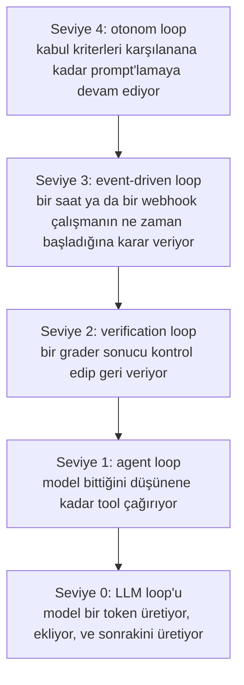
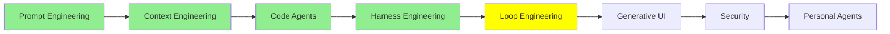

# Loop Engineering

[Harness Engineering](harness_engineering_tr.md) bittiğinde agent'ın bir motoru, bir gövdesi ve bariyerli bir pisti vardı. Çizime bir daha bak ve sürücü koltuğunda hâlâ kimin oturduğuna dikkat et.

Sen. Prompt'u sen yazıyorsun. Geri geleni sen okuyorsun. Yeterince iyi olup olmadığına sen karar veriyorsun, sırada ne olacağına da sen karar veriyorsun. Modern agent'lar işin büyük bir kısmını devraldı:

- kendi context'lerini yönetiyorlar
- context uzayınca onu sıkıştırıyorlar
- kendi subagent'larını açıyorlar
- kendi to-do listelerini tutuyorlar

Ve hâlâ, merkezde bir insan oturup enter'a basıyor.

Bu modül o insanı çıkarmakla ilgili.

## Loop Engineering Ne Demek

Loop engineering, kendiliğinden tekrarlayan loop'ları tasarlama pratiği. Her loop, agent'ı harekete geçme, gözlemleme ve ayarlama döngülerinden geçiriyor. Bu, agent tanımlanmış bir hedefe ulaşana kadar sürüyor. Agent'a tur tur prompt yazmıyorsun. Onun yerine kontrol sistemini kuruyorsun: bir çalışmayı ne başlatıyor, agent ne alıyor, ve hepsinden önemlisi **ne zaman duruyor**.

Tasarım o son madde. Loop engineering'in sorduğu tek soru: **stop condition nedir?** Geri kalan her şey ondan çıkıyor. Bir yönde yanlış yaparsan loop iş bitmeden duruyor. Öbür yönde yanlış yaparsan faturan gelene kadar çalışıyor.

Arabaya dönelim. Motor prompt, gövde context, pist ve bariyerler de harness. Şimdiye kadar sürücü bir insandı. Loop engineering, arabayı AI'ın sürmesi. Bu, bir araba ile kendini süren bir araba arasındaki fark. Bundan sonraki her şey, direksiyonun ne kadarını AI'a bırakmaya razı olduğunla ilgili.

  
*Şaka işliyor, çünkü her kare gerçekten var olmuş bir iş. Oklar ise bütün argüman. 2026'da insan agent'ları işaret ediyor. 2026.5'te insan tek bir agent'ı işaret ediyor, o agent da diğerlerini işaret ediyor. Sonraki kare de dürüst bir soru soruyor: bu iş nereye gidiyor? Son iki karede otomatikleşen şey coding değil. Otomatikleşen şey denetim.*

## Loop'lar Beş Seviyede Oluyor

İnsanlar "loop engineering" dediğinde genelde en dıştaki loop'u kastediyor. Ama beşini de görmek işe yarıyor, çünkü üst üste biniyorlar. LangChain'in [The Art of Loop Engineering](https://www.langchain.com/blog/the-art-of-loop-engineering) yazısı bu pratiğe "loop'ları üst üste koyma sanatı" diyor. Bu tam olarak doğru.



*Her seviye altındakini kapsıyor, ve her biri senden bir karar alıyor. Seviye 0 bir sonraki token'a karar veriyor. Seviye 1 sırada hangi tool'un çağrılacağına karar veriyor. Seviye 2 cevabın yeterince iyi olup olmadığına karar veriyor. Seviye 3 ne zaman başlanacağına karar veriyor. Sadece seviye 4 tekrar denenip denenmeyeceğine karar veriyor. Senin gerçekte verdiğin karar da buydu.*

### Seviye 0: LLM Loop'u

Loop modelin kendi içinde başlıyor. Modern LLM'ler çoğunlukla **autoregressive**. Yani model input'u alıyor ve sadece bir token üretiyor. Sonra o tek token'ı input'un sonuna ekliyor (append). Bir sonraki token'ı da bu uzamış input'tan üretiyor. Bunu bir stop token üretene ya da bir uzunluk sınırına gelene kadar tekrarlıyor. Bir LLM'den okuduğun her cevap bu şekilde, her seferinde bir token olarak yazıldı.

Bu, loop'ların 0. seviyesi, ve LLM seviyesinde oluyor. Bunu kimse engineer etmiyor. Model metni böyle üretiyor. Bu modüldeki diğer bütün loop'lar da bunun üzerine oturuyor.

### Seviye 1: Agent Loop

Agent'ın kendisi bir loop. Model bir tool çağırıyor, sonucu okuyor ve başka bir tool çağırıyor. İşin bittiğine karar verene kadar devam ediyor. Bu, [AI Agent'lar](../1_fundamentals/agents_tr.md)'daki loop. Doğrudan 0. seviyenin üzerine oturuyor, modelin kendi turunda.

Bunu da kimse engineer etmiyor. LangChain, diğer framework'ler ve her coding agent bunu zaten implement ediyor. İnsanlar loop engineering derken bu loop'u kastetmiyor. Diğer üçü üzerine oturacak bir şey bulsun diye burada.

### Seviye 2: Verification Loop

Agent bitiriyor. Sonra, biri işi kabul etmeden önce, bir şey işi kriterlere göre kontrol ediyor. İş yeterince iyi değilse geri bildirim agent'a gidiyor, agent da bir tur daha atıyor.

Bu, [Harness Engineering](harness_engineering_tr.md)'in sensör fikrinin loop'a dönüşmüş hâli. Sensör artık sadece rapor vermiyor. Bir iterasyon daha olup olmayacağına da karar veriyor. Buradaki stop condition bir **hedef**, yani bu goal-based loop.

Kriterler kontrol edebildiğin herhangi bir şey olabilir. Örneğin bir test suite geçiyor, bir type check temiz dönüyor ya da bir Lighthouse skoru 90'ın üzerine çıkıyor. Kriter bir rubric de olabilir. Rubric, iyi bir sonucun neye benzediğini anlatan yazılı bir liste. Başka bir model çağrısı işi o listeye göre notluyor. Bu da hiçbir test'in kontrol edemeyeceği şeyleri kapsıyor.

LangChain'de bunu rubric middleware ile kuruyorsun. Claude Code'da bu `/goal`. [Loop engineering: Getting started with loops](https://claude.com/blog/getting-started-with-loops) sayfasına göre `/goal`, agent hedefe ulaştığında ya da maksimum tur sayısına geldiğinde duruyor:

```text
/goal get the homepage Lighthouse score to 90 or above, stop after 5 tries
```

Şekline bak: bir hedef, ve bir üst sınır. Üst sınır süs değil. Bir loop'un tek stop condition'ı başarıysa, başarı imkânsız olduğunda o loop durmaz.

### Seviye 3: Event-driven Loop

Burada bir çalışmanın ne zaman olacağına konuşmanın dışındaki bir şey karar veriyor: bir zamanlama ya da bir webhook. Agent, senin açtığın bir şey olmaktan çıkıyor. Çalışan bir şey hâline geliyor.

Stop condition goal-based değil, time-based. Loop bir hedefe doğru iterasyon yapmıyor. Uyanıyor, bir iş yapıyor ve bir sonraki tetiklemeye kadar uykuya dönüyor.

Claude Code'da `/loop`, kendi makinende tekrarlayan bir iş çalıştırıyor. `/schedule` aynı şeyi bulutta yapıyor, böylece iş laptop'un kapalıyken de çalışmaya devam ediyor:

```text
/loop 5m check my PR, address review comments, and fix failing CI
```

İkisi de sen iptal ettiğinde ya da iş bittiğinde duruyor. Bu seviyeyi değerli yapan şey, agent'ın artık etrafındaki sistemlere bağlı olması. Bir pull request açılıyor, bir build düşüyor ya da bir alarm çalıyor. Agent, kimse bildirimi okumadan önce onunla ilgilenmeye başlamış oluyor.

### Seviye 4: Otonom Loop

Loop engineering'i bir konu hâline getiren bu.

Tarihi **Ralph loop** ile başlıyor. Bu fikir Geoffrey Huntley'in [everything is a ralph loop](https://ghuntley.com/loop/) yazısından geliyor. Shell ya da JavaScript ile bir script yazıyorsun. Script, iş kabul kriterlerini karşılayana kadar agent'ı mekanik biçimde tekrar tekrar prompt'luyor. En saf ve en basite indirgenmiş hâli şöyle:

```bash
while true; do
  claude -p "$PROMPT"
done
```

Fikrin çoğu gerçekten bu. Loop, iş bitene kadar prompt'lamaya devam ediyor. Her yeni session temiz bir context window ile başlıyor. Bu yüzden [Context Engineering](context_engineering_tr.md)'deki çürüme (rot) problemi birikme fırsatı bulamıyor. State bir context window'da değil, diskte duruyor: planda ve kodda.

  
*Adı Simpsons karakterinden geliyor. Şaka küçümseyici değil, sevecen. Teknik, zekice olamayacak kadar basit olduğu için işliyor. Daha sofistike bir şeyi durduracak aksiliklerden sonra da devam ediyor.*

En önemli kural şu: **Ralph loop başına bir iş yapıyor.** Her iterasyonda bütün backlog'u değil, listeden sadece tek bir kalemi alıyor. Her geçiş şunları yapıyor:

- planı okuyor
- sıradaki bitmemiş kalemi seçiyor
- o kalemi yapıyor
- kalemin bittiğini kaydediyor
- çıkıyor

Sonra bir sonraki geçiş temiz başlıyor ve ondan sonraki kalemi alıyor.

Coding agent'ların [Context Engineering](context_engineering_tr.md)'in anlattığı birkaç saatlik çalışmanın ötesine geçmesini sağlayan şey bu. Böyle bir loop günlerce çalışıyor, çünkü tek bir session'ın o kadar dayanması gerekmiyor.

Gerçek versiyonlar dört satır bash'ten çok daha dikkatli. İnsanların eklediği şey hata yönetimi. Hangi iterasyonların düştüğünü izliyorsun ve hata modunu buluyorsun. Sonra o hata modunu, bir daha olmayacak şekilde engineer ederek ortadan kaldırıyorsun. Huntley bunu şöyle anlatıyor: yazılım, tek tek dizilen tuğlalar değil, çömlekçi çarkındaki kil gibi oluyor. Düşen bir iterasyon da durma sebebi değil, iyileştirme sebebi.

Gerçek bir tane bulacağın birkaç yer var. [ralph-loop plugin'i](https://claude.com/plugins/ralph-loop) Claude Code için paketlenmiş hâli. [snarktank/ralph](https://github.com/snarktank/ralph) bir ürün gereksinim dokümanındaki her kalem tamamlanana kadar çalışıyor. [loop-engineering](https://github.com/cobusgreyling/loop-engineering) ise desenleri ve CLI araçlarını bir araya getiriyor. Bu araçlardan biri, uzun bir çalışmanın sana neye mal olduğunu denetliyor.

[Ralph Wiggum Loop for Claude Code](https://awesomeclaude.ai/ralph-wiggum) iyi bir yazılı anlatım. Tekrarlamaya değer bir noktayı da vurguluyor: bunun ne kadar iyi çalıştığı, çalıştırdığın modelden çok yazdığın prompt'a bağlı.

> **NOT:** LangChain farklı bir en üst seviyeden söz ediyor: **hill climbing loop**. Bu loop production trace'lerini okuyup problem buluyor ve agent'ın kendi konfigürasyonunu iyileştiriyor. Onu bu seviyenin bir üstü olarak bilmek işe yarar. Çıktısı bitmiş iş değil, daha iyi bir harness olan bir loop bu.

## Agent Teams ve Dynamic Workflows

Buraya kadar her şey bir insanın tasarladığı loop'tu. Script mekanik ve kriterleri sen yazıyorsun. Yapı da ya senin ya da Ralph'inki gibi bilinen bir desen.

Sonraki adım, loop'u agent'ın kendisinin tasarlayıp çalıştırması. Son bir kez arabaya dönelim: burada AI sadece sürmüyor. Güzergâha da o karar veriyor. Bu, başka AI'ları orkestre eden bir AI.

Bu ikisinin ne olduğunu netleştirelim. Agent teams ve dynamic workflow'lar **ileri seviye multi-agent mimarileri**. [Multi-Agent Systems](../1_fundamentals/multi_agent_tr.md)'teki desenlerin üzerine kuruluyorlar. Bunları loop engineering'in kendisiyle karıştırma. Loop engineering bir pratik: bir çalışmayı neyin başlattığına, agent'ın ne aldığına ve ne zaman durduğuna sen karar veriyorsun. Agent teams ve dynamic workflow'lar ise bu pratiğe uyan mimariler. Bu pratiği çok daha büyük ölçekte mümkün kılıyorlar.

Claude Code'un bunun için iki özelliği var. İkisinin şekli aynı değil.

### Agent Teams

Agent team, birlikte çalışan birkaç tam Claude Code session'ı. Bunlardan biri lead. Lead işi paylaşılan bir task listesine bölüyor, diğerlerini açıyor ve sonuçları bir araya getiriyor. Her teammate'in kendi context window'u var. Teammate'ler paylaşılan listeden task alıyor. Sadece lead'e rapor vermek yerine birbirlerine doğrudan mesaj atıyorlar.

Bu, neredeyse yan etki olarak bir loop yaratıyor. Lead diğerlerinin ne yaptığını izliyor ve sırada ne olacağına karar veriyor. Bu da eskiden senin yaptığın işti.

  
*Dikkat edilecek şey, soldaki kesik çizgili daireler. Bir subagent bittiğinde ondan sadece sonucu kalıyor. O işin geri döndüğü tek yer de ana agent. Sağda ise yukarı çıkarken hiçbir şey özetlenmiyor, çünkü her şeyi gören tek bir window yok. Aşağıdaki tablodaki daha yüksek token maliyeti buradan geliyor. Bir lead'in kendi ekibinin ne yaptığını takip edemez hâle gelmesinin sebebi de bu.*

İkisi şöyle karşılaştırılıyor, [Orchestrate teams of Claude Code sessions](https://code.claude.com/docs/en/agent-teams) sayfasından:

| | Subagent'lar | Agent teams |
| --- | --- | --- |
| Context | Kendi context window'u; sonuçlar çağırana dönüyor | Kendi context window'u; tamamen bağımsız |
| İletişim | Çağırana bir sonuç döndürüyor. Claude'un açarken isim verdiği subagent'lar birbirine de mesaj atabiliyor | Teammate'ler birbirine doğrudan mesaj atıyor |
| Koordinasyon | Bütün işi ana agent yönetiyor | Mesajlarla kendi kendine koordinasyon, artı paylaşılan bir task listesi |
| En uygun | Sadece sonucun önemli olduğu odaklı işler | Tartışma ve iş birliği gerektiren karmaşık işler |
| Token maliyeti | Daha düşük: sonuçlar ana context'e özetlenerek dönüyor | Daha yüksek: her teammate ayrı bir Claude instance'ı |

Dikkat edilecek satır son satır. Her teammate ayrı bir instance, yani maliyet teammate sayısıyla birlikte artıyor. Odaklı üç teammate genelde dağınık beş teammate'ten daha iyi iş çıkarıyor. Dokümanlar üç ile beş teammate ile başlamayı öneriyor.

> **NOT:** agent teams deneysel ve varsayılan olarak kapalı. `CLAUDE_CODE_EXPERIMENTAL_AGENT_TEAMS=1` ile açıyorsun.

### Dynamic Workflows

Dynamic workflow, aynı anda çok sayıda subagent'ı orkestre eden bir JavaScript script'i. Claude, script'i senin anlattığın iş için yazıyor. Sonra bir runtime onu arka planda çalıştırıyor ve session'ın boş kalıyor.

Yukarıdaki her şeyden farkı, **planı kimin tuttuğu**. Subagent'lar, skill'ler ve agent teams'te orkestratör Claude. Sırada ne çalışacağına tur tur o karar veriyor. Workflow ise bu kararı koda taşıyor. Loop'u, dallanmayı ve bütün ara sonuçları script tutuyor. Bu yüzden senin context'ine ulaşan tek şey son cevap oluyor.

Sıradaki tablo [Orchestrate subagents at scale with dynamic workflows](https://code.claude.com/docs/en/workflows) sayfasından:

| | Subagent'lar | Skill'ler | Agent teams | Workflow'lar |
| --- | --- | --- | --- | --- |
| Nedir | Claude'un açtığı bir işçi | Claude'un uyduğu talimatlar | Eş session'ları denetleyen bir lead agent | Runtime'ın çalıştırdığı bir script |
| Sırada ne çalışacağına kim karar veriyor | Claude, tur tur | Claude, prompt'u izleyerek | Lead agent, tur tur | Script |
| Ara sonuçlar nerede duruyor | Claude'un context window'u | Claude'un context window'u | Paylaşılan bir task listesi | Script değişkenleri |
| Tekrar kullanılabilir olan | İşçi tanımı | Talimatlar | Team tanımı | Orkestrasyonun kendisi |
| Ölçek | Tur başına birkaç devredilmiş iş | Subagent'larla aynı | Bir avuç uzun çalışan eş | Çalışma başına düzinelerce ya da yüzlerce agent |
| Kesinti | Turu baştan başlatıyor | Turu baştan başlatıyor | Teammate'ler çalışmaya devam ediyor | Aynı session içinde devam ettirilebilir |

İki satır dikkat hak ediyor. Birincisi **ölçek**. Bir workflow tek bir çalışmada sana düzinelerce ya da yüzlerce agent veriyor. Bir team ise sana bir avuç agent veriyor. Script bunu yapabiliyor, çünkü ne yaptığını hatırlamak için bir context window'a ihtiyacı yok. İkinci satır **tekrar kullanılabilir olan**. Bir team'de team tanımını yeniden kullanabiliyorsun. Bir workflow'da ise orkestrasyonun kendisi bir dosyaya dönüşüyor. Bu dosyayı okuyabilir, düzenleyebilir, yeniden çalıştırabilir ve commit'leyebilirsin.

Bu sana, başka türlü kolay elde edemeyeceğin bir kalite deseni de kazandırıyor. Kontrol script'te. Bu yüzden script, bağımsız agent'ları birbirinin bulgularına itiraz etmeye gönderebiliyor, hem de bulguların hiçbiri raporlanmadan önce. Ya da bir planı birkaç açıdan taslak olarak çizip bu açıları birbiriyle karşılaştırabiliyor. Sadece daha çok agent almıyorsun. Birbirini kontrol eden agent'lar alıyorsun.

Bunu `/effort ultracode` ile açıyorsun. Bu ayar, en yüksek reasoning ayarını otomatik workflow orkestrasyonuyla birleştiriyor. Ya da tek bir prompt'ta `ultracode` kelimesini kullanabilirsin. O zaman sadece o iş workflow olarak çalışıyor.

## Recursive Language Models

Dynamic workflow'lar sadece loop engineering yüzünden var değil. Aynı zamanda **recursive language model** (RLM) denen bir fikrin pratik hâli. Fikir, MIT'den Alex Zhang, Tim Kraska ve Omar Khattab'ın [Recursive Language Models](https://arxiv.org/abs/2512.24601) makalesinden geliyor.

Normal bir model prompt'un tamamını context window'unun içinde alıyor. Bir RLM almıyor. Uzun prompt bir Python ortamında bir değişken (variable) olarak duruyor. Model başta onun hakkında sadece birkaç şey görüyor: ne kadar uzun olduğunu, nasıl başladığını ve parçalarını nasıl okuyacağını. Sonra model o değişkenle çalışmak için kod yazıyor. Bir dilimine bakabiliyor, onu grep ile arayabiliyor ya da chunk'lara bölebiliyor. Ve bu parçalardan herhangi biri için bir modeli yeniden çağırabiliyor, kendisinin bir kopyası da dahil. "Recursive" kısmı bu çağrılar. Ana context window'a sadece bu çağrıların sonuçları geri geliyor. Yani window hiçbir zaman input'un tamamını tutmak zorunda kalmıyor. Tek bir modelin sınırsız bir window'u varmış gibi davranmaya başlaması da böyle oluyor. Bir dynamic workflow aynı fikri daha büyük ölçekte kullanıyor: script input'u ve ara sonuçları değişkenlerde tutuyor, ve birçok agent bu parçalar üzerinde çalışıyor. Agent dolu bir script'in, sınırsız window'u olan tek bir model gibi görünmeye başlaması da böyle oluyor.

Burada iki şey kolayca karışıyor, o yüzden açıkça söylemeye değer.

- **Bir RLM loop engineering değil.** Bir çalışmayı neyin başlattığına ya da ne zaman durduğuna karar vermiyor. Ama loop engineering'i mümkün kılıyor ve daha iyi hâle getiriyor. Günlerce çalışan bir loop, tek bir window'un tutabileceğinden fazla metinle çalışmanın bir yoluna ihtiyaç duyuyor.
- **Bir RLM single-agent bir mimari.** Tek bir agent'ın içeride nasıl çalıştığını anlatıyor: kod üzerinden kendisini çağıran tek bir model. Çok sayıda model çağrısı yapsa da onu yukarıdaki multi-agent mimarileriyle karıştırma.

[Executable Code Actions Elicit Better LLM Agents](https://arxiv.org/abs/2402.01030)'dan gelen **CodeAct** da yakın bir akraba. JSON tool çağrıları yerine çalıştırılabilir kodu agent'ın action space'i yapıyor. [Advanced Agent Architectures](../3_expert/advanced_agent_architectures_tr.md) ikisini de düzgünce anlatıyor. Alex Zhang'in [yazısı](https://alexzhang13.github.io/blog/2025/rlm/) makalenin okunabilir versiyonu, [rlm](https://github.com/alexzhang13/rlm) de library.

## Trend

Son dört modülü yan yana koyunca yön kolayca görülüyor:

- daha iyi modeller
- sonra context window'un daha iyi kullanılması
- sonra modellerin etrafında daha iyi ortamlar
- sonra bu ortamların etrafında daha iyi loop'lar

Her katman uzunluk ekledi. Tek bir iyi cevap, tutarlı kalan bir session'a dönüştü. O da saatlerce denetimsiz çalışmaya, sonra da günlerle ölçülen çalışmalara dönüştü.

Katmanların hiçbiri öncekinin yerini almadı. Üst üste bindiler. Bütün serinin, üzerine parça eklenen tek bir çizim olmasının sebebi de bu.

## Bu serinin neresindeyiz



## Özet

Loop engineering, bir agent'ı hedefe taşıyan ve içinde insan olmayan tekrarlayan döngüyü tasarlamak. Tasarımın kendisi de stop condition.

Loop'lar biri diğerinin içinde olacak şekilde üst üste biniyor:

- En altta LLM loop'u var. Model bir token üretiyor, onu input'a ekliyor ve sonrakini üretiyor.
- Agent loop, modelin bitene kadar tool çağırması. Onu her framework zaten veriyor.
- Verification loop, iş yeterince iyi olmadığında onu geri veren bir grader ekliyor. Bir hedefle, artı kaç deneme hakkı olduğunu söyleyen bir üst sınırla duruyor.
- Event-driven loop, başlama kararını bir saate ya da bir webhook'a devrediyor.
- Otonom loop, yani Ralph loop, iş kabul kriterlerini karşılayana kadar agent'ı tekrar tekrar prompt'layan bir script. İterasyon başına bir iş yapıyor ve her geçiş temiz bir window'dan başlıyor. State bir context'te değil, diskte duruyor. Agent'ları saatlerden günlere taşıyan şey de bu son madde.

Bütün bunların üzerinde loop'u agent'ın kendisi tasarlıyor. Agent teams sana paylaşılan bir task listesi olan eş session'lar ve onları koordine eden bir lead veriyor. Dynamic workflow'lar planı bir script'e taşıyor. Bu sana üç şey kazandırıyor: yüzlerce agent'a ölçekleniyor, orkestrasyonun kendisini tekrar kullanılabilir parça yapıyor ve agent'ların birbirinin işini kontrol etmesini sağlıyor. İkisi de ileri seviye multi-agent mimarileri. Loop engineering'i mümkün kılıyorlar, ama loop engineering'in kendisi değiller. Bir recursive language model ise yine farklı bir şey. O, single-agent bir mimari: tek bir model kod üzerinden kendisini çağırıyor ve böylece window'unun tutabileceğinden fazla metinle çalışabiliyor.

Sırada: bu modüldeki her şey bir agent'ı denetlemeyi zorlaştırdı. Security de bunun maliyeti.

**Hızlı Kontrol**: bir verification loop da bir otonom loop da bir şey sağlanana kadar devam ediyor. Aradaki fark nedir, ve hangisinin maksimum deneme sayısına ihtiyacı var?

## Kaynaklar

- [The Art of Loop Engineering](https://www.langchain.com/blog/the-art-of-loop-engineering): loop engineering'in loop üst üste koyma olarak tanımı, ve dört seviye
- [Loop engineering: Getting started with loops](https://claude.com/blog/getting-started-with-loops): `/goal`, `/loop` ve `/schedule`, her birinin kullandığı stop condition ile
- [everything is a ralph loop](https://ghuntley.com/loop/): tekniğin orijinali, ve loop başına bir iş kuralı
- [ralph-loop plugin](https://claude.com/plugins/ralph-loop): Claude Code için paketlenmiş hâli
- [snarktank/ralph](https://github.com/snarktank/ralph): bir gereksinim dokümanındaki her kalem tamamlanana kadar çalışan otonom bir loop
- [loop-engineering](https://github.com/cobusgreyling/loop-engineering): desenler, başlangıç şablonları ve CLI araçları, uzun bir çalışma için maliyet denetimi dahil
- [Ralph Wiggum Loop for Claude Code](https://awesomeclaude.ai/ralph-wiggum): yazılı bir anlatım, ve operatörün prompt'unun neden modelden önemli olduğu
- [Orchestrate teams of Claude Code sessions](https://code.claude.com/docs/en/agent-teams): agent teams, paylaşılan task listesi ve arkasındaki mimari
- [Orchestrate subagents at scale with dynamic workflows](https://code.claude.com/docs/en/workflows): bir workflow script'i neye benziyor, limitleri, ve dörtlü karşılaştırma
- [Executable Code Actions Elicit Better LLM Agents](https://arxiv.org/abs/2402.01030): CodeAct, kodun action space olduğu yer
- [Recursive Language Models](https://arxiv.org/abs/2512.24601): makale, [Alex Zhang'in yazısı](https://alexzhang13.github.io/blog/2025/rlm/) ve [rlm](https://github.com/alexzhang13/rlm) library'si ile
- [Loop Engineering explained in 8min..](https://www.youtube.com/watch?v=4biXYSNkn9Y): bu modülün konusu sekiz dakikada, okumaktansa izlemeyi tercih edersen
- [Advanced Agent Architectures](../3_expert/advanced_agent_architectures_tr.md): CodeAct, recursive language model'ler ve gerisi, düzgün hâliyle
