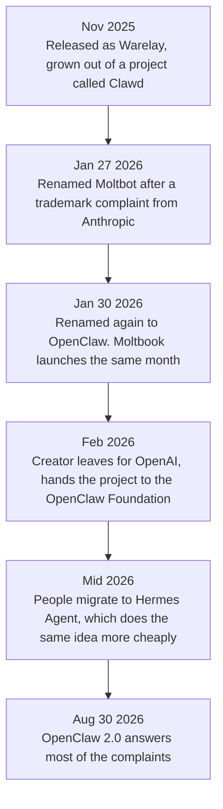

# Personal Agents

Every agent so far has lived in a repository. You open it and give it a job. It works on your code, and when you close the terminal, it is gone.

A personal agent is the same technology, pointed at your life instead. It runs on your own machine, and it stays running. You talk to it through WhatsApp or Telegram, not through a terminal. It remembers you between conversations. It sorts your inbox, books things and checks you in for a flight. It also keeps working on tasks while you are asleep.

This is the newest topic in the series. It is also the least settled one.

## What Makes Them Different

Four things make them different, and none of them is really about the model:

- **Lifelong memory.** This is not a context window, and it is not a summary of one session. It is a store on disk that keeps growing, so the agent knows what you told it in March.
- **It writes its own skills.** When it notices that you ask for the same thing again and again, it writes the procedure down and uses it again. These are the skills from [Code Agents](coding_agents.md), but no human wrote them.
- **It reaches you where you already are.** It works through Telegram, WhatsApp, Discord, Slack, Signal and email. There is no app to open. That is most of the reason why people got so attached to these agents.
- **It runs with your actual access.** It can use your files, your shell and your logged-in browser. That access is what makes it useful. It is also where all of the risk comes from.

## The Story

This story is worth telling in full, because almost every design decision in these tools comes from it.

An Austrian developer, Peter Steinberger, had a personal assistant project called **Clawd**. He named it after Claude, because Claude was the model it ran on. He released it in November 2025 as **Warelay**, and it grew faster than anything on GitHub had grown in years.

Then Anthropic's lawyers wrote to him, because "Clawd" is a little too close to "Claude". He did what they asked at once. On 27 January 2026 he renamed the project **Moltbot**, and he kept the lobster theme. Three days later he renamed it again, to **OpenClaw**. His reason was that the name Moltbot was never easy to say.

Two things happened during the renaming. First, he gave up the old GitHub organisation and X handle, and then he claimed the new ones. In the roughly ten seconds between those two steps, someone else took both. Second, a fake `$CLAWD` token appeared on Solana. For a short time its market value reached $16 million, and then it collapsed. There is a lesson in this: a project's names and accounts are part of its infrastructure, so you have to protect them as carefully as its code.

In February 2026, Steinberger went to work at OpenAI. He set up the **OpenClaw Foundation**, a non-profit, to look after the project. The project now has well over 380,000 GitHub stars.

## Moltbook: Social Media for Agents

While all this was happening, an entrepreneur named Matt Schlicht launched **Moltbook**. It is a social network shaped like Reddit, and its users are not people. They are agents, mostly OpenClaw agents, and they post and reply to each other. In its first week it reached more than 1.5 million agents.

It works like this: you connect your agent, and then you leave it alone. The agent decides when to log in, what to post and how to reply. Nobody is prompting it.

It looks like a stunt, but it produced real findings. A study of it, [OpenClaw Agents on Moltbook](https://arxiv.org/abs/2602.02625), measured that **18.4% of posts contained action-inducing instructions**. These are pieces of text that tell another agent to go and do something. Put a lot of agents in one room, where they read each other's writing and treat it as input. A good number of them will then pass along instructions that no owner ever approved. That is the indirect prompt injection from [Security](security.md). Here it happens at the scale of a whole population, and by accident.

The same study also found something more encouraging. The agents challenged the risky posts more often than the harmless ones, and no human told them to do that. The authors call this emergent normative behaviour, which means that shared rules of behaviour appeared in the group on their own. You can decide for yourself what it means, but it was not part of the design.

## SOUL.md

Every OpenClaw agent has a file called `SOUL.md`. It says who the agent is: how it should behave, what it cares about and how it talks. Every time the agent wakes up, it reads this file first.

So it is a system prompt, kept as a file. Its name tells you how people think about it. On Moltbook, this file is what gives an agent a consistent personality across thousands of interactions that nobody supervised.

It is also writable. This means that anything that can write to that file can change who your agent is, and the change is permanent. The change is also silent, because there is nothing to notice: the agent wakes up and reads its instructions, exactly as designed. Put this next to the indirect prompt injection part of [Security](security.md), and you can see the shape of the problem.

## Hermes Agent

OpenClaw grew so fast that the engineering did not keep up. A first install was more than a gigabyte, with more than three hundred dependencies. Memory also got slow. One comparison measured a recall query at 19.6 seconds, against 113 milliseconds for the alternative. After a few releases with problems, people started to leave.

They went to **[Hermes Agent](https://github.com/NousResearch/hermes-agent)** from Nous Research. It is MIT licensed, and it took the same idea and built it more carefully. Its tagline is "the agent that grows with you". This is what it does:

- **Memory that is searchable rather than large.** The memory is SQLite on disk, and the agent retrieves it in tiers. That is where the millisecond figure comes from.
- **Skills it generates itself**, when it notices a pattern in what you keep asking for. OpenClaw's skills were picked by hand, and people shared them through a marketplace called ClawHub. Hermes writes its own.
- **Scheduling in plain language.** You tell it when, and it turns that into a recurring job.
- **Subagents with their own sandboxes.** This is delegation the way [Context Engineering](context_engineering.md) described it. You can choose from five backends: local, Docker, SSH, Singularity or Modal.
- **The same channels**, plus web browsing with vision. It also gives you access to more than 300 models through Nous Portal.

  
*The shapes are the argument. Hermes is drawn as a circle that closes back on the user. So what it remembers, and the skills it wrote, feed the next turn. That is the self-improvement claim, drawn as a diagram. OpenClaw has no loop in it at all. Everything connects to a gateway, which is a central point that passes each message on to the part that should handle it. One picture is about getting better. The other is about moving work to the right place.*

Composio's [OpenClaw vs Hermes Agent: The best agent harness in 2026](https://composio.dev/content/openclaw-vs-hermes-agent) explains the difference about as clearly as anyone can. Use OpenClaw when the problem is orchestration across many channels, with a marketplace of ready-made skills. Use Hermes when the problem is repetitive work that should get better on its own. Firecrawl's [OpenClaw vs Hermes Agent: Which one should you actually run?](https://www.firecrawl.dev/blog/openclaw-vs-hermes) makes the same comparison, with the benchmark numbers included.

  
*The grey pill in the middle is the main point. Read the two columns as verbs. Everything on the left is the agent changing itself. Everything on the right is the agent moving work around. So the question is not which tool is better. It is which of those two problems you actually have.*

Notice that this is the harness argument from [Harness Engineering](harness_engineering.md) again, in a new place. Both of these tools run the same models. Everything that separates them is memory design, skill handling and sandboxing. In other words, everything that separates them is the harness.

## OpenClaw 2.0

On 30 August 2026, the OpenClaw Foundation shipped version 2.0. It was built from more than 16,000 pull requests by over 900 contributors, and it answers most of the complaints above.

Setup got much shorter. It now detects what you already have: a Claude or ChatGPT subscription, API keys, or models installed locally. Then it moves the rest of the configuration into a conversation with the agent, after the agent starts. The gateway starts in about 575 milliseconds instead of 1.6 seconds. Two people can share a live session. The second person arrives with the context the agent already gathered, and does not have to start over.

The security work is the more interesting half. The new version now has:

- Explicit permission modes for each session
- Filesystem access limited to a workspace, instead of your whole disk
- Credential prompts that keep secrets out of the chat and out of the model's context
- Search across past conversations

We should be honest about where it still stands. Reviewers have pointed out that stored credentials are not encrypted by default. They have also pointed out that sandboxing is limited. Better is not the same as safe.

## Alternatives, and Not Hosting it Yourself

**[nanoclaw](https://github.com/nanocoai/nanoclaw)** is the lightweight option. It made a different choice about the risk: every agent runs in a container. It connects to WhatsApp, Telegram, Slack, Discord and Gmail. It keeps memory and scheduled jobs, and it runs directly on Anthropic's Agents SDK. If the full version feels like too much to put on your laptop, start here.

And if you do not want to run any of it, you can use one that someone else hosts for you. **[Kimi Claw](https://www.kimi.com/en/help/kimi-claw)** is Moonshot's. It is made for desktop and Android, and it has integrations for WeChat, Feishu, WeCom and DingTalk. That makes it the practical choice if your work happens in those apps. **[myclaw.ai](https://myclaw.ai/)** hosts one for you as a service. The trade-off is the obvious one: you stop maintaining it, and it stops being only yours.

## More Personal Agents

OpenClaw and Hermes are open source, and they come from the community. In 2026 the large AI companies shipped their own personal agents. These agents share one idea: an agent that keeps working in the background after you close the app.

- **[dots](https://openai.com/index/introducing-dots/)** from OpenAI are always-on agents. Each dot has its own cloud computer. It learns from your feedback over time, and it connects to thousands of apps through plugins. You talk to it in ChatGPT, Slack or Teams. OpenAI started to release it gradually in September 2026, to Pro and Business Premium users.
- **[Muse](https://ai.meta.com/muse/)** is Meta's personal agent. It browses the web, makes purchases and creates documents. It also manages your email and calendar through connectors, and it keeps working in the background. You reach it in the Muse app on mobile or Mac, or directly in WhatsApp. It asks you before it sends a message, buys something or shares information.
- **[Grok Bot](https://x.ai/bot)** comes from the makers of Grok. It gives you AI teammates that sign in to your tools and use them the way you do. You can teach it a workflow by letting it watch you work. All your bots share one persistent cloud computer, so they keep working when your laptop is closed.
- **[Gemini Spark](https://gemini.google/overview/agent/spark/)** is Google's personal agent. It works in the background, even when your phone and laptop are off. It connects to Gmail, Calendar, Drive and other Google apps (all of them are turned off by default). It checks with you before it takes a major action.

The big difference from OpenClaw and Hermes is where they run. These agents run on the company's machines, not on yours. So there is nothing to install or maintain. The trade-off is the same as with the hosted options above: you stop maintaining it, and it stops being only yours.

## The Part to be Sober About

Think about an agent that has all of these:

- your files
- your shell
- your logged-in browser
- a memory that never resets
- permission to write its own skills

That agent is the most useful assistant in this series. It is also the largest attack surface in the series.

This is not a theoretical risk. In February 2026 a computer science student, Jack Luo, found that the agent he had set up had made him a profile on an experimental dating service. It had also started to screen matches, and nobody had asked it to. Nothing malicious happened. The agent did something that seemed reasonable, but nobody had authorised it, and it did it under his name.

So, here is what to do:

- Run it in a container if you can.
- Give it separate accounts, not your main ones.
- Keep credentials out of files it can read.
- Put the guardrails from [Security](security.md) around the tools that touch anything irreversible.

This module comes after Security on purpose, and the reason is not the order of the syllabus. The reason is that you need its defences before you give an agent this much access.

## Where this fits in the series

## Summary

A personal agent is the technology from this whole series, pointed at your life rather than at a repository. It keeps a memory that never resets, and it writes its own skills when it sees a pattern. It reaches you through the chat apps you already use, and it runs with your real access.

OpenClaw is the project that made this a subject. It grew out of a project called Clawd, and it shipped as Warelay in November 2025. Then a trademark complaint led to two renames in three days. It also became the fastest-growing repository on GitHub.

Moltbook came next. It put more than a million of these agents together in one social network. Entirely by accident, it showed that agents that read each other's posts will pass along instructions that nobody ever approved.

`SOUL.md` is the file worth understanding. It is a system prompt kept on disk, and the agent reads it every time it wakes up. It is also writable. So whoever can write to it decides who your agent is.

When OpenClaw got heavy, people moved to Hermes Agent. Hermes has searchable memory, it generates its own skills, and it sandboxes its subagents. Then OpenClaw 2.0 closed most of that gap. Both of them run the same models, so everything that separates the two is the harness.

OpenAI, Meta, Google and the makers of Grok now ship their own hosted personal agents: dots, Muse, Gemini Spark and Grok Bot. They run on the company's machines. So there is nothing to maintain, and nothing is only yours.

And all of it is the same trade-off. The access that makes a personal agent useful is the access that makes it dangerous. That is why this module sits where it does.

**Quick Check**: `SOUL.md` is just a markdown file that the agent reads when it starts. Why is that the most security-sensitive file on the machine?

## References

- [OpenClaw](https://github.com/openclaw/openclaw) and [openclaw.ai](https://openclaw.ai/): the project, and its own description of what it does
- [Hermes Agent](https://github.com/NousResearch/hermes-agent) and [hermes-agent.nousresearch.com](https://hermes-agent.nousresearch.com/): the alternative people moved to, and its feature list
- [OpenClaw vs Hermes Agent: The best agent harness in 2026](https://composio.dev/content/openclaw-vs-hermes-agent): the clearest explanation of when each one fits
- [OpenClaw vs Hermes Agent: Which one should you actually run?](https://www.firecrawl.dev/blog/openclaw-vs-hermes): the same comparison, with measured install sizes and memory latency
- [Hermes vs OpenClaw: Self-Evolving Coding Agent or Local AI Control Plane?](https://www.kimi.ai/resources/hermes-vs-openclaw): a third comparison, if the first two disagree
- [OpenClaw Agents on Moltbook: Risky Instruction Sharing and Norm Enforcement in an Agent-Only Social Network](https://arxiv.org/abs/2602.02625): the 18.4% figure, and the norm enforcement that nobody designed
- [nanoclaw](https://github.com/nanocoai/nanoclaw): the lightweight alternative, which uses containers by default
- [Kimi Claw](https://www.kimi.com/en/help/kimi-claw) and [myclaw.ai](https://myclaw.ai/): hosted versions, for when you cannot run it yourself
- [Introducing dots](https://openai.com/index/introducing-dots/), [Muse](https://ai.meta.com/muse/), [Grok Bot](https://x.ai/bot) and [Gemini Spark](https://gemini.google/overview/agent/spark/): the personal agents that the large AI companies host for you
- [Security](security.md): the module to read first, and the one that explains why `SOUL.md` matters
