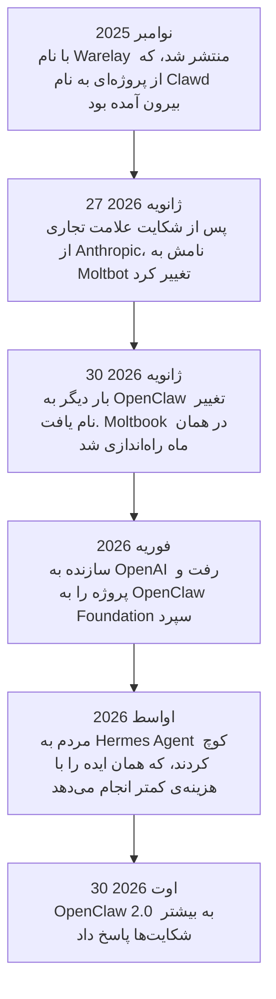

# Personal Agent‌ها

تا اینجا هر agent در یک repository زندگی کرده است. شما آن را باز می‌کنید و یک کار به آن می‌دهید. روی کد شما کار می‌کند و وقتی ترمینال را می‌بندید، دیگر نیست.

یک personal agent همان فناوری است، اما این بار به زندگی شما نشانه رفته است. روی ماشین خودتان اجرا می‌شود و همیشه روشن می‌ماند. با آن از طریق WhatsApp یا Telegram حرف می‌زنید، نه از طریق ترمینال. بین گفتگو‌ها شما را به یاد دارد. صندوق ورودی (inbox) شما را مرتب می‌کند، رزرو انجام می‌دهد و برای پرواز شما check-in می‌کند. همچنین وقتی خواب هستید به کار‌هایش ادامه می‌دهد.

این جدید‌ترین موضوع این مجموعه است. هنوز از همه‌ی موضوعات دیگر کمتر جا افتاده است.

## چه چیزی آن‌ها را متفاوت می‌کند

چهار چیز آن‌ها را متفاوت می‌کند و هیچ‌کدام واقعاً درباره‌ی مدل نیست:

- **Lifelong memory.** این یک context window نیست و خلاصه‌ی یک session هم نیست. این یک مخزن روی دیسک است که پیوسته بزرگ‌تر می‌شود، پس agent می‌داند شما در ماه مارس به او چه گفته‌اید.
- **skill‌های خودش را می‌نویسد.** وقتی متوجه می‌شود شما بار‌ها همان کار را درخواست می‌کنید، روش انجام آن را یادداشت می‌کند و دوباره از آن استفاده می‌کند. این‌ها همان skill‌های [Code Agent‌ها](coding_agents_fa.md) هستند، اما هیچ انسانی آن‌ها را ننوشته است.
- **به همان جایی که هستید به شما می‌رسد.** از طریق Telegram، WhatsApp، Discord، Slack، Signal و ایمیل کار می‌کند. اپلیکیشنی نیست که باز کردنش لازم باشد. بیشتر دلیلِ دلبستگی مردم به این agent‌ها همین است.
- **با دسترسی واقعی شما اجرا می‌شود.** می‌تواند از فایل‌ها، shell و مرورگری که با حساب شما وارد شده است استفاده کند. همین دسترسی آن را مفید می‌کند. تمام ریسک هم از همین‌جا می‌آید.

## داستان

این داستان ارزش دارد کامل گفته شود، چون تقریباً هر تصمیم طراحی در این ابزار‌ها از همین داستان می‌آید.

یک توسعه‌دهنده‌ی اتریشی به نام Peter Steinberger یک پروژه‌ی دستیار شخصی به نام **Clawd** داشت. او نام آن را از Claude گرفت، چون پروژه روی Claude اجرا می‌شد. در نوامبر 2025 آن را با نام **Warelay** منتشر کرد، و پروژه با سرعتی رشد کرد که سال‌ها در GitHub دیده نشده بود.

بعد وکلای Anthropic به او نامه نوشتند، چون «Clawd» کمی بیش از حد به «Claude» نزدیک است. او فوراً کاری را که خواستند انجام داد. در 27 ژانویه 2026 نام پروژه را به **Moltbot** تغییر داد و موضوع خرچنگ دریایی (lobster) را نگه داشت. سه روز بعد دوباره آن را به **OpenClaw** تغییر نام داد. دلیلش این بود که نام Moltbot هیچ‌وقت راحت گفته نمی‌شد.

در این تغییرات نام دو اتفاق افتاد. اول، او سازمان قدیمی GitHub و نام کاربری X قبلی‌اش را رها کرد و بعد نام‌های جدید را برای خودش ثبت کرد. در حدود ده ثانیه‌ای که بین این دو قدم فاصله بود، شخص دیگری هر دو را گرفت. دوم، یک token جعلی با نام `$CLAWD` روی Solana ظاهر شد. مدت کوتاهی ارزش بازار آن به 16 میلیون دلار رسید و بعد سقوط کرد. درسی در این ماجرا هست: نام‌ها هم جزو زیرساخت‌اند.

در فوریه 2026، Steinberger برای کار به OpenAI رفت. او **OpenClaw Foundation** را، که یک سازمان غیرانتفاعی است، راه‌اندازی کرد تا از پروژه مراقبت کند. پروژه اکنون بیش از 380,000 ستاره در GitHub دارد.

## Moltbook: شبکه‌ی اجتماعی برای agent‌ها

در همین حال، کارآفرینی به نام Matt Schlicht، **Moltbook** را راه‌اندازی کرد. این شبکه‌ی اجتماعی با ساختاری شبیه Reddit است، و کاربرانش انسان نیستند. آن‌ها agent هستند، بیشترشان OpenClaw agent، و به یکدیگر post می‌گذارند و جواب می‌دهند. در هفته‌ی اول، به بیش از 1.5 میلیون agent رسید.

کارش به این شکل است: agent خودتان را وصل می‌کنید و بعد آن را به حال خودش رها می‌کنید. خود agent تصمیم می‌گیرد کی وارد شود، چه post‌ای بگذارد و چطور جواب دهد. هیچ‌کس به آن prompt نمی‌دهد.

این شبیه یک شیرین‌کاری به نظر می‌رسد، اما یافته‌های واقعی داشت. یک مطالعه درباره‌ی آن، [OpenClaw Agents on Moltbook](https://arxiv.org/abs/2602.02625)، اندازه گرفت که **18.4% از post‌ها دستور‌های محرک عمل (action-inducing instructions) داشتند**. این متن‌هایی هستند که به یک agent دیگر می‌گویند برود و کاری انجام دهد. تعداد زیادی agent را در یک اتاق بگذارید، جایی که نوشته‌ی یکدیگر را می‌خوانند و آن را به‌عنوان input در نظر می‌گیرند. بعد، تعداد قابل‌توجهی از آن‌ها دستور‌هایی را منتقل می‌کنند که هیچ صاحبی هرگز تأییدشان نکرده است. این همان indirect prompt injection از [Security](security_fa.md) است. این‌جا این اتفاق در مقیاس یک جمعیت کامل و کاملاً تصادفی رخ می‌دهد.

همان مطالعه چیز امیدبخش‌تری هم پیدا کرد. agent‌ها post‌های پرخطر را بیشتر از post‌های بی‌خطر به چالش می‌کشیدند، و هیچ انسانی این کار را به آن‌ها نگفته بود. نویسندگان این را رفتار هنجاری نوظهور (emergent normative behaviour) می‌نامند. معنای آن را خودتان تعیین کنید، اما این چیزی نبود که در طراحی‌اش آمده باشد.

## SOUL.md

هر agent از OpenClaw یک فایل به نام `SOUL.md` دارد. این فایل می‌گوید agent کیست: باید چطور رفتار کند، به چه چیزی اهمیت می‌دهد و چطور حرف بزند. هر بار که agent بیدار می‌شود، اول این فایل را می‌خواند.

پس این یک system prompt است که به شکل فایل نگه داشته شده است. نام آن نشان می‌دهد مردم چطور به آن فکر می‌کنند. در Moltbook، همین فایل است که به یک agent شخصیتی ثابت می‌دهد، در هزاران تعامل که هیچ‌کس بر آن‌ها نظارت نکرده است.

این فایل قابل نوشتن هم هست. یعنی هر چیزی که بتواند در آن بنویسد، می‌تواند تغییر دهد که agent شما کیست، و این تغییر دائمی است. این تغییر بی‌صداست، چون چیزی نیست که بشود متوجهش شد: agent بیدار می‌شود و دستور‌هایش را دقیقاً طبق طراحی می‌خواند. این را کنار بخش indirect prompt injection از [Security](security_fa.md) بگذارید، آن‌وقت شکل مسئله را می‌بینید.

## Hermes Agent

OpenClaw آن‌قدر سریع رشد کرد که مهندسی آن نتوانست همراهش شود. نصب اولیه بیش از یک گیگابایت بود و بیش از سیصد dependency داشت. memory هم کند شد. یک مقایسه، زمان یک recall query را 19.6 ثانیه اندازه گرفت، در برابر 113 میلی‌ثانیه برای جایگزین. بعد از چند release پرمشکل، مردم شروع کردند به ترک آن.

آن‌ها به سراغ **[Hermes Agent](https://github.com/NousResearch/hermes-agent)** از Nous Research رفتند. این ابزار مجوز MIT دارد و همان ایده را گرفت و با دقت بیشتری ساخت. شعارش «the agent that grows with you» است. کار‌هایی که انجام می‌دهد این‌هاست:

- **memory‌ای که قابل جست‌وجو است، نه بزرگ.** memory روی دیسک به شکل SQLite نگه داشته می‌شود و agent آن را در لایه‌ها (tiers) بازیابی می‌کند. عدد میلی‌ثانیه از همین‌جا می‌آید.
- **skill‌هایی که خودش می‌سازد،** وقتی در چیز‌هایی که مدام درخواست می‌کنید الگویی ببیند. skill‌های OpenClaw به‌صورت دستی انتخاب می‌شدند و مردم آن‌ها را از طریق یک marketplace به نام ClawHub به اشتراک می‌گذاشتند. Hermes خودش skill‌های خودش را می‌نویسد.
- **زمان‌بندی با زبان ساده.** شما می‌گویید کی، و آن را تبدیل می‌کند به یک کار تکرارشونده.
- **Subagent‌هایی با sandbox مخصوص خودشان.** این همان واگذاری کار (delegation) است به همان شکلی که [Context Engineering](context_engineering_fa.md) توضیح داد. می‌توانید از میان پنج backend انتخاب کنید: local، Docker، SSH، Singularity یا Modal.
- **همان کانال‌ها،** به‌علاوه‌ی مرور وب همراه با vision. همچنین از طریق Nous Portal به بیش از 300 مدل دسترسی می‌دهد.

  
*شکل‌ها خودشان استدلال‌اند. Hermes به شکل دایره‌ای کشیده شده که به کاربر برمی‌گردد. یعنی آنچه به خاطر می‌سپارد و skill‌هایی که نوشته، نوبت بعدی را تغذیه می‌کنند. این ادعای خودبهبودی است، که به شکل یک نمودار کشیده شده. OpenClaw اصلاً هیچ loop ای ندارد. همه‌چیز به یک gateway وصل می‌شود، و این یک شکل مسیریابی (routing) است. یک تصویر درباره‌ی بهتر شدن است. تصویر دیگر درباره‌ی بردن کار به جای درستش است.*

مقاله‌ی Composio با عنوان [OpenClaw vs Hermes Agent: The best agent harness in 2026](https://composio.dev/content/openclaw-vs-hermes-agent) تفاوت را تا جایی که ممکن است واضح توضیح می‌دهد. وقتی مسئله، orchestration بین کانال‌های زیاد است و یک marketplace از skill‌های آماده لازم دارید، از OpenClaw استفاده کنید. وقتی مسئله، کار تکراری است که باید خودبه‌خود بهتر شود، از Hermes استفاده کنید. مقاله‌ی Firecrawl با عنوان [OpenClaw vs Hermes Agent: Which one should you actually run?](https://www.firecrawl.dev/blog/openclaw-vs-hermes) همان مقایسه را انجام می‌دهد، همراه با عدد‌های benchmark.

  
*قرص خاکستری وسط، نکته‌ی اصلی است. دو ستون را به‌صورت فعل بخوانید. هر چیزی سمت چپ، agent است که خودش را تغییر می‌دهد. هر چیزی سمت راست، agent است که کار را جابه‌جا می‌کند. پس سؤال این نیست که کدام ابزار بهتر است. سؤال این است که کدام‌یک از این دو مسئله را واقعاً دارید.*

به این نکته توجه کنید که این همان استدلال harness است که در [Harness Engineering](harness_engineering_fa.md) آمده، این بار در جای دیگری. هر دو ابزار همان مدل‌ها را اجرا می‌کنند. هر چیزی که آن‌ها را از هم جدا می‌کند، طراحی memory، مدیریت skill و sandbox کردن است. به بیان دیگر، هر چیزی که آن‌ها را از هم جدا می‌کند، harness است.

## OpenClaw 2.0

در 30 اوت 2026، OpenClaw Foundation نسخه‌ی 2.0 را منتشر کرد. این نسخه از بیش از 16,000 pull request ساخته شده است که بیش از 900 مشارکت‌کننده آن‌ها را فرستاده‌اند، و به بیشتر شکایت‌های بالا پاسخ می‌دهد.

راه‌اندازی خیلی کوتاه‌تر شد. حالا خودش تشخیص می‌دهد شما از قبل چه چیز‌هایی دارید: اشتراک Claude یا ChatGPT، API key‌ها، یا مدل‌هایی که به‌صورت محلی نصب شده‌اند. بعد، بقیه‌ی پیکربندی را به یک گفتگو با خود agent منتقل می‌کند، بعد از این‌که agent شروع به کار کرد. gateway در حدود 575 میلی‌ثانیه شروع می‌شود، به جای 1.6 ثانیه. دو نفر می‌توانند یک session زنده را با هم به اشتراک بگذارند. نفر دوم با context‌ای که agent از قبل جمع کرده وارد می‌شود و لازم نیست از اول شروع کند.

بخش امنیتی، نیمه‌ی جالب‌تر کار است. نسخه‌ی جدید حالا این موارد را دارد:

- حالت‌های مجوز صریح برای هر session
- دسترسی filesystem محدود به یک workspace، به جای کل دیسک شما
- درخواست‌های credential که اطلاعات محرمانه را بیرون از گفتگو و بیرون از context مدل نگه می‌دارند
- جست‌وجو در گفتگو‌های گذشته

باید درباره‌ی وضعیت فعلی آن صادق باشیم. بازبین‌ها اشاره کرده‌اند که credential‌های ذخیره‌شده به‌طور پیش‌فرض رمزگذاری نشده‌اند. آن‌ها همچنین گفته‌اند که sandbox کردن محدود است. بهتر بودن با امن بودن یکی نیست.

## جایگزین‌ها، و میزبانی نکردن خودتان

**[nanoclaw](https://github.com/nanocoai/nanoclaw)** گزینه‌ی سبک است. درباره‌ی ریسک، راه دیگری انتخاب کرده است: هر agent در یک container اجرا می‌شود. به WhatsApp، Telegram، Slack، Discord و Gmail وصل می‌شود. memory و کار‌های زمان‌بندی‌شده را نگه می‌دارد و مستقیم روی Agents SDK مربوط به Anthropic اجرا می‌شود. اگر نسخه‌ی کامل برای گذاشتن روی لپ‌تاپتان زیادی به نظر می‌رسد، از این‌جا شروع کنید.

و اگر نمی‌خواهید هیچ‌کدام را اجرا کنید، می‌توانید از یکی استفاده کنید که کس دیگری برای شما میزبانی می‌کند. **[Kimi Claw](https://www.kimi.com/en/help/kimi-claw)** ساخته‌ی Moonshot است. برای desktop و Android ساخته شده و integration با WeChat، Feishu، WeCom و DingTalk دارد. اگر کار شما در این اپ‌ها انجام می‌شود، این انتخاب عملی‌ای است. **[myclaw.ai](https://myclaw.ai/)** یکی را به‌صورت سرویس برای شما میزبانی می‌کند. مبادله (trade-off) آشکار است: نگه‌داری آن را دیگر خودتان انجام نمی‌دهید، و دیگر فقط مال شما نیست.

## Personal Agent‌های دیگر

OpenClaw و Hermes متن‌باز (open source) هستند و از جامعه‌ی توسعه‌دهندگان آمده‌اند. در سال 2026، شرکت‌های بزرگ هوش مصنوعی personal agent‌های خودشان را منتشر کردند. ایده‌ی مشترک این agent‌ها این است: agent‌ای که بعد از بستن اپلیکیشن، در پس‌زمینه به کارش ادامه می‌دهد.

- **[dots](https://openai.com/index/introducing-dots/)** از OpenAI، agent‌های always-on هستند. هر dot کامپیوتر ابری مخصوص خودش را دارد. با گذشت زمان از بازخورد شما یاد می‌گیرد و از طریق plugin به هزاران اپلیکیشن وصل می‌شود. با آن در ChatGPT، Slack یا Teams حرف می‌زنید. OpenAI در سپتامبر 2026 عرضه‌ی آن را به‌تدریج برای کاربران Pro و Business Premium شروع کرد.
- **[Muse](https://ai.meta.com/muse/)** personal agent متعلق به Meta است. وب را مرور می‌کند، خرید انجام می‌دهد و سند می‌سازد. همچنین ایمیل و تقویم شما را از طریق connector‌ها مدیریت می‌کند و در پس‌زمینه به کار ادامه می‌دهد. می‌توانید از طریق اپلیکیشن Muse روی موبایل یا Mac، یا مستقیم در WhatsApp، به آن دسترسی داشته باشید. قبل از فرستادن پیام، خرید کردن یا به اشتراک گذاشتن اطلاعات، از شما می‌پرسد.
- **[Grok Bot](https://x.ai/bot)** از سازندگان Grok است. به شما هم‌تیمی‌های AI می‌دهد که به ابزار‌های شما وارد می‌شوند و همان‌طور که شما از آن‌ها استفاده می‌کنید، از آن‌ها استفاده می‌کنند. می‌توانید با اجازه دادن به آن که هنگام کار شما را تماشا کند، یک workflow به آن یاد بدهید. همه‌ی bot‌های شما یک کامپیوتر ابری پایدار مشترک دارند، پس وقتی لپ‌تاپتان بسته است هم به کار ادامه می‌دهند.
- **[Gemini Spark](https://gemini.google/overview/agent/spark/)** personal agent گوگل است. حتی وقتی گوشی و لپ‌تاپ شما خاموش هستند، در پس‌زمینه کار می‌کند. به Gmail، Calendar، Drive و سایر اپلیکیشن‌های گوگل وصل می‌شود (همه‌ی آن‌ها به‌طور پیش‌فرض خاموش‌اند). قبل از انجام یک کار مهم، از شما می‌پرسد.

تفاوت بزرگ با OpenClaw و Hermes در این است که کجا اجرا می‌شوند. این agent‌ها روی ماشین‌های شرکت اجرا می‌شوند، نه روی ماشین شما. پس چیزی برای نصب یا نگه‌داری وجود ندارد. این مبادله همان مبادله‌ی گزینه‌های میزبانی‌شده‌ی بالاست: نگه‌داری آن را دیگر خودتان انجام نمی‌دهید، و دیگر فقط مال شما نیست.

## بخشی که باید واقع‌بینانه به آن نگاه کرد

به agent‌ای فکر کنید که همه‌ی این‌ها را دارد:

- فایل‌های شما
- shell شما
- مرورگرِ وارد شده‌ی شما
- یک memory که هرگز ریست نمی‌شود
- اجازه‌ی نوشتن skill‌های خودش

این agent، مفید‌ترین دستیار این مجموعه است. همچنین بزرگ‌ترین attack surface در این مجموعه هم هست.

این ریسک نظری نیست. در فوریه 2026، یک دانشجوی علوم کامپیوتر به نام Jack Luo متوجه شد agent‌ای که راه‌اندازی کرده بود، برای او در یک سرویس آشنایی آزمایشی پروفایلی ساخته است. همچنین شروع کرده بود match‌ها را غربال کند، و هیچ‌کس این را از آن نخواسته بود. هیچ کار مخربی انجام نشد. agent کاری کرد که منطقی به نظر می‌رسید، اما هیچ‌کس اجازه‌اش را نداده بود، و آن کار را به نام او انجام داد.

پس این کار‌ها را انجام دهید:

- اگر می‌شود، آن را در یک container اجرا کنید.
- حساب‌های جداگانه به آن بدهید، نه حساب‌های اصلی‌تان.
- credential‌ها را بیرون از فایل‌هایی نگه دارید که agent می‌تواند بخواند.
- guardrail‌های [Security](security_fa.md) را دور tool‌هایی بگذارید که به هر کار برگشت‌ناپذیری دست می‌زنند.

این ماژول (module) به دلیلی بعد از آن ماژول آمده است، و این دلیل ترتیب سرفصل‌های درس نیست.

## کجای این مجموعه هستیم

```mermaid
graph LR
    A[Prompt Engineering] --> B[Context Engineering]
    B --> C[Code Agents]
    C --> D[Harness Engineering]
    D --> E[Loop Engineering]
    E --> F[Generative UI]
    F --> G[Security]
    G --> H[Personal Agents]
    style A fill:#90EE90
    style B fill:#90EE90
    style C fill:#90EE90
    style D fill:#90EE90
    style E fill:#90EE90
    style F fill:#90EE90
    style G fill:#90EE90
    style H fill:#FFFF00
```

## خلاصه

یک personal agent همان فناوری کل این مجموعه است، که به‌جای یک repository، به زندگی شما نشانه رفته است. یک memory نگه می‌دارد که هرگز ریست نمی‌شود، و وقتی الگویی ببیند، skill‌های خودش را می‌نویسد. از طریق اپلیکیشن‌های گفتگویی که از قبل استفاده می‌کنید به شما می‌رسد و با دسترسی واقعی شما کار می‌کند.

OpenClaw پروژه‌ای است که این موضوع را به موضوعی شناخته‌شده تبدیل کرد. از پروژه‌ای به نام Clawd رشد کرد و در نوامبر 2025 با نام Warelay منتشر شد. بعد یک شکایت علامت تجاری باعث شد در سه روز دو بار نامش عوض شود. همچنین به سریع‌ترین repository در حال رشد GitHub تبدیل شد.

بعد Moltbook آمد. بیش از یک میلیون از این agent‌ها را در یک شبکه‌ی اجتماعی کنار هم گذاشت. کاملاً تصادفی نشان داد که agent‌هایی که post های یکدیگر را می‌خوانند، دستور‌هایی را منتقل می‌کنند که هیچ‌کس هرگز تأییدشان نکرده است.

`SOUL.md` فایلی است که ارزش فهمیدن دارد. این یک system prompt است که روی دیسک نگه داشته می‌شود، و agent هر بار که بیدار می‌شود آن را می‌خواند. همچنین قابل نوشتن است. پس هر کسی بتواند در آن بنویسد، تصمیم می‌گیرد agent شما کیست.

وقتی OpenClaw سنگین شد، مردم به Hermes Agent رفتند. Hermes یک memory قابل جست‌وجو دارد، skill‌های خودش را تولید می‌کند و subagent هایش را در sandbox قرار می‌دهد. بعد OpenClaw 2.0 بیشتر آن فاصله را بست. هر دو همان مدل‌ها را اجرا می‌کنند، پس هر چیزی که این دو را از هم جدا می‌کند، harness است.

OpenAI، Meta، Google و سازندگان Grok حالا personal agent های میزبانی‌شده‌ی خودشان را منتشر می‌کنند: dots، Muse، Gemini Spark و Grok Bot. این‌ها روی ماشین‌های شرکت اجرا می‌شوند. پس چیزی برای نگه‌داری وجود ندارد، و هیچ‌چیز هم فقط مال شما نیست.

و همه‌ی این‌ها یک مبادله‌ی مشترک دارند. دسترسی‌ای که یک personal agent را مفید می‌کند، همان دسترسی‌ای است که آن را خطرناک می‌کند. به همین دلیل این ماژول در جایی که هست قرار گرفته است.

**بررسی سریع**: `SOUL.md` فقط یک فایل markdown است که agent هنگام شروع آن را می‌خواند. چرا این فایل، حساس‌ترین فایل روی ماشین از نظر امنیت است؟

## منابع

- [OpenClaw](https://github.com/openclaw/openclaw) و [openclaw.ai](https://openclaw.ai/): خود پروژه، و توضیح خودش درباره‌ی کارش
- [Hermes Agent](https://github.com/NousResearch/hermes-agent) و [hermes-agent.nousresearch.com](https://hermes-agent.nousresearch.com/): جایگزینی که مردم به آن رفتند، و فهرست ویژگی‌هایش
- [OpenClaw vs Hermes Agent: The best agent harness in 2026](https://composio.dev/content/openclaw-vs-hermes-agent): واضح‌ترین توضیح درباره‌ی این‌که هر کدام کی مناسب است
- [OpenClaw vs Hermes Agent: Which one should you actually run?](https://www.firecrawl.dev/blog/openclaw-vs-hermes): همان مقایسه، با اندازه‌گیری حجم نصب و تأخیر memory
- [Hermes vs OpenClaw: Self-Evolving Coding Agent or Local AI Control Plane?](https://www.kimi.ai/resources/hermes-vs-openclaw): مقایسه‌ی سوم، اگر دو مقایسه‌ی اول با هم فرق داشتند
- [OpenClaw Agents on Moltbook: Risky Instruction Sharing and Norm Enforcement in an Agent-Only Social Network](https://arxiv.org/abs/2602.02625): عدد 18.4%، و norm enforcement که هیچ‌کس طراحی‌اش نکرده بود
- [nanoclaw](https://github.com/nanocoai/nanoclaw): جایگزین سبک، که به‌طور پیش‌فرض از container ها استفاده می‌کند
- [Kimi Claw](https://www.kimi.com/en/help/kimi-claw) و [myclaw.ai](https://myclaw.ai/): نسخه‌های میزبانی‌شده، برای وقتی که خودتان نمی‌توانید آن را اجرا کنید
- [Introducing dots](https://openai.com/index/introducing-dots/)، [Muse](https://ai.meta.com/muse/)، [Grok Bot](https://x.ai/bot) و [Gemini Spark](https://gemini.google/overview/agent/spark/): personal agent هایی که شرکت‌های بزرگ هوش مصنوعی برای شما میزبانی می‌کنند
- [Security](security_fa.md): ماژولی که اول باید خوانده شود، و همان که توضیح می‌دهد چرا `SOUL.md` مهم است
