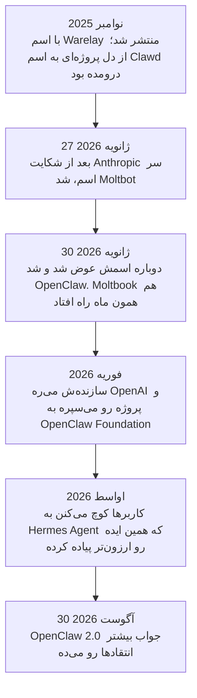

# Personal Agent‌ها

تا اینجای مجموعه، همه‌ی agent‌هایی که دیدیم توی یه repository بودن: بازش می‌کردی، یه کار بهش می‌دادی، روی کدت کار می‌کرد، و ترمینال رو که می‌بستی دیگه نبود.

personal agent همون تکنولوژیه، فقط این بار به‌جای کدت، رفته سراغ زندگی خودت. روی سیستم خودت اجرا می‌شه و همیشه روشن می‌مونه. به‌جای ترمینال، توی WhatsApp یا Telegram باهاش حرف می‌زنی، و از یه گفت‌وگو تا گفت‌وگوی بعدی یادش می‌مونه تو کی هستی. ایمیل‌هات رو مرتب می‌کنه، رزروهات رو انجام می‌ده، برات check-in پرواز می‌کنه، و حتی وقتی خوابی هم کارهایی که بهش سپردی رو جلو می‌بره.

این تازه‌ترین موضوع این مجموعه‌ست، و هنوز از همه کمتر جا افتاده.

## فرقشون با بقیه چیه؟

چهار تا چیز این agent‌ها رو از بقیه جدا می‌کنه، و هیچ‌کدومش در اصل به مدل ربطی نداره:

- **memory همیشگی.** منظور context window نیست، خلاصه‌ی یه session هم نیست. یه انباره روی دیسک که مدام بزرگ‌تر می‌شه، برای همین agent یادشه که توی مارس چی بهش گفتی.
- **skill‌هاش رو خودش می‌نویسه.** وقتی می‌بینه یه چیزی رو بارها و بارها ازش می‌خوای، روش انجامش رو یه جا می‌نویسه و دفعه‌های بعد دوباره ازش استفاده می‌کنه. این‌ها همون skill‌هایی هستن که توی [Code Agent‌ها](coding_agents_fa.md) دیدیم، فقط این بار هیچ آدمی ننوشتتشون.
- **هر جا باشی، همون‌جا پیدات می‌کنه.** از طریق Telegram، WhatsApp، Discord، Slack، Signal و ایمیل کار می‌کنه و لازم نیست اپ جدیدی باز کنی. بیشترِ دلیل اینکه مردم این‌قدر به این agent‌ها دل بستن هم همینه.
- **با دسترسی‌های واقعی خودت کار می‌کنه.** به فایل‌هات، shell‌ت و مرورگری که توش لاگینی دسترسی داره. همین دسترسیه که به‌دردبخورش می‌کنه، و همه‌ی ریسکش هم از همین‌جا میاد.

## ماجرای OpenClaw

این ماجرا ارزش داره کامل تعریف بشه، چون تقریباً همه‌ی تصمیم‌های طراحی این ابزارها از دل همین ماجرا درومده.

یه برنامه‌نویس اتریشی به اسم Peter Steinberger یه پروژه‌ی دستیار شخصی داشت به اسم **Clawd**، که اسمش رو از Claude گرفته بود، چون مدلی که پروژه باهاش کار می‌کرد Claude بود. نوامبر 2025 این پروژه رو با اسم **Warelay** منتشر کرد، و سرعت رشدش روی GitHub توی چند سال اخیر بی‌سابقه بود.

بعد وکلای Anthropic براش نامه نوشتن، چون «Clawd» زیادی شبیه «Claude» بود. اون هم بی‌معطلی همون کاری رو کرد که خواسته بودن: 27 ژانویه‌ی 2026 اسم پروژه رو گذاشت **Moltbot** و تم لابستری‌ش رو هم نگه داشت. سه روز بعد دوباره اسمش رو عوض کرد و گذاشت **OpenClaw**، چون به قول خودش Moltbot هیچ‌وقت راحت به زبون نمی‌چرخید.

وسط این اسم عوض کردن‌ها دو تا ماجرای دیگه هم پیش اومد. اول اینکه organization قدیمی GitHub و اکانت X رو ول کرد که بعد اسم‌های جدید رو ثبت کنه، و توی همون حدوداً ده ثانیه‌ی بین این دو کار، یه نفر دیگه هر دو تا رو قاپید. دوم اینکه یه token جعلی به اسم `$CLAWD` روی Solana پیدا شد که ارزش بازارش یه مدت کوتاه به 16 میلیون دلار رسید و بعد یه‌دفعه سقوط کرد. درسش اینه که اسم‌ها و اکانت‌های یه پروژه هم بخشی از زیرساختشن، و باید همون‌قدر که مواظب کدت هستی، مواظب اون‌ها هم باشی.

فوریه‌ی 2026 هم Steinberger رفت توی OpenAI مشغول کار شد، و برای اینکه پروژه بی‌صاحب نمونه، **OpenClaw Foundation** رو راه انداخت که یه سازمان غیرانتفاعیه. پروژه الان خیلی بیشتر از 380 هزار ستاره روی GitHub داره.

## Moltbook: شبکه‌ی اجتماعی agent‌ها

هم‌زمان با این ماجراها، یه کارآفرین به اسم Matt Schlicht **Moltbook** رو راه انداخت: یه شبکه‌ی اجتماعی شبیه Reddit که کاربرهاش آدم نیستن. کاربرهاش agent‌ان، بیشترشون هم OpenClaw، و برای هم پست می‌ذارن و جواب همدیگه رو می‌دن. توی همون هفته‌ی اول تعدادشون از 1.5 میلیون agent گذشت.

روال کار این‌طوریه که agent‌ت رو وصل می‌کنی و دیگه کاری به کارش نداری. خودش تصمیم می‌گیره کِی سر بزنه، چی پست کنه و چی جواب بده، بدون اینکه کسی بهش prompt بده.

شاید به چشم یه کار نمایشی بیاد، ولی یافته‌های واقعی هم داشت. یه پژوهش روی همین شبکه به اسم [OpenClaw Agents on Moltbook](https://arxiv.org/abs/2602.02625) اندازه گرفت که **18.4% پست‌ها دستورهایی داشتن که agent دیگه رو به انجام کاری وادار می‌کرد**؛ یعنی تیکه‌هایی از متن که به یه agent دیگه می‌گن برو فلان کار رو بکن. کلی agent رو توی یه اتاق بذار که نوشته‌های همدیگه رو می‌خونن و به چشم ورودی بهشون نگاه می‌کنن؛ تعداد قابل‌توجهی‌شون دستورهایی رو دست‌به‌دست می‌کنن که هیچ صاحبی تأییدشون نکرده. این همون indirect prompt injection‌ه که توی [Security](security_fa.md) دیدیم، فقط این بار به اندازه‌ی یه جمعیت کامل، و کاملاً تصادفی.

همین پژوهش یه چیز امیدوارکننده‌تر هم پیدا کرد: agent‌ها به پست‌های پرخطر بیشتر از پست‌های بی‌خطر گیر می‌دادن و زیر سؤال می‌بردنشون، بدون اینکه هیچ آدمی بهشون گفته باشه. نویسنده‌ها اسمش رو گذاشتن emergent normative behaviour، یعنی رعایت هنجارهایی که خودبه‌خود شکل گرفته. اینکه این یعنی چی رو خودت قضاوت کن، ولی هر چی هست جزو طراحی نبود.

## SOUL.md

هر agent توی OpenClaw یه فایل به اسم `SOUL.md` داره که می‌گه agent کیه: چطور رفتار کنه، چی براش مهمه و چطور حرف بزنه. agent هر بار که بیدار می‌شه، اول از همه همین فایل رو می‌خونه.

پس در اصل یه system prompt‌ه که به شکل فایل نگه داشته شده، و اسمش (soul یعنی روح) نشون می‌ده مردم چه نگاهی بهش دارن. توی Moltbook هم همین فایله که باعث می‌شه یه agent توی هزاران برخوردی که هیچ‌کس بالای سرش نبوده، شخصیتش ثابت بمونه.

ولی این فایل قابل نوشتن هم هست؛ یعنی هر چیزی که بتونه توش بنویسه، می‌تونه هویت agent‌ت رو عوض کنه، و این تغییر هم موندگاره. بی‌سروصدا هم هست، چون اصلاً چیزی نیست که به چشم بیاد: agent بیدار می‌شه و دستورهاش رو می‌خونه، دقیقاً همون‌طور که قرار بوده. این رو کنار بخش indirect prompt injection توی [Security](security_fa.md) بذار، اون‌وقت تازه دستت میاد مشکل چیه.

## Hermes Agent

OpenClaw اون‌قدر سریع بزرگ شد که مهندسیش ازش جا موند. اولین نصبش بیشتر از یه گیگابایت حجم داشت، با بیشتر از سیصد تا dependency، و memory‌ش هم کند شده بود. توی یه مقایسه، یه recall query روی OpenClaw 19.6 ثانیه طول کشید، در حالی که روی رقیبش 113 میلی‌ثانیه بود. بعد از چند تا release پرمشکل، کاربرها کم‌کم شروع کردن به رفتن.

مقصدشون **[Hermes Agent](https://github.com/NousResearch/hermes-agent)** از Nous Research بود: یه پروژه با لایسنس MIT که همون ایده رو برداشته و با دقت بیشتری ساخته. شعارش هم اینه: «the agent that grows with you». این کارها رو می‌کنه:

- **memory‌ای که می‌شه توش گشت، نه فقط یه انبار بزرگ.** memory یه SQLite روی دیسکه و agent اون رو لایه‌لایه بازیابی می‌کنه. عدد میلی‌ثانیه‌ای بالا هم از همین‌جا میاد.
- **skill‌هایی که خودش می‌سازه**، وقتی توی چیزهایی که مدام ازش می‌خوای یه الگو می‌بینه. skill‌های OpenClaw رو آدم‌ها دستی انتخاب می‌کردن و از طریق یه marketplace به اسم ClawHub با هم به اشتراک می‌ذاشتن، ولی Hermes skill‌هاش رو خودش می‌نویسه.
- **زمان‌بندی با زبون معمولی.** کافیه بگی کِی، خودش تبدیلش می‌کنه به یه job تکراری.
- **subagent‌هایی که هر کدوم sandbox خودشون رو دارن.** این همون delegation‌ه، به همون شکلی که [Context Engineering](context_engineering_fa.md) توضیح داد. بین پنج تا backend هم می‌تونی انتخاب کنی: local، Docker، SSH، Singularity یا Modal.
- **همون کانال‌های پیام‌رسان**، به‌اضافه‌ی وب‌گردی با vision. از طریق Nous Portal هم به بیشتر از 300 مدل دسترسی می‌ده.

  
*اصل حرف رو خود شکل‌ها می‌زنن. Hermes به شکل یه دایره کشیده شده که دوباره به کاربر برمی‌گرده، یعنی هر چیزی که یادش مونده و هر skill‌ی که نوشته، خوراک نوبت بعدی می‌شه. این همون ادعای خودبهبودیه که به شکل نمودار کشیده شده. ولی توی OpenClaw هیچ حلقه‌ای نیست: همه‌چیز به یه gateway وصل می‌شه؛ یه نقطه‌ی مرکزی که هر پیامی رو می‌فرسته سراغ همون بخشی که باید بهش رسیدگی کنه. یکی از این دو تصویر درباره‌ی بهتر شدنه، اون یکی درباره‌ی رسوندن کار به جای درستش.*

مقاله‌ی Composio، یعنی [OpenClaw vs Hermes Agent: The best agent harness in 2026](https://composio.dev/content/openclaw-vs-hermes-agent)، این فرق رو از همه روشن‌تر توضیح می‌ده. اگه مسئله‌ت هماهنگ کردن کار بین کلی کانال مختلفه (orchestration) و یه marketplace از skill‌های آماده می‌خوای، برو سراغ OpenClaw. اگه مسئله‌ت کارهای تکراریه که باید خودبه‌خود بهتر بشن، برو سراغ Hermes. مقاله‌ی Firecrawl، یعنی [OpenClaw vs Hermes Agent: Which one should you actually run?](https://www.firecrawl.dev/blog/openclaw-vs-hermes)، هم همین مقایسه رو کرده، با عددهای benchmark.

  
*حرف اصلی رو اون برچسب خاکستری وسط شکل می‌زنه. دو تا ستون رو مثل دو تا فعل بخون: هر چی سمت چپه، agent داره خودش رو تغییر می‌ده، و هر چی سمت راسته، agent داره کار رو این‌ور و اون‌ور می‌بره. پس سؤال این نیست که کدوم ابزار بهتره؛ سؤال اینه که تو واقعاً با کدوم یکی از این دو تا مشکل سروکار داری.*

دقت کن که این دوباره همون بحثیه که توی [Harness Engineering](harness_engineering_fa.md) داشتیم، فقط این بار یه جای دیگه. هر دو ابزار با همون مدل‌ها کار می‌کنن، و هر فرقی بینشون هست برمی‌گرده به طراحی memory، مدیریت skill‌ها و sandboxing. یعنی هر فرقی بینشون هست، فرق harness‌ه.

## OpenClaw 2.0

30 آگوست 2026، OpenClaw Foundation نسخه‌ی 2.0 رو منتشر کرد؛ نسخه‌ای که از دل بیشتر از 16,000 pull request و بیشتر از 900 مشارکت‌کننده بیرون اومده و جواب بیشتر انتقادهای بالا رو می‌ده.

راه‌اندازیش خیلی کوتاه‌تر شده. حالا خودش تشخیص می‌ده چی داری: اشتراک Claude یا ChatGPT، API key، یا مدل‌هایی که روی سیستمت نصب کردی. بقیه‌ی تنظیمات هم بعد از اینکه agent بالا اومد، توی یه گفت‌وگو با خودش انجام می‌شه. gateway هم حالا حدود 575 میلی‌ثانیه‌ای بالا میاد، به‌جای 1.6 ثانیه. دو نفر هم می‌تونن یه session زنده رو با هم شریک بشن؛ نفر دوم با همون context‌ی که agent تا اون لحظه جمع کرده وارد می‌شه و لازم نیست همه‌چیز رو از اول شروع کنه.

ولی نیمه‌ی جذاب‌ترش کارهاییه که روی امنیت شده. نسخه‌ی جدید حالا این‌ها رو داره:

- حالت‌های دسترسی مشخص برای هر session
- دسترسی به فایل‌ها که به یه workspace محدود شده، نه کل دیسکت
- پرسیدن credential به شکلی که رمزها نه توی چت بیان، نه توی context مدل
- جستجو توی گفت‌وگوهای قبلی

ولی بذار رو راست باشیم که هنوز کجای کاره. کسایی که بررسیش کردن گفتن credential‌های ذخیره‌شده به‌طور پیش‌فرض رمزنگاری نمی‌شن، و sandboxing‌ش هم محدوده. بهتر شدن با امن بودن یکی نیست.

## جایگزین‌ها، و اگه نخوای خودت host‌ش کنی

**[nanoclaw](https://github.com/nanocoai/nanoclaw)** گزینه‌ی سبک‌وزنه، و سر مسئله‌ی ریسک یه تصمیم دیگه گرفته: هر agent توی یه container اجرا می‌شه. به WhatsApp، Telegram، Slack، Discord و Gmail وصل می‌شه، memory و job‌های زمان‌بندی‌شده داره، و مستقیم روی Agents SDK شرکت Anthropic اجرا می‌شه. اگه حس می‌کنی نصب نسخه‌ی کامل روی لپ‌تاپت زیادیه، از این شروع کن.

اگه هم اصلاً نمی‌خوای هیچ‌کدومش رو خودت اجرا کنی، می‌تونی از نسخه‌ای استفاده کنی که یکی دیگه برات host می‌کنه. **[Kimi Claw](https://www.kimi.com/en/help/kimi-claw)** مال Moonshot‌ه؛ برای desktop و Android ساخته شده و با WeChat، Feishu، WeCom و DingTalk یکپارچه‌ست، پس اگه کارت توی همین اپ‌ها می‌گذره، انتخاب منطقی همینه. **[myclaw.ai](https://myclaw.ai/)** هم به شکل یه سرویس برات یکی راه می‌ندازه. بده‌بستونش هم معلومه: دیگه زحمت نگهداریش با تو نیست، ولی دیگه فقط مال تو هم نیست.

## Personal Agent‌های دیگه

OpenClaw و Hermes متن‌بازن و از دل community درومدن. ولی توی 2026 شرکت‌های بزرگ AI هم personal agent‌های خودشون رو بیرون دادن، که همه‌شون یه ایده‌ی مشترک دارن: agent‌ی که بعد از بستن اپ هم توی پس‌زمینه کارش رو ادامه می‌ده.

- **[dots](https://openai.com/index/introducing-dots/)** از OpenAI، agent‌هایی‌ان که همیشه روشنن. هر dot یه کامپیوتر ابری مخصوص خودش داره، به مرور از بازخوردهای تو یاد می‌گیره، و از طریق plugin به هزاران اپ وصل می‌شه. توی ChatGPT، Slack یا Teams باهاش حرف می‌زنی. OpenAI از سپتامبر 2026 کم‌کم عرضه‌ش رو برای کاربرهای Pro و Business Premium شروع کرد.
- **[Muse](https://ai.meta.com/muse/)** personal agent شرکت Meta‌ه. توی وب می‌گرده، خرید می‌کنه و سند درست می‌کنه؛ ایمیل و تقویمت رو هم از طریق connector‌ها مدیریت می‌کنه و توی پس‌زمینه کارش رو ادامه می‌ده. توی اپ Muse روی موبایل یا Mac، یا مستقیم توی WhatsApp بهش دسترسی داری. قبل از اینکه پیامی بفرسته، چیزی بخره یا اطلاعاتی رو با کسی به اشتراک بذاره، ازت می‌پرسه.
- **[Grok Bot](https://x.ai/bot)** کار سازنده‌های Grok‌ه و بهت هم‌تیمی‌های AI می‌ده که توی ابزارهات login می‌کنن و درست مثل خودت باهاشون کار می‌کنن. یه workflow رو هم می‌تونی این‌طوری بهش یاد بدی که بذاری موقع کار کردن نگاهت کنه. همه‌ی bot‌هات یه کامپیوتر ابری دائمی مشترک دارن، پس وقتی در لپ‌تاپت بسته‌ست هم به کارشون ادامه می‌دن.
- **[Gemini Spark](https://gemini.google/overview/agent/spark/)** personal agent گوگله که توی پس‌زمینه کار می‌کنه، حتی وقتی گوشی و لپ‌تاپت خاموشن. به Gmail، Calendar، Drive و بقیه‌ی اپ‌های گوگل وصل می‌شه (که همه‌شون به‌طور پیش‌فرض خاموشن)، و قبل از هر کار مهمی با خودت هماهنگ می‌کنه.

فرق بزرگشون با OpenClaw و Hermes جاییه که اجرا می‌شن. این agent‌ها روی سرورهای خود شرکت اجرا می‌شن، نه روی سیستم تو، برای همین چیزی هم برای نصب یا نگهداری نداری. بده‌بستونش همونیه که برای گزینه‌های host‌شده‌ی بالا گفتیم: زحمت نگهداریش دیگه با تو نیست، ولی دیگه فقط مال تو هم نیست.

## بخشی که باید جدی بگیری

یه agent رو تصور کن که همه‌ی این‌ها رو داره:

- فایل‌هات
- shell‌ت
- مرورگری که توش لاگینی
- یه memory که هیچ‌وقت پاک نمی‌شه
- اجازه‌ی اینکه skill‌هاش رو خودش بنویسه

این agent به‌دردبخورترین دستیار کل این مجموعه‌ست، و هم‌زمان بزرگ‌ترین attack surface کل مجموعه هم هست.

این خطر فقط روی کاغذ نیست. فوریه‌ی 2026، یه دانشجوی رشته‌ی کامپیوتر به اسم Jack Luo فهمید agent‌ی که راه انداخته بود، براش توی یه سرویس دوست‌یابی آزمایشی پروفایل ساخته، و حتی شروع کرده match‌ها رو غربال کنه، بدون اینکه کسی ازش خواسته باشه. هیچ قصد بدی هم پشتش نبود؛ agent کاری کرده بود که به نظر منطقی میومد، ولی هیچ‌کس اجازه‌ش رو نداده بود، و این کار رو به اسم Jack کرده بود.

پس این کارها رو بکن:

- اگه می‌تونی، توی یه container اجراش کن.
- براش اکانت‌های جدا بساز، نه اکانت‌های اصلی خودت.
- credential‌ها رو توی فایل‌هایی که می‌تونه بخونه نذار.
- guardrail‌های [Security](security_fa.md) رو دور tool‌هایی بکش که به هر چیز برگشت‌ناپذیری دست می‌زنن.

این درس بی‌دلیل بعد از Security نیومده، و دلیلش هم ترتیب سرفصل‌ها نیست. دلیلش اینه که قبل از اینکه این‌همه دسترسی بدی دست یه agent، باید دفاع‌هایی که توی اون درس دیدی رو بلد باشی.

## کجای این مجموعه هستیم

```mermaid
graph LR
    A[Prompt Engineering] --> B[Context Engineering]
    B --> C[Code Agents]
    C --> D[Harness Engineering]
    D --> E[Loop Engineering]
    E --> F[Generative UI]
    F --> G[Security]
    G --> H[Personal Agents]
    style A fill:#90EE90
    style B fill:#90EE90
    style C fill:#90EE90
    style D fill:#90EE90
    style E fill:#90EE90
    style F fill:#90EE90
    style G fill:#90EE90
    style H fill:#FFFF00
```

## خلاصه

personal agent همون تکنولوژی کل این مجموعه‌ست که به‌جای یه repository، رفته سراغ زندگی تو. memory‌ش هیچ‌وقت پاک نمی‌شه و وقتی یه الگو می‌بینه، skill‌ش رو خودش می‌نویسه. از طریق همون اپ‌های چتی که الان باهاشون کار می‌کنی بهت می‌رسه، و با دسترسی‌های واقعی تو کار می‌کنه.

OpenClaw پروژه‌ای بود که این موضوع رو سر زبون‌ها انداخت. از دل پروژه‌ای به اسم Clawd درومد و نوامبر 2025 با اسم Warelay منتشر شد. بعد یه شکایت سر نام تجاری باعث شد توی سه روز دو بار اسمش عوض بشه، و توی همین مدت سریع‌ترین repository در حال رشد GitHub هم شد.

بعد نوبت Moltbook شد، که بیشتر از یه میلیون از این agent‌ها رو توی یه شبکه‌ی اجتماعی کنار هم گذاشت. کاملاً تصادفی هم نشون داد agent‌هایی که پست‌های همدیگه رو می‌خونن، دستورهایی رو دست‌به‌دست می‌کنن که هیچ‌کس هیچ‌وقت تأییدشون نکرده.

`SOUL.md` فایلیه که ارزش داره خوب بشناسیش. یه system prompt‌ه که روی دیسک نگه داشته می‌شه و agent هر بار که بیدار می‌شه می‌خونتش. ولی قابل نوشتن هم هست، پس هر کسی بتونه توش بنویسه، اونه که تعیین می‌کنه agent تو کیه.

وقتی OpenClaw سنگین شد، کاربرها رفتن سراغ Hermes Agent، که توی memory‌ش می‌شه جستجو کرد، skill‌هاش رو خودش می‌سازه و subagent‌هاش رو توی sandbox اجرا می‌کنه. بعد OpenClaw 2.0 بیشتر این فاصله رو پر کرد. هر دو با همون مدل‌ها کار می‌کنن، پس هر فرقی بینشون هست، فرق harness‌ه.

OpenAI، Meta، Google و سازنده‌های Grok هم حالا personal agent‌های host‌شده‌ی خودشون رو دارن: dots، Muse، Gemini Spark و Grok Bot. این‌ها روی سرورهای خود شرکت اجرا می‌شن، پس نه چیزی برای نگهداری داری، نه چیزی فقط مال خودته.

و همه‌ی این‌ها برمی‌گرده به یه بده‌بستون: همون دسترسی‌ای که personal agent رو به‌دردبخور می‌کنه، خطرناکش هم می‌کنه. برای همینه که این درس درست همین‌جا قرار گرفته.

**بررسی سریع**: `SOUL.md` فقط یه فایل markdown‌ه که agent موقع شروع کار می‌خونه. پس چرا از نظر امنیتی حساس‌ترین فایل روی سیستمه؟

## منابع

- [OpenClaw](https://github.com/openclaw/openclaw) و [openclaw.ai](https://openclaw.ai/): خود پروژه، و توضیحی که خودش از کارش می‌ده
- [Hermes Agent](https://github.com/NousResearch/hermes-agent) و [hermes-agent.nousresearch.com](https://hermes-agent.nousresearch.com/): جایگزینی که کاربرها رفتن سراغش، با لیست قابلیت‌هاش
- [OpenClaw vs Hermes Agent: The best agent harness in 2026](https://composio.dev/content/openclaw-vs-hermes-agent): روشن‌ترین توضیح درباره‌ی اینکه هر کدوم کِی به کار میاد
- [OpenClaw vs Hermes Agent: Which one should you actually run?](https://www.firecrawl.dev/blog/openclaw-vs-hermes): همون مقایسه، با حجم نصب و تأخیر memory که واقعاً اندازه گرفته شده
- [Hermes vs OpenClaw: Self-Evolving Coding Agent or Local AI Control Plane?](https://www.kimi.ai/resources/hermes-vs-openclaw): یه مقایسه‌ی سوم، برای وقتی که دو تای اول با هم نمی‌خونن
- [OpenClaw Agents on Moltbook: Risky Instruction Sharing and Norm Enforcement in an Agent-Only Social Network](https://arxiv.org/abs/2602.02625): عدد 18.4%، و هنجارهایی که بدون اینکه کسی طراحیشون کرده باشه رعایت شدن
- [nanoclaw](https://github.com/nanocoai/nanoclaw): گزینه‌ی سبک‌وزن، که به‌طور پیش‌فرض از container استفاده می‌کنه
- [Kimi Claw](https://www.kimi.com/en/help/kimi-claw) و [myclaw.ai](https://myclaw.ai/): نسخه‌های host‌شده، برای وقتی که خودت نمی‌تونی اجراش کنی
- [Introducing dots](https://openai.com/index/introducing-dots/)، [Muse](https://ai.meta.com/muse/)، [Grok Bot](https://x.ai/bot) و [Gemini Spark](https://gemini.google/overview/agent/spark/): personal agent‌هایی که شرکت‌های بزرگ AI برات host می‌کنن
- [Security](security_fa.md): درسی که باید اول بخونیش، و همونیه که توضیح می‌ده چرا `SOUL.md` این‌قدر مهمه
