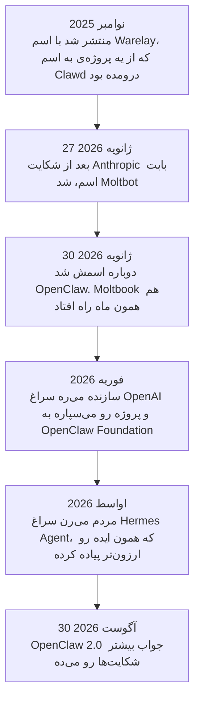

# Personal Agent‌ها

تا اینجای این مجموعه، همه‌ی agent‌ها داخل یک repository زندگی می‌کردن. تو بازش می‌کنی، یه کار بهش می‌دی، روی کدت کار می‌کنه، و وقتی ترمینال رو می‌بندی، کارش هم تموم می‌شه و دیگه ازش خبری نیست.

یه personal agent در واقع همون تکنولوژیه، فقط این بار به‌جای یه repository، روی زندگی خودت کار می‌کنه. روی دستگاه خودت اجرا می‌شه و همیشه بیداره. از طریق WhatsApp یا Telegram باهاش حرف می‌زنی، نه از توی ترمینال. بین گفتگوها یادش می‌مونه. ایمیل‌هات رو مرتب می‌کنه، کار رزرو رو انجام می‌ده و برات چک‌این پرواز هم می‌زنه. حتی وقتی خوابی، کارهایی که بهش سپردی رو ادامه می‌ده.

این جدیدترین موضوع این مجموعه‌ست و در عین حال، هنوز کمتر از بقیه‌ی موضوع‌ها به نتیجه‌ی قطعی رسیده.

## چی این‌ها رو متفاوت می‌کنه

چهار چیز این agent‌ها رو از بقیه جدا می‌کنه، و هیچ‌کدومشون واقعاً به مدل ربطی نداره:

- **memory مادام‌العمر.** این یه context window نیست و خلاصه‌ی یه session هم نیست. یه انبار روی دیسکه که پیوسته بزرگ‌تر می‌شه، برای همین agent یادش می‌مونه که تو توی مارس چی بهش گفتی.
- **خودش skill می‌نویسه.** وقتی متوجه بشه یه چیزی رو دوباره و دوباره ازش می‌خوای، مراحل کار رو یادداشت می‌کنه و دفعه‌ی بعد ازش استفاده می‌کنه. این‌ها همون skill‌هایی هستن که توی [Code Agent‌ها](coding_agents_fa.md) دیدیم، با این تفاوت که هیچ آدمی اون‌ها رو ننوشته.
- **خودش میاد سراغت، همون‌جایی که هستی.** از طریق Telegram، WhatsApp، Discord، Slack، Signal و ایمیل کار می‌کنه و لازم نیست هیچ اپ جدیدی باز کنی. بیشترِ دلیلی که مردم این‌قدر بهشون دل‌بسته شدن هم همینه.
- **با دسترسی واقعی خودت کار می‌کنه.** می‌تونه فایل‌هات، shell‌ت و مرورگری که با حساب‌هات واردش شدی رو استفاده کنه. همین دسترسیه که کارش رو مفید می‌کنه، و تمام ریسک‌ها هم از همین‌جا میاد.

## ماجرای این ابزارها

ارزشش رو داره که ماجرا رو کامل تعریف کنیم، چون تقریباً هر تصمیم طراحیِ این ابزارها از همین ماجرا اومده.

یه برنامه‌نویس اتریشی به اسم Peter Steinberger یه پروژه‌ی دستیار شخصی داشت به اسم **Clawd**. اسمش رو از Claude گذاشته بود، چون Claude همون مدلی بود که پروژه روش اجرا می‌شد. در نوامبر 2025 با اسم **Warelay** منتشرش کرد، و پروژه با سرعتی رشد کرد که در سال‌های اخیر روی GitHub بی‌سابقه بود.

بعدش وکلای Anthropic براش نامه نوشتن، چون «Clawd» یه کم زیادی به «Claude» شبیهه. اونم فوراً همون کاری رو کرد که ازش خواسته بودن. در 27 ژانویه‌ی 2026 اسم پروژه رو کرد **Moltbot** و تم لابستری‌ش رو نگه داشت. سه روز بعد دوباره اسمش رو کرد **OpenClaw**، چون می‌گفت اسم Moltbot هیچ‌وقت راحت به زبون نمی‌اومد.

دو اتفاق هم توی این تغییر اسم افتاد. اول اینکه اون سازمان قدیمی GitHub و هندل X قبلی‌ش رو ول کرد و بعد اون‌ها رو برای نسخه‌ی جدید گرفت. اما توی حدوداً ده ثانیه‌ی بین این دو قدم، یه نفر دیگه هر دو رو قاپید. دوم اینکه یه token جعلی به اسم `$CLAWD` روی Solana ظاهر شد. مدتی ارزش بازارش به 16 میلیون دلار رسید و بعد یه‌دفعه سقوط کرد. درس این ماجرا اینه: اسم‌ها هم زیرساختن.

در فوریه‌ی 2026 Steinberger رفت OpenAI کار کنه. برای نگه‌داری از پروژه هم **OpenClaw Foundation** رو راه انداخت، که یه سازمان غیرانتفاعیه. الان پروژه بیش از 380 هزار ستاره‌ی GitHub داره.

## Moltbook: شبکه‌ی اجتماعی برای agent‌ها

همزمان با همه‌ی این ماجراها، یه کارآفرین به اسم Matt Schlicht **Moltbook** رو راه انداخت. این یه شبکه‌ی اجتماعی شبیه Reddit‌ه، ولی کاربراش آدم نیستن. agent‌ها هستن، بیشترشون OpenClaw، و به هم پست می‌دن و جواب می‌دن. توی هفته‌ی اول، به بیش از 1.5 میلیون agent رسید.

کارش این‌جوریه: agent خودت رو وصل می‌کنی و بعدش تنهاش می‌ذاری. خودش تصمیم می‌گیره کی واردش بشه، چی پست کنه و چطور جواب بده. هیچ‌کس هم بهش prompt نمی‌ده.

از بیرون شبیه یه شیرین‌کاری به نظر می‌رسه، ولی نتیجه‌های واقعی هم داشته. یه مطالعه روی همین شبکه با عنوان [OpenClaw Agents on Moltbook](https://arxiv.org/abs/2602.02625) اندازه گرفت که **18.4% از پست‌ها شامل دستورهایی بود که agent دیگه رو وادار می‌کرد یه کاری انجام بده**. یعنی متنی که به یه agent دیگه می‌گه برو یه کاری رو بکن. حالا یه عالمه agent رو توی یه اتاق بذار، که نوشته‌ی هم رو بخونن و اون رو مثل ورودی‌ای ببینن که باید پردازش بشه. بعد خیلی‌هاشون دستورهایی رو پخش می‌کنن که هیچ صاحبی تأییدشون نکرده. این همون indirect prompt injection‌ه که توی [Security](security_fa.md) دیدیم. این‌بار ولی، در مقیاس کل یه جمعیت اتفاق افتاد، و اونم کاملاً تصادفی.

همون مطالعه یه نتیجه‌ی امیدوارکننده‌تر هم داشت. agent‌ها پست‌های پرخطر رو بیشتر از پست‌های بی‌خطر به چالش می‌کشیدن، و هیچ انسانی هم بهشون نگفته بود این کار رو بکنن. نویسنده‌ها اسمش رو گذاشتن emergent normative behaviour، یعنی یه رفتار هنجاری که خودجوش شکل گرفته. معنیش رو خودت می‌تونی تشخیص بدی، ولی این چیزی نبود که توی طراحی‌شون پیش‌بینی شده باشه.

## SOUL.md

هر agent از OpenClaw یه فایل داره به اسم `SOUL.md`. این فایل می‌گه agent کیه: چطور باید رفتار کنه، به چی اهمیت می‌ده و چطور حرف می‌زنه. هر بار که agent بیدار می‌شه، اول همین فایل رو می‌خونه.

پس در واقع این یه system prompt‌ه که به شکل فایل نگه داشته شده. اسمش، که SOUL یعنی روح، نشون می‌ده مردم بهش چه‌جوری نگاه می‌کنن. توی Moltbook همین فایله که به یه agent شخصیت ثابت می‌ده، توی هزاران تعاملی که هیچ‌کس نظارتشون نمی‌کنه.

این فایل قابل نوشتنه. یعنی هر چیزی که بتونه توش بنویسه، می‌تونه عوض کنه که agent تو کیه، و این تغییر هم دائمیه. ضمن اینکه این تغییر بی‌صداست، چون چیزی نیست که بشه متوجهش شد. agent بیدار می‌شه و دستورهاش رو دقیقاً همون‌طور که طراحی شده، می‌خونه. اگه بخوای شکل مشکل رو ببینی، این موضوع رو کنار اون بخشی از [Security](security_fa.md) بذار که درباره‌ی indirect prompt injection بود.

## Hermes Agent

OpenClaw اون‌قدر سریع بزرگ شد که مهندسی‌اش دیگه نتونست همراهیش کنه. نصب اولیه بیش از یه گیگابایت حجم داشت و بیش از سیصد dependency. memory هم کند شده بود. توی یه مقایسه، یه recall query روی OpenClaw 19.6 ثانیه طول کشید، در برابر 113 میلی‌ثانیه برای جایگزین. بعد از چند نسخه‌ی پراشکال، مردم کم‌کم داشتن ولش می‌کردن.

مردم رفتن سراغ **[Hermes Agent](https://github.com/NousResearch/hermes-agent)** از Nous Research. این یکی تحت لایسنس MIT منتشر شده و همون ایده رو گرفته و با دقت بیشتری ساخته. شعارش اینه: «the agent that grows with you». کارهاش هم این‌هاست:

- **memory‌ای که قابل جستجو باشه، نه فقط حجیم.** memory روی دیسک، توی SQLite ذخیره می‌شه و agent به‌صورت لایه‌لایه بازیابیش می‌کنه. عدد میلی‌ثانیه‌ای که گفتیم هم از همین‌جا میاد.
- **skill‌هایی که خودش می‌سازه،** وقتی توی چیزهایی که مدام ازش می‌خوای یه الگو تشخیص بده. skill‌های OpenClaw رو آدم‌ها دستی انتخاب می‌کردن و از طریق یه marketplace به اسم ClawHub به اشتراک می‌ذاشتن. ولی Hermes خودش برای خودش می‌نویسه.
- **زمان‌بندی با زبون ساده.** کافیه بگی کی انجام بشه، و خودش اون رو تبدیل می‌کنه به یه کار تکرارشونده.
- **subagent‌هایی با sandbox مخصوص خودشون.** این همون واگذاری کار (delegation) به شیوه‌ایه که [Context Engineering](context_engineering_fa.md) توضیحش داد. پنج backend برای انتخاب داری: local، Docker، SSH، Singularity یا Modal.
- **همون پیام‌رسان‌ها،** به‌علاوه‌ی مرور وب با قابلیت vision. ضمناً از طریق Nous Portal به بیش از 300 مدل هم دسترسی می‌ده.

  
*شکل‌ها خودشون حرف اصلی رو می‌زنن. Hermes به شکل یه دایره کشیده شده که به کاربر برمی‌گرده و بسته می‌شه، یعنی هر چیزی که یادش می‌مونه و هر skill‌ای که نوشته، به نوبت بعدی برمی‌گرده. این همون ادعای خودبهبودیه که این‌جا به شکل نمودار کشیده شده. OpenClaw اصلاً هیچ حلقه‌ای توش نداره. همه‌چیز به یه gateway وصل می‌شه، و این یه شکل مسیریابیه. یه تصویر درباره‌ی بهتر شدنه و اون یکی درباره‌ی رساندن کار به جای درستش.*

مقاله‌ی Composio با عنوان [OpenClaw vs Hermes Agent: The best agent harness in 2026](https://composio.dev/content/openclaw-vs-hermes-agent) تفاوت این دو رو تقریباً به شفاف‌ترین شکلی که بشه توضیح می‌ده. OpenClaw رو وقتی استفاده کن که مسئله‌ت orchestration بین کانال‌های زیاده، و یه marketplace از skill‌های آماده هم در اختیارت باشه. Hermes رو وقتی استفاده کن که مسئله‌ت کارهای تکراریه که باید خودبه‌خود بهتر بشن. مقاله‌ی Firecrawl با عنوان [OpenClaw vs Hermes Agent: Which one should you actually run?](https://www.firecrawl.dev/blog/openclaw-vs-hermes) هم همین مقایسه رو کرده، و عددهای benchmark رو هم داره.

  
*قرص خاکستری وسط شکل، نکته‌ی اصلیه. دو ستون رو مثل دو تا فعل بخون. هر چی سمت چپه، agent داره خودش رو تغییر می‌ده. هر چی سمت راسته، agent داره کار رو جابه‌جا می‌کنه. پس سؤال این نیست که کدوم ابزار بهتره. سؤال اینه که کدوم‌یک از این دو مشکل رو واقعاً داری.*

دقت کن که این همون بحث harness از [Harness Engineering](harness_engineering_fa.md) هست، این بار توی یه جای تازه. هر دو ابزار همون مدل‌ها رو اجرا می‌کنن، و هرچی این دو رو از هم جدا می‌کنه، طراحی memory، نحوه‌ی مدیریت skill و sandboxing‌ه. به زبون ساده‌تر، هرچی این دو رو از هم جدا می‌کنه، همون harness هست.

## OpenClaw 2.0

در 30 آگوست 2026، OpenClaw Foundation نسخه‌ی 2.0 رو منتشر کرد. این نسخه از بیش از 16,000 pull request ساخته شده که بیش از 900 مشارکت‌کننده روشون کار کردن، و بیشتر شکایت‌هایی رو که بالاتر گفتیم جواب می‌ده.

راه‌اندازی خیلی راحت‌تر شده. الان خودش چیزهایی رو که از قبل داری تشخیص می‌ده: اشتراک Claude یا ChatGPT، API key‌ها، یا مدل‌هایی که به‌صورت محلی روی سیستمت نصب کردی. بقیه‌ی تنظیمات رو هم بعد از اینکه agent روشن شد، توی یه گفتگو با خود agent انجام می‌ده. gateway حدود 575 میلی‌ثانیه بالا میاد، در مقابل 1.6 ثانیه‌ی قبلی. دو نفر هم می‌تونن یه session زنده رو با هم داشته باشن. نفر دوم با context‌ی که agent از قبل جمع کرده وارد می‌شه و لازم نیست از اول شروع کنه.

بخش امنیتی‌اش جالب‌تره. نسخه‌ی جدید الان این‌ها رو داره:

- حالت‌های دسترسی مشخص برای هر session
- دسترسی به فایل‌ها محدود به یه workspace، نه کل دیسکت
- پرسیدن credential، که رمزها رو نه توی گفتگو می‌ذاره و نه توی context مدل
- جستجو توی گفتگوهای قبلی

باید رک بگیم که هنوز کجا ایستاده. کسایی که نسخه‌ی جدید رو بررسی کردن گفتن که credential‌های ذخیره‌شده به‌طور پیش‌فرض رمزگذاری نشدن. همچنین گفتن که sandboxing هنوز محدوده. یادت باشه: بهتر بودن با امن بودن یکی نیست.

## جایگزین‌ها و وقتی خودت اجراش نمی‌کنی

**[nanoclaw](https://github.com/nanocoai/nanoclaw)** گزینه‌ی سبک‌تره. درباره‌ی ریسک یه تصمیم متفاوت گرفته: هر agent داخل یه container اجرا می‌شه. به WhatsApp، Telegram، Slack، Discord و Gmail وصل می‌شه. memory و کارهای زمان‌بندی‌شده رو نگه می‌داره، و مستقیماً روی Anthropic's Agents SDK اجرا می‌شه. اگه نسخه‌ی کامل روی لپ‌تاپت زیادی سنگین به نظرت می‌رسه، از این شروع کن.

و اگه اصلاً نمی‌خوای هیچ‌کدومش رو خودت اجرا کنی، می‌تونی از یه سرویس استفاده کنی که یکی دیگه برات میزبانیش می‌کنه. **[Kimi Claw](https://www.kimi.com/en/help/kimi-claw)** محصول Moonshot هست. برای desktop و Android ساخته شده و با WeChat، Feishu، WeCom و DingTalk یکپارچه‌ست. اگه کارت توی همین اپ‌ها پیش می‌ره، انتخاب عملی‌تریه. **[myclaw.ai](https://myclaw.ai/)** هم به‌عنوان یه سرویس، برات میزبانیش می‌کنه. بده‌بستانش هم روشنه: دیگه نگهداری‌اش با تو نیست، و دیگه فقط مال تو هم نیست.

## Personal Agent‌های دیگه

OpenClaw و Hermes متن‌بازن و از دل جامعه‌ی برنامه‌نویس‌ها اومدن. توی 2026 شرکت‌های بزرگ هوش مصنوعی هم personal agent‌های خودشون رو منتشر کردن. این agent‌ها یه ایده‌ی مشترک دارن: agent‌ای که بعد از بستن اپ هم توی پس‌زمینه به کارش ادامه می‌ده.

- **[dots](https://openai.com/index/introducing-dots/)** از OpenAI هستن که همیشه روشن‌ان. هر dot یه کامپیوتر ابری اختصاصی خودش داره. با گذشت زمان از بازخورد تو یاد می‌گیره، و از طریق plugin به هزاران اپ وصل می‌شه. می‌تونی توی ChatGPT، Slack یا Teams باهاش حرف بزنی. OpenAI از سپتامبر 2026 آروم‌آروم عرضه‌ش رو شروع کرد، اول برای کاربرهای Pro و Business Premium.
- **[Muse](https://ai.meta.com/muse/)** personal agent شرکت Meta هست. وب رو می‌گرده، خرید می‌کنه و سند می‌سازه. از طریق connector‌ها ایمیل و تقویمت رو هم مدیریت می‌کنه، و توی پس‌زمینه هم به کارش ادامه می‌ده. از اپ Muse روی موبایل یا Mac، یا مستقیم توی WhatsApp بهش دسترسی داری. قبل از اینکه پیامی بفرسته، چیزی بخره یا اطلاعاتی رو به اشتراک بذاره، ازت می‌پرسه.
- **[Grok Bot](https://x.ai/bot)** از سازنده‌های Grok هست. بهت هم‌تیمی‌های هوش مصنوعی می‌ده که به ابزارهات لاگین می‌کنن و درست مثل خودت ازشون استفاده می‌کنن. می‌تونی با این‌که کارت رو جلوی چشمش انجام بدی، یه workflow رو بهش یاد بدی. همه‌ی bot‌هات یه کامپیوتر ابری پایدار مشترک دارن، برای همین وقتی لپ‌تاپت بسته‌ست هم به کارشون ادامه می‌دن.
- **[Gemini Spark](https://gemini.google/overview/agent/spark/)** personal agent گوگله. حتی وقتی گوشی و لپ‌تاپت خاموش‌ن، توی پس‌زمینه کار می‌کنه. به Gmail، Calendar، Drive و بقیه‌ی اپ‌های Google وصل می‌شه، که همه‌شون به‌طور پیش‌فرض خاموش‌ن. قبل از انجام یه کار بزرگ، ازت نظر می‌گیره.

تفاوت بزرگشون با OpenClaw و Hermes توی محل اجراشونه. این agent‌ها روی سیستم‌های خود شرکت اجرا می‌شن، نه روی سیستم تو. برای همین چیزی برای نصب یا نگهداری وجود نداره. بده‌بستانش هم همون چیزیه که توی گزینه‌های میزبانی‌شده‌ی بالا گفتیم: دیگه نگهداری‌اش با تو نیست، و دیگه فقط مال تو نیست.

## بخش جدی ماجرا

فرض کن یه agent داری که همه‌ی این‌ها رو داره:

- فایل‌هات
- shell‌ت
- مرورگری که باهاش وارد حساب‌هات شدی
- یه memory که هیچ‌وقت ریست نمی‌شه
- اجازه‌ی نوشتن skill‌های خودش

این agent مفیدترین دستیاریه که توی این مجموعه معرفی شده. در عین حال، بزرگ‌ترین attack surface کل مجموعه‌ست.

این ریسک فرضی نیست. توی فوریه‌ی 2026، یه دانشجوی علوم کامپیوتر به اسم Jack Luo فهمید agent‌ای که راه انداخته، براش یه پروفایل توی یه سرویس دوست‌یابی آزمایشی ساخته. حتی شروع کرده بود match‌ها رو غربال کنه، در حالی که هیچ‌کس ازش نخواسته بود. هیچ اتفاق بدخواهانه‌ای هم نیفتاد. agent کاری کرده بود که معقول به نظر می‌رسید، ولی هیچ‌کس اجازه‌ش رو نداده بود، و به اسم اون این کار رو کرده بود.

پس این کارها رو بکن:

- اگه بتونی، داخل یه container اجراش کن.
- براش حساب‌های جدا بساز، نه حساب‌های اصلی‌ت.
- credential‌ها رو توی فایل‌هایی نذار که agent بتونه بخونه.
- guardrail‌های [Security](security_fa.md) رو دور ابزارهایی بذار که به هر چیز برگشت‌ناپذیری دست می‌زنن.

این ماژول به دلیلی بعد از Security قرار گرفته، و اون دلیل ترتیب سرفصل‌ها نیست.

## کجای این مجموعه هستیم

```mermaid
graph LR
    A[Prompt Engineering] --> B[Context Engineering]
    B --> C[Code Agents]
    C --> D[Harness Engineering]
    D --> E[Loop Engineering]
    E --> F[Generative UI]
    F --> G[Security]
    G --> H[Personal Agents]
    style A fill:#90EE90
    style B fill:#90EE90
    style C fill:#90EE90
    style D fill:#90EE90
    style E fill:#90EE90
    style F fill:#90EE90
    style G fill:#90EE90
    style H fill:#FFFF00
```

## خلاصه

یه personal agent همون تکنولوژی کل این مجموعه‌ست، ولی این بار به‌جای یه repository، سراغ زندگی تو رفته. memory‌ش هیچ‌وقت ریست نمی‌شه، و وقتی یه الگو می‌بینه، خودش skill می‌نویسه. از طریق اپ‌های چتی که الان استفاده می‌کنی بهت می‌رسه، و با دسترسی واقعی تو کار می‌کنه.

OpenClaw پروژه‌ای بود که این موضوع رو جدی کرد. از یه پروژه‌ی به اسم Clawd بیرون اومد و در نوامبر 2025 با اسم Warelay منتشر شد. بعدش یه شکایت بابت نام تجاری باعث شد توی سه روز دو بار اسمش عوض بشه. همچنین تبدیل شد به سریع‌ترین repository در حال رشد توی GitHub.

بعدش نوبت Moltbook رسید. بیش از یه میلیون از این agent‌ها رو توی یه شبکه‌ی اجتماعی جمع کرد. کاملاً تصادفی نشون داد که agent‌هایی که پست‌های همدیگه رو می‌خونن، دستورهایی رو پخش می‌کنن که هیچ‌کس تأییدشون نکرده.

`SOUL.md` فایلیه که ارزش فهمیدن داره. یه system prompt‌ه که روی دیسک نگه داشته شده، و agent هر بار که بیدار می‌شه اون رو می‌خونه. قابل نوشتنه هم هست. پس هرکس بتونه توش بنویسه، تصمیم می‌گیره agent تو کیه.

وقتی OpenClaw سنگین شد، مردم رفتن سراغ Hermes Agent. Hermes یه memory داره که می‌شه توش جستجو کرد، خودش skill می‌سازه و subagent‌هاش رو داخل sandbox اجرا می‌کنه. بعدش OpenClaw 2.0 بیشترِ اون فاصله رو جبران کرد. هر دوتاشون همون مدل‌ها رو اجرا می‌کنن، پس هرچی این دو رو از هم جدا می‌کنه، harness هست.

OpenAI، Meta، Google و سازنده‌های Grok الان personal agent‌های میزبانی‌شده‌ی خودشون رو منتشر کردن: dots، Muse، Gemini Spark و Grok Bot. این‌ها روی سیستم‌های شرکت اجرا می‌شن. پس چیزی برای نگهداری نیست، و هیچ‌چیزی هم فقط مال تو نیست.

و همه‌ی این ماجرا به یه بده‌بستان برمی‌گرده. دسترسی‌ای که یه personal agent رو مفید می‌کنه، همون دسترسی‌ایه که خطرناکش می‌کنه. به همین دلیل این ماژول سر جای فعلیش قرار گرفته.

**بررسی سریع**: `SOUL.md` فقط یه فایل markdown ساده‌ست که agent موقع شروع کار می‌خونه. با این حال، چرا این فایل از نظر امنیتی حساس‌ترین فایل روی دستگاهه؟

## منابع

- [OpenClaw](https://github.com/openclaw/openclaw) و [openclaw.ai](https://openclaw.ai/): خود پروژه، و توضیحی که خودش از کارش می‌ده
- [Hermes Agent](https://github.com/NousResearch/hermes-agent) و [hermes-agent.nousresearch.com](https://hermes-agent.nousresearch.com/): جایگزینی که مردم بهش کوچ کردن، به‌همراه لیست قابلیت‌هاش
- [OpenClaw vs Hermes Agent: The best agent harness in 2026](https://composio.dev/content/openclaw-vs-hermes-agent): واضح‌ترین توضیح درباره‌ی اینکه هر کدوم کی مناسب‌ن
- [OpenClaw vs Hermes Agent: Which one should you actually run?](https://www.firecrawl.dev/blog/openclaw-vs-hermes): همون مقایسه، با اندازه‌ی نصب و تأخیر memory که اندازه‌گیری شده
- [Hermes vs OpenClaw: Self-Evolving Coding Agent or Local AI Control Plane?](https://www.kimi.ai/resources/hermes-vs-openclaw): مقایسه‌ی سوم، برای وقتی که دو مقایسه‌ی اول با هم نمی‌خونن
- [OpenClaw Agents on Moltbook: Risky Instruction Sharing and Norm Enforcement in an Agent-Only Social Network](https://arxiv.org/abs/2602.02625): عدد 18.4%، و اجرای هنجاری که هیچ‌کس طراحی نکرده بود
- [nanoclaw](https://github.com/nanocoai/nanoclaw): گزینه‌ی سبک‌تر که به‌طور پیش‌فرض از container استفاده می‌کنه
- [Kimi Claw](https://www.kimi.com/en/help/kimi-claw) و [myclaw.ai](https://myclaw.ai/): نسخه‌های میزبانی‌شده، برای وقتی که خودت نمی‌تونی اجراشون کنی
- [Introducing dots](https://openai.com/index/introducing-dots/), [Muse](https://ai.meta.com/muse/), [Grok Bot](https://x.ai/bot) و [Gemini Spark](https://gemini.google/overview/agent/spark/): personal agent‌هایی که شرکت‌های بزرگ هوش مصنوعی برات میزبانی می‌کنن
- [Security](security_fa.md): ماژولی که باید اول بخونیش، و همونیه که توضیح می‌ده چرا `SOUL.md` مهمه
