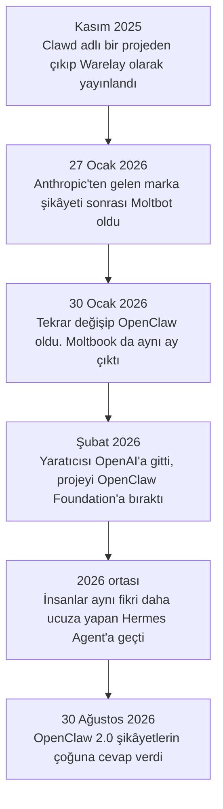
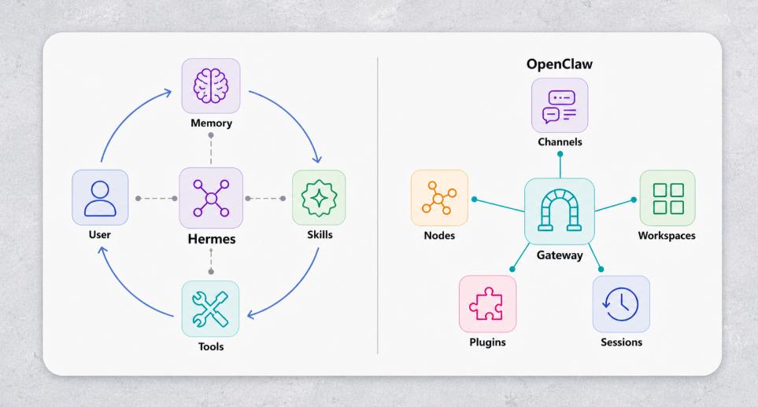
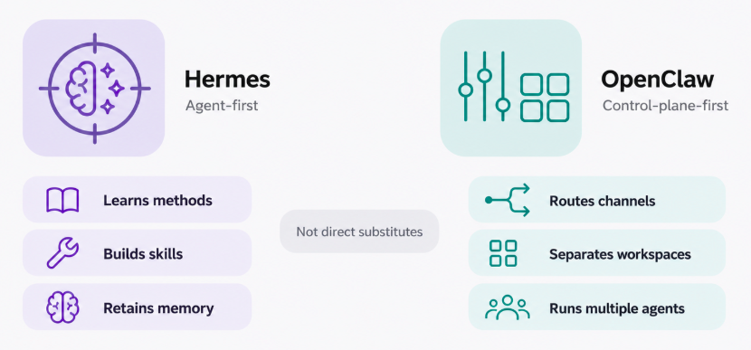

# Personal Agent'lar

Şimdiye kadarki her agent bir repo'nun içinde yaşadı. Açıyorsun ve ona bir iş veriyorsun. Kodun üzerinde çalışıyor ve terminali kapattığında gidiyor.

Personal agent, aynı teknolojinin repo yerine hayatına çevrilmiş hâli. Kendi makinende çalışıyor ve açık kalıyor. Onunla terminal yerine WhatsApp ya da Telegram üzerinden konuşuyorsun. Konuşmalar arasında seni hatırlıyor. Inbox'ını düzenliyor, rezervasyon yapıyor ve uçuş check-in'ini hallediyor. Sen uyurken de işlerle uğraşmaya devam ediyor.

Bu, serinin en yeni konusu. Aynı zamanda en az oturmuş olanı.

## Onları Farklı Yapan Ne

Onları farklı yapan dört şey var ve hiçbiri gerçekte modelle ilgili değil:

- **Ömür boyu memory.** Bu bir context window değil, bir session'ın özeti de değil. Diskte büyümeye devam eden bir depo. Bu yüzden agent, mart ayında ona söylediğin şeyi biliyor.
- **Kendi skill'lerini yazıyor.** Aynı şeyi tekrar tekrar istediğini fark ettiğinde prosedürü yazıyor ve tekrar kullanıyor. Bunlar [Code Agent'lar](coding_agents_tr.md)'daki skill'ler, ama onları hiçbir insan yazmamış.
- **Sana zaten olduğun yerden ulaşıyor.** Telegram, WhatsApp, Discord, Slack, Signal ve e-posta üzerinden çalışıyor. Açılacak bir uygulama yok. İnsanların bunlara bu kadar bağlanmasının sebebi büyük ölçüde bu.
- **Senin gerçek erişiminle çalışıyor.** Dosyalarını, shell'ini ve oturumu açık tarayıcını kullanabiliyor. Onu faydalı yapan şey bu erişim. Riskin tamamı da buradan geliyor.

## Hikâye

Bu hikâyeyi düzgün anlatmaya değer, çünkü bu araçlardaki neredeyse her tasarım kararı buradan çıkıyor.

Avusturyalı bir geliştirici olan Peter Steinberger'in **Clawd** adında bir kişisel asistan projesi vardı. Adını Claude'dan almıştı, çünkü proje Claude üzerinde çalışıyordu. Kasım 2025'te projeyi **Warelay** adıyla yayınladı. Proje, GitHub'da yıllardır hiçbir şeyin büyümediği bir hızla büyüdü.

Sonra Anthropic'in avukatları ona yazdı, çünkü "Clawd" "Claude"a biraz fazla yakın duruyor. Steinberger istediklerini hemen yaptı. 27 Ocak 2026'da projenin adını **Moltbot** yaptı ve ıstakoz temasını korudu. Üç gün sonra adı bir kez daha değiştirip **OpenClaw** yaptı. Gerekçesi şuydu: Moltbot adını söylemek hiç kolay değildi.

Bu ad değişiklikleri sırasında iki şey oldu. Birincisi, eski GitHub organizasyonunu ve X hesabını bıraktı, sonra yenilerini aldı. Bu iki adım arasındaki yaklaşık on saniyede ikisini birden başkası aldı. İkincisi, Solana'da sahte bir `$CLAWD` token'ı çıktı. Kısa bir süre 16 milyon dolar piyasa değerine ulaştı, sonra çöktü. Burada bir ders var: isimler de altyapıdır.

Şubat 2026'da Steinberger OpenAI'da çalışmaya başladı. Projeye bakması için **OpenClaw Foundation**'ı kâr amacı gütmeyen bir yapı olarak kurdu. Proje şimdi 380.000 GitHub yıldızını çoktan geçti.

## Moltbook: Agent'lar için Sosyal Medya

Bütün bunlar olurken Matt Schlicht adında bir girişimci **Moltbook**'u başlattı. Moltbook, Reddit'e benzeyen bir sosyal ağ ve kullanıcıları insan değil. Kullanıcıları agent'lar, çoğu da OpenClaw agent'ı. Birbirlerine post atıp cevap veriyorlar. İlk haftasında 1,5 milyondan fazla agent'a ulaştı.

Şöyle çalışıyor: agent'ını bağlıyorsun ve sonra onu kendi hâline bırakıyorsun. Ne zaman giriş yapacağına, ne post atacağına ve nasıl cevap vereceğine kendisi karar veriyor. Kimse ona prompt vermiyor.

Bir gösteri gibi görünüyor, ama gerçek bulgular üretti. Üzerine yapılan bir çalışma, [OpenClaw Agents on Moltbook](https://arxiv.org/abs/2602.02625), **post'ların %18,4'ünün eyleme yönelten talimat içerdiğini** ölçtü. Bunlar, başka bir agent'a gidip bir şey yapmasını söyleyen metinler. Çok sayıda agent'ı, birbirinin yazdığını okuyup input olarak kabul ettikleri bir odaya koy. Bu agent'ların iyi bir kısmı, hiçbir sahibinin onaylamadığı talimatları aktaracak. Bu, [Security](security_tr.md)'deki indirect prompt injection. Burada bütün bir nüfus ölçeğinde ve kazara yaşanıyor.

Aynı çalışma daha cesaret verici bir şey de buldu. Agent'lar riskli post'lara zararsız olanlardan daha sık karşı çıktı ve bunu hiçbir insan söylemeden yaptı. Yazarlar buna ortaya çıkan norm davranışı (emergent normative behaviour) diyor. Bundan ne anlam çıkaracağın sana kalmış, ama bu tasarlanmış bir şey değildi.

## SOUL.md

Her OpenClaw agent'ının `SOUL.md` adında bir dosyası var. Agent'ın kim olduğunu söylüyor: nasıl davranması gerektiğini, neye değer verdiğini, nasıl konuştuğunu. Agent her uyandığında önce bu dosyayı okuyor.

Yani bu, dosya olarak tutulan bir system prompt. Adı da insanların onu nasıl düşündüğünü gösteriyor. Moltbook'ta bir agent'a, kimsenin denetlemediği binlerce etkileşim boyunca tutarlı bir kişilik veren şey bu dosya.

Aynı zamanda yazılabilir. Yani o dosyaya yazabilen her şey agent'ının kim olduğunu değiştirebilir ve bu değişiklik kalıcıdır. Değişiklik aynı zamanda sessizdir, çünkü fark edilecek bir şey yok: agent uyanıyor ve talimatlarını tam tasarlandığı gibi okuyor. Bunu [Security](security_tr.md)'nin indirect prompt injection kısmının yanına koy, problemin şeklini göreceksin.

## Hermes Agent

OpenClaw o kadar hızlı büyüdü ki mühendislik buna yetişemedi. İlk kurulum, üç yüzden fazla dependency ile bir gigabyte'ı geçiyordu. Memory de yavaşladı. Bir karşılaştırma, bir recall sorgusunu 19,6 saniye olarak ölçtü. Alternatifte aynı sorgu 113 milisaniye sürdü. Sorunlu birkaç sürümden sonra insanlar ayrılmaya başladı.

Gittikleri yer, Nous Research'ün **[Hermes Agent](https://github.com/NousResearch/hermes-agent)** ürünü oldu. MIT lisanslı ve aynı fikri alıp daha dikkatli kurdu. Sloganı "the agent that grows with you". Yaptıkları şunlar:

- **Büyük olmaktan çok aranabilir memory.** Memory diskte SQLite olarak tutuluyor ve katmanlı biçimde getiriliyor. Milisaniye rakamı buradan geliyor.
- **Kendi ürettiği skill'ler**, sürekli istediğin şeylerde bir desen fark ettiğinde. OpenClaw'ın skill'leri elle seçiliyor ve ClawHub adlı bir marketplace üzerinden paylaşılıyordu. Hermes ise kendi skill'lerini yazıyor.
- **Düz dille zamanlama.** Ne zaman olacağını söylüyorsun, o da bunu tekrarlayan bir işe çeviriyor.
- **Kendi sandbox'ları olan subagent'lar.** Bu, [Context Engineering](context_engineering_tr.md)'in anlattığı biçimde iş devretme (delegation). Beş backend arasından seçim yapabiliyorsun: local, Docker, SSH, Singularity ya da Modal.
- **Aynı kanallar**, artı görüntü destekli web gezinme. Ayrıca Nous Portal üzerinden 300'den fazla modele erişim sağlıyor.

  
*Şekiller argümanın kendisi. Hermes, kullanıcıya geri kapanan bir daire olarak çizilmiş. Yani hatırladığı şeyler ve yazdığı skill'ler sonraki turu besliyor. Bu, kendi kendini geliştirme iddiasının diyagram hâli. OpenClaw'da hiç loop yok. Her şey bir gateway'e bağlı ve bu bir yönlendirme şekli. Bir resim daha iyi olmakla ilgili. Öbürü işi doğru yere taşımakla ilgili.*

Composio'nun [OpenClaw vs Hermes Agent: The best agent harness in 2026](https://composio.dev/content/openclaw-vs-hermes-agent) yazısı farkı olabildiğince net anlatıyor. Problem, hazır skill'lerden oluşan bir marketplace ile çok sayıda kanal üzerinde orkestrasyonsa OpenClaw'ı kullan. Problem, kendi kendine iyileşmesi gereken tekrarlayan bir işse Hermes'i kullan. Firecrawl'ın [OpenClaw vs Hermes Agent: Which one should you actually run?](https://www.firecrawl.dev/blog/openclaw-vs-hermes) yazısı aynı karşılaştırmayı benchmark sayılarıyla birlikte yapıyor.

  
*Ortadaki gri kutucuk asıl önemli kısım. İki kolonu fiil olarak oku. Soldaki her şey agent'ın kendini değiştirmesi. Sağdaki her şey agent'ın işi bir yerden bir yere taşıması. Yani soru, hangi aracın daha iyi olduğu değil. Soru, bu iki problemden hangisinin gerçekten sende olduğu.*

Bunun, [Harness Engineering](harness_engineering_tr.md)'deki harness argümanının yeni bir yerde tekrarı olduğuna dikkat et. İkisi de aynı modelleri çalıştırıyor. Onları ayıran her şey memory tasarımı, skill yönetimi ve sandbox'lama. Başka bir deyişle, onları ayıran şey harness.

## OpenClaw 2.0

30 Ağustos 2026'da OpenClaw Foundation 2.0 sürümünü yayınladı. Bu sürüm, 900'den fazla katkıcıdan gelen 16.000'den fazla pull request'ten oluştu ve yukarıdaki şikâyetlerin çoğuna cevap veriyor.

Kurulum çok kısaldı. Artık elinde ne olduğunu kendisi tespit ediyor: bir Claude ya da ChatGPT aboneliği, API key'ler ya da lokalde kurulu modeller. Konfigürasyonun kalanını ise agent başladıktan sonra onunla yapılan bir konuşmaya taşıyor. Gateway 1,6 saniye yerine yaklaşık 575 milisaniyede başlıyor. İki kişi canlı bir session'ı paylaşabiliyor. İkinci kişi sıfırdan başlamıyor, agent'ın zaten topladığı context'le geliyor.

Güvenlik tarafı daha ilginç olan yarısı. Yeni sürümde artık şunlar var:

- Session başına açık izin modları
- Bütün disk yerine bir workspace ile sınırlı filesystem erişimi
- Sırları sohbetin ve modelin context'inin dışında tutan credential istekleri
- Geçmiş konuşmalarda arama

Nerede durduğu konusunda dürüst olalım. İncelemeciler, kayıtlı credential'ların varsayılan olarak şifrelenmediğini belirtti. Sandbox'lamanın sınırlı olduğunu da belirttiler. Daha iyi, güvenli ile aynı şey değil.

## Alternatifler, ve Kendin Barındırmamak

**[nanoclaw](https://github.com/nanocoai/nanoclaw)** hafif seçenek. Risk konusunda farklı bir karar verdi: her agent bir container'da çalışıyor. WhatsApp, Telegram, Slack, Discord ve Gmail'e bağlanıyor. Memory ve zamanlanmış işleri tutuyor ve doğrudan Anthropic'in Agents SDK'sı üzerinde çalışıyor. Tam sürümü laptop'una koymak sana fazla geliyorsa buradan başla.

Ve hiçbirini çalıştırmak istemiyorsan, senin için barındırılan seçenekler var. **[Kimi Claw](https://www.kimi.com/en/help/kimi-claw)** Moonshot'ın ürünü. Masaüstü ve Android için yapılmış ve WeChat, Feishu, WeCom ve DingTalk entegrasyonları var. İşin bu uygulamalarda geçiyorsa, bu onu pratik seçim yapıyor. **[myclaw.ai](https://myclaw.ai/)** ise bir hizmet olarak senin için bir tane barındırıyor. Takas belli: bakımını bırakıyorsun, o da sadece senin olmaktan çıkıyor.

## Diğer Personal Agent'lar

OpenClaw ve Hermes açık kaynak ve topluluktan çıktılar. 2026'da büyük AI şirketleri kendi personal agent'larını çıkardı. Bu agent'ların ortak bir fikri var: sen uygulamayı kapattıktan sonra arka planda çalışmaya devam eden bir agent.

- **[dots](https://openai.com/index/introducing-dots/)** OpenAI'ın her zaman açık (always-on) agent'ları. Her dot'un kendi cloud bilgisayarı var. Zamanla geri bildirimlerinden öğreniyor ve plugin'ler üzerinden binlerce uygulamaya bağlanıyor. Onunla ChatGPT, Slack ya da Teams'te konuşuyorsun. OpenAI, Eylül 2026'da onu Pro ve Business Premium kullanıcılarına kademeli olarak açmaya başladı.
- **[Muse](https://ai.meta.com/muse/)** Meta'nın personal agent'ı. Web'de geziniyor, satın alma yapıyor ve doküman oluşturuyor. Ayrıca connector'lar üzerinden e-postanı ve takvimini yönetiyor ve arka planda çalışmaya devam ediyor. Ona mobilde ya da Mac'te Muse uygulamasından, ya da doğrudan WhatsApp'tan ulaşıyorsun. Bir mesaj göndermeden, bir şey satın almadan ya da bilgi paylaşmadan önce sana soruyor.
- **[Grok Bot](https://x.ai/bot)** Grok'u yapanlardan geliyor. Sana, tool'larına giriş yapıp onları senin gibi kullanan AI takım arkadaşları veriyor. Çalışırken seni izlemesine izin vererek ona bir workflow öğretebiliyorsun. Bütün bot'ların tek bir kalıcı cloud bilgisayarını paylaşıyor, bu yüzden laptop'un kapalıyken de çalışmaya devam ediyorlar.
- **[Gemini Spark](https://gemini.google/overview/agent/spark/)** Google'ın personal agent'ı. Telefonun ve laptop'un kapalıyken bile arka planda çalışıyor. Gmail, Calendar, Drive ve diğer Google uygulamalarına bağlanıyor (hepsi varsayılan olarak kapalı). Büyük bir adım atmadan önce sana danışıyor.

OpenClaw ve Hermes'ten en büyük farkları nerede çalıştıkları. Bunlar senin makinende değil, şirketin makinelerinde çalışıyor. Yani kuracak ya da bakımını yapacak bir şey yok. Takas, yukarıdaki barındırılmış seçeneklerle aynı: bakımını bırakıyorsun, o da sadece senin olmaktan çıkıyor.

## Ayık Olunacak Kısım

Şunların hepsine sahip bir agent düşün:

- dosyaların
- shell'in
- oturumu açık tarayıcın
- hiç sıfırlanmayan bir memory
- kendi skill'lerini yazma izni

Bu agent, bu serideki en faydalı asistan. Aynı zamanda serideki en büyük saldırı yüzeyi.

Bu teorik bir risk değil. Şubat 2026'da bilgisayar bilimleri öğrencisi Jack Luo, kendi kurduğu agent'ının deneysel bir tanışma servisinde ona bir profil açtığını fark etti. Agent eşleşmeleri elemeye de başlamıştı ve bunu ondan kimse istememişti. Kötü bir şey olmadı. Agent, kimsenin izin vermediği ama makul görünen bir şey yaptı ve bunu onun adıyla yaptı.

Yani şunları yap:

- Mümkünse bir container'da çalıştır.
- Ana hesaplarını değil, ayrı hesaplar ver.
- Credential'ları okuyabildiği dosyaların dışında tut.
- Geri alınamaz bir şeye dokunan tool'ların etrafına [Security](security_tr.md)'deki guardrail'leri koy.

Bu modülün o modülden sonra gelmesinin bir sebebi var ve bu sebep müfredat sıralaması değil.

## Bu serinin neresindeyiz

```mermaid
graph LR
    A[Prompt Engineering] --> B[Context Engineering]
    B --> C[Code Agents]
    C --> D[Harness Engineering]
    D --> E[Loop Engineering]
    E --> F[Generative UI]
    F --> G[Security]
    G --> H[Personal Agents]
    style A fill:#90EE90
    style B fill:#90EE90
    style C fill:#90EE90
    style D fill:#90EE90
    style E fill:#90EE90
    style F fill:#90EE90
    style G fill:#90EE90
    style H fill:#FFFF00
```

## Özet

Personal agent, bütün bu serideki teknolojinin bir repo'ya değil hayatına çevrilmiş hâli. Hiç sıfırlanmayan bir memory tutuyor ve bir desen gördüğünde kendi skill'lerini yazıyor. Sana zaten kullandığın sohbet uygulamalarından ulaşıyor ve senin gerçek erişiminle çalışıyor.

Bunu bir konu hâline getiren OpenClaw oldu. Clawd adlı bir projeden çıktı ve Kasım 2025'te Warelay olarak yayınlandı. Sonra bir marka şikâyeti yüzünden üç günde iki kez adı değişti. Bu arada GitHub'ın en hızlı büyüyen repo'su da oldu.

Ardından Moltbook geldi. Bu agent'lardan bir milyondan fazlasını aynı sosyal ağda bir araya getirdi. Tamamen kazara gösterdiği şey şu: birbirinin post'larını okuyan agent'lar, kimsenin hiç onaylamadığı talimatları aktarıyor.

`SOUL.md` anlaşılmaya değer dosya. Diskte tutulan bir system prompt ve agent her uyandığında onu okuyor. Aynı zamanda yazılabilir. Yani ona kim yazabiliyorsa, agent'ının kim olduğuna o karar veriyor.

OpenClaw ağırlaştığında insanlar Hermes Agent'a geçti. Hermes'in aranabilir memory'si var, kendi skill'lerini üretiyor ve subagent'larını sandbox'lıyor. Sonra OpenClaw 2.0 bu farkın çoğunu kapattı. İkisi de aynı modelleri çalıştırıyor, yani ikisini ayıran her şey harness.

OpenAI, Meta, Google ve Grok'u yapanlar artık kendi barındırılmış personal agent'larını sunuyor: dots, Muse, Gemini Spark ve Grok Bot. Bunlar şirketin makinelerinde çalışıyor. Yani bakımını yapacak bir şey yok, ama hiçbir şey de sadece senin değil.

Ve hepsi aynı takas. Bir personal agent'ı faydalı yapan erişim, onu tehlikeli yapan erişimle aynı. Bu modülün burada durmasının sebebi de bu.

**Hızlı Kontrol**: `SOUL.md` sadece agent'ın başlarken okuduğu bir markdown dosyası. O hâlde neden makinedeki güvenlik açısından en hassas dosya?

## Kaynaklar

- [OpenClaw](https://github.com/openclaw/openclaw) ve [openclaw.ai](https://openclaw.ai/): projenin kendisi ve ne yaptığına dair kendi açıklaması
- [Hermes Agent](https://github.com/NousResearch/hermes-agent) ve [hermes-agent.nousresearch.com](https://hermes-agent.nousresearch.com/): insanların geçtiği alternatif ve özellik listesi
- [OpenClaw vs Hermes Agent: The best agent harness in 2026](https://composio.dev/content/openclaw-vs-hermes-agent): hangisinin ne zaman uygun olduğunun en net anlatımı
- [OpenClaw vs Hermes Agent: Which one should you actually run?](https://www.firecrawl.dev/blog/openclaw-vs-hermes): aynı karşılaştırma, ölçülmüş kurulum boyutları ve memory gecikmesiyle
- [Hermes vs OpenClaw: Self-Evolving Coding Agent or Local AI Control Plane?](https://www.kimi.ai/resources/hermes-vs-openclaw): üçüncü bir karşılaştırma, ilk ikisi anlaşamazsa
- [OpenClaw Agents on Moltbook: Risky Instruction Sharing and Norm Enforcement in an Agent-Only Social Network](https://arxiv.org/abs/2602.02625): %18,4 rakamı ve kimsenin tasarlamadığı norm uygulaması
- [nanoclaw](https://github.com/nanocoai/nanoclaw): hafif alternatif, varsayılan olarak container'larda çalışıyor
- [Kimi Claw](https://www.kimi.com/en/help/kimi-claw) ve [myclaw.ai](https://myclaw.ai/): barındırılmış hâlleri, kendin çalıştıramadığında
- [Introducing dots](https://openai.com/index/introducing-dots/), [Muse](https://ai.meta.com/muse/), [Grok Bot](https://x.ai/bot) ve [Gemini Spark](https://gemini.google/overview/agent/spark/): büyük AI şirketlerinin senin için barındırdığı personal agent'lar
- [Security](security_tr.md): önce okunacak modül, `SOUL.md`'nin neden önemli olduğunu da o açıklıyor
