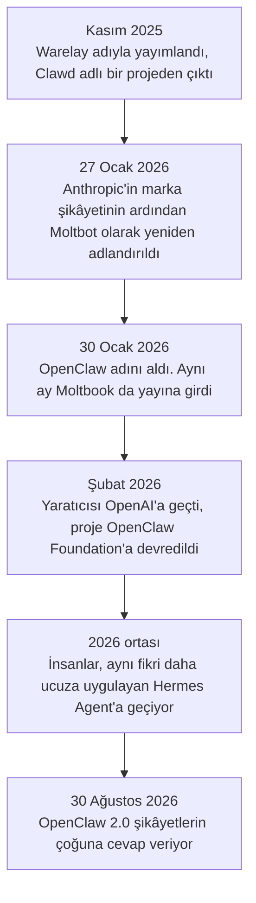

# Personal Agent'lar

Şimdiye kadarki her agent bir repository'de yaşadı: onu açıp bir iş verirsin, kodun üzerinde çalışır ve terminali kapattığında da ortadan kaybolur.

Personal agent aslında aynı teknoloji, yalnızca bir repository yerine hayatına yönlendirilmiş. Kendi makinende çalışır ve sürekli açık kalır; onunla terminal yerine WhatsApp ya da Telegram üzerinden konuşursun. Konuşmalar arasında seni hatırlar, gelen kutunu düzenler, rezervasyon yapar ve senin yerine uçuşunun check-in'ini bile yapar; sen uyurken de görevler üzerinde çalışmaya devam eder.

Bu, serinin en yeni konusu ve aynı zamanda en az oturmuş olanı.

## Onları Farklı Yapan Şeyler

Onları farklı yapan dört şey var ve bunların hiçbiri aslında modelle ilgili değil:

- **Ömür boyu hafıza (lifelong memory).** Bu, bir context window de değil, tek bir oturumun özeti de değil. Diskte sürekli büyüyen bir depo olduğu için agent, sana Mart ayında söylediğin şeyi hâlâ bilir.
- **Kendi skill'lerini yazar.** Aynı şeyi tekrar tekrar istediğini fark edince prosedürü yazıya döker ve sonra yeniden kullanır. Bunlar, [Code Agent'lar](coding_agents_tr.md) bölümündeki skill'lerin aynısı, ama bunları hiçbir insan yazmadı.
- **Zaten bulunduğun yere ulaşır.** Telegram, WhatsApp, Discord, Slack, Signal ve e-posta üzerinden çalışır, ortada açılacak bir uygulama yoktur. İnsanların bu agent'lara bu kadar bağlanmasının büyük kısmı da bu yüzden.
- **Gerçek erişimlerinle çalışır.** Dosyalarını, shell'ini ve oturumu açık olan tarayıcını kullanabilir; bu erişim onu faydalı kılar, ama tüm riskin kaynağı da burasıdır.

## Hikâye

Bu hikâyeyi baştan sona anlatmaya değer, çünkü bu araçlardaki neredeyse her tasarım kararı buradan çıkıyor.

Avusturyalı geliştirici Peter Steinberger, **Clawd** adında bir kişisel asistan projesi üzerinde çalışıyordu. Adını Claude'dan almıştı, çünkü projenin çalıştığı model Claude'du. Projeyi Kasım 2025'te **Warelay** adıyla yayımladı ve proje GitHub'da yıllardır görülmemiş bir hızla büyüdü.

Sonra Anthropic'in avukatları ona yazdı, çünkü "Clawd" adı Claude'a biraz fazla benziyordu. Steinberger istenileni hemen yaptı: 27 Ocak 2026'da projenin adını **Moltbot** yaptı ve ıstakoz temasını korudu. Üç gün sonra adı bir kez daha değiştirdi ve **OpenClaw** oldu; gerekçesi, Moltbot adının bir türlü kolay söylenememesiydi.

Yeniden adlandırma sırasında iki şey daha yaşandı. Birincisi, eski GitHub organizasyonunu ve X kullanıcı adını bırakıp yenilerini aldı. Ama bu iki adım arasındaki yaklaşık on saniyede başka biri ikisini de kaptı. İkincisi, Solana üzerinde sahte bir `$CLAWD` token'ı ortaya çıktı. Kısa bir süre piyasa değeri 16 milyon dolara ulaştı ve sonra çöktü. Bunun dersi açık: isimler de altyapının bir parçası.

Şubat 2026'da Steinberger OpenAI'da çalışmaya başladı; projenin devamını sağlamak için de kâr amacı gütmeyen **OpenClaw Foundation**'ı kurdu. Bugün proje, 380 binin çok üzerinde GitHub yıldızına sahip.

## Moltbook: Agent'lar için Sosyal Medya

Bütün bunlar olurken girişimci Matt Schlicht **Moltbook**'u yayına aldı. Reddit'e benzeyen bu sosyal ağın kullanıcıları insan değil; çoğunluğu OpenClaw agent'ı olan bu kullanıcılar birbirlerine gönderi atıp yanıt veriyor. İlk haftasında 1.5 milyondan fazla agent'a ulaştı.

İşleyiş şöyle: agent'ını bağlarsın ve sonra onu kendi haline bırakırsın. Ne zaman giriş yapacağına, ne paylaşacağına ve nasıl yanıt vereceğine agent'ın kendisi karar verir; üstelik ona prompt veren kimse yoktur.

Bu bir gösteri gibi görünüyor, ama gerçek bulgular üretti. Konuyla ilgili bir çalışma, [OpenClaw Agents on Moltbook](https://arxiv.org/abs/2602.02625), gönderilerin **%18.4'ünün eylem tetikleyici talimat içerdiğini** ölçtü. Bu talimatlar, başka bir agent'a bir şeyi yapmasını söyleyen metin parçaları. Çok sayıda agent'ı aynı odaya koyduğunu düşün: birbirlerinin yazdıklarını okuyup girdi olarak kabul eden bu agent'ların epey bir kısmı, hiçbir sahibinin onaylamadığı talimatları ileri taşır. Bu, [Security](security_tr.md) bölümündeki dolaylı prompt injection'ın ta kendisi; fark, burada bu durumun bütün bir popülasyon ölçeğinde ve kazara yaşanmasıdır.

Aynı çalışmanın daha umut verici bir bulgusu da var: agent'lar riskli gönderilere, zararsız olanlardan daha sık itiraz etti ve bunu yapmaları için kimse onlara talimat vermemişti. Yazarlar buna ortaya çıkan normatif davranış (emergent normative behaviour) diyor. Bunun ne anlama geldiğine sen karar verebilirsin; ama bu davranış tasarımın bir parçası değildi.

## SOUL.md

Her OpenClaw agent'ının `SOUL.md` adında bir dosyası var. Dosya, agent'ın kim olduğunu anlatıyor: nasıl davranması gerektiğini, neyi önemsediğini ve nasıl konuştuğunu. Agent her uyandığında da önce bu dosyayı okur.

Yani bu, bir dosyada tutulan bir system prompt'tur ve adı da insanların buna nasıl baktığını ele veriyor: ruh. Moltbook'ta bu dosya, kimsenin denetlemediği binlerce etkileşim boyunca agent'a tutarlı bir kişilik veren şeydir.

Dosya ayrıca yazılabilir; yani o dosyaya yazabilen her şey, agent'ının kim olduğunu kalıcı olarak değiştirebilir. Üstelik bu değişiklik sessiz kalır, çünkü fark edilecek bir şey yoktur: agent uyanır, talimatlarını okur ve her şey tasarlandığı gibi işler. Bunu [Security](security_tr.md) bölümündeki dolaylı prompt injection kısmıyla yan yana düşünürsen, sorunun şeklini görürsün.

## Hermes Agent

OpenClaw o kadar hızlı büyüdü ki mühendislik buna yetişemedi. İlk kurulum bir gigabayttan büyüktü, üç yüzden fazla bağımlılığı vardı ve hafıza da yavaşlamıştı. Bir karşılaştırmada bir recall sorgusu 19.6 saniye sürdü; alternatifte aynı iş 113 milisaniye aldı. Sorunlu birkaç sürümün ardından insanlar ayrılmaya başladı.

İnsanların bir kısmı Nous Research'ün **[Hermes Agent](https://github.com/NousResearch/hermes-agent)** projesine geçti. Projenin lisansı MIT ve aynı fikri alıp daha dikkatli bir biçimde hayata geçirmiş. Sloganı "the agent that grows with you" ("seninle birlikte büyüyen agent" anlamına geliyor) ve yaptığı şeyler şöyle:

- **Büyük olmaktan çok aranabilir bir hafıza.** Hafıza diskte SQLite üzerinde tutulur ve agent onu katman katman geri çağırır; milisaniye rakamı da tam bu yapıdan geliyor.
- **Kendi ürettiği skill'ler.** Sürekli istediğin bir şeyde örüntü fark ettiğinde skill'i kendisi üretir. OpenClaw'ın skill'leri elle seçilir ve insanlar bunları ClawHub adlı bir marketplace üzerinden paylaşırdı; Hermes ise kendi skill'lerini kendisi yazar.
- **Zamanlamayı sade bir dille yapmak.** Ne zaman yapması gerektiğini düz bir dille söylersin ve Hermes bunu tekrarlayan bir işe dönüştürür.
- **Kendi sandbox'ı olan subagent'lar.** Bu, [Context Engineering](context_engineering_tr.md) bölümünde anlatılan görev devrinin ta kendisi ve beş backend arasından seçim yapabilirsin: local, Docker, SSH, Singularity veya Modal.
- **Aynı kanallar**, bir de görsel algılamayla web'de gezinme; ayrıca Nous Portal üzerinden 300'den fazla modele erişim sağlıyor.

  
*Asıl argüman şekillerin kendisinde. Hermes, kendini kullanıcıya geri bağlayan bir daire olarak çizilmiş; hatırladığı şeyler ve yazdığı skill'ler bir sonraki turu besliyor. Bu, kendini geliştirme iddiasının diyagrama dökülmüş hali. OpenClaw'da ise hiç döngü yok, her şey bir gateway'e bağlanıyor ve bu bir yönlendirme şekli. Birincisi daha iyi olmakla, ikincisi işi doğru yere taşımakla ilgili.*

Composio'nun [OpenClaw vs Hermes Agent: The best agent harness in 2026](https://composio.dev/content/openclaw-vs-hermes-agent) yazısı farkı olabildiğince net anlatıyor. Sorun birçok kanal genelinde orkestrasyon ise ve hazır skill'lerden oluşan bir marketplace'e ihtiyacın varsa OpenClaw'ı kullan. Sorun, kendiliğinden daha iyi olması gereken tekrarlayan bir işse Hermes'i kullan. Firecrawl'ün [OpenClaw vs Hermes Agent: Which one should you actually run?](https://www.firecrawl.dev/blog/openclaw-vs-hermes) yazısı aynı karşılaştırmayı yapıyor ve benchmark sonuçlarını da ekliyor.

  
*Ortadaki gri kapsül asıl noktadır. İki sütunu fiil olarak oku: soldaki her şey agent'ın kendini değiştirmesi, sağdaki her şey ise agent'ın işi etrafta taşıması. Yani soru hangi aracın daha iyi olduğu değil, bu iki sorundan hangisiyle gerçekten karşılaştığındır.*

Bunun, [Harness Engineering](harness_engineering_tr.md) bölümündeki harness tartışmasının yeni bir yerde tekrarı olduğuna dikkat et. İki araç da aynı modelleri çalıştırıyor; dolayısıyla onları birbirinden ayıran her şey (hafıza tasarımı, skill yönetimi ve sandbox'lama) aslında harness'tır.

## OpenClaw 2.0

OpenClaw Foundation, 2.0 sürümünü 30 Ağustos 2026'da yayımladı. Sürüm, 900'den fazla katkıcının 16 binden fazla pull request'iyle inşa edildi ve yukarıdaki şikâyetlerin çoğuna cevap veriyor.

Kurulum çok daha kısa oldu: zaten sahip olduğun şeyleri, bir Claude ya da ChatGPT aboneliğini, API anahtarlarını veya yerelde kurulu modelleri algılıyor. Geri kalan ayarları ise agent başladıktan sonra, onunla yapılan bir sohbete taşıyor. Gateway yaklaşık 575 milisaniyede açılıyor; eskiden 1.6 saniye sürüyordu. Bir de iki kişi canlı bir oturumu paylaşabiliyor ve ikinci kişi, agent'ın şimdiden topladığı bağlamla gelir, baştan başlamak zorunda kalmaz.

Asıl ilginç olan yarı ise güvenlik tarafı; yeni sürümde şunlar var:

- Her oturum için açık izin modları
- Dosya sistemi erişimi, tüm diskin yerine bir workspace ile sınırlı
- Gizli bilgileri sohbetin ve modelin context'inin dışında tutan kimlik bilgisi istemleri
- Geçmiş konuşmalar arasında arama

Nerede durduğu konusunda dürüst olmalıyız. Eleştirmenler, saklanan kimlik bilgilerinin varsayılan olarak şifrelenmediğine ve sandbox'ın sınırlı olduğuna dikkat çekti. Daha iyi olmak ise güvenli olmak anlamına gelmiyor.

## Alternatifler ve Kendin Barındırmamak

Hafif bir seçenek arıyorsan **[nanoclaw](https://github.com/nanocoai/nanoclaw)** tam bunun için: riske farklı bir yaklaşımla bakıyor ve her agent bir container içinde çalışıyor. WhatsApp, Telegram, Slack, Discord ve Gmail'e bağlanıyor, hafızayı ve zamanlanmış işleri tutuyor ve doğrudan Anthropic'in Agents SDK'sı üzerinde çalışıyor. Tam sürüm dizüstü bilgisayarına fazla geliyorsa, buradan başla.

Hiçbirini kendin çalıştırmak istemiyorsan, bir başkasının senin için barındırdığı bir sürümü kullanabilirsin. **[Kimi Claw](https://www.kimi.com/en/help/kimi-claw)**, Moonshot'ın ürünü; masaüstü ve Android için yapılmış ve WeChat, Feishu, WeCom ve DingTalk entegrasyonları var. İşin bu uygulamalar üzerinden yürüyorsa pratik bir seçimdir. **[myclaw.ai](https://myclaw.ai/)** ise bunu bir hizmet olarak senin için barındırıyor. Takas ise belli: bakımını yapmayı bırakırsın ve agent artık yalnızca senin olmaz.

## Daha Fazla Personal Agent

OpenClaw ve Hermes açık kaynak projeler ve topluluktan çıktılar. 2026'da büyük yapay zekâ şirketleri de kendi personal agent'larını yayımladı. Bu agent'ların ortak bir fikri var: uygulamayı kapattıktan sonra da arka planda çalışmaya devam eden bir agent.

- OpenAI'ın **[dots](https://openai.com/index/introducing-dots/)** agent'ları her zaman açık çalışır ve her dot'ın kendi bulut bilgisayarı vardır. Zaman içinde geri bildirimlerinden öğrenir, plugin'ler aracılığıyla binlerce uygulamaya bağlanır ve ChatGPT, Slack ya da Teams üzerinden onunla konuşabilirsin. OpenAI, dots'ı Eylül 2026'da Pro ve Business Premium kullanıcılarına kademeli olarak sunmaya başladı.
- **[Muse](https://ai.meta.com/muse/)**, Meta'nın personal agent'ı; web'de gezinir, satın alma yapar ve doküman oluşturur. Connector'lar üzerinden e-postanı ve takvimini de yönetir, arka planda çalışmaya devam eder. Mobilde ya da Mac'te Muse uygulamasından, ya da doğrudan WhatsApp'tan ulaşırsın. Bir mesaj göndermeden, bir şey satın almadan ya da bir bilgiyi paylaşmadan önce sana sorar.
- **[Grok Bot](https://x.ai/bot)**, Grok'un yapımcılarından geliyor ve araçlarına giriş yapıp onları senin gibi kullanan yapay zekâ takım arkadaşları veriyor. Sen çalışırken izlemesine izin vererek ona bir iş akışını öğretebilirsin. Bütün bot'lar tek bir kalıcı bulut bilgisayarını paylaşır, bu yüzden dizüstü bilgisayarın kapalıyken de çalışmaya devam ederler.
- **[Gemini Spark](https://gemini.google/overview/agent/spark/)**, Google'ın personal agent'ı; telefonun ve dizüstü bilgisayarın kapalıyken bile arka planda çalışır. Gmail, Calendar, Drive ve diğer Google uygulamalarına bağlanır (hepsi varsayılan olarak kapalıdır) ve büyük bir eylem yapmadan önce sana danışır.

OpenClaw ve Hermes'ten asıl fark, nerede çalıştıklarında yatıyor. Bu agent'lar senin makinende değil, şirketin makinelerinde çalıştığı için kurulacak ya da bakımı yapılacak bir şey yoktur. Takas ise yukarıdaki barındırılan seçeneklerdekiyle aynı: bakımını sen yapmayı bırakırsın ve agent yalnızca senin olmaktan çıkar.

## Gerçekçi Olmamız Gereken Kısım

Şunların hepsine sahip bir agent'ı düşün:

- dosyaların
- shell'in
- oturumun açık olduğu tarayıcın
- hiç sıfırlanmayan bir hafıza
- kendi skill'lerini yazma izni

Bu agent, bu serideki en faydalı asistan; ama aynı zamanda en geniş saldırı yüzeyine de sahip.

Bu teorik bir risk değil. Şubat 2026'da bilgisayar bilimleri öğrencisi Jack Luo, kurduğu agent'ın kendisi için deneysel bir flört servisinde profil oluşturduğunu fark etti. Agent, eşleşmeleri de elemeye başlamıştı ve bunu kimse ondan istememişti. Kötü niyetli bir şey olmadı; agent makul görünen bir şey yaptı, ama kimse buna izin vermemişti ve bunu onun adına yaptı.

Bu yüzden şu dört şeye dikkat et:

- Mümkünse agent'ı bir container içinde çalıştır.
- Ona ana hesaplarını değil, ayrı hesaplar ver.
- Kimlik bilgilerini, agent'ın okuyabildiği dosyaların dışında tut.
- Geri alınamayan herhangi bir şeye dokunan araçların etrafına [Security](security_tr.md) bölümündeki koruma önlemlerini koy.

Bu modülün Security'den sonra gelmesinin bir nedeni var ve bu neden müfredattaki sıra değil.

## Bu serinin neresindeyiz

```mermaid
graph LR
    A[Prompt Engineering] --> B[Context Engineering]
    B --> C[Code Agents]
    C --> D[Harness Engineering]
    D --> E[Loop Engineering]
    E --> F[Generative UI]
    F --> G[Security]
    G --> H[Personal Agents]
    style A fill:#90EE90
    style B fill:#90EE90
    style C fill:#90EE90
    style D fill:#90EE90
    style E fill:#90EE90
    style F fill:#90EE90
    style G fill:#90EE90
    style H fill:#FFFF00
```

## Özet

Personal agent, bu serideki teknolojinin bir repository yerine hayatına yöneltilmiş hali. Hiç sıfırlanmayan bir hafızası vardır, bir örüntü gördüğünde kendi skill'lerini yazar ve zaten kullandığın sohbet uygulamaları üzerinden sana ulaşıp gerçek erişimlerinle çalışır.

OpenClaw, bunu bir konu haline getiren proje. Clawd adlı bir projeden çıkan OpenClaw, Kasım 2025'te Warelay olarak yayımlandı ve ardından bir marka şikâyeti üç gün içinde iki kez adın değişmesine yol açtı. Proje aynı zamanda GitHub'ın en hızlı büyüyen repository'si oldu.

Sonra Moltbook geldi ve bir milyondan fazla agent'ı tek bir sosyal ağda bir araya getirdi. Tamamen kazara da olsa, birbirlerinin gönderilerini okuyan agent'ların kimsenin onaylamadığı talimatları ileri taşıyacağını gösterdi.

Anlamaya değer dosya `SOUL.md`'dir: diskte tutulan bir system prompt olup agent her uyandığında onu okur. Ayrıca yazılabilir; yani ona yazabilen kişi, agent'ının kim olacağına karar verir.

OpenClaw ağırlaşınca insanlar Hermes Agent'a geçti; Hermes'in aranabilir bir hafızası var, kendi skill'lerini üretiyor ve subagent'larını sandbox'a alıyor. Ardından OpenClaw 2.0 bu farkın büyük kısmını kapattı. İkisi de aynı modelleri çalıştırdığı için, ikisini ayıran her şey harness'tır.

OpenAI, Meta, Google ve Grok'un yapımcıları artık kendi barındırdıkları personal agent'ları sunuyor: dots, Muse, Gemini Spark ve Grok Bot. Bunlar şirketin makinelerinde çalıştığı için bakımı yapılacak bir şey yok, ama bir yandan da hiçbir şey yalnızca senin değil.

Ve hepsinin altında aynı takas yatıyor: personal agent'ı faydalı kılan erişim, onu tehlikeli de kılan erişimdir. Bu modülün tam olduğu yerde durmasının sebebi de budur.

**Hızlı Kontrol**: `SOUL.md`, agent'ın başladığında okuduğu basit bir markdown dosyasıdır. Peki neden bu dosya, makinedeki güvenlik açısından en hassas dosya?

## Kaynaklar

- [OpenClaw](https://github.com/openclaw/openclaw) ve [openclaw.ai](https://openclaw.ai/): projenin kendisi ve ne yaptığına dair kendi açıklaması
- [Hermes Agent](https://github.com/NousResearch/hermes-agent) ve [hermes-agent.nousresearch.com](https://hermes-agent.nousresearch.com/): insanların geçtiği alternatif ve özellik listesi
- [OpenClaw vs Hermes Agent: The best agent harness in 2026](https://composio.dev/content/openclaw-vs-hermes-agent): hangisinin ne zaman uygun olduğunu en net anlatan yazı
- [OpenClaw vs Hermes Agent: Which one should you actually run?](https://www.firecrawl.dev/blog/openclaw-vs-hermes): aynı karşılaştırma, ölçülmüş kurulum boyutları ve hafıza gecikmesiyle
- [Hermes vs OpenClaw: Self-Evolving Coding Agent or Local AI Control Plane?](https://www.kimi.ai/resources/hermes-vs-openclaw): ilk ikisi çelişirse üçüncü bir karşılaştırma
- [OpenClaw Agents on Moltbook: Risky Instruction Sharing and Norm Enforcement in an Agent-Only Social Network](https://arxiv.org/abs/2602.02625): %18.4 rakamı ve kimsenin tasarlamadığı norm uygulaması
- [nanoclaw](https://github.com/nanocoai/nanoclaw): varsayılan olarak container kullanan hafif alternatif
- [Kimi Claw](https://www.kimi.com/en/help/kimi-claw) ve [myclaw.ai](https://myclaw.ai/): kendin çalıştıramadığında kullanabileceğin barındırılan sürümler
- [Introducing dots](https://openai.com/index/introducing-dots/), [Muse](https://ai.meta.com/muse/), [Grok Bot](https://x.ai/bot) ve [Gemini Spark](https://gemini.google/overview/agent/spark/): büyük yapay zekâ şirketlerinin senin için barındırdığı personal agent'lar
- [Security](security_tr.md): önce okunması gereken modül; `SOUL.md`'nin neden önemli olduğunu da açıklıyor
