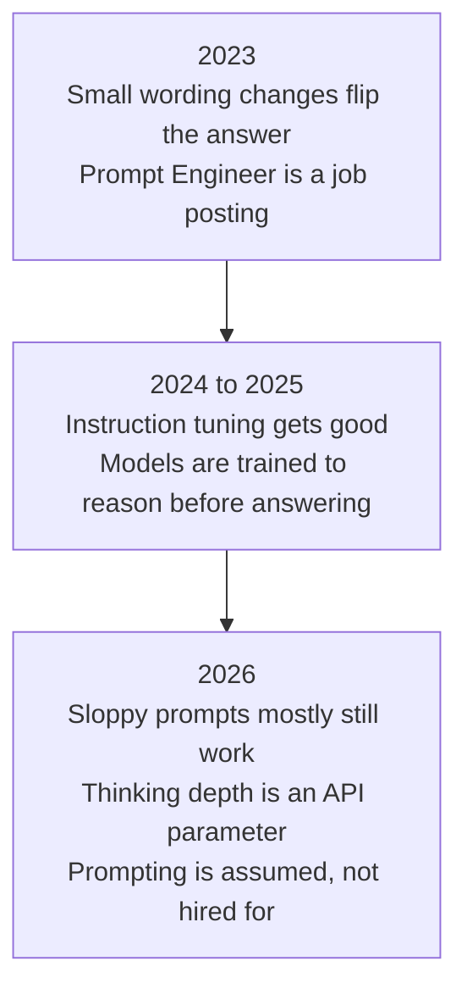

# Prompt Engineering

[LLM Fundamentals](../1_fundamentals/llms.md) ended with one paragraph about prompt engineering.
This module is that paragraph, opened up.

> **Prompt engineering is writing an input that leads the model to the output you expect.**

Start with what a model is. It is a pre-trained neural network. Its weights are frozen, and it has
no state and no memory. Input goes in and output comes out, every time. Nothing carries over from
one time to the next. So the model is fixed, and the input is the only thing you control. That makes
the input the only thing that can decide the quality of what comes back.

[LLM Fundamentals](../1_fundamentals/llms.md) wrote down what the model computes:

```
P(next token | context)
```

Your prompt *is* that context. So the whole job is one search problem:

```
best prompt = the prompt that maximises P(the output you want | prompt)
```

Everything below is a technique that answers one question: how do you write the prompt so that you
get the output you expect?

## Why Prompt Engineering is Even Needed?

Here is an objection that you probably already have. If the weights are frozen and the model
remembers nothing, why do you get two different answers when you ask the same question in two
different ways?

Because two phrasings are not the same input. And the model does not answer questions. It runs a
neural network on the words you give it, and the answer is whatever that network produces.

That network contains neurons, and the prompt decides which ones fire. Some activate strongly,
some activate weakly, and some do not activate at all. When you change the words, you change that
pattern. When the pattern changes, the output changes.

  
*The weights are identical in both cases. A prompt only decides which of them get used. That is why the same model answers an arithmetic question with one part of itself and a painting question with another part.*

Think of a DJ mixer. It has one knob each for volume, bass and echo. The DJ never changes the
hardware. They move the knobs, listen, and move them again until the room sounds right. Your
prompt is one setting of those knobs. Prompt engineering is writing the text that turns up the
parts of the network you need for this job.

  
*Every knob here is something this module covers. None of them is on a panel that you can touch: the prompt text is the only thing that moves them.*

But the knobs have no labels, and you cannot reach them. Text is the only way to move them. That
is why this work is experimental and not theoretical. It is also why nobody can give you the
correct prompt for your task.

## What a Weak Prompt Costs You

Two drivers drive the same car around the same track, and they get different lap times. They have
the same engine, the same horsepower, the same grip and the same corners. The better driver simply
gets more out of the machine.

Models work the same way, and this explains a complaint that you have probably heard before.
Someone with little prompting skill does not get what they wanted. They decide that the model is
weak, or not very intelligent, or that it can only do seventy percent of the job. Someone else
takes the same model, writes a better prompt, and finishes the task.

So when a model disappoints you, the first question is not which model to switch to.

## Prompt Engineering is Dead in 2026

Yes, really.

When the first LLM APIs became available around 2023, the models were fragile. A small change in
wording could turn a good answer into a wrong one. This sensitivity was measured, not imagined. On
open models of that time, formatting changes that did not change the meaning moved accuracy by up
to [76 points](https://arxiv.org/abs/2310.11324). **Prompt Engineer** was a job title. Companies
hired people to spend the whole day on trial and error, until the model produced the expected
output.

Those days are gone. Models are far more capable now. They come with abilities like chain of
thought, which is covered further down this page. These abilities let a model understand what you
meant, even from a sloppy prompt. In 2026 prompt engineering is not a career. It is a basic skill
that everyone who works with these systems is expected to have.



That is why this module only covers what is useful in a daily AI engineering job. The more
advanced part of the subject is in [Advanced Prompting](../3_expert/advanced_prompting.md).

If you want the full catalogue and not only the useful subset, the [Prompt Engineering
Guide](https://www.promptingguide.ai/) has it. Also, treat what follows as starting points, not
as a syllabus. Prompting is experimental. You get good at it by writing a prompt, reading the
output, and changing the prompt.

## Two Prompt Templates

The rule is simple: a clearer and more detailed prompt gets a better answer. But two templates are
still useful to know, because they show what "clear and detailed" means in practice. It means a
prompt that states the goal, the context, the format of the answer and the point where the model
should stop.

The simple one:

```text
{Goal}
{Output Format}
{Warnings}
{Context}
```

- **Goal**: what you want, in a sentence or two.
- **Output Format**: the shape that the answer must come in.
- **Warnings**: the mistakes that you already expect the model to make.
- **Context**: everything about your situation that a stranger would need to know to help you.

  
*The context dump is the longest part and the least polished part, and that is fine. It is the part that no template can write for you.*

The more detailed one:

```text
{Role}
{Task}
{Context}
{Reasoning}
{Output Format}
{Stop Conditions}
```

- **Role**: who the model should be while it works. The role prompting section below covers this.
- **Task**: the work itself, as numbered steps when the order matters.
- **Context**: background, constraints, and what to avoid.
- **Reasoning**: how you want the model to think before it decides on an answer.
- **Output Format**: the exact shape, including the table columns when you need them.
- **Stop Conditions**: how the model knows it is finished.

  
*Stop conditions are the slot that people forget. Without one, "done" is the model's guess and not your definition.*

Today's models do not need you to follow either template strictly, and most of the time you will
not. The templates are here so that "write a clear prompt" is no longer vague advice.

## In-context Learning, and Few-shot Prompting

Models can learn things that are not in their weights. They do not learn them through
pre-training, and not through fine-tuning. They learn them from what is in the context, the
working memory from [Memory](../1_fundamentals/memory.md). This is called **in-context learning**,
or ICL.

It is also the reason RAG works at all. In [RAG & Embeddings](../1_fundamentals/rag.md), the
weights never change. The retrieved documents go into the context, and the model uses them
immediately. The library stays closed, and you put what you need on the desk.

Look again at both templates: each one has a slot for context. That slot is the one place where
you give the model knowledge that it did not have a second ago.

ICL also gives you a technique. **Few-shot prompting** means showing the model a few examples of
the task, done correctly, before you give it the real task:

```text
Classify the sentiment of each message as positive, negative or neutral.

Message: "the package arrived two days early"
Sentiment: positive

Message: "the box was crushed and the mug inside was broken"
Sentiment: negative

Message: "delivery is scheduled for Thursday"
Sentiment: neutral

Message: "it works, but the app crashed twice"
Sentiment:
```

Those three examples do two jobs at the same time. First, they fix the label set, so the answer is
one of three words and not a paragraph of nuance. Second, they fix the format, so the answer comes
as `Sentiment: <label>` and your code can read it. This combination is usually why examples work
where an instruction alone did not.

Using a few examples is **few-shot**. Using no examples at all is **zero-shot**. You have been
doing zero-shot every time you typed a question into a chat window.

## Prompt Engineering Tips

### Be Clear and Direct

Less effective:

```text
Create an analytics dashboard
```

More effective:

```text
Create an analytics dashboard. Include as many relevant features and interactions as possible. Go beyond the basics to create a fully-featured implementation.
```

The second prompt is not more polite or better written. The difference is that it says much more
about what "finished" looks like. Both examples come from Anthropic's [prompting best
practices](https://platform.claude.com/docs/en/build-with-claude/prompt-engineering/claude-prompting-best-practices).

### Add Context, Including Your Reasons

The model learns from what is in the context. So tell it *why* a rule exists, and not only what
the rule is.

Less effective:

```text
NEVER use ellipses
```

More effective:

```text
Your response will be read aloud by a text-to-speech engine, so never use ellipses since the text-to-speech engine will not know how to pronounce them.
```

The first is a rule that the model must obey without knowing why. The second lets the model
generalise. It will also avoid other punctuation that a speech engine gets wrong, even punctuation
that you never thought to list.

### Give the Prompt a Structure

Often you want to split a prompt into sections. Sections show the model:

- which part is an instruction;
- which part is data;
- which part is the goal;
- which part describes the output.

Structure makes a prompt easier to read, and it keeps the parts separate. It also changes the
results, and you can measure the change.

You can use XML tags. Anthropic's models are tuned for them:

```xml
<identity>
You are a support engineer for a company that hosts Postgres databases.
</identity>

<goal>
Read the customer ticket below and decide whether it is a billing question, a
technical question, or both.
</goal>

<output_format>
One line: BILLING, TECHNICAL or BOTH, followed by a one-sentence reason.
</output_format>
```

The same thing in markdown:

```markdown
## Identity
You are a support engineer for a company that hosts Postgres databases.

## Goal
Decide whether the ticket below is a billing question, a technical question, or both.

### How to do it
Read the whole ticket first. Ignore the customer's own guess about the cause.

## Output format
One line: BILLING, TECHNICAL or BOTH, followed by a one-sentence reason.
```

Nesting works in both formats, and the model reads the hierarchy as a hierarchy. A `###` under a
`##` is detail that belongs to it. The higher level carries more weight.

The format does not have to be a standard one. You can invent your own when it fits:

```text
Please read the emails below from my boss and my friend:

=== Boss Email ===
Write down the report of what you have done.

=== Friend Email ===
Write a poem for me.

=== Your Task ===
Please write a polite reply to both emails.
```

Why use these fences? Without them, "Write a poem for me" looks exactly like an instruction from
you. The model may then happily write a poem and not reply to anyone. In a long, crowded prompt,
this is most of what structure gives you: the model can tell your instructions apart from the text
you pasted in. Sometimes the pasted text is hostile, and not only confusing. Then the same problem
has a name, prompt injection, and it gets its own module: [Security](security.md).

## Chain of Thought

Research found something that sounds obvious once you hear it. A model can break a hard task into
smaller tasks and write the intermediate steps *before* the final answer. When it does this, the
final answer gets better. It is the same as when you do the arithmetic on paper and not in your
head.

Ask a model this:

```text
The cafeteria had 23 apples. They used 20 for lunch and bought 6 more. How many now?
```

With a plain prompt, it answers directly:

```text
Final Answer: 32 apples
```

That is wrong. Now force the model to think first. Make it write its intermediate results before
it decides on an answer:

```text
<thinking>
The user wants the final number of apples in the cafeteria. Steps:
start with the initial number, subtract the apples used for lunch, add the apples bought later.

Initial apples: 23. Apples used for lunch: 20. Apples bought: 6.

Step 1: apples remaining after lunch. 23 - 20 = 3 apples.
Step 2: final number after buying more. 3 + 6 = 9 apples.
</thinking>

Final Answer: 9 apples
```

It feels like magic, but the reason behind it is a simple, mechanical one. A model is **autoregressive**: every token it
writes becomes part of the input it reads for the next token. When it writes `23 - 20 = 3`, that
result is now in its context. So the model no longer has to hold the result in its head while it
works on the rest. For a model, writing is thinking.

The author of this course built a [Chain of Thought Visualizer](https://cot-visualizer.online/), so
you can watch the two side by side on a set of puzzles. It is a demonstration, not a benchmark: the
plain side is prompted on purpose to answer badly. To learn why any of this works, the extra
reading is [Why Can Large Language Models Generate Correct
Chain-of-Thoughts?](https://arxiv.org/abs/2310.13571)

### Chain of Thought is Also Why the Job Title Disappeared

In 2026 you almost never write a chain of thought prompt by hand.

When ChatGPT or an agent shows you that it is "thinking", that is chain of thought. It does not
happen because someone typed *let us think step by step*. It happens because the model was trained
to reason before it answers. It always does this, whether you asked or not.

How much the model thinks is now a dial, not a prompt. This is what people mean when they talk
about running a model on high thinking, or low effort, or max effort. Anthropic's [effort
parameter](https://platform.claude.com/docs/en/build-with-claude/effort) takes `low`, `medium`,
`high`, `xhigh` and `max`. The other providers have their own version of the same knob. More
thinking means better answers on hard problems. It also means more cost, slower responses, and a
context window that fills up faster.

> **NOTE: more thinking is not always better.** Like people, models can overthink, and their
> performance gets worse when they do. This is well documented:
>
> - [Stop Overthinking](https://arxiv.org/abs/2503.16419) surveys the whole area.
> - [The Danger of Overthinking](https://arxiv.org/abs/2502.08235) found nearly 30% better results
>   on software engineering tasks. It got them by picking the solutions that overthought the least.
> - [When More Thinking Hurts](https://aclanthology.org/2026.findings-acl.1199/) shows models
>   giving up answers that were already correct.
> - [OptimalThinkingBench](https://proceedings.iclr.cc/paper_files/paper/2026/hash/0f63515b14f33c008158213c7b6191c6-Abstract-Conference.html)
>   concludes that no model yet thinks the right amount for the question in front of it.

So the real skill is to match the thinking budget to the difficulty of the task. That budget is a
parameter you set, not a sentence you write.

## Role Prompting

Role prompting is giving the model a job, a persona or a character before you give it the task.

> **NOTE: what is a system prompt?** The system prompt appears once, at the top of the context. It
> defines how the model behaves for the whole conversation. The developer of the model or of the
> agent writes it, not the user, and it is usually long. The tools are also registered there, with
> their schemas and descriptions ([Tool Calling](../1_fundamentals/tools.md)). If you want to see
> real system prompts, [system prompt leaks](https://github.com/asgeirtj/system_prompts_leaks)
> collects them word for word from ChatGPT, Claude, Gemini, Grok and others.

  
*This is the same figure as in [LLM Fundamentals](../1_fundamentals/llms.md). A role goes in the identity and the instructions. Everything in this box is written before the user says anything.*

That is why role prompting belongs here: a role does its best work in the system prompt. The
examples of the technique itself are as simple as they look:

```text
Act as a senior software engineer. Review this code and find security bugs.
```

```text
You are William Shakespeare. Write a short poem about summer.
```

A role does two things well. First, it sets the perspective: it tells the model who it is, for
example an HR manager, a chef or a data science interviewer. Second, it shapes the tone and the
style. It makes the vocabulary, the assumed expertise and the formatting match that role.

But a role does not reliably make the model smarter. That was the early hope, and it did not prove
true. Personas in system prompts [do not improve
performance](https://arxiv.org/abs/2311.10054) across a broad range of questions. A 2026
follow-up study found that persona prompting [increases expertise depth while reducing
clarity](https://arxiv.org/abs/2605.29420). The effect depends on the question and on the domain.
Use a role to shape *how* an answer reads. Do not expect it to raise the ceiling of what the model
can do.

Roles are most useful when you build agents. When we talk about designing an agent, we mostly mean
choosing a system prompt and a set of tools for one job. For example, say you want a code review
team:

1. **Code Review Agent.** System prompt: review code for structural, logic and architectural
   flaws. Return a bulleted list of bugs and performance bottlenecks. Never comment on style or
   security. Tools: `fetch_repository_files`, `run_ast_parser`.
2. **Security Auditor Agent.** System prompt: scan only for vulnerabilities, data leaks and
   dependency risks. Grade each one as High, Medium or Low. Do not suggest features or
   refactoring. Tools: `run_sast_scanner`, `check_cve_database`.
3. **Clean Code Formatter Agent.** System prompt: refactor working code for readability and
   maintainability. Apply DRY and standard naming. Do not change the logic or look for bugs.
   Tools: `execute_linter_auto_fix`, `generate_docstrings`.

These are three different agents, but all three run on the same model. The only differences are the role, the instructions and the tools.
[Multi-Agent Systems](../1_fundamentals/multi_agent.md) quietly assumed this when it drew a
supervisor that gives work to specialists.

But be careful. A role changes the whole behaviour, not only the part you wanted to change. If you
give the model a security expert role and then ask it about art history, the answer can be worse
than with no role at all.

This brings us back to the mixer. "Act as a security expert" turns up the parts of the network
that hold security knowledge. It leaves the parts that hold art history turned down. Seen this way,
role prompting is a retrieval problem. You are not adding knowledge to the model. You are choosing
which of its existing knowledge gets used. And that is also the downside, because the knobs you
turned down stay down when the question changes.

## Where this fits in the series


## Summary

Prompt engineering is writing the input that makes the output you want the most likely one. The
weights are frozen, so the prompt is the only knob you have. Different phrasings activate different
parts of the same network.

The things that reliably help are ordinary ones:

- say exactly what you want;
- explain why;
- give the model the context;
- show an example or two;
- structure a long prompt so that your instructions cannot be confused with your data.

Chain of thought used to be one of those techniques. Now it is built into the models. That is most
of the reason why the job title disappeared and prompting became a basic skill instead.

Next: everything that goes into the context window, and how to decide what deserves the space.

**Quick Check**: why does a frozen model answer the same question differently when you rephrase it?
And what does a role prompt actually change?

## References

- [Prompt Engineering Guide](https://www.promptingguide.ai/): the full catalogue of techniques, much more than we covered
- [Prompting best practices](https://platform.claude.com/docs/en/build-with-claude/prompt-engineering/claude-prompting-best-practices): Anthropic's current guidance, and the source of the two before-and-after examples
- [Quantifying Language Models' Sensitivity to Spurious Features in Prompt Design](https://arxiv.org/abs/2310.11324): a measurement of how fragile the 2023 generation of models really was
- [Why Can Large Language Models Generate Correct Chain-of-Thoughts?](https://arxiv.org/abs/2310.13571): the theory behind the idea that writing is thinking
- [Chain of Thought Visualizer](https://cot-visualizer.online/): a side-by-side demo of reasoning compared with answering immediately
- [Effort](https://platform.claude.com/docs/en/build-with-claude/effort): the thinking dial, and what each level is for
- [Stop Overthinking: A Survey on Efficient Reasoning for Large Language Models](https://arxiv.org/abs/2503.16419): the research on overthinking, in one place
- [When "A Helpful Assistant" Is Not Really Helpful](https://arxiv.org/abs/2311.10054): the study that showed persona prompts help less than people hoped
- [System prompt leaks](https://github.com/asgeirtj/system_prompts_leaks): production system prompts, copied word for word
- [Advanced Prompting](../3_expert/advanced_prompting.md): the techniques this module skipped on purpose
