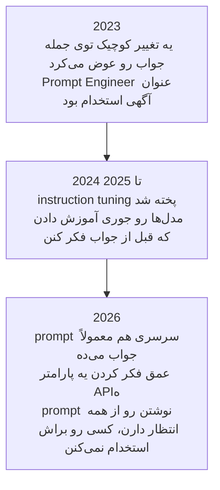

# Prompt Engineering

درس [مبانی LLM](../1_fundamentals/llms_fa.md) آخرش یه پاراگراف درباره‌ی prompt engineering داشت. این درس همون پاراگرافه که حالا بازش می‌کنیم و مفصل سراغش می‌ریم.

> **Prompt engineering یعنی ورودی رو جوری بنویسی که مدل به همون خروجی‌ای برسه که انتظارش رو داری.**

بیا از خود مدل شروع کنیم. مدل یه شبکه‌ی عصبیه که از قبل آموزش دیده؛ وزن‌هاش (weights) ثابتن و نه state داره نه حافظه. هر بار یه ورودی می‌گیره و یه خروجی پس می‌ده، و هیچی از این دفعه به دفعه‌ی بعد نمی‌رسه. پس مدل همینیه که هست و تنها چیزی که دست توئه ورودیه، و برای همین کیفیت جوابی که برمی‌گرده فقط به همین ورودی بستگی داره.

توی [مبانی LLM](../1_fundamentals/llms_fa.md) دیدیم که مدل دقیقاً چی رو حساب می‌کنه:

```
P(next token | context)
```

prompt تو *همون* context‌ه، پس کل کار در اصل یه مسئله‌ی جست‌وجوئه:

```
best prompt = the prompt that maximises P(the output you want | prompt)
```

هر تکنیکی که از این‌جا به بعد می‌بینی، جواب یه سواله: prompt رو چطور بنویسی که همون خروجی‌ای رو بگیری که انتظار داری؟

## اصلاً چرا prompt engineering لازمه؟

احتمالاً همین الان این ایراد به ذهنت رسیده که اگه وزن‌ها ثابتن و مدل هیچی یادش نمی‌مونه، چرا وقتی یه سوال رو به دو شکل مختلف می‌پرسی، دو تا جواب مختلف می‌گیری؟

چون دو جور پرسیدن یعنی دو تا ورودی متفاوت. تازه مدل اصلاً «جواب سوال» نمی‌ده؛ فقط یه شبکه‌ی عصبی رو روی کلمه‌هایی که بهش دادی اجرا می‌کنه، و جوابش هم همون چیزیه که این شبکه بیرون می‌ده.

توی این شبکه کلی نورون هست و prompt تعیین می‌کنه کدوم‌ها فعال بشن: بعضی‌ها خیلی قوی، بعضی‌ها کم، بعضی‌ها هم اصلاً. کلمه‌ها رو که عوض کنی، این الگو عوض می‌شه، و الگو که عوض بشه، خروجی هم عوض می‌شه.

  
*وزن‌ها توی هر دو حالت هیچ فرقی ندارن؛ prompt فقط تعیین می‌کنه کدومشون به کار بیفتن. برای همینه که یه مدل واحد، سوال ریاضی رو با یه بخش از خودش جواب می‌ده و سوال نقاشی رو با یه بخش دیگه.*

یه میکسر DJ رو در نظر بگیر که برای صدا، بیس و اکو هر کدوم یه پیچ داره. DJ هیچ‌وقت دست به سخت‌افزار نمی‌زنه؛ پیچ‌ها رو می‌چرخونه، گوش می‌ده و باز می‌چرخونه، تا صدای سالن درست دربیاد. prompt تو هم یه تنظیم از همین پیچ‌هاست، و prompt engineering یعنی متنی بنویسی که پیچ اون بخش‌هایی از شبکه رو که برای این کار لازم داری، زیاد کنه.

  
*هر پیچی که این‌جا می‌بینی، یکی از موضوع‌های همین درسه. هیچ‌کدومشون روی پنلی نیست که دستت بهش برسه، و تنها چیزی که می‌چرخونه‌شون متن prompt‌ه.*

ولی روی این پیچ‌ها هیچی ننوشته و دستت هم بهشون نمی‌رسه؛ فقط با متن می‌شه چرخوندشون. برای همین این کار بیشتر تجربیه تا تئوری، و برای همین هم هیچ‌کس نمی‌تونه prompt درست کار تو رو از قبل بذاره کف دستت.

## یه prompt ضعیف چقدر گرون تموم می‌شه

دو تا راننده با یه ماشین توی یه پیست می‌رونن و هر کدوم یه زمان دیگه ثبت می‌کنن. موتور یکیه، قدرت یکیه، لاستیک‌ها همون لاستیک‌هاست و پیچ‌وخم‌های پیست هم همون؛ فقط راننده‌ی بهتر بیشتر از همون ماشین کار می‌کشه.

مدل‌ها هم دقیقاً همین‌طورن، و این همون گلایه‌ای رو توضیح می‌ده که احتمالاً زیاد شنیدی. یکی که prompt نوشتن بلد نیست، به چیزی که می‌خواست نمی‌رسه و نتیجه می‌گیره مدل ضعیفه، یا اون‌قدرها باهوش نیست، یا نهایتش هفتاد درصد کار رو درمیاره. بعد یکی دیگه همون مدل رو برمی‌داره، prompt بهتری می‌نویسه و کار رو تا آخر می‌بره.

پس وقتی یه مدل ناامیدت کرد، اولین سوالت نباید این باشه که بری سراغ کدوم مدل دیگه.

## prompt engineering توی 2026 مرده

شوخی نمی‌کنم.

حدود سال 2023 که اولین API‌های LLM در دسترس قرار گرفتن، مدل‌ها خیلی شکننده بودن و با یه تغییر کوچیک توی جمله‌بندی، یه جواب درست می‌تونست غلط از آب دربیاد. این فقط یه حس نبود و اندازه‌ش رو هم گرفته بودن: روی مدل‌های open اون موقع، تغییرهای ظاهری توی فرمت که هیچ فرقی توی معنی نمی‌داد، دقت رو تا [76 واحد درصد](https://arxiv.org/abs/2310.11324) بالا و پایین می‌کرد. **Prompt Engineer** اسم یه شغل بود و شرکت‌ها آدم استخدام می‌کردن که کل روز رو با آزمون و خطا بگذرونه تا مدل همون خروجی‌ای رو بده که می‌خواستن.

اون دوره گذشت. مدل‌ها الان خیلی تواناترن و قابلیت‌هایی مثل chain of thought دارن (پایین‌تر توی همین صفحه بهش می‌رسیم) که باعث می‌شه حتی از یه prompt سرسری هم بفهمن منظورت چی بوده. توی 2026، prompt engineering دیگه شغل نیست؛ یه مهارت پایه‌ست که از هر کسی که با این سیستم‌ها کار می‌کنه انتظار دارن بلد باشه.



برای همین این درس فقط سراغ چیزهایی می‌ره که توی کار روزمره‌ی یه AI engineer به درد می‌خورن، و بخش پیشرفته‌ترش رو گذاشتیم برای [Advanced Prompting](../3_expert/advanced_prompting.md).

اگه فهرست کامل تکنیک‌ها رو می‌خوای و نه فقط اون‌هایی که به کار میان، [Prompt Engineering Guide](https://www.promptingguide.ai/) همه‌ش رو داره. چیزهایی رو هم که در ادامه میاد نقطه‌ی شروع ببین، نه سرفصل کامل درس. prompt نوشتن کار تجربیه و با نوشتن، خوندن خروجی و دوباره عوض کردن prompt کم‌کم دستت میاد.

## دو تا قالب prompt

قاعده‌ش ساده‌ست: prompt هر چی واضح‌تر و کامل‌تر باشه، جواب بهتری می‌گیری. با این حال بد نیست دو تا قالب رو بشناسی، چون نشون می‌دن «واضح و کامل» توی عمل یعنی چی، یعنی prompt‌ی که روشن گفته باشه هدف چیه، context چیه، جواب باید چه شکلی باشه و مدل کجا باید دست نگه داره.

قالب ساده:

```text
{Goal}
{Output Format}
{Warnings}
{Context}
```

- **Goal**: چی می‌خوای، توی یکی دو جمله.
- **Output Format**: جواب باید به چه شکلی برگرده.
- **Warnings**: اشتباه‌هایی که از همین الان می‌دونی مدل احتمالاً می‌کنه.
- **Context**: هر چیزی از شرایطت که یه غریبه باید بدونه تا بتونه کمکت کنه.

  
*جایی که context رو یه‌جا می‌ریزی معمولاً از همه طولانی‌تر و نامرتب‌تره، و اشکالی هم نداره، چون این همون بخشیه که هیچ قالبی نمی‌تونه جای تو بنویسه.*

قالب کامل‌تر:

```text
{Role}
{Task}
{Context}
{Reasoning}
{Output Format}
{Stop Conditions}
```

- **Role**: مدل موقع کار چه کسی باشه. بخش Role Prompting پایین‌تر سراغش می‌ره.
- **Task**: خود کار، و اگه ترتیب مهمه، به شکل قدم‌های شماره‌دار.
- **Context**: پیش‌زمینه، محدودیت‌ها و چیزهایی که باید ازشون دوری کنه.
- **Reasoning**: می‌خوای مدل قبل از اینکه سر یه جواب به نتیجه برسه، چطوری فکر کنه.
- **Output Format**: شکل دقیق جواب، و اگه جدول لازم داری، حتی ستون‌هاش.
- **Stop Conditions**: مدل از کجا بفهمه کارش تموم شده.

  
*Stop Conditions همون بخشیه که معمولاً یادشون می‌ره. اگه نباشه، اینکه کار کی «تموم» شده رو مدل حدس می‌زنه، نه اینکه تو تعریفش کرده باشی.*

مدل‌های امروزی لازم ندارن هیچ‌کدوم از این قالب‌ها رو مو به مو رعایت کنی، و بیشتر وقت‌ها هم نمی‌کنی. این قالب‌ها این‌جان که «یه prompt واضح بنویس» دیگه یه توصیه‌ی کلی و مبهم نباشه.

## In-context Learning و Few-shot Prompting

مدل‌ها می‌تونن چیزهایی رو یاد بگیرن که توی وزن‌هاشون نیست، اون هم نه با pre-training و نه با fine-tuning، بلکه از همون چیزی که توی context‌ه، یعنی همون حافظه‌ی کاری که توی درس [Memory](../1_fundamentals/memory_fa.md) دیدیم. به این می‌گن **in-context learning** یا ICL.

اصلاً RAG هم به خاطر همین کار می‌کنه. توی [RAG و Embedding‌ها](../1_fundamentals/rag_fa.md) وزن‌ها هیچ‌وقت تغییر نمی‌کنن؛ سندهایی که retrieve می‌شن می‌رن توی context و مدل همون لحظه ازشون استفاده می‌کنه. در کتابخونه بسته می‌مونه و تو فقط چیزی رو که لازم داری می‌ذاری روی میز.

حالا دوباره به اون دو تا قالب نگاه کن. هر دوشون یه جا برای context دارن، و این تنها جاییه که می‌تونی دانشی به مدل بدی که یه لحظه قبل نداشت.

ICL یه تکنیک هم دستت می‌ده به اسم **few-shot prompting**: قبل از اینکه کار اصلی رو به مدل بدی، چند تا نمونه از همون کار رو که درست انجام شده نشونش می‌دی:

```text
Classify the sentiment of each message as positive, negative or neutral.

Message: "the package arrived two days early"
Sentiment: positive

Message: "the box was crushed and the mug inside was broken"
Sentiment: negative

Message: "delivery is scheduled for Thursday"
Sentiment: neutral

Message: "it works, but the app crashed twice"
Sentiment:
```

این سه تا نمونه هم‌زمان دو تا کار می‌کنن. یکی اینکه برچسب‌ها رو مشخص می‌کنن، پس جواب یکی از همین سه تا کلمه‌ست، نه یه پاراگراف که بخواد ریزه‌کاری‌های احساس پیام رو توضیح بده. دیگه اینکه فرمت رو هم مشخص می‌کنن، پس جواب به شکل `Sentiment: <label>` برمی‌گرده و کدت می‌تونه راحت بخونتش. معمولاً همین دو تا با هم باعث می‌شن نمونه‌ها جایی جواب بدن که یه دستور خالی جواب نداده بود.

اگه چند تا نمونه بدی، اسمش می‌شه **few-shot**، و اگه هیچ نمونه‌ای ندی، **zero-shot**. هر بار که یه سوال توی پنجره‌ی چت تایپ کردی، در واقع داشتی zero-shot کار می‌کردی.

## چند تا ترفند برای prompt نوشتن

### واضح و رک بگو چی می‌خوای

کم‌اثرتر:

```text
Create an analytics dashboard
```

مؤثرتر:

```text
Create an analytics dashboard. Include as many relevant features and interactions as possible. Go beyond the basics to create a fully-featured implementation.
```

prompt دوم نه مؤدب‌تره نه قشنگ‌تر نوشته شده؛ فرقش اینه که خیلی بیشتر توضیح می‌ده کارِ «تموم‌شده» چه شکلیه. هر دو مثال از راهنمای [prompting best practices](https://platform.claude.com/docs/en/build-with-claude/prompt-engineering/claude-prompting-best-practices) خود Anthropic اومدن.

### context بده، دلیلت رو هم بگو

مدل از چیزی که توی context‌ه یاد می‌گیره، پس فقط نگو قانون چیه؛ بگو *چرا* هست.

کم‌اثرتر:

```text
NEVER use ellipses
```

مؤثرتر:

```text
Your response will be read aloud by a text-to-speech engine, so never use ellipses since the text-to-speech engine will not know how to pronounce them.
```

اولی قانونیه که مدل باید چشم‌بسته اجراش کنه. دومی دست مدل رو باز می‌ذاره که خودش تعمیم بده، یعنی از علامت‌های دیگه‌ای هم که موتور تبدیل متن به گفتار درست نمی‌خونه دوری می‌کنه، حتی اون‌هایی که اصلاً به فکرت نرسیده بود توی لیست بیاری.

### به prompt ساختار بده

خیلی وقت‌ها بهتره prompt رو بخش‌بندی کنی تا مدل بفهمه:

- کدوم قسمت دستوره؛
- کدوم قسمت داده‌ست؛
- کدوم قسمت هدفه؛
- کدوم قسمت خروجی رو توصیف می‌کنه.

ساختار هم خوندن prompt رو راحت‌تر می‌کنه، هم قسمت‌ها رو از هم جدا نگه می‌داره. تازه روی نتیجه هم اثر داره، اون هم اثری که می‌شه اندازه‌ش رو گرفت.

می‌تونی از تگ‌های XML استفاده کنی، که مدل‌های Anthropic مخصوصاً روشون tune شدن:

```xml
<identity>
You are a support engineer for a company that hosts Postgres databases.
</identity>

<goal>
Read the customer ticket below and decide whether it is a billing question, a
technical question, or both.
</goal>

<output_format>
One line: BILLING, TECHNICAL or BOTH, followed by a one-sentence reason.
</output_format>
```

همین رو با markdown:

```markdown
## Identity
You are a support engineer for a company that hosts Postgres databases.

## Goal
Decide whether the ticket below is a billing question, a technical question, or both.

### How to do it
Read the whole ticket first. Ignore the customer's own guess about the cause.

## Output format
One line: BILLING, TECHNICAL or BOTH, followed by a one-sentence reason.
```

توی هر دو فرمت می‌شه بخش‌ها رو تودرتو کرد و مدل هم این سلسله‌مراتب رو درست می‌فهمه: یه `###` زیر یه `##` یعنی جزئیاتِ همون بخش، و سطح بالاتر وزن بیشتری داره.

لازم هم نیست فرمتت استاندارد باشه؛ هر جا به کارت بیاد، می‌تونی فرمت خودت رو دربیاری:

```text
Please read the emails below from my boss and my friend:

=== Boss Email ===
Write down the report of what you have done.

=== Friend Email ===
Write a poem for me.

=== Your Task ===
Please write a polite reply to both emails.
```

این جداکننده‌ها به چه دردی می‌خورن؟ اگه نباشن، «Write a poem for me» عین یه دستور از طرف خود تو به چشم مدل میاد، و ممکنه با کمال میل یه شعر بنویسه و جواب هیچ‌کدوم از ایمیل‌ها رو نده. توی یه prompt بلند و شلوغ، فایده‌ی اصلی ساختار همینه که مدل بتونه دستورهای تو رو از متنی که کپی کردی و گذاشتی توش، جدا کنه. گاهی هم اون متن فقط گیج‌کننده نیست و عمداً با نیت بد نوشته شده؛ اون‌وقت همین مشکل اسم پیدا می‌کنه، یعنی prompt injection، و یه درس جدا براش داریم: [Security](security_fa.md).

## Chain of Thought

پژوهش‌ها به نتیجه‌ای رسیدن که وقتی می‌شنویش، می‌گی خب معلومه دیگه: مدل می‌تونه یه کار سخت رو به چند تا کار کوچیک‌تر بشکنه و قدم‌های وسط رو *قبل* از جواب نهایی بنویسه، و وقتی این کار رو می‌کنه، جواب نهایی‌ش بهتر می‌شه. درست مثل وقتی که حساب رو روی کاغذ می‌کنی، نه توی ذهنت.

این سوال رو از یه مدل بپرس:

```text
The cafeteria had 23 apples. They used 20 for lunch and bought 6 more. How many now?
```

با یه prompt معمولی، یه‌راست جواب می‌ده:

```text
Final Answer: 32 apples
```

این جواب غلطه. حالا مدل رو وادار کن اول فکر کنه، یعنی قبل از اینکه سر جواب به نتیجه برسه، حساب‌های وسط کار رو بنویسه:

```text
<thinking>
The user wants the final number of apples in the cafeteria. Steps:
start with the initial number, subtract the apples used for lunch, add the apples bought later.

Initial apples: 23. Apples used for lunch: 20. Apples bought: 6.

Step 1: apples remaining after lunch. 23 - 20 = 3 apples.
Step 2: final number after buying more. 3 + 6 = 9 apples.
</thinking>

Final Answer: 9 apples
```

شاید شبیه جادو باشه، ولی در اصل یه کار پیش‌پاافتاده‌ست، چیزی شبیه یادداشت‌برداری. مدل‌ها **autoregressive** هستن، یعنی هر token‌ی که مدل می‌نویسه، جزو ورودی‌ای می‌شه که برای token بعدی می‌خونه. وقتی `23 - 20 = 3` رو می‌نویسه، این نتیجه دیگه توی context‌شه و لازم نیست موقع حل بقیه‌ی مسئله، توی ذهنش نگهش داره. برای مدل، نوشتن همون فکر کردنه.

نویسنده‌ی این دوره یه [Chain of Thought Visualizer](https://cot-visualizer.online/) ساخته که توش می‌تونی این دو حالت رو روی چند تا معما کنار هم ببینی. البته این فقط یه نمایشه، نه benchmark، چون سمت ساده رو عمداً جوری prompt کردن که بد جواب بده. اگه می‌خوای بدونی اصلاً چرا این روش جواب می‌ده، برای مطالعه‌ی بیشتر [Why Can Large Language Models Generate Correct Chain-of-Thoughts?](https://arxiv.org/abs/2310.13571) رو بخون.

### Chain of Thought همون چیزیه که اون عنوان شغلی رو از بین برد

توی 2026 تقریباً هیچ‌وقت لازم نیست prompt مخصوص chain of thought رو دستی بنویسی.

وقتی ChatGPT یا یه agent بهت نشون می‌ده که داره «فکر می‌کنه»، این همون chain of thought‌ه. دلیلش این نیست که کسی تایپ کرده *let us think step by step*؛ دلیلش اینه که مدل رو جوری آموزش دادن که قبل از جواب دادن استدلال کنه، و همیشه هم این کار رو می‌کنه، چه ازش بخوای چه نخوای.

حالا میزان فکر کردن مدل یه پیچه که می‌چرخونی، نه چیزی که توی prompt بنویسی. وقتی آدم‌ها می‌گن مدل رو روی high thinking یا low effort یا max effort اجرا کن، منظورشون همینه. [پارامتر effort](https://platform.claude.com/docs/en/build-with-claude/effort) توی Anthropic مقدارهای `low`، `medium`، `high`، `xhigh` و `max` رو می‌گیره و بقیه‌ی provider‌ها هم نسخه‌ی خودشون رو از همین پیچ دارن. فکر بیشتر روی مسئله‌های سخت جواب بهتری می‌ده، ولی هزینه‌ش هم بیشتره، جواب دیرتر میاد و context window هم زودتر پر می‌شه.

> **نکته: فکر کردن بیشتر همیشه هم بهتر نیست.** مدل‌ها هم مثل آدم‌ها ممکنه زیادی فکر کنن، و اون‌وقت کارشون بدتر می‌شه. روی این موضوع حسابی کار شده و مستنداتش زیاده:
>
> - [Stop Overthinking](https://arxiv.org/abs/2503.16419) کل این حوزه رو مرور کرده.
> - [The Danger of Overthinking](https://arxiv.org/abs/2502.08235) روی کارهای مهندسی نرم‌افزار نزدیک 30 درصد نتیجه‌ی بهتر گرفته، فقط با اینکه از بین راه‌حل‌ها اون‌هایی رو برداشته که از همه کمتر زیادی فکر کرده بودن.
> - [When More Thinking Hurts](https://aclanthology.org/2026.findings-acl.1199/) نشون می‌ده مدل‌ها گاهی جوابی رو که درست بهش رسیده بودن، با فکر کردن بیشتر ول می‌کنن.
> - [OptimalThinkingBench](https://proceedings.iclr.cc/paper_files/paper/2026/hash/0f63515b14f33c008158213c7b6191c6-Abstract-Conference.html)
>   به این نتیجه رسیده که هنوز هیچ مدلی برای سوالی که جلوشه، دقیقاً به اندازه‌ی لازم فکر نمی‌کنه.

پس مهارت اصلی اینه که بودجه‌ی فکر کردن رو با سختی کار جور کنی، و این بودجه پارامتریه که تنظیمش می‌کنی، نه جمله‌ای که توی prompt می‌نویسی.

## Role Prompting

role prompting یعنی قبل از اینکه کار رو به مدل بسپری، یه شغل، یه persona یا یه شخصیت بهش بدی.

> **نکته: system prompt چیه؟** system prompt یه بار، اول context میاد و رفتار مدل رو برای کل مکالمه تعیین می‌کنه. اون رو سازنده‌ی مدل یا agent می‌نویسه، نه کاربر، و معمولاً هم طولانیه. tool‌ها هم همون‌جا با schema و توضیحاتشون تعریف می‌شن ([Tool Calling](../1_fundamentals/tools_fa.md)). اگه دلت می‌خواد system prompt‌های واقعی رو ببینی، [system prompt leaks](https://github.com/asgeirtj/system_prompts_leaks) اون‌ها رو کلمه به کلمه از ChatGPT، Claude، Gemini، Grok و بقیه جمع کرده.

  
*همون شکلیه که توی [مبانی LLM](../1_fundamentals/llms_fa.md) دیدی. نقش توی قسمت هویت و دستورالعمل‌ها می‌شینه، و هر چی توی این جعبه هست، قبل از اینکه کاربر حرفی بزنه نوشته شده.*

role prompting هم برای همین این‌جا مطرح می‌شه، چون نقش بهترین اثرش رو توی system prompt می‌ذاره. مثال‌های خود این تکنیک هم همون‌قدر ساده‌ان که انتظار داری:

```text
Act as a senior software engineer. Review this code and find security bugs.
```

```text
You are William Shakespeare. Write a short poem about summer.
```

نقش دو تا کار رو خوب انجام می‌ده. اول اینکه زاویه‌ی دید رو مشخص می‌کنه و به مدل می‌گه کیه، مثلاً یه مدیر منابع انسانی، یه سرآشپز یا کسی که برای data science مصاحبه می‌گیره. دوم اینکه لحن و سبک رو شکل می‌ده، یعنی کلمه‌ها، سطح تخصصی که فرض می‌کنه و فرمت جواب رو با همون نقش جور می‌کنه.

ولی نقش دادن، مدل رو به‌طور قطعی باهوش‌تر نمی‌کنه. اوایل امید داشتن این‌طور باشه، ولی درست از آب درنیومد: persona گذاشتن توی system prompt روی طیف وسیعی از سوال‌ها [عملکرد رو بهتر نمی‌کنه](https://arxiv.org/abs/2311.10054)، و یه پژوهش تکمیلی در 2026 نشون داد که prompt با persona [عمق تخصصی جواب رو بیشتر می‌کنه ولی از وضوحش کم می‌کنه](https://arxiv.org/abs/2605.29420). اثرش هم به سوال و حوزه بستگی داره. پس از نقش برای اینکه جواب *چطور* خونده بشه استفاده کن، ولی انتظار نداشته باش سقف توان مدل رو بالا ببره.

نقش‌ها بیشتر از همه وقتی به درد می‌خورن که داری agent می‌سازی. وقتی از طراحی یه agent حرف می‌زنیم، بیشتر منظورمون اینه که برای یه کار مشخص یه system prompt و یه دسته tool انتخاب کنیم. مثلاً فرض کن یه تیم code review می‌خوای:

1. **Code Review Agent.** system prompt: کد رو از نظر ایرادهای ساختاری، منطقی و معماری بررسی کن و یه لیست bullet از باگ‌ها و گلوگاه‌های performance برگردون. درباره‌ی style یا security هیچ نظری نده. tool‌ها: `fetch_repository_files`، `run_ast_parser`.
2. **Security Auditor Agent.** system prompt: فقط دنبال آسیب‌پذیری‌ها، نشت داده و ریسک‌های dependency بگرد و به هر کدوم درجه‌ی High، Medium یا Low بده. feature یا refactoring پیشنهاد نکن. tool‌ها: `run_sast_scanner`، `check_cve_database`.
3. **Clean Code Formatter Agent.** system prompt: کدی رو که درست کار می‌کنه برای خوانایی و راحتی نگهداری refactor کن و DRY و نام‌گذاری استاندارد رو رعایت کن. به منطق کد دست نزن و دنبال باگ هم نگرد. tool‌ها: `execute_linter_auto_fix`، `generate_docstrings`.

سه تا agent داریم و یه مدل، و تنها فرقشون نقش و دستورها و tool‌هاشونه. درس [Multi-Agent Systems](../1_fundamentals/multi_agent_fa.md) هم وقتی یه supervisor کشید که کار رو بین متخصص‌ها پخش می‌کنه، بی‌اینکه به زبون بیاره همین رو فرض کرده بود.

ولی حواست باشه که نقش کل رفتار مدل رو عوض می‌کنه، نه فقط اون قسمتی رو که می‌خواستی. اگه به مدل نقش یه متخصص امنیت بدی و بعد ازش درباره‌ی تاریخ هنر بپرسی، ممکنه جوابش از وقتی که هیچ نقشی نداشت هم بدتر باشه.

این‌جا دوباره می‌رسیم به همون میکسر. «Act as a security expert» پیچ اون بخش‌هایی از شبکه رو که دانش امنیتی دارن زیاد می‌کنه و پیچ بخش‌های تاریخ هنر رو کم نگه می‌داره. از این زاویه، role prompting یه جور بازیابی (retrieval) حساب می‌شه: دانش جدیدی به مدل اضافه نمی‌کنی، فقط انتخاب می‌کنی کدوم بخش از دانشی که از قبل داره به کار بیفته. ایرادش هم همین‌جاست، چون پیچ‌هایی که کم کردی، وقتی سوال عوض می‌شه هم کم می‌مونن.

## کجای این مجموعه هستیم


## خلاصه

prompt engineering یعنی ورودی رو جوری بنویسی که خروجی دلخواهت محتمل‌ترین خروجی بشه. وزن‌ها ثابتن، پس prompt تنها پیچیه که دستته، و هر جمله‌بندی بخش متفاوتی از همون شبکه رو فعال می‌کنه.

چیزهایی که همیشه و واقعاً جواب می‌دن، خیلی هم عجیب‌وغریب نیستن:

- دقیقاً بگو چی می‌خوای؛
- بگو چرا؛
- context لازم رو به مدل بده؛
- یکی دو تا نمونه نشونش بده؛
- prompt بلند رو جوری بخش‌بندی کن که دستورهات با داده‌هات قاطی نشن.

chain of thought هم قبلاً یکی از همین تکنیک‌ها بود، ولی حالا توی خود مدل‌ها جا افتاده، و دلیل اصلی اینکه شغل prompt engineer از بین رفت و prompt نوشتن شد یه مهارت پایه، بیشتر همینه.

درس بعدی درباره‌ی همه‌ی چیزهاییه که وارد context window می‌شن، و اینکه چطور تصمیم بگیری کدومشون ارزش جا گرفتن دارن.

**بررسی سریع**: چرا مدلی که وزن‌هاش ثابته، وقتی یه سوال رو با کلمه‌های دیگه می‌پرسی، جواب دیگه‌ای می‌ده؟ و role prompt در عمل چی رو عوض می‌کنه؟

## منابع

- [Prompt Engineering Guide](https://www.promptingguide.ai/): فهرست کامل تکنیک‌ها، خیلی بیشتر از چیزی که این‌جا گفتیم
- [Prompting best practices](https://platform.claude.com/docs/en/build-with-claude/prompt-engineering/claude-prompting-best-practices): راهنمای فعلی Anthropic، و جایی که دو تا مثال قبل و بعد رو ازش برداشتیم
- [Quantifying Language Models' Sensitivity to Spurious Features in Prompt Design](https://arxiv.org/abs/2310.11324): اندازه‌گیری اینکه مدل‌های نسل 2023 واقعاً چقدر شکننده بودن
- [Why Can Large Language Models Generate Correct Chain-of-Thoughts?](https://arxiv.org/abs/2310.13571): تئوری پشت این ایده که برای مدل، نوشتن همون فکر کردنه
- [Chain of Thought Visualizer](https://cot-visualizer.online/): استدلال کردن و جواب فوری دادن، کنار هم
- [Effort](https://platform.claude.com/docs/en/build-with-claude/effort): پیچ فکر کردن، و اینکه هر سطحش به چه کاری میاد
- [Stop Overthinking: A Survey on Efficient Reasoning for Large Language Models](https://arxiv.org/abs/2503.16419): پژوهش‌های مربوط به زیادی فکر کردن، یک‌جا
- [When "A Helpful Assistant" Is Not Really Helpful](https://arxiv.org/abs/2311.10054): پژوهشی که نشون داد prompt‌های persona کمتر از اون چیزی که امید داشتن کمک می‌کنن
- [System prompt leaks](https://github.com/asgeirtj/system_prompts_leaks): system prompt‌های محصول‌های واقعی، کلمه به کلمه
- [Advanced Prompting](../3_expert/advanced_prompting.md): تکنیک‌هایی که این درس عمداً سراغشون نرفت
