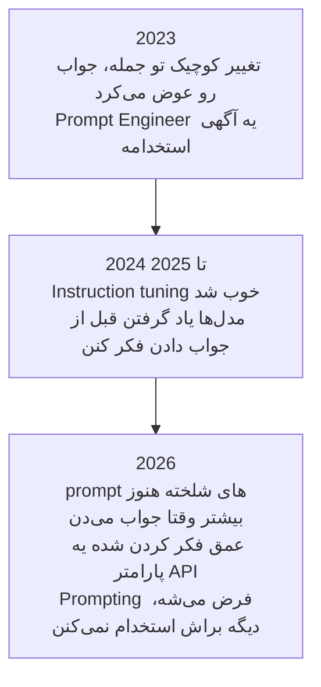
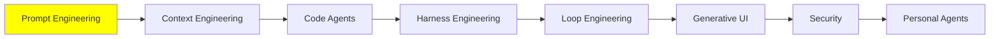

# Prompt Engineering

[مبانی LLM](../1_fundamentals/llms_fa.md) با یه پاراگراف درباره‌ی Prompt Engineering تموم شد. این ماژول همون پاراگرافه، فقط این‌بار بازش کردیم و کامل توضیحش دادیم.

> **Prompt Engineering یعنی نوشتن یه ورودی که مدل رو به خروجی‌ای که انتظارش رو داری می‌رسونه.**

اول ببینیم مدل دقیقاً چیه. یه شبکه‌ی عصبیه که از قبل آموزش دیده و وزن‌هاش (weights) ثابت‌ن. این مدل نه state‌ای داره نه حافظه‌ای؛ هر بار یه ورودی می‌گیره، یه خروجی می‌ده، و هیچی از دفعه‌ی قبل به دفعه‌ی بعد منتقل نمی‌شه. پس مدل ثابته و تنها چیزی که دستته ورودیه. یعنی این ورودیه که تعیین می‌کنه جوابی که برمی‌گرده چه کیفیتی داره.

[مبانی LLM](../1_fundamentals/llms_fa.md) همون‌جا نوشته بود که مدل دقیقاً چی رو حساب می‌کنه:

```
P(next token | context)
```

prompt تو دقیقاً همون context‌ه. پس کل کار می‌شه یه مسئله‌ی جست‌وجو:

```
best prompt = the prompt that maximises P(the output you want | prompt)
```

هر تکنیکی که پایین‌تر می‌آد، در واقع به یه سؤال جواب می‌ده: چه‌جوری prompt رو بنویسی که خروجی‌ای که انتظارش رو داری بگیری؟

## اصلاً چرا به Prompt Engineering نیاز داریم؟

احتمالاً همین الان یه اعتراض تو ذهنته. اگه وزن‌ها ثابت‌ن و مدل هیچی یادش نمی‌مونه، پس چرا وقتی یه سؤال رو دو جوری می‌پرسی، دو تا جواب متفاوت می‌گیری؟

چون دو تا جمله‌بندی، دو تا ورودی‌ی متفاوتن. ضمناً مدل اصلاً به سؤال جواب نمی‌ده؛ فقط یه شبکه رو اجرا می‌کنه. اون شبکه پر از نورونه و prompt تعیین می‌کنه کدومشون فعال بشن. بعضی‌هاشون خیلی قوی فعال می‌شن، بعضی‌ها ضعیف، و بعضی‌ها اصلاً فعال نمی‌شن. وقتی کلمات رو عوض می‌کنی، این الگوی فعال‌سازی هم عوض می‌شه، و وقتی الگو عوض بشه، خروجی هم عوض می‌شه.

  
*وزن‌ها توی هر دو حالت یکی‌ان. prompt فقط مشخص می‌کنه کدومشون استفاده بشن. برای همین همون مدل، سؤال حساب رو با یه بخش از خودش جواب می‌ده و سؤال نقاشی رو با بخش دیگه‌ای.*

یه میکسر DJ رو تصور کن. برای صدا، باس و اکو هرکدوم یه دستگیره داره. DJ سخت‌افزار رو عوض نمی‌کنه؛ دستگیره‌ها رو می‌چرخونه، گوش می‌ده، دوباره می‌چرخونه، تا وقتی که صدای سالن درست دربیاد. prompt تو هم یه تنظیم از همین دستگیره‌هاست. Prompt Engineering یعنی نوشتن متنی که بخش‌هایی از شبکه رو که این کار لازم داره روشن کنه.

  
*هر دستگیره‌ای که اینجا می‌بینی، چیزیه که این ماژول بهش می‌پردازه. هیچ‌کدوم‌شون روی پنلی نیستن که دستت بهشون برسه؛ فقط متن prompt می‌تونه تکونشون بده.*

ولی دستگیره‌ها برچسب ندارن و تو هم بهشون دسترسی نداری. فقط از راه متن می‌شه تکونشون داد. برای همین این کار بیشتر تجربیه تا نظری، و به همین دلیل هم هیچ‌کس نمی‌تونه prompt درست رو برای کار تو از قبل بهت بده.

## یه prompt ضعیف چی از دستت می‌گیره

دو تا راننده، با یه ماشین و توی یه پیست، زمان دورهاشون فرق داره. موتور هر دو یکیه، قدرتش یکیه، گرفتنش یکیه و پیچ‌های پیست هم یکیه. راننده‌ی بهتر فقط بیشتر از همون ماشین درمی‌آره.

مدل‌ها هم همین‌جوری‌ان، و این یه شکایت رو توضیح می‌ده که احتمالاً قبلاً شنیدی. آدمی که مهارت prompt نوشتنش کمه، چیزی رو که می‌خواسته به دست نمی‌آره. بعدش نتیجه می‌گیره که مدل ضعیفه، یا خیلی باهوش نیست، یا فقط می‌تونه هفتاد درصد کار رو انجام بده. یکی دیگه همون مدل رو برمی‌داره، یه prompt بهتر می‌نویسه، و کار رو تموم می‌کنه.

پس وقتی یه مدل ناامیدت می‌کنه، اولین سؤال این نیست که به کدوم مدل دیگه سوئیچ کنی.

## تو 2026 دیگه Prompt Engineering مرده

آره، جدی‌ست.

وقتی حدود 2023 اولین API‌های LLM در دسترس قرار گرفتن، مدل‌ها شکننده بودن. یه تغییر کوچیک تو جمله‌بندی می‌تونست یه جواب خوب رو به یه جواب غلط تبدیل کنه. این حساسیت فقط یه حس نبود؛ اندازه‌گیری شده بود. روی مدل‌های open اون زمان، تغییرهای قالب‌بندی‌ای که معنی رو عوض نمی‌کردن، دقت رو تا [76 واحد درصد](https://arxiv.org/abs/2310.11324) جابه‌جا می‌کردن. **Prompt Engineer** یه عنوان شغلی بود. شرکت‌ها آدم استخدام می‌کردن که تمام روزشون رو با آزمون و خطا بگذرونن، تا وقتی که مدل خروجی مورد انتظار رو بده.

اون روزها گذشته. الان مدل‌ها خیلی توانمندترن. قابلیت‌هایی مثل chain of thought رو دارن، که پایین‌تر همین صفحه درباره‌شون حرف می‌زنیم. همین قابلیت‌ها باعث می‌شه مدل حتی از یه prompt شلخته هم بفهمه منظورت چی بوده. تو 2026 دیگه Prompt Engineering یه شغل نیست. یه مهارت پایه‌ست که انتظار می‌ره هرکسی که با این سیستم‌ها کار می‌کنه داشته باشه.



برای همین این ماژول فقط اون چیزهایی رو پوشش می‌ده که تو کار روزمره‌ی مهندسی AI به دردت می‌خورن. بخش پیشرفته‌تر این موضوع توی [Advanced Prompting](../3_expert/advanced_prompting.md) هست.

اگه کل فهرست تکنیک‌ها رو می‌خوای و نه فقط بخش مفیدش رو، [Prompt Engineering Guide](https://www.promptingguide.ai/) همه‌شون رو داره. یه نکته‌ی دیگه: هرچی بعداً می‌آد رو به‌عنوان نقطه‌ی شروع در نظر بگیر، نه به‌عنوان سرفصل درسی. Prompting تجربیه. آدم با نوشتن یه prompt، خوندن خروجی‌ش و عوض کردن دوباره‌ی prompt، کم‌کم توش خوب می‌شه.

## دو تا الگوی prompt

قانونش ساده‌ست: هرچی prompt واضح‌تر و دقیق‌تر باشه، جواب بهتری می‌گیری. ولی دو تا الگو هنوز ارزش دارن که بدونیشون، چون نشون می‌دن «واضح و دقیق» توی عمل یعنی چی. یعنی یه prompt که مرزهاش مشخص باشه.

الگوی ساده‌تر:

```text
{Goal}
{Output Format}
{Warnings}
{Context}
```

- **Goal**: چی می‌خوای، توی یه یا دو جمله.
- **Output Format**: شکلی که جواب باید داشته باشه.
- **Warnings**: اشتباهایی که از قبل احتمال می‌دی مدل بکنه.
- **Context**: هر چیزی درباره‌ی وضعیتت که یه غریبه برای کمک کردن بهت باید بدونه.

  
*بخش context معمولاً بلندترین و کم‌صیقل‌ترین بخشه، و اشکالی هم نداره. این همون بخشیه که هیچ الگویی نمی‌تونه برات بنویسه.*

الگوی دقیق‌تر:

```text
{Role}
{Task}
{Context}
{Reasoning}
{Output Format}
{Stop Conditions}
```

- **Role**: مدل موقع کار باید کی باشه. بخش Role Prompting پایین‌تر همین رو پوشش می‌ده.
- **Task**: خود کار، و اگه ترتیب مهمه، به‌صورت مرحله‌های شماره‌دار.
- **Context**: زمینه‌ی کار، محدودیت‌ها، و اینکه از چی باید پرهیز کنه.
- **Reasoning**: اینکه می‌خوای مدل قبل از انتخاب جوابش چه‌جوری فکر کنه.
- **Output Format**: شکل دقیق جواب، از جمله ستون‌های جدول، اگه بهشون نیاز داری.
- **Stop Conditions**: اینکه مدل از کجا بفهمه کارش تموم شده.

  
*شرط توقف همون خونه‌ایه که آدم‌ها فراموشش می‌کنن. بدون اون، «تمام شد» حدس مدله، نه تعریف تو.*

مدل‌های امروزی لازم نیست این الگوها رو دقیق دنبال کنی، و بیشتر وقتا هم دنبالشون نمی‌کنی. الگوها اینجان تا «یه prompt واضح بنویس» دیگه توصیه‌ی مبهمی نباشه.

## In-context Learning و Few-shot Prompting

مدل‌ها می‌تونن چیزهایی رو یاد بگیرن که توی وزن‌هاشون نیستن. نه از راه pre-training یادشون می‌گیرن، نه از راه fine-tuning. از چیزی یاد می‌گیرن که توی context هست، یعنی همون حافظه‌ی کاری‌ای که توی [Memory](../1_fundamentals/memory_fa.md) درباره‌ش حرف زدیم. بهش می‌گن **in-context learning**، یا به اختصار ICL.

دلیل اینکه RAG اصلاً جواب می‌ده هم همینه. توی [RAG و Embedding‌ها](../1_fundamentals/rag_fa.md) دیدیم که وزن‌ها هیچ‌وقت عوض نمی‌شن. سندهایی که بازیابی می‌شن وارد context می‌شن و مدل همون لحظه ازشون استفاده می‌کنه. کتابخونه بسته می‌مونه، و تو فقط چیزی رو که لازمه روی میزت می‌ذاری.

یه بار دیگه به هر دو الگو نگاه کن: هر کدوم یه خونه برای context دارن. اون خونه تنها جاییه که دانشی رو که مدل یه لحظه پیش نداشت بهش می‌دی.

ICL یه تکنیک هم بهت می‌ده. **Few-shot prompting** یعنی قبل از اینکه کار واقعی رو بدی، چند تا نمونه‌ی درست از همون کار رو به مدل نشون بدی:

```text
Classify the sentiment of each message as positive, negative or neutral.

Message: "the package arrived two days early"
Sentiment: positive

Message: "the box was crushed and the mug inside was broken"
Sentiment: negative

Message: "delivery is scheduled for Thursday"
Sentiment: neutral

Message: "it works, but the app crashed twice"
Sentiment:
```

این سه تا نمونه همزمان دو کار می‌کنن. اول اینکه مجموعه‌ی برچسب‌ها رو ثابت می‌کنن، پس جواب یکی از سه کلمه می‌شه و نه یه پاراگراف پر از ظرافت. دوم اینکه قالب رو ثابت می‌کنن، پس جواب به شکل `Sentiment: <label>` درمیاد و کدت می‌تونه بخونتش. معمولاً همین ترکیبه که باعث می‌شه نمونه‌ها کار کنن، جایی که یه دستور تنها کار نمی‌کرد.

استفاده از چند تا نمونه می‌شه **few-shot**، و استفاده از هیچ نمونه‌ای **zero-shot**. تو هر بار که یه سؤال توی پنجره‌ی چت تایپ کردی، داشتی zero-shot کار می‌کردی.

## چند نکته‌ی عملی برای نوشتن prompt

### واضح و مستقیم باش

نسخه‌ی کم‌اثر:

```text
Create an analytics dashboard
```

نسخه‌ی مؤثرتر:

```text
Create an analytics dashboard. Include as many relevant features and interactions as possible. Go beyond the basics to create a fully-featured implementation.
```

prompt دوم مؤدب‌تر یا بهتر نوشته‌شده نیست. فرقش اینه که خیلی بیشتر می‌گه «تموم شده» یعنی چی. هر دو مثال از راهنمای [prompting best practices](https://platform.claude.com/docs/en/build-with-claude/prompt-engineering/claude-prompting-best-practices) شرکت Anthropic گرفته شدن.

### context بده، دلیلت رو هم بگو

مدل از چیزی که توی context هست یاد می‌گیره. پس بهش بگو *چرا* یه قانون وجود داره، نه فقط اینکه قانون چیه.

نسخه‌ی کم‌اثر:

```text
NEVER use ellipses
```

نسخه‌ی مؤثرتر:

```text
Your response will be read aloud by a text-to-speech engine, so never use ellipses since the text-to-speech engine will not know how to pronounce them.
```

اولی یه قانونه که مدل باید بدون اینکه دلیلش رو بدونه اجراش کنه. دومی به مدل اجازه می‌ده تعمیم بده. مدل از علامت‌های نگارشی دیگه‌ای هم که موتور گفتار اشتباه می‌خونه دوری می‌کنه، حتی اون‌هایی که اصلاً فکرشون رو هم نکرده بودی که فهرست کنی.

### به prompt ساختار بده

خیلی وقتا می‌خوای prompt رو به بخش تقسیم کنی. بخش‌ها به مدل نشون می‌دن:

- کدوم بخش دستوره؛
- کدوم بخش داده‌ست؛
- کدوم بخش هدفه؛
- و کدوم بخش خروجی رو توصیف می‌کنه.

ساختار باعث می‌شه prompt راحت‌تر خونده بشه و بخش‌ها از هم جدا بمونن. علاوه بر این، نتیجه رو هم عوض می‌کنه، و می‌تونی این تغییر رو اندازه بگیری.

می‌تونی از تگ‌های XML استفاده کنی. مدل‌های Anthropic برای اینا تنظیم شدن:

```xml
<identity>
You are a support engineer for a company that hosts Postgres databases.
</identity>

<goal>
Read the customer ticket below and decide whether it is a billing question, a
technical question, or both.
</goal>

<output_format>
One line: BILLING, TECHNICAL or BOTH, followed by a one-sentence reason.
</output_format>
```

همون چیز رو با markdown:

```markdown
## Identity
You are a support engineer for a company that hosts Postgres databases.

## Goal
Decide whether the ticket below is a billing question, a technical question, or both.

### How to do it
Read the whole ticket first. Ignore the customer's own guess about the cause.

## Output format
One line: BILLING, TECHNICAL or BOTH, followed by a one-sentence reason.
```

تودرتو کردن توی هر دو قالب کار می‌کنه، و مدل سلسله‌مراتب رو همون‌طور که هست می‌خونه. یه `###` زیر یه `##` یعنی جزئیاتی که به اون تعلق داره. سطح بالاتر هم وزن بیشتری داره.

قالب لازم نیست استاندارد باشه. اگه جور درآمد، می‌تونی خودت یکی بسازی:

```text
Please read the emails below from my boss and my friend:

=== Boss Email ===
Write down the report of what you have done.

=== Friend Email ===
Write a poem for me.

=== Your Task ===
Please write a polite reply to both emails.
```

چرا این جداکننده‌ها لازمن؟ بدون اون‌ها، «Write a poem for me» دقیقاً شبیه یه دستور از طرف تو به نظر می‌آد. مدل ممکنه با خوشحالی یه شعر بنویسه و اصلاً به هیچ‌کدوم از ایمیل‌ها جواب نده. توی یه prompt بلند و شلوغ، بیشترین چیزی که ساختار بهت می‌ده همینه: مدل می‌تونه دستورهای تو رو از متنی که چسبوندی تشخیص بده. گاهی هم متنی که چسبوندی نه فقط گیج‌کننده، بلکه خصمانه‌ست. اون وقت همون مشکل اسم داره، یعنی prompt injection، و ماژول مخصوص خودش رو داره: [Security](security_fa.md).

## Chain of Thought

تحقیقات یه چیزی رو پیدا کردن که وقتی بشنوی، بدیهی به نظر می‌رسه. یه مدل می‌تونه یه کار سخت رو به کارهای کوچیک‌تر تقسیم کنه و مراحل میانی رو *قبل* از جواب نهایی بنویسه. وقتی این کار رو می‌کنه، جواب نهایی بهتر می‌شه. دقیقاً مثل وقتیه که حساب رو روی کاغذ انجام می‌دی، نه توی ذهنت.

از یه مدل این رو بپرس:

```text
The cafeteria had 23 apples. They used 20 for lunch and bought 6 more. How many now?
```

با یه prompt ساده، مدل مستقیم جواب می‌ده:

```text
Final Answer: 32 apples
```

این جواب غلطه. حالا مدل رو مجبور کن اول فکر کنه. بذار قبل از اینکه جواب رو انتخاب کنه، نتیجه‌های میانی‌ش رو بنویسه:

```text
<thinking>
The user wants the final number of apples in the cafeteria. Steps:
start with the initial number, subtract the apples used for lunch, add the apples bought later.

Initial apples: 23. Apples used for lunch: 20. Apples bought: 6.

Step 1: apples remaining after lunch. 23 - 20 = 3 apples.
Step 2: final number after buying more. 3 + 6 = 9 apples.
</thinking>

Final Answer: 9 apples
```

یه جورایی حس جادو میده، ولی بیشتر به یه کار خونه‌داری شبیهه. یه مدل **autoregressive** هست: هر token‌ای که می‌نویسه، می‌شه بخشی از ورودی‌ای که برای token بعدی می‌خونه. وقتی `23 - 20 = 3` رو می‌نویسه، این نتیجه الان توی context‌شه. پس مدل دیگه لازم نیست نتیجه رو توی ذهنش نگه داره وقتی داره بقیه‌ی کار رو انجام می‌ده. برای یه مدل، نوشتن همون فکر کردنه.

نویسنده‌ی این دوره یه [Chain of Thought Visualizer](https://cot-visualizer.online/) ساخته که می‌تونی هر دو حالت رو کنار هم روی یه مجموعه پازل ببینی. این یه نمایشه، نه یه benchmark: سمت ساده عمداً طوری prompt شده که بد جواب بده. اگه بخوای بفهمی چرا اصلاً این‌ها کار می‌کنن، مطالعه‌ی بعدی این مقاله‌ست: [Why Can Large Language Models Generate Correct Chain-of-Thoughts?](https://arxiv.org/abs/2310.13571)

### Chain of Thought هم دلیلی بود که عنوان شغلی از بین رفت

تو 2026 تقریباً هیچ‌وقت دستی یه prompt از نوع chain of thought نمی‌نویسی.

وقتی ChatGPT یا یه agent نشون می‌ده که داره «فکر می‌کنه»، این همون chain of thought‌ه. این‌جوری نیست که کسی تایپ کرده باشه *let us think step by step*. این اتفاق می‌افته چون مدل آموزش دیده که قبل از جواب دادن استدلال کنه. همیشه هم این کار رو می‌کنه، خواسته باشی یا نه.

حالا میزان فکر کردن مدل یه دکمه‌ست، نه یه جمله‌ی prompt. وقتی آدم‌ها می‌گن مدل رو روی thinking زیاد اجرا کن، یا effort کم، یا effort بیشینه، همین منظورشونه. [پارامتر effort](https://platform.claude.com/docs/en/build-with-claude/effort) مال Anthropic مقادیر `low`، `medium`، `high`، `xhigh` و `max` رو می‌گیره. بقیه‌ی ارائه‌دهنده‌ها هم نسخه‌ی خودشون رو از همین دکمه دارن. فکر کردن بیشتر یعنی جواب‌های بهتر روی مسئله‌های سخت. ولی یعنی هزینه‌ی بیشتر، جواب‌های کندتر، و context‌ای که زودتر پر می‌شه.

> **نکته، فکر کردن بیشتر همیشه بهتر نیست.** مدل‌ها هم مثل آدم‌ها می‌تونن بیش از حد فکر کنن، و وقتی این کار رو می‌کنن عملکردشون افت می‌کنه. این موضوع خوب مستند شده:
>
> - [Stop Overthinking](https://arxiv.org/abs/2503.16419) کل این حوزه رو مرور می‌کنه.
> - [The Danger of Overthinking](https://arxiv.org/abs/2502.08235) نزدیک به 30 درصد نتیجه‌ی بهتر روی کارهای مهندسی نرم‌افزار پیدا کرد، و این کار رو با انتخاب راه‌حل‌هایی کرد که کمترین overthinking رو داشتن.
> - [When More Thinking Hurts](https://aclanthology.org/2026.findings-acl.1199/) نشون می‌ده که مدل‌ها جواب‌های درستی رو که از قبل داشتن کنار می‌ذارن.
> - [OptimalThinkingBench](https://proceedings.iclr.cc/paper_files/paper/2026/hash/0f63515b14f33c008158213c7b6191c6-Abstract-Conference.html)
>   نتیجه می‌گیره که هنوز هیچ مدلی برای سؤالی که جلویشه، اندازه‌ی درست فکر کردن رو پیدا نکرده.

پس مهارت واقعی اینه که میزان فکر کردن رو با سختی کار هماهنگ کنی. این بودجه‌ی فکر کردن یه پارامتره که خودت تنظیمش می‌کنی، نه یه جمله‌ای که بنویسی.

## Role Prompting

Role prompting یعنی قبل از اینکه کار رو بدی، به مدل یه شغل، یه persona یا یه شخصیت بدی.

> **نکته، system prompt چیه؟** system prompt فقط یه بار، توی بالای context ظاهر می‌شه و رفتار مدل رو برای کل مکالمه تعیین می‌کنه. سازنده‌ی مدل یا سازنده‌ی agent اون رو می‌نویسه، نه کاربر، و معمولاً هم بلنده. ابزارها هم اونجا ثبت می‌شن، با schema‌ها و توضیحاتشون ([Tool Calling](../1_fundamentals/tools_fa.md)). اگه بخوای system prompt‌های واقعی رو ببینی، [system prompt leaks](https://github.com/asgeirtj/system_prompts_leaks) اون‌ها رو کلمه به کلمه از ChatGPT، Claude، Gemini، Grok و بقیه جمع کرده.

  
*این همون شکلیه که توی [مبانی LLM](../1_fundamentals/llms_fa.md) هم بود. نقش توی بخش هویت و دستورها قرار می‌گیره. هر چیزی که توی این جعبه‌ست، قبل از اینکه کاربر حرفی بزنه نوشته شده.*

برای همین role prompting اینجا جا داره: نقش بهترین کارش رو توی system prompt انجام می‌ده. مثال‌های خود تکنیک هم همون‌قدر ساده‌ن که به نظر می‌رسن:

```text
Act as a senior software engineer. Review this code and find security bugs.
```

```text
You are William Shakespeare. Write a short poem about summer.
```

نقش دو کار رو خوب انجام می‌ده. اول اینکه دیدگاه رو تعیین می‌کنه: به مدل می‌گه کی هست، مثلاً یه مدیر منابع انسانی، یه سرآشپز، یا یه مصاحبه‌گر data science. دوم اینکه لحن و سبک رو شکل می‌ده. واژگان، سطح تخصصی‌ای که فرض می‌شه و قالب‌بندی رو با اون نقش هماهنگ می‌کنه.

ولی نقش به طور قابل اتکا مدل رو باهوش‌تر نمی‌کنه. این امید اولیه بود و درست از آب درنیومد. پرسونا توی system prompt‌ها [روی عملکرد تأثیری نداره](https://arxiv.org/abs/2311.10054) در طیف وسیعی از سؤال‌ها. یه مطالعه‌ی پیگیری در 2026 دید که prompt پرسونا [عمق تخصص رو بالا می‌بره ولی وضوح رو کم می‌کنه](https://arxiv.org/abs/2605.29420). این اثر به سؤال و حوزه بستگی داره. پس از نقش برای شکل دادن به *چگونگی* خوانده شدن جواب استفاده کن، و انتظار نداشته باش سقف توانایی مدل رو بالا ببره.

نقش‌ها وقتی بیشترین کاربرد رو دارن که agent می‌سازی. وقتی درباره‌ی طراحی یه agent حرف می‌زنیم، بیشتر منظورمون انتخاب یه system prompt و یه مجموعه ابزار برای یه کار مشخصه. مثلاً فرض کن می‌خوای یه تیم code review داشته باشی:

1. **Code Review Agent.** System prompt: کد رو از نظر ایرادهای ساختاری، منطقی و معماری بررسی کن. فهرستی از باگ‌ها و گلوگاه‌های performance رو به‌صورت bullet برگردون. هرگز درباره‌ی style یا security نظر نده. ابزارها: `fetch_repository_files`، `run_ast_parser`.
2. **Security Auditor Agent.** System prompt: فقط دنبال آسیب‌پذیری‌ها، نشت داده و ریسک‌های dependency بگرد. هرکدوم رو به‌عنوان High، Medium یا Low رتبه‌بندی کن. پیشنهاد feature یا refactoring نده. ابزارها: `run_sast_scanner`، `check_cve_database`.
3. **Clean Code Formatter Agent.** System prompt: کدی رو که کار می‌کنه برای خوانایی و قابل نگهداری بودن refactor کن. DRY و نام‌گذاری استاندارد رو اعمال کن. منطق کد رو عوض نکن و دنبال باگ نگرد. ابزارها: `execute_linter_auto_fix`، `generate_docstrings`.

سه تا agent، یه مدل. فرقشون فقط توی نقش، دستورها و ابزارهاشونه. [Multi-Agent Systems](../1_fundamentals/multi_agent_fa.md) بی‌سروصدا همین رو فرض کرده بود، وقتی نموداری از یه supervisor کشید که کار رو به متخصص‌ها می‌ده.

ولی مراقب باش. نقش کل رفتار رو عوض می‌کنه، نه فقط بخشی رو که می‌خواستی عوض کنی. اگه به مدل نقش یه متخصص امنیت بدی و بعد درباره‌ی تاریخ هنر ازش بپرسی، جوابی که می‌گیری ممکنه از وقتی هیچ نقشی نداشت بدتر باشه.

این ما رو دوباره به میکسر برمی‌گردونه. «Act as a security expert» بخش‌هایی از شبکه رو که دانش امنیتی دارن بلند می‌کنه، و بخش‌هایی که تاریخ هنر دارن رو پایین نگه می‌داره. از این زاویه، role prompting یه مسئله‌ی بازیابیه. تو دانش تازه‌ای به مدل اضافه نمی‌کنی؛ داری انتخاب می‌کنی کدوم دانش موجودش استفاده بشه. و این هم همون نقطه‌ی ضعفشه، چون دستگیره‌هایی که پایین گذاشتی وقتی سؤال عوض می‌شه، پایین می‌مونن.

## کجای این مجموعه هستیم



## خلاصه

Prompt Engineering یعنی نوشتن ورودی‌ای که احتمال اینکه خروجی‌ای که می‌خوای بیاد رو بالا ببره. وزن‌ها ثابت‌ن، پس prompt تنها دکمه‌ایه که داری. جمله‌بندی‌های متفاوت، بخش‌های متفاوتی از همون شبکه رو فعال می‌کنن.

چیزهایی که به‌طور قابل اتکا کمک می‌کنن، چیزهای معمولی‌ان:

- دقیقاً بگو چی می‌خوای؛
- دلیلش رو توضیح بده؛
- به مدل context بده؛
- یه یا دو تا نمونه نشونش بده؛
- یه prompt بلند رو طوری ساختاربندی کن که دستورهات با داده‌هات قاطی نشه.

chain of thought هم قبلاً یکی از همین تکنیک‌ها بود. حالا خود مدل‌ها اون رو توی خودشون دارن. بخش زیادی از دلیل اینکه عنوان شغلی از بین رفت و prompt نوشتن به یه مهارت پایه تبدیل شد، همینه.

بعدی: همه‌چیِ داخل context window، و اینکه چه‌جوری تصمیم بگیری کدوم‌شون جا رو می‌ارزن.

**بررسی سریع**: چرا یه مدل ثابت وقتی یه سؤال رو با کلمات دیگه‌ای می‌پرسی، جواب متفاوتی می‌ده؟ و یه role prompt دقیقاً چی رو عوض می‌کنه؟

## منابع

- [Prompt Engineering Guide](https://www.promptingguide.ai/): فهرست کامل تکنیک‌ها، خیلی بیشتر از چیزی که اینجا پوشش دادیم
- [Prompting best practices](https://platform.claude.com/docs/en/build-with-claude/prompt-engineering/claude-prompting-best-practices): راهنمای فعلی Anthropic، و منبع دو تا مثال قبل و بعد
- [Quantifying Language Models' Sensitivity to Spurious Features in Prompt Design](https://arxiv.org/abs/2310.11324): اندازه‌گیری‌ای از اینکه مدل‌های نسل 2023 واقعاً چقدر شکننده بودن
- [Why Can Large Language Models Generate Correct Chain-of-Thoughts?](https://arxiv.org/abs/2310.13571): نظریه‌ی پشت این ایده که نوشتن همون فکر کردنه
- [Chain of Thought Visualizer](https://cot-visualizer.online/): یه نمایش کنار هم از استدلال کردن در برابر جواب فوری
- [Effort](https://platform.claude.com/docs/en/build-with-claude/effort): دکمه‌ی فکر کردن، و اینکه هر سطحش برای چیه
- [Stop Overthinking: A Survey on Efficient Reasoning for Large Language Models](https://arxiv.org/abs/2503.16419): پژوهش‌های مربوط به overthinking، یک‌جا
- [When "A Helpful Assistant" Is Not Really Helpful](https://arxiv.org/abs/2311.10054): مطالعه‌ای که نشون داد prompt‌های پرسونا کمتر از چیزی که آدم‌ها امید داشتن کمک می‌کنن
- [System prompt leaks](https://github.com/asgeirtj/system_prompts_leaks): system prompt‌های واقعی محصولات، کلمه به کلمه کپی شده
- [Advanced Prompting](../3_expert/advanced_prompting.md): تکنیک‌هایی که این ماژول عمداً ازشون رد شد
