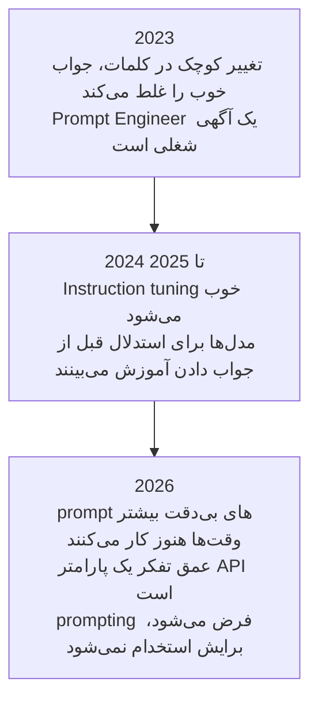

# Prompt Engineering

[مبانی LLM](../1_fundamentals/llms_fa.md) با یک پاراگراف درباره prompt engineering تمام شد.
این ماژول (module) همان پاراگراف است، با جزئیات بیشتر.

> **Prompt engineering یعنی نوشتن یک ورودی (input) که مدل را به خروجی‌ای می‌رساند که انتظار دارید.**

ابتدا ببینیم مدل چیست. مدل یک شبکه‌ی عصبی (neural network) از پیش آموزش‌دیده (pre-trained) است. weights آن ثابت است و هیچ state و memory ندارد. ورودی (input) وارد می‌شود و خروجی (output) بیرون می‌آید، هر بار. هیچ چیزی از یک بار به بار بعد منتقل نمی‌شود. پس مدل ثابت است و تنها چیزی که شما کنترل می‌کنید ورودی است. به همین دلیل، ورودی تنها چیزی است که می‌تواند کیفیت خروجی را تعیین کند.

[مبانی LLM](../1_fundamentals/llms_fa.md) نوشت که مدل چه چیزی را محاسبه می‌کند:

```
P(next token | context)
```

prompt شما *همان* context است. پس کل کار یک مسئله‌ی جست‌وجو است:

```
best prompt = the prompt that maximises P(the output you want | prompt)
```

هر چیزی که در ادامه می‌آید یک تکنیک است که به یک سؤال جواب می‌دهد: چطور prompt را بنویسیم تا خروجی‌ای بگیریم که انتظارش را داریم؟

## چرا اصلاً به Prompt Engineering نیاز داریم؟

احتمالاً همین حالا یک اعتراض در ذهن دارید. اگر weights ثابت باشد و مدل چیزی را به یاد نسپارد، چرا وقتی یک سؤال را به دو شکل متفاوت می‌پرسید، دو جواب متفاوت می‌گیرید؟

چون دو شکل جمله‌بندی، دو ورودی یکسان نیستند. و مدل به سؤال‌ها جواب نمی‌دهد. مدل یک شبکه را اجرا می‌کند.

آن شبکه نورون‌ها (neurons) را دارد و prompt تعیین می‌کند کدام‌یک از آن‌ها فعال شوند. بعضی‌ها قوی فعال می‌شوند، بعضی‌ها ضعیف، و بعضی اصلاً فعال نمی‌شوند. وقتی کلمات را عوض می‌کنید، آن الگو را عوض می‌کنید. وقتی الگو عوض شود، خروجی هم عوض می‌شود.

  
*weights در هر دو حالت یکسان است. prompt فقط تعیین می‌کند کدام بخش‌ها استفاده شوند. به همین خاطر، همان مدل یک سؤال حسابی را با یک بخش از خودش جواب می‌دهد و یک سؤال درباره‌ی نقاشی را با بخش دیگری از خودش.*

به یک میکسر DJ فکر کنید. این میکسر برای صدا، باس و اکو هر کدام یک دکمه دارد. DJ هرگز سخت‌افزار را عوض نمی‌کند. او دکمه‌ها را می‌چرخاند، گوش می‌دهد، و دوباره آن‌ها را می‌چرخاند تا صدای اتاق درست شود. prompt شما یک تنظیم از همین دکمه‌هاست. Prompt engineering یعنی نوشتن متنی که بخش‌هایی از شبکه را که برای این کار لازم دارید بلند می‌کند.

  
*هر دکمه‌ای در این تصویر چیزی است که این ماژول درباره‌اش حرف می‌زند. هیچ‌کدام روی پنلی نیست که بتوانید لمسش کنید: فقط متن prompt آن‌ها را جابه‌جا می‌کند.*

اما این دکمه‌ها برچسبی ندارند و شما به آن‌ها دسترسی ندارید. متن تنها راه جابه‌جا کردن آن‌هاست. به همین دلیل این کار تجربی است و نظری نیست. و به همین دلیل هم هیچ‌کس نمی‌تواند prompt درست کار شما را به شما بدهد.

## یک prompt ضعیف چه هزینه‌ای دارد

دو راننده با یک ماشین، یک پیست را دور می‌زنند و زمان دورشان با هم فرق می‌کند. هر دو موتور، اسب‌بخار (horsepower)، چسبندگی و پیچ‌های یکسانی دارند. راننده‌ی بهتر فقط بیشتر از ماشین بیرون می‌کشد.

مدل‌ها هم همین‌طورند، و این شکایتی را توضیح می‌دهد که احتمالاً قبلاً هم شنیده‌اید. کسی که مهارت کمی در نوشتن prompt دارد، آنچه را می‌خواست نمی‌گیرد. او نتیجه می‌گیرد که مدل ضعیف است، یا خیلی باهوش نیست، یا فقط می‌تواند هفتاد درصد کار را انجام دهد. کس دیگری همان مدل را برمی‌دارد، یک prompt بهتر می‌نویسد و کار را تمام می‌کند.

پس وقتی مدلی شما را ناامید می‌کند، اولین سؤال این نیست که به کدام مدل دیگر سوییچ کنیم.

## Prompt Engineering در سال 2026 مرده است

بله، واقعاً.

وقتی اولین API‌های LLM حدود سال 2023 در دسترس قرار گرفتند، مدل‌ها شکننده بودند. یک تغییر کوچک در جمله‌بندی می‌توانست یک جواب خوب را به یک جواب غلط تبدیل کند. این حساسیت اندازه‌گیری شده بود و فقط تصور نبود. در مدل‌های باز آن زمان، تغییرهای قالب‌بندی‌ای که معنی را عوض نمی‌کرد، دقت را تا [76 واحد درصد](https://arxiv.org/abs/2310.11324) جابه‌جا می‌کرد. **Prompt Engineer** یک عنوان شغلی بود. شرکت‌ها آدم استخدام می‌کردند تا تمام روز را صرف آزمون و خطا کنند، تا وقتی که مدل خروجی مورد انتظار را بدهد.

آن روزها گذشته است. مدل‌ها حالا خیلی توانمندتر شده‌اند. آن‌ها توانایی‌هایی مثل chain of thought دارند که پایین‌تر در همین صفحه توضیح داده شده است. این توانایی‌ها به مدل کمک می‌کنند منظور شما را بفهمد، حتی از روی یک prompt بی‌دقت. در سال 2026، prompt engineering یک شغل نیست. یک مهارت پایه است که از هر کسی که با این سیستم‌ها کار می‌کند انتظار می‌رود داشته باشد.



به همین دلیل این ماژول فقط چیزهایی را پوشش می‌دهد که در کار روزانه‌ی مهندسی AI مفیدند. بخش پیشرفته‌تر این موضوع در [Advanced Prompting](../3_expert/advanced_prompting.md) آمده است.

اگر فهرست کامل را می‌خواهید، و نه فقط بخش مفید آن را، [Prompt Engineering
Guide](https://www.promptingguide.ai/) آن را دارد. همچنین، آنچه در ادامه می‌آید را نقطه‌ی شروع بدانید، نه سرفصل یک درس. Prompting تجربی است. شما با نوشتن یک prompt، خواندن خروجی و تغییر دادن prompt در آن، خوب می‌شوید.

## دو الگوی prompt

قاعده ساده است: یک prompt واضح‌تر و دقیق‌تر، جواب بهتری می‌گیرد. با این حال، دانستن دو الگو هنوز مفید است، چون نشان می‌دهند «واضح و دقیق» در عمل یعنی چه. یعنی یک prompt که مرزهای مشخصی دارد.

الگوی ساده:

```text
{Goal}
{Output Format}
{Warnings}
{Context}
```

- **Goal**: چیزی که می‌خواهید، در یک یا دو جمله.
- **Output Format**: شکلی که جواب باید به آن شکل باشد.
- **Warnings**: اشتباه‌هایی که از قبل انتظار دارید مدل انجام دهد.
- **Context**: هر چیزی درباره‌ی وضعیت شما که یک غریبه برای کمک کردن به شما باید بداند.

  
*انبوه context طولانی‌ترین بخش است و کم‌صیقل‌ترین بخش هم هست، و این اشکالی ندارد. این همان بخشی است که هیچ الگویی نمی‌تواند به جای شما بنویسد.*

الگوی دقیق‌تر:

```text
{Role}
{Task}
{Context}
{Reasoning}
{Output Format}
{Stop Conditions}
```

- **Role**: مدل وقتی کار می‌کند باید چه کسی باشد. بخش role prompting پایین‌تر این را پوشش می‌دهد.
- **Task**: خود کار، به صورت مراحل شماره‌دار وقتی ترتیب مهم است.
- **Context**: پس‌زمینه، محدودیت‌ها، و آنچه باید از آن پرهیز شود.
- **Reasoning**: اینکه می‌خواهید مدل قبل از تصمیم‌گیری درباره‌ی جواب، چطور فکر کند.
- **Output Format**: شکل دقیق، شامل ستون‌های جدول وقتی لازم باشند.
- **Stop Conditions**: اینکه مدل از کجا بفهمد کارش تمام شده است.

  
*شرط‌های توقف (stop conditions) بخشی است که آدم‌ها اغلب فراموشش می‌کنند. بدون آن، «تمام شد» حدس مدل است و نه تعریف شما.*

مدل‌های امروزی لازم نیست که دقیقاً از هیچ‌کدام از این الگوها پیروی کنید، و بیشتر وقت‌ها هم این کار را نمی‌کنید. الگوها اینجا هستند تا «یک prompt واضح بنویس» دیگر یک توصیه‌ی مبهم نباشد.

## In-context Learning و Few-shot Prompting

مدل‌ها می‌توانند چیزهایی را یاد بگیرند که در weights‌شان نیست. آن‌ها این چیزها را نه از طریق pre-training یاد می‌گیرند و نه از طریق fine-tuning. آن‌ها این‌ها را از چیزی یاد می‌گیرند که در context است، یعنی همان حافظه‌ی کاری‌ای که در [Memory](../1_fundamentals/memory_fa.md) توضیح داده شد. به این کار می‌گویند **in-context learning** یا ICL.

این همچنین دلیلی است که RAG اصلاً کار می‌کند. در [RAG و Embedding‌ها](../1_fundamentals/rag_fa.md)، weights هرگز تغییر نمی‌کنند. سندهای بازیابی‌شده وارد context می‌شوند و مدل فوراً از آن‌ها استفاده می‌کند. کتابخانه بسته می‌ماند، و شما آنچه را لازم دارید روی میز می‌گذارید.

به هر دو الگو دوباره نگاه کنید: هر کدام یک جای خالی برای context دارند. آن جای خالی تنها جایی است که به مدل دانشی می‌دهید که یک لحظه پیش نداشت.

ICL یک تکنیک هم به شما می‌دهد. **Few-shot prompting** یعنی قبل از دادن کار واقعی، چند نمونه‌ی درست از همان کار را به مدل نشان دهید:

```text
Classify the sentiment of each message as positive, negative or neutral.

Message: "the package arrived two days early"
Sentiment: positive

Message: "the box was crushed and the mug inside was broken"
Sentiment: negative

Message: "delivery is scheduled for Thursday"
Sentiment: neutral

Message: "it works, but the app crashed twice"
Sentiment:
```

این سه نمونه دو کار را همزمان انجام می‌دهند. اول، مجموعه‌ی برچسب‌ها (label set) را ثابت می‌کنند، پس جواب یکی از سه کلمه است و نه یک پاراگراف پر از ظرافت. دوم، قالب را ثابت می‌کنند، پس جواب به شکل `Sentiment: <label>` می‌آید و کد شما می‌تواند آن را بخواند. این ترکیب معمولاً دلیلی است که نمونه‌ها کار می‌کنند، جایی که یک دستور تنها کار نمی‌کرد.

استفاده از چند نمونه، **few-shot** است. استفاده از هیچ نمونه‌ای، **zero-shot** است. هر بار که سؤالی را در یک پنجره‌ی چت تایپ کرده‌اید، در واقع zero-shot بوده است.

## نکته‌های Prompt Engineering

### واضح و مستقیم باشید

ضعیف‌تر:

```text
Create an analytics dashboard
```

بهتر:

```text
Create an analytics dashboard. Include as many relevant features and interactions as possible. Go beyond the basics to create a fully-featured implementation.
```

prompt دوم مؤدبانه‌تر یا بهتر نوشته نشده است. تفاوتش این است که درباره‌ی اینکه «تمام شده» چه شکلی است، خیلی بیشتر می‌گوید. هر دو مثال از [prompting best
practices](https://platform.claude.com/docs/en/build-with-claude/prompt-engineering/claude-prompting-best-practices) مربوط به Anthropic گرفته شده‌اند.

### Context اضافه کنید، از جمله دلیل‌هایتان

مدل از چیزی یاد می‌گیرد که در context است. پس به آن بگویید *چرا* یک قاعده وجود دارد، و نه فقط اینکه قاعده چیست.

ضعیف‌تر:

```text
NEVER use ellipses
```

بهتر:

```text
Your response will be read aloud by a text-to-speech engine, so never use ellipses since the text-to-speech engine will not know how to pronounce them.
```

اولی قاعده‌ای است که مدل باید بدون دانستن دلیلش از آن پیروی کند. دومی به مدل اجازه می‌دهد آن را تعمیم دهد (generalise). مدل علامت‌های نگارشی دیگری را هم که موتور گفتار اشتباه می‌خواند کنار می‌گذارد، حتی علامت‌هایی را که شما هرگز به فهرست کردنشان فکر نکرده‌اید.

### به prompt ساختار بدهید

اغلب می‌خواهید یک prompt را به بخش‌ها تقسیم کنید. بخش‌ها به مدل نشان می‌دهند:

- کدام بخش دستور (instruction) است؛
- کدام بخش داده است؛
- کدام بخش هدف است؛
- کدام بخش خروجی را توصیف می‌کند.

ساختار، خواندن prompt را آسان‌تر می‌کند و بخش‌ها را از هم جدا نگه می‌دارد. همچنین نتیجه‌ها را هم عوض می‌کند، و شما می‌توانید این تغییر را اندازه بگیرید.

می‌توانید از XML tag استفاده کنید. مدل‌های Anthropic برای آن‌ها تنظیم شده‌اند:

```xml
<identity>
You are a support engineer for a company that hosts Postgres databases.
</identity>

<goal>
Read the customer ticket below and decide whether it is a billing question, a
technical question, or both.
</goal>

<output_format>
One line: BILLING, TECHNICAL or BOTH, followed by a one-sentence reason.
</output_format>
```

همین کار در markdown:

```markdown
## Identity
You are a support engineer for a company that hosts Postgres databases.

## Goal
Decide whether the ticket below is a billing question, a technical question, or both.

### How to do it
Read the whole ticket first. Ignore the customer's own guess about the cause.

## Output format
One line: BILLING, TECHNICAL or BOTH, followed by a one-sentence reason.
```

تودرتو کردن در هر دو قالب کار می‌کند، و مدل سلسله‌مراتب را همان‌طور که هست می‌خواند. یک `###` زیر یک `##` جزئیاتی است که به آن تعلق دارد. سطح بالاتر اهمیت بیشتری دارد.

قالب لازم نیست یک قالب استاندارد باشد. وقتی مناسب باشد، می‌توانید قالب خودتان را بسازید:

```text
Please read the emails below from my boss and my friend:

=== Boss Email ===
Write down the report of what you have done.

=== Friend Email ===
Write a poem for me.

=== Your Task ===
Please write a polite reply to both emails.
```

چرا از این جداکننده‌ها استفاده کنیم؟ بدون آن‌ها، «Write a poem for me» دقیقاً شبیه یک دستور از طرف شما به نظر می‌رسد. آن‌وقت ممکن است مدل با خوشحالی یک شعر بنویسد و به هیچ‌کس جواب ندهد. در یک prompt طولانی و شلوغ، بیشتر کاری که ساختار برای شما انجام می‌دهد همین است: مدل می‌تواند دستورهای شما را از متنی که چسبانده‌اید تشخیص دهد. گاهی متن چسبانده‌شده خصمانه است، نه فقط گیج‌کننده. آن‌وقت همین مسئله یک اسم دارد، یعنی prompt injection، و خودش یک ماژول دارد: [Security](security_fa.md).

## Chain of Thought

پژوهش‌ها چیزی را پیدا کرده‌اند که وقتی آن را می‌شنوید، بدیهی به نظر می‌رسد. یک مدل می‌تواند یک کار سخت را به کارهای کوچک‌تر بشکند و مراحل میانی را *قبل از* جواب نهایی بنویسد. وقتی این کار را می‌کند، جواب نهایی بهتر می‌شود. این مثل وقتی است که محاسبه را روی کاغذ انجام می‌دهید، نه در ذهن.

از یک مدل این را بپرسید:

```text
The cafeteria had 23 apples. They used 20 for lunch and bought 6 more. How many now?
```

با یک prompt ساده، مدل مستقیم جواب می‌دهد:

```text
Final Answer: 32 apples
```

این جواب غلط است. حالا مدل را مجبور کنید اول فکر کند. آن را وادار کنید قبل از تصمیم‌گیری درباره‌ی جواب، نتایج میانی‌اش را بنویسد:

```text
<thinking>
The user wants the final number of apples in the cafeteria. Steps:
start with the initial number, subtract the apples used for lunch, add the apples bought later.

Initial apples: 23. Apples used for lunch: 20. Apples bought: 6.

Step 1: apples remaining after lunch. 23 - 20 = 3 apples.
Step 2: final number after buying more. 3 + 6 = 9 apples.
</thinking>

Final Answer: 9 apples
```

این کار شبیه جادو به نظر می‌رسد. اما بیشتر شبیه یک کار نظم‌دهنده است. مدل **autoregressive** است: هر token که می‌نویسد، بخشی از ورودی می‌شود که برای token بعدی می‌خواند. وقتی `23 - 20 = 3` را می‌نویسد، آن نتیجه حالا در context آن است. پس مدل دیگر لازم نیست نتیجه را در ذهنش نگه دارد، وقتی بقیه‌ی کار را انجام می‌دهد. برای یک مدل، نوشتن همان فکر کردن است.

نویسنده‌ی این دوره یک [Chain of Thought Visualizer](https://cot-visualizer.online/) ساخته است، تا بتوانید این دو را کنار هم، روی مجموعه‌ای از پازل‌ها، تماشا کنید. این یک نمایش است، نه یک benchmark: طرف ساده عمداً طوری prompt شده که بد جواب بدهد. برای یادگرفتن اینکه چرا اصلاً این کار جواب می‌دهد، مطالعه‌ی بیشتر این است: [Why Can Large Language Models Generate Correct
Chain-of-Thoughts?](https://arxiv.org/abs/2310.13571)

### Chain of Thought هم دلیل ناپدید شدن عنوان شغلی است

در سال 2026، تقریباً هرگز یک prompt از نوع chain of thought را با دست نمی‌نویسید.

وقتی ChatGPT یا یک agent نشان می‌دهد که «در حال فکر کردن» است، این همان chain of thought است. این اتفاق به خاطر این نیست که کسی *let us think step by step* را تایپ کرده باشد. به این دلیل است که مدل آموزش دیده تا قبل از جواب دادن استدلال کند. این کار را همیشه انجام می‌دهد، چه از آن خواسته باشید یا نه.

میزان فکر کردن مدل حالا یک دکمه‌ی تنظیم است، نه یک prompt. وقتی آدم‌ها درباره‌ی اجرای مدل با thinking زیاد، effort کم یا effort بیشینه حرف می‌زنند، همین را منظورشان است. [پارامتر effort](https://platform.claude.com/docs/en/build-with-claude/effort) از Anthropic مقادیر `low`، `medium`، `high`، `xhigh` و `max` را می‌پذیرد. بقیه‌ی ارائه‌دهنده‌ها نسخه‌ی خودشان از همین دکمه را دارند. فکر کردن بیشتر یعنی جواب‌های بهتر برای مسئله‌های سخت. اما یعنی هزینه‌ی بیشتر، پاسخ کندتر، و یک context window که سریع‌تر پر می‌شود.

> **نکته: فکر کردن بیشتر همیشه بهتر نیست.** مثل آدم‌ها، مدل‌ها هم می‌توانند بیش‌ازحد فکر کنند، و وقتی این کار را می‌کنند، عملکردشان بدتر می‌شود. این موضوع خوب مستند شده است:
>
> - [Stop Overthinking](https://arxiv.org/abs/2503.16419) کل این حوزه را مرور می‌کند.
> - [The Danger of Overthinking](https://arxiv.org/abs/2502.08235) نزدیک به 30% نتیجه‌ی بهتر در وظایف مهندسی نرم‌افزار پیدا کرد. این کار را با انتخاب راه‌حل‌هایی انجام داد که کمترین بیش‌ازحد فکر کردن را داشتند.
> - [When More Thinking Hurts](https://aclanthology.org/2026.findings-acl.1199/) نشان می‌دهد که مدل‌ها پاسخ‌هایی را که از قبل درست بودند رها می‌کنند.
> - [OptimalThinkingBench](https://proceedings.iclr.cc/paper_files/paper/2026/hash/0f63515b14f33c008158213c7b6191c6-Abstract-Conference.html)
>   نتیجه می‌گیرد که هنوز هیچ مدلی نمی‌تواند برای سؤال پیش رو، میزان درست فکر کردن را پیدا کند.

پس مهارت واقعی این است که میزان فکر کردن را با سختی کار هماهنگ کنید. آن میزان یک پارامتری است که تنظیم می‌کنید، نه جمله‌ای که می‌نویسید.

## Role Prompting

Role prompting یعنی قبل از دادن کار به مدل، به آن یک شغل، یک persona یا یک شخصیت بدهید.

> **نکته: system prompt چیست؟** system prompt یک بار، در بالای context ظاهر می‌شود. رفتار مدل را برای کل گفتگو تعیین می‌کند. توسعه‌دهنده‌ی مدل یا agent آن را می‌نویسد، نه کاربر، و معمولاً طولانی است. ابزارها هم همان‌جا با schema و توضیحاتشان ثبت می‌شوند ([Tool Calling](../1_fundamentals/tools_fa.md)). اگر می‌خواهید system prompt‌های واقعی را ببینید، [system prompt leaks](https://github.com/asgeirtj/system_prompts_leaks) آن‌ها را کلمه به کلمه از ChatGPT، Claude، Gemini، Grok و دیگران جمع کرده است.

  
*این همان شکلی است که در [مبانی LLM](../1_fundamentals/llms_fa.md) آمده است. یک role در بخش identity و دستورها قرار می‌گیرد. هر چیزی که داخل این جعبه است، پیش از آنکه کاربر چیزی بگوید نوشته شده است.*

به همین دلیل role prompting اینجا جا دارد: یک role بهترین کارش را در system prompt انجام می‌دهد. مثال‌های خود این تکنیک هم به همان سادگی‌ای هستند که به نظر می‌رسند:

```text
Act as a senior software engineer. Review this code and find security bugs.
```

```text
You are William Shakespeare. Write a short poem about summer.
```

یک role دو کار را خوب انجام می‌دهد. اول، دیدگاه را تعیین می‌کند: به مدل می‌گوید که کیست، مثلاً یک مدیر منابع انسانی، یک آشپز، یا یک مصاحبه‌گر data science. دوم، لحن و سبک را شکل می‌دهد. واژگان، تخصص فرض‌شده، و قالب‌بندی را با آن role هماهنگ می‌کند.

اما یک role به طور قابل اتکا مدل را باهوش‌تر نمی‌کند. این امید اولیه بود، و درست از آب درنیامد. persona‌ها در system prompt‌ها [عملکرد را در طیف گسترده‌ای از سؤال‌ها بهتر نمی‌کنند](https://arxiv.org/abs/2311.10054). یک مطالعه‌ی پیگیری در سال 2026 دریافت که persona prompting [عمق تخصص را بالا می‌برد، اما وضوح را کم می‌کند](https://arxiv.org/abs/2605.29420). اثر به سؤال و به حوزه بستگی دارد. از role برای شکل دادن به *اینکه* یک جواب چطور خوانده شود استفاده کنید. انتظار نداشته باشید که سقف کاری را که مدل می‌تواند انجام دهد بالا ببرد.

role‌ها وقتی agent می‌سازید بیشترین فایده را دارند. وقتی درباره‌ی طراحی یک agent حرف می‌زنیم، معمولاً منظورمان انتخاب یک system prompt و مجموعه‌ای از ابزارها برای یک کار است. برای مثال، فرض کنید می‌خواهید یک تیم بازبینی کد داشته باشید:

1. **Code Review Agent.** System prompt: کد را از نظر عیب‌های ساختاری، منطقی و معماری بازبینی کن. یک فهرست گلوله‌ای (bulleted list) از باگ‌ها و گلوگاه‌های کارایی برگردان. هرگز درباره‌ی سبک یا امنیت نظر نده. Tools: `fetch_repository_files`, `run_ast_parser`.
2. **Security Auditor Agent.** System prompt: فقط دنبال آسیب‌پذیری‌ها، نشت داده و ریسک‌های وابستگی بگرد. هر کدام را در سطح High، Medium یا Low درجه‌بندی کن. پیشنهاد فیچر یا refactor نده. Tools: `run_sast_scanner`, `check_cve_database`.
3. **Clean Code Formatter Agent.** System prompt: کدی را که کار می‌کند برای خوانایی و قابلیت نگهداری refactor کن. DRY و نام‌گذاری استاندارد را اعمال کن. منطق را عوض نکن و دنبال باگ نگرد. Tools: `execute_linter_auto_fix`, `generate_docstrings`.

سه agent، یک مدل. تنها تفاوت‌ها role، دستورها و ابزارها هستند. [Multi-Agent Systems](../1_fundamentals/multi_agent_fa.md) این را بی‌سروصدا فرض کرده بود، وقتی یک supervisor را ترسیم کرد که کار را به متخصص‌ها می‌دهد.

اما مراقب باشید. یک role کل رفتار را تغییر می‌دهد، نه فقط بخشی را که می‌خواستید عوض کنید. اگر به مدل یک role متخصص امنیت بدهید و بعد درباره‌ی تاریخ هنر از آن بپرسید، جواب ممکن است بدتر از حالتی باشد که هیچ role نداشت.

این ما را دوباره به میکسر برمی‌گرداند. «Act as a security expert» بخش‌هایی از شبکه را که دانش امنیتی دارند بلند می‌کند. بخش‌هایی را که دانش تاریخ هنر دارند پایین نگه می‌دارد. با این نگاه، role prompting یک مسئله‌ی بازیابی (retrieval) است. شما به دانش مدل چیزی اضافه نمی‌کنید. شما انتخاب می‌کنید کدام بخش از دانش موجودش استفاده شود. و این هم عیب آن است، چون دکمه‌هایی که پایین گذاشته‌اید، وقتی سؤال عوض می‌شود هم پایین می‌مانند.

## کجای این مجموعه هستیم


## خلاصه

Prompt engineering یعنی نوشتن ورودی‌ای که خروجی مورد نظر شما را محتمل‌ترین خروجی می‌کند. weights ثابت‌اند، پس prompt تنها دکمه‌ای است که در اختیار دارید. جمله‌بندی‌های مختلف بخش‌های متفاوتی از همان شبکه را فعال می‌کنند.

چیزهایی که به طور قابل اتکا کمک می‌کنند، چیزهای ساده‌ای هستند:

- دقیقاً بگویید چه می‌خواهید؛
- دلیلش را توضیح دهید؛
- به مدل context بدهید؛
- یک یا دو نمونه نشان دهید؛
- یک prompt طولانی را طوری ساختاربندی کنید که دستورهایتان با داده‌هایتان اشتباه گرفته نشوند.

Chain of thought زمانی یکی از آن تکنیک‌ها بود. حالا در خود مدل‌ها ساخته شده است. بیشترین دلیل ناپدید شدن عنوان شغلی و تبدیل شدن prompting به یک مهارت پایه، همین است.

در ادامه: هر چیزی که وارد context window می‌شود، و اینکه چطور تصمیم بگیریم چه چیزی ارزش این فضا را دارد.

**بررسی سریع**: چرا یک مدل ثابت، وقتی سؤال را دوباره بیان می‌کنید، جواب متفاوتی می‌دهد؟ و یک role prompt واقعاً چه چیزی را عوض می‌کند؟

## منابع

- [Prompt Engineering Guide](https://www.promptingguide.ai/): فهرست کامل تکنیک‌ها، خیلی بیشتر از چیزی که اینجا پوشش داده‌ایم
- [Prompting best practices](https://platform.claude.com/docs/en/build-with-claude/prompt-engineering/claude-prompting-best-practices): راهنمای فعلی Anthropic، و منبع دو مثال قبل و بعد
- [Quantifying Language Models' Sensitivity to Spurious Features in Prompt Design](https://arxiv.org/abs/2310.11324): اندازه‌گیری اینکه نسل مدل‌های سال 2023 واقعاً چقدر شکننده بودند
- [Why Can Large Language Models Generate Correct Chain-of-Thoughts?](https://arxiv.org/abs/2310.13571): نظریه‌ی پشت این ایده که نوشتن همان فکر کردن است
- [Chain of Thought Visualizer](https://cot-visualizer.online/): نمایش کنار هم استدلال در برابر جواب دادن فوری
- [Effort](https://platform.claude.com/docs/en/build-with-claude/effort): دکمه‌ی تنظیم thinking، و اینکه هر سطح برای چه کاری است
- [Stop Overthinking: A Survey on Efficient Reasoning for Large Language Models](https://arxiv.org/abs/2503.16419): پژوهش درباره‌ی بیش‌ازحد فکر کردن، در یک جا
- [When "A Helpful Assistant" Is Not Really Helpful](https://arxiv.org/abs/2311.10054): مطالعه‌ای که نشان داد persona prompt‌ها کمتر از آنچه مردم امید داشتند کمک می‌کنند
- [System prompt leaks](https://github.com/asgeirtj/system_prompts_leaks): system prompt‌های واقعی، کلمه به کلمه کپی شده
- [Advanced Prompting](../3_expert/advanced_prompting.md): تکنیک‌هایی که این ماژول عمداً از آن‌ها گذشت
