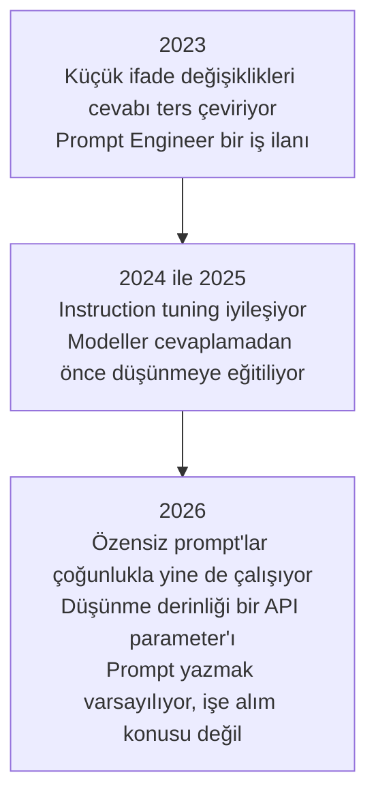
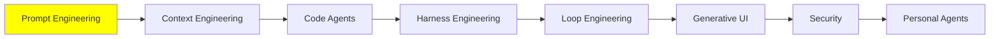

# Prompt Engineering

[LLM Fundamentals](../1_fundamentals/llms_tr.md), prompt engineering hakkında tek bir paragrafla
bitiyordu. Bu modül o paragrafın açılmış hâli.

> **Prompt engineering, modeli beklediğin output'a götüren bir input yazmak.**

Bir modelin ne olduğundan başla. Model pre-trained bir neural network. Weight'leri donmuş,
state'i ve memory'si yok. Her seferinde input girer, output çıkar ve hiçbir şey bir sonrakine
taşınmaz. Yani model sabit ve senin kontrol ettiğin tek şey input. Bu yüzden geri gelen cevabın
kalitesine karar verebilecek tek şey de input.

[LLM Fundamentals](../1_fundamentals/llms_tr.md) modelin ne hesapladığını yazmıştı:

```
P(next token | context)
```

Senin prompt'un *o* context. Yani bütün iş tek bir arama problemi:

```
best prompt = the prompt that maximises P(the output you want | prompt)
```

Aşağıdaki her şey tek bir soruyu cevaplayan bir teknik: prompt'u nasıl yazarsan beklediğin
output'u alırsın?

## Prompt Engineering Neden Gerekli?

Muhtemelen aklına zaten gelmiş bir itiraz var. Weight'ler donmuşsa ve model hiçbir şey
hatırlamıyorsa, aynı soruyu iki farklı şekilde sorduğunda neden iki farklı cevap alıyorsun?

Çünkü iki farklı ifade aynı input değil. Ve model soruları cevaplamıyor. Bir network çalıştırıyor.

O network'ün içinde neuron'lar var ve hangilerinin ateşleneceğine prompt karar veriyor. Bazıları
güçlü aktive oluyor, bazıları zayıf, bazıları hiç aktive olmuyor. Kelimeleri değiştirdiğinde o
deseni değiştiriyorsun. Desen değişince output da değişiyor.

  
*İki durumda da weight'ler aynı. Prompt sadece hangilerinin kullanılacağına karar veriyor. Aynı modelin bir aritmetik sorusunu kendisinin bir parçasıyla, bir resim sorusunu başka bir parçasıyla cevaplamasının sebebi bu.*

Bir DJ mixer'ı düşün. Volume, bass ve echo için birer düğmesi var. DJ donanımı hiç değiştirmiyor.
Düğmeleri çeviriyor, dinliyor ve oda doğru duyulana kadar tekrar çeviriyor. Senin prompt'un o
düğmelerin bir ayarı. Prompt engineering de network'ün bu iş için ihtiyacın olan kısımlarını
yükselten metni yazmak.

  
*Buradaki her düğme bu modülün kapsadığı bir şey. Hiçbiri elini uzatabileceğin bir panelde değil: onları oynatan tek şey prompt metni.*

Ama o düğmelerin etiketi yok ve elin onlara yetişmiyor. Onları oynatmanın tek yolu metin. Bu işin
teorik değil deneysel olmasının sebebi bu. Senin görevin için doğru prompt'u kimsenin sana
verememesinin sebebi de bu.

## Kötü Bir Prompt'un Sana Maliyeti

İki sürücü aynı arabayla aynı pistte tur atıyor ve farklı süreler çıkarıyor. Motor aynı, beygir
gücü aynı, yol tutuş aynı, virajlar aynı. İyi sürücü aynı makineden daha fazlasını çıkarıyor, o
kadar.

Modeller de böyle çalışıyor ve bu, muhtemelen daha önce duyduğun bir şikâyeti açıklıyor. Prompt
yazma becerisi az olan biri istediğini alamıyor. Sonra modelin zayıf olduğuna, o kadar zeki
olmadığına ya da işin ancak yüzde yetmişini yapabildiğine karar veriyor. Bir başkası aynı modeli
alıyor, daha iyi bir prompt yazıyor ve işi bitiriyor.

Yani bir model seni hayal kırıklığına uğrattığında, ilk soru hangi modele geçeceğin değil.

## 2026'da Prompt Engineering Öldü

Evet, gerçekten.

İlk LLM API'leri 2023 civarında kullanıma açıldığında modeller kırılgandı. İfadedeki küçük bir
değişiklik iyi bir cevabı yanlış bir cevaba çevirebiliyordu. Bu hassasiyet hayal ürünü değildi,
ölçülmüştü. O dönemin open model'lerinde, anlamı hiç değiştirmeyen format değişiklikleri doğruluğu
[76 puana](https://arxiv.org/abs/2310.11324) kadar oynatıyordu. **Prompt Engineer** bir iş unvanıydı.
Şirketler bütün gün deneme yanılma yapacak insanlar işe alıyordu. Bu insanlar, model beklenen
output'u üretene kadar uğraşıyordu.

O günler geçti. Modeller artık çok daha yetenekli. Chain of thought gibi yeteneklerle geliyorlar
(bu sayfanın ilerisinde anlatılıyor). Bu yetenekler, özensiz bir prompt'tan bile ne demek
istediğini anlamalarını sağlıyor. 2026'da prompt engineering bir kariyer değil. Bu sistemlerle
çalışan herkesten beklenen temel bir beceri.



Bu yüzden bu modül sadece günlük AI engineering işinde faydalı olanı kapsıyor. Konunun daha ileri
kısmı [Advanced Prompting](../3_expert/advanced_prompting_tr.md) modülünde.

Sadece faydalı kısmı değil de bütün kataloğu istiyorsan, [Prompt Engineering
Guide](https://www.promptingguide.ai/) onu veriyor. Ayrıca aşağıdakileri bir müfredat olarak
değil, başlangıç noktaları olarak gör. Prompt yazmak deneysel bir iş. Bir prompt yazıp output'u
okuyarak ve prompt'u değiştirerek bu işte iyileşiyorsun.

## İki Prompt Template'i

Kural basit: daha açık ve daha detaylı bir prompt daha iyi bir cevap alıyor. Yine de iki
template'i bilmek faydalı, çünkü "açık ve detaylı"nın pratikte ne demek olduğunu gösteriyorlar.
Bu, sınırları tanımlanmış bir prompt demek.

Basit olanı:

```text
{Goal}
{Output Format}
{Warnings}
{Context}
```

- **Goal**: ne istediğin, bir iki cümleyle.
- **Output Format**: cevabın hangi şekilde gelmesi gerektiği.
- **Warnings**: modelin yapacağını zaten tahmin ettiğin hatalar.
- **Context**: durumun hakkında, bir yabancının sana yardım edebilmek için bilmesi gereken her
  şey.

  
*Context dump en uzun ve en özensiz kısım ve bunda bir sorun yok. Hiçbir template'in senin yerine yazamayacağı kısım o.*

Daha detaylı olanı:

```text
{Role}
{Task}
{Context}
{Reasoning}
{Output Format}
{Stop Conditions}
```

- **Role**: model çalışırken kim olmalı. Aşağıdaki role prompting bölümü bunu anlatıyor.
- **Task**: işin kendisi, sıra önemliyse numaralı adımlar hâlinde.
- **Context**: arka plan, kısıtlar ve nelerden uzak duracağı.
- **Reasoning**: bir cevaba karar vermeden önce nasıl düşünmesini istediğin.
- **Output Format**: tam olarak hangi şekilde, ihtiyacın varsa tablo kolonlarına kadar.
- **Stop Conditions**: modelin işinin bittiğini nasıl anlayacağı.

  
*Stop condition'lar insanların atladığı slot. Stop condition yoksa "bitti", senin tanımın değil modelin tahmini oluyor.*

Bugünün modelleri iki template'e de sıkı sıkıya uymanı gerektirmiyor ve çoğu zaman uymayacaksın.
Template'ler burada, "açık bir prompt yaz" belirsiz bir tavsiye olmaktan çıksın diye var.

## In-context Learning ve Few-shot Prompting

Modeller weight'lerinde olmayan şeyleri öğrenebiliyor. Bunu pre-training'le de, fine-tuning'le de
öğrenmiyorlar. Context'te duran şeyden öğreniyorlar, yani [Memory](../1_fundamentals/memory_tr.md)
modülündeki working memory'den. Buna **in-context learning**, kısaca ICL deniyor.

RAG'in çalışmasının sebebi de bu. [RAG & Embeddings](../1_fundamentals/rag_tr.md) modülünde
weight'ler hiç değişmiyor. Getirilen dokümanlar context'e giriyor ve model onları hemen kullanıyor.
Kütüphane kapalı kalıyor, sen ihtiyacın olanı masaya koyuyorsun.

İki template'e tekrar bak: her ikisinde de context için bir slot var. O slot, modele bir saniye
öncesine kadar sahip olmadığı bilgiyi verdiğin tek yer.

ICL sana bir teknik de kazandırıyor. **Few-shot prompting**, gerçek görevi vermeden önce modele
görevin doğru yapılmış birkaç örneğini göstermek demek:

```text
Classify the sentiment of each message as positive, negative or neutral.

Message: "the package arrived two days early"
Sentiment: positive

Message: "the box was crushed and the mug inside was broken"
Sentiment: negative

Message: "delivery is scheduled for Thursday"
Sentiment: neutral

Message: "it works, but the app crashed twice"
Sentiment:
```

O üç örnek aynı anda iki iş yapıyor. Birincisi, label kümesini sabitliyorlar. Böylece cevap
nüanslı bir paragraf değil, üç kelimeden biri oluyor. İkincisi, format'ı sabitliyorlar. Böylece
cevap `Sentiment: <label>` olarak geliyor ve kodun onu okuyabiliyor. Tek başına bir talimatın
başaramadığı yerde örneklerin başarmasının sebebi genelde bu kombinasyon.

Birkaç örnek kullanmak **few-shot**. Hiç örnek kullanmamak ise **zero-shot**. Bir chat penceresine
her soru yazdığında yaptığın şey de zero-shot.

## Prompt Engineering İpuçları

### Açık ve Doğrudan Ol

Daha az etkili:

```text
Create an analytics dashboard
```

Daha etkili:

```text
Create an analytics dashboard. Include as many relevant features and interactions as possible. Go beyond the basics to create a fully-featured implementation.
```

İkinci prompt daha kibar ya da daha iyi yazılmış değil. Farkı şu: "bitmiş" hâlin neye benzediği
hakkında çok daha fazla şey söylüyor. İki örnek de Anthropic'in [prompting best
practices](https://platform.claude.com/docs/en/build-with-claude/prompt-engineering/claude-prompting-best-practices)
sayfasından.

### Context Ekle, Sebeplerini de

Model context'te olan şeyden öğreniyor. O yüzden ona bir kuralın sadece ne olduğunu değil, *neden*
var olduğunu da söyle.

Daha az etkili:

```text
NEVER use ellipses
```

Daha etkili:

```text
Your response will be read aloud by a text-to-speech engine, so never use ellipses since the text-to-speech engine will not know how to pronounce them.
```

İlki, modelin nedenini bilmeden uyacağı bir kural. İkincisi modelin genelleme yapmasını sağlıyor.
Model, bir konuşma motorunun yanlış okuduğu diğer noktalama işaretlerinden de kaçınacak. Senin
listelemeyi hiç düşünmediğin işaretler de buna dahil.

### Prompt'a Bir Yapı Ver

Çoğu zaman prompt'u bölümlere ayırmak istersin. Bölümler modele şunları gösterir:

- hangi kısım talimat;
- hangi kısım data;
- hangi kısım hedef;
- hangi kısım output'u tarif ediyor.

Yapı, prompt'u daha okunur yapar ve kısımları birbirinden ayırır. Sonuçları da değiştirir ve bu
değişikliği ölçebilirsin.

XML tag'leri kullanabilirsin. Anthropic'in modelleri bunlara göre ayarlanmış:

```xml
<identity>
You are a support engineer for a company that hosts Postgres databases.
</identity>

<goal>
Read the customer ticket below and decide whether it is a billing question, a
technical question, or both.
</goal>

<output_format>
One line: BILLING, TECHNICAL or BOTH, followed by a one-sentence reason.
</output_format>
```

Aynı şeyin markdown hâli:

```markdown
## Identity
You are a support engineer for a company that hosts Postgres databases.

## Goal
Decide whether the ticket below is a billing question, a technical question, or both.

### How to do it
Read the whole ticket first. Ignore the customer's own guess about the cause.

## Output format
One line: BILLING, TECHNICAL or BOTH, followed by a one-sentence reason.
```

İki format'ta da nesting çalışıyor ve model hiyerarşiyi hiyerarşi olarak okuyor. Bir `##`
altındaki `###`, ona ait bir detay. Üst seviye daha fazla ağırlık taşıyor.

Format'ın standart bir format olması da gerekmiyor. Uygun olduğunda kendi format'ını icat
edebilirsin:

```text
Please read the emails below from my boss and my friend:

=== Boss Email ===
Write down the report of what you have done.

=== Friend Email ===
Write a poem for me.

=== Your Task ===
Please write a polite reply to both emails.
```

Bu ayraçlar neden var? Onlar olmadan "Write a poem for me" tam olarak senden gelen bir talimat
gibi görünüyor. Model de kimseye cevap yazmak yerine keyifle bir şiir yazabiliyor. Uzun ve
kalabalık bir prompt'ta yapının sana kazandırdığı şeyin çoğu bu: model senin talimatlarını
yapıştırdığın metinden ayırt edebiliyor. Bazen yapıştırılan metin sadece kafa karıştırıcı değil,
düşmanca da olabilir. O zaman aynı problemin bir adı var, prompt injection, ve kendi modülü var:
[Security](security_tr.md).

## Chain of Thought

Araştırmalar, duyduğun anda bariz gelen bir şey buldu. Bir model zor bir görevi daha küçük
görevlere bölebilir ve ara adımları final cevaptan *önce* yazabilir. Bunu yaptığında final cevap
iyileşiyor. Bu, aritmetiği kafanda değil kâğıt üzerinde yapmanla aynı şey.

Bir modele şunu sor:

```text
The cafeteria had 23 apples. They used 20 for lunch and bought 6 more. How many now?
```

Düz bir prompt'la doğrudan cevap veriyor:

```text
Final Answer: 32 apples
```

Bu yanlış. Şimdi modeli önce düşünmeye zorla. Bir cevaba karar vermeden önce ara sonuçlarını
yazmasını iste:

```text
<thinking>
The user wants the final number of apples in the cafeteria. Steps:
start with the initial number, subtract the apples used for lunch, add the apples bought later.

Initial apples: 23. Apples used for lunch: 20. Apples bought: 6.

Step 1: apples remaining after lunch. 23 - 20 = 3 apples.
Step 2: final number after buying more. 3 + 6 = 9 apples.
</thinking>

Final Answer: 9 apples
```

Sihir gibi geliyor. Aslında ev işine daha yakın. Bir model **autoregressive**: yazdığı her token,
bir sonraki token için okuduğu input'un parçası oluyor. `23 - 20 = 3`'ü yazdığında o sonuç artık
context'inde duruyor. Böylece geri kalanı çözerken onu kafasında tutmak zorunda kalmıyor. Bir
model için yazmak, düşünmek.

Bu kursun yazarı bir [Chain of Thought Visualizer](https://cot-visualizer.online/) yaptı. Onunla
ikisini bir dizi bulmaca üzerinde yan yana izleyebilirsin. Bu bir benchmark değil, bir gösterim:
düz taraf bilerek kötü cevap verecek şekilde yönlendiriliyor. Bütün bunun neden çalıştığını merak
ediyorsan, ek okuma olarak [Why Can Large Language Models Generate Correct
Chain-of-Thoughts?](https://arxiv.org/abs/2310.13571) var.

### O İş Unvanının Kaybolma Sebebi de Chain of Thought

2026'da neredeyse hiçbir zaman elle chain of thought prompt'u yazmıyorsun.

ChatGPT ya da bir agent sana "düşünüyor" diye gösterdiğinde, o chain of thought. Bu, biri
*hadi adım adım düşünelim* yazdığı için olmuyor. Model cevaplamadan önce düşünmeye eğitildiği için
oluyor. Bunu her zaman yapıyor, sen istesen de istemesen de.

Modelin ne kadar düşüneceği artık bir prompt değil, bir kadran. İnsanlar bir modeli high
thinking'de, low effort'ta ya da max effort'ta çalıştırmaktan bahsettiğinde kastettikleri şey bu.
Anthropic'in [effort parameter](https://platform.claude.com/docs/en/build-with-claude/effort)'ı
`low`, `medium`, `high`, `xhigh` ve `max` değerlerini alıyor. Diğer sağlayıcıların da aynı
düğmenin kendi versiyonu var. Daha fazla düşünme, zor problemlerde daha iyi cevap demek. Aynı
zamanda daha fazla maliyet, daha yavaş cevap ve daha hızlı dolan bir context window demek.

> **NOT: daha fazla düşünmek her zaman daha iyi değil.** İnsanlar gibi modeller de aşırı
> düşünebiliyor ve aşırı düşündüklerinde performansları kötüleşiyor. Bu iyi belgelenmiş:
>
> - [Stop Overthinking](https://arxiv.org/abs/2503.16419) bütün alanı tarıyor.
> - [The Danger of Overthinking](https://arxiv.org/abs/2502.08235) software engineering
>   görevlerinde neredeyse %30 daha iyi sonuç buldu. Bunu en az aşırı düşünen çözümleri seçerek
>   elde etti.
> - [When More Thinking Hurts](https://aclanthology.org/2026.findings-acl.1199/) modellerin zaten
>   doğru olan cevapları terk ettiğini gösteriyor.
> - [OptimalThinkingBench](https://proceedings.iclr.cc/paper_files/paper/2026/hash/0f63515b14f33c008158213c7b6191c6-Abstract-Conference.html)
>   hiçbir modelin önündeki soru için henüz doğru miktarda düşünmediği sonucuna varıyor.

Yani gerçek beceri, düşünme bütçesini görevin zorluğuyla eşleştirmek. Bu bütçe de yazdığın bir
cümle değil, ayarladığın bir parameter.

## Role Prompting

Role prompting, göreve girmeden önce modele bir iş, bir persona ya da bir karakter vermek.

> **NOT: system prompt ne?** System prompt, context'in en tepesinde bir kez yer alıyor. Modelin
> bütün konuşma boyunca nasıl davrandığını tanımlıyor. Onu kullanıcı değil, modelin ya da agent'ın
> geliştiricisi yazıyor ve genelde uzun oluyor. Tool'ların schema ve açıklamalarıyla birlikte
> kaydedildiği yer de burası ([Tool Calling](../1_fundamentals/tools_tr.md)). Gerçek system
> prompt'ları görmek istersen, [system prompt leaks](https://github.com/asgeirtj/system_prompts_leaks)
> bunları ChatGPT, Claude, Gemini, Grok ve diğerlerinden birebir toplamış.

  
*[LLM Fundamentals](../1_fundamentals/llms_tr.md) modülündeki figürün aynısı. Bir role, identity ve instruction kısmına girer. Bu kutudaki her şey kullanıcı bir şey söylemeden önce yazılıyor.*

Role prompting'in buraya ait olmasının sebebi bu: bir role en iyi işini system prompt'ta yapıyor.
Tekniğin örnekleri de göründükleri kadar basit:

```text
Act as a senior software engineer. Review this code and find security bugs.
```

```text
You are William Shakespeare. Write a short poem about summer.
```

Bir role iki şeyi iyi yapıyor. Birincisi, bakış açısını kuruyor: modele kim olduğunu söylüyor,
örneğin bir İK müdürü, bir aşçı ya da bir data science mülakatçısı. İkincisi, ton ve stili
şekillendiriyor. Kelime dağarcığını, varsayılan uzmanlık seviyesini ve format'ı o role'e
uyduruyor.

Ama bir role modeli güvenilir şekilde daha zeki yapmıyor. İlk zamanların umudu buydu ve tutmadı.
System prompt'taki persona'lar geniş bir soru yelpazesinde
[performansı iyileştirmiyor](https://arxiv.org/abs/2311.10054). 2026'daki bir devam çalışması da
persona prompting'in [uzmanlık derinliğini artırırken netliği
düşürdüğünü](https://arxiv.org/abs/2605.29420) buldu. Etkisi soruya ve alana bağlı. Bir role'ü,
bir cevabın *nasıl* okunduğunu şekillendirmek için kullan. Modelin yapabileceklerinin tavanını
yükseltmesini bekleme.

Role'ler en çok agent kurarken işe yarıyor. Bir agent tasarlamaktan bahsederken çoğunlukla
kastettiğimiz şey, tek bir iş için bir system prompt ve bir tool kümesi seçmek. Örneğin, diyelim ki
bir code review ekibi istiyorsun:

1. **Code Review Agent.** System prompt: kodu yapısal, mantıksal ve mimari kusurlar için incele.
   Bug'ların ve performans darboğazlarının maddeli bir listesini döndür. Stil ya da security
   hakkında hiç yorum yapma. Tool'lar: `fetch_repository_files`, `run_ast_parser`.
2. **Security Auditor Agent.** System prompt: sadece vulnerability, veri sızıntısı ve dependency
   riskleri için tara. Her birini High, Medium ya da Low olarak derecelendir. Feature ya da
   refactoring önerme. Tool'lar: `run_sast_scanner`, `check_cve_database`.
3. **Clean Code Formatter Agent.** System prompt: çalışan kodu okunabilirlik ve bakım kolaylığı için
   refactor et. DRY ve standart isimlendirmeyi uygula. Mantığı değiştirme ve bug arama. Tool'lar:
   `execute_linter_auto_fix`, `generate_docstrings`.

Üç agent, tek model. Tek farkları role, talimatlar ve tool'lar.
[Multi-Agent Sistemler](../1_fundamentals/multi_agent_tr.md), işi uzmanlara dağıtan bir supervisor
çizerken sessizce bunu varsayıyordu.

Ama dikkatli ol. Bir role sadece hedeflediğin kısmı değil, bütün davranışı değiştiriyor. Modele bir
security uzmanı role'ü verip sonra ona sanat tarihini sorarsan, cevap hiç role verilmemiş
hâlinden daha kötü olabilir.

Bu da bizi mixer'a geri getiriyor. "Act as a security expert" network'ün security bilgisini tutan
kısımlarını yükseltiyor. Sanat tarihini tutan kısımları ise kısık bırakıyor. Bu açıdan bakınca role
prompting bir retrieval problemi. Modele bilgi eklemiyorsun. Zaten sahip olduğu bilginin
hangisinin kullanılacağını seçiyorsun. İşin kötü yanı da bu, çünkü kıstığın düğmeler soru
değiştiğinde kısık kalıyor.

## Bu serinin neresindeyiz



## Özet

Prompt engineering, istediğin output'u en olası hâle getiren input'u yazmak. Weight'ler donmuş
durumda, yani elindeki tek düğme prompt. Farklı ifadeler aynı network'ün farklı kısımlarını aktive
ediyor.

Güvenilir şekilde işe yarayan şeyler sıradan şeyler:

- ne istediğini tam olarak söyle;
- sebebini açıkla;
- modele context'i ver;
- bir iki örnek göster;
- uzun bir prompt'u, talimatların data'nla karışamayacağı şekilde yapılandır.

Chain of thought bir zamanlar bu tekniklerden biriydi. Artık modellerin içine yerleşik. İş
unvanının kaybolmasının ve prompt yazmanın onun yerine temel bir beceri hâline gelmesinin sebebi de
büyük ölçüde bu.

Sırada context window'a giren her şey ve o yeri neyin hak ettiğine nasıl karar vereceğin var.

**Hızlı Kontrol**: donmuş bir model, soruyu yeniden ifade ettiğinde neden farklı cevap veriyor? Ve
bir role prompt'u gerçekte neyi değiştiriyor?

## Kaynaklar

- [Prompt Engineering Guide](https://www.promptingguide.ai/): tekniklerin tam kataloğu, kapsadığımızın çok ötesinde
- [Prompting best practices](https://platform.claude.com/docs/en/build-with-claude/prompt-engineering/claude-prompting-best-practices): Anthropic'in güncel rehberi ve iki öncesi-sonrası örneğinin kaynağı
- [Quantifying Language Models' Sensitivity to Spurious Features in Prompt Design](https://arxiv.org/abs/2310.11324): 2023 nesli modellerin gerçekte ne kadar kırılgan olduğunun ölçümü
- [Why Can Large Language Models Generate Correct Chain-of-Thoughts?](https://arxiv.org/abs/2310.13571): yazmanın düşünmek olduğu fikrinin teorisi
- [Chain of Thought Visualizer](https://cot-visualizer.online/): düşünmenin ve doğrudan cevaplamanın yan yana gösterimi
- [Effort](https://platform.claude.com/docs/en/build-with-claude/effort): düşünme kadranı ve her seviyenin ne için olduğu
- [Stop Overthinking: A Survey on Efficient Reasoning for Large Language Models](https://arxiv.org/abs/2503.16419): aşırı düşünme üzerine araştırmalar, tek yerde
- [When "A Helpful Assistant" Is Not Really Helpful](https://arxiv.org/abs/2311.10054): persona prompt'larının umulduğu kadar faydalı olmadığını gösteren çalışma
- [System prompt leaks](https://github.com/asgeirtj/system_prompts_leaks): production system prompt'ları, birebir toplanmış
- [Advanced Prompting](../3_expert/advanced_prompting_tr.md): bu modülün bilerek atladığı teknikler
