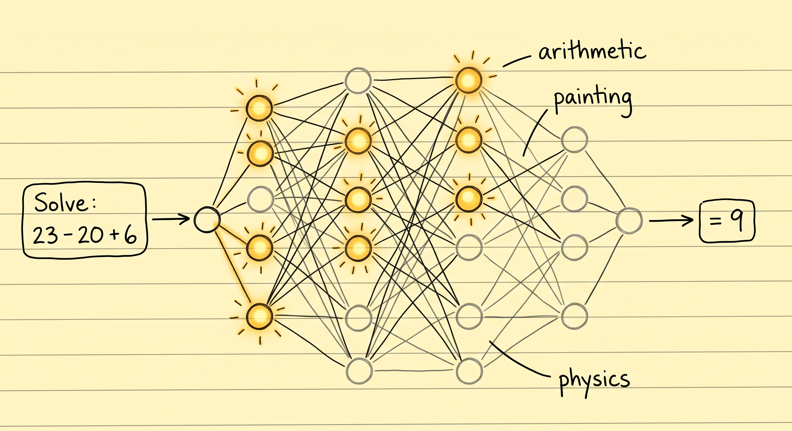
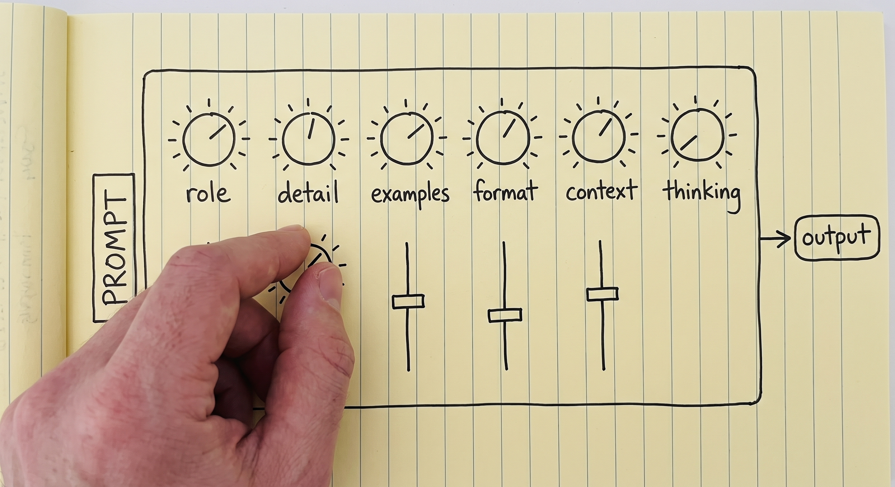
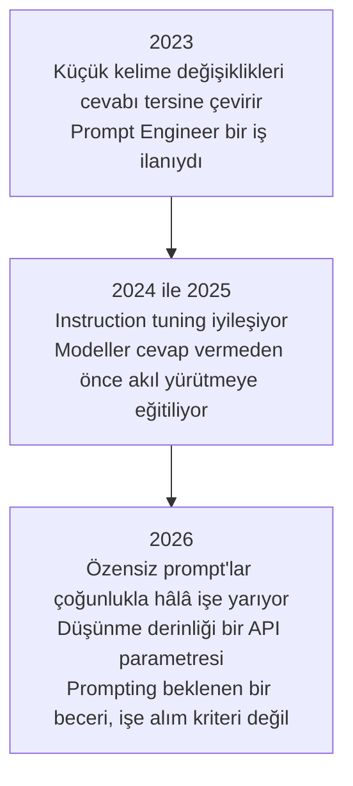
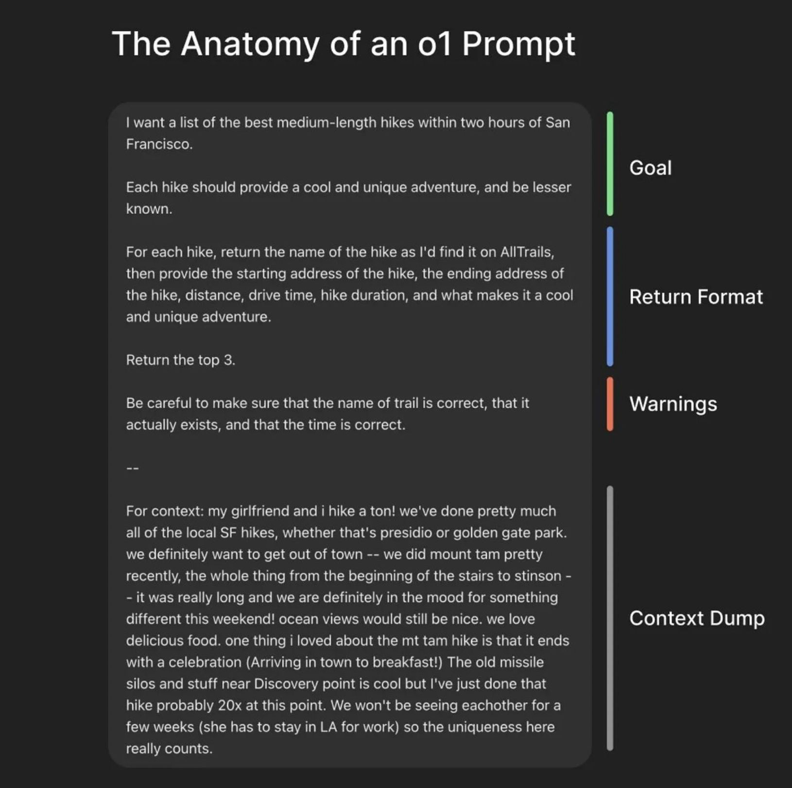
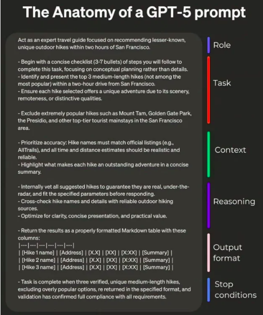
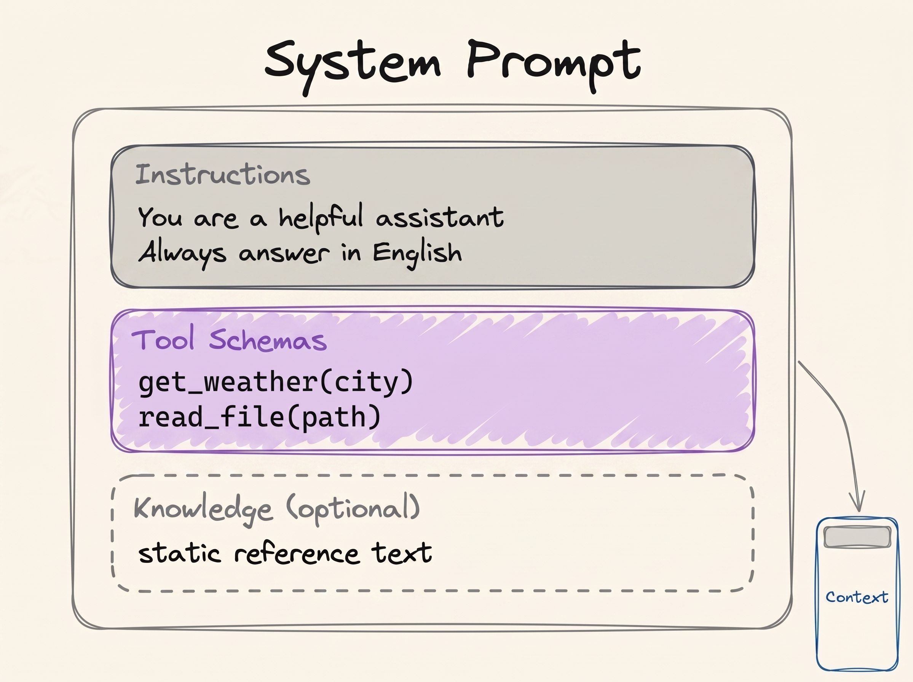

# Prompt Engineering

[LLM Temelleri](../1_fundamentals/llms_tr.md) modülü, prompt engineering hakkında tek bir paragrafla bitiyordu. Bu modül o paragrafı açıp genişletiyor.

> **Prompt engineering, modelin beklediğin çıktıya ulaşmasını sağlayan bir girdi yazmaktır.**

Önce modelin ne olduğuna bakalım. Model, önceden eğitilmiş bir sinir ağıdır; ağırlıkları donmuştur ve durumu ya da hafızası yoktur. Her seferinde girdi alır, çıktı üretir ve bir sonraki seferde önceki seferden hiçbir şey hatırlamaz. Bu yüzden model sabit kalır, kontrol edebildiğin tek şey de girdidir. Çıktının kalitesini belirleyebilecek tek şey bu girdi olur.

[LLM Temelleri](../1_fundamentals/llms_tr.md) modelin neyi hesapladığını şöyle yazmıştı:

```
P(next token | context)
```

Prompt'un kendisi tam olarak bu context'tir. Yani bütün iş tek bir arama problemine dönüşüyor:

```
best prompt = the prompt that maximises P(the output you want | prompt)
```

Bundan sonra anlatılan her teknik tek bir soruya cevap veriyor: çıktıyı beklediğin gibi almak için prompt'u nasıl yazarsın?

## Peki Prompt Engineering Neden Hâlâ Gerekli?

Muhtemelen aklına şöyle bir itiraz gelmiştir: ağırlıklar donmuşsa ve model hiçbir şey hatırlamıyorsa, aynı soruyu iki farklı şekilde sorduğunda neden iki farklı cevap alıyorsun?

Çünkü iki farklı ifade, iki farklı girdi demektir. Üstelik model soruları gerçekten cevaplamıyor; verdiğin kelimeler üzerinde bir sinir ağını çalıştırıyor ve cevap, o ağın ürettiği şey oluyor.

Bu ağın içinde nöronlar var ve prompt, hangilerinin ateşleneceğine karar veriyor. Bazıları güçlü bir şekilde devreye giriyor, bazıları zayıf kalıyor, bazıları da hiç devreye girmiyor. Kelimeleri değiştirdiğinde bu örüntü değişiyor ve örüntü değiştiğinde çıktı da değişiyor.

  
*Ağırlıklar iki durumda da aynı. Prompt yalnızca hangilerinin kullanılacağına karar veriyor. Aynı model, aritmetik soruyu kendisinin bir bölümüyle, resim sorusunu başka bir bölümüyle yanıtlamasının sebebi bu.*

Bir DJ mikserini düşün. Ses seviyesi, bas ve eko için birer düğmesi var ama DJ donanımı hiç değiştirmez. DJ düğmeleri çevirir, dinler ve odanın doğru ses çıkarana kadar tekrar çevirir. Senin prompt'un ise bu düğmelerin bir ayarıdır. Prompt engineering de bu iş için gereken ağ bölümlerini açacak metni yazmak demek.

  
*Her düğme bu modülde anlatılan bir şeye karşılık gelir. Ama hiçbiri dokunabileceğin bir panelde değil. Düğmeleri oynatan tek şey prompt metni.*

Ama düğmelerin üzerinde etiket yok ve sana erişilebilir de değiller; onları hareket ettirmenin tek yolu metin. İşte bu yüzden prompt engineering teorik bir konu değil, deneysel bir iş. Aynı sebeple kimse, senin görevin için doğru prompt'u önceden veremez.

## Zayıf Bir Prompt'un Bedeli

İki sürücü aynı arabayla aynı pistte yarışıyor ve tur süreleri farklı çıkıyor. İkisinin motoru, beygir gücü, lastik tutuşu ve virajları aynı. Aradaki fark, daha iyi olan sürücünün makineden daha fazlasını çıkarmasından geliyor.

Modeller de aynı şekilde çalışıyor ve bu, muhtemelen daha önce duyduğun bir şikâyeti açıklıyor. Prompt yazma becerisi az olan biri istediğini alamıyor ve modelin zayıf olduğuna, yeterince zeki olmadığına ya da işin yüzde yetmişini yapabildiğine karar veriyor. Başka biri aynı modeli eline alıp daha iyi bir prompt yazıyor ve işi bitiriyor.

Bu yüzden bir model seni hayal kırıklığına uğrattığında ilk soru, hangi modele geçeceğin olmamalı.

## 2026'da Prompt Engineering Öldü

Evet, gerçekten.

2023 civarında ilk LLM API'leri kullanılabilir olduğunda modeller kırılgandı. Kelimelerde yapılan küçük bir değişiklik, iyi bir cevabı yanlış bir cevaba çevirebiliyordu. Bu hassasiyet hayal ürünü değildi, ölçülmüştü: o dönemin açık modellerinde anlamı değiştirmeyen biçim değişiklikleri doğruluğu [76 puana kadar](https://arxiv.org/abs/2310.11324) oynatabiliyordu. O zamanlar **Prompt Engineer** bir iş unvanıydı ve şirketler, model beklenen çıktıyı verene kadar deneme yanılmayla bütün günlerini geçirecek insanlar arıyordu.

Bu günler geride kaldı, çünkü modeller artık çok daha yetenekli. Bu sayfanın ilerisinde anlatılan chain of thought gibi yeteneklerle geliyorlar ve bu yetenekler, modelin özensiz bir prompt'tan bile ne demek istediğini anlamasını sağlıyor. Bu yüzden 2026'da prompt engineering bir kariyer değil, bu sistemlerle çalışan herkesten beklenen temel bir beceri.



Bu yüzden bu modül, yalnızca günlük bir AI mühendisliği işinde işe yarayan kısmı anlatıyor. Konunun daha ileri kısmı [İleri Seviye Prompting](../3_expert/advanced_prompting_tr.md) modülünde.

Tüm kataloğu istiyorsan, [Prompt Engineering Guide](https://www.promptingguide.ai/) hepsini içeriyor. Bu bölümde anlatılanları da bir müfredat olarak değil, başlangıç noktası olarak gör, çünkü prompting deneysel bir alan. Bu işte ustalaşmanın yolu, bir prompt yazmak, çıktısını okumak ve prompt'u değiştirmek.

## İki Prompt Şablonu

Kural basit: prompt ne kadar açık ve ayrıntılıysa cevap o kadar iyi olur. Yine de iki şablonu bilmek işe yarar, çünkü "açık ve ayrıntılı" ifadesinin pratikte ne anlama geldiğini gösteriyorlar. Pratikte bu, hedefi, context'i, cevabın biçimini ve modelin nerede durması gerektiğini açıkça söyleyen bir prompt demek.

Basit olan şu:

```text
{Goal}
{Output Format}
{Warnings}
{Context}
```

- **Goal**: ne istediğin, bir iki cümlede.
- **Output Format**: cevabın alması gereken biçim.
- **Warnings**: modelin yapmasını şimdiden beklediğin hatalar.
- **Context**: senin durumunu anlatan, yabancı birinin sana yardım edebilmesi için bilmesi gereken her şey.

  
*Bağlam dökümü en uzun ve en az cilalı kısım, ve bu bir sorun değil. Hiçbir şablon bu kısmı senin yerine yazamaz.*

Ayrıntılı olanı şu:

```text
{Role}
{Task}
{Context}
{Reasoning}
{Output Format}
{Stop Conditions}
```

- **Role**: model çalışırken kim olmalı. Aşağıdaki Role Prompting bölümü bunu ele alıyor.
- **Task**: işin kendisi. Sıra önemliyse adımları numaralandır.
- **Context**: arka plan, kısıtlar ve neyden kaçınılacağı.
- **Reasoning**: modelin bir cevaba karar vermeden önce nasıl düşünmesini istediğin.
- **Output Format**: tam biçim, gerekiyorsa tablo sütunları dahil.
- **Stop Conditions**: modelin ne zaman bittiğini nasıl anlayacağı.

  
*Stop conditions, insanların en sık unuttuğu bölüm. Bu bölüm yoksa "bitti" senin tanımın olmaz, modelin tahmini olur.*

Bugünkü modellerin bu şablonlardan birine sıkı sıkıya uymanı gerektirmediği gibi, çoğu zaman da uymayacaksın. Şablonlar, "açık bir prompt yaz" gibi muğlak bir öğütten somut bir şey çıkarmak için burada.

## In-context Learning ve Few-shot Prompting

Modeller, ağırlıklarında olmayan şeyleri öğrenebilir; bunu ne pre-training ile ne de fine-tuning ile yaparlar. Bilgiyi context'ten, yani [Memory](../1_fundamentals/memory_tr.md) modülünde anlatılan çalışma belleğinden alırlar. Buna **in-context learning** deniyor, kısaca ICL.

RAG'in çalışmasının sebebi de bu: [Retrieval-Augmented Generation (RAG)](../1_fundamentals/rag_tr.md) modülünde ağırlıklar hiç değişmez, getirilen dokümanlar context'e girer ve model onları hemen kullanır. Kitaplık kapalı kalır, sen de ihtiyacın olanı masana koyarsın.

İki şablona tekrar baktığında, ikisinde de bir context alanı olduğunu görürsün. Bu alan, modele daha önce bilmediği bir bilgiyi verebildiğin tek yerdir.

ICL bize bir teknik de sunuyor. **Few-shot prompting**, asıl görevi vermeden önce modele görevin birkaç doğru örneğini göstermek anlamına gelir:

```text
Classify the sentiment of each message as positive, negative or neutral.

Message: "the package arrived two days early"
Sentiment: positive

Message: "the box was crushed and the mug inside was broken"
Sentiment: negative

Message: "delivery is scheduled for Thursday"
Sentiment: neutral

Message: "it works, but the app crashed twice"
Sentiment:
```

Bu üç örnek aynı anda iki iş görüyor. Birincisi etiket kümesini sabitliyor, yani cevap bir paragraf nüans yerine üç kelimeden biri oluyor. İkincisi biçimi sabitliyor: cevap `Sentiment: <label>` şeklinde geliyor ve kodun bunu okuyabiliyor. Bu iki işi birlikte yapmaları, örneklerin çoğu zaman tek başına bir talimatın başaramadığını başarmasının nedeni.

Birkaç örnek kullanmaya **few-shot**, hiç örnek kullanmamaya ise **zero-shot** deniyor. Bir sohbet penceresine soru yazdığında her seferinde zero-shot yapmış oluyorsun.

## Prompt Engineering İpuçları

### Açık ve Doğrudan Ol

Daha az etkili:

```text
Create an analytics dashboard
```

Daha etkili:

```text
Create an analytics dashboard. Include as many relevant features and interactions as possible. Go beyond the basics to create a fully-featured implementation.
```

İkinci prompt daha kibar ya da daha iyi yazılmış değil. Aradaki fark, "bitmiş" halin nasıl görünmesi gerektiğini çok daha fazla anlatması. İki örnek de Anthropic'in [prompting best practices](https://platform.claude.com/docs/en/build-with-claude/prompt-engineering/claude-prompting-best-practices) dokümanından alındı.

### Bağlam Ekle, Nedenini de Yaz

Model context'ten öğrendiği için ona bir kuralın yalnızca ne olduğunu değil, neden var olduğunu da anlat.

Daha az etkili:

```text
NEVER use ellipses
```

Daha etkili:

```text
Your response will be read aloud by a text-to-speech engine, so never use ellipses since the text-to-speech engine will not know how to pronounce them.
```

İlk örnek, modelin nedenini bilmeden uymak zorunda olduğu bir kural. İkincisi ise modele genelleme yapabilmesine olanak tanıyor. Üstelik model, sen hiç listelememiş olsan bile konuşma motorunun yanlış okuyacağı başka noktalama işaretlerinden de uzak durur.

### Prompt'a Yapı Ver

Bir prompt'u bölümlere ayırmak çoğu zaman işine yarar. Bölümler modele şunları gösterir:

- hangi kısmın bir talimat olduğunu;
- hangi kısmın veri olduğunu;
- hangi kısmın hedef olduğunu;
- hangi kısmın çıktıyı tarif ettiğini.

Yapı, prompt'u okunur kılmakla kalmaz, parçaları birbirinden ayrı tutar ve sonuçları da değiştirir. Bu değişikliği de ölçebilirsin.

XML etiketlerini de kullanabilirsin, çünkü Anthropic'in modelleri bu biçim için ayarlandı:

```xml
<identity>
You are a support engineer for a company that hosts Postgres databases.
</identity>

<goal>
Read the customer ticket below and decide whether it is a billing question, a
technical question, or both.
</goal>

<output_format>
One line: BILLING, TECHNICAL or BOTH, followed by a one-sentence reason.
</output_format>
```

Aynı şeyi markdown ile yapmak:

```markdown
## Identity
You are a support engineer for a company that hosts Postgres databases.

## Goal
Decide whether the ticket below is a billing question, a technical question, or both.

### How to do it
Read the whole ticket first. Ignore the customer's own guess about the cause.

## Output format
One line: BILLING, TECHNICAL or BOTH, followed by a one-sentence reason.
```

İki biçimde de iç içe yapılar çalışır ve model hiyerarşiyi bir hiyerarşi olarak okur. Bir `##` altındaki `###`, ona ait bir ayrıntıdır. Üst seviye başlık daha fazla ağırlık taşır.

Biçimin standart olması da şart değil. Uygun olduğunda kendi biçimini de uydurabilirsin:

```text
Please read the emails below from my boss and my friend:

=== Boss Email ===
Write down the report of what you have done.

=== Friend Email ===
Write a poem for me.

=== Your Task ===
Please write a polite reply to both emails.
```

Bu ayraçları neden kullanıyoruz? Onlar olmadan "Write a poem for me" cümlesi, tam olarak senden gelen bir talimat gibi görünür. Model memnuniyetle bir şiir yazabilir, ama kimseye cevap vermeyebilir. Uzun ve kalabalık bir prompt'ta yapının sana verdiği şey tam olarak bu: model kendi talimatlarını, yapıştırdığın metinden ayırabilir. Bazen yapıştırılan metin yalnızca kafa karıştırıcı değil, düşmanca da olabilir. O durumda aynı sorunun bir adı var: prompt injection. Bu konu kendi modülünü hak ediyor: [Security](security_tr.md).

## Chain of Thought

Araştırmacılar, bir kez duyunca bariz görünen bir şey buldu: bir model zor bir görevi daha küçük görevlere bölebilir ve nihai cevaptan *önce* ara adımları yazabilir. Bunu yaptığında nihai cevap daha iyi oluyor; bu, işlemi kafanda değil kağıda yazarak yapmaya benziyor.

Modele şunu sor:

```text
The cafeteria had 23 apples. They used 20 for lunch and bought 6 more. How many now?
```

Düz bir prompt ile model doğrudan cevap verir:

```text
Final Answer: 32 apples
```

Bu cevap yanlış. Şimdi modeli önce düşünmeye zorla: bir cevaba karar vermeden önce ara sonuçlarını yazmasını sağla:

```text
<thinking>
The user wants the final number of apples in the cafeteria. Steps:
start with the initial number, subtract the apples used for lunch, add the apples bought later.

Initial apples: 23. Apples used for lunch: 20. Apples bought: 6.

Step 1: apples remaining after lunch. 23 - 20 = 3 apples.
Step 2: final number after buying more. 3 + 6 = 9 apples.
</thinking>

Final Answer: 9 apples
```

Bu sihirli gibi duruyor, ama arkasındaki sebep basit ve mekanik bir sebep. Model **autoregressive** çalışır: yazdığı her token, bir sonraki token'ı okurken kullandığı girdinin parçası olur. `23 - 20 = 3` yazdığında bu sonuç artık context'inde ve model geri kalan işi yaparken sonucu kafasında tutmak zorunda kalmıyor. Model için yazmak, düşünmek demek.

Bu kursun yazarı, bir dizi bulmaca üzerinde iki yaklaşımı yan yana izleyebilmen için bir [Chain of Thought Visualizer](https://cot-visualizer.online/) geliştirdi. Bu bir demo, bir benchmark değil: düşünmeden cevap veren taraf, kasıtlı olarak kötü cevap verecek şekilde yönlendirildi. Bunun neden işe yaradığını öğrenmek için ek okuma olarak [Why Can Large Language Models Generate Correct Chain-of-Thoughts?](https://arxiv.org/abs/2310.13571) makalesi var.

### Chain of Thought, Bu Unvanın Neden Kaybolduğunu da Açıklıyor

2026'da chain of thought prompt'unu elle neredeyse hiç yazmazsın.

ChatGPT ya da bir agent "düşünüyor" gösterdiğinde bu chain of thought'tur. Bu, birinin *let us think step by step* yazmasından değil, modelin cevap vermeden önce akıl yürütmek üzere eğitilmiş olmasından kaynaklanır. Sen istesen de istemesen de model her zaman böyle yapar.

Modelin ne kadar düşüneceği artık bir prompt değil, bir kadran. İnsanlar bir modeli high thinking, low effort ya da max effort ile çalıştırmaktan bahsettiğinde bu kadranı kastediyorlar. Anthropic'in [effort parameter](https://platform.claude.com/docs/en/build-with-claude/effort)'ı `low`, `medium`, `high`, `xhigh` ve `max` değerlerini alıyor. Diğer sağlayıcıların da aynı düğmenin kendi sürümleri var. Daha fazla düşünmek, zor problemlerde daha iyi cevaplar demek. Ama aynı zamanda daha fazla maliyet, daha yavaş cevaplar ve daha hızlı dolan bir context window demek.

> **NOT, daha fazla düşünmek her zaman daha iyi değil.** Tıpkı insanlar gibi, modeller de aşırı düşünebilir ve bunu yaptıklarında performansları düşer. Bu konu iyi belgelenmiş:
>
> - [Stop Overthinking](https://arxiv.org/abs/2503.16419) bu alanın tamamını derliyor.
> - [The Danger of Overthinking](https://arxiv.org/abs/2502.08235) yazılım mühendisliği görevlerinde neredeyse 30% daha iyi sonuç buldu. Bu sonucu, en az aşırı düşünen çözümleri seçerek elde etti.
> - [When More Thinking Hurts](https://aclanthology.org/2026.findings-acl.1199/) modellerin zaten doğru olan cevapları terk ettiğini gösteriyor.
> - [OptimalThinkingBench](https://proceedings.iclr.cc/paper_files/paper/2026/hash/0f63515b14f33c008158213c7b6191c6-Abstract-Conference.html) hiçbir modelin, önündeki soru için doğru miktarda düşünmediği sonucuna varıyor.

Asıl beceri, düşünme bütçesini görevin zorluğuna göre ayarlayabilmektir. Bu bütçe, yazdığın bir cümle değil, ayarladığın bir parametredir.

## Role Prompting

Role prompting, görevi vermeden önce modele bir iş, bir persona ya da bir karakter vermek demek.

> **NOT, system prompt nedir?** System prompt, context'in en üstünde bir kez yer alır ve konuşmanın tamamında modelin nasıl davranacağını tanımlar. Onu kullanıcı değil, modelin ya da agent'ın geliştiricisi yazar ve genellikle uzun olur. Araçlar da burada, şemaları ve açıklamalarıyla birlikte kayıtlıdır ([LLM Tool Calling](../1_fundamentals/tools_tr.md)). Gerçek system prompt'ları görmek istersen, [system prompt leaks](https://github.com/asgeirtj/system_prompts_leaks) ChatGPT, Claude, Gemini, Grok ve diğerlerinin system prompt'larını kelimesi kelimesine topluyor.

  
*Bu şekil [LLM Temelleri](../1_fundamentals/llms_tr.md) modülündeki şeklin aynısı. Rol, kimlik ve talimatların yazıldığı yer burası. Bu kutudaki her şey, kullanıcı tek kelime etmeden önce yazılmış olur.*

Bu yüzden role prompting burada anlatılıyor: bir rol işini en iyi system prompt'ta yapar. Tekniğin kendisine dair örnekler göründükleri kadar basit:

```text
Act as a senior software engineer. Review this code and find security bugs.
```

```text
You are William Shakespeare. Write a short poem about summer.
```

Bir rol iki şeyi iyi yapar. Birincisi bakış açısını belirler ve modele kim olduğunu söyler; bu bir İK müdürü, bir şef ya da bir veri bilimi mülakatçısı olabilir. İkincisi tonu ve üslubu şekillendirir: kelime seçimini, varsayılan uzmanlık seviyesini ve biçimlendirmeyi o rolle uyumlu hale getirir.

Ama rol, modeli güvenilir biçimde daha akıllı yapmaz. Erken dönemde bunun böyle olacağı umuluyordu, ama bu doğru çıkmadı: system prompt'taki personalar, geniş bir soru yelpazesinde [performansı artırmıyor](https://arxiv.org/abs/2311.10054). 2026'daki bir takip çalışması ise persona prompting'in [uzmanlık derinliğini artırıp açıklığı azalttığını](https://arxiv.org/abs/2605.29420) buldu. Etki soruya ve alana bağlı. Bu yüzden rolü, bir cevabın *nasıl* okunacağını şekillendirmek için kullan ve modelin yapabildiklerinin tavanını yükseltmesini bekleme.

Roller en çok agent kurarken işe yarar. Bir agent tasarladığımızda genellikle tek bir iş için bir system prompt ile bir araç seti seçiyoruz. Diyelim ki bir kod inceleme ekibi kurmak istiyorsun:

1. **Code Review Agent.** System prompt: kodu yapısal, mantıksal ve mimari hatalar açısından incele. Hataları ve performans darboğazlarını madde işaretli bir listede döndür. Stil ya da güvenlik hakkında asla yorum yapma. Araçlar: `fetch_repository_files`, `run_ast_parser`.
2. **Security Auditor Agent.** System prompt: yalnızca güvenlik açıklarını, veri sızıntılarını ve bağımlılık risklerini tara. Her birini High, Medium ya da Low olarak derecelendir. Özellik ya da refactoring önerme. Araçlar: `run_sast_scanner`, `check_cve_database`.
3. **Clean Code Formatter Agent.** System prompt: çalışan kodu okunabilirlik ve bakım kolaylığı için yeniden düzenle. DRY ilkesini ve standart isimlendirmeyi uygula. Mantığı değiştirme ve hata arama. Araçlar: `execute_linter_auto_fix`, `generate_docstrings`.

Bunlar üç ayrı agent, ama üçü de aynı model üzerinde çalışıyor. Aralarındaki tek fark rol, talimatlar ve araçlar. [Multi-Agent Systems](../1_fundamentals/multi_agent_tr.md) modülü, işleri uzmanlara dağıtan bir supervisor çizerken bunu sessizce varsaymıştı.

Ama dikkatli ol: bir rol, yalnızca değiştirmek istediğin kısmı değil, bütün davranışı değiştirir. Modele bir güvenlik uzmanı rolü verip sonra sanat tarihi hakkında soru sorarsan, cevap hiç rol olmadan sorduğundan daha kötü olabilir.

Bu, mikser benzetmesine geri dönüyor. "Bir güvenlik uzmanı gibi davran" dediğinde güvenlik bilgisini tutan ağ bölümlerini açıyorsun ve sanat tarihini tutan bölümleri kısık bırakıyorsun. Bu açıdan bakınca role prompting bir retrieval problemidir: modele yeni bilgi eklemiyorsun, mevcut bilgisinin hangisinin kullanılacağını seçiyorsun. Dezavantajı da tam burada. Çevirdiğin düğmeler, soru değiştiğinde de kısık kalıyor.

## Bu serinin neresindeyiz


## Özet

Prompt engineering, beklediğin çıktıyı en olası kılan girdiyi yazmaktır. Ağırlıklar donmuş olduğu için prompt, elindeki tek düğmedir ve farklı ifadeler aynı ağın farklı bölümlerini devreye sokar.

Güvenilir biçimde işe yarayan şeyler, sıradan olanlardır:

- tam olarak ne istediğini söyle;
- nedenini açıkla;
- modele context'i ver;
- bir ya da iki örnek göster;
- uzun bir prompt'u, talimatlarının verilerle karıştırılamayacağı şekilde yapılandır.

Chain of thought eskiden bu tekniklerden biriydi, ama şimdi modellerin içine yerleşmiş durumda. Unvanın kaybolup prompting'in temel bir beceriye dönüşmesinin büyük kısmı da bu yüzden.

Sıradaki konu: context window'a giren her şey ve bu alanın neyi hak ettiğine nasıl karar verileceği.

**Hızlı Kontrol**: Donmuş bir model aynı soruyu farklı ifadeyle sorduğunda neden farklı cevap veriyor? Ve bir role prompt tam olarak neyi değiştiriyor?

## Kaynaklar

- [Prompt Engineering Guide](https://www.promptingguide.ai/): tekniklerin tam kataloğu, bu modülde anlattığımızdan çok daha fazlası
- [Prompting best practices](https://platform.claude.com/docs/en/build-with-claude/prompt-engineering/claude-prompting-best-practices): Anthropic'in güncel rehberi ve iki önce-sonra örneğinin kaynağı
- [Quantifying Language Models' Sensitivity to Spurious Features in Prompt Design](https://arxiv.org/abs/2310.11324): 2023 neslindeki modellerin ne kadar kırılgan olduğunu ölçen çalışma
- [Why Can Large Language Models Generate Correct Chain-of-Thoughts?](https://arxiv.org/abs/2310.13571): "yazmak düşünmektir" fikrinin arkasındaki teori
- [Chain of Thought Visualizer](https://cot-visualizer.online/): düşünerek ve hemen cevap vererek üretilen cevapları yan yana gösteren bir demo
- [Effort](https://platform.claude.com/docs/en/build-with-claude/effort): düşünme düğmesi ve her seviyenin ne için olduğu
- [Stop Overthinking: A Survey on Efficient Reasoning for Large Language Models](https://arxiv.org/abs/2503.16419): aşırı düşünme üzerine araştırmalar, tek bir yerde
- [When "A Helpful Assistant" Is Not Really Helpful](https://arxiv.org/abs/2311.10054): persona prompt'larının umulandan daha az yardımcı olduğunu gösteren çalışma
- [System prompt leaks](https://github.com/asgeirtj/system_prompts_leaks): üretimdeki system prompt'lar, kelimesi kelimesine kopyalanmış
- [Advanced Prompting](../3_expert/advanced_prompting_tr.md): bu modülün bilerek atladığı teknikler
