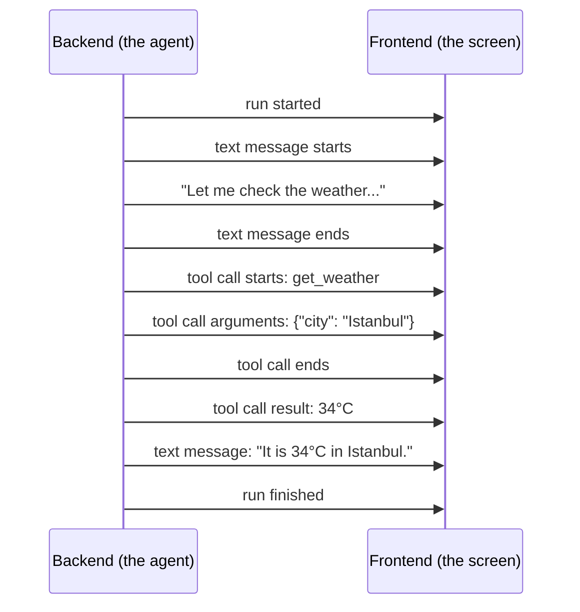
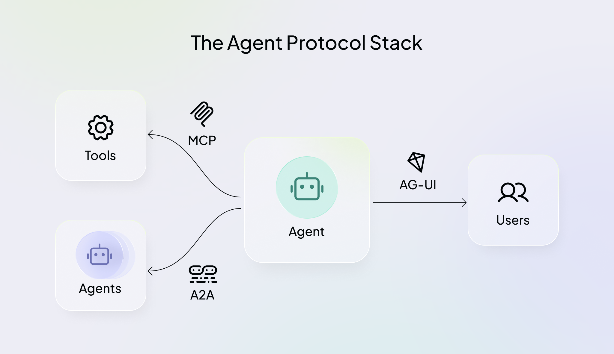

# Agentic UI

[Loop Engineering](loop_engineering.md) ended with agents that run for minutes, hours, and sometimes
days. Someone still has to look at that work: see what the agent is doing, stop it when it goes
wrong, and approve the steps that matter. This module is about the interface where that happens,
and about the contract that carries an agent's work from the backend to the screen.

## What Agentic UI is

CopilotKit's [What Is Agentic UI?](https://www.copilotkit.ai/learning/what-is-agentic-ui) gives the
definition that this module uses:

> **Agentic UI is user interface built for humans and AI agents to work in the same application.**
> It streams agent work as it happens, accepts human steering and approvals mid-run, renders
> agent-generated interface alongside developer-built components, and keeps application state
> synchronized between the user and the agent.

The difference from the interfaces you already know is who is doing the work.

- **A traditional UI** assumes a human who issues commands to software that behaves the same way
  every time. You press a button, and the same thing happens.
- **A chat UI** assumes one question and one answer. You type, you wait, and a reply appears.
- **An agentic UI** assumes an agent that is already running. The agent makes many decisions and
  calls many tools, and the human watches, directs, and corrects it while it works.

This module covers the first part of that definition, the one every agentic UI is built on:
**streaming the agent's work as it happens**, and the protocol that standardises it. Steering,
approvals, shared state and interface that the agent generates itself belong to the Expert module,
[Advanced Agentic UI](../3_expert/advanced_ui.md).

## Why Stream the Run

An agent run takes time. A single answer from a model already arrives one token at a time, as
[LLM Fundamentals](../1_fundamentals/llms.md) showed. An agent adds more on top of that: it thinks,
it calls a tool, it waits for the result, it calls another tool, and it may start subagents. The
whole run can take a minute, or an hour.

So there are two ways to build the screen.

1. **Wait, then show everything.** The backend runs the whole agent loop. When the loop ends, it
   sends the final answer. The user looks at a spinner for the whole time, and has no idea whether
   the agent is working, stuck, or going in the wrong direction.
2. **Stream the run.** The backend sends each piece of work to the front end as soon as it exists:
   a few words of the answer, the start of a tool call, the result of that call. The user sees the
   progress as it happens, the same way you watch a coding agent work in its terminal.

Agent products such as coding agents and chat assistants use the second way. The work is produced step by step
anyway, so there is no reason to hide it until the end. Seeing the steps also lets the user catch a
mistake early, while the run is still cheap to stop.

  
*The screen starts with an empty prompt. Once the agent starts, a checklist of its steps fills in, and each step is ticked off as the agent finishes it, so the user sees progress instead of a spinner.*

## What Gets Streamed

The backend does not stream one long string. It streams **events**: small, typed messages, each of
which says what just happened. For one turn of the weather agent from
[Tool Calling](../1_fundamentals/tools.md), the stream looks like this:



The front end reads each event and updates the screen: it adds words to the message bubble as they
arrive, shows a "checking the weather" card while the tool runs, and fills the card with the result.

The kinds of event are the same in almost every agent:

- **Lifecycle**: the run started, a step started or finished, the run finished, the run failed.
- **Text**: a message started, a piece of its content arrived, the message ended.
- **Reasoning**: the model's thinking, streamed the same way as text.
- **Tool calls**: a call started, its arguments arrived piece by piece, the call ended, the result
  came back. This is the [Tool Calling](../1_fundamentals/tools.md) mechanism, made visible.
- **Subagents**: a subagent started or finished, so the screen can show the work it delegated.
- **State**: the agent's current state, so the screen and the agent agree on what is true.

## Every Agent Speaks Its Own Format

Here is the problem. The kinds of event are similar everywhere, but their exact shape is not. Each
agent framework has its own event format.

LangChain, for example, has its own
[event streaming](https://docs.langchain.com/oss/python/langchain/event-streaming) API. Each model
message comes with its text, its reasoning and its tool calls. The stream also reports the
subagents, the state of the run and custom updates. Another framework uses different names,
different fields, and a different order. (LangChain also speaks AG-UI, below, which shows how the
industry solved exactly this problem.)

That ties the front end to the backend. The front end has to understand the events of the one
agent framework behind it. If the team later moves the backend to another framework, the front end
has to be rewritten too, even though the screen is supposed to look exactly the same.

In software engineering we always look for **decoupling**: two parts that can change separately
because they agree on a contract. MCP did exactly this for tools, as
[Code Agents](coding_agents.md) showed. You describe a tool once in a standard way, and any agent
that speaks MCP can use it. The same idea, applied between the agent and the screen, is AG-UI.

## AG-UI

**AG-UI** is the **Agent–User Interaction Protocol**. Its own
[overview](https://docs.ag-ui.com/introduction) calls it "an open, lightweight, event-based protocol
that standardizes how AI agents connect to user-facing applications".

It defines one shared set of events. A backend that emits AG-UI events and a front end that reads
them can be built by different teams, with different tools, and still work together. So if you
write the front end against AG-UI, you can replace the agent behind it at any time.

The events are grouped like the kinds above. Here are the main ones, as AG-UI names them in
[its event reference](https://docs.ag-ui.com/concepts/events):

| Group | Events |
| --- | --- |
| Lifecycle | `RunStarted`, `RunFinished`, `RunError`, `StepStarted`, `StepFinished` |
| Text message | `TextMessageStart`, `TextMessageContent`, `TextMessageEnd` |
| Reasoning | `ReasoningStart`, `ReasoningMessageContent`, `ReasoningEnd`, and four more |
| Tool call | `ToolCallStart`, `ToolCallArgs`, `ToolCallEnd`, `ToolCallResult` |
| Subagent | `SubagentStarted`, `SubagentFinished`, `SubagentError` |
| State | `StateSnapshot`, `StateDelta`, `MessagesSnapshot` |
| Special | `Raw`, `Custom` |

On the wire, each name is written in capitals with underscores, so `RunStarted` is sent as
`RUN_STARTED`. The weather turn from above, as AG-UI events on the wire, one JSON object per event:

```json
{"type": "RUN_STARTED", "threadId": "t1", "runId": "r1"}
{"type": "TEXT_MESSAGE_START", "messageId": "m1", "role": "assistant"}
{"type": "TEXT_MESSAGE_CONTENT", "messageId": "m1", "delta": "Let me check the weather..."}
{"type": "TEXT_MESSAGE_END", "messageId": "m1"}
{"type": "TOOL_CALL_START", "toolCallId": "c1", "toolCallName": "get_weather"}
{"type": "TOOL_CALL_ARGS", "toolCallId": "c1", "delta": "{\"city\": \"Istanbul\"}"}
{"type": "TOOL_CALL_END", "toolCallId": "c1"}
{"type": "TOOL_CALL_RESULT", "messageId": "m2", "toolCallId": "c1", "content": "34°C"}
{"type": "TEXT_MESSAGE_START", "messageId": "m3", "role": "assistant"}
{"type": "TEXT_MESSAGE_CONTENT", "messageId": "m3", "delta": "It is 34°C in Istanbul."}
{"type": "TEXT_MESSAGE_END", "messageId": "m3"}
{"type": "RUN_FINISHED", "threadId": "t1", "runId": "r1"}
```

Three things are worth noticing. First, the arguments of a tool call arrive as `delta` pieces, the
same way the text does, so the screen can show a tool call while the model is still writing it.
Second, every piece carries an id (`messageId`, `toolCallId`), so the front end knows which message
or which card to update. Third, nothing here belongs to one framework. Any backend can produce
exactly these lines.

AG-UI runs on the ordinary web. Its overview says it builds on HTTP and WebSockets. So the events
reach the browser over a connection the front end already knows how to open.

### Who Supports It

Because the contract is shared, many agent frameworks speak it. The overview lists, among others:

- **Partnerships**: LangChain and CrewAI.
- **First-party integrations**: Microsoft Agent Framework, Google ADK, AWS Strands Agents, Mastra,
  Pydantic AI, Agno, LlamaIndex and AG2.
- **Community integrations**: the Claude Agent SDK and the OpenAI Agents SDK, among others.

It also has client SDKs in many languages, from Kotlin and Go to Rust and .NET.
The [CopilotKit](https://www.copilotkit.ai/ag-ui) team develops the protocol together with partner
frameworks, and builds its own front-end components on it. The source is on GitHub at
[ag-ui-protocol/ag-ui](https://github.com/ag-ui-protocol/ag-ui).

## The Agent Protocol Stack

AG-UI is one of three protocols, and each one covers a different side of the agent.

  
*The agent sits in the middle. MCP and A2A reach left, to its tools and to other agents. AG-UI reaches right, to the users in front of the screen.*

| Protocol | Connects the agent to | Comes from |
| --- | --- | --- |
| **MCP** | tools and data | Anthropic |
| **A2A** | other agents | Google |
| **AG-UI** | users, through the application | the CopilotKit team, with partner frameworks |

They do not compete. A real product often uses all three: the agent calls tools over MCP, hands a
part of the work to another agent over A2A, and streams everything it does to the user over AG-UI.

## Beyond Streaming

Streaming is the base. The rest of the agentic UI definition builds on it, and the Expert module
[Advanced Agentic UI](../3_expert/advanced_ui.md) will cover it:

- **Human in the loop**: the agent pauses and asks the user to approve a step before it runs it.
- **Shared state**: the screen and the agent read and write the same application state.
- **Generative UI**, and the specifications for it: A2UI, MCP Apps, OpenUI and json-render.

## Where this fits in the series

```mermaid
graph LR
    A[Prompt Engineering] --> B[Context Engineering]
    B --> C[Code Agents]
    C --> D[Agents in Practice]
    D --> E[Harness Engineering]
    E --> F[Loop Engineering]
    F --> G[Agentic UI]
    G --> H[Security]
    H --> I[Personal Agents]
    style A fill:#90EE90
    style B fill:#90EE90
    style C fill:#90EE90
    style D fill:#90EE90
    style E fill:#90EE90
    style F fill:#90EE90
    style G fill:#FFFF00
```



## Summary

Agentic UI is the interface where a human and a running agent work in the same application. Its
base is streaming: the agent's work is produced step by step, so it is sent to the screen step by
step, as typed events for the run's lifecycle, its text, its reasoning, its tool calls, its
subagents and its state. Every framework has its own event format, and that ties the front end to
one backend. AG-UI removes that tie with one open set of events, the same way MCP did for tools, and
many agent frameworks support it. Next to MCP (tools) and A2A (other agents), it is the protocol for
the third side of an agent: its users.

Next: everything that made the agent harder to supervise also made it a more valuable target to
attack. That is the subject of [Security](security.md).

**Quick Check**: Why does an agentic UI stream events instead of waiting for the final answer? What
problem does AG-UI solve that each framework's own event format does not? And which side of an agent
does each of MCP, A2A and AG-UI connect?

## References

### 📄 Articles

- [What Is Agentic UI?](https://www.copilotkit.ai/learning/what-is-agentic-ui): the definition this module uses, and agentic UI against traditional and chat UI
- [Event streaming](https://docs.langchain.com/oss/python/langchain/event-streaming): how LangChain streams the messages, tool calls, subagents and state of a run
- [AG-UI Overview](https://docs.ag-ui.com/introduction): what the protocol is, the frameworks that support it, and where it sits next to MCP and A2A
- [Events](https://docs.ag-ui.com/concepts/events): every AG-UI event, with its fields

### 🛠️ Tools

- [AG-UI Protocol](https://www.copilotkit.ai/ag-ui): the protocol from the side of the CopilotKit team that develops it
- [CopilotKit Interactive Dojo](https://dojo.ag-ui.com/): live demos of chat, generative UI, human in the loop and shared state, to try in the browser

### 🗃️ Repositories

- [ag-ui-protocol/ag-ui](https://github.com/ag-ui-protocol/ag-ui): the protocol, its SDKs and its integrations

### 🧭 Modules

- [Advanced Agentic UI](../3_expert/advanced_ui.md): human in the loop, shared state, generative UI, and the specifications for it
