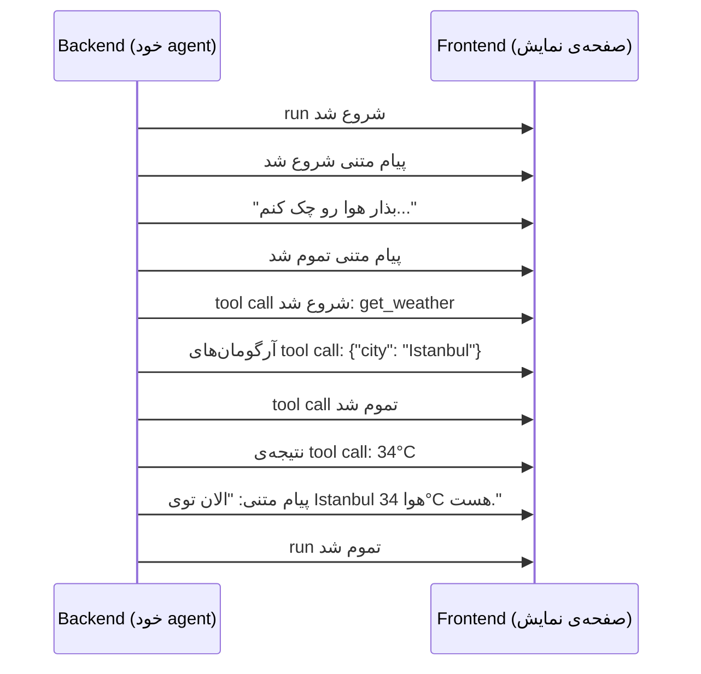
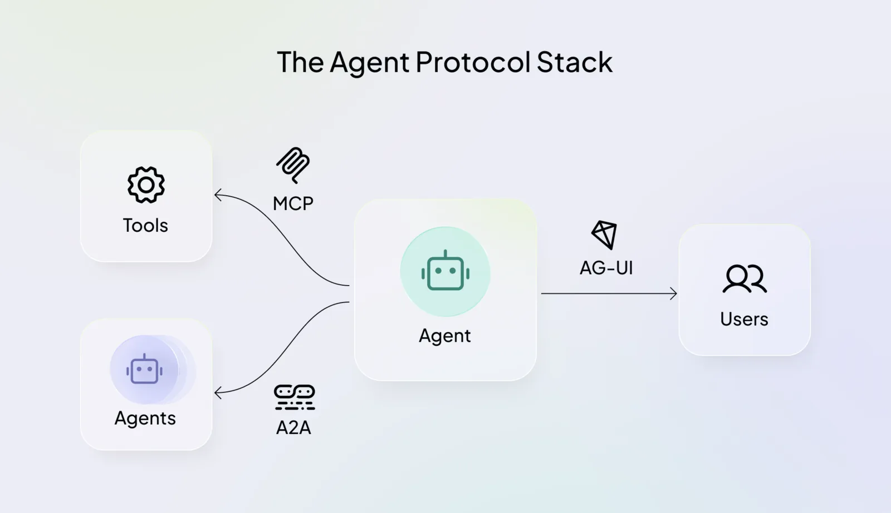

---
objectives:
  - "بگو Agentic UI چیه و چه فرقی با رابط سنتی و رابط chat داره"
  - "توضیح بده چرا run یه agent به‌صورت event stream می‌شه، نه اینکه توی آخر یه‌جا برگرده"
  - "اسم نوع event‌های اصلی رو بیار که یه run تولید می‌کنه: lifecycle، text، reasoning، tool call، subagent و state"
  - "توضیح بده مشکل coupling رو که یه قرارداد مشترک event برطرف می‌کنه"
  - "AG-UI رو توی Protocol Stack برای Agent کنار MCP و A2A بذار"
---

# Agentic UI

[Loop Engineering](loop_engineering_fa.md) با agent‌هایی تموم شد که چند دقیقه، چند ساعت و گاهی چند روز بدون وقفه کار می‌کنن. ولی هنوز یه نفر باید به این کار نگاه کنه: ببینه agent داره چی‌کار می‌کنه، وقتی داره اشتباه می‌ره متوقفش کنه، و قدم‌های مهم رو تأیید کنه. این درس درباره‌ی همون رابطیه که این اتفاق‌ها توش می‌افته، و درباره‌ی قراردادی که کار agent رو از backend به صفحه‌ی نمایش می‌رسونه.

## Agentic UI چیه؟

CopilotKit توی [What Is Agentic UI?](https://www.copilotkit.ai/learning/what-is-agentic-ui) تعریفی داده که ما هم توی این درس همون رو به‌کار می‌بریم:

> **Agentic UI یعنی رابط کاربری‌ای که برای این ساخته شده که آدم‌ها و agent‌های AI توی یه برنامه‌ی مشترک با هم کار کنن.** کار agent رو همون لحظه که داره انجام می‌شه stream می‌کنه، وسط اجرا از آدم هدایت و تأیید می‌گیره، رابطی که خود agent می‌سازه رو کنار component‌هایی که برنامه‌نویس ساخته نشون می‌ده، و state برنامه رو بین کاربر و agent هماهنگ نگه می‌داره.

فرقش با رابط‌هایی که می‌شناسی اینه که کار رو کی انجام می‌ده.

- **رابط کاربری سنتی** فرض می‌کنه یه آدم هست که به نرم‌افزاری دستور می‌ده که هر بار دقیقاً یه جور رفتار می‌کنه. دکمه رو می‌زنی و همیشه همون اتفاق می‌افته.
- **رابط chat** فرض می‌کنه یه سؤال هست و یه جواب. می‌نویسی، صبر می‌کنی و یه پاسخ نشون داده می‌شه.
- **Agentic UI** فرض می‌کنه یه agent هست که همین الان داره کار می‌کنه. agent کلی تصمیم می‌گیره و کلی tool صدا می‌زنه، و آدم وسط کار نگاهش می‌کنه، هدایتش می‌کنه و اصلاحش می‌کنه.

این درس سراغ بخش اول این تعریف می‌ره، یعنی همون چیزی که هر agentic UI روش ساخته می‌شه: **stream کردن کار agent همون لحظه که اتفاق می‌افته**، و protocol‌ای که این کار رو استاندارد می‌کنه. هدایت کردن، تأیید گرفتن، state مشترک و رابطی که خود agent می‌سازه مال درس Expert‌ه: [Advanced Agentic UI](../3_expert/advanced_ui.md).

## چرا run رو stream می‌کنیم؟

یه run‌ی agent زمان می‌بره. حتی یه جواب ساده از مدل هم token به token می‌رسه، همون‌طور که توی [مبانی LLM](../1_fundamentals/llms_fa.md) دیدیم. agent چند تا کار دیگه هم بهش اضافه می‌کنه: فکر می‌کنه، یه tool صدا می‌زنه، منتظر نتیجه می‌مونه، tool بعدی رو صدا می‌زنه، و ممکنه چند تا subagent هم راه بندازه. کل run می‌تونه یه دقیقه طول بکشه یا یه ساعت.

برای همین دو جور می‌شه صفحه رو ساخت.

1. **صبر کن، بعد همه‌چی رو یه‌جا نشون بده.** backend کل agent loop رو اجرا می‌کنه و وقتی loop تموم شد، جواب نهایی رو می‌فرسته. کاربر تمام این مدت به یه spinner زل می‌زنه و نمی‌دونه agent داره کار می‌کنه، گیر کرده یا به سمت اشتباه می‌ره.
2. **run رو stream کن.** backend هر تیکه از کار رو به frontend می‌فرسته، به محض اینکه ساخته شد: چند کلمه از جواب، شروع یه tool call، نتیجه‌ی همون call. کاربر پیشرفت رو همون لحظه می‌بینه، درست مثل وقتی که کار یه coding agent رو توی terminal‌ش تماشا می‌کنی.

محصول‌های agent‌ای مثل coding agent‌ها و chat assistant‌ها از راه دوم می‌رن. کار به‌هرحال قدم‌به‌قدم ساخته می‌شه، پس دلیلی نداره تا آخر قایمش کنیم. وقتی قدم‌ها رو می‌بینه، کاربر می‌تونه یه اشتباه رو زود بگیره، یعنی وقتی که هنوز متوقف کردن run ارزونه.

  
*صفحه با یه prompt خالی شروع می‌شه. وقتی agent شروع می‌کنه، یه checklist از قدم‌هاش پر می‌شه و هر قدم که agent تمومش می‌کنه تیک می‌خوره، برای همین کاربر به‌جای یه spinner پیشرفت رو می‌بینه.*

## چی stream می‌شه؟

backend یه رشته‌ی طولانی stream نمی‌کنه. **event** stream می‌کنه: پیام‌های کوچیکِ دسته‌بندی‌شده که هر کدوم می‌گه همین الان چی اتفاق افتاد. برای یه نوبت از weather agent که توی [Tool Calling](../1_fundamentals/tools_fa.md) دیدیم، stream این شکلیه:



frontend هر event رو می‌خونه و صفحه رو به‌روز می‌کنه: کلمه‌ها رو همین‌طور که می‌رسن به حباب پیام اضافه می‌کنه، تا وقتی tool داره کار می‌کنه یه کارت «در حال چک کردن هوا» نشون می‌ده، و وقتی نتیجه اومد کارت رو باهاش پر می‌کنه.

نوع event‌ها تقریباً توی همه‌ی agent‌ها یکیه:

- **Lifecycle**: run شروع شد، یه step شروع یا تموم شد، run تموم شد، run با خطا تموم شد.
- **Text**: یه پیام شروع شد، یه تیکه از محتواش رسید، پیام تموم شد.
- **Reasoning**: فکر کردن مدل، که مثل متن stream می‌شه.
- **Tool call**: یه call شروع شد، آرگومان‌هاش تیکه‌تیکه رسیدن، call تموم شد، نتیجه برگشت. این همون مکانیزم [Tool Calling](../1_fundamentals/tools_fa.md) هست که حالا دیدنی شده.
- **Subagent**: یه subagent شروع یا تموم شد، تا صفحه بتونه کاری که واگذار شده رو نشون بده.
- **State**: state فعلی agent، تا صفحه و agent هر دو بدونن چی درسته.

## هر Agent با فرمت خودش حرف می‌زنه

مشکل اینجاست. نوع event‌ها همه‌جا شبیه همه، ولی شکل دقیقشون نه. هر framework فرمت event خودش رو داره.

مثلاً LangChain برای خودش یه API به اسم [event streaming](https://docs.langchain.com/oss/python/langchain/event-streaming) داره. هر message مدل با متن، reasoning و tool call‌هاش میاد. stream جدا از این‌ها subagent‌ها، state‌ی run و آپدیت‌های custom رو هم گزارش می‌ده. یه framework دیگه اسم‌ها و field‌های دیگه‌ای داره و ترتیبش هم فرق می‌کنه. (LangChain AG-UI رو هم بلده، پایین‌تر می‌بینیمش، و همین نشون می‌ده صنعت دقیقاً همین مشکل رو چطور حل کرد.)

این یعنی frontend به backend گره می‌خوره. frontend باید event‌های همون framework‌ای رو بفهمه که پشتشه. اگه تیم بعداً backend رو ببره روی یه framework دیگه، frontend رو هم باید از نو بنویسه، با اینکه قراره صفحه دقیقاً همون شکلی بمونه.

توی مهندسی نرم‌افزار همیشه دنبال **decoupling** هستیم: دو بخشی که چون سر یه قرارداد توافق کردن، می‌تونن جدا از هم عوض بشن. MCP همین کار رو برای tool‌ها کرد، همون‌طور که توی [Code Agent‌ها](coding_agents_fa.md) دیدیم. یه بار یه tool رو به شکل استاندارد توصیف می‌کنی و هر agent‌ی که MCP بلده می‌تونه ازش استفاده کنه. همین ایده، این بار بین agent و صفحه، می‌شه AG-UI.

## AG-UI

**AG-UI** مخفف **Agent–User Interaction Protocol** هست. توی [overview](https://docs.ag-ui.com/introduction) خودش بهش می‌گن «یه protocol باز و سبک و مبتنی بر event که مشخص می‌کنه agent‌های AI چطور به برنامه‌های رو‌به‌کاربر وصل بشن» (an open, lightweight, event-based protocol that standardizes how AI agents connect to user-facing applications).

AG-UI یه مجموعه event مشترک تعریف می‌کنه. backend‌ای که event‌های AG-UI تولید می‌کنه و frontend‌ای که اون‌ها رو می‌خونه می‌تونن دست تیم‌های مختلف و با ابزارهای مختلف ساخته بشن و باز هم با هم کار کنن. پس اگه frontend رو روی AG-UI بنویسی، هر وقت خواستی می‌تونی agent پشتش رو عوض کنی.

event‌ها مثل همون نوع‌هایی که بالا گفتیم گروه‌بندی شدن. این‌ها اصلی‌ترین‌هان، با همون اسم‌هایی که AG-UI توی [event reference](https://docs.ag-ui.com/concepts/events) بهشون می‌ده:

| گروه | Event‌ها |
| --- | --- |
| Lifecycle | `RunStarted`, `RunFinished`, `RunError`, `StepStarted`, `StepFinished` |
| پیام متنی | `TextMessageStart`, `TextMessageContent`, `TextMessageEnd` |
| Reasoning | `ReasoningStart`, `ReasoningMessageContent`, `ReasoningEnd`, و چهار تای دیگه |
| Tool call | `ToolCallStart`, `ToolCallArgs`, `ToolCallEnd`, `ToolCallResult` |
| Subagent | `SubagentStarted`, `SubagentFinished`, `SubagentError` |
| State | `StateSnapshot`, `StateDelta`, `MessagesSnapshot` |
| ویژه | `Raw`, `Custom` |

روی wire اسم هر event با حروف بزرگ و با underscore نوشته می‌شه، یعنی `RunStarted` به‌شکل `RUN_STARTED` فرستاده می‌شه. همون نوبت weather از بالا، به‌شکل event‌های AG-UI روی wire، با یه JSON برای هر event:

```json
{"type": "RUN_STARTED", "threadId": "t1", "runId": "r1"}
{"type": "TEXT_MESSAGE_START", "messageId": "m1", "role": "assistant"}
{"type": "TEXT_MESSAGE_CONTENT", "messageId": "m1", "delta": "Let me check the weather..."}
{"type": "TEXT_MESSAGE_END", "messageId": "m1"}
{"type": "TOOL_CALL_START", "toolCallId": "c1", "toolCallName": "get_weather"}
{"type": "TOOL_CALL_ARGS", "toolCallId": "c1", "delta": "{\"city\": \"Istanbul\"}"}
{"type": "TOOL_CALL_END", "toolCallId": "c1"}
{"type": "TOOL_CALL_RESULT", "messageId": "m2", "toolCallId": "c1", "content": "34°C"}
{"type": "TEXT_MESSAGE_START", "messageId": "m3", "role": "assistant"}
{"type": "TEXT_MESSAGE_CONTENT", "messageId": "m3", "delta": "It is 34°C in Istanbul."}
{"type": "TEXT_MESSAGE_END", "messageId": "m3"}
{"type": "RUN_FINISHED", "threadId": "t1", "runId": "r1"}
```

سه نکته توی این خط‌ها هست. اول، آرگومان‌های یه tool call هم مثل متن به‌شکل تیکه‌های `delta` می‌رسن، برای همین صفحه می‌تونه یه tool call رو همون موقع که مدل هنوز داره می‌نویسدش نشون بده. دوم، هر تیکه یه id داره (`messageId` و `toolCallId`)، پس frontend می‌دونه کدوم پیام یا کدوم کارت رو باید به‌روز کنه. سوم، هیچ‌چیزی اینجا مال یه framework خاص نیست. هر backend‌ای می‌تونه دقیقاً همین خط‌ها رو تولید کنه.

AG-UI روی همون وب معمولی کار می‌کنه. overview‌ش می‌گه روی HTTP و WebSockets ساخته شده. برای همین event‌ها از یه اتصالی به مرورگر می‌رسن که frontend از قبل بلده بازش کنه.

### کی ازش پشتیبانی می‌کنه؟

چون قرارداد مشترکه، خیلی از framework‌های agent AG-UI رو بلدن. overview بین بقیه این‌ها رو اسم می‌بره:

- **Partnership‌ها**: LangChain و CrewAI.
- **Integration‌های رسمی**: Microsoft Agent Framework، Google ADK، AWS Strands Agents، Mastra، Pydantic AI، Agno، LlamaIndex و AG2.
- **Integration‌های community**: Claude Agent SDK و OpenAI Agents SDK، و چند تای دیگه.

برای خیلی از زبان‌ها هم client SDK داره، از Kotlin و Go تا Rust و .NET.
تیم [CopilotKit](https://www.copilotkit.ai/ag-ui) این protocol رو با framework‌های partner با هم توسعه می‌ده و component‌های frontend خودش رو هم روش می‌سازه. سورس روی GitHub هست: [ag-ui-protocol/ag-ui](https://github.com/ag-ui-protocol/ag-ui).

## Protocol Stack برای Agent

AG-UI یکی از سه protocol‌ه، و هر کدوم یه طرف agent رو پوشش می‌دن.

  
*agent وسطه. MCP و A2A به سمت چپ می‌رن، به tool‌ها و agent‌های دیگه. AG-UI به سمت راست می‌ره، به کاربرهایی که پشت صفحه نشستن.*

| Protocol | agent رو وصل می‌کنه به | از طرف |
| --- | --- | --- |
| **MCP** | tool‌ها و داده | Anthropic |
| **A2A** | agent‌های دیگه | Google |
| **AG-UI** | کاربرها، از راه برنامه | تیم CopilotKit، با framework‌های partner |

این‌ها با هم رقابت نمی‌کنن. یه محصول واقعی معمولاً از هر سه استفاده می‌کنه: agent با MCP tool صدا می‌زنه، با A2A بخشی از کار رو می‌سپره به یه agent دیگه، و با AG-UI همه‌ی کارهاش رو برای کاربر stream می‌کنه.

این سه تا رو با هم قاطی نکن. هر کدوم یه طرف متفاوت agent رو وصل می‌کنه، و دو تای دیگه رو قبلاً دیدی: MCP توی [Code Agent‌ها](coding_agents_fa.md) و A2A توی [Multi-Agent Systems](../1_fundamentals/multi_agent_fa.md).

## فراتر از Streaming

streaming پایه‌ست. بقیه‌ی تعریف agentic UI روی همین بنا می‌شه و درس Expert، [Advanced Agentic UI](../3_expert/advanced_ui.md)، بهش می‌رسه:

- **Human in the loop**: agent وایمیسه و از کاربر می‌خواد یه قدم رو قبل از اجرا تأیید کنه.
- **Shared state**: صفحه و agent هر دو روی یه state مشترک می‌خونن و می‌نویسن.
- **Generative UI** و specification‌های مربوط بهش: A2UI، MCP Apps، OpenUI و json-render.

## اصطلاح‌های کلیدی

- **Agentic UI**: رابطی که آدم و agent توی یه برنامه‌ی مشترک باهم کار می‌کنن.
- **Streaming**: فرستادن هر تیکه از کار agent به صفحه، همون لحظه که ساخته می‌شه.
- **Event**: یه پیام کوچیک با نوع مشخص، که می‌گه همین الان چی اتفاق افتاد.
- **Tool call**: درخواست agent برای اجرای یه tool؛ شروعش، آرگومان‌هاش، پایانش و نتیجه‌ش هر کدوم جدا event می‌شن.
- **Decoupling**: دو بخشی که چون سر یه قرارداد توافق کردن، می‌تونن جدا از هم عوض بشن.
- **MCP**: protocol‌ای که agent رو به tool‌ها و داده وصل می‌کنه؛ از Anthropic.
- **AG-UI**: Agent–User Interaction Protocol؛ یه مجموعه event مشترک که agent رو به برنامه‌های رو‌به‌کاربر وصل می‌کنه.
- **A2A**: protocol‌ای که agent رو به agent‌های دیگه وصل می‌کنه؛ از Google.
- **Human in the loop**: agent قبل از اجرای یه قدم وایمیسه و از کاربر تأیید می‌گیره.
- **Shared state**: صفحه و agent هر دو روی یه state برنامه می‌خونن و می‌نویسن.
- **Generative UI**: رابطی که خود agent می‌سازه و کنار component‌های برنامه‌نویس نشون داده می‌شه.

## کجای این مجموعه هستیم

```mermaid
graph LR
    A[Prompt Engineering] --> B[Context Engineering]
    B --> C[Code Agents]
    C --> D[Agents in Practice]
    D --> E[Harness Engineering]
    E --> F[Loop Engineering]
    F --> G[Agentic UI]
    G --> H[Security]
    H --> I[Personal Agents]
    style A fill:#90EE90
    style B fill:#90EE90
    style C fill:#90EE90
    style D fill:#90EE90
    style E fill:#90EE90
    style F fill:#90EE90
    style G fill:#FFFF00
```



## خلاصه

Agentic UI رابطیه که توش یه آدم و یه agent‌ی در حال اجرا توی یه برنامه‌ی مشترک کار می‌کنن. پایه‌ش streaming‌ه: کار agent قدم‌به‌قدم ساخته می‌شه، پس قدم‌به‌قدم هم به صفحه فرستاده می‌شه، به‌شکل event‌هایی با نوع مشخص برای lifecycle، متن، reasoning، tool call‌ها، subagent‌ها و state‌ی run. هر framework فرمت event خودش رو داره و همین frontend رو به یه backend گره می‌زنه. AG-UI با یه مجموعه event باز و مشترک این گره رو باز می‌کنه، همون‌طور که MCP برای tool‌ها کرد، و خیلی از framework‌های agent ازش پشتیبانی می‌کنن. کنار MCP (برای tool‌ها) و A2A (برای agent‌های دیگه)، AG-UI protocol سومین طرف agent‌ه: کاربرهاش.

قدم بعدی: هر چیزی که نظارت روی agent رو سخت‌تر کرد، اون رو به یه هدف باارزش‌تر برای حمله هم تبدیل کرد. این موضوع [Security](security_fa.md) هست.

**بررسی سریع**: چرا یه agentic UI به‌جای اینکه منتظر جواب نهایی بمونه، event‌ها رو stream می‌کنه؟ AG-UI چه مشکلی رو حل می‌کنه که فرمت event خودِ هر framework حل نمی‌کنه؟ و MCP و A2A و AG-UI هر کدوم کدوم طرف agent رو وصل می‌کنن؟

## منابع

### 📄 مقاله‌ها

- [What Is Agentic UI?](https://www.copilotkit.ai/learning/what-is-agentic-ui): تعریفی که این درس ازش استفاده می‌کنه، و فرق agentic UI با رابط سنتی و chat
- [Event streaming](https://docs.langchain.com/oss/python/langchain/event-streaming): اینکه LangChain چطور message‌ها، tool call‌ها، subagent‌ها و state‌ی یه run رو stream می‌کنه
- [AG-UI Overview](https://docs.ag-ui.com/introduction): protocol چیه، کدوم framework‌ها ازش پشتیبانی می‌کنن، و کنار MCP و A2A کجا می‌شینه
- [Events](https://docs.ag-ui.com/concepts/events): همه‌ی event‌های AG-UI، با field‌هاشون

### 🛠️ ابزارها

- [AG-UI Protocol](https://www.copilotkit.ai/ag-ui): protocol از دید تیم CopilotKit که توسعه‌ش می‌ده
- [CopilotKit Interactive Dojo](https://dojo.ag-ui.com/): دموهای زنده‌ی chat، generative UI، human in the loop و shared state، که می‌تونی توی مرورگر امتحانشون کنی

### 🗃️ Repository‌ها

- [ag-ui-protocol/ag-ui](https://github.com/ag-ui-protocol/ag-ui): خود protocol، SDK‌ها و integration‌هاش

### 🧭 ماژول‌ها

- [Advanced Agentic UI](../3_expert/advanced_ui.md): human in the loop، shared state، generative UI و specification‌های مربوط بهش
