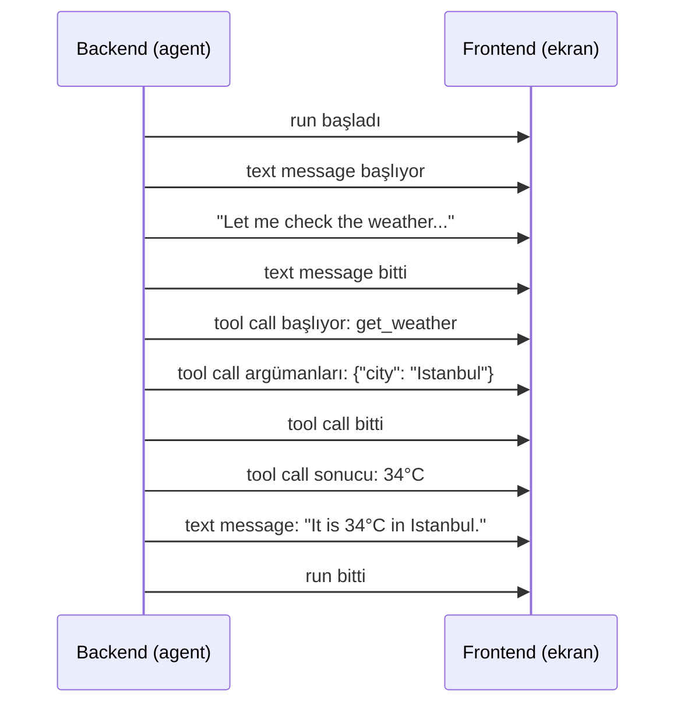
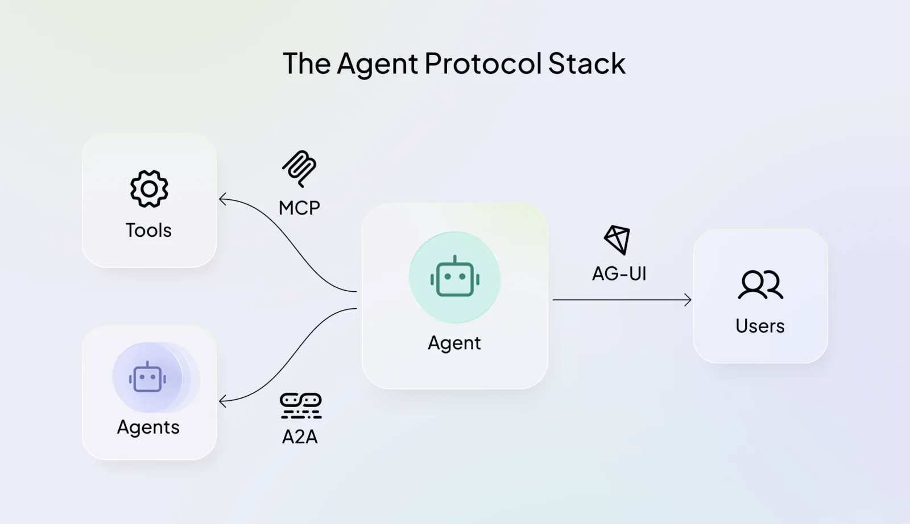
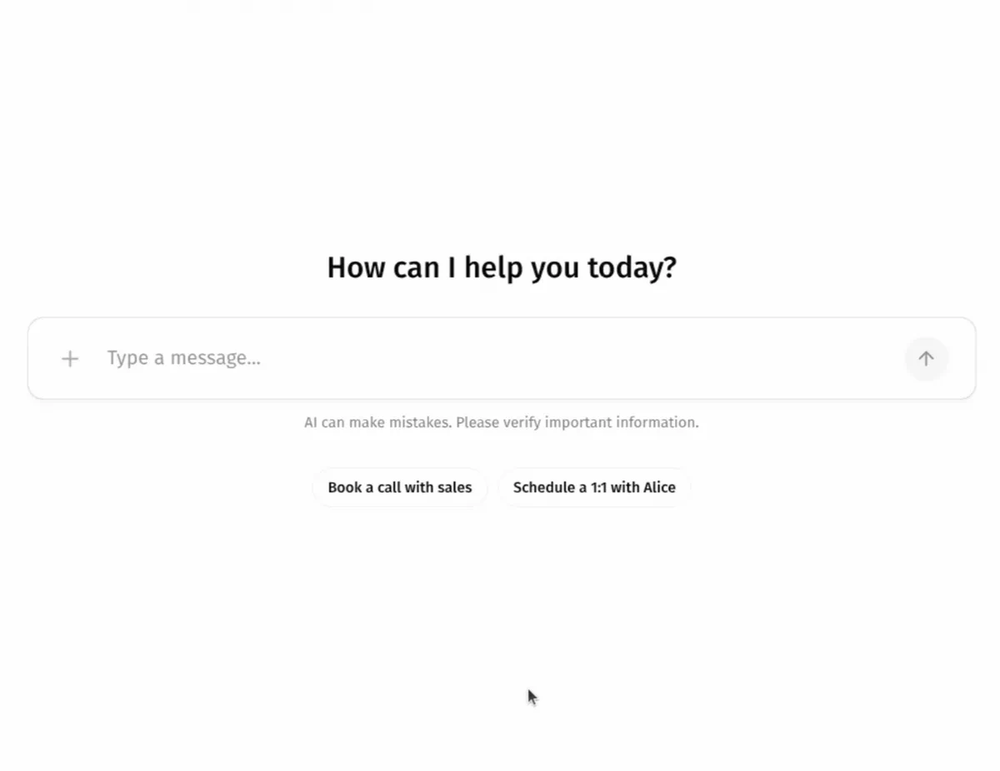

---
objectives:
  - "Agentic UI'ın ne olduğunu söyle ve onun geleneksel bir UI'dan ve chat UI'dan nasıl ayrıldığını açıkla"
  - "Bir agent run'ının neden sonunda tek parça dönmek yerine event olarak stream edildiğini açıkla"
  - "Bir run'ın ürettiği başlıca event türlerini say: lifecycle, text, reasoning, tool call, subagent ve state"
  - "Ortak bir event sözleşmesinin ortadan kaldırdığı coupling sorununu açıkla"
  - "AG-UI'ı Agent Protocol Stack'te MCP ve A2A'in yanına yerleştir"
  - "Human in the loop'un ne olduğunu ve bir agentic UI'ın bir run'ı bir insanın cevabı için nasıl durdurduğunu söyle"
---

# Agentic UI

[Loop Engineering](loop_engineering_tr.md) modülü, dakikalarca, saatlerce, bazen günlerce çalışan agent'larla bitti. Yine de biri bu işe bakmak zorunda: agent'ın ne yaptığını görmek, işler ters gittiğinde onu durdurmak ve önemli adımlara onay vermek. Bu modül, bunların gerçekleştiği arayüzü ve bir agent'ın işini backend'den ekrana taşıyan sözleşmeyi (contract) anlatıyor.

## Agentic UI Nedir

Bu modülün kullandığı tanım, CopilotKit'in [What Is Agentic UI?](https://www.copilotkit.ai/learning/what-is-agentic-ui) yazısından geliyor:

> **Agentic UI, insanların ve AI agent'larının aynı uygulamada birlikte çalışması için geliştirilmiş kullanıcı arayüzüdür.**
> Agent'ın işini gerçekleştikçe stream eder, çalışma sürerken insanın yönlendirmesini ve onaylarını kabul eder, agent'ın ürettiği arayüzü geliştiricinin yazdığı bileşenlerin yanında gösterir ve uygulamanın state'ini kullanıcı ile agent arasında senkron tutar.

Bildiğin arayüzlerden farkı, işi kimin yaptığında.

- **Geleneksel bir UI**, her seferinde aynı şekilde davranan bir yazılıma komut veren bir insan varsayar. Bir düğmeye basarsın ve her zaman aynı şey olur.
- **Bir chat UI**, tek bir soru ve tek bir cevap varsayar. Yazarsın, beklersin ve bir cevap görünür.
- **Bir agentic UI**, zaten çalışmakta olan bir agent varsayar. Agent çok sayıda karar verir ve çok sayıda tool çağırır; insan ise o çalışırken onu izler, yönlendirir ve düzeltir.

Bu modül, tanımın her agentic UI'ın dayandığı kısımlarını anlatıyor: **agent'ın işini gerçekleştikçe stream etmek**, bunu standartlaştıran protocol ve onaylar, yani **human in the loop**. Bir run'ı çalışırken yönlendirmek, ortak state ve agent'ın kendi ürettiği arayüz ise Expert modülün konusu: [İleri Seviye Agentic UI](../3_expert/advanced_ui_tr.md).

## Run'ı Neden Stream Ederiz

Bir agent run'ı zaman alır. Modelin tek bir cevabı bile, [LLM Temelleri](../1_fundamentals/llms_tr.md) modülünde gördüğün gibi, token token gelir. Agent bunun üstüne daha fazlasını ekler: düşünür, bir tool çağırır, sonucu bekler, başka bir tool çağırır ve subagent'lar başlatabilir. Bütün run bir dakika da sürebilir, bir saat de.

Dolayısıyla ekranı kurmanın iki yolu var.

1. **Bekle, sonra hepsini göster.** Backend bütün agent loop'unu çalıştırır. Loop bitince nihai cevabı gönderir. Kullanıcı bütün bu süre boyunca bir spinner'a bakar ve agent'ın çalışıyor mu, takılmış mı, yoksa yanlış yöne mi gidiyor olduğunu bilemez.
2. **Run'ı stream et.** Backend her iş parçasını oluştuğu anda front end'e gönderir: cevabın birkaç kelimesi, bir tool call'un başlangıcı, o çağrının sonucu. Kullanıcı ilerlemeyi olurken görür; tıpkı bir coding agent'ı terminalinde çalışırken izlediğin gibi.

İkinci yolu coding agent'lar ve chat asistanları gibi agent ürünleri kullanır. İş zaten adım adım üretiliyor, o yüzden onu sona kadar saklamanın bir anlamı yok. Adımları görmek, kullanıcının bir hatayı erken yakalamasını da sağlar; yani run'ı durdurmanın hâlâ ucuz olduğu bir anda.

  
*Ekran boş bir prompt ile başlar. Agent çalışmaya başlayınca adımlarından oluşan bir checklist dolmaya başlar ve agent her adımı bitirdikçe o adım işaretlenir; böylece kullanıcı bir spinner yerine ilerlemeyi görür.*

## Neler Stream Edilir

Backend, uzun tek bir string stream etmez. **Event'leri** stream eder: her biri az önce ne olduğunu söyleyen, küçük ve tipli mesajlar. [Tool Calling](../1_fundamentals/tools_tr.md) modülündeki hava durumu agent'ının tek bir turu için stream şöyle görünür:



Front end her event'i okur ve ekranı günceller: gelen kelimeleri mesaj balonuna ekler, tool çalışırken "hava durumuna bakılıyor" kartını gösterir ve sonuç gelince kartı doldurur.

Event türleri hemen hemen her agent'ta aynıdır:

- **Lifecycle**: run başladı, bir step başladı ya da bitti, run bitti, run hata verdi.
- **Text**: bir mesaj başladı, içeriğinin bir parçası geldi, mesaj bitti.
- **Reasoning**: modelin düşünmesi; metinle aynı şekilde stream edilir.
- **Tool call'lar**: bir çağrı başladı, argümanları parça parça geldi, çağrı bitti, sonuç döndü. Bu, [Tool Calling](../1_fundamentals/tools_tr.md) mekanizmasının görünür hâli.
- **Subagent'lar**: bir subagent başladı ya da bitti; böylece ekran devredilen işi gösterebilir.
- **State**: agent'ın o anki state'i; böylece ekran ve agent neyin doğru olduğu konusunda aynı fikirde olur.

## Her Agent Kendi Formatını Konuşur

Sorun burada başlıyor. Event türleri her yerde benzer, ama tam şekilleri benzer değil. Her agent framework'ünün kendi event formatı var.

Örneğin LangChain'in kendi [event streaming](https://docs.langchain.com/oss/python/langchain/event-streaming) API'si var. Her model mesajı metniyle, reasoning'iyle ve tool call'larıyla birlikte gelir. Stream ayrıca subagent'ları, run'ın state'ini ve özel (custom) güncellemeleri de bildirir. Başka bir framework farklı isimler, farklı alanlar ve farklı bir sıra kullanır. (LangChain AG-UI'ı da konuşuyor; aşağıda göreceğin gibi sektör tam olarak bu sorunu böyle çözdü.)

Bu da front end'i backend'e bağlar. Front end, arkasındaki tek bir agent framework'ünün event'lerini anlamak zorunda kalır. Ekibin backend'i sonradan başka bir framework'e taşıması gerekirse, ekranın birebir aynı görünmesi gerekse bile front end'in de yeniden yazılması gerekir.

Yazılım mühendisliğinde hep **decoupling** ararız: bir sözleşmede anlaştıkları için birbirinden bağımsız değişebilen iki parça. MCP tam olarak bunu tool'lar için yaptı; [Code Agent'lar](coding_agents_tr.md) modülünde gördüğün gibi. Bir tool'u standart bir şekilde bir kez tanımlarsın ve MCP konuşan her agent onu kullanabilir. Aynı fikrin agent ile ekran arasına uygulanmış hâli AG-UI.

## AG-UI

**AG-UI**, **Agent–User Interaction Protocol**'ün kısaltmasıdır. Kendi [overview](https://docs.ag-ui.com/introduction) sayfası onu, "AI agent'larının kullanıcıya dönük uygulamalara nasıl bağlanacağını standartlaştıran açık, hafif, event tabanlı bir protocol" olarak tanımlıyor.

Ortak tek bir event kümesi tanımlar. AG-UI event'leri üreten bir backend ile bunları okuyan bir front end, farklı ekipler tarafından, farklı araçlarla yazılabilir ve yine de birlikte çalışır. Yani front end'i AG-UI'a göre yazarsan, arkasındaki agent'ı istediğin zaman değiştirebilirsin.

Event'ler, yukarıdaki türler gibi gruplanır. Ana event'ler, AG-UI'ın [event referansındaki](https://docs.ag-ui.com/concepts/events) adlarıyla şöyle:

| Grup | Event'ler |
| --- | --- |
| Lifecycle | `RunStarted`, `RunFinished`, `RunError`, `StepStarted`, `StepFinished` |
| Text message | `TextMessageStart`, `TextMessageContent`, `TextMessageEnd` |
| Reasoning | `ReasoningStart`, `ReasoningMessageContent`, `ReasoningEnd` ve dört tane daha |
| Tool call | `ToolCallStart`, `ToolCallArgs`, `ToolCallEnd`, `ToolCallResult` |
| Subagent | `SubagentStarted`, `SubagentFinished`, `SubagentError` |
| State | `StateSnapshot`, `StateDelta`, `MessagesSnapshot` |
| Special | `Raw`, `Custom` |

Wire üzerinde her isim büyük harflerle ve alt çizgilerle yazılır; yani `RunStarted`, `RUN_STARTED` olarak gönderilir. Yukarıdaki hava durumu turunun AG-UI event'leri olarak ağ üzerinden giden hâli (wire); her event için bir JSON nesnesi:

```json
{"type": "RUN_STARTED", "threadId": "t1", "runId": "r1"}
{"type": "TEXT_MESSAGE_START", "messageId": "m1", "role": "assistant"}
{"type": "TEXT_MESSAGE_CONTENT", "messageId": "m1", "delta": "Let me check the weather..."}
{"type": "TEXT_MESSAGE_END", "messageId": "m1"}
{"type": "TOOL_CALL_START", "toolCallId": "c1", "toolCallName": "get_weather"}
{"type": "TOOL_CALL_ARGS", "toolCallId": "c1", "delta": "{\"city\": \"Istanbul\"}"}
{"type": "TOOL_CALL_END", "toolCallId": "c1"}
{"type": "TOOL_CALL_RESULT", "messageId": "m2", "toolCallId": "c1", "content": "34°C"}
{"type": "TEXT_MESSAGE_START", "messageId": "m3", "role": "assistant"}
{"type": "TEXT_MESSAGE_CONTENT", "messageId": "m3", "delta": "It is 34°C in Istanbul."}
{"type": "TEXT_MESSAGE_END", "messageId": "m3"}
{"type": "RUN_FINISHED", "threadId": "t1", "runId": "r1"}
```

Dikkat etmeye değer üç nokta var. Birincisi, bir tool call'un argümanları da tıpkı metin gibi `delta` parçaları hâlinde geliyor; böylece ekran, model tool call'u daha yazarken onu gösterebilir. İkincisi, her parça bir id taşıyor (`messageId`, `toolCallId`); front end hangi mesajı ya da hangi kartı güncelleyeceğini bu sayede biliyor. Üçüncüsü, buradaki hiçbir şey tek bir framework'e ait değil. Herhangi bir backend birebir bu satırları üretebilir.

AG-UI, sıradan web üzerinde çalışır. Overview sayfası onun HTTP ve WebSockets üzerine kurulduğunu söylüyor. Yani event'ler, front end'in zaten nasıl açacağını bildiği bir bağlantı üzerinden tarayıcıya ulaşır.

### Kim Destekliyor

Sözleşme ortak olduğu için birçok agent framework'ü onu konuşuyor. Overview sayfası, diğerlerinin yanında şunları sayıyor:

- **Partnerships**: LangChain ve CrewAI.
- **First-party integrations**: Microsoft Agent Framework, Google ADK, AWS Strands Agents, Mastra, Pydantic AI, Agno, LlamaIndex ve AG2.
- **Community integrations**: Claude Agent SDK ve OpenAI Agents SDK, başkalarının yanında.

Kotlin ve Go'dan Rust ve .NET'e kadar birçok dilde client SDK'ları da var. Protocol'ü [CopilotKit](https://www.copilotkit.ai/ag-ui) ekibi partner framework'lerle birlikte geliştiriyor ve kendi front-end bileşenlerini de onun üstüne kuruyor. Kaynak kodu GitHub'da: [ag-ui-protocol/ag-ui](https://github.com/ag-ui-protocol/ag-ui).

## Agent Protocol Stack

AG-UI, üç protocol'den biridir ve her biri agent'ın farklı bir tarafını kapsar.

  
*Agent ortada duruyor. MCP ve A2A sola uzanır: tool'lara ve diğer agent'lara. AG-UI ise sağa uzanır: ekranın önündeki kullanıcılara.*

| Protocol | Agent'ı neye bağlar | Kimden geliyor |
| --- | --- | --- |
| **MCP** | tool'lara ve veriye | Anthropic |
| **A2A** | diğer agent'lara | Google |
| **AG-UI** | kullanıcılara, uygulama üzerinden | CopilotKit ekibi, partner framework'lerle birlikte |

Birbirleriyle rekabet etmezler. Gerçek bir üründe çoğu zaman üçü birden kullanılır: agent tool'ları MCP ile çağırır, işin bir kısmını A2A ile başka bir agent'a devreder ve yaptığı her şeyi AG-UI ile kullanıcıya stream eder.

Üçünü birbirine karıştırma. Her biri agent'ın farklı bir tarafını bağlar ve diğer ikisiyle zaten tanıştın: MCP'yi [Code Agent'lar](coding_agents_tr.md) modülünde, A2A'yı [Multi-Agent Systems](../1_fundamentals/multi_agent_tr.md) modülünde.

## Human in the Loop

Streaming, bir insanın agent'ı izlemesini sağlar. **Human in the loop** ise kararı insana bırakır.

Tek başına çalışan bir agent, bazen önemli bir adıma gelir: bir e-posta göndermek, bir veritabanını değiştirmek ya da bir şey için ödeme yapmak gibi. Human in the loop ile agent o adımda durur ve bekler. Bir insan adımı onaylar, değiştirir ya da seçeneklerden birini seçer. Sonra agent bu cevaptan devam eder. Agent rutin adımları yine kendi başına yapar; yani insan yalnızca karar gereken yerde karar verir.

Bu en çok sonuçları gerçek olan adımlarda önemlidir. LangGraph'in [Interrupts](https://docs.langchain.com/oss/python/langgraph/interrupts) sayfası, duraklatılması gereken kritik işlemlere örnek olarak API çağrılarını, veritabanı değişikliklerini ve finansal işlemleri veriyor. Adımı çalışmadan önce gören bir insan onu reddedebilir ya da düzeltebilir. Erken yakalanan bir hata daha az maliyetlidir. Ekranın adımları göstermesinin sebebi de budur.

Bir agentic UI bunu dört adımda yapar. AG-UI bu duraklamaya **interrupt** diyor ve adımları [Interrupts](https://docs.ag-ui.com/concepts/interrupts) sayfasında anlatıyor:

1. **Run durur.** Run, bir `RunFinished` event'iyle biter ve bu event'in `outcome` alanının tipi `interrupt` olur. Alan bir ya da daha fazla interrupt listeler. Her birinin bir `id`'si ve bir `reason`'ı, çoğunlukla da insan için yazılmış bir `message`'ı vardır.
2. **Ekran bekleyen adımı gösterir.** Varsa mesajı ve cevap için gereken kontrolleri çizer: onayla ve reddet düğmeleri ya da bir seçenek listesi.
3. **Cevap geri gider.** Front end, aynı thread üzerinde yeni bir run başlatır. Bu run, her interrupt için bir girdi içeren bir `resume` listesi taşır. Bir girdide `interruptId`, `resolved` ya da `cancelled` olan bir `status` ve cevabın kendisi, yani `payload` bulunur.
4. **Run devam eder.** Agent cevabı okur ve oradan yoluna devam eder.

  
*Agent bir randevu önerir ve durur. Saat düğmeleri agent beklerken görünür ve run, tıklamadan devam eder. İkinci run'da "None of these work" randevuyu sonlandırır.*

AG-UI'ın daha basit bir yolu da var; [Tools](https://docs.ag-ui.com/concepts/tools) sayfası bunu anlatıyor. Agent, front end'in sahip olduğu bir tool'u çağırır; örneğin `confirmAction`. Front end bir onay penceresi gösterir ve insanın kararı, o tool call'un sonucu olarak agent'a geri gider.

Agent framework'lerinde de aynı mekanizma agent'ın içinde var. LangGraph'te `interrupt` çağırmak graph'ı o noktada askıya alır. LangGraph, graph'ın state'ini bir checkpointer ile kaydeder. Sonra graph süresiz bekler. Devam etmesi için onu `Command(resume=...)` ile tekrar çağır. Verdiğin değer, `interrupt` çağrısının dönüş değeri olur.

## Streaming'in Ötesi

Streaming ve human in the loop temeldir. Agentic UI tanımının geri kalanı bunların üstüne kurulur ve Expert modül [İleri Seviye Agentic UI](../3_expert/advanced_ui_tr.md) bunu anlatacak:

- **Yönlendirme**: kullanıcı, run hâlâ çalışırken onu başka bir yöne çevirir.
- **Shared state**: ekran ve agent aynı uygulama state'ini okur ve yazar.
- **Generative UI** ve bunun specification'ları: A2UI, MCP Apps, OpenUI ve json-render.

## Temel Terimler

- **Agentic UI**: bir insanın ve çalışan bir agent'ın aynı uygulamada birlikte kullandığı kullanıcı arayüzü.
- **Streaming**: agent'ın işinin, oluştuğu anda ekrana parça parça gönderilmesi.
- **Event**: az önce ne olduğunu söyleyen küçük ve tipli bir mesaj.
- **Tool call**: agent'ın bir tool'u çalıştırma isteği; başlangıcı, argümanları, bitişi ve sonucu ayrı event'ler olarak gelir.
- **Decoupling**: bir sözleşme üzerinde anlaştıkları için birbirinden bağımsız değişebilen iki parça.
- **MCP**: agent'ı tool'lara ve veriye bağlayan protocol; Anthropic'ten.
- **AG-UI**: Agent–User Interaction Protocol; agent'ı kullanıcıya dönük uygulamalara bağlayan, ortak tek bir event kümesi.
- **A2A**: agent'ı diğer agent'lara bağlayan protocol; Google'dan.
- **Human in the loop**: agent önemli bir adımda durur ve devam etmeden önce bir insanın onaylamasını, değiştirmesini ya da seçmesini bekler.
- **Interrupt**: AG-UI'da, bir run'ın `interrupt` outcome'unda listelenen ve bir insanın cevapladığı duraklama; sonraki run cevabı `resume` listesinde geri taşır.
- **Shared state**: ekranın ve agent'ın aynı uygulama state'ini okuyup yazması.
- **Generative UI**: agent'ın kendisinin ürettiği arayüz; geliştiricinin yazdığı bileşenlerin yanında gösterilir.

## Bu serinin neresindeyiz

```mermaid
graph LR
    A[Prompt Engineering] --> B[Context Engineering]
    B --> C[Code Agents]
    C --> D[Agents in Practice]
    D --> E[Harness Engineering]
    E --> F[Loop Engineering]
    F --> G[Agentic UI]
    G --> H[Security]
    H --> I[Personal Agents]
    style A fill:#90EE90
    style B fill:#90EE90
    style C fill:#90EE90
    style D fill:#90EE90
    style E fill:#90EE90
    style F fill:#90EE90
    style G fill:#FFFF00
```



## Özet

Agentic UI, bir insanın ve çalışan bir agent'ın aynı uygulamada birlikte çalıştığı arayüzdür. Temeli streaming'dir: agent'ın işi adım adım üretildiği için ekrana da adım adım gönderilir; run'ın lifecycle'ı, metni, reasoning'i, tool call'ları, subagent'ları ve state'i için tipli event'ler hâlinde. Her framework'ün kendi event formatı var ve bu, front end'i tek bir backend'e bağlıyor. AG-UI bu bağı, MCP'nin tool'lar için yaptığı gibi, açık ve ortak tek bir event kümesiyle ortadan kaldırıyor ve birçok agent framework'ü onu destekliyor. MCP (tool'lar) ve A2A'in (diğer agent'lar) yanında, bir agent'ın üçüncü tarafı için, yani kullanıcıları için olan protocol bu. Aynı protocol, bir run'ın önemli bir adımda durup bir insanı beklemesini de sağlıyor; human in the loop budur: run bir interrupt ile biter ve sonraki run insanın cevabını taşır.

Sıradaki konu: agent'ı denetlemeyi zorlaştıran her şey, onu saldırı için daha değerli bir hedef de yaptı. Bunu [Security](security_tr.md) modülü anlatıyor.

**Hızlı Kontrol**: Bir agentic UI neden nihai cevabı beklemek yerine event'leri stream eder? AG-UI, her framework'ün kendi event formatının çözemediği hangi sorunu çözer? MCP, A2A ve AG-UI'ın her biri agent'ın hangi tarafını bağlar? Bir agent'ın bir insanın cevabına ihtiyacı olduğunda run'a ne olur?

## Kaynaklar

### 📄 Makaleler

- [What Is Agentic UI?](https://www.copilotkit.ai/learning/what-is-agentic-ui): bu modülün kullandığı tanım ve agentic UI'ın geleneksel UI ile chat UI'a karşı konumu
- [Event streaming](https://docs.langchain.com/oss/python/langchain/event-streaming): LangChain bir run'ın mesajlarını, tool call'larını, subagent'larını ve state'ini nasıl stream ediyor
- [AG-UI Overview](https://docs.ag-ui.com/introduction): protocol'ün ne olduğu, onu destekleyen framework'ler ve MCP ile A2A'in yanındaki yeri
- [Events](https://docs.ag-ui.com/concepts/events): bütün AG-UI event'leri, alanlarıyla birlikte
- [Interrupts](https://docs.ag-ui.com/concepts/interrupts): AG-UI bir run'ı bir insanın cevabı için nasıl durduruyor ve nasıl devam ettiriyor
- [Tools](https://docs.ag-ui.com/concepts/tools): front end'in sahip olduğu bir tool, bir insandan bir işlemi nasıl onaylamasını isteyebilir
- [Interrupts](https://docs.langchain.com/oss/python/langgraph/interrupts): LangGraph bir graph'ı bir adımda nasıl durduruyor ve bir değerle nasıl devam ettiriyor

### 🛠️ Araçlar

- [AG-UI Protocol](https://www.copilotkit.ai/ag-ui): protocol'ün, onu geliştiren CopilotKit ekibinin kendi sayfası
- [CopilotKit Interactive Dojo](https://dojo.ag-ui.com/): chat, generative UI, human in the loop ve shared state için canlı demolar; tarayıcıda deneyebilirsin

### 🗃️ Repolar

- [ag-ui-protocol/ag-ui](https://github.com/ag-ui-protocol/ag-ui): protocol'ün kendisi, SDK'ları ve entegrasyonları

### 🧭 Modüller

- [İleri Seviye Agentic UI](../3_expert/advanced_ui_tr.md): bir run'ı yönlendirme, shared state, generative UI ve bunların specification'ları
