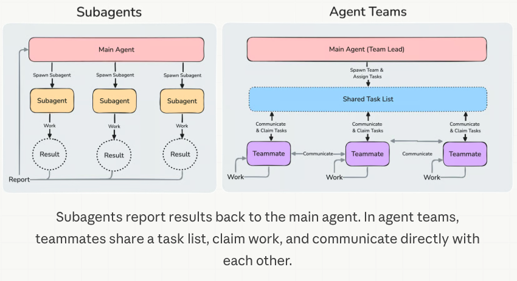

# Advanced Loop Engineering

*(Placeholder module: a short overview for now, full lesson content is coming soon.)*

Loop Engineering covered loops that a human designs: what starts a run, what the agent gets, and when it stops. This module covers the techniques that let an agent design and run the loop itself, at a much larger scale.

**Topics this module will cover**:
- Agent teams
- Dynamic workflows
- Recursive language models

## Agent Teams & Dynamic Workflows

Everything in [Loop Engineering](../2_intermediate/loop_engineering.md) is a loop that a human designed. The script is mechanical, and you write the criteria. The structure is either yours or a known pattern like Ralph's.

The next step is to let the agent design and run the loop itself. Back to the car from Loop Engineering one last time, where the prompt is the engine, the context is the body, the harness is the track, and the AI already drives: here the AI is not only driving. It also decides the route. It is an AI that orchestrates other AIs.

Be clear about what these two are. Agent teams and dynamic workflows are **advanced multi-agent architectures**. They build on the patterns in [Multi-Agent Systems](../1_fundamentals/multi_agent.md). Do not mistake them for loop engineering itself. Loop engineering is the practice: you decide what starts a run, what the agent gets, and when it stops. Agent teams and dynamic workflows are architectures that suit that practice. They make it possible at a much larger scale.

Claude Code has two features for this, and they do not have the same shape.

### Agent Teams

An agent team is several full Claude Code sessions that work together. One session is the lead. The lead breaks the work into a shared task list, spawns the others, and brings the results together. Each teammate has its own context window. The teammates claim tasks from the shared list. They message each other directly, instead of reporting only up to the lead.

That creates a loop, almost as a side effect. The lead watches what the others are doing and decides what happens next. That is the job you used to do.

  
*The thing to notice is the dashed circles on the left. When a subagent ends, only its result survives. The main agent is the only place that any of that work comes back to. On the right, nothing gets summarised on the way up, because no single window sees everything. That is where the higher token cost in the table below comes from. It is also why a lead can lose track of what its own team is doing.*

Here is how the two compare, from [Orchestrate teams of Claude Code sessions](https://code.claude.com/docs/en/agent-teams):

| | Subagents | Agent teams |
| --- | --- | --- |
| Context | Own context window; results return to the caller | Own context window; fully independent |
| Communication | Return a result to the caller. Subagents that Claude named when it spawned them can also message each other | Teammates message each other directly |
| Coordination | Main agent manages all work | Self-coordination through messages, plus a shared task list |
| Best for | Focused tasks where only the result matters | Complex work requiring discussion and collaboration |
| Token cost | Lower: results summarized back to main context | Higher: each teammate is a separate Claude instance |

The row to notice is the last one. Each teammate is a whole separate instance, so the cost grows with the number of teammates. Three focused teammates usually do better than five scattered ones. The docs suggest that you start with three to five.

> **NOTE:** agent teams are experimental, and they are off by default. You turn them on with `CLAUDE_CODE_EXPERIMENTAL_AGENT_TEAMS=1`.

### Dynamic Workflows

A dynamic workflow is a JavaScript script that orchestrates many subagents at once. Claude writes the script for the task that you described. A runtime then executes the script in the background, and your session stays free.

The difference from everything above is **who holds the plan**. With subagents, skills and agent teams, Claude is the orchestrator. It decides, turn by turn, what to run next. A workflow moves that decision into code instead. The script holds the loop, the branching and all the intermediate results. So the only thing that reaches your context is the final answer.

The next table is from [Orchestrate subagents at scale with dynamic workflows](https://code.claude.com/docs/en/workflows):

| | Subagents | Skills | Agent teams | Workflows |
| --- | --- | --- | --- | --- |
| What it is | A worker Claude spawns | Instructions Claude follows | A lead agent supervising peer sessions | A script the runtime executes |
| Who decides what runs next | Claude, turn by turn | Claude, following the prompt | The lead agent, turn by turn | The script |
| Where intermediate results live | Claude's context window | Claude's context window | A shared task list | Script variables |
| What is repeatable | The worker definition | The instructions | The team definition | The orchestration itself |
| Scale | A few delegated tasks per turn | Same as subagents | A handful of long-running peers | Dozens to hundreds of agents per run |
| Interruption | Restarts the turn | Restarts the turn | Teammates keep running | Resumable in the same session |

Two rows deserve attention. The first is **scale**. A workflow gives you dozens to hundreds of agents in a single run, where a team gives you a handful. A script can do that because it does not need a context window to remember what it is doing. The second row is **what is repeatable**. With a team, you can reuse the team definition. With a workflow, the orchestration itself becomes a file. You can read, edit, rerun and commit that file.

That also gives you a quality pattern that is hard to get in any other way. The script is in charge. So it can send independent agents to argue against each other's findings, before any of those findings get reported. Or it can draft a plan from several angles and weigh those angles against each other. You do not only get more agents. You get agents that check each other.

You turn it on with `/effort ultracode`. This combines the highest reasoning setting with automatic workflow orchestration. Or you can include the word `ultracode` in a single prompt, and then only that task runs as a workflow.

## Recursive Language Models

Dynamic workflows do not exist only because of loop engineering. They are also the practical form of an idea called the **recursive language model** (RLM). The idea comes from the paper [Recursive Language Models](https://arxiv.org/abs/2512.24601) by Alex Zhang, Tim Kraska and Omar Khattab at MIT.

A normal model receives the whole prompt inside its context window. An RLM does not. The long prompt sits in a Python environment, as a variable. At the start, the model sees only a little about it: how long it is, how it begins, and how to read parts of it. The model then writes code to work with that variable. It can look at a slice, search it with grep, or split it into chunks. And it can call a model again on any one of those pieces, including another copy of itself. Those calls are the "recursive" part. Only their results come back into the main context window. So the window never has to hold the whole input. That is how one model starts to behave as if its window had no limit. A dynamic workflow uses the same idea at a larger scale: the script holds the input and the intermediate results in variables, and many agents work on the pieces. That is how a script full of agents starts to look like one model with an unbounded window.

Two things are easy to confuse here, so it is worth saying them plainly.

- **An RLM is not loop engineering.** It does not decide what starts a run or when the run stops. But it makes loop engineering possible, and it makes it better. A loop that runs for days needs a way to work with more text than one window can hold.
- **An RLM is a single-agent architecture.** It describes how one agent works on the inside: one model that calls itself through code. It makes many model calls, but do not mistake it for the multi-agent architectures above.

**CodeAct**, from [Executable Code Actions Elicit Better LLM Agents](https://arxiv.org/abs/2402.01030), is a close relative. It makes executable code the agent's action space, instead of JSON tool calls. [Advanced Agent Architectures](advanced_agent_architectures.md) covers both of them properly. Alex Zhang's [write-up](https://alexzhang13.github.io/blog/2025/rlm/) is the readable version of the paper, and [rlm](https://github.com/alexzhang13/rlm) is the library.

## References

### 📄 Articles

- [Orchestrate teams of Claude Code sessions](https://code.claude.com/docs/en/agent-teams): agent teams, the shared task list, and the architecture behind it
- [Orchestrate subagents at scale with dynamic workflows](https://code.claude.com/docs/en/workflows): what a workflow script looks like, its limits, and the four-way comparison
- [Executable Code Actions Elicit Better LLM Agents](https://arxiv.org/abs/2402.01030): CodeAct, where code becomes the action space
- [Recursive Language Models](https://arxiv.org/abs/2512.24601): the paper, with [Alex Zhang's write-up](https://alexzhang13.github.io/blog/2025/rlm/) and the [rlm](https://github.com/alexzhang13/rlm) library

### 🧭 Modules

- [Loop Engineering](../2_intermediate/loop_engineering.md): the loops a person designs, which this module builds on
- [Multi-Agent Systems](../1_fundamentals/multi_agent.md): the patterns that agent teams and workflows extend
- [Advanced Agent Architectures](advanced_agent_architectures.md): CodeAct and recursive language models, covered properly
