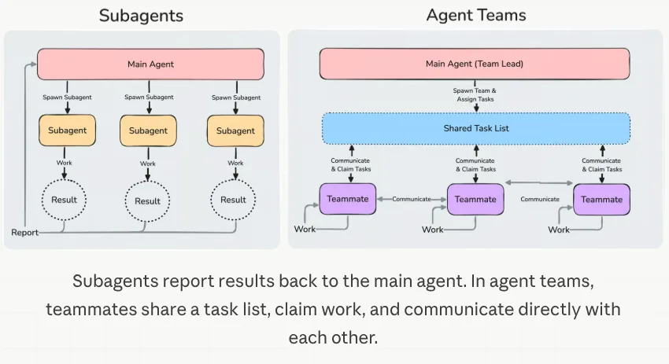

# İleri Seviye Loop Engineering

*(Bu bir placeholder modül: şimdilik kısa bir özet, tam ders içeriği yakında geliyor.)*

Loop Engineering modülü bir insanın tasarladığı döngüleri anlattı: bir çalıştırmayı ne başlatır, agent'a ne verilir ve ne zaman durur. Bu modül, agent'ın döngüyü kendisinin tasarlayıp çok daha büyük ölçekte çalıştırmasını sağlayan teknikleri anlatıyor.

**Bu modülde işlenecek konular**:
- Agent team'ler
- Dynamic workflow'lar
- Recursive language model'ler

## Agent Team'ler ve Dinamik Workflow'lar

[Loop Engineering](../2_intermediate/loop_engineering_tr.md) modülünde anlatılan her şey bir insanın tasarladığı döngülerdi: betik mekaniktir, kriterleri sen yazarsın ve yapı ya senin ya da Ralph'inki gibi bilinen bir desendir.

Bir sonraki adım, döngünün kendisini agent'ın tasarlayıp çalıştırmasına izin vermektir. Loop Engineering'deki arabaya bir kez daha dönelim; orada prompt motordu, context gövdeydi, harness pistti ve arabayı zaten AI sürüyordu. Burada AI yalnızca sürmüyor, rotayı da o belirliyor. Yani bu, diğer AI'ları koordine eden bir AI demektir.

Bu ikisinin ne olduğunu net söyleyelim: agent team'ler ve dinamik workflow'lar **ileri seviye multi-agent mimarileridir** ve [Multi-Agent Systems](../1_fundamentals/multi_agent_tr.md) modülündeki desenler üzerine kurulurlar. Bunları loop engineering'in kendisiyle karıştırma. Loop engineering bir pratiktir; bir çalışmayı neyin başlattığına, agent'a neyin verildiğine ve ne zaman durduğuna sen karar verirsin. Bu mimariler bu pratiğe uyar ve onu çok daha büyük bir ölçekte mümkün kılar.

Claude Code'da bunun için iki özellik var ve bu ikisinin yapısı aynı değil.

### Agent Team'ler

Bir agent team, birlikte çalışan birkaç tam Claude Code oturumudur ve bunlardan biri lider (lead) olur. Lider işi ortak bir görev listesine böler, diğerlerini başlatır ve sonuçları bir araya getirir. Her takım arkadaşının (teammate) kendi context penceresi vardır; takım arkadaşları görevleri ortak listeden alır ve sonuçları yalnızca lidere bildirmek yerine birbirlerine doğrudan mesaj atarlar.

Bu, neredeyse bir yan etki olarak bir döngü yaratır: lider, diğerlerinin ne yaptığını izler ve sonra ne olacağına karar verir. Eskiden bu işi sen yapıyordun.

  
*Dikkat edilmesi gereken, soldaki kesikli daireler. Bir subagent bittiğinde yalnızca sonucu kalır ve bütün bu işin geri döndüğü tek yer ana agent'tır. Sağda ise yukarı çıkarken hiçbir şey özetlenmez, çünkü hiçbir tek pencere her şeyi görmez. Aşağıdaki tablodaki daha yüksek token maliyeti buradan gelir ve bu aynı zamanda liderin, kendi takımının ne yaptığını gözden kaçırabilmesinin nedenidir.*

İkisinin karşılaştırması, [Orchestrate teams of Claude Code sessions](https://code.claude.com/docs/en/agent-teams) dokümanından şöyle:

| | Subagent'lar | Agent team'ler |
| --- | --- | --- |
| Context | Kendi context penceresi; sonuçlar çağırana döner | Kendi context penceresi; tamamen bağımsız |
| İletişim | Sonucu çağırana döndürür. Claude'un başlatırken adını verdiği subagent'lar birbirine de mesaj atabilir | Takım arkadaşları birbirine doğrudan mesaj atar |
| Koordinasyon | Ana agent bütün işi yönetir | Mesajlarla kendi kendini koordine eder; ayrıca ortak bir görev listesi vardır |
| En uygun olduğu durum | Yalnızca sonucun önemli olduğu, odaklı görevler | Tartışma ve iş birliği gerektiren karmaşık işler |
| Token maliyeti | Daha düşük: sonuçlar ana context'e özetlenerek döner | Daha yüksek: her takım arkadaşı ayrı bir Claude instance'ıdır |

Asıl dikkat edilmesi gereken satır sonuncusu. Her takım arkadaşı ayrı bir Claude instance'ı olduğu için maliyet, takım arkadaşı sayısıyla birlikte artar. Üç odaklı takım arkadaşı, genellikle dağınık ve odaksız beş takım arkadaşından daha iyi sonuç verir; dokümanlar da üçle beş arasıyla başlamanı öneriyor.

> **NOT:** agent team'ler deneyseldir ve varsayılan olarak kapalıdır. Bunları `CLAUDE_CODE_EXPERIMENTAL_AGENT_TEAMS=1` ile açarsın.

### Dinamik Workflow'lar

Dinamik workflow, aynı anda çok sayıda subagent'ı koordine eden bir JavaScript betiğidir. Claude, senin tarif ettiğin görev için bu betiği yazar; ardından bir runtime betiği arka planda çalıştırır ve senin oturumun kullanılabilir kalır.

Yukarıdakilerden farkı, **planı kimin tuttuğunda** görürsün. Subagent'lar, skill'ler ve agent team'lerde Claude orkestratördür ve her turda sıradaki işin ne olacağına o karar verir. Workflow ise bu kararı koda taşır: betik döngüyü, dallanmayı ve bütün ara sonuçları tutar, bu yüzden senin context'ine yalnızca nihai cevap ulaşır.

[Orchestrate subagents at scale with dynamic workflows](https://code.claude.com/docs/en/workflows) dokümanından sıradaki tablo:

| | Subagent'lar | Skill'ler | Agent team'ler | Workflow'lar |
| --- | --- | --- | --- | --- |
| Nedir | Claude'un başlattığı bir işçi | Claude'un takip ettiği talimatlar | Eş oturumları denetleyen bir lider agent | Runtime'ın çalıştırdığı bir betik |
| Sıradaki işi kim belirler | Claude, tur tur | Claude, prompt'u takip ederek | Lider agent, tur tur | Betik |
| Ara sonuçlar nerede tutulur | Claude'un context penceresinde | Claude'un context penceresinde | Ortak bir görev listesinde | Betik değişkenlerinde |
| Neyin tekrarlanabilir olduğu | İşçi tanımı | Talimatlar | Takım tanımı | Orkestrasyonun kendisi |
| Ölçek | Tur başına birkaç devredilmiş görev | Subagent'larla aynı | Birkaç uzun süre çalışan eş | Her çalışmada onlarca ila yüzlerce agent |
| Kesinti | Turu baştan başlatır | Turu baştan başlatır | Takım arkadaşları çalışmaya devam eder | Aynı oturumda devam ettirilebilir |

İki satır özellikle dikkat çekiyor. Birincisi **ölçek**: bir workflow tek bir çalışmada onlarca ila yüzlerce agent verirken bir team birkaç tane verir. Betik bunu yapabilir, çünkü ne yaptığını hatırlamak için bir context penceresine ihtiyaç duymaz. İkinci satır ise **neyin tekrar kullanılabileceğini** gösterir. Bir team'de takım tanımını yeniden kullanabilirsin; bir workflow'da ise orkestrasyonun kendisi bir dosyaya dönüşür ve o dosyayı okuyabilir, düzenleyebilir, yeniden çalıştırabilir ve commit edebilirsin.

Bu, başka türlü kolay elde edilemeyen bir kalite deseni de sağlar. Burada işi yöneten betik olduğu için, bulgular raporlanmadan önce bağımsız agent'ları birbirlerinin bulgularına karşı tartıştırabilir. Ya da bir planı birkaç açıdan taslak hâline getirip bu açıları birbirleriyle tarttırabilir. Yani yalnızca daha fazla agent almazsın; birbirini kontrol eden agent'lar elde edersin.

Bunu `/effort ultracode` ile açarsın; bu komut en yüksek muhakeme (reasoning) ayarını otomatik workflow orkestrasyonuyla birleştirir. Ya da tek bir prompt'un içine `ultracode` kelimesini yazabilirsin, bu durumda yalnızca o görev workflow olarak çalışır.

## Özyinelemeli Dil Modelleri

Dinamik workflow'lar yalnızca loop engineering yüzünden var olmuyor; aynı zamanda **özyinelemeli dil modeli (recursive language model, RLM)** adı verilen bir fikrin pratik bir biçimidirler. Fikir, MIT'deki Alex Zhang, Tim Kraska ve Omar Khattab'ın yazdığı [Recursive Language Models](https://arxiv.org/abs/2512.24601) makalesinden geliyor.

Normal bir model bütün prompt'u context penceresinin içinde alır, RLM ise almaz. Uzun prompt, bir Python ortamında bir değişken olarak durur. Model başta bunun hakkında çok az şey görür: ne kadar uzun olduğunu, nasıl başladığını ve parçalarını nasıl okuyacağını. Sonra model o değişkenle çalışmak için kod yazar. Bir dilimine bakabilir, grep ile arayabilir ya da parçalara bölebilir. Bu parçalardan herhangi birinde modeli yeniden çağırabilir; çağrılan model, kendisinin bir kopyası bile olabilir. Özyinelemeli olan kısım bu çağrılardır. Ana context penceresine yalnızca sonuçlar geri döner, bu yüzden pencerenin bütün girdiyi tutması hiç gerekmez. Model, pencere sınırı yokmuş gibi davranmaya işte böyle başlar.

Dinamik bir workflow aynı fikri daha büyük ölçekte kullanır: betik girdiyi ve ara sonuçları değişkenlerde tutar, birçok agent de parçalar üzerinde çalışır. Böylece agent dolu bir betik, sınırsız bir pencereye sahip tek bir model gibi görünmeye başlar.

Burada karıştırması kolay iki şey var, bunları açıkça söylemekte fayda var.

- **RLM, loop engineering değildir.** Bir çalışmayı neyin başlattığına ya da ne zaman durduğuna karar vermez; ama loop engineering'i mümkün kılar ve onu daha iyi hâle getirir. Günlerce çalışan bir döngü, tek bir pencerenin tutabileceğinden fazla metinle çalışmanın bir yoluna ihtiyaç duyar.
- **RLM, tek agent'lı bir mimaridir.** Tek bir agent'ın içeride nasıl çalıştığını anlatır: kodla kendini çağıran tek bir model. Çok sayıda model çağrısı yapsa da onu yukarıdaki multi-agent mimarileriyle karıştırma, çünkü bütün bu çağrıları tek bir agent yapar.

**CodeAct** ise bu fikrin yakın bir akrabası: [Executable Code Actions Elicit Better LLM Agents](https://arxiv.org/abs/2402.01030) makalesinde tanıtılır ve JSON tool çağrıları yerine çalıştırılabilir kodu agent'ın eylem alanı yapar. İkisi de [İleri Seviye Mimariler](advanced_agent_architectures_tr.md) modülünde ayrıntılı olarak işlenir. Alex Zhang'in [yazısı](https://alexzhang13.github.io/blog/2025/rlm/) makalenin daha rahat okunan hâlidir, [rlm](https://github.com/alexzhang13/rlm) ise kütüphanedir.

## Kaynaklar

### 📄 Makaleler

- [Orchestrate teams of Claude Code sessions](https://code.claude.com/docs/en/agent-teams): agent team'ler, ortak görev listesi ve bunun altyapısı
- [Orchestrate subagents at scale with dynamic workflows](https://code.claude.com/docs/en/workflows): bir workflow betiğinin neye benzediği, sınırları ve dört yönlü karşılaştırma
- [Executable Code Actions Elicit Better LLM Agents](https://arxiv.org/abs/2402.01030): CodeAct; kodun eylem alanı olduğu yaklaşım
- [Recursive Language Models](https://arxiv.org/abs/2512.24601): makale; [Alex Zhang'in yazısı](https://alexzhang13.github.io/blog/2025/rlm/) ve [rlm](https://github.com/alexzhang13/rlm) kütüphanesiyle birlikte

### 🧭 Modüller

- [Loop Engineering](../2_intermediate/loop_engineering_tr.md): bir insanın tasarladığı döngüler; bu modül onların üzerine kuruluyor
- [Multi-Agent Systems](../1_fundamentals/multi_agent_tr.md): agent team'lerin ve workflow'ların genişlettiği desenler
- [İleri Seviye Mimariler](advanced_agent_architectures_tr.md): CodeAct ve özyinelemeli dil modelleri, ayrıntılı olarak
