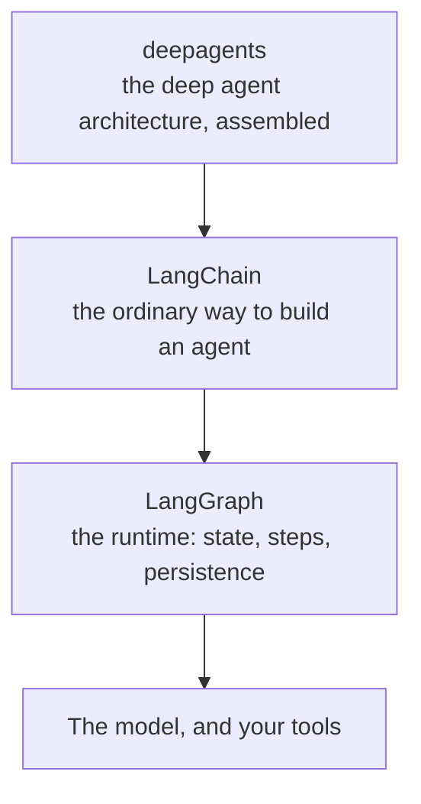
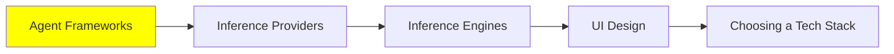

# Agent Frameworks

Everything up to here was about how agents work. This module is about what you actually install when you build one.

Here is the honest starting point: you do not need a framework. [AI Agents](../1_fundamentals/agents.md) showed the loop. It is a `while` loop around a model call, with a tool dispatch in the middle. You can write that in an afternoon.

What you get from a framework is everything around the loop:

- Retries when a provider returns a 500 error.
- Streaming, so the user sees tokens as they arrive.
- A standard tool schema, so you do not write JSON by hand for every function.
- Memory that survives a restart.
- A place to put the traces.

That list is why most people stop writing their own loop after the second project.

## The LangChain Stack

This is the one to learn first. It is the most complete and the most current. It is also the one most likely to run in production somewhere near you. But it confuses people, because "LangChain" is three separate libraries at three levels. Which one you want depends on the job.

**[LangGraph](https://github.com/langchain-ai/langgraph)** is the runtime. It is the lowest level of the three. You describe your agent as a graph. The nodes are steps, the edges are what can happen next, and the state moves between them. The state is explicit, so the runtime can save it and resume from it. The runtime can also let a human interrupt the agent in the middle of a run. Use LangGraph when the control flow is the hard part and you want to control it yourself.

**[LangChain](https://github.com/langchain-ai/langchain)** is the main interface, and it is where you should start. It sits on top of LangGraph. It gives you the ordinary agent in a few lines of code: a model, some tools and some middleware. The middleware is where the [Harness Engineering](../2_intermediate/harness_engineering.md) work happens. It is also where the guardrails from [Security](../2_intermediate/security.md) live.

**[deepagents](https://github.com/langchain-ai/deepagents)** is the highest level. It is built on the other two. It calls itself a "batteries-included" agent harness. The batteries are exactly the list from [Context Engineering](../2_intermediate/context_engineering.md):

- planning
- a filesystem
- subagents with their own context windows
- summarisation of long threads

If you want the deep agent architecture rather than a custom one, start here and skip the assembly.

So the practical rule is simple. Start with LangChain. Go down to LangGraph when you need to control the flow yourself. Go up to deepagents when you want the whole architecture already built for you.

## The Other Python Options

None of these is wrong. They make different trade-offs. Usually the trade-off is how much they decide for you.

- **[Agno](https://github.com/agno-agi/agno)** looks past the single agent to the whole platform. It helps you build, run and manage agents as a system rather than as a script.
- **[CrewAI](https://github.com/crewAIInc/crewAI)** organises everything around roles. You describe a crew of agents, each with a job, and let them work together. This fits well with the multi-agent shapes from [Multi-Agent Systems](../1_fundamentals/multi_agent.md).
- **[smolagents](https://github.com/huggingface/smolagents)** from Hugging Face is the small one, and it is small on purpose. It is a barebones library for agents that think in code. It is the CodeAct idea from [Loop Engineering](../2_intermediate/loop_engineering.md), packaged as a library. It is also the best one to read if you want to understand a loop rather than use one.
- **[Pydantic AI](https://github.com/pydantic/pydantic-ai)** brings the thing Pydantic is good at: types. Every model and every interface is typed from end to end. So a malformed tool call becomes a validation error, not a mystery.

## If Your Project is TypeScript

Two frameworks are worth knowing here. The reason is that the whole stack above is Python-first, and most product code is not written in Python.

- **[Mastra](https://github.com/mastra-ai/mastra)** is the modern TypeScript framework for agents and AI applications. It is the closest thing to LangChain in that language.
- **[VoltAgent](https://github.com/VoltAgent/voltagent)** is an agent engineering platform built on top of an open-source TypeScript framework. So it focuses more on the operational side.

## AI Workflows

Here is a distinction that is important to get right. If you choose wrong, it costs you months.

An **AI workflow** runs a path that somebody wrote down. The steps are fixed. Code decides what happens next. The code calls the model at specific points to do specific jobs. An **AI agent** decides for itself. It picks the tools and the order, and the path is different on every run. The [Prompt Engineering Guide's comparison](https://www.promptingguide.ai/agents/ai-workflows-vs-ai-agents) describes this as hard-coded logic versus LLM-driven reasoning.

The mistake is to assume that the agent is the grown-up version. It is not. If the requirements are stable and you know the steps, a workflow is more predictable, cheaper and easier to debug. And predictable is usually what production wants. Keep the agent for open-ended work, where nobody can write down the steps in advance.

**[n8n](https://github.com/n8n-io/n8n)** is the tool that most people finally choose for the workflow half. With it, you:

- build on a visual canvas
- connect more than 400 integrations
- add your own code where you need it
- host it yourself, or use their cloud

Take a job like "when a form is submitted, classify it, look something up, write to the database, send a message". For that job, this tool is easily better than an agent.

And this connects back to [Code Agents](../2_intermediate/coding_agents.md). n8n runs an MCP server. So your coding agent can connect to your n8n instance and **build the workflow for you**. You describe what you want in plain language, and the coding agent:

- assembles the nodes
- validates the result
- runs the workflow
- fixes what broke

Building workflows through MCP arrived in v2.13. So the agent and the workflow stop being alternatives. The agent becomes the thing that writes the workflow.

## No-code Options

This is worth saying plainly, because engineers tend to skip it. For a lot of jobs, the right answer is a no-code platform. **[Lovable](https://lovable.dev/)**, **[Bolt](https://bolt.new/)** and **[Replit](https://replit.com/)** turn a description into a working application. They deploy it, and you can keep writing prompts to change it. For a prototype, an internal tool, or a landing page with a form behind it, that takes hours instead of weeks.

The trade-off is the usual one. You get speed now and less control later. If you move off the platform, you must build the application again. Know which of those you are buying.

## Where this fits in the series

## Summary

A framework does not give you the agent loop. You could write that yourself. It gives you everything around the loop:

- retries
- streaming
- tool schemas
- memory that survives a restart
- a place for the traces to go

LangChain is three libraries at three levels. LangGraph is the runtime. Its state is explicit, so you can save, resume and interrupt a run. LangChain is the ordinary interface and the place to start. deepagents is the deep agent architecture, already assembled. Start in the middle, and move up or down when the job needs it.

Agno, CrewAI, smolagents and Pydantic AI are the other Python options. They differ mostly in how much they decide for you. Mastra and VoltAgent are the TypeScript answers.

Then comes the distinction that matters most. A workflow runs a path that you wrote. An agent decides its own path. The agent is not the upgrade. If you can write the steps down, write them down, and n8n is where those steps live. With its MCP server, your coding agent can build those workflows for you. That makes the two approaches partners rather than rivals.

**Quick Check**: you can describe every step of the job in advance. Should you build an agent, and why not?

## References

- [LangChain](https://github.com/langchain-ai/langchain): the main interface, and the place to start
- [LangGraph](https://github.com/langchain-ai/langgraph): the runtime underneath, for when you want to control the flow yourself
- [deepagents](https://github.com/langchain-ai/deepagents): the deep agent architecture, already put together
- [Agno](https://github.com/agno-agi/agno): agents as a managed platform rather than a script
- [CrewAI](https://github.com/crewAIInc/crewAI): agents organised as roles in a crew
- [smolagents](https://github.com/huggingface/smolagents): the barebones one, and the best to read
- [Pydantic AI](https://github.com/pydantic/pydantic-ai): typed from end to end, so a bad tool call fails with a clear error
- [Mastra](https://github.com/mastra-ai/mastra) and [VoltAgent](https://github.com/VoltAgent/voltagent): the TypeScript options
- [AI Workflows vs AI Agents](https://www.promptingguide.ai/agents/ai-workflows-vs-ai-agents): the distinction, and when each one is right
- [n8n](https://github.com/n8n-io/n8n): the workflow platform, with [an MCP server that builds the workflows for you](https://docs.n8n.io/advanced-ai/mcp/accessing-n8n-mcp-server/)
- [Lovable](https://lovable.dev/), [Bolt](https://bolt.new/) and [Replit](https://replit.com/): describe an app in plain language and get a working one
