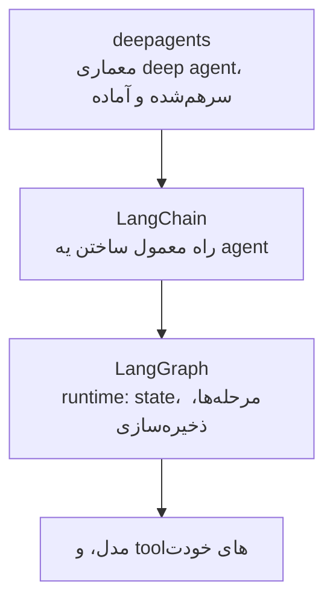
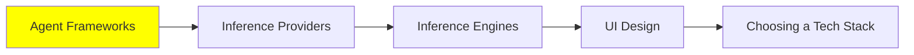

# Agent Framework‌ها

تا اینجا همه‌ی حرف‌ها سر این بود که agent‌ها چطوری کار می‌کنن. این درس درباره‌ی اینه که وقتی می‌خوای یکی بسازی، در عمل چی نصب می‌کنی.

بذار رک شروع کنیم: لازم نیست حتماً framework داشته باشی. توی [AI Agents](../1_fundamentals/agents_fa.md) خود loop رو دیدیم: یه `while` loop دور یه call به مدل، که وسطش tool درست رو صدا می‌زنی (tool dispatch). این رو توی یه بعدازظهر می‌شه نوشت.

چیزی که framework بهت می‌ده، همه‌ی چیزهاییه که دور این loop لازم داری:

- retry، وقتی provider خطای 500 برمی‌گردونه.
- streaming، که کاربر token‌ها رو همون موقع که می‌رسن ببینه.
- یه tool schema استاندارد، که مجبور نباشی برای هر تابع JSON رو دستی بنویسی.
- memory‌ای که بعد از restart هم سر جاش بمونه.
- یه جا برای trace‌ها.

به خاطر همین لیسته که بیشتر آدم‌ها از پروژه‌ی دوم به بعد دیگه loop رو خودشون نمی‌نویسن.

## استک LangChain

اگه قراره یکی رو اول یاد بگیری، این باشه. از همه کامل‌تر و به‌روزتره، و به احتمال زیاد همین الان یه جایی دور و بر خودت توی production داره کار می‌کنه. ولی آدم‌ها رو گیج می‌کنه، چون «LangChain» در واقع سه تا کتابخونه‌ی جداست توی سه سطح مختلف، و اینکه کدومش رو لازم داری به کارت بستگی داره.

**[LangGraph](https://github.com/langchain-ai/langgraph)** همون runtime‌ه و پایین‌ترین سطح از این سه تا. agent‌ت رو به شکل یه graph تعریف می‌کنی: node‌ها مرحله‌ها هستن، edge‌ها می‌گن بعد از هر مرحله چی می‌تونه بیاد، و state بینشون دست‌به‌دست می‌شه. چون state صریح و مشخصه، runtime می‌تونه ذخیره‌ش کنه و بعداً از همون‌جا ادامه بده، و حتی اجازه بده یه آدم وسط اجرا وارد بشه و agent رو نگه داره. هر وقت سخت‌ترین قسمت کار کنترل جریان (control flow) بود و خواستی خودت کنترلش کنی، برو سراغ LangGraph.

**[LangChain](https://github.com/langchain-ai/langchain)** رابط اصلیه و نقطه‌ی شروع تو. روی LangGraph ساخته شده و agent معمولی رو با چند خط کد بهت می‌ده: یه مدل، چند تا tool و یه سری middleware. کارهای [Harness Engineering](../2_intermediate/harness_engineering_fa.md) توی همین middleware انجام می‌شه، و guardrail‌های [Security](../2_intermediate/security_fa.md) هم همین‌جا می‌شینن.

**[deepagents](https://github.com/langchain-ai/deepagents)** بالاترین سطحه و روی دو تای دیگه ساخته شده. به خودش می‌گه یه agent harness «batteries-included»، یعنی هر چی لازم داری از قبل توشه. این امکانات آماده دقیقاً همون لیستیه که توی [Context Engineering](../2_intermediate/context_engineering_fa.md) دیدیم:

- برنامه‌ریزی (planning)
- یه filesystem
- subagent‌هایی که هر کدوم context window خودشون رو دارن
- خلاصه کردن گفت‌وگوهای طولانی

اگه معماری deep agent رو می‌خوای و دنبال یه معماری سفارشی نیستی، از همین‌جا شروع کن و زحمت سرهم کردنش رو به خودت نده.

پس قاعده‌ی عملیش ساده‌ست: با LangChain شروع کن. هر وقت لازم شد جریان کار رو خودت کنترل کنی، یه پله برو پایین سراغ LangGraph، و هر وقت کل معماری رو آماده خواستی، یه پله برو بالا سراغ deepagents.

## بقیه‌ی گزینه‌های Python

هیچ‌کدوم از این‌ها انتخاب غلطی نیست؛ فقط هر کدوم یه چیزی داده و یه چیزی گرفته، و معمولاً فرق اصلیشون اینه که چقدر به‌جای تو تصمیم می‌گیرن.

- **[Agno](https://github.com/agno-agi/agno)** از یه agent تنها فراتر می‌ره و کل پلتفرم رو در نظر می‌گیره. کمکت می‌کنه agent‌ها رو مثل یه سیستم بسازی، اجرا کنی و مدیریت کنی، نه مثل یه script.
- **[CrewAI](https://github.com/crewAIInc/crewAI)** همه‌چیز رو حول نقش‌ها می‌چینه. یه crew از agent‌ها تعریف می‌کنی که هر کدوم یه کاری دارن، و می‌ذاری با هم کار کنن. این با الگوهای multi-agent توی [Multi-Agent Systems](../1_fundamentals/multi_agent_fa.md) خیلی خوب جور درمیاد.
- **[smolagents](https://github.com/huggingface/smolagents)** از Hugging Face کوچیکه‌ی این جمعه، و عمداً هم کوچیک نگهش داشتن: یه کتابخونه‌ی ساده و بی‌زرق‌وبرق برای agent‌هایی که به‌جای فرستادن tool call‌های JSON، کد می‌نویسن و اجراش می‌کنن تا کارشون رو انجام بدن. در واقع همون ایده‌ی CodeAct‌ه که توی [Loop Engineering](../2_intermediate/loop_engineering_fa.md) دیدیم، فقط به شکل یه کتابخونه. اگه می‌خوای بفهمی یه loop چطوری کار می‌کنه، نه اینکه فقط ازش استفاده کنی، این بهترین کدیه که می‌تونی بخونی.
- **[Pydantic AI](https://github.com/pydantic/pydantic-ai)** همون چیزی رو میاره که Pydantic توش استاده: type. همه‌ی مدل‌ها و interface‌ها از سر تا ته type دارن، پس یه tool call خراب به‌جای اینکه یه معمای حل‌نشدنی بشه، یه validation error روشن می‌ده.

## اگه پروژه‌ت TypeScript‌ه

اینجا دو تا framework ارزش شناختن دارن، چون کل استک بالا اول برای Python ساخته شده، در حالی که بیشتر کدهای محصول با Python نوشته نمی‌شن.

- **[Mastra](https://github.com/mastra-ai/mastra)** framework مدرن TypeScript برای ساختن agent و اپلیکیشن‌های AI‌ه، و توی این زبون نزدیک‌ترین چیز به LangChain همینه.
- **[VoltAgent](https://github.com/VoltAgent/voltagent)** یه پلتفرم agent engineering‌ه که روی یه framework متن‌باز TypeScript ساخته شده، برای همین بیشتر روی بخش عملیاتی (operations) تمرکز داره، یعنی کارهایی که بعد از ساختن agent‌ها پیش میاد: اجرا کردنشون، زیر نظر گرفتنشون و مدیریتشون.

## AI Workflow‌ها

اینجا یه فرق هست که باید درست بفهمیش، چون اگه اشتباه انتخاب کنی، چند ماه از وقتت هدر می‌ره.

**AI workflow** مسیری رو اجرا می‌کنه که یه نفر از قبل نوشته. مرحله‌ها ثابتن، کد تصمیم می‌گیره قدم بعدی چی باشه، و فقط توی جاهای مشخصی مدل رو صدا می‌زنه تا یه کار مشخص انجام بده. ولی **AI agent** خودش تصمیم می‌گیره: tool‌ها و ترتیبشون رو خودش انتخاب می‌کنه و مسیرش توی هر اجرا فرق می‌کنه. [مقایسه‌ی Prompt Engineering Guide](https://www.promptingguide.ai/agents/ai-workflows-vs-ai-agents) این فرق رو این‌طوری خلاصه می‌کنه: منطقی که توی کد hard-code شده، در برابر استدلالی که LLM جلو می‌بره.

اشتباه رایج اینه که فکر کنی agent نسخه‌ی پیشرفته‌تر workflow‌ه؛ نیست. اگه نیازمندی‌ها ثابتن و مراحل رو می‌دونی، workflow قابل‌پیش‌بینی‌تر و ارزون‌تره و debug کردنش هم راحت‌تره، و production معمولاً دقیقاً همین قابل‌پیش‌بینی بودن رو می‌خواد. agent رو نگه دار برای کارهایی که مسیرشون از قبل معلوم نیست و هیچ‌کس نمی‌تونه مراحلش رو از قبل بنویسه.

برای نیمه‌ی workflow، بیشتر آدم‌ها آخرش می‌رسن به **[n8n](https://github.com/n8n-io/n8n)**. باهاش می‌تونی:

- روی یه canvas تصویری workflow بسازی
- به بیشتر از 400 تا integration وصل بشی
- هر جا لازم شد کد خودت رو اضافه کنی
- خودت host‌ش کنی، یا از cloud خودشون استفاده کنی

یه کاری مثل این رو در نظر بگیر: «وقتی یه فرم ثبت شد، دسته‌بندیش کن، یه چیزی رو جستجو کن، توی database بنویس، و یه پیام بفرست.» برای همچین کاری، این ابزار با فاصله از یه agent بهتره.

این قضیه به [Code Agent‌ها](../2_intermediate/coding_agents_fa.md) هم گره می‌خوره. n8n یه MCP server داره، پس coding agent‌ت می‌تونه به n8n خودت وصل بشه و **workflow رو برات بسازه**. کافیه با زبون ساده بگی چی می‌خوای، اون‌وقت coding agent:

- node‌ها رو کنار هم می‌چینه
- نتیجه رو validate می‌کنه
- workflow رو اجرا می‌کنه
- هر جا خراب شد درستش می‌کنه

ساختن workflow از طریق MCP از v2.13 اضافه شده. این‌طوری agent و workflow دیگه رقیب هم نیستن؛ agent می‌شه همونی که workflow رو می‌نویسه.

## گزینه‌های No-code

این رو باید رک گفت، چون مهندس‌ها معمولاً از کنارش رد می‌شن: برای خیلی از کارها، جواب درست یه پلتفرم no-code‌ه. **[Lovable](https://lovable.dev/)**، **[Bolt](https://bolt.new/)** و **[Replit](https://replit.com/)** از روی یه توضیح، یه اپلیکیشن سالم و کارکن تحویلت می‌دن و خودشون deploy‌ش می‌کنن، و تو هم با نوشتن prompt‌های بعدی، هر بار عوضش می‌کنی. برای یه prototype، یه ابزار داخلی، یا یه landing page که یه فرم پشتشه، این کار به‌جای چند هفته چند ساعت طول می‌کشه.

بده‌بستونش هم همون همیشگیه: الان سرعت می‌گیری و بعداً کنترلت کمتره، و اگه بخوای از پلتفرم بری بیرون، باید اپلیکیشن رو از نو بسازی. پس حواست باشه داری چی رو با چی معامله می‌کنی.

## کجای این مجموعه هستیم

## خلاصه

framework خودِ agent loop رو بهت نمی‌ده، چون اون رو خودت هم می‌تونستی بنویسی. چیزی که می‌ده همه‌ی چیزهای دور و بر loop‌ه:

- retry
- streaming
- tool schema
- memory‌ای که بعد از restart سر جاش بمونه
- یه جا برای trace‌ها

LangChain سه تا کتابخونه‌ست توی سه سطح. LangGraph همون runtime‌ه و state‌ش صریحه، پس می‌تونی یه اجرا رو ذخیره کنی، ادامه بدی یا وسطش قطعش کنی. LangChain رابط معمولیه و جای شروع، و deepagents همون معماری deep agent‌ه که از قبل سرهم شده. از وسط شروع کن، و هر وقت کارت لازم داشت، برو بالا یا پایین.

Agno، CrewAI، smolagents و Pydantic AI بقیه‌ی گزینه‌های Python هستن، که بیشتر سر اینکه چقدر به‌جای تو تصمیم می‌گیرن با هم فرق دارن. برای TypeScript هم Mastra و VoltAgent هستن.

و بعد مهم‌ترین فرق: workflow مسیری رو اجرا می‌کنه که تو نوشتی، و agent مسیرش رو خودش انتخاب می‌کنه. agent نسخه‌ی ارتقایافته‌ی workflow نیست. اگه می‌تونی مراحل رو بنویسی، بنویسشون، و جای این مراحل هم n8n‌ه. با MCP server‌ی که n8n داره، coding agent‌ت می‌تونه همین workflow‌ها رو برات بسازه، پس این دو تا روش به‌جای اینکه رقیب هم باشن، شریک هم می‌شن.

**بررسی سریع**: می‌تونی همه‌ی مراحل کار رو از قبل توضیح بدی. باید agent بسازی؟ اگه نه، چرا؟

## منابع

- [LangChain](https://github.com/langchain-ai/langchain): رابط اصلی، و جایی که باید شروع کنی
- [LangGraph](https://github.com/langchain-ai/langgraph): runtime زیرش، برای وقتی که می‌خوای جریان کار رو خودت کنترل کنی
- [deepagents](https://github.com/langchain-ai/deepagents): معماری deep agent، که از قبل سرهم شده
- [Agno](https://github.com/agno-agi/agno): agent‌ها به شکل یه پلتفرم مدیریت‌شده، نه یه script
- [CrewAI](https://github.com/crewAIInc/crewAI): agent‌هایی که هر کدوم یه نقش توی یه crew دارن
- [smolagents](https://github.com/huggingface/smolagents): ساده‌ترینشون، و بهترینشون برای خوندن
- [Pydantic AI](https://github.com/pydantic/pydantic-ai): از سر تا ته type داره، پس یه tool call خراب با یه خطای روشن fail می‌شه
- [Mastra](https://github.com/mastra-ai/mastra) و [VoltAgent](https://github.com/VoltAgent/voltagent): گزینه‌های TypeScript
- [AI Workflows vs AI Agents](https://www.promptingguide.ai/agents/ai-workflows-vs-ai-agents): فرق این دو، و اینکه هر کدوم کِی درسته
- [n8n](https://github.com/n8n-io/n8n): پلتفرم workflow، با [یه MCP server که workflow‌ها رو برات می‌سازه](https://docs.n8n.io/advanced-ai/mcp/accessing-n8n-mcp-server/)
- [Lovable](https://lovable.dev/)، [Bolt](https://bolt.new/) و [Replit](https://replit.com/): اپلیکیشنی که می‌خوای رو با زبون ساده توضیح بده و یه نسخه‌ی کارکن تحویل بگیر
