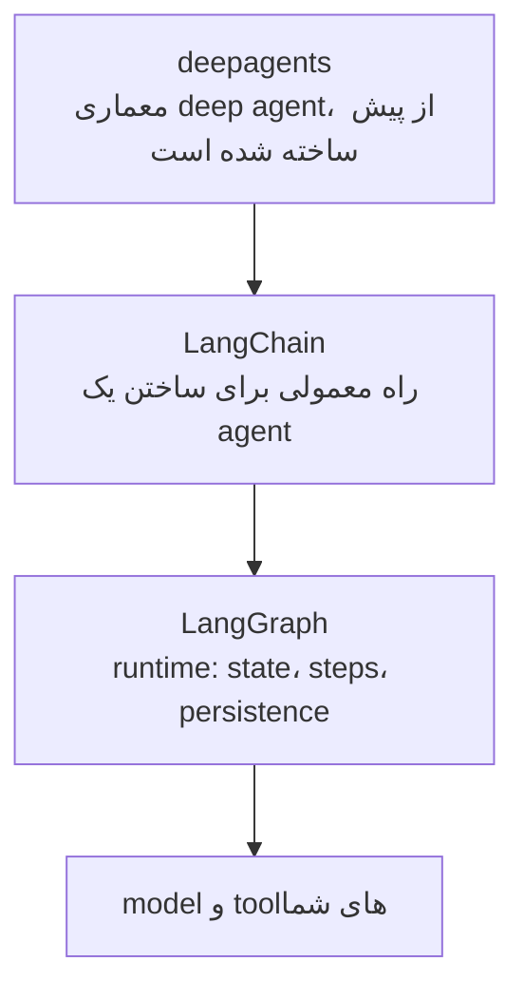
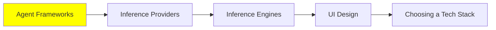

# Agent Framework‌ها

تا اینجای این مجموعه، همه‌چیز درباره‌ی طرز کار agent‌ها بود. این ماژول درباره‌ی چیزی است که واقعاً وقتی یک agent می‌سازید نصب می‌کنید.

نقطه‌ی شروع صادقانه این است: شما به framework نیازی ندارید. [AI Agents](../1_fundamentals/agents_fa.md) این loop را نشان داد. این یک `while` loop است که دور یک model call می‌چرخد، و وسطش یک tool dispatch قرار دارد. می‌توانید آن را در یک بعدازظهر بنویسید.

آنچه از یک framework می‌گیرید، همه‌ی چیزهای اطراف loop است:

- Retry‌ها وقتی یک provider خطای 500 برمی‌گرداند.
- Streaming، تا کاربر token‌ها را همان‌طور که می‌رسند ببیند.
- یک tool schema استاندارد، تا لازم نباشد JSON را برای هر تابع دستی بنویسید.
- Memory‌ای که بعد از یک restart باقی می‌ماند.
- جایی برای نگه‌داری trace‌ها.

همین فهرست دلیلی است که بیشتر آدم‌ها بعد از پروژه‌ی دوم، دیگر loop خودشان را نمی‌نویسند.

## LangChain Stack

این همان است که اول باید یاد بگیرید. کامل‌ترین و به‌روزترین است. همچنین، احتمالاً همان چیزی است که جایی نزدیک شما در production اجرا می‌شود. اما آدم‌ها را گیج می‌کند، چون «LangChain» سه کتابخانه‌ی جدا در سه سطح است. کدام‌یک را می‌خواهید، به کاری که دارید بستگی دارد.

**[LangGraph](https://github.com/langchain-ai/langgraph)** runtime است. این پایین‌ترین سطح از این سه است. agent خود را به شکل یک graph توصیف می‌کنید. node‌ها مراحل هستند، edge‌ها نشان می‌دهند بعد از هر مرحله چه چیزهایی ممکن است رخ دهند، و state بین آن‌ها حرکت می‌کند. state صریح است، پس runtime می‌تواند آن را ذخیره کند و از روی آن ادامه دهد. runtime همچنین به یک انسان اجازه می‌دهد وسط یک اجرا، agent را متوقف کند. وقتی کنترل جریان (control flow) سخت‌ترین بخش کار است و می‌خواهید خودتان آن را کنترل کنید، از LangGraph استفاده کنید.

**[LangChain](https://github.com/langchain-ai/langchain)** interface اصلی است و همان جایی است که باید شروع کنید. این روی LangGraph قرار دارد. با چند خط کد، agent معمولی را در اختیار شما می‌گذارد: یک model، چند tool و مقداری middleware. middleware همان جایی است که کار [Harness Engineering](../2_intermediate/harness_engineering_fa.md) انجام می‌شود. guardrail‌های [Security](../2_intermediate/security_fa.md) هم همان‌جا قرار دارند.

**[deepagents](https://github.com/langchain-ai/deepagents)** بالاترین سطح است. روی دو تای دیگر ساخته شده است. خودش را یک agent harness از نوع «batteries-included» معرفی می‌کند. این batteries دقیقاً همان فهرستی است که در [Context Engineering](../2_intermediate/context_engineering_fa.md) آمده است:

- برنامه‌ریزی
- یک filesystem
- subagent‌هایی با context window خودشان
- خلاصه‌سازی thread‌های طولانی

اگر معماری deep agent را می‌خواهید و نه یک معماری سفارشی، از اینجا شروع کنید و مرحله‌ی مونتاژ را رد کنید.

پس قاعده‌ی عملی ساده است. از LangChain شروع کنید. وقتی می‌خواهید خودتان جریان را کنترل کنید، به سمت LangGraph پایین بیایید. وقتی می‌خواهید کل معماری از پیش ساخته شده برای شما باشد، به سمت deepagents بالا بروید.

## گزینه‌های دیگر Python

هیچ‌کدام از این‌ها اشتباه نیستند. هرکدام trade-off‌های متفاوتی دارند. معمولاً trade-off این است که هرکدام چقدر به جای شما تصمیم می‌گیرند.

- **[Agno](https://github.com/agno-agi/agno)** فراتر از یک agent تنها، به کل platform نگاه می‌کند. به شما کمک می‌کند agent‌ها را به‌عنوان یک سیستم بسازید، اجرا کنید و مدیریت کنید، نه به‌عنوان یک script.
- **[CrewAI](https://github.com/crewAIInc/crewAI)** همه‌چیز را حول نقش‌ها سازمان‌دهی می‌کند. یک crew از agent‌ها را توصیف می‌کنید که هرکدام کار مشخصی دارند، و اجازه می‌دهید با هم کار کنند. این با شکل‌های multi-agent در [Multi-Agent Systems](../1_fundamentals/multi_agent_fa.md) خوب هم‌خوانی دارد.
- **[smolagents](https://github.com/huggingface/smolagents)** از Hugging Face، گزینه‌ی کوچک است، و کوچک بودنش عمدی است. این یک کتابخانه‌ی بی‌پیرایه (barebones) برای agent‌هایی است که با code فکر می‌کنند. این همان ایده‌ی CodeAct از [Loop Engineering](../2_intermediate/loop_engineering_fa.md) است که به شکل یک کتابخانه بسته‌بندی شده. اگر می‌خواهید یک loop را بفهمید نه اینکه از آن استفاده کنید، این بهترین گزینه برای خواندن هم هست.
- **[Pydantic AI](https://github.com/pydantic/pydantic-ai)** چیزی را می‌آورد که Pydantic در آن خوب است: type‌ها. هر model و هر interface از ابتدا تا انتها type‌بندی شده است. پس یک tool call نادرست، به جای یک معما، یک validation error می‌شود.

## اگر پروژه‌تان TypeScript است

دو framework اینجا ارزش دارند که بدانید. دلیلش این است که کل stack بالا در درجه‌ی اول برای Python ساخته شده است، و بیشتر کد محصول با Python نوشته نمی‌شود.

- **[Mastra](https://github.com/mastra-ai/mastra)** framework مدرن TypeScript برای agent‌ها و اپلیکیشن‌های AI است. در آن زبان، نزدیک‌ترین چیز به LangChain همین است.
- **[VoltAgent](https://github.com/VoltAgent/voltagent)** یک platform مهندسی agent است که روی یک framework متن‌باز (open-source) TypeScript ساخته شده است. پس بیشتر روی جنبه‌ی عملیاتی تمرکز دارد.

## AI Workflow‌ها

اینجا تمایزی است که درست فهمیدنش مهم است. اگر اشتباه انتخاب کنید، ماه‌ها وقت‌تان را می‌گیرد.

یک **AI workflow** مسیری را اجرا می‌کند که کسی آن را نوشته است. مراحل ثابت هستند. کد تصمیم می‌گیرد که بعد چه اتفاقی بیفتد. کد در نقطه‌های مشخصی model را فراخوانی می‌کند تا کارهای مشخصی انجام دهد. یک **AI agent** خودش تصمیم می‌گیرد. tool‌ها و ترتیب را خودش انتخاب می‌کند، و مسیر در هر اجرا فرق دارد. [مقایسه‌ی Prompt Engineering Guide](https://www.promptingguide.ai/agents/ai-workflows-vs-ai-agents) این را به‌صورت منطق hard-coded در برابر reasoning هدایت‌شده توسط LLM توصیف می‌کند.

اشتباه این است که فرض کنیم agent نسخه‌ی بالغ‌تر است. این‌طور نیست. اگر نیازمندی‌ها ثابت باشند و مراحل را بدانید، یک workflow قابل‌پیش‌بینی‌تر، ارزان‌تر است، و debug کردنش آسان‌تر است. و قابل‌پیش‌بینی بودن معمولاً همان چیزی است که production می‌خواهد. agent را برای کارهای open-ended نگه دارید، جایی که هیچ‌کس نمی‌تواند مراحل را از قبل بنویسد.

**[n8n](https://github.com/n8n-io/n8n)** همان tool‌ای است که بیشتر آدم‌ها در نهایت برای بخش workflow انتخاب می‌کنند. با آن می‌توانید:

- روی یک canvas بصری بسازید
- به بیش از 400 integration وصل شوید
- هر جا لازم باشد، کد خودتان را اضافه کنید
- خودتان آن را روی سرور خودتان میزبانی (self-host) کنید، یا از cloud آن‌ها استفاده کنید

کاری مثل این را در نظر بگیرید: «وقتی فرمی ارسال می‌شود، آن را دسته‌بندی کنید، چیزی را جست‌وجو کنید، در database بنویسید و یک پیام بفرستید.» برای چنین کاری، این tool به‌مراتب بهتر از یک agent است.

و این مطلب به [Code Agent‌ها](../2_intermediate/coding_agents_fa.md) برمی‌گردد. n8n یک MCP server اجرا می‌کند. پس coding agent شما می‌تواند به n8n instance شما وصل شود و **workflow را برای شما بسازد**. آنچه را می‌خواهید با زبان ساده توصیف می‌کنید، و coding agent این کارها را انجام می‌دهد:

- node‌ها را کنار هم می‌گذارد
- نتیجه را اعتبارسنجی می‌کند
- workflow را اجرا می‌کند
- هر چیزی را که خراب شده درست می‌کند

ساختن workflow از طریق MCP در نسخه‌ی v2.13 اضافه شد. پس agent و workflow دیگر جایگزین یکدیگر نیستند. agent به چیزی تبدیل می‌شود که workflow را می‌نویسد.

## گزینه‌های No-code

این را صریح گفتنش ارزش دارد، چون مهندس‌ها معمولاً از کنارش رد می‌شوند. برای خیلی از کارها، جواب درست یک پلتفرم no-code است. **[Lovable](https://lovable.dev/)**، **[Bolt](https://bolt.new/)** و **[Replit](https://replit.com/)** یک توصیف را به اپلیکیشنی که کار می‌کند تبدیل می‌کنند. آن را deploy می‌کنند، و می‌توانید برای تغییرش همچنان prompt بنویسید. برای یک prototype، یک tool داخلی، یا یک landing page که پشتش یک فرم دارد، این کار به‌جای هفته‌ها، ساعت‌ها طول می‌کشد.

این همان trade-off همیشگی است. الان سرعت به دست می‌آورید و بعداً کنترل کمتری دارید. اگر از پلتفرم بیرون بروید، باید اپلیکیشن را دوباره بسازید. بدانید که دارید کدام‌یک از این‌ها را می‌خرید.

## کجای این مجموعه هستیم

## خلاصه

یک framework به شما agent loop را نمی‌دهد. آن را خودتان هم می‌توانید بنویسید. آنچه می‌دهد، همه‌ی چیزهای اطراف loop است:

- retry‌ها
- streaming
- tool schema‌ها
- Memory‌ای که بعد از یک restart باقی می‌ماند
- جایی برای trace‌ها

LangChain سه کتابخانه در سه سطح است. LangGraph runtime است. state آن صریح است، پس می‌توانید یک اجرا را ذخیره کنید، ادامه دهید و متوقفش کنید. LangChain interface معمولی و جای شروع است. deepagents معماری deep agent است که از قبل مونتاژ شده است. از وسط شروع کنید، و وقتی کار لازم داشت، بالا یا پایین بروید.

Agno، CrewAI، smolagents و Pydantic AI گزینه‌های دیگر Python هستند. بیشتر در این فرق دارند که هرکدام چقدر کارها را به جای شما تصمیم می‌گیرند. Mastra و VoltAgent هم گزینه‌های TypeScript هستند.

بعد می‌رسیم به مهم‌ترین تمایز. یک workflow مسیری را اجرا می‌کند که شما نوشته‌اید. یک agent مسیر خودش را تعیین می‌کند. agent یک ارتقا نیست. اگر می‌توانید مراحل را بنویسید، آن‌ها را بنویسید، و n8n جایی است که آن مراحل در آن قرار می‌گیرند. با MCP server خودش، coding agent شما می‌تواند آن workflow‌ها را برای شما بسازد. این کار دو رویکرد را شریک یکدیگر می‌کند، نه رقیب.

**بررسی سریع**: می‌توانید هر مرحله‌ی کار را از قبل توصیف کنید. آیا باید یک agent بسازید؟ و چرا نه؟

## منابع

- [LangChain](https://github.com/langchain-ai/langchain): interface اصلی، و جایی که باید شروع کنید
- [LangGraph](https://github.com/langchain-ai/langgraph): runtime زیرین، برای وقتی که می‌خواهید خودتان جریان را کنترل کنید
- [deepagents](https://github.com/langchain-ai/deepagents): معماری deep agent، که از قبل مونتاژ شده است
- [Agno](https://github.com/agno-agi/agno): agent‌ها به‌عنوان یک platform مدیریت‌شده، نه یک script
- [CrewAI](https://github.com/crewAIInc/crewAI): agent‌هایی که در یک crew به‌صورت نقش سازمان‌دهی شده‌اند
- [smolagents](https://github.com/huggingface/smolagents): کتابخانه‌ی بی‌پیرایه، و بهترین گزینه برای خواندن
- [Pydantic AI](https://github.com/pydantic/pydantic-ai): type‌بندی‌شده از ابتدا تا انتها، پس یک tool call نادرست با یک خطای روشن شکست می‌خورد
- [Mastra](https://github.com/mastra-ai/mastra) و [VoltAgent](https://github.com/VoltAgent/voltagent): گزینه‌های TypeScript
- [AI Workflows vs AI Agents](https://www.promptingguide.ai/agents/ai-workflows-vs-ai-agents): تمایز، و اینکه هرکدام کی درست است
- [n8n](https://github.com/n8n-io/n8n): پلتفرم workflow، همراه با [یک MCP server که workflow را برای شما می‌سازد](https://docs.n8n.io/advanced-ai/mcp/accessing-n8n-mcp-server/)
- [Lovable](https://lovable.dev/)، [Bolt](https://bolt.new/) و [Replit](https://replit.com/): یک اپلیکیشن را با زبان ساده توصیف کنید و اپلیکیشنی بگیرید که کار می‌کند
