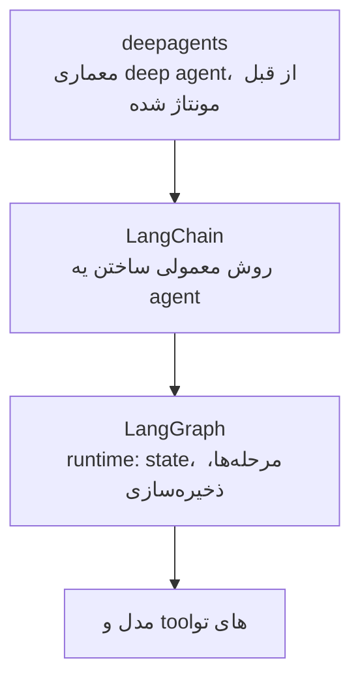
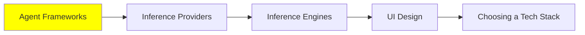

# Agent Framework‌ها

این ماژول می‌گه وقتی یه agent می‌سازی، در عمل چه چیزهایی رو باید نصب کنی. تا اینجای این مجموعه بیشتر درباره‌ی این حرف زدیم که agent‌ها از درون چطوری کار می‌کنن، و حالا وقتشه ببینیم بیرون از اون‌ها، توی پروژه‌ی واقعی، چه ابزارهایی دورشون قرار می‌گیرن.

راستشو بخوای، اول باید بدونی که لازم نیست framework داشته باشی. توی [AI Agents](../1_fundamentals/agents_fa.md) این loop رو دیدیم. اون یه `while` loop دور یه فراخوانی مدل هست که وسطش یه tool dispatch داره، یعنی تشخیص می‌ده کدوم tool باید اجرا بشه. این رو توی یه بعدازظهر هم می‌تونی بنویسی.

چیزی که framework بهت می‌ده، همه‌ی چیزهاییه که دور اون loop هست:

- retry وقتی provider یه خطای 500 برمی‌گردونه.
- streaming، که باعث می‌شه کاربر token‌ها رو همون لحظه‌ای که می‌رسن ببینه.
- یه tool schema استاندارد، که دیگه لازم نیست برای هر تابع JSON رو دستی بنویسی.
- Memory‌ای که بعد از restart هم باقی می‌مونه.
- جایی برای ذخیره‌ی trace‌ها.

همین فهرست دلیلشه که بیشتر آدم‌ها بعد از پروژه‌ی دوم دیگه loop رو خودشون نمی‌نویسن.

## استک LangChain

این اولین چیزیه که باید یاد بگیری. کامل‌ترینه و به‌روزترینه، و احتمالاً یه جایی نزدیک تو هم توی production اجرا می‌شه. ولی خیلی‌ها رو گیج می‌کنه، چون «LangChain» در واقع سه تا کتابخونه‌ی جدا توی سه سطحه. کدومشون رو لازم داری، به کاری که می‌خوای انجام بدی بستگی داره.

**[LangGraph](https://github.com/langchain-ai/langgraph)** همون runtime‌ست و پایین‌ترین سطح بین این سه تاست. agent رو به شکل یه graph توصیف می‌کنی. node‌ها مرحله‌ها هستن، edge‌ها مشخص می‌کنن که بعدش چه اتفاق‌هایی ممکنه بیفته، و state بین اون‌ها جابه‌جا می‌شه. چون state صریحه، runtime می‌تونه اون رو ذخیره کنه و از همون‌جا ادامه بده. runtime همچنین اجازه می‌ده وسط یه اجرا، یه آدم agent رو متوقف کنه و دخالت کنه. اگه سخت‌ترین بخش کار کنترل جریانه و می‌خوای خودت کنترلش کنی، LangGraph رو انتخاب کن.

**[LangChain](https://github.com/langchain-ai/langchain)** رابط اصلیه و جایی که باید شروع کنی. روی LangGraph ساخته شده و یه agent معمولی رو توی چند خط کد در اختیارت می‌ذاره: یه مدل، چند تا tool و یه middleware. کار [Harness Engineering](../2_intermediate/harness_engineering_fa.md) توی همین middleware انجام می‌شه. guardrail‌های [Security](../2_intermediate/security_fa.md) هم همین‌جا قرار دارن.

**[deepagents](https://github.com/langchain-ai/deepagents)** بالاترین سطحه و روی دو تای دیگه ساخته شده. خودش رو «batteries-included» معرفی می‌کنه، یعنی یه agent harness که امکاناتش از قبل آماده‌ست. و اون امکانات دقیقاً همون فهرستیه که توی [Context Engineering](../2_intermediate/context_engineering_fa.md) دیدیم:

- برنامه‌ریزی (planning)
- یه filesystem
- subagent‌هایی که هر کدوم context window جدا دارن
- خلاصه‌کردن گفت‌وگوهای طولانی

اگه به‌جای یه معماری سفارشی، معماری deep agent رو می‌خوای، از همین‌جا شروع کن و مرحله‌ی مونتاژ کردن رو رد کن.

پس قاعده‌ی عملی‌اش ساده‌ست: اول از LangChain شروع کن. اگه خودت باید جریان رو کنترل کنی، برو سراغ LangGraph، و اگه کل معماری رو از قبل ساخته شده می‌خوای، برو سراغ deepagents.

## بقیه‌ی گزینه‌های Python

هیچ‌کدوم از این‌ها اشتباه نیستن. هر کدوم یه معامله‌ی متفاوت دارن، و معمولاً تفاوت اصلی‌شون توی اینه که چقدر تصمیم رو به جای تو می‌گیرن.

- **[Agno](https://github.com/agno-agi/agno)** فراتر از یه agent تکی نگاه می‌کنه و کل پلتفرم رو می‌بینه. کمکت می‌کنه agent‌ها رو به‌عنوان یه سیستم بسازی، اجرا کنی و مدیریت کنی، نه این‌که فقط یه اسکریپت بنویسی.
- **[CrewAI](https://github.com/crewAIInc/crewAI)** همه‌چیز رو دور نقش‌ها سازماندهی می‌کنه. یه crew از agent‌ها رو توصیف می‌کنی که هر کدوم یه کار مشخص دارن و با هم کار می‌کنن. این خیلی خوب با الگوهای multi-agent توی [Multi-Agent Systems](../1_fundamentals/multi_agent_fa.md) جور درمیاد.
- **[smolagents](https://github.com/huggingface/smolagents)** از Hugging Face کوچیک‌ترین گزینه‌ست، و عمداً هم این‌طوری ساخته شده. یه کتابخونه‌ی خیلی ساده برای agent‌هایی که با کد فکر می‌کنن. ایده‌ی CodeAct که توی [Loop Engineering](../2_intermediate/loop_engineering_fa.md) دیدیم، این‌جا به شکل یه کتابخونه درومده. اگه بخوای loop رو بفهمی، نه این‌که فقط ازش استفاده کنی، این بهترین گزینه برای خوندنه.
- **[Pydantic AI](https://github.com/pydantic/pydantic-ai)** اون چیزی رو می‌اره که Pydantic توش خوبه، یعنی type. همه‌ی مدل‌ها و رابط‌ها از اول تا آخر type دارن. برای همین یه tool call خراب، به‌جای یه معمای گیج‌کننده، یه خطای validation واضح می‌ده.

## اگه پروژه‌ت با TypeScript نوشته می‌شه

دوتا framework هست که ارزش شناختن دارن. دلیلش اینه که کل استکی که بالاتر گفتیم Python-first هست، و بیشتر کدهای محصول اصلاً با Python نوشته نمی‌شن.

- **[Mastra](https://github.com/mastra-ai/mastra)** framework مدرن TypeScript برای agent‌ها و اپلیکیشن‌های AI هست. توی اون زبون، نزدیک‌ترین چیز به LangChain همینه.
- **[VoltAgent](https://github.com/VoltAgent/voltagent)** یه پلتفرم agent engineering هست که روی یه framework متن‌باز TypeScript ساخته شده. برای همین تمرکزش بیشتر روی بخش عملیاتی کاره.

## AI Workflow‌ها

یه تفاوت هست که خیلی مهمه درستش رو بفهمی. اگه اشتباه انتخابش کنی، ممکنه چند ماه وقتت هدر بره.

یه **AI workflow** مسیری رو اجرا می‌کنه که یه نفر از قبل نوشته. مرحله‌ها ثابتن و کد تصمیم می‌گیره که بعدش چی بشه. کد توی نقطه‌های مشخصی مدل رو صدا می‌زنه تا کارهای مشخصی انجام بده. اما یه **AI agent** خودش تصمیم می‌گیره. خودش tool‌ها و ترتیبشون رو انتخاب می‌کنه، و مسیرش توی هر اجرا ممکنه با قبلی فرق داشته باشه. [مقایسه‌ی Prompt Engineering Guide](https://www.promptingguide.ai/agents/ai-workflows-vs-ai-agents) این تفاوت رو این‌طوری توضیح می‌ده: از یه طرف منطقی که توی کد نوشته شده، از طرف دیگه استدلال هدایت‌شده‌ی LLM.

اشتباه اینه که فکر کنی agent نسخه‌ی بالغ‌تر workflow‌ه. این‌طور نیست. اگه نیازمندی‌ها ثابتن و مراحل رو می‌دونی، یه workflow قابل‌پیش‌بینی‌تره، ارزون‌تره و debug کردنش راحت‌تره. و سیستم‌های production معمولاً همین قابل‌پیش‌بینی بودن رو می‌خوان. پس agent رو نگه دار برای کارهای open-ended، یعنی جاهایی که هیچ‌کس نمی‌تونه مراحل رو از قبل بنویسه.

**[n8n](https://github.com/n8n-io/n8n)** ابزاریه که بیشتر آدم‌ها بالاخره برای نیمه‌ی workflow انتخابش می‌کنن. باهاش می‌تونی:

- یه workflow رو روی یه canvas بصری بسازی
- به بیش از 400 integration وصل بشی
- هر جا لازم باشه، کد خودت رو اضافه کنی
- خودت میزبانیش کنی، یا از cloud خودشون استفاده کنی

یه کار رو در نظر بگیر، مثلاً: «وقتی یه فرم ارسال شد، دسته‌بندیش کن، یه چیزی رو جستجو کن، توی database بنویسش، و یه پیام بفرست.» برای این‌جور کاری، این ابزار راحت از یه agent بهتره.

و این موضوع به [Code Agent‌ها](../2_intermediate/coding_agents_fa.md) ربط داره. n8n یه MCP server اجرا می‌کنه، پس coding agent تو می‌تونه به n8n instance وصل بشه و **workflow رو برات بسازه**. کافیه با زبون ساده توضیح بدی چی می‌خوای، و بعد coding agent:

- node‌ها رو کنار هم می‌ذاره
- نتیجه رو اعتبارسنجی می‌کنه
- workflow رو اجرا می‌کنه
- هر چی خراب شده باشه رو درست می‌کنه

ساختن workflow با MCP از نسخه‌ی v2.13 به بعد ممکن شده. برای همین دیگه agent و workflow دو تا گزینه‌ی جدا از هم نیستن. agent می‌شه همون چیزی که خودش workflow رو می‌نویسه.

## گزینه‌های No-code

این رو صاف و ساده بگیم، چون مهندس‌ها معمولاً ازش رد می‌شن. برای خیلی از کارها، جواب درست یه پلتفرم no-code هست. **[Lovable](https://lovable.dev/)**، **[Bolt](https://bolt.new/)** و **[Replit](https://replit.com/)** یه توصیف رو به یه اپلیکیشن کارکن تبدیل می‌کنن. خودشون اون رو deploy می‌کنن، و تو هم می‌تونی با نوشتن prompt هر تغییری بخوای بدی. برای یه prototype، یه ابزار داخلی، یا یه landing page که یه فرم پشتشه، این کار به‌جای هفته‌ها، چند ساعت طول می‌کشه.

معامله‌اش همون معامله‌ی همیشگیه. الان سرعت گیرت می‌اد، ولی بعداً کنترل کمتری داری. اگه از پلتفرم بیرون بری، باید اپلیکیشن رو از اول دوباره بسازی. پس بدون که داری دقیقاً چی رو می‌خری.

## کجای این مجموعه هستیم

## خلاصه

framework خودِ agent loop رو بهت نمی‌ده. اون رو خودت هم می‌تونی بنویسی. چیزی که بهت می‌ده، همه‌ی چیزهاییه که دور loop هست:

- retry
- streaming
- tool schema
- Memory‌ای که بعد از restart باقی می‌مونه
- جایی برای ذخیره‌ی trace‌ها

LangChain سه تا کتابخونه‌ست که هر کدوم توی یه سطح قرار دارن. LangGraph همون runtime‌ست و state‌ش صریحه، پس می‌تونی یه اجرا رو ذخیره کنی، ادامه بدی یا وسطش متوقفش کنی. LangChain رابط معمولی و جای شروعه. deepagents معماری deep agent هست که از قبل مونتاژ شده. از وسط شروع کن، و وقتی کار لازم داشت، بالا یا پایین برو.

Agno، CrewAI، smolagents و Pydantic AI گزینه‌های دیگه‌ی Python هستن، و بیشتر فرقشون توی اینه که چقدر تصمیم رو به جای تو می‌گیرن. Mastra و VoltAgent هم گزینه‌های TypeScript هستن.

بعدش می‌رسیم به مهم‌ترین تفاوتی که باید بفهمی. workflow مسیری رو اجرا می‌کنه که خودت نوشتی، و agent مسیر خودش رو تصمیم می‌گیره. و برخلاف چیزی که ممکنه فکر کنی، agent ارتقای workflow نیست. اگه بتونی مراحل رو بنویسی، بنویسشون، و n8n جاییه که این مراحل نگه‌داری می‌شن. با MCP server‌ش، coding agent تو می‌تونه همین workflow‌ها رو برات بسازه. این باعث می‌شه این دو رویکرد شریک هم باشن، نه رقیب.

**بررسی سریع**: فرض کن می‌تونی همه‌ی مراحل یه کار رو از قبل توصیف کنی. آیا باید agent بسازی؟ و اگه نه، چرا؟

## منابع

- [LangChain](https://github.com/langchain-ai/langchain): رابط اصلی، و جایی که باید شروع کنی
- [LangGraph](https://github.com/langchain-ai/langgraph): runtime زیرین، برای وقتی که می‌خوای جریان رو خودت کنترل کنی
- [deepagents](https://github.com/langchain-ai/deepagents): معماری deep agent، که از قبل مونتاژ شده
- [Agno](https://github.com/agno-agi/agno): agent‌ها به‌عنوان یه پلتفرم مدیریت‌شده، نه یه اسکریپت
- [CrewAI](https://github.com/crewAIInc/crewAI): agent‌ها به‌عنوان نقش‌هایی توی یه crew
- [smolagents](https://github.com/huggingface/smolagents): ساده‌ترینشون، و بهترینش برای خوندن
- [Pydantic AI](https://github.com/pydantic/pydantic-ai): از اول تا آخر type داره، برای این‌که یه tool call خراب، خطای واضح بده
- [Mastra](https://github.com/mastra-ai/mastra) و [VoltAgent](https://github.com/VoltAgent/voltagent): گزینه‌های TypeScript
- [AI Workflows vs AI Agents](https://www.promptingguide.ai/agents/ai-workflows-vs-ai-agents): تفاوت این دو، و این‌که هر کدوم کجا درسته
- [n8n](https://github.com/n8n-io/n8n): پلتفرم workflow، با [یه MCP server که workflow‌ها رو برات می‌سازه](https://docs.n8n.io/advanced-ai/mcp/accessing-n8n-mcp-server/)
- [Lovable](https://lovable.dev/)، [Bolt](https://bolt.new/) و [Replit](https://replit.com/): یه اپلیکیشن رو با زبون ساده توصیف کن و یه نسخه‌ی کارکن بگیر
