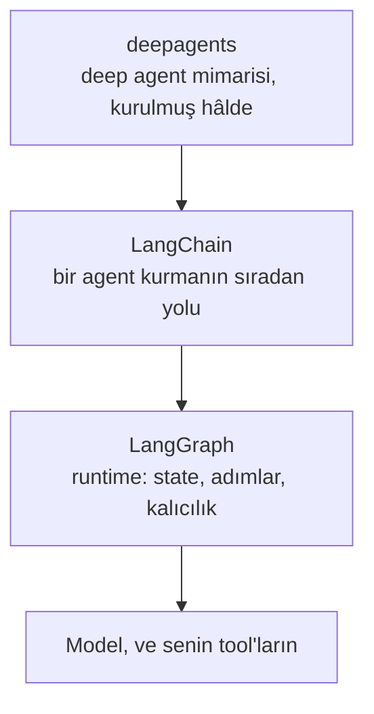
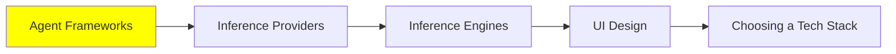

# Agent Framework'leri

Buraya kadar her şey agent'ların nasıl çalıştığıyla ilgiliydi. Bu modül ise bir agent geliştirirken gerçekte neyi kurduğunla ilgili.

Dürüst başlangıç noktası şu: bir framework'e ihtiyacın yok. [AI Agent'lar](../1_fundamentals/agents_tr.md) loop'u göstermişti. Bu loop, bir model çağrısının etrafında dönen bir `while` döngüsü. Ortasında da bir tool dispatch var. Bunu bir öğleden sonrada yazabilirsin.

Framework'ten aldığın şey, loop'un etrafındaki her şey:

- Bir sağlayıcı 500 hatası döndürdüğünde retry.
- Streaming, böylece kullanıcı token'ları geldikçe görüyor.
- Standart bir tool schema'sı, böylece her fonksiyon için JSON'u elle yazmıyorsun.
- Bir restart'tan sonra da kaybolmayan memory.
- Trace'leri koyacak bir yer.

Bu liste, insanların çoğunun ikinci projeden sonra kendi loop'unu yazmayı bırakmasının sebebi.

## LangChain Stack'i

İlk öğrenilecek olan bu. En eksiksiz ve en güncel olanı bu. Yakınında bir yerde production'da çalışıyor olma ihtimali en yüksek olan da bu. Ama insanların kafasını karıştırıyor, çünkü "LangChain" üç farklı seviyede üç ayrı kütüphane. Hangisini istediğin, işe bağlı.

**[LangGraph](https://github.com/langchain-ai/langgraph)** runtime ve üçünün en alt seviyesi. Agent'ını bir graph olarak tanımlıyorsun. Node'lar adımlar, edge'ler sırada ne olabileceği, state ise aralarında dolaşıyor. State açık (explicit) olduğu için runtime onu kaydedebiliyor ve oradan devam edebiliyor. Ayrıca bir insanın çalışmanın ortasında araya girmesine izin verebiliyor. Kontrol akışı işin zor kısmıysa ve onu kendin kontrol etmek istiyorsan LangGraph'ı kullan.

**[LangChain](https://github.com/langchain-ai/langchain)** ana arayüz ve başlaman gereken yer. LangGraph'ın üstünde duruyor. Sana sıradan agent'ı birkaç satır kodla veriyor: bir model, birkaç tool ve biraz middleware. Middleware, [Harness Engineering](../2_intermediate/harness_engineering_tr.md) işinin yapıldığı yer. [Security](../2_intermediate/security_tr.md)'deki guardrail'ler de burada duruyor.

**[deepagents](https://github.com/langchain-ai/deepagents)** en üst seviye. Diğer ikisinin üstüne kurulu. Kendisine "batteries-included" bir agent harness diyor. Bataryalar da tam olarak [Context Engineering](../2_intermediate/context_engineering_tr.md)'deki liste:

- planlama
- bir filesystem
- kendi context window'ları olan subagent'lar
- uzun thread'lerin özetlenmesi

Özel bir mimari değil de deep agent mimarisini istiyorsan, buradan başla ve montajı atla.

Yani pratik kural basit. LangChain'den başla. Akışı kendin kontrol etmen gerektiğinde LangGraph'a in. Bütün mimarinin hazır gelmesini istediğinde deepagents'a çık.

## Diğer Python Seçenekleri

Bunların hiçbiri yanlış değil. Her biri farklı ödünler (trade-off) veriyor. Ödün genelde, senin yerine ne kadar çok şeye karar verdikleri.

- **[Agno](https://github.com/agno-agi/agno)** tek agent'ın ötesine, bütün platforma bakıyor. Agent'ları bir script olarak değil, bir sistem olarak kurmana, çalıştırmana ve yönetmene yardım ediyor.
- **[CrewAI](https://github.com/crewAIInc/crewAI)** her şeyi roller etrafında düzenliyor. Her birinin bir işi olan bir agent ekibi tanımlıyorsun ve birlikte çalışmalarına izin veriyorsun. Bu da [Multi-Agent Sistemler](../1_fundamentals/multi_agent_tr.md)'deki şekillere iyi oturuyor.
- **Hugging Face'in [smolagents](https://github.com/huggingface/smolagents)** kütüphanesi küçük olanı ve bilerek küçük tutulmuş. Kodla düşünen agent'lar için yalın (barebones) bir kütüphane. [Loop Engineering](../2_intermediate/loop_engineering_tr.md)'deki CodeAct fikrinin kütüphane hâli. Bir loop'u kullanmak değil de anlamak istiyorsan, okunacak en iyi kütüphane de bu.
- **[Pydantic AI](https://github.com/pydantic/pydantic-ai)** Pydantic'in iyi olduğu şeyi getiriyor: tip'leri. Her model ve her arayüz baştan sona tipli. Böylece bozuk bir tool çağrısı gizemli bir sorun değil, bir validation hatası oluyor.

## Projen TypeScript ise

Burada bilmeye değer iki framework var. Sebebi şu: yukarıdaki bütün stack Python öncelikli, ama ürün kodunun çoğu Python ile yazılmıyor.

- **[Mastra](https://github.com/mastra-ai/mastra)** agent'lar ve AI uygulamaları için modern TypeScript framework'ü. O dilde LangChain'e en yakın şey bu.
- **[VoltAgent](https://github.com/VoltAgent/voltagent)** açık kaynak bir TypeScript framework'ünün üstüne kurulmuş bir agent engineering platformu. Bu yüzden daha çok operasyon tarafına odaklanıyor.

## AI Workflow'ları

Burada doğru anlaman önemli bir ayrım var. Yanlış seçersen, bu sana aylara mal oluyor.

Bir **AI workflow**, birinin yazdığı bir yolu çalıştırıyor. Adımlar sabit. Sırada ne olacağına kod karar veriyor. Kod, modeli belirli noktalarda belirli işler için çağırıyor. Bir **AI agent** ise kendisi karar veriyor. Tool'ları ve sırayı kendi seçiyor, ve yol her çalışmada farklı. [Prompt Engineering Guide'ın karşılaştırması](https://www.promptingguide.ai/agents/ai-workflows-vs-ai-agents) bunu, hard-coded mantığa karşı LLM'in yürüttüğü akıl yürütme olarak tanımlıyor.

Hata, agent'ın yetişkin versiyon olduğunu varsaymak. Değil. Gereksinimler sabitse ve adımları biliyorsan, bir workflow daha öngörülebilir, daha ucuz ve debug etmesi daha kolay. Öngörülebilirlik de genelde production'ın istediği şey. Agent'ı, adımları kimsenin önceden yazamadığı açık uçlu işler için sakla.

**[n8n](https://github.com/n8n-io/n8n)** insanların workflow yarısı için en çok kullandığı tool. Onunla:

- görsel bir kanvas üzerinde kuruyorsun
- 400'den fazla entegrasyonu bağlıyorsun
- ihtiyaç duyduğun yere kendi kodunu ekliyorsun
- kendi sunucunda çalıştırıyorsun (self-host) ya da onların bulutunu kullanıyorsun

"Bir form gönderildiğinde sınıflandır, bir şeye bak, veritabanına yaz, bir mesaj gönder" gibi bir iş düşün. Böyle bir iş için bu tool, bir agent'tan rahatça daha iyi.

Bu da bizi [Code Agent'lar](../2_intermediate/coding_agents_tr.md) konusuna geri götürüyor. n8n bir MCP server çalıştırıyor. Yani coding agent'ın senin n8n instance'ına bağlanıp **workflow'u senin için kurabiliyor**. Ne istediğini düz bir dille anlatıyorsun, coding agent da:

- node'ları birleştiriyor
- sonucu doğruluyor
- workflow'u çalıştırıyor
- bozulanı düzeltiyor

MCP üzerinden workflow kurmak v2.13'te geldi. Yani agent ve workflow artık birbirinin alternatifi değil. Agent, workflow'u yazan şey oluyor.

## No-code Seçenekler

Bunu açıkça söylemeye değer, çünkü mühendisler bunu atlama eğiliminde. Bir sürü iş için doğru cevap bir no-code platform. **[Lovable](https://lovable.dev/)**, **[Bolt](https://bolt.new/)** ve **[Replit](https://replit.com/)** bir açıklamayı çalışan bir uygulamaya çeviriyor. Uygulamayı deploy ediyor, sen de değiştirmek için prompt yazmaya devam edebiliyorsun. Bir prototip, bir iç tool ya da arkasında form olan bir landing page için bu, haftalar yerine saatler sürüyor.

Buradaki ödün her zamanki ödün. Şimdi hız kazanıyorsun, sonra daha az kontrolün oluyor. Platformdan çıkarsan, uygulamayı yeniden kurman gerekiyor. Hangisini satın aldığını bil.

## Bu serinin neresindeyiz

## Özet

Bir framework sana agent loop'unu vermiyor. Onu kendin yazabilirsin. Loop'un etrafındaki her şeyi veriyor:

- retry'lar
- streaming
- tool schema'ları
- bir restart'tan sonra da kaybolmayan memory
- trace'lerin gideceği bir yer

LangChain üç seviyede üç kütüphane. LangGraph runtime. State'i açık olduğu için bir çalışmayı kaydedebiliyor, devam ettirebiliyor ve kesebiliyorsun. LangChain sıradan arayüz ve başlanacak yer. deepagents ise hazır kurulmuş deep agent mimarisi. Ortadan başla, iş gerektirdikçe yukarı ya da aşağı git.

Agno, CrewAI, smolagents ve Pydantic AI diğer Python seçenekleri. Aralarındaki fark çoğunlukla, senin yerine ne kadar çok şeye karar verdikleri. Mastra ve VoltAgent da TypeScript cevapları.

Sonra en önemli ayrım geliyor. Bir workflow senin yazdığın yolu çalıştırıyor. Bir agent ise kendi yolunu seçiyor. Agent bir yükseltme değil. Adımları yazabiliyorsan yaz, n8n de o adımların yaşadığı yer. MCP server'ı sayesinde coding agent'ın o workflow'ları senin için kurabiliyor. Bu da iki yaklaşımı rakip değil, ortak yapıyor.

**Hızlı Kontrol**: işin her adımını önceden anlatabiliyorsun. Bir agent kurmalı mısın, ve neden hayır?

## Kaynaklar

- [LangChain](https://github.com/langchain-ai/langchain): ana arayüz, ve başlanacak yer
- [LangGraph](https://github.com/langchain-ai/langgraph): alttaki runtime, akışı kendin kontrol etmek istediğinde
- [deepagents](https://github.com/langchain-ai/deepagents): deep agent mimarisi, zaten bir araya getirilmiş
- [Agno](https://github.com/agno-agi/agno): script yerine yönetilen bir platform olarak agent'lar
- [CrewAI](https://github.com/crewAIInc/crewAI): bir ekipte roller olarak düzenlenmiş agent'lar
- [smolagents](https://github.com/huggingface/smolagents): yalın olanı ve okunacak en iyisi
- [Pydantic AI](https://github.com/pydantic/pydantic-ai): baştan sona tipli, böylece bozuk bir tool çağrısı açık bir hata veriyor
- [Mastra](https://github.com/mastra-ai/mastra) ve [VoltAgent](https://github.com/VoltAgent/voltagent): TypeScript seçenekleri
- [AI Workflows vs AI Agents](https://www.promptingguide.ai/agents/ai-workflows-vs-ai-agents): ayrım, ve hangisinin ne zaman doğru olduğu
- [n8n](https://github.com/n8n-io/n8n): workflow platformu, ve [workflow'ları senin için kuran bir MCP server](https://docs.n8n.io/advanced-ai/mcp/accessing-n8n-mcp-server/) ile
- [Lovable](https://lovable.dev/), [Bolt](https://bolt.new/) ve [Replit](https://replit.com/): bir uygulamayı düz dille anlat, çalışan bir tane al
