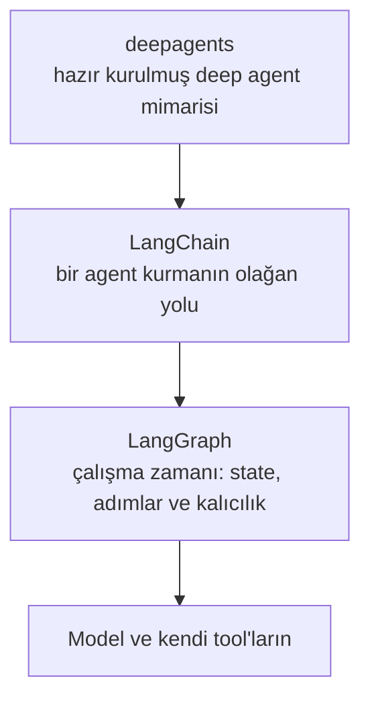
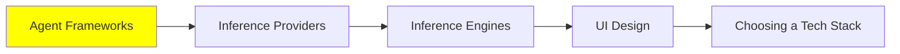

# Agent Framework'leri

Buraya kadar olan kısım agent'ların nasıl çalıştığıyla ilgiliydi. Bu modül ise bir agent'ı kurarken gerçekte neyi yüklediğini anlatıyor.

Dürüst bir başlangıçla açayım: bir framework'e ihtiyacın yok. [AI Agents](../1_fundamentals/agents_tr.md) modülü döngüyü göstermişti. Bu döngü, bir model çağrısının etrafındaki bir `while` döngüsüdür; ortasında tool çağrılarını ilgili fonksiyona yönlendiren küçük bir parça da vardır. Bunu bir öğleden sonrada rahatlıkla yazabilirsin.

Bir framework'ün sana verdiği şey ise döngünün etrafındaki her şey:

- Sağlayıcı 500 hatası döndürdüğünde otomatik yeniden deneme (retry).
- Streaming: kullanıcı token'ları geldikçe ekranda görür.
- Standart bir tool şeması (schema), böylece her fonksiyon için JSON'u elle yazmak zorunda kalmazsın.
- Uygulama yeniden başladıktan sonra da kalan memory.
- Trace'lerin toplanacağı bir yer.

Çoğu insanın ikinci projeden sonra kendi döngüsünü yazmayı bırakmasının sebebi de bu listedir.

## LangChain Stack'i

Önce bunu öğrenmen gerekiyor, çünkü en eksiksiz ve en güncel olan bu. Üstelik büyük ihtimalle çevrendeki bir yerde production'da çalışan da bu. Ama "LangChain" aslında üç ayrı kütüphane ve her biri farklı bir seviyede çalışıyor, bu yüzden insanların kafası karışır. Hangisine ihtiyacın olduğu ise yaptığın işe bağlı.

**[LangGraph](https://github.com/langchain-ai/langgraph)** çalışma zamanıdır (runtime) ve üç katmanın en alt seviyesinde durur. Agent'ını bir graf olarak tarif edersin; node'lar adımlar, edge'ler bundan sonra neyin olabileceğini gösterir ve state bunlar arasında hareket eder. State açıkça tanımlı olduğu için runtime onu kaydedebilir ve kaldığı yerden devam ettirebilir. Runtime, bir insanın çalıştırma sırasında araya girip agent'ı durdurmasına da izin verebilir. Kontrol akışı asıl zor kısım olduğunda ve akışı kendin yönetmek istediğinde LangGraph'i kullan.

**[LangChain](https://github.com/langchain-ai/langchain)** ana arayüzdür ve başlamak için doğru yer de burası. LangGraph'in üzerinde oturur ve birkaç satır kodla olağan bir agent verir: bir model, birkaç tool ve birkaç middleware. Middleware'ler, [Harness Engineering](../2_intermediate/harness_engineering_tr.md) modülünün anlattığı işin büyük kısmının yapıldığı yerdir. Aynı zamanda [Security](../2_intermediate/security_tr.md) modülündeki guardrail'ler de tam burada yaşar.

**[deepagents](https://github.com/langchain-ai/deepagents)** ise en üst seviyedir. Diğer ikisinin üzerine kurulu ve kendini "batteries-included" (her şeyi hazır içeren) bir agent harness'i olarak tanımlıyor. Bu hazır parçalar tam olarak [Context Engineering](../2_intermediate/context_engineering_tr.md) modülündeki listedir:

- planlama
- bir dosya sistemi (filesystem)
- kendi context window'ları olan subagent'lar
- uzun thread'lerin özetlenmesi

Kendi mimarini kurmak yerine hazır deep agent mimarisini istiyorsan buradan başla ve birleştirme işini atla.

Pratik kural basit: LangChain ile başla, akışı kendin yönetmen gerektiğinde LangGraph'e in, bütün mimarinin hazır gelmesini istediğinde ise deepagents'a çık.

## Diğer Python Seçenekleri

Bunların hiçbiri yanlış değil; hepsi farklı takaslar (trade-off) yapıyor ve genelde aradaki fark, senin yerine ne kadar karar verdiklerinde yatıyor.

- **[Agno](https://github.com/agno-agi/agno)** tek bir agent'ın ötesine, tüm platforma bakar. Agent'ları bir script olarak değil, bir sistem olarak kurmana, çalıştırmana ve yönetmene yardım eder.
- **[CrewAI](https://github.com/crewAIInc/crewAI)** her şeyi roller etrafında düzenler. Her biri ayrı bir işi olan bir agent ekibi (crew) tarif edersin ve onların birlikte çalışmasını sağlarsın. Bu yapı, [Multi-Agent Systems](../1_fundamentals/multi_agent_tr.md) modülündeki çoklu agent yapılarına iyi oturur.
- **[smolagents](https://github.com/huggingface/smolagents)**, Hugging Face'in küçük olanıdır ve bu küçüklük bilerek seçilmiş bir tercih. JSON tool çağrıları göndermek yerine kod yazıp çalıştırarak iş yapan agent'lar için yalın bir kütüphane. Bu, [Loop Engineering](../2_intermediate/loop_engineering_tr.md) modülünde anlatılan CodeAct fikrinin kütüphane olarak paketlenmiş hali. Bir döngüyü kullanmaktan çok anlamak istiyorsan, okumak için de en iyi seçenek.
- **[Pydantic AI](https://github.com/pydantic/pydantic-ai)** Pydantic'in iyi yaptığı şeyi, yani tipleri getiriyor. Her model ve her arayüz baştan sona tiplenmiş. Bu yüzden hatalı bir tool çağrısı gizemli bir hataya değil, açık bir validation hatasına dönüşür.

## Projen TypeScript İse

Burada bilmeye değer iki framework var, çünkü yukarıdaki stack'in tamamı Python öncelikli ve ürün kodunun çoğu Python ile yazılmıyor.

- **[Mastra](https://github.com/mastra-ai/mastra)** agent'lar ve AI uygulamaları için modern bir TypeScript framework'ü. Bu dilde LangChain'e en çok benzeyen seçenek.
- **[VoltAgent](https://github.com/VoltAgent/voltagent)** ise açık kaynaklı bir TypeScript framework'ü üzerine kurulu bir agent engineering platformu. Bu yüzden daha çok agent'larını kurduktan sonraki kısma odaklanıyor: onları çalıştırmaya, izlemeye ve yönetmeye.

## AI Workflow'ları

Doğru anlaman gereken önemli bir ayrım var. Yanlış seçersen bu sana aylarca zaman kaybettirebilir.

Bir **AI workflow**, birinin önceden yazdığı bir yolu izler. Adımlar sabittir ve bundan sonra ne olacağına kod karar verir. Kod, belirli işleri yapmak için modeli belirli noktalarda çağırır. Bir **AI agent** ise kendi kararını kendisi verir. Tool'ları ve sırayı kendisi seçer, bu yüzden yol her çalıştırmada farklı olabilir. [Prompt Engineering Guide'ın karşılaştırması](https://www.promptingguide.ai/agents/ai-workflows-vs-ai-agents) bunu, sabit kodlanmış mantık ile LLM'in yönlendirdiği akıl yürütme (reasoning) arasındaki fark olarak anlatıyor.

Hata, agent'ı workflow'un olgunlaşmış hali sanmaktır. Oysa durum bu değil. Gereksinimler sabitse ve adımları biliyorsan, bir workflow daha öngörülebilir, daha ucuz ve hata ayıklaması daha kolay olur; üretimde de genellikle istenen şey tam olarak bu öngörülebilirliktir. Agent'ı, adımların önceden kimse tarafından yazılamadığı açık uçlu işler için sakla.

**[n8n](https://github.com/n8n-io/n8n)**, workflow tarafı için çoğu insanın sonunda seçtiği araç. Onunla şunları yaparsın:

- görsel bir canvas üzerinde kurarsın
- 400'den fazla entegrasyona bağlanırsın
- ihtiyacın olan yerlere kendi kodunu eklersin
- kendi sunucunda barındırabilir ya da onların cloud'unu kullanabilirsin

Şöyle bir işi düşün: "bir form gönderildiğinde onu sınıflandır, bir bilgiyi ara, veritabanına yaz ve bir mesaj gönder." Bu iş için bu araç, bir agent'tan açıkça daha iyidir.

Bu konu, [Code Agent'lar](../2_intermediate/coding_agents_tr.md) modülüne de geri bağlanıyor. n8n bir MCP sunucusu çalıştırdığı için coding agent, n8n instance'ına bağlanıp **workflow'u senin yerine kurabilir**. İstediğini sade bir dille anlatırsın ve coding agent şunları yapar:

- node'ları bir araya getirir
- sonucu doğrular
- workflow'u çalıştırır
- bozulan şeyi düzeltir

MCP üzerinden workflow kurmak v2.13 sürümüyle geldi. Böylece agent ile workflow birbirinin alternatifi olmaktan çıkıyor ve agent, workflow'u yazan şey haline geliyor.

## No-code Seçenekleri

Bunu açıkça söylemek gerekiyor, çünkü mühendisler genelde bunu atlar. Pek çok iş için doğru cevap bir no-code platform. **[Lovable](https://lovable.dev/)**, **[Bolt](https://bolt.new/)** ve **[Replit](https://replit.com/)** bir açıklamayı çalışan bir uygulamaya çeviriyor. Uygulamayı yayınlıyorlar ve değiştirmek için prompt yazmaya devam edebilirsin. Bir prototip, dahili bir araç ya da arkasında formu olan bir landing page için bu, haftalar yerine saatler sürer.

Takas da bildiğin türden: şimdi hız kazanırsın, sonra daha az kontrol elde edersin. Platformdan ayrılırsan uygulamayı baştan yazman gerekir. Bu takasın hangi tarafını satın aldığını bilerek karar ver.

## Bu serinin neresindeyiz

## Özet

Framework, agent döngüsünün kendisini vermez; onu kendin de yazabilirsin. Framework'ün sana verdiği şey ise döngünün etrafındaki her şeydir:

- yeniden denemeler
- streaming
- tool şemaları
- yeniden başlatıldıktan sonra da kalan memory
- trace'lerin gideceği bir yer

LangChain, üç seviyede çalışan üç kütüphanedir. LangGraph çalışma zamanıdır; state'i açık olduğu için bir çalıştırmayı kaydedebilir, kaldığı yerden sürdürebilir ya da araya girip durdurabilirsin. LangChain olağan arayüzdür ve başlamak için doğru yerdir; deepagents ise zaten birleştirilmiş deep agent mimarisidir. Ortadan başla ve işin gerektirdiğinde yukarı ya da aşağı çık.

Agno, CrewAI, smolagents ve Pydantic AI diğer Python seçenekleridir ve aralarındaki fark çoğunlukla senin yerine ne kadar karar verdiklerinde yatar. Mastra ve VoltAgent ise TypeScript tarafının cevaplarıdır.

Sonra en önemli ayrım geliyor: bir workflow, senin yazdığın bir yolu izler; bir agent ise kendi yolunu kendisi belirler. Agent, workflow'un yükseltilmiş hali değildir. Adımları yazabiliyorsan onları yaz; n8n da bu adımların yaşadığı yerdir. MCP sunucusu sayesinde coding agent, bu workflow'ları senin yerine kurabilir. Bu da iki yaklaşımı rakip olmaktan çıkarıp ortak hale getiriyor.

**Hızlı Kontrol**: İşin her adımını önceden tarif edebiliyorsan bir agent kurmalı mısın? Cevabının nedenini de yaz.

## Kaynaklar

- [LangChain](https://github.com/langchain-ai/langchain): ana arayüz ve başlamak için doğru yer
- [LangGraph](https://github.com/langchain-ai/langgraph): altta çalışan runtime, akışı kendin kontrol etmek istediğinde
- [deepagents](https://github.com/langchain-ai/deepagents): deep agent mimarisi, zaten birleştirilmiş halde
- [Agno](https://github.com/agno-agi/agno): agent'ları bir script yerine yönetilen bir platform olarak
- [CrewAI](https://github.com/crewAIInc/crewAI): agent'ları bir ekipte roller olarak düzenlemek
- [smolagents](https://github.com/huggingface/smolagents): en sade olanı, okumak için en iyisi
- [Pydantic AI](https://github.com/pydantic/pydantic-ai): baştan sona tiplenmiş, bu yüzden hatalı bir tool çağrısı açık bir hatayla düşer
- [Mastra](https://github.com/mastra-ai/mastra) ve [VoltAgent](https://github.com/VoltAgent/voltagent): TypeScript seçenekleri
- [AI Workflows vs AI Agents](https://www.promptingguide.ai/agents/ai-workflows-vs-ai-agents): bu ayrım ve her birinin ne zaman doğru olduğu
- [n8n](https://github.com/n8n-io/n8n): workflow platformu, [workflow'ları senin yerine kuran bir MCP sunucusuyla](https://docs.n8n.io/advanced-ai/mcp/accessing-n8n-mcp-server/)
- [Lovable](https://lovable.dev/), [Bolt](https://bolt.new/) ve [Replit](https://replit.com/): uygulamayı sade bir dille tarif et, çalışan bir uygulama al
