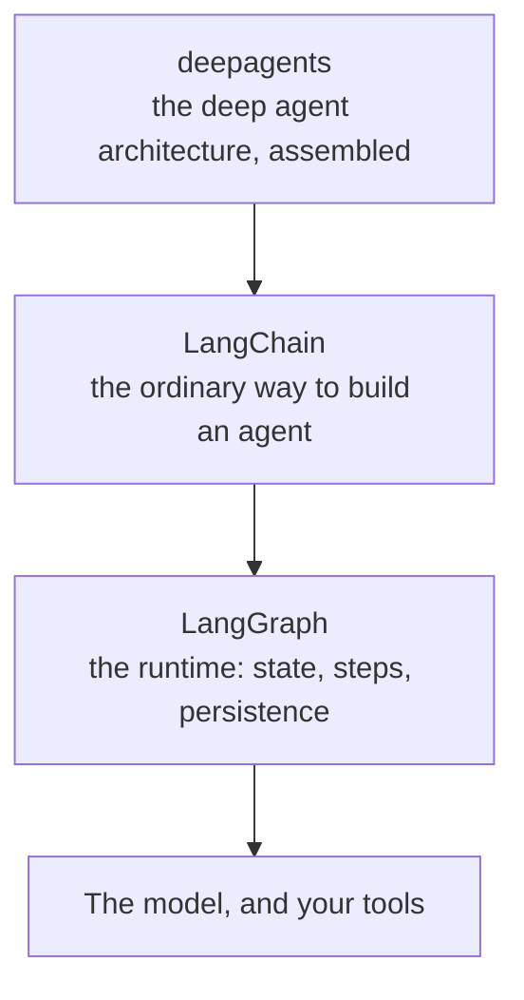

# Agent Frameworks

Everything up to here was about how agents work. This module is a map of what people actually use
when they build one. You will hear these names in meetings and from vendors.

## Why This Matters to You

When a team or a vendor proposes an AI project, they will name a framework or a platform. You do not
need to install any of them. But knowing what each one is for helps you follow the discussion and
ask the right question, which is often: "does this need an agent at all, or would a fixed workflow
do?"

## What a Framework Gives You

You do not strictly need a framework. [AI Agents](../1_fundamentals/agents.md) showed that the
agent loop is simple. A framework is the ready-made plumbing around that loop:

- trying again when an AI service fails for a moment
- showing the answer word by word as it is written
- describing tools in a standard way
- remembering things after a restart
- keeping the traces from [Observability](../1_fundamentals/observability.md)

It is like buying a ready-made kitchen instead of building every cupboard yourself. That is why most
teams stop writing their own loop after their second project.

## The LangChain Family

This is the name you will hear most often. It is the most complete, and the one most likely to be in use near you. "LangChain"
is really three layers:

- **LangGraph** is the lowest layer, for teams that want full control over each step.
- **LangChain** is the main layer, and where most teams start.
- **deepagents** is the top layer: the deep agent from
  [Context Engineering](../2_intermediate/context_engineering.md), with planning, helpers, notes
  and summarising already built in.

## Other Names You Will Hear

They do the same job with different trade-offs:

- **CrewAI** organises agents as a crew of roles, the team idea from [Multi-Agent Systems](../1_fundamentals/multi_agent.md).
- **smolagents** from Hugging Face is small on purpose and easy to read.
- **Agno** focuses on running and managing many agents as one system.
- **Pydantic AI** focuses on strict checking, so mistakes show up as clear errors.
- **Mastra** and **VoltAgent** are for companies whose product is written in TypeScript rather than Python.

## Workflows: Fixed Steps

This is the most useful distinction in the module, and choosing wrong can cost months.

An **AI workflow** follows steps that someone wrote down, like a company procedure. The steps are
fixed. The AI is used inside some steps, for one job each. An **AI agent** decides the steps itself.

The mistake is to think the agent is the better, grown-up version. It is not. When you know the
steps and they rarely change, a workflow is more predictable, cheaper, and easier to fix when
something breaks.

**n8n** is the tool most teams choose for workflows. You build them on a visual canvas by
connecting boxes, it connects to more than 400 services, and it can run on the company's own
computers. Take a job like: "when a form is submitted, sort it, look something up, save it to the
database, and send a message." For that job, a workflow is easily better than an agent.

And the two now work together. n8n can be connected to a coding agent through MCP (from
[Code Agents](../2_intermediate/coding_agents.md)). You describe the workflow in plain words, and
the agent builds it in n8n, tests it and fixes what broke. The agent becomes the thing that writes
the workflow.

## No-code Platforms

For many jobs, the right answer is a no-code platform. **[Lovable](https://lovable.dev/)**, **[Bolt](https://bolt.new/)**
and **[Replit](https://replit.com/)** turn a description into a working app, put it online,
and let you keep changing it with more requests. For a prototype, an internal tool or a simple page
with a form, that takes hours instead of weeks.

The trade-off: you get speed now and less control later. If you ever move off the platform, you
build the app again. Know which of those you are buying.

## Words You Now Know

- **Framework**: ready-made software around the agent loop.
- **LangChain / LangGraph / deepagents**: the three layers of the most common framework family.
- **AI workflow**: fixed steps someone wrote, with AI inside some of them.
- **n8n**: the most common workflow tool, built visually.
- **No-code platform**: a service that builds a working app from a description.

## Summary

A framework is the plumbing around the agent loop, and LangChain is the name you will hear most. But
the most important question is often not which framework: it is whether you need an agent at all.
When the steps are known, a workflow (often in n8n) is cheaper and more predictable, and an agent can
now build that workflow for you. For simple apps, a no-code platform may be enough.

**Quick check**: When is a workflow a better choice than an agent? And what do you give up with a
no-code platform?

## References

### 📄 Articles

- [AI Workflows vs AI Agents](https://www.promptingguide.ai/agents/ai-workflows-vs-ai-agents): the distinction, and when each one is right

### 🛠️ Tools

- [Lovable](https://lovable.dev/), [Bolt](https://bolt.new/) and [Replit](https://replit.com/): describe an app in plain language and get a working one

### 🗃️ Repositories

- [LangChain](https://github.com/langchain-ai/langchain): the main framework, and the place most teams start
- [CrewAI](https://github.com/crewAIInc/crewAI): agents organised as roles in a crew
- [n8n](https://github.com/n8n-io/n8n): the visual workflow platform
