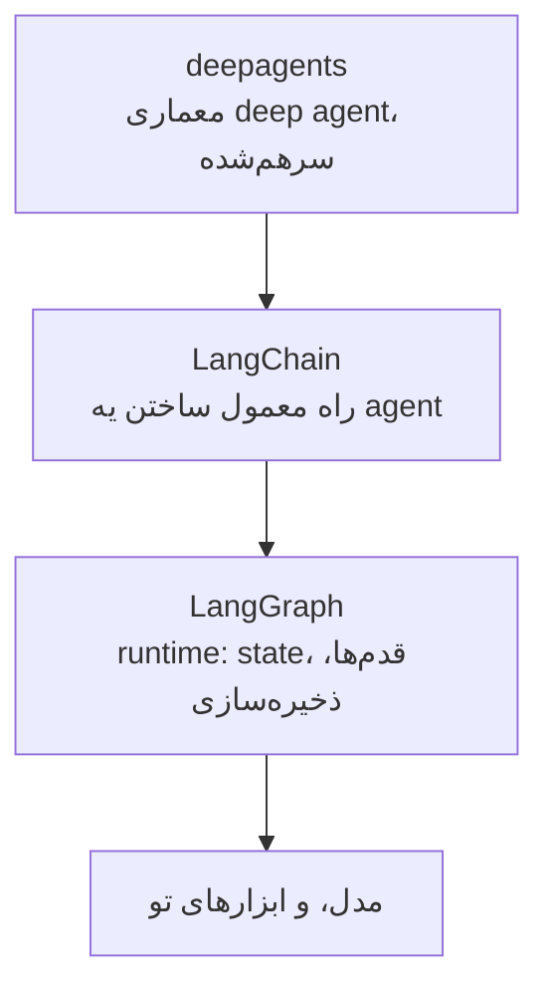

---
objectives:
  - "بگو یه framework چی بهت می‌ده و این‌که لزوماً بهش احتیاج نداری"
  - "اسم‌های اصلی رو بشناس: LangChain، LangGraph، deepagents، CrewAI و n8n"
  - "workflow رو از agent تشخیص بده، و بدون کی workflow گزینه‌ی بهتریه"
---

# Agent Framework‌ها

همه‌ی چیزهایی که تا این‌جا گفتیم درباره‌ی این بود که agent‌ها چطور کار می‌کنن. این درس یه نقشه‌ست از چیزی که آدم‌ها واقعاً موقع ساختن یکی استفاده می‌کنن. این اسم‌ها رو توی جلسه‌ها و از زبون فروشنده‌ها می‌شنوی.

## چرا این برای تو مهمه

وقتی یه تیم یا یه فروشنده یه پروژه‌ی AI پیشنهاد می‌ده، اسم یه framework یا یه پلتفرم رو میاره. لازم نیست هیچ‌کدومشون رو نصب کنی. ولی دونستن این‌که هر کدوم به چه دردی می‌خوره کمک می‌کنه بحث رو دنبال کنی و سوال درست رو بپرسی، که اغلب اینه: «این اصلاً agent می‌خواد، یا یه workflow ثابت کافیه؟»

## یه framework چی بهت می‌ده

لزوماً به framework احتیاج نداری. [AI Agents](../1_fundamentals/agents_fa.md) نشون داد که agent loop ساده‌ست. framework لوله‌کشی آماده‌ی دور اون loop‌ه:

- دوباره امتحان کردن وقتی یه سرویس AI یه لحظه خراب می‌شه
- نشون دادن جواب کلمه‌به‌کلمه همون‌طور که نوشته می‌شه
- توصیف ابزارها به شکل استاندارد
- یادآوری چیزها بعد از راه‌اندازی دوباره
- نگه داشتن trace‌های [Observability](../1_fundamentals/observability_fa.md)

مثل اینه که به جای ساختن تک‌تک کابینت‌ها، یه آشپزخونه‌ی آماده بخری. برای همینه که بیشتر تیم‌ها بعد از پروژه‌ی دومشون دیگه loop خودشون رو نمی‌نویسن.

## استک LangChain

این اسمیه که از همه بیشتر می‌شنوی. کامل‌ترینه، و احتمال این‌که دور و برت استفاده بشه از همه بیشتره. «LangChain» در واقع سه لایه‌ست:

- **LangGraph** پایین‌ترین لایه‌ست، برای تیم‌هایی که کنترل کامل روی هر قدم می‌خوان.
- **LangChain** لایه‌ی اصلیه، و جاییه که بیشتر تیم‌ها از اون‌جا شروع می‌کنن.
- **deepagents** لایه‌ی بالاییه: همون deep agent از
  [Context Engineering](../2_intermediate/context_engineering_fa.md)، که برنامه‌ریزی، کمک‌کارها، یادداشت‌برداری و خلاصه کردن از قبل توش ساخته شده.

## بقیه‌ی گزینه‌های Python

همین کار رو می‌کنن، با معامله‌های متفاوت:

- **CrewAI** agent‌ها رو به شکل یه گروه از نقش‌ها سازمان می‌ده، همون ایده‌ی تیم از [Multi-Agent Systems](../1_fundamentals/multi_agent_fa.md).
- **smolagents** از Hugging Face عمداً کوچیکه و خوندنش آسونه.
- **Agno** روی اجرا و مدیریت کلی agent به شکل یه سیستم تمرکز داره.
- **Pydantic AI** روی بررسی سخت‌گیرانه تمرکز داره، که اشتباه‌ها به شکل خطای روشن ظاهر بشن.
- **Mastra** و **VoltAgent** برای شرکت‌هایی‌ان که محصولشون به جای Python با TypeScript نوشته شده.

## AI Workflow‌ها

این مفیدترین تفکیک این درسه، و انتخاب اشتباهش می‌تونه ماه‌ها خرج داشته باشه.

یه **AI workflow** قدم‌هایی رو دنبال می‌کنه که یکی نوشته، مثل یه روال شرکت. قدم‌ها ثابتن. AI توی بعضی قدم‌ها استفاده می‌شه، برای یه کار توی هر کدوم. یه **AI agent** قدم‌ها رو خودش تعیین می‌کنه.

اشتباه اینه که فکر کنی agent نسخه‌ی بهتر و بزرگ‌ترشه. نیست. وقتی قدم‌ها رو می‌دونی و به‌ندرت عوض می‌شن، یه workflow قابل‌پیش‌بینی‌تره، ارزون‌تره، و وقتی یه چیزی خراب بشه راحت‌تر درست می‌شه.

**n8n** ابزاریه که بیشتر تیم‌ها برای workflow انتخاب می‌کنن. روی یه بوم دیداری با وصل کردن جعبه‌ها می‌سازیش، به بیشتر از 400 سرویس وصل می‌شه، و می‌تونه روی کامپیوترهای خود شرکت اجرا بشه. یه کار مثل این رو در نظر بگیر: «وقتی یه فرم ثبت شد، دسته‌بندیش کن، یه چیزی رو جست‌وجو کن، توی دیتابیس ذخیره‌ش کن و یه پیام بفرست.» برای این کار، یه workflow به‌راحتی از یه agent بهتره.

و حالا این دو تا با هم کار می‌کنن. n8n رو می‌شه از طریق MCP (از [Code Agent‌ها](../2_intermediate/coding_agents_fa.md)) به یه coding agent وصل کرد. workflow رو به زبان ساده توضیح می‌دی، و agent توی n8n می‌سازدش، تستش می‌کنه و چیزی رو که خراب شده درست می‌کنه. agent می‌شه چیزی که workflow رو می‌نویسه.

## گزینه‌های No-code

برای خیلی از کارها، جواب درست یه پلتفرم no-code‌ه. **[Lovable](https://lovable.dev/)**، **[Bolt](https://bolt.new/)**
و **[Replit](https://replit.com/)** یه توضیح رو به یه اپ کارا تبدیل می‌کنن، می‌ذارنش روی اینترنت، و می‌ذارن با درخواست‌های بیشتر مدام عوضش کنی. برای یه نمونه‌ی اولیه، یه ابزار داخلی یا یه صفحه‌ی ساده با یه فرم، این کار ساعت‌ها طول می‌کشه به جای هفته‌ها.

معامله‌ش: الان سرعت می‌گیری و بعداً کنترل کمتری داری. اگه یه روزی از پلتفرم بری بیرون، اپ رو از نو می‌سازی. پس مطمئن شو می‌دونی کدوم‌شون رو داری می‌خری.

## کلمه‌هایی که الان بلدی

- **Framework**: نرم‌افزار آماده دور agent loop.
- **LangChain / LangGraph / deepagents**: سه لایه‌ی رایج‌ترین خانواده‌ی framework.
- **AI workflow**: قدم‌های ثابتی که یکی نوشته، با AI توی بعضی‌هاشون.
- **n8n**: رایج‌ترین ابزار workflow، که دیداری ساخته می‌شه.
- **No-code platform**: سرویسی که از یه توضیح یه اپ کارا می‌سازه.

## خلاصه

framework لوله‌کشی دور agent loop‌ه، و LangChain اسمیه که از همه بیشتر می‌شنوی. ولی مهم‌ترین سوال اغلب این نیست که کدوم framework: اینه که اصلاً agent لازم داری یا نه. وقتی قدم‌ها معلومه، یه workflow (اغلب توی n8n) ارزون‌تر و قابل‌پیش‌بینی‌تره، و حالا یه agent می‌تونه اون workflow رو برات بسازه. برای اپ‌های ساده، یه پلتفرم no-code ممکنه کافی باشه.

**بررسی سریع**: کِی یه workflow از یه agent انتخاب بهتریه؟ و با یه پلتفرم no-code چی رو از دست می‌دی؟

## منابع

### 📄 مقاله‌ها

- [AI Workflows vs AI Agents](https://www.promptingguide.ai/agents/ai-workflows-vs-ai-agents): این تفکیک، و این‌که هر کدوم کِی درسته

### 🛠️ ابزارها

- [Lovable](https://lovable.dev/)، [Bolt](https://bolt.new/) و [Replit](https://replit.com/): یه اپ رو به زبون ساده توضیح بده و یه اپ کارا بگیر

### 🗃️ Repository‌ها

- [LangChain](https://github.com/langchain-ai/langchain): framework اصلی، و جایی که بیشتر تیم‌ها شروع می‌کنن
- [CrewAI](https://github.com/crewAIInc/crewAI): agent‌ها به شکل نقش‌های یه گروه
- [n8n](https://github.com/n8n-io/n8n): پلتفرم workflow دیداری
