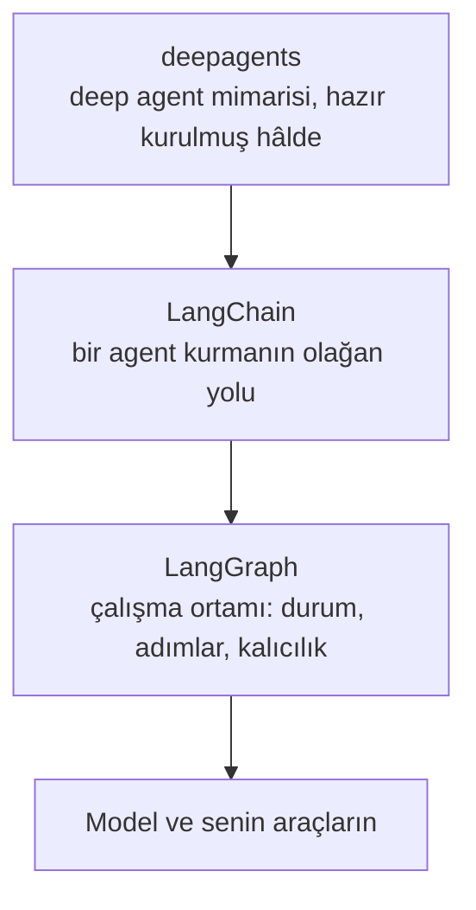

# Agent Framework'leri

Buraya kadar her şey agent'ların nasıl çalıştığıyla ilgiliydi. Bu modül, insanların bir agent kurarken gerçekte ne kullandığının haritası. Bu isimleri toplantılarda ve satıcılardan duyacaksın.

## Bu Senin İçin Neden Önemli

Bir ekip ya da bir satıcı bir yapay zekâ projesi önerdiğinde bir framework'ün ya da bir platformun adını sayacak. Bunların hiçbirini kurman gerekmiyor. Ama her birinin ne işe yaradığını bilmek, tartışmayı takip etmene ve doğru soruyu sormana yardım ediyor. Bu soru çoğu zaman şu: "Bu iş için bir agent gerçekten gerekli mi, yoksa sabit adımlı bir workflow yeter mi?"

## Bir Framework Sana Ne Verir

Bir framework'e kesin olarak ihtiyacın yok. [AI Agent'lar](../1_fundamentals/agents_tr.md) modülü, agent döngüsünün basit olduğunu göstermişti. Framework, bu döngünün etrafındaki hazır gelen altyapı:

- bir yapay zekâ servisi kısa süreliğine hata verdiğinde yeniden denemek
- cevabı yazıldıkça kelime kelime göstermek
- araçları standart bir şekilde tanımlamak
- yeniden başlatmadan sonra bir şeyleri hatırlamak
- [Observability](../1_fundamentals/observability_tr.md) modülündeki izleri tutmak

Her dolabı kendin yapmak yerine hazır bir mutfak satın almaya benziyor. Çoğu ekibin ikinci projesinden sonra kendi döngüsünü yazmayı bırakmasının sebebi bu.

## LangChain Ailesi

En sık duyacağın isim bu. En eksiksiz ve en çok kullanılan. "LangChain" aslında üç katman:

- **LangGraph** en alt katman; her adım üzerinde tam kontrol isteyen ekipler için.
- **LangChain** ana katman ve çoğu ekibin başladığı yer.
- **deepagents** en üst katman: [Context Engineering](../2_intermediate/context_engineering_tr.md) modülündeki deep agent; planlama, yardımcılar, notlar ve özetleme zaten içinde hazır.

## Duyacağın Diğer İsimler

Aynı işi farklı artı ve eksilerle yapıyorlar:

- **CrewAI**, agent'ları rollerden oluşan bir ekip olarak düzenliyor; [Multi-Agent Systems](../1_fundamentals/multi_agent_tr.md) modülündeki ekip fikri.
- Hugging Face'in **smolagents**'ı bilerek küçük tutulmuş ve okuması kolay.
- **Agno**, birçok agent'ı tek bir sistem olarak çalıştırmaya ve yönetmeye odaklanıyor.
- **Pydantic AI**, sıkı kontrole odaklanıyor; böylece hatalar net birer hata olarak ortaya çıkıyor.
- **Mastra** ve **VoltAgent**, ürünü Python yerine TypeScript ile yazılmış şirketler için.

## Workflow'lar: Sabit Adımlar

Bu modülün en işe yarar ayrımı bu ve yanlış seçmek aylara mal olabilir.

Bir **AI workflow**, birinin yazdığı adımları izler; bir şirket prosedürü gibi. Adımlar sabittir. Yapay zekâ, bazı adımların içinde, her seferinde tek bir iş için kullanılır. Bir **AI agent** ise adımlara kendisi karar verir.

Hata, agent'ı daha iyi, daha olgun sürüm sanmak. Öyle değil. Adımları bildiğinde ve nadiren değiştiklerinde, bir workflow daha öngörülebilir, daha ucuz ve bir şey bozulduğunda düzeltmesi daha kolaydır.

**n8n**, çoğu ekibin workflow için seçtiği araç. Görsel bir tuval üzerinde kutuları birbirine bağlayarak kuruyorsun, 400'den fazla servise bağlanıyor ve şirketin kendi bilgisayarlarında çalışabiliyor. Şöyle bir işi düşün: "bir form gönderildiğinde onu ayır, bir şey ara, veritabanına kaydet ve bir mesaj gönder." Bu iş için bir workflow, bir agent'tan rahatça daha iyi.

Ve ikisi artık birlikte çalışıyor. n8n, MCP ile ([Code Agent'lar](../2_intermediate/coding_agents_tr.md) modülünden) bir code agent'a bağlanabiliyor. Workflow'u sade kelimelerle anlatıyorsun, agent onu n8n'de kuruyor, test ediyor ve bozulan yeri düzeltiyor. Agent, workflow'u yazan şey oluyor.

## No-code Platformlar

Birçok iş için doğru cevap bir no-code platform. **[Lovable](https://lovable.dev/)**, **[Bolt](https://bolt.new/)** ve **[Replit](https://replit.com/)**, bir açıklamayı çalışan bir uygulamaya çeviriyor, internette yayına alıyor ve daha fazla istekle onu değiştirmeye devam etmene izin veriyor. Bir prototip, bir iç araç ya da formu olan basit bir sayfa için bu, haftalar yerine saatler alıyor.

Bedeli şu: şimdi hız kazanıyorsun, sonra daha az kontrol. Platformdan hiç ayrılırsan uygulamayı yeniden yaparsın. Bu ikisinden hangisini satın aldığını bil.

## Artık Bildiğin Terimler

- **Framework**: agent döngüsünün etrafındaki hazır yazılım.
- **LangChain / LangGraph / deepagents**: en yaygın framework ailesinin üç katmanı.
- **AI workflow**: birinin yazdığı sabit adımlar; bazılarının içinde yapay zekâ var.
- **n8n**: görsel olarak kurulan, en yaygın workflow aracı.
- **No-code platform**: bir açıklamayı çalışan bir uygulamaya çeviren servis.

## Özet

Framework, agent döngüsünün etrafındaki tesisat ve en çok duyacağın isim LangChain. Ama en önemli soru çoğu zaman hangi framework olduğu değil: bir agent'a hiç ihtiyacın olup olmadığı. Adımlar bilindiğinde bir workflow (çoğu zaman n8n'de) daha ucuz ve daha öngörülebilir ve bir agent artık o workflow'u senin için kurabiliyor. Basit uygulamalar için bir no-code platform yeterli olabilir.

**Hızlı Kontrol**: Bir workflow ne zaman bir agent'tan daha iyi bir seçimdir? Bir no-code platformda neyi gözden çıkarıyorsun?

## Kaynaklar

### 📄 Makaleler

- [AI Workflows vs AI Agents](https://www.promptingguide.ai/agents/ai-workflows-vs-ai-agents): ayrım ve hangisinin ne zaman doğru olduğu

### 🛠️ Araçlar

- [Lovable](https://lovable.dev/), [Bolt](https://bolt.new/) ve [Replit](https://replit.com/): bir uygulamayı sade dille anlat ve çalışan birini al

### 🗃️ Repolar

- [LangChain](https://github.com/langchain-ai/langchain): ana framework ve çoğu ekibin başladığı yer
- [CrewAI](https://github.com/crewAIInc/crewAI): bir ekipteki roller olarak düzenlenmiş agent'lar
- [n8n](https://github.com/n8n-io/n8n): görsel workflow platformu
