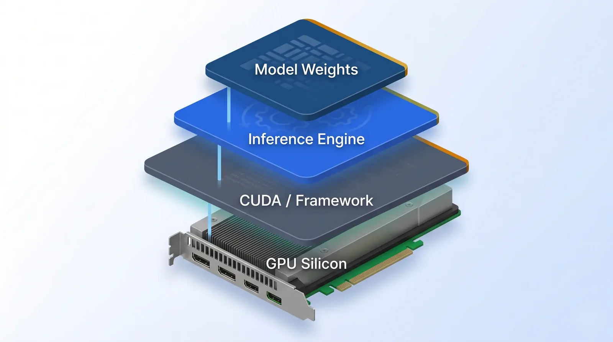
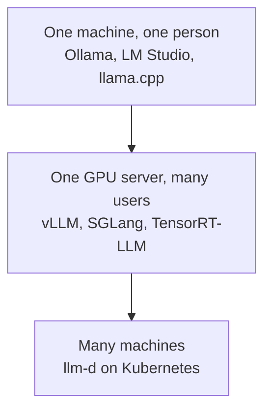
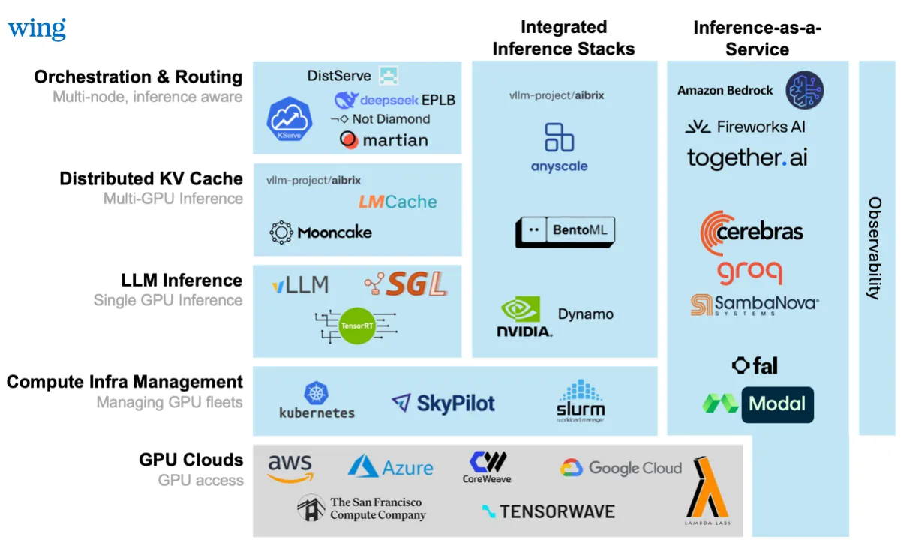
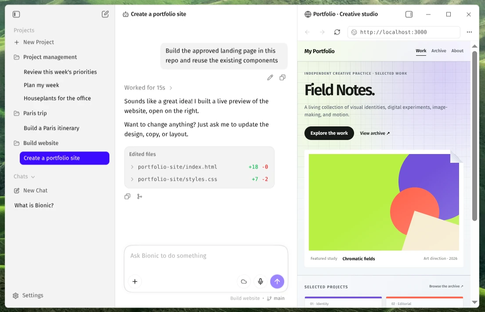
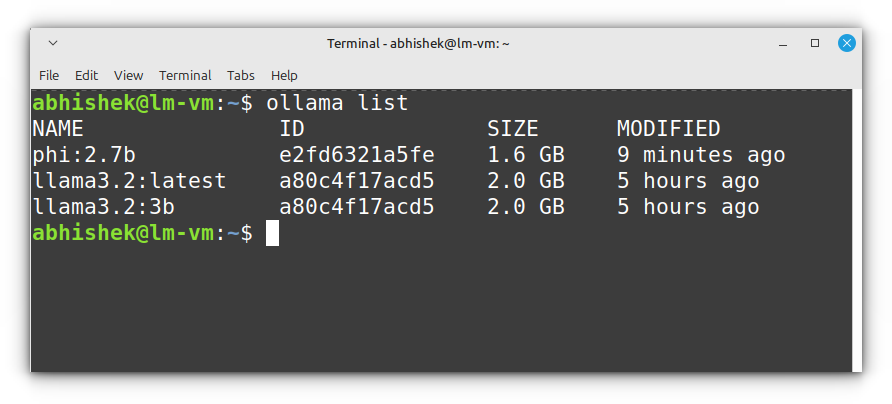
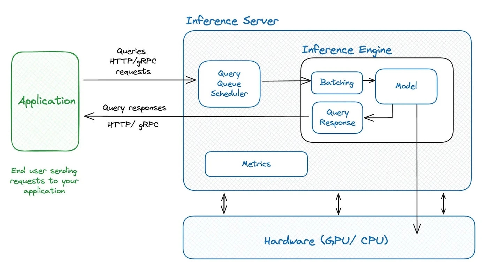

# Inference Engines

[Inference Providers](inference_providers.md) was about renting a model from a company. This module
is about the software those companies run, and about when your own company might run it instead.

An **inference engine** is the program that actually runs a model on a computer: it loads the model
and turns your text into the answer. An inference provider is a company that runs one of these
engines for you and charges per token.

  
*The engine is the middle layer: above it sits the model itself (its weights), below it the software layer and the chip that do the arithmetic. A provider runs all of this for you.*

## Why This Matters to You

Sooner or later someone in your company will ask: "should we run the AI ourselves, on our own
servers?" This module gives you the three good reasons, and the main reason not to.

## Why You Would Run it Yourself

There are three reasons, and only these three are worth the trouble.

**1. The data must not leave the company.** Health records, legal documents, and anything under a
rule that says the text must stay inside. This is the most common reason by far.

**2. The volume makes it cheaper.** Paying per token is a very good deal at first. But at very large
volume, renting your own machines and running the model yourself becomes cheaper.

**3. You need something no provider offers**, such as your own fine-tuned model from
[Training LLMs](../1_fundamentals/training.md), a model nobody hosts, or full control over exactly
which version runs, so an update never surprises you.

If none of these is true, use a provider. Running models yourself is a real, ongoing job for a team,
and in the first month you mostly learn what you forgot to budget for.

## The Engines, by the Size of the Problem



- **On one computer**, use the simple apps from [LLM Fundamentals](../1_fundamentals/llms.md):
  LM Studio or Ollama.
- **On a company server with many users**, a proper serving engine: **vLLM** is the usual
  default. SGLang and NVIDIA's TensorRT-LLM are other names you will hear.
- **Across many machines**, a system such as **llm-d** coordinates them.

The map below shows where all of these sit, and where providers sit next to them.

  
*Wing's map of the systems that serve AI models, read from the bottom: rented chips, the tools that manage them, the engines, then ways to share work between many machines. The inference-as-a-service column on the right is the provider route: those companies run the whole stack for you.*

## Run a Model on Your Laptop

You can run an AI model on your own computer. The easiest way is **[LM Studio](https://lmstudio.ai/)**. It is a desktop app, and you install it like any other program. You download models inside it and chat with them in its own window. Its newer, separate app, LM Studio Bionic, is built for an AI agent that does tasks for you, and the picture below shows it.

  
*A normal app window: your projects on the left, the chat in the middle, and a preview of the result on the right. There is no terminal.*

If you are comfortable with a terminal, **[Ollama](https://ollama.com/)** does the same job with typed commands. You install it from the [Ollama download page](https://ollama.com/download). These commands download a model, list your models, chat with one, and stop it. It is fine not to follow them: LM Studio gives you the same result without any commands.

```bash
ollama pull llama3.2:3b   # download the model to your disk
ollama list               # show the models you have downloaded
ollama run llama3.2:3b    # chat with the model; it pulls the model first if needed
ollama ps                 # show the models that are loaded in memory
ollama stop llama3.2:3b   # unload the model from memory
```

  
*Every model you download is a file on your computer, and this list shows how big each one is. A bigger file usually needs a more powerful computer.*

Do not mix up the names. Open WebUI, described at the end of this module, is a web page for chatting. It does not run a model itself: it connects to Ollama or to a similar program that does. A version of it is packaged together with Ollama, but Ollama still does the running. LM Studio is different, because the program that runs the model and the chat screen are in one app.

## The One Idea That Explains the Numbers

A computer that answers one request at a time is mostly waiting. So engines serve many requests
together, which is called **batching**. Think of a bus instead of a taxi for each person: the trip
costs about the same, but it carries many more people.

  
*Requests arrive from an app and wait in a queue (the bus stop). The batching step fills the bus, and the model answers everyone together. The engine is only the inner box; the server around it manages the waiting line and keeps count of how things are going.*

The best engines do not even wait for the bus to fill: new requests join as soon as older ones
finish, so the computer is never idle. This is one reason big providers can sell tokens cheaply:
they fill every trip.

## Something to Put in Front of it

An engine gives programs a way to talk to it, but nothing for a person to look at. **Open WebUI** is
the chat screen companies often put in front of their own model, so employees get something that
looks and works like ChatGPT, running on the company's own computers.

## Words You Now Know

- **Inference engine**: the program that actually runs a model.
- **Self-hosting**: running a model on your company's own computers.
- **vLLM**: the usual engine for a company server.
- **Batching**: serving many requests together, like a bus instead of taxis.
- **Open WebUI**: a ChatGPT-like screen for a company's own model.
- **LM Studio**: a desktop app that runs a model on your own computer and has the chat window inside it.
- **Ollama**: a tool you use from a terminal to download and run models on your own computer.

## Summary

An inference engine runs the model; a provider is a company running one for you. Run it yourself
only for one of three reasons: the data must stay inside, the volume is very large, or you need
something no provider offers. Otherwise, rent. Batching is one reason large providers are cheap. You can also run a small model on your own computer, and LM Studio is the easiest way.

**Quick check**: What is the most common reason a company runs a model itself? And why does batching
make each token cheaper?

## References

### 🛠️ Tools

- [Ollama](https://ollama.com/) and [LM Studio](https://lmstudio.ai/): the simple apps for running a model on one computer

### 🗃️ Repositories

- [Open WebUI](https://github.com/open-webui/open-webui): a chat screen to put in front of a company's own model
- [llm-d](https://github.com/llm-d/llm-d): serving across many machines
