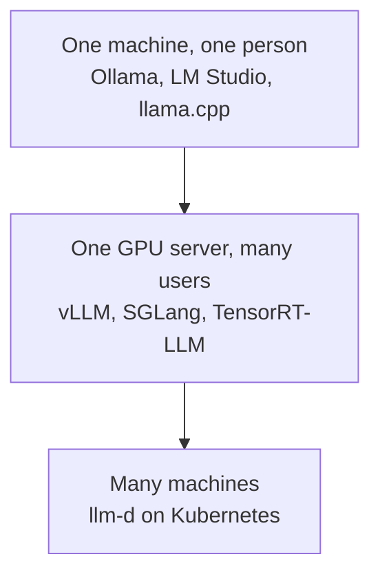

# Inference Engines

[Inference Providers](inference_providers.md) was about renting a model from a company. This module
is about the software those companies run, and about when your own company might run it instead.

An **inference engine** is the program that actually runs a model on a computer: it loads the model
and turns your text into the answer. An inference provider is a company that runs one of these
engines for you and charges per token.

## Why This Matters to You

Sooner or later someone in your company will ask: "should we run the AI ourselves, on our own
servers?" This module gives you the three good reasons, and the main reason not to.

## Why Run it Yourself

There are three reasons, and only these three are worth the trouble.

**1. The data must not leave the company.** Health records, legal documents, and anything under a
rule that says the text must stay inside. This is the most common reason by far.

**2. The volume makes it cheaper.** Paying per token is a very good deal at first. But at very large
volume, renting your own machines and running the model yourself becomes cheaper.

**3. You need something no provider offers**, such as your own fine-tuned model from
[Training LLMs](../1_fundamentals/training.md), a model nobody hosts, or full control over exactly
which version runs, so an update never surprises you.

If none of these is true, use a provider. Running models yourself is a real, ongoing job for a team,
and in the first month you mostly learn what you forgot to budget for.

## The Engines, by the Size of the Job

- **On one computer**, use the simple apps from [LLM Fundamentals](../1_fundamentals/llms.md):
  LM Studio or Ollama.
- **On a company server with many users**, a proper serving engine: **vLLM** is the usual
  default. SGLang and NVIDIA's TensorRT-LLM are other names you will hear.
- **Across many machines**, a system such as **llm-d** coordinates them.

## The One Idea Behind the Numbers: Batching

A computer that answers one request at a time is mostly waiting. So engines serve many requests
together, which is called **batching**. Think of a bus instead of a taxi for each person: the trip
costs about the same, but it carries many more people.

The best engines do not even wait for the bus to fill: new requests join as soon as older ones
finish, so the computer is never idle. This is why big providers can sell tokens so cheaply: they
fill every trip.

## A Screen in Front of It

An engine gives programs a way to talk to it, but nothing for a person to look at. **Open WebUI** is
the chat screen companies often put in front of their own model, so employees get something that
looks and works like ChatGPT, running on the company's own computers.

## Words You Now Know

- **Inference engine**: the program that actually runs a model.
- **Self-hosting**: running a model on your company's own computers.
- **vLLM**: the usual engine for a company server.
- **Batching**: serving many requests together, like a bus instead of taxis.
- **Open WebUI**: a ChatGPT-like screen for a company's own model.

## Summary

An inference engine runs the model; a provider is a company running one for you. Run it yourself
only for one of three reasons: the data must stay inside, the volume is very large, or you need
something no provider offers. Otherwise, rent. Batching is why large providers are cheap.

**Quick check**: What is the most common reason a company runs a model itself? And why does batching
make each token cheaper?

## References

### 🛠️ Tools

- [Ollama](https://ollama.com/) and [LM Studio](https://lmstudio.ai/): the simple apps for running a model on one computer

### 🗃️ Repositories

- [Open WebUI](https://github.com/open-webui/open-webui): a chat screen to put in front of a company's own model
- [llm-d](https://github.com/llm-d/llm-d): serving across many machines
