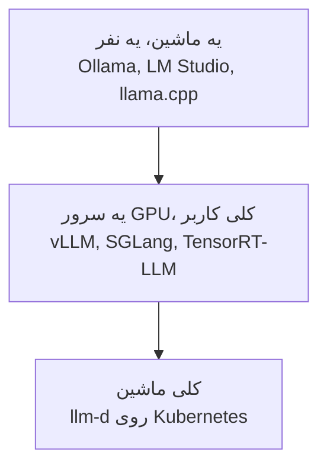

# Inference Engine‌ها

[Inference Provider‌ها](inference_providers_fa.md) درباره‌ی اجاره کردن یه مدل از یه شرکت بود. این درس درباره‌ی نرم‌افزاریه که اون شرکت‌ها اجرا می‌کنن، و این‌که شرکت خودت کِی ممکنه به جاش خودش اجراش کنه.

یه **inference engine** برنامه‌ایه که واقعاً یه مدل رو روی یه کامپیوتر اجرا می‌کنه: مدل رو لود می‌کنه و متن تو رو به جواب تبدیل می‌کنه. یه inference provider شرکتیه که یکی از این engine‌ها رو برات اجرا می‌کنه و به ازای هر token پول می‌گیره.

## چرا این برای تو مهمه

دیر یا زود یکی توی شرکتت می‌پرسه: «نباید AI رو خودمون، روی سرورهای خودمون اجرا کنیم؟» این درس سه تا دلیل خوب برای این کار رو بهت می‌ده، و دلیل اصلی برای نکردنش رو.

## چرا خودت اجراش کنی

سه تا دلیل هست، و فقط همین سه تا ارزش دردسرش رو دارن.

**1. داده نباید از شرکت بیرون بره.** پرونده‌های پزشکی، سندهای حقوقی، و هر چیزی که یه قانون می‌گه متنش باید داخل بمونه. این با اختلاف رایج‌ترین دلیله.

**2. حجم کار باعث می‌شه ارزون‌تر دربیاد.** پول دادن به ازای هر token اول کار معامله‌ی خیلی خوبیه. ولی توی حجم خیلی بزرگ، اجاره کردن ماشین‌های خودت و اجرای مدل به دست خودت ارزون‌تر می‌شه.

**3. چیزی می‌خوای که هیچ provider‌ای نداره**، مثل مدل fine-tune‌شده‌ی خودت از [Training LLMs](../1_fundamentals/training_fa.md)، مدلی که هیچ‌کس میزبانی‌ش نمی‌کنه، یا کنترل کامل روی این‌که دقیقاً کدوم نسخه اجرا بشه، که یه به‌روزرسانی هیچ‌وقت غافلگیرت نکنه.

اگه هیچ‌کدوم از این‌ها درست نیست، از یه provider استفاده کن. خودت مدل اجرا کردن یه کار واقعی و مداوم برای یه تیمه، و ماه اول بیشتر چیزی که یاد می‌گیری اینه که چی رو یادت رفته بود بودجه‌ش رو بذاری.

## Engine‌ها، بر اساس اندازه‌ی کار

- **روی یه کامپیوتر**، از اپ‌های ساده‌ی [مبانی LLM](../1_fundamentals/llms_fa.md) استفاده کن: LM Studio یا Ollama.
- **روی یه سرور شرکت با کلی کاربر**، یه engine سرویس‌دهی درست‌وحسابی: **vLLM** انتخاب معمولیه. SGLang و TensorRT-LLM از NVIDIA اسم‌های دیگه‌ای‌ان که می‌شنوی.
- **روی کلی ماشین**، یه سیستم مثل **llm-d** هماهنگشون می‌کنه.

## یه ایده‌ی پشت عددها: Batching

کامپیوتری که یه درخواست رو هر بار جواب می‌ده، بیشتر وقتش رو منتظره. برای همین engine‌ها کلی درخواست رو با هم جواب می‌دن، که بهش می‌گن **batching**. یه اتوبوس رو تصور کن به جای یه تاکسی برای هر نفر: سفر تقریباً همون‌قدر خرج داره، ولی خیلی آدم بیشتری رو می‌بره.

بهترین engine‌ها حتی صبر نمی‌کنن اتوبوس پر بشه: درخواست‌های تازه به محض تموم شدن قدیمی‌ها سوار می‌شن، پس کامپیوتر هیچ‌وقت بیکار نمی‌مونه. یکی از دلیل‌هایی که provider‌های بزرگ می‌تونن token رو ارزون بفروشن همینه: هر سفر رو پر می‌کنن.

## یه صفحه جلوش

یه engine به برنامه‌ها راهی می‌ده که باهاش حرف بزنن، ولی چیزی نداره که یه آدم بهش نگاه کنه. **Open WebUI** صفحه‌ی چتیه که شرکت‌ها اغلب جلوی مدل خودشون می‌ذارن، که کارمندها چیزی بگیرن که شبیه ChatGPT به نظر میاد و همون‌طور کار می‌کنه، ولی روی کامپیوترهای خود شرکت اجرا می‌شه.

## کلمه‌هایی که الان بلدی

- **Inference engine**: برنامه‌ای که واقعاً یه مدل رو اجرا می‌کنه.
- **Self-hosting**: اجرای یه مدل روی کامپیوترهای خود شرکتت.
- **vLLM**: engine معمول برای یه سرور شرکت.
- **Batching**: جواب دادن کلی درخواست با هم، مثل اتوبوس به جای تاکسی.
- **Open WebUI**: یه صفحه شبیه ChatGPT برای مدل خود شرکت.

## خلاصه

یه inference engine مدل رو اجرا می‌کنه؛ provider شرکتیه که یکی رو برات اجرا می‌کنه. خودت فقط به یکی از سه دلیل اجراش کن: داده باید داخل بمونه، حجم خیلی بزرگه، یا چیزی می‌خوای که هیچ provider‌ای نداره. وگرنه اجاره کن. batching یکی از دلیل‌های ارزونی provider‌های بزرگه.

**بررسی سریع**: رایج‌ترین دلیل برای این‌که یه شرکت خودش مدل اجرا کنه چیه؟ و چرا batching هر token رو ارزون‌تر می‌کنه؟

## منابع

### 🛠️ ابزارها

- [Ollama](https://ollama.com/) و [LM Studio](https://lmstudio.ai/): اپ‌های ساده برای اجرای یه مدل روی یه کامپیوتر

### 🗃️ Repository‌ها

- [Open WebUI](https://github.com/open-webui/open-webui): یه صفحه‌ی چت که جلوی مدل خود شرکت بذاری
- [llm-d](https://github.com/llm-d/llm-d): سرویس‌دهی روی کلی ماشین
