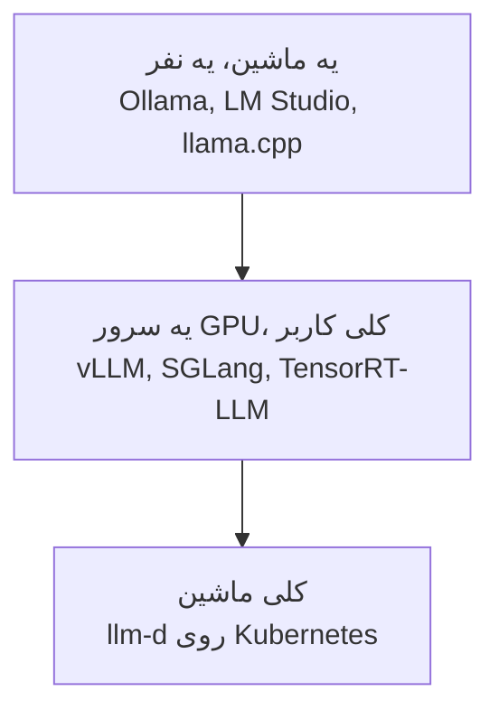

---
objectives:
  - "بگو inference engine چیه و با provider چه ربطی داره"
  - "سه تا دلیل رو بگو که چرا خودت مدل رو اجرا کنی، و این‌که کی نباید اجراش کنی"
  - "batching رو با مثال اتوبوس توضیح بده و بگو چرا provider‌های بزرگ می‌تونن token رو ارزون بفروشن"
  - "بدون که می‌تونی یه مدل رو روی کامپیوتر خودت اجرا کنی، و آسون‌ترین اپ کدومه"
---

# Inference Engine‌ها

[Inference Provider‌ها](inference_providers_fa.md) درباره‌ی اجاره کردن یه مدل از یه شرکت بود. این درس درباره‌ی نرم‌افزاریه که اون شرکت‌ها اجرا می‌کنن، و این‌که شرکت خودت کِی ممکنه به جاش خودش اجراش کنه.

یه **inference engine** برنامه‌ایه که واقعاً یه مدل رو روی یه کامپیوتر اجرا می‌کنه: مدل رو لود می‌کنه و متن تو رو به جواب تبدیل می‌کنه. یه inference provider شرکتیه که یکی از این engine‌ها رو برات اجرا می‌کنه و به ازای هر token پول می‌گیره.

  
*engine لایه‌ی وسطه: بالاش خود مدل (weight‌هاش) هست، و زیرش لایه‌ی نرم‌افزاری و چیپی که حساب‌وکتاب رو انجام می‌دن. provider همه‌ی این‌ها رو برات اجرا می‌کنه.*

## چرا این برای تو مهمه

دیر یا زود یکی توی شرکتت می‌پرسه: «نباید AI رو خودمون، روی سرورهای خودمون اجرا کنیم؟» این درس سه تا دلیل خوب برای این کار رو بهت می‌ده، و دلیل اصلی برای نکردنش رو.

## چرا خودت اجراش کنی؟

سه تا دلیل هست، و فقط همین سه تا ارزش دردسرش رو دارن.

**1. داده نباید از شرکت بیرون بره.** پرونده‌های پزشکی، سندهای حقوقی، و هر چیزی که یه قانون می‌گه متنش باید داخل بمونه. این با اختلاف رایج‌ترین دلیله.

**2. حجم کار باعث می‌شه ارزون‌تر دربیاد.** پول دادن به ازای هر token اول کار معامله‌ی خیلی خوبیه. ولی توی حجم خیلی بزرگ، اجاره کردن ماشین‌های خودت و اجرای مدل به دست خودت ارزون‌تر می‌شه.

**3. چیزی می‌خوای که هیچ provider‌ای نداره**، مثل مدل fine-tune‌شده‌ی خودت از [Training LLMs](../1_fundamentals/training_fa.md)، مدلی که هیچ‌کس میزبانی‌ش نمی‌کنه، یا کنترل کامل روی این‌که دقیقاً کدوم نسخه اجرا بشه، که یه به‌روزرسانی هیچ‌وقت غافلگیرت نکنه.

اگه هیچ‌کدوم از این‌ها درست نیست، از یه provider استفاده کن. خودت مدل اجرا کردن یه کار واقعی و مداوم برای یه تیمه، و ماه اول بیشتر چیزی که یاد می‌گیری اینه که چی رو یادت رفته بود بودجه‌ش رو بذاری.

## Engine مناسب، بسته به بزرگی کار



- **روی یه کامپیوتر**، از اپ‌های ساده‌ی [مبانی LLM](../1_fundamentals/llms_fa.md) استفاده کن: LM Studio یا Ollama.
- **روی یه سرور شرکت با کلی کاربر**، یه engine سرویس‌دهی درست‌وحسابی: **vLLM** انتخاب معمولیه. SGLang و TensorRT-LLM از NVIDIA اسم‌های دیگه‌ای‌ان که می‌شنوی.
- **روی کلی ماشین**، یه سیستم مثل **llm-d** هماهنگشون می‌کنه.

یه نقشه‌ی پایین نشون می‌ده همه‌ی این‌ها کجا می‌شینن، و provider‌ها کنارشون کجان.

  
*نقشه‌ی Wing از سیستم‌هایی که مدل‌های AI رو سرو می‌کنن، از پایین به بالا: چیپ‌های اجاره‌ای، ابزارهایی که مدیریتشون می‌کنن، engine‌ها، و بعد روش‌هایی که کار رو بین کلی ماشین پخش می‌کنن. ستون inference-as-a-service سمت راست، راه provider‌هاست: اون شرکت‌ها کل این مجموعه رو برات اجرا می‌کنن.*

## یه مدل رو روی لپ‌تاپت اجرا کن

می‌تونی یه مدل AI رو روی کامپیوتر خودت اجرا کنی. راحت‌ترین راه، **[LM Studio](https://lmstudio.ai/)** هست. یه اپ دسکتاپه و مثل هر برنامه‌ی دیگه‌ای نصب می‌شه. مدل‌ها رو از داخل خود اپ دانلود می‌کنی و توی پنجره‌ی خودش باهاشون چت می‌کنی. اپ جدیدتر و جداش، LM Studio Bionic، برای یه AI agent ساخته شده که کارها رو به جات انجام می‌ده، و تصویر پایین همون رو نشون می‌ده.

  
*یه پنجره‌ی اپ معمولی: پروژه‌هات سمت چپ، چت وسط، و پیش‌نمایش نتیجه سمت راست. terminal‌ای در کار نیست.*

اگه با terminal راحتی، **[Ollama](https://ollama.com/)** همین کار رو با دستورهایی که تایپ می‌کنی انجام می‌ده. نصبش رو از [صفحه‌ی دانلود Ollama](https://ollama.com/download) انجام بده. این دستورها یه مدل رو دانلود می‌کنن، مدل‌هات رو لیست می‌کنن، باهاش چت می‌کنن و متوقفش می‌کنن. لازم نیست دنبالشون کنی: LM Studio همین نتیجه رو بدون هیچ دستوری بهت می‌ده.

```bash
ollama pull llama3.2:3b   # download the model to your disk
ollama list               # show the models you have downloaded
ollama run llama3.2:3b    # chat with the model; it pulls the model first if needed
ollama ps                 # show the models that are loaded in memory
ollama stop llama3.2:3b   # unload the model from memory
```

  
*هر مدلی که دانلود می‌کنی یه فایل روی کامپیوتره، و این لیست نشون می‌ده هر کدوم چقدر بزرگه. فایل بزرگ‌تر معمولاً کامپیوتر قوی‌تری می‌خواد.*

اسم‌ها رو با هم قاطی نکن. Open WebUI رو آخر همین درس توضیح می‌دیم، و اون یه صفحه‌ی وب برای چت کردنه: خودش مدل اجرا نمی‌کنه و به Ollama یا یه برنامه‌ی مشابه که مدل رو اجرا می‌کنه وصل می‌شه. یه نسخه‌ش هم هست که با Ollama بسته‌بندی شده، ولی اجرای مدل باز هم کار خود Ollama هست. LM Studio فرق داره، چون برنامه‌ای که مدل رو اجرا می‌کنه و صفحه‌ی چت توی یه اپ هستن.

## ایده‌ای که همه‌ی عددها رو توضیح می‌ده

کامپیوتری که یه درخواست رو هر بار جواب می‌ده، بیشتر وقتش رو منتظره. برای همین engine‌ها کلی درخواست رو با هم جواب می‌دن، که بهش می‌گن **batching**. یه اتوبوس رو تصور کن به جای یه تاکسی برای هر نفر: سفر تقریباً همون‌قدر خرج داره، ولی خیلی آدم بیشتری رو می‌بره.

  
*درخواست‌ها از یه اپ میان و توی یه صف منتظر می‌مونن (ایستگاه اتوبوس). مرحله‌ی batching اتوبوس رو پر می‌کنه و مدل همه رو با هم جواب می‌ده. engine فقط جعبه‌ی داخلیه؛ server دورش صف انتظار رو مدیریت می‌کنه و حساب نگه می‌داره که کارها چطور پیش می‌رن.*

بهترین engine‌ها حتی صبر نمی‌کنن اتوبوس پر بشه: درخواست‌های تازه به محض تموم شدن قدیمی‌ها سوار می‌شن، پس کامپیوتر هیچ‌وقت بیکار نمی‌مونه. یکی از دلیل‌هایی که provider‌های بزرگ می‌تونن token رو ارزون بفروشن همینه: هر سفر رو پر می‌کنن.

## یه رابط جلوی Engine

یه engine به برنامه‌ها راهی می‌ده که باهاش حرف بزنن، ولی چیزی نداره که یه آدم بهش نگاه کنه. **Open WebUI** صفحه‌ی چتیه که شرکت‌ها اغلب جلوی مدل خودشون می‌ذارن، که کارمندها چیزی بگیرن که شبیه ChatGPT به نظر میاد و همون‌طور کار می‌کنه، ولی روی کامپیوترهای خود شرکت اجرا می‌شه.

## کلمه‌هایی که الان بلدی

- **Inference engine**: برنامه‌ای که واقعاً یه مدل رو اجرا می‌کنه.
- **Self-hosting**: اجرای یه مدل روی کامپیوترهای خود شرکتت.
- **vLLM**: engine معمول برای یه سرور شرکت.
- **Batching**: جواب دادن کلی درخواست با هم، مثل اتوبوس به جای تاکسی.
- **Open WebUI**: یه صفحه شبیه ChatGPT برای مدل خود شرکت.
- **LM Studio**: یه اپ دسکتاپ که مدل رو روی کامپیوتر خودت اجرا می‌کنه و پنجره‌ی چت هم توشه.
- **Ollama**: ابزاری که از terminal استفاده‌ش می‌کنی تا مدل‌ها رو روی کامپیوتر خودت دانلود و اجرا کنی.

## خلاصه

یه inference engine مدل رو اجرا می‌کنه؛ provider شرکتیه که یکی رو برات اجرا می‌کنه. خودت فقط به یکی از سه دلیل اجراش کن: داده باید داخل بمونه، حجم خیلی بزرگه، یا چیزی می‌خوای که هیچ provider‌ای نداره. وگرنه اجاره کن. batching یکی از دلیل‌های ارزونی provider‌های بزرگه. یه مدل کوچیک رو هم می‌تونی روی کامپیوتر خودت اجرا کنی، و LM Studio راحت‌ترین راهشه.

**بررسی سریع**: رایج‌ترین دلیل برای این‌که یه شرکت خودش مدل اجرا کنه چیه؟ و چرا batching هر token رو ارزون‌تر می‌کنه؟

## منابع

### 🛠️ ابزارها

- [Ollama](https://ollama.com/) و [LM Studio](https://lmstudio.ai/): اپ‌های ساده برای اجرای یه مدل روی یه کامپیوتر

### 🗃️ Repository‌ها

- [Open WebUI](https://github.com/open-webui/open-webui): یه صفحه‌ی چت که جلوی مدل خود شرکت بذاری
- [llm-d](https://github.com/llm-d/llm-d): سرویس‌دهی روی کلی ماشین
